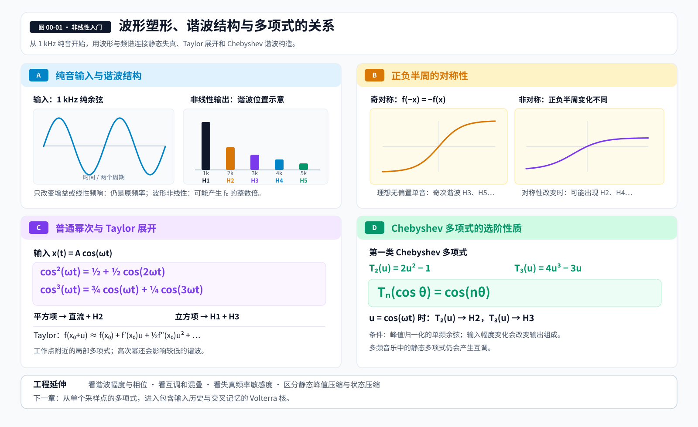
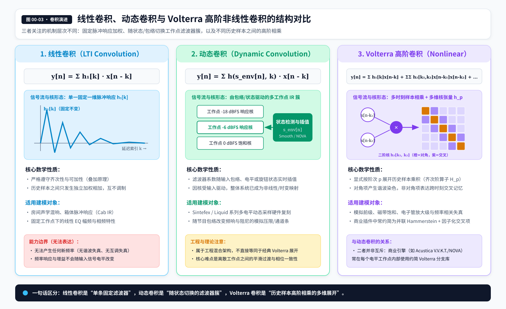
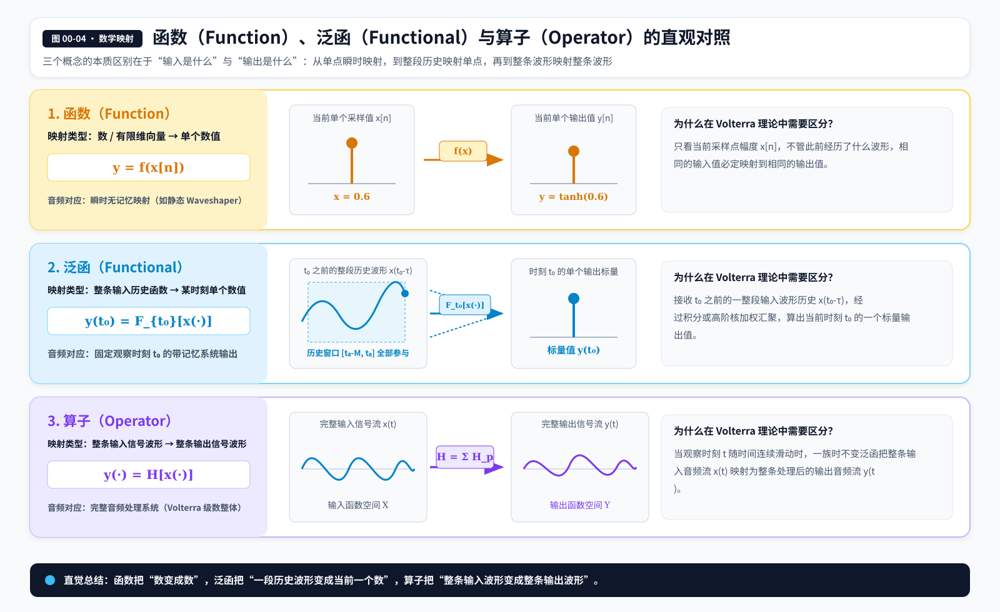

# 00 前置概念与术语约定

[在线阅读本章（完整合订版）](https://excillex-marisa.github.io/volterra-wiki/#chapter-00)

> **版本：v33 · 2026-11-27 · 从声音直觉到数学理解**
> **所属系列：Volterra Wiki**
> **阅读定位：在学习 Volterra 级数之前，建立音频非线性系统建模所需的直觉、基本语言和判断边界。**
> **配图说明：** 本章 5 张 SVG 教学图；分章使用相对路径，合订版使用 GitHub Raw 图像链接。
> **阅读方式：先理解现象，再认识概念，最后接触用于表达现象的数学形式。本章不要求读者预先掌握泛函分析、张量分解或系统辨识算法。**

本系列研究非线性音频系统的数字建模与系统辨识。我们以一台假想的模拟前级贯穿全书：先听见频响、饱和与动态变化，再用数学描述输入和输出，随后研究 Volterra、神经网络、状态模型与物理建模。

首次阅读沿 0.1—0.7 的声音与数学主线展开；0.8 是全书符号速查，遇到陌生记法时再查阅。0.9 将这些直觉收束到 Volterra。正文中的数字均为教学构造，除非另有测量来源。

## 0.1 从声音到输入—输出系统

一台模拟前级可能让声音变厚、让瞬态变柔和，或使频响随驱动电平改变。即使没有电路图，也可以通过输入已知的声音、记录输出，建立一种能够预测设备响应的数学规则。电路和物理建模则进一步研究这些规律如何产生；两种方法可以互相补充。

在数学里，我们通常用 $`x`$ 表示输入，用 $`y`$ 表示输出。连续时间的模拟信号写作 $`x(t)`$ 和 $`y(t)`$；经过采样，变成数字音频以后，则写作 $`x[n]`$ 和 $`y[n]`$。这里的 $`t`$ 是以秒为单位的连续时间，$`n`$ 是一个整数，表示“第几个采样点”。方括号 $`[n]`$ 标明了离散时间索引，提醒我们：现在讨论的是离散时间信号。

例如在 $`48\,\mathrm{kHz}`$ 采样率下，系统每秒处理 $`48\,000`$ 个采样点。$`x[n-1]`$ 表示输入的前一个采样点，$`x[n-48]`$ 表示约 $`1\,\mathrm{ms}`$ 以前的输入。此后遇到 $`x[n-k]`$ 时，可以把它读成“距离现在 $`k`$ 个采样点以前的输入”，以此建立对时间延迟的直观认识。

索引 n 只是编号，本身无量纲；乘以采样周期才得到时间。上标的帽子表示估计或预测，$`\hat y[n]`$ 是模型输出，$`y[n]`$ 是设备输出。

系统（System）是一套输入到输出的处理规则：

```math
y=\mathcal S[x].
```

这里先以单输入单输出（SISO）为例，立体声可以进一步加入声道间耦合。测量时应固定旋钮、采样率、增益、负载和初始化方式。数字归一化采样值不直接等于电路电压；量纲、参考值及无量纲化的约定见 0.8.16。

## 0.2 从听感认识线性与非线性

音频工程里经常将线性与非线性简单对应为“没有失真”和“有失真”。理想 EQ 会改变原有信号的频率成分和相位，因此存在通常所说的线性失真，但它仍然是一个线性系统。区分线性与非线性的严格依据，是**叠加原理（Superposition）**。

假设 $`x_1`$ 与 $`x_2`$ 是两段输入，$`a`$ 与 $`b`$ 是两个数。如果系统满足

```math
\mathcal{S}[a x_1+b x_2]=a\mathcal{S}[x_1]+b\mathcal{S}[x_2].
```

叠加原理包含可加性（输入先相加再处理，等于分别处理后相加）和齐次性（输入缩放时输出按相同比例缩放）。两条条件必须同时成立。

**非线性（Nonlinearity）** 的严格定义是叠加原理失效，其外延远大于听感上的“声音变脏”。硬削波、软饱和、压缩器的电平相关增益、随输入幅度变化的频率响应，都属于非线性现象。有些非线性效应只有在特定电平、频率组合或输入历史下才容易被观察出来。

**手算叠加原理。** 取输入 0.2、0.4，增益取 2，则 2×(0.2+0.4)=1.2，分开处理再相加也是 0.4+0.8=1.2。平方函数的两种运算分别得到 (0.2+0.4)²=0.36 与 0.2²+0.4²=0.20，差出的 0.16 来自交叉乘积 2×0.2×0.4。再检验缩放：输入 0.2 的平方为 0.04，输入加倍后平方为 0.16，原输出加倍仅为 0.08。这分别检验了可加性和齐次性；线性要求二者对所有允许输入与标量成立。

### 0.2.1 从纯音认识基波与谐波

有混音、母带经验的人，通常已经熟悉“更厚”“更破”“高频发毛”“模拟染色”等听感描述。但要研究设备为何产生这些变化，还需要了解声音的频率成分究竟发生了什么。先向待测前级输入 **1 kHz 的纯正弦波**。理想情况下，输入频谱只有 1 kHz 这一根谱线；固定增益和线性滤波可以改变它的幅度与相位，却不会自行生成其他频率。如果输出又出现 2 kHz、3 kHz、4 kHz，我们就需要检查设备的非线性响应及测量链路。

一根纯音的原始频率称为**基频（Fundamental Frequency）**，记作 $`f_0`$。频率为基频整数倍的成分称为**谐波（Harmonics）**。分析仪上的 H1 是基波，H2 是二次谐波，H3 是三次谐波；这里的数字是倍频序号。

| 名称 | 相对于基频的频率 | 1 kHz 输入时的频率 |
|---|---|---|
| H1，基波 | $`f_0`$ | 1 kHz |
| H2，二次谐波 | $`2f_0`$ | 2 kHz |
| H3，三次谐波 | $`3f_0`$ | 3 kHz |
| H4，四次谐波 | $`4f_0`$ | 4 kHz |
| H5，五次谐波 | $`5f_0`$ | 5 kHz |

H2、H4、H6 等属于**偶次谐波**，H3、H5、H7 等属于**奇次谐波**。所谓谐波结构，还需要观察各次谐波的幅度、相位、随输入电平及基频变化的规律。两台设备即使都产生 H2 和 H3，也可能有截然不同的声音行为。

### 0.2.2 波形变弯与奇偶对称性

正弦波形状规则，将它整体放大或缩小仍然只包含原来的频率。静态 Waveshaper 会根据每一个输入采样值改变其输出，例如将波峰逐渐压平、让正半周更早弯曲，或者直接截断超过阈值的部分。波形在一个周期内的形状由此改变。**傅里叶分析（Fourier Analysis）**提供了一种观察方式：适当条件下的周期波形可以用基频及其整数倍频率的正弦、余弦成分叠加描述，因此波形塑形会在频谱里体现为新的谐波。

谐波的奇偶结构经常与传递曲线的**对称性**有关。对于工作点位于零附近的静态函数 $`y=f(x)`$，若满足 $`f(-x)=-f(x)`$，称为**奇函数（Odd Function）**：正负输入会得到幅度对应、极性相反的输出。理想的上下对称 Clipper 就具有这样的传递关系。无直流偏置的纯正弦经过这一类静态处理，在理想条件下只会出现奇次谐波。若正半周与负半周弯曲得不一样，奇对称性受到破坏，输出便可能出现偶次谐波。满足 $`f(-x)=f(x)`$ 的**偶函数（Even Function）**，例如平方器，会产生直流与偶次谐波。

Hard Clipping 会在波形上制造明显的拐角，因此频谱通常需要包含更多高阶谐波；较平滑的 Soft Clipping 往往使高阶谐波衰减得更快。这可以帮助解释高驱动削波的尖锐、粗糙边缘，但听感仍取决于频率、失真强度、音乐素材与响度差异。不能单凭“偶次”或“奇次”认定某种处理一定更好听。

## 0.3 从波形变化到数学表达

### 0.3.1 从平方和立方算出谐波

用数学上最简单的一根纯音作为输入：

```math
x(t)=A\cos(\omega t),\qquad \omega=2\pi f_0.
```

这里 $`A`$ 表示波形幅度，$`t`$ 为以秒计的时间，$`\omega`$ 是角频率，$`\pi`$ 约为 3.14159；$`\cos`$ 表示余弦函数。把一根纯音分别进行平方、立方，会得到

```math
\begin{aligned}
\cos^2(\omega t)&=\frac12+\frac12\cos(2\omega t),\\
\cos^3(\omega t)&=\frac34\cos(\omega t)+\frac14\cos(3\omega t).
\end{aligned}
```

第一行说明：平方会产生直流（DC，频率为零的常数成分）与 H2。第二行说明：立方产生 H3 的同时，还会改变原来的 H1。**多项式幂次和谐波序号是两个不同概念**；五次幂也可以对 H1、H3 和 H5 产生贡献。

现在构造一个只有三项的静态 Waveshaper：

```math
f(x)=x+\alpha x^2+\beta x^3.
```

$`\alpha`$（alpha）和 $`\beta`$（beta）是平方、立方项的系数。把 $`x(t)=A\cos(\omega t)`$ 代入并展开，就得到

```math
\begin{aligned}
y(t)=&\ \frac{\alpha A^2}{2}
+\left(A+\frac{3\beta A^3}{4}\right)\cos(\omega t)\\
&+\frac{\alpha A^2}{2}\cos(2\omega t)
+\frac{\beta A^3}{4}\cos(3\omega t).
\end{aligned}
```

第一项是 DC，后面依次是 H1、H2、H3。令 $`A=1`$、$`\alpha=0.2`$、$`\beta=0.1`$，四项系数分别为 **0.1、1.075、0.1、0.025**。这是可以自己算、也可以在 DAW 中核对的例子。若提高输入幅度，二次项随 $`A^2`$ 增长，三次项随 $`A^3`$ 增长；所以描述某台前级的“谐波性格”时，驱动电平必不可少。

### 0.3.2 从曲线斜率认识导数

令 f(x)=x²，输入从 x 变成 x+δ（δ 是非零的小变化），输出变化除以输入变化：

```math
\begin{aligned}
\frac{f(x+\delta)-f(x)}{\delta}
&=\frac{x^2+2x\delta+\delta^2-x^2}{\delta}\\
&=2x+\delta.
\end{aligned}
```

让 δ 趋近零，差商趋近 2x，因此 f'(x)=2x。在 x=0.5 处局部斜率为 1。离散差分使用有限间隔；幅值从 0.2 变成 0.3，差分为 0.1，除以采样周期才得到单位时间的平均变化率。

多变量函数的偏导数每次只改变一个变量。取 F(u,v)=u²+2uv+v²，将 v 当作常数，对 u 求导得到 2u+2v；将 u 当作常数，对 v 求导也得到 2u+2v。在 u=0.5、v=−0.25 时，两个偏导均为 0.5。将它们排成列向量便得到梯度。继续对梯度各分量分别求偏导，可构造 Hessian 矩阵，第 01 章将用这一方法联系二阶 Volterra 核。

复合函数需要链式法则。令 z=2x+1、y=z²：

```math
\frac{dy}{dx}=\frac{dy}{dz}\frac{dz}{dx}=2z\cdot2=4(2x+1).
```

在 x=0.5 处，z=2，导数为 8。若 y=f(x)g(x)，乘积求导为 y'=f'g+fg'，每次求导一个因子，另一个保持原值。这两条规则是 Taylor 推导、最小二乘和反向传播的共同基础。

积分可以看作连续累积。取 f(t)=2t，在 0 到 1 之间的积分为：

```math
\int_0^1 2t\,dt=\left[t^2\right]_0^1=1^2-0^2=1.
```

方括号表示原函数在上限的值减去下限的值。若分成四个宽度 0.25 的区间，用右端点取样，面积近似为 0.25×(0.5+1+1.5+2)=1.25；区间继续细分，该近似趋向 1。由此建立连续积分与离散求和的联系。

### 0.3.3 Taylor 展开：用局部多项式描述饱和

软饱和曲线在小信号附近接近直线，随着输入变大逐渐弯曲。选取工作点 $`x_0`$，以 $`u=x-x_0`$ 表示附近的输入变化，就可以用函数值和各阶导数构造有限阶 Taylor 多项式：

```math
P_3(x_0+u)=f(x_0)+f'(x_0)u+\frac{f''(x_0)}{2!}u^2+\frac{f'''(x_0)}{3!}u^3.
```

分母的阶乘来自逐次求导。幂函数 x 的 k 次幂求导得到 k 乘以 x 的 k−1 次幂，常数的导数为零。例如 x³ 的一阶、二阶和三阶导数分别是 3x²、6x、6。设零点附近的三阶多项式为 $`P_3(x)=a_0+a_1x+a_2x^2+a_3x^3`$，逐次求导并令 x=0：

```math
\begin{aligned}
P_3(0)&=a_0,\\
P_3'(0)&=a_1,\\
P_3''(0)&=2a_2,\\
P_3'''(0)&=6a_3.
\end{aligned}
```

让这些数值与目标函数在零点的对应导数相等，就分别除以 0!、1!、2!、3!，其中 0!=1。例如取 $`f(x)=(1+x)^3`$，普通代数展开为 1+3x+3x²+x³。逐次求导：

```math
\begin{aligned}
f'(x)&=3(1+x)^2,\\
f''(x)&=6(1+x),\\
f'''(x)&=6,\\
P_3(x)&=1+3x+\frac{6}{2!}x^2+\frac{6}{3!}x^3\\
&=1+3x+3x^2+x^3.
\end{aligned}
```

目标恰好是三次多项式，所以可以精确恢复。实际软饱和常用双曲正切 $`\tanh(x)`$，其零点附近的三阶近似为 $`x-x^3/3`$。x=0.5 时，近似值为 0.458333，原函数约为 0.462117；x=2 时，两者分别为 −0.666667 与 0.964028。局部匹配不保证远离工作点仍然准确。完整 tanh 求导与收敛性见《01》1.15；实测数据拟合的系数还取决于数据和误差准则，与局部 Taylor 系数需要区分。

### 0.3.4 Chebyshev：用幂次组合构造指定谐波

普通三次幂会同时改变基波。如果我们的目标是在**规定的单音条件下**独立控制某几根谐波，可以采用不同的**多项式基（Polynomial Basis）**。**第一类切比雪夫多项式（Chebyshev Polynomials of the First Kind）**记为 $`T_n(u)`$，其中 $`n`$ 是多项式序号，$`u`$ 是输入数值。它的前几项为

```math
\begin{aligned}
T_0(u)&=1, &T_1(u)&=u,\\
T_2(u)&=2u^2-1, &T_3(u)&=4u^3-3u.
\end{aligned}
```

它们有一个对音频谐波十分方便的关系：

```math
T_n(\cos\theta)=\cos(n\theta).
```

$`\theta`$ 表示余弦的相位角。输入一根峰值归一化的余弦波 $`u=\cos\theta`$，经过 $`T_2(u)`$ 得到二倍频，经过 $`T_3(u)`$ 得到三倍频。可以手算检验 $`T_2(\cos\theta)=2\cos^2\theta-1=\cos(2\theta)`$：多出来的常数 $`-1`$ 抵消了平方产生的直流；$`T_3`$ 中的 $`-3u`$ 则抵消立方对基波的额外贡献。

例如设计一条静态波形塑形函数：

```math
\begin{aligned}
f(u)&=u+0.2T_2(u)+0.1T_3(u),\\
u&=\cos(\omega t),\\
y(t)&=\cos(\omega t)+0.2\cos(2\omega t)+0.1\cos(3\omega t).
\end{aligned}
```

因此，对**这一根归一化纯音**，输出 H2、H3 的幅度系数恰好为 0.2 与 0.1。更多阶可以用递推关系 $`T_{n+1}(u)=2uT_n(u)-T_{n-1}(u)`$ 逐步算出。

**选阶性质有使用条件。** 如果输入改为 $`u=A\cos(\omega t)`$ 且 $`A\neq1`$，固定 $`T_n(u)`$ 的各个幂次会重新分配到较低阶谐波，需要按已知幅度作相应归一化才能保持简洁对应。真实音乐又包含多个频率，逐采样多项式仍可能生成互调。这种结构因此很适合解释指定单音条件下的谐波构造，也为后面研究多项式基、失真建模及模型约简提供直觉。

将振幅 A 的余弦代入 T₃，可以看见幅度条件：

```math
\begin{aligned}
T_3(A\cos\theta)&=4A^3\cos^3\theta-3A\cos\theta\\
&=3(A^3-A)\cos\theta+A^3\cos(3\theta).
\end{aligned}
```

A=1 时基波抵消；A=0.5 时基波系数为 −1.125，三次谐波系数为 0.125。负号表示相对于余弦参考的极性反转。

### 0.3.5 THD、互调、次谐波与混叠

认识 H2、H3 以后，还要学会判断它们有多强。测量时常把某次谐波的幅度与基波相比较，形成**相对谐波电平**。**总谐波失真（Total Harmonic Distortion, THD）**则合并指定测量带宽内的各次谐波。令 $`Y_k`$ 是输出第 $`k`$ 次谐波的 RMS（有效值）幅度，$`Y_1`$ 为基波有效值，$`K`$ 为测量中纳入的最高谐波序号，则

```math
\mathrm{THD}=\frac{\sqrt{\sum_{k=2}^{K}Y_k^2}}{Y_1},
\qquad
L_k=20\log_{10}\left(\frac{Y_k}{Y_1}\right)\ \mathrm{dBc}.
```

求和符号 $`\sum`$ 在这里表示把 H2 至 HK 的有效值逐个平方后相加（完整运算记法见 0.5）。$`L_k`$ 表示第 $`k`$ 次谐波相对于基波的电平，$`\log_{10}`$ 表示以 10 为底的对数。例如 H2 的有效值只有基波的十分之一，其电平为 $`-20\,\mathrm{dBc}`$。THD 与 THD+N（总谐波失真加噪声）的计算对象不同，引用实测数据时还需记录输入电平、基频、采样率、测量带宽与噪声底。

真实音乐包含多个频率。非线性让它们共同参与乘积，产生互调（Intermodulation），例如后面双音算例的和频与差频。

还要区分两个容易混淆的现象。**次谐波（Subharmonic）**可以表现为 100 Hz 输入产生稳定的 50 Hz 成分，涉及分频、倍周期或特定动态机制。对于时不变、无记忆的静态 Waveshaper，单根周期正弦的输出仍按照输入周期或其约数重复，所以不会自行生成低一倍频率的周期。**数字混叠（Aliasing）**则发生在数字非线性产生超过采样率一半的频率成分而未妥善抗混叠时。例如在 48 kHz 工程中，奈奎斯特频率为 24 kHz；9 kHz 纯音的 H3 原本位于 27 kHz，直接逐采样生成时可能折返到 21 kHz。过采样与正确的抗混叠滤波可以降低这种折返，具体算法放在《01》1.21。

**手算互调与 THD。** 令输入为两根峰值均为 0.5 的余弦，角频率分别为 ω₁ 和 ω₂。平方时使用 (a+b)²=a²+2ab+b²，再用积化和差公式 2cos α cos β=cos(α+β)+cos(α−β)：

```math
\begin{aligned}
x(t)&=0.5\cos(\omega_1t)+0.5\cos(\omega_2t),\\
x(t)^2&=0.25+0.125\cos(2\omega_1t)\\
&\quad+0.125\cos(2\omega_2t)\\
&\quad+0.25\cos((\omega_1+\omega_2)t)\\
&\quad+0.25\cos((\omega_1-\omega_2)t).
\end{aligned}
```

若输入频率为 1000 Hz、1300 Hz，输出含 DC、2000 Hz、2600 Hz、2300 Hz 和 300 Hz。差频的余弦为偶函数，因此负频率差可写成正的 300 Hz。再考虑单音 THD：基波 RMS 为 0.5，H2、H3 的 RMS 为 0.03、0.04，其余谐波为零。谐波平方和为 0.0009+0.0016=0.0025，开方为 0.05，除以基波 0.5 得 THD=0.1=10%。两例均假定理想频率分离，不计混叠与噪声。



*图 00-01 | 从 1 kHz 纯音认识基波与高次谐波，比较静态传递曲线的奇对称与非对称结构，用平方、立方、Taylor 局部展开及 Chebyshev 选阶连接波形塑形与多项式。图中的谱线高度是教学示意，不代表某台硬件的实测谐波幅度。*

## 0.4 系统性质、记忆与内部状态

### 0.4.1 时不变、因果与稳定

讨论系统时，除了线性，还常常要问它是否**时不变（Time-Invariant）**。时不变的准确含义是：如果输入的整段声音推迟了一秒，输出也只是整体推迟一秒，系统本身的处理规律不随绝对时间起点改变。固定参数的线性 EQ 是时不变的；一个受外部 LFO 调制频率的滤波器，在只把音频当作输入、把 LFO 相位视为外部时间参考时，通常就是时变系统。非线性和时变性属于不同的分类轴：系统可以线性时不变，也可以线性时变、非线性时不变或非线性时变。

**因果性（Causality）** 关心的是信息从哪里来。因果系统在计算某一时刻输出时，只依赖当时和此前能够获得的信息。Look-ahead limiter 看起来会“提前处理即将出现的峰值”，其实是把信号缓冲并延迟输出，于是在播放某个输出采样点时，相应的后续输入已经到达。它仍可以是因果的实时系统，只是付出了处理延迟。

**稳定性（Stability）** 则是在问：系统面对合理、有限的输入，会不会产生无法控制的输出？初学时可以先认识**有界输入—有界输出稳定性（BIBO Stability）**：在规定的系统条件下，有界输入应当对应有界输出。这里容易混淆两种问题：某些反馈算法会因为内部状态不断积累而随时间失稳；有限阶、有限记忆 Volterra 多项式则可能在输入幅度超出训练范围以后产生极大的数值输出。两者都危险，但后一种通常属于**幅度外推失控**，有别于在固定有界输入下随时间自发发散的递归失稳。

这三种性质会直接影响模型能否作为 VST 插件运行，也关系到测试方法能否成立。后文默认讨论的经典 Volterra 结构，多数情况下是针对因果、时不变系统写出的；对于时变设备、随机噪声和状态初始化，还必须另外交代条件。

### 0.4.2 记忆与内部状态：过去的声音怎样影响现在？

先考虑一个静态 waveshaper：

```math
y[n]=f(x[n]).
```

它只看当前采样点的输入幅度。不论先前经过了安静片段、强烈鼓点还是持续的低频正弦波，只要现在的 $`x[n]`$ 一样，且参数不变，得到的 $`y[n]`$ 就一样。这类系统叫**无记忆系统（Memoryless System）**。它能产生谐波与互调，输出始终由当下的输入决定。

接着想象两个输入片段：当前采样点都等于 $`0.3`$，但片段 A 的前面一直很安静，片段 B 的前面刚刚出现一个大瞬态。若设备对这两个 $`0.3`$ 给出不同输出，就说明单凭当前输入已经不足以预测结果。我们需要把输入历史也写进规则：

```math
y[n]=F\bigl(x[n],x[n-1],x[n-2],\ldots\bigr).
```

这就是**记忆（Memory）** 最核心的含义：**系统现在的输出仍然受过去输入的影响。** 它不要求声音一定有可听的“尾巴”。一个纯粹延迟一个采样点的系统 $`y[n]=x[n-1]`$ 就有记忆，尽管它没有产生混响，也没有任何非线性。相反，静态削波可以产生很强的失真，却依然没有记忆。

因此，“有没有记忆”与“有没有非线性”属于两个独立的分类维度。动态饱和设备的建模需要同时考察非线性传递曲线与历史状态。

**四种音频处理结构中的记忆。** 观察到当前输出受历史影响以后，还应检查过去的输入以什么方式参与计算。下面把常见 DSP 信号流与可观察行为放在一起比较。

| 处理结构 | 历史的参与方式 | 对应的音频现象 |
|---|---|---|
| 线性滤波器 L（FIR / IIR） | 历史采样按固定权重相加，稳定 IIR 可以保留很长的衰减尾部 | 固定频响、相位延迟、低频耦合和线性振铃 |
| 静态 Waveshaper N | $`y[n]=f(x[n])`$，只对当前输入取值 | 随幅度变化的失真、谐波与互调，本身不保存历史 |
| L–N 级联 | L 先把历史采样混合，N 对混合结果施加非线性 | 即使 N 是静态的，整体也可产生跨时刻非线性交互 |
| 由内部状态控制的非线性 | 包络、磁化等内部状态更新后改变输出关系 | 相同探针可能随预激励历史、恢复阶段或初始状态而变化 |

L 的记忆可以很短，也可以具有很长的衰减时间；**线性记忆的长短与非线性失真的强弱没有固定对应关系**。内部状态也可以用来实现完全线性的系统，上表最后一行特指状态参与非线性处理的情形。判断历史依赖时尤其要注意：即使设备完全线性，探针前面一段声音的滤波尾部仍可能叠加在当前输出上。因此需要先测量线性尾部、控制初始条件，再检查额外的状态依赖。这一辨别过程将连接《01》的 L–N、Volterra 核与《03》的历史探针实验。

当我们说系统有记忆，还需要继续问：过去的影响会持续到什么时候？最容易理解的是**有限记忆（Finite Memory）**。如果系统当前只依赖最近 $`M`$ 个采样点，早于这一范围的输入严格不会再改变当前输出，就可以写成

```math
y[n]=F\bigl(x[n],x[n-1],\ldots,x[n-M+1]\bigr).
```

这里的 $`M`$ 表示**记忆长度**（区别于非线性阶数 $`p`$）。$`M=64`$ 意味着模型最多查看最近 64 个采样点；在不同采样率下，64 个采样点对应的真实时间也不同。讨论“长记忆”时，最好同时写出采样点数与毫秒、秒等物理时间单位。

许多滤波器与动态系统并不存在这种严格的截止时刻，它们受到久远输入的影响通常越来越弱。这种性质可以用**衰减记忆（Fading Memory）** 的直觉理解：两段足够久以前不一样、但最近历史完全相同的输入，会使当前输出越来越接近。稳定 IIR 滤波器是很好的例子。它理论上可能保留无限长的历史作用，但由于影响逐渐衰减，在工程上往往可以截取一个足够长的近似时间窗。关于衰减记忆的严格定义与逼近定理，留待《04》第 4.4—4.5 节展开。

**持久记忆（Persistent Memory）** 是另外一种情况。某些材料的内部状态在外部激励撤除后不会自动回到唯一的原点，例如具有剩磁的磁性材料。即便当前输入为零，系统仍然可能因为早先采用过不同的磁化路径而处于不同状态。真实材料还可能伴随热弛豫与速率相关损耗，详见《01》1.18。

假设你正在设计一个压缩器。它需要知道输入此前有多响，才能决定当前的增益衰减。在算法实现上，压缩器无需逐一保存前面几秒钟里的每个采样值，只需维护一个包络变量。过去大量输入信息最终被概括成少数几个当前有用的数值，这些数值就是**状态（State）** 的一种例子。

一个简单的状态模型可以写成

```math
\mathbf{s}[n+1]=F\bigl(\mathbf{s}[n],x[n]\bigr),
```

```math
y[n]=G\bigl(\mathbf{s}[n],x[n]\bigr).
```

其中 $`\mathbf{s}[n]`$ 是当前内部状态，$`F`$ 决定它如何更新，$`G`$ 决定如何由输入与状态产生输出。符号上加粗，表示它可以是一组状态变量。压缩器的包络、滤波器积分器中的储存量、放大器电源下陷的慢变量，以及磁滞模型里与历史路径有关的内部变量，都可以放进这套语言里。

为了看到递推怎样执行，可以用一个简化的平滑包络状态作例子：

```math
s[n+1]=0.9s[n]+0.1\lvert x[n]\rvert.
```

这里 $`s[n]`$ 保存上一步的包络值，$`x[n]`$ 是当前输入，$`0.9`$ 和 $`0.1`$ 为固定平滑权重。如果最初 $`s[0]=0`$、$`x[0]=1`$，下一步得到 $`s[1]=0.1`$；若随后 $`x[1]=0`$，则 $`s[2]=0.09`$。即使输入回到零，状态仍保留此前激励留下的影响。这只是说明记忆与递推的简化包络跟随器，实际压缩器还需要检测方式、时间常数和增益计算。

我们可以把两种观察角度区分为：**历史描述过去发生过哪些输入；状态描述这些过去的输入在系统内部留下了什么结果。** 状态通常是历史信息的一种紧凑表示方式；保存最近 $`M`$ 个采样点的延迟线本身也可以被视为一组状态。两者的核心区别体现在建模结构上：显式历史模型直接列出较长的输入窗口，状态模型则通过递推方程把相关历史压缩到少数内部变量中。

还要特别留意**初始状态（Initial State）**。即使两段测量使用完全相同的输入，如果设备开始时的温度、包络值或磁化状态不同，输出也可能不同。此时“同一个输入对应两个输出”可能源于未受控的初始条件，而未必代表随机噪声。这也是复杂硬件辨识经常出现重复性问题的原因之一。


*图 00-02 | 输入历史与内部状态的两种建模视角。保存历史与递归状态可以相互转化，延迟线本身也可以被视为状态。*

## 0.5 从线性卷积到非线性历史交互

### 0.5.1 求和、连乘与历史索引

第一次看到 $`\sum`$、$`\prod`$ 时，可以把它们理解为“按照索引逐个代入，再统一计算”的简写。它们都由三个部分组成：**运算符号、索引的起点和终点、需要反复计算的表达式**。以 $`\sum_{i=1}^{3}a_i`$ 为例，符号下方的 $`i=1`$ 表示从 1 开始，上方的 3 表示最后代入 3，右边的 $`a_i`$ 表示每次要取哪一项。

| 符号示例 | 展开后的普通算式 | 读法 |
|---|---|---|
| $`\sum_{i=1}^{3}a_i`$ | $`a_1+a_2+a_3`$ | 从第 1 项加到第 3 项 |
| $`\prod_{i=1}^{3}a_i`$ | $`a_1a_2a_3`$ | 从第 1 项乘到第 3 项 |
| $`\sum_{k=0}^{2}(k+1)`$ | $`1+2+3=6`$ | 让 $`k`$ 依次取 0、1、2，再把结果相加 |
| $`\prod_{k=1}^{3}k`$ | $`1\times2\times3=6`$ | 让 $`k`$ 依次取 1、2、3，再把结果相乘 |

这里的 $`i`$、$`k`$ 是**求和或连乘索引（Index）**，用于标记当前遍历到哪一项。起点和终点都包含在遍历范围内。把 $`i`$ 换成 $`k`$，只要同时更换表达式中的对应下标，计算结果就不会改变。需要留意，同一个公式中的采样时刻 $`n`$ 往往保持固定，而延迟索引 $`k`$ 才会逐项变化。

连乘可用于构造非线性交互，例如

```math
\prod_{i=1}^{3}x[n-k_i]
=x[n-k_1]x[n-k_2]x[n-k_3].
```

这里的三个延迟索引 $`k_1,k_2,k_3`$ 可以指向不同的历史位置。**求和负责合并多个项，连乘负责把多个因子组合为一个项。** 后面 Volterra 级数会把两种运算放在同一个公式中：先形成历史样本乘积，再乘上对应核系数，最后把所有延迟组合的贡献求和。

另外还会看到 $`\sum_{k=0}^{M-1}`$ 这样的写法：当 $`M`$ 是历史窗口的采样点数量时，它表示从 0 到 $`M-1`$ 共取 $`M`$ 项。若某个求和号只写 $`\sum_k`$，上下限需要由公式前后的索引范围约定决定；若写 $`\sum_{k=0}^{\infty}`$，则表示无限项求和，还要进一步讨论级数的收敛条件。

### 0.5.2 线性卷积的逐采样运算

对于线性时不变系统，输出可以通过**卷积（Convolution）** 描述：

```math
y[n]=\sum_{k=0}^{\infty}h[k]x[n-k].
```

这里的 $`h[k]`$ 是**脉冲响应（Impulse Response, IR）**。可以把它理解成一张按时间排列的权重表：每个过去的采样点都会乘上相应权重，再将贡献相加。对于满足线性时不变条件的系统，脉冲响应足以完整描述零初始状态下的输入—输出关系。FIR、稳定 IIR、房间响应与许多 EQ 的数学基础都可以从这里理解。

这里使用求和符号 $`\sum`$。它的意思是将索引允许的每一项算出来，再相加。例如，一个只使用当前及此前两个采样点的 FIR 可以写成

```math
\begin{aligned}
y[n]&=\sum_{k=0}^{2}h[k]x[n-k]\\
&=h[0]x[n]+h[1]x[n-1]+h[2]x[n-2].
\end{aligned}
```

符号下方的 $`k=0`$ 是起点，上方的 2 是终点，$`k`$ 依次取 0、1、2；当前采样时刻 $`n`$ 在这次计算中保持不变。前面的无穷求和是描述完整历史影响的一种理论形式，使用时需要满足相应的收敛条件；实时实现也可以采用有限窗口近似或递归状态。

然而，卷积有一个明确限制：**不同历史采样点的贡献只能线性相加，无法在式子里直接相乘。** 假设真实设备的当前输出，除了受到 $`x[n-2]`$ 和 $`x[n-7]`$ 各自影响，还会受到这两个值共同出现时的交互影响，那么可能需要一个这样的项：

```math
c\,x[n-2]x[n-7].
```

它与普通卷积中的 $`h[2]x[n-2]+h[7]x[n-7]`$ 具有本质差异。在线性相加的情形下，改变第一个历史采样点的作用不会因为第二个历史采样点的大小而改变；而在乘积项中，两者彼此影响。这个差别就是理解 Volterra 之前最重要的一道门槛。



*图 00-03 | 线性卷积、动态卷积与 Volterra 高阶卷积的概念对照。注意“动态卷积”在商业音频语境中的定义并不统一：若卷积核由输入信号驱动而变化，整体处理也可以是非线性的；三者并非严格互斥的分类。*

**逐采样手算：有限长卷积。** 取输入 x[0]=0.5、x[1]=−0.25、x[2]=0.1，其余位置为零；两抽头核 h[0]=h[1]=0.5。每次将 n 向前移动一格，k 仍从 0 到 1。

| 时刻 n | 当前输入 | 上一输入 | 当前贡献 | 历史贡献 | 输出 |
|---:|---:|---:|---:|---:|---:|
| 0 | 0.5 | 0 | 0.25 | 0 | 0.25 |
| 1 | -0.25 | 0.5 | -0.125 | 0.25 | 0.125 |
| 2 | 0.1 | -0.25 | 0.05 | -0.125 | -0.075 |
| 3 | 0 | 0.1 | 0 | 0.05 | 0.05 |

以 n=1 为例，y[1]=0.5×(−0.25)+0.5×0.5=0.125。即使 n=3 的当前输入为零，历史贡献仍产生非零输出。第 01 章将在两抽头结构上引入非线性乘积。

### 0.5.3 多个求和式相加与嵌套求和

当一条公式同时出现多个求和符号，先看它们之间有没有加号。以下式子是两个独立的求和结果与常数相加：

```math
\begin{aligned}
S&=1+\sum_{i=0}^{1}(i+1)
+\sum_{j=0}^{1}(2j+1)\\
&=1+(1+2)+(1+3)=8.
\end{aligned}
```

第一个求和结果为 3，第二个为 4，最后加上常数 1。每个求和符号都有自己的索引与作用范围，中间的加号分隔不同的贡献。即使两个求和都用字母 k，只要各自在自己的作用范围内，也可以分别从起点遍历。相邻且没有加号的两个求和符号则表示嵌套求和：固定外层索引，将内层遍历完毕，再改变外层索引。以两个索引各取 0、1 为例：

```math
\begin{aligned}
\sum_{i=0}^{1}\sum_{j=0}^{1}(i+j+1)
&=\sum_{i=0}^{1}\bigl[(i+1)+(i+2)\bigr]\\
&=(1+2)+(2+3)=8.
\end{aligned}
```

这里恰好也等于 8，但计算结构不同：两个独立求和式各有两项；嵌套求和遍历四组索引。更一般地，若两个索引分别有 M 与 N 个取值，双重求和就有 M×N 个有序组合。三个相邻求和符号依此类推。它们并不表示把几个求和的数值相乘；仅在被求和项恰好可以分离为独立因子的特殊情况下，才可以改写为若干独立求和结果的乘积。

**用一个小型音频公式贯通两种读法。** 固定当前采样时刻 n，设历史窗口 M=2，当前与上一采样分别为 u=0.5、v=−0.25。下面写法与《01》1.3 的前三阶展开具有相同结构：

```math
\begin{aligned}
y[n]&=h_0+\sum_{k_1=0}^{1}h_1[k_1]x[n-k_1]\\
&\quad+\sum_{k_1=0}^{1}\sum_{k_2=0}^{1}
h_2[k_1,k_2]x[n-k_1]x[n-k_2]\\
&\quad+\sum_{k_1=0}^{1}\sum_{k_2=0}^{1}\sum_{k_3=0}^{1}
h_3[k_1,k_2,k_3]\prod_{i=1}^{3}x[n-k_i].
\end{aligned}
```

这里 h₀ 为常数，h₁、h₂、h₃ 是给每个历史组合分配的权重（正式的核定义见《01》1.3）。为专注于求和规则，取 h₀=0.01、一阶的两个权重均为 0.5、二阶的四个权重均为 0.1、三阶的八个权重均为 0.02。先用 y₁、y₂、y₃ 分别记下三个求和结果：

```math
\begin{aligned}
y_1&=0.5u+0.5v=0.125,\\
y_2&=0.1u^2+0.1uv+0.1vu+0.1v^2\\
&=0.025-0.0125-0.0125+0.00625=0.00625,\\
y_3&=0.02(u^3+u^2v+uvu+uv^2\\
&\qquad+vu^2+vuv+v^2u+v^3)\\
&=0.02(0.125-0.0625-0.0625+0.03125\\
&\qquad-0.0625+0.03125+0.03125-0.015625)\\
&=0.0003125.
\end{aligned}
```

最后把四个部分的结果相加：

```math
y[n]=0.01+0.125+0.00625+0.0003125=0.1415625.
```

这条长公式实际只需要完成四项工作：保留常数、计算一阶的两个乘积项、计算二阶的四个乘积项、计算三阶的八个乘积项，再相加。公式为了排版而分行时，换行和对齐并不产生新运算；行首的加号仍然表示继续累加前一行的结果。若末尾有省略号，表示还可以按相同规律继续增加四阶、五阶等贡献；实际手算或程序实现要先确定保留的最高阶数。

| 组成部分 | 索引组合数（M=2） | 本例输出 |
|---|---:|---:|
| 常数 | 1 | 0.01 |
| 一重求和 | 2 | 0.125 |
| 二重求和 | 4 | 0.00625 |
| 三重求和 | 8 | 0.0003125 |
| 全部相加 | 15 项（含常数） | 0.1415625 |

读长公式时可以先按外部加号划分贡献，再逐个展开内部求和，最后合并结果。0.8.13 将进一步解释为何索引组合数会随阶数快速增加。

## 0.6 数学怎样描述一个系统

### 0.6.1 函数、泛函与算子

先回到最熟悉的静态 waveshaper：$`y=f(x)`$。这里的 $`f`$ 是一个**函数（Function）**，它将一个数映射成另一个数。严格地说，函数可以有多个输入变量；对我们眼前的直觉而言，先把它理解成“给定有限个数，算出一个结果”就够了。

如果当前输出要取决于一整段输入历史，就有必要用一个能够接收“函数或信号”的规则。固定观察时刻 $`t_0`$，我们可以写成

```math
y(t_0)=\mathcal{F}_{t_0}[x(\cdot)].
```

这里的 $`\mathcal{F}_{t_0}`$ 是**泛函（Functional）**：它接收整条输入函数，返回时刻 $`t_0`$ 的一个标量输出。$`x(\cdot)`$ 中的圆点占据原本写时间变量的位置，表示将整条输入函数作为对象；而 $`x(t_0)`$ 只表示一个时刻的函数值。这个圆点是占位记号。若希望一次描述从整条输入波形到整条输出波形的映射，则可以写成

```math
y(\cdot)=\mathcal{H}[x(\cdot)].
```

这时 $`\mathcal{H}`$ 是**算子（Operator）**，作用对象是整个信号，结果也是一个信号。三个词之间的关系由此变得自然：**函数通常处理有限维变量，泛函将函数映射为数值，算子则将一个函数映射为另一个函数。** 在广义数学用法里，泛函也可被看作取值于标量的特殊算子。它们的严格数学性质将在《04》第 4.1—4.3 节中展开。



*图 00-04 | 函数、泛函与算子的输入—输出对象对照。图中依次比较数值到数值、整条输入函数到单个输出值，以及整条信号到整条信号的映射。*

为什么 Volterra 要用到它们？因为我们最终需要描述的是一种对整个输入历史施加处理规律、生成输出波形的系统映射。Volterra 级数可以视为对这类输入—输出算子进行幂级数式表示的一条路径。阅读到这里，先建立这一概念即可。相关的严格定义将在后续章节展开。

### 0.6.2 从历史向量到多维核

标量是一个数，向量用一个索引排列数值，矩阵使用两个索引，三阶张量则使用三个索引。二阶核像一张由两个延迟位置定位的权重表，三阶核需要三个延迟位置。

| 对象 | 记法 | 结构 |
|---|---|---|
| 向量 | $`\mathbf x\in\mathbb R^M`$ | 一个索引轴，$`M`$ 个元素 |
| 矩阵 | $`\mathbf A\in\mathbb R^{M\times N}`$ | 两个索引轴，$`MN`$ 个元素 |
| 三阶张量 | $`\mathcal T\in\mathbb R^{M\times M\times M}`$ | 三个索引轴，$`M^3`$ 个坐标 |
| 第 $`p`$ 阶 Volterra 核 | $`h_p[k_1,\ldots,k_p]`$ | $`p`$ 个延迟索引轴，每轴有 $`M`$ 个位置 |

例如 M=4 时二阶核有 16 个有序坐标，利用输入乘法交换律只需 10 个独立系数；证明与参数规模见《01》1.6、1.13。张量阶数表示索引轴数量，矩阵秩与张量分解秩描述独立成分，概念不同（见 0.8.12）。

### 0.6.3 内积、外积与二次型

取历史列向量 x=(0.5,−0.25)ᵀ、权重列向量 h=(0.5,0.5)ᵀ。内积逐项乘加：

```math
\mathbf h^\top\mathbf x=0.5(0.5)+0.5(-0.25)=0.125.
```

外积则保留所有两两组合：

```math
\mathbf x\mathbf x^\top=
\begin{bmatrix}0.5\\-0.25\end{bmatrix}
\begin{bmatrix}0.5&-0.25\end{bmatrix}
=\begin{bmatrix}0.25&-0.125\\-0.125&0.0625\end{bmatrix}.
```

每个位置对应一对历史采样点。设二阶权重矩阵 H 的四个元素均为 0.1。矩阵乘向量时，第一行和第二行各自得到 0.1×0.5+0.1×(−0.25)=0.025。再将原向量转置乘以结果：

```math
\begin{aligned}
\mathbf H\mathbf x&=(0.025,0.025)^\top,\\
\mathbf x^\top\mathbf H\mathbf x&=0.5(0.025)-0.25(0.025)=0.00625.
\end{aligned}
```

这种运算称为二次型，也可将外积矩阵的四个位置分别乘对应权重后相加。第 01 章将用双重求和表达二阶核的同类运算。


*图 00-05 | 数学对象、处理规则、变化分析与测量训练的关系。图中以波形、数组、多维核及优化曲线帮助建立直觉；对应的严格定义和推导将在后续章节展开。*

## 0.7 从听感现象走向系统辨识

### 0.7.1 谐波相位、频率敏感度与压缩感

**谐波相位。** 两条信号可以拥有相同的 H1、H2 幅度，却具有不同的波峰形状：

```math
y_{\varphi}(t)=\cos(\omega t)+0.3\cos(2\omega t+\varphi).
```

在 t=0 时，φ=0 得到 1.3，φ=π/2 得到 1。两条信号 THD 相同，但后续削波或峰值限制可能产生不同结果；波形差异的可闻性仍取决于听觉条件。为了消除整条信号共同平移的影响，相对谐波相位可用 $`\operatorname{wrap}(\phi_k-k\phi_1)`$ 表示，wrap 表示折回同一角度周期，详细推导见《01》1.8.7。

**频率敏感饱和。** 相同电平的 100 Hz 和 5 kHz 纯音可能产生不同失真。以 L–N–L（线性滤波—非线性—线性滤波）为例，前置线性滤波使进入静态非线性 N 的幅度变为 $`A\lvert G(\omega)\rvert`$；后置滤波作用于已经生成的谐波，例如 5 kHz 的 H3 位于 15 kHz，可能受到高频滚降。实际变压器的磁芯饱和还与磁通摆幅有关，见《01》1.8.7、1.18。

**饱和后的压缩感。** 静态软饱和 $`y=V_s\tanh(x/V_s)`$（$`V_s`$ 为饱和幅度尺度）可以让波峰增长变慢；共享非线性使强低频改变弱高频的有效增益；电源下陷、偏置或包络等状态则会影响后续输入的响应。前两者可以在无记忆非线性或块结构中出现，第三类需要比较相同探针在不同预激励下的恢复轨迹，并排除线性尾部。定量解释见《01》1.17.1，测量协议见《03》3.11。

### 0.7.2 模型结构、参数、残差与辨识

**模型结构（Model Structure）** 规定模型允许怎样组合输入、历史与内部状态，例如是否保留历史输入的乘积项、最多使用多少个历史采样点。**模型参数（Model Parameters）** 则规定这些关系的具体数值，例如卷积中每个延迟位置的权重。选择一阶 FIR 还是允许高阶交互，属于结构选择；求出各个权重的大小，属于参数估计。稍后第 01 章介绍的对角 Volterra，就是一种限制历史交互方式的模型结构。

**拟合（Fitting）** 指调整模型参数，让预测输出尽量接近已记录的参考输出。两者相减得到的差叫**残差（Residual）**，可写成 $`e[n]=y[n]-\hat y[n]`$。为判断模型能否处理新输入，需要留出未参与拟合的数据做独立验证。一个基础辨识实验通常经历：选定测试输入（**激励**）→ 记录输入与设备输出 → 对齐测量信号 → 选定模型结构 → 估计参数 → 分析残差 → 用独立数据检查预测。例如，可以用若干不同电平的扫频测量模拟前级，拟合后再用此前未使用的瞬态或音乐材料测试它。

黑盒利用输入输出数据估计规律，白盒依据物理或电路方程，灰盒将已知结构与数据校准结合。

系统辨识（System Identification）涵盖上述实验与建模过程。残差可帮助检查测量、激励覆盖与模型结构是否合适。

再从输出反求两个未知权重 a、b。假设线性模型 y=au+bv，输入组合 (0.5,0) 与 (0.5,0.5) 的理想输出为 0.25 与 0.5。于是 0.5a=0.25，除以 0.5 得 a=0.5；代入第二条方程 0.5a+0.5b=0.5，得 0.5b=0.25，即 b=0.5。这是消元与回代的最小辨识例子；真实测量有误差时，需要《01》1.11 的最小二乘方法。

以两点残差 (0.1,−0.05) 为例，平方和为 0.01+0.0025=0.0125，均方误差为 0.00625。后面的辨识章节会把这种误差计算推广到整段声音。

**手算均值、方差与能量。** 取四个观测值 −0.5、0、0.5、0，样本均值为 (−0.5+0+0.5+0)/4=0。用 N 作分母计算经验二阶中心矩：(0.25+0+0.25+0)/4=0.125，开方约为 0.353553。本例均值为零，因此二阶中心矩等于均方值；一般信号的 RMS 为均方值开方，与经验标准差仅在均值为零时相同。若用独立同分布样本估计总体方差，常见无偏估计使用 N−1 作分母；此处使用 N 是为了展示经验分布的矩。有限样本均值用于估计数学期望，两者需要区分。

### 0.7.3 贯穿案例：一台未知前级的四类测量

设想我们拥有待测前级、音频接口和 DAW，只能送入已知测试信号并记录输出。首先固定旋钮、接口增益、采样率、负载及预热条件，将记录的输入、输出放在相同时间基准下比较。

| 实验 | 向设备输入什么 | 先要回答的建模问题 |
|---|---|---|
| **A 小信号扫频** | 低电平扫频并记录幅频、相频和衰减尾部 | 一个固定 LTI 滤波器已经解释了多少行为？ |
| **B 多电平单音** | 保持基频，逐步改变输入电平，观察各阶谐波 | 是否需要 N？频率与驱动量怎样影响失真？ |
| **C 双音与瞬态组合** | 让两种频率或两个不同时刻的输入共同作用 | 互调或跨时刻交互是否超过简单模型的预测？ |
| **D 同一探针的历史比较** | 改变探针之前的激励，再重复完全相同的探针 | 控制线性尾部后，是否仍存在恢复或路径依赖？ |

这四轮观察构成后续全书的共同实验坐标。单音产生谐波并不自动说明系统具有交叉记忆；双音产生互调也可能来自静态 N。为区分不同结构，需要联合考察输入电平、激励频率、相位以及历史条件，并用未参与拟合的数据检验。实验 A 若已经充分解释目标工作域，就可以保留最简单的 LTI 模型；只有当 B、C、D 暴露出稳定残差时，我们才有增加非线性分支、跨时刻乘积或显式状态的依据。

在 DAW 中，可用归一化单音核对多项式谐波、双音核对和差频，并在提高基频时观察混叠。回到音乐素材时，通过电平匹配与 Delta 监听联系测量结果与听感。

## 0.8 全书数学符号与术语速查

此节保留原有十七个编号，供后续遇到陌生公式时查阅。主线已展示常用运算；高级术语的严格定义与推导放在实际使用的章节。

### 0.8.1 信号、时间与模型变量

| 符号 | 本系列默认含义 | 阅读提示 |
|---|---|---|
| $`x(t),\ y(t)`$ | 连续时间输入、输出 | $`t`$ 以秒为单位 |
| $`x[n],\ y[n]`$ | 离散时间输入、输出 | $`n`$ 是整数采样索引 |
| $`\hat y[n]`$ | 模型预测输出 | 与真实测量输出 $`y[n]`$ 区分 |
| $`e[n]`$ | 输出残差 | 默认 $`e[n]=y[n]-\hat y[n]`$ |
| $`t,\ n`$ | 连续时间变量、离散时间索引 | $`n-1`$ 表示前一个采样点 |
| $`k,\ k_i`$ | 延迟或求和索引 | 因果模型中通常取非负整数 |
| $`f_s,\ T_s`$ | 采样率、采样周期 | $`T_s=1/f_s`$ |
| $`f,\ \omega`$ | 频率、角频率 | $`\omega=2\pi f`$，单位分别为 Hz 与 rad/s |
| $`\tau,\ \tau_i`$ | 连续时间延迟坐标 | $`x(t-\tau_i)`$ 表示过去的输入 |
| $`M`$ | 输入历史窗口长度 | 通常以采样点计数，需结合 $`f_s`$ 换算成时间 |
| $`p`$ | 当前 Volterra 阶次 | 表示一个乘积项含有多少个输入因子 |
| $`P`$ | 模型保留的最高阶数 | 截断到第 $`P`$ 阶 |
| $`h_0`$ | 零阶 Volterra 项 | 常数偏置项 |
| $`h_1[k]`$ | 一阶 Volterra 核 | 在因果 LTI 条件下对应脉冲响应 |
| $`h_p(\tau_1,\ldots,\tau_p)`$ | 第 $`p`$ 阶连续时间 Volterra 核 | 以多个连续延迟坐标为自变量 |
| $`h_p[k_1,\ldots,k_p]`$ | 第 $`p`$ 阶离散时间完整核 | 以多个离散延迟索引为自变量 |
| $`g_p[k]`$ | 第 $`p`$ 阶对角／并联 Hammerstein 支路 FIR 核 | 作用于 $`x^p[n-k]`$ 等一维幂次特征；不能与多维核 $`h_p`$ 混用 |
| $`H(\omega),\ H(z)`$ | 线性系统的频率响应、$`z`$ 域传递函数 | 通常描述一阶线性支路 |
| $`H_p(\omega_1,\ldots,\omega_p)`$ | 第 $`p`$ 阶广义频率响应函数 | 通常由第 $`p`$ 阶 Volterra 核作多维频域变换得到 |
| $`\mathbf{x}_n`$ | 当前时刻的输入历史向量 | 例如 $`[x[n],x[n-1],\ldots]^\top`$ |
| $`\mathbf{s}[n]`$ | 系统内部状态向量 | 以紧凑变量概括对当前输出仍有影响的历史 |
| $`s_{\mathrm{env}}[n]`$ | 包络或慢速控制状态 | 常用于压缩器、限制器及渐变控制 |
| $`\boldsymbol{\theta}`$ | 待估计的参数向量 | 可以包含核系数、网络权重或物理参数 |
| $`\mathbf{X}`$ | 回归特征矩阵／设计矩阵 | 每列或每行的具体组织方式由模型定义 |
| $`\phi_i[n],\ c_i`$ | 第 $`i`$ 个基函数及其展开系数 | 常见于 Laguerre、Kautz 与其他正交基展开 |
| $`R`$ | 低秩分解中的分量数量 | 表示保留多少个可分离模式 |
| $`r`$ | 局部约简维度或实际秩 | 具体含义由所在模型定义 |
| $`x_c[n],\ y_d[n]`$ | 第 $`c`$ 路输入、第 $`d`$ 路输出 | 用于 MIMO 或多通道系统 |
| $`y_{\mathrm{meas}}[n]`$ | 实际采集到的测量输出 | 可能包含测量链、底噪与时序误差 |
| $`y_{\mathrm{ref}}[n]`$ | 参考输出 | 比较时采用的目标值，可以来自实测或理论计算 |
| $`y_{\mathrm{ideal}}[n]`$ | 理想输出 | 在理想化假设下得到的理论结果 |
| $`\hat{\boldsymbol\theta}`$ | 参数估计值 | 由测量数据和辨识方法得到 |

连续角频率 ω=2πf（rad/s），离散角频率 Ω=2πf/fₛ（rad/sample）。本书用 hₚ 表示完整核，gₚ 表示对角支路；M 为历史长度，p 为当前阶次，P 为最高阶。

### 0.8.2 基本代数、求和与大小关系

| 符号 | 名称与作用 | 例子或直观解释 |
|---|---|---|
| $`+`$、$`-`$ | 加法、减法 | 把不同贡献相加，或计算两者差值 |
| $`\times`$、$`\cdot`$ | 乘法 | 标量乘法；向量之间的点乘也常写作 $`\mathbf a\cdot\mathbf b`$ |
| $`/`$、$`\div`$ | 除法 | 将一个量按另一个量缩放 |
| $`a^p`$ | 幂运算 | $`x^3`$ 表示输入的三次方 |
| $`\sum_{i=1}^{N}a_i`$ | 求和 | 将 $`i=1`$ 到 $`N`$ 的所有项累加 |
| $`\prod_{i=1}^{N}a_i`$ | 连乘 | 将指定范围内的所有因子相乘 |
| $`\sqrt{x}`$ | 平方根 | 满足 $`(\sqrt{x})^2=x`$ 的非负平方根 |
| $`\lvert x\rvert`$ | 绝对值 | 标量距离零点的大小 |
| $`\lVert\mathbf{x}\rVert_2`$ | 二范数 | 向量的欧几里得长度 |
| $`\lVert\mathbf{x}\rVert_\infty`$ | 无穷范数 | 向量各分量绝对值中的最大值 |
| $`\langle\mathbf{x},\mathbf{y}\rangle`$ | 内积 | 衡量两个向量的长度与方向关系；在实数欧氏空间中等于点积 |
| $`\max,\ \min`$ | 最大值、最小值 | 在给定集合中取最大或最小元素 |
| $`\sup,\ \inf`$ | 上确界、下确界 | 分别表示最小上界和最大下界，不要求该界一定被取到 |
| $`\lim_{x\to a}f(x)`$ | 极限 | 观察变量趋近某点时函数的趋近结果 |

运算展开见 0.5.1—0.5.3。

### 0.8.3 关系、定义与集合记法

| 符号 | 含义 | 阅读提示 |
|---|---|---|
| $`=`$ | 相等 | 两边数值或数学对象相同 |
| $`\ne`$ | 不相等 | 两边不相同 |
| $`:=`$、$`\triangleq`$ | 定义为 | 用右侧表达式定义左侧符号 |
| $`\approx`$ | 近似相等 | 存在误差，但在当前语境下可接受 |
| $`\simeq`$ | 近似等价或渐近相似 | 具体含义由上下文说明 |
| $`\equiv`$ | 恒等或按定义等同 | 表示在所讨论范围内恒成立，或明确的定义关系 |
| $`\propto`$ | 正比于 | 一个量随另一个量按比例变化 |
| $`\sim`$ | 服从某分布，或具有渐近同阶关系 | 例如 $`x\sim\mathcal N(0,\sigma^2)`$ 表示服从正态分布；渐近分析中需按上下文解释 |
| $`<,\ \leq,\ >,\ \geq`$ | 小于、小于等于、大于、大于等于 | 比较两个数值或矩阵序关系 |
| $`\ll,\ \gg`$ | 远小于、远大于 | 表示数量级上有明显差距 |
| $`\in,\ \notin`$ | 属于、不属于 | 判断元素是否在某集合中 |
| $`\subsetneq,\ \subseteq`$ | 真子集、子集 | $`A\subsetneq B`$ 表示严格包含，$`A\subseteq B`$ 允许两集合相等；$`\subset`$ 在不同文献中是否表示严格包含存在约定差异 |
| $`\forall`$ | 对所有 | 量词，表示条件对集合中每个元素成立 |
| $`\exists`$ | 存在 | 量词，表示至少有一个满足条件的对象 |
| $`\to`$ | 趋于或映射到 | 如 $`x\to 0`$ 表示 $`x`$ 趋近零 |
| $`\mapsto`$ | 映射为 | 如 $`x\mapsto x^2`$ 表示输入 $`x`$ 被映射为 $`x^2`$ |

阅读时要区分“定义”和“近似”：$`:=`$ 或 $`\triangleq`$ 通常是在建立记号；$`\approx`$ 则说明两边只在某个误差范围或条件下接近。$`\equiv`$ 常用于恒等式，但在不同数学文献中也可能用于定义等价，遇到特殊用法时应以作者的说明为准。

### 0.8.4 微积分、差分与泛函导数

| 符号 | 名称与作用 | 音频或建模中的直观例子 |
|---|---|---|
| $`\mathrm{d}x`$ | 微分记号 | 表示变量 $`x`$ 的微小变化量 |
| $`\frac{\mathrm{d}x}{\mathrm{d}t}`$、$`\dot x`$ | 对时间的一阶导数 | 连续时间信号的变化率 |
| $`\ddot x`$ | 对时间的二阶导数 | 位移的二阶导数对应加速度 |
| $`\frac{\partial f}{\partial x}`$ | 偏导数 | 多个变量共同影响 $`f`$ 时，只考察其中一个变量的变化 |
| $`\int_a^b f(t)\,\mathrm{d}t`$ | 定积分 | 累积一个区间内的连续贡献 |
| $`\iint,\ \iiint`$ | 二重积分、三重积分 | 对二维或三维变量区域累积贡献 |
| $`\Delta x[n]`$ | 离散差分 | 本 Wiki 常用 $`x[n]-x[n-1]`$ 表示相邻采样点之差 |
| $`\nabla f`$ | 梯度 | 多变量标量函数沿各个变量方向的偏导数组成的向量 |
| $`\nabla\cdot\mathbf v`$ | 散度 | 描述向量场在某点附近的净流出程度 |
| $`\nabla\times\mathbf v`$ | 旋度 | 描述向量场的局部旋转趋势 |
| $`\nabla^2 f`$ | 拉普拉斯或 Hessian 记法 | 在标量场物理问题中常表示拉普拉斯算子，在多变量优化中有时表示 Hessian；具体含义由对象及定义确定 |
| $`\mathbf H_f`$ | Hessian 矩阵 | 由标量函数对多个变量的二阶偏导数组成，描述各变量之间的二阶变化 |
| $`\mathbf J_F`$ | Jacobian 雅可比矩阵 | 多变量映射对各输入分量的一阶偏导数组成的矩阵 |
| $`D_G\mathcal S[x;v]`$ | Gâteaux 导数 | 系统算子沿指定扰动方向 $`v`$ 的方向导数 |
| $`D\mathcal S[x]`$ | Fréchet 导数 | 在函数空间中描述算子对小扰动的一阶线性响应 |
| $`D^p\mathcal S[x]`$ | 第 $`p`$ 阶 Fréchet 导数 | 描述算子在参考输入附近的高阶多线性变化 |
| $`\frac{\delta\mathcal F}{\delta x}`$ | 泛函导数／变分导数 | 描述泛函对整条输入函数的局部敏感程度 |
| $`\overline{\nabla}H`$ | 离散梯度 | 在离散状态更新中满足方向差分恒等式的梯度型算子 |

基础求导与积分见 0.3.2；高级算子导数见《04》4.2。普通微分 d、偏导 ∂、变分 δ 和离散差分 Δ 由所作用的对象区分。

### 0.8.5 线性代数、张量与系统算子

| 符号 | 名称与作用 | 阅读提示 |
|---|---|---|
| $`\mathbf x`$、$`\mathbf A`$ | 向量、矩阵 | 本 Wiki 通常用粗体小写表示向量、粗体大写表示矩阵 |
| $`\mathbf A^\top`$、$`\mathbf A^{\mathsf T}`$ | 转置 | 将矩阵的行与列互换 |
| $`\mathbf A^{-1}`$ | 逆矩阵 | 满足 $`\mathbf A^{-1}\mathbf A=\mathbf I`$ 的矩阵；仅在逆存在时定义 |
| $`\det(\mathbf A)`$ | 行列式 | 方阵的一个标量特征，可用于判断矩阵是否可逆 |
| $`\operatorname{rank}(\mathbf A)`$ | 秩 | 矩阵或张量展开中独立线性成分的数量 |
| $`\operatorname{tr}(\mathbf A)`$ | 迹 | 方阵主对角线元素之和 |
| $`\operatorname{diag}(\mathbf a)`$ | 对角矩阵构造 | 将向量分量放在矩阵主对角线上 |
| $`\langle\mathbf x,\mathbf y\rangle`$ | 内积 | 计算向量的投影、相似程度或能量关系 |
| $`\mathbf x\mathbf y^\top`$ | 外积 | 由两个向量构造矩阵 |
| $`\otimes`$ | 张量积或 Kronecker 积 | 具体是抽象张量积还是矩阵 Kronecker 积，需要根据对象类型判断 |
| $`\odot`$ | Hadamard 逐元素乘积 | 对两个同形数组的对应位置分别相乘 |
| $`\circ`$ | 函数复合 | $`(f\circ g)(x)=f(g(x))`$，先执行 $`g`$ 再执行 $`f`$ |
| $`\ast`$ | 卷积 | 如 $`(h\ast x)[n]=\sum_k h[k]x[n-k]`$ |
| $`\rho(\mathbf A)`$ | 谱半径 | 矩阵所有特征值绝对值的最大值 |
| $`\mathbf A\succeq\mathbf 0`$ | 半正定 | 对称／Hermitian 矩阵的二次型非负 |
| $`\mathbf A\succ\mathbf 0`$ | 正定 | 对称／Hermitian 矩阵的二次型对非零向量严格为正 |

具体内积、外积、矩阵乘法与二次型见 0.6.3；参数反求见 0.7.2。函数复合与卷积分别表示映射嵌套与历史加权。

### 0.8.6 信号变换与输入—输出映射

| 符号 | 名称与作用 | 说明 |
|---|---|---|
| $`\mathcal S[x]`$ | 系统算子 | 将输入信号映射为输出信号 |
| $`\mathcal F_{t_0}[x]`$ | 固定时刻的泛函 | 接收整条输入历史，返回 $`t_0`$ 时刻的标量输出 |
| $`\mathscr F\{x(t)\}=X(\omega)`$ | Fourier 变换 | 将连续时间信号表示到角频率域 |
| $`\mathscr L\{x(t)\}=X(s)`$ | Laplace 变换 | 常用于连续时间系统与微分方程分析 |
| $`\mathscr Z\{x[n]\}=X(z)`$ | Z 变换 | 常用于离散时间系统与差分方程分析 |
| $`X(\omega)`$ | 输入频谱 | 输入信号的频域表示 |
| $`H(\omega)`$ | 频率响应 | 线性时不变系统对不同频率分量的复数增益 |
| $`H_p(\omega_1,\ldots,\omega_p)`$ | 第 $`p`$ 阶广义频率响应 | 描述多个频率分量共同进入高阶非线性项时的响应 |

符号选择上，本 Wiki 在介绍函数空间映射时用 $`\mathcal F`$ 表示泛函；在需要明确写 Fourier 变换时优先使用 $`\mathscr F`$，以减少同一字母的冲突。不同文献可能将 Fourier 变换写成 $`\mathcal F`$、$`F`$ 或其他形式，引用时应以文献自身定义为准。

### 0.8.7 集合、数域与函数空间

| 符号 | 含义 | 直观理解 |
|---|---|---|
| $`\mathbb R`$ | 实数集合 | 包含有理数与无理数 |
| $`\mathbb C`$ | 复数集合 | 由实部和虚部组成 |
| $`\mathbb Z`$ | 整数集合 | 正整数、负整数与零 |
| $`\mathbb N`$ | 自然数集合 | 是否包含零依文献约定；若影响推导，正文会明确 |
| $`\mathbb R^N`$ | $`N`$ 维实向量空间 | $`N`$ 个实数构成的向量 |
| $`\mathbb Z_-`$ | 非正整数索引集合 | 本 Wiki 在过去历史序列中采用 $`\{0,-1,-2,\ldots\}`$ |
| $`C([a,b])`$ | 区间上的连续函数空间 | 元素是定义在 $`[a,b]`$ 上的连续函数 |
| $`L^2`$ | 平方可积函数空间 | 连续时间函数的平方积分有限 |
| $`\ell^2`$ | 平方可和序列空间 | 离散序列的平方和有限 |
| $`\ell^\infty`$ | 有界序列空间 | 序列各项绝对值存在统一上界 |
| $`\mathcal X,\ \mathcal Y`$ | 抽象输入、输出空间 | 用于描述算子的定义域和值域 |
| $`\mathcal L(\mathcal X,\mathcal Y)`$ | 从 $`\mathcal X`$ 到 $`\mathcal Y`$ 的有界线性算子空间 | 在泛函分析中用于描述线性化后的系统映射 |

$`L^2`$ 与 $`\ell^2`$ 的区别尤其重要：前者通常用于连续时间函数，后者通常用于离散时间序列。它们都表达“平方意义下可积／可和”，但一个处理连续变量，一个处理离散索引。类似地，$`\ell^\infty`$ 用于描述有界离散序列；在《04》中，它会用于表示系统可能接收到的有界过去输入历史。

### 0.8.8 概率、统计与随机过程

| 符号 | 名称与作用 | 阅读提示 |
|---|---|---|
| $`\mathbb E[X]`$ | 数学期望 | 随机变量的平均值 |
| $`\bar x_N`$ | 样本均值 | $`N`$ 个观测值的算术平均 |
| $`\hat\mu_N`$ | 均值估计值 | 根据有限样本估计总体均值 |
| $`\operatorname{Var}(X)`$ | 方差 | 描述随机变量围绕均值的离散程度 |
| $`\operatorname{Cov}(X,Y)`$ | 协方差 | 描述两个随机变量共同变化的程度 |
| $`R_{xx}[k]`$ | 输入自相关函数 | 描述序列与其延迟版本之间的统计相关性 |
| $`\sigma_x^2`$ | 输入方差 | 零均值信号下也常用于表示其平均功率 |
| $`X\sim\mathcal N(\mu,\sigma^2)`$ | 正态分布 | 均值为 $`\mu`$、方差为 $`\sigma^2`$ 的高斯随机变量 |
| $`X\perp Y`$ | 独立或正交 | 概率论中常表示统计独立；内积空间中也可能表示正交，必须看上下文 |
| $`\mathbb P(A)`$ | 事件 $`A`$ 的概率 | 表示某事件发生的概率 |
| $`\delta_{ij}`$ | Kronecker delta | 当 $`i=j`$ 时为 1，否则为 0 |

在随机系统辨识中，$`\mathbb E[\cdot]`$ 表示对随机试验或随机样本取平均。它与一次测量得到的瞬时值不同。例如 $`\mathbb E[x[n]x[n-k]]`$ 是理论自相关关系的常见形式；实际实验中通常用有限长度数据的样本平均去估计它。

离散随机变量的期望按概率加权求和，连续随机变量则按概率密度积分：

```math
\mathbb E[X]=\sum_x xP(X=x),
\qquad
\mathbb E[X]=\int_{-\infty}^{\infty}x\,p_X(x)\,\mathrm dx.
```

有限样本均值为 $`\bar x_N=\frac1N\sum_{i=1}^N x_i`$，用来估计理论期望。参数估计与目标函数的最优参数也需区分。数值算例见 0.7.2。

### 0.8.9 优化、极限与计算复杂度

| 符号 | 名称与作用 | 阅读提示 |
|---|---|---|
| $`\arg\min_{\theta}J(\theta)`$ | 使目标函数最小的参数 | 返回最优参数位置，而不是最小值本身 |
| $`\min_{\theta}J(\theta)`$ | 目标函数的最小值 | 返回最小值本身 |
| $`\arg\max`$、$`\max`$ | 使目标最大的位置、最大值 | 与 $`\arg\min`$、$`\min`$ 对应 |
| $`\sup`$、$`\inf`$ | 上确界、下确界 | 可用于描述全输入集合上的误差上界 |
| $`\mathcal O(N)`$ | 大 O 复杂度 | 描述规模增大时运算量的增长阶，不是精确操作次数 |
| $`o(N)`$ | 小 o 量级 | 表示相对于 $`N`$ 增长得更慢的量 |
| $`\lambda`$ | 正则化或损失权重 | 在优化问题中平衡不同目标 |
| $`\eta`$ | 学习率或更新步长 | 控制参数每次迭代的更新幅度 |
| $`\varepsilon`$ | 误差容限或小量 | 具体阈值必须由实验条件或推导定义 |
| $`\theta^\star`$ | 最优参数 | 上标星号在此表示优化结果，不是卷积符号 |

例如，$`\boldsymbol\theta^\star=\arg\min_{\boldsymbol\theta}J(\boldsymbol\theta)`$ 表示寻找一组使损失函数最小的参数；而 $`\min_{\boldsymbol\theta}J(\boldsymbol\theta)`$ 才是这个优化问题最终取得的最小损失值。两者分别回答“最优参数在哪里”和“最小误差是多少”。

### 0.8.10 全书符号作用域与重名规则

全书默认采用吸收 1/p! 的工程核记法。局部符号首次出现需明确定义；完整表达式及对象类型优先于单个字母。比较文献时需核对核归一化、对称化、频域变换约定和频率单位。

### 0.8.11 上标、下标与数学修饰符

角标和修饰符用于补充说明变量的索引、阶次、通道、数学操作或估计性质，阅读时应把它们与主体字母合起来理解。

| 写法 | 常见含义 | 提示 |
|---|---|---|
| $`x_i`$、$`h_p`$ | 元素索引、第 $`p`$ 阶核 | 变量或索引下标通常用斜体 |
| $`x_{\mathrm{in}}`$、$`y_{\mathrm{meas}}`$ | 输入属性、测量输出 | 文字下标用正体，避免误读成变量乘积 |
| $`x^p`$、$`x^{(p)}`$ | $`p`$ 次幂、第 $`p`$ 阶导数 | 圆括号上标通常用于区分导数阶次 |
| $`\mathbf A^\top`$、$`\mathbf A^{-1}`$ | 转置、逆矩阵 | 上标不一定表示乘方 |
| $`\hat x`$、$`\bar x`$、$`\tilde x`$ | 估计／预测、平均量、扰动或变换量 | 具体含义必须由上下文定义 |
| $`\dot x`$、$`\ddot x`$ | 一阶、二阶时间导数 | 分别对应 $`\mathrm dx/\mathrm dt`$、$`\mathrm d^2x/\mathrm dt^2`$ |
| $`z^*`$、$`\theta^\star`$ | 复共轭、最优参数 | 星号的具体含义取决于位置和领域 |
| $`\delta x`$ | 微小变化或变分 | 与 Dirac 冲激、Kronecker delta 区分 |

例如，$`h_p[k_1,\ldots,k_p]`$ 中的 $`p`$ 表示核阶次，$`k_1,\ldots,k_p`$ 表示多个延迟索引；$`x_{\mathrm{in}}`$ 的下标则是文字属性。横线也可能表示平均或复共轭，波浪线可能表示扰动或变换量，所以新符号首次出现时仍需说明。还要区分 $`h*x`$ 中表示卷积的星号、$`z^*`$ 中表示复共轭的上标星号，以及 $`\theta^\star`$ 中表示最优解的星号。

### 0.8.12 向量、矩阵、张量与维数

| 对象 | 记法 | 结构 |
|---|---|---|
| 向量 | $`\mathbf x\in\mathbb R^M`$ | 一个索引轴，$`M`$ 个元素 |
| 矩阵 | $`\mathbf A\in\mathbb R^{M\times N}`$ | 两个索引轴，$`MN`$ 个元素 |
| 三阶张量 | $`\mathcal T\in\mathbb R^{M\times M\times M}`$ | 三个索引轴，$`M^3`$ 个坐标 |
| 第 $`p`$ 阶 Volterra 核 | $`h_p[k_1,\ldots,k_p]`$ | $`p`$ 个延迟索引轴，每轴有 $`M`$ 个位置 |

张量阶数与分解秩的区别见 0.6.2；核对称化及独立参数规模见《01》1.6、1.13。

### 0.8.13 多重求和、阶乘、组合数与复杂度

多重求和的完整展开见 0.5.3。阶乘 $`n!=1\times2\times\cdots\times n`$，规定 0!=1。组合数 $`\binom nk=\frac{n!}{k!(n-k)!}`$ 表示从 n 个对象中选 k 个且不考虑顺序。完整 p 阶核有 $`M^p`$ 个有序坐标，对称后的独立系数为 $`\binom{M+p-1}{p}`$。O(Mᵖ) 描述增长量级，固定 p 时对 M 为多项式增长，固定 M>1 时随 p 指数增长。推导见《01》1.13。

### 0.8.14 常见函数与特殊函数

本节汇总全书中反复出现的常见函数。函数名称通常使用正体书写，以便与变量相区别。

| 记法 | 名称与定义 | 常见用途 |
|---|---|---|
| $`\sin x,\ \cos x`$ | 正弦函数、余弦函数 | 周期信号、相位与振荡 |
| $`\arcsin x,\ \arccos x,\ \arctan x`$ | 反正弦、反余弦、反正切函数 | 由函数值反求角度；点形函数与相位表达 |
| $`\sinh x,\ \cosh x,\ \tanh x`$ | 双曲正弦、双曲余弦、双曲正切函数 | 连续非线性映射、神经网络激活 |
| $`\sigma(x)`$ | Logistic Sigmoid 函数，$`\sigma(x)=1/(1+e^{-x})`$ | LSTM 门控等神经网络结构 |
| $`\operatorname{sgn}(x)`$ | 符号函数，正数取 1、负数取 −1、零取 0 | 奇对称点形函数与符号判断 |
| $`\exp(x)`$ | 指数函数，$`e^x`$ | 指数衰减、状态递推与概率密度 |
| $`\ln x`$、$`\log_{10}x`$ | 自然对数、常用对数 | 对数频率、分贝换算与尺度分析 |
| $`\Gamma(z)`$ | Euler Gamma 函数，$`\Gamma(z)=\int_0^\infty t^{z-1}e^{-t}\,\mathrm dt`$（当 $`\operatorname{Re}(z)>0`$） | 分数阶微积分与广义阶乘 |
| $`\operatorname{erf}(x)`$ | 误差函数 | 高斯分布的累积分布表达 |
| $`T_n(u)`$ | 第一类切比雪夫多项式，满足 $`T_n(\cos\theta)=\cos(n\theta)`$ | 归一化单音的谐波构造、多项式基与 Waveshaper（见 0.3.4） |

Gamma 函数满足递推关系 $`\Gamma(z+1)=z\Gamma(z)`$，对正整数 $`n`$ 有 $`\Gamma(n)=(n-1)!`$。它将阶乘关系延伸到非整数参数，因此常出现在分数阶导数、概率分布与积分变换中。

Sigmoid 与双曲正切都把实数映射到有限范围。标准 Logistic Sigmoid 的输出范围为 $`(0,1)`$，常用于门控权重；$`\tanh(x)`$ 的输出范围为 $`(-1,1)`$，常用于有正负极性的候选状态或非线性映射。这里的函数记号 $`\sigma(x)`$ 与标准差 $`\sigma_x`$、方差 $`\sigma_x^2`$ 具有不同语义，阅读时应结合括号和下标判断。

### 0.8.15 矩阵谱、数值条件与概率补充记法

| 记法 | 名称与作用 | 阅读提示 |
|---|---|---|
| $`\lambda_i(\mathbf A)`$ | 矩阵特征值 | 下标 $`i`$ 用于区分不同特征值 |
| $`\lambda_{\min}(\mathbf A)`$、$`\lambda_{\max}(\mathbf A)`$ | 最小、最大特征值 | 常用于稳定性、正定性与最优实验设计 |
| $`\sigma_i(\mathbf A)`$ | 第 $`i`$ 个奇异值 | 通常按非增顺序排列；最大、最小奇异值分别记作 $`\sigma_{\max}`$、$`\sigma_{\min}`$ |
| $`\mathbf A=\mathbf U\boldsymbol\Sigma\mathbf V^\top`$ | 奇异值分解（SVD） | $`\mathbf U`$、$`\mathbf V`$ 为正交矩阵，$`\boldsymbol\Sigma`$ 为奇异值构成的对角矩阵 |
| $`\kappa_2(\mathbf A)`$ | 二范数条件数 | 对满列秩矩阵，$`\kappa_2(\mathbf A)=\sigma_{\max}(\mathbf A)/\sigma_{\min}(\mathbf A)`$；数值越大，求解对扰动越敏感 |
| $`\oint_C f(x)\,\mathrm dx`$ | 沿闭合路径 $`C`$ 的积分 | 磁滞回线积分常用于计算一个周期内的能量交换或耗散 |
| $`\mathbb N_0`$ | 非负整数集合 | $`\{0,1,2,\ldots\}`$；多重指标的各分量常取自该集合 |
| $`p(X\mid Y)`$ | 条件概率或条件概率密度 | 竖线表示在给定 $`Y`$ 的条件下考察 $`X`$ |
| $`\mathbb E[X\mid Y]`$ | 条件期望 | 在已知 $`Y`$ 的条件下，对 $`X`$ 求期望 |
| $`\Longleftrightarrow`$ | 逻辑等价或双向推出 | 两个命题在指定条件下互相推出 |

条件数与奇异值的手算见《01》1.11；磁滞闭合积分的物理含义见《01》1.18。

### 0.8.16 量纲、单位、无量纲化与数值尺度

从真实音频设备走向数学模型时，我们会同时接触伏特、秒、赫兹等物理单位，以及插件内部常用的归一化采样值。**量纲（Dimension）** 描述物理量属于哪一类、怎样随基本量组合，例如时间的量纲记作 $`T`$，频率的量纲为 $`T^{-1}`$。**单位（Unit）** 则规定同类量采用什么计量标准，例如时间可以用秒或毫秒表示，数值会变化，时间量纲保持不变。量纲的记法通常用 $`\dim(q)`$ 表示某物理量 $`q`$ 的量纲；它与向量或张量的“维数”（索引轴或坐标数）具有不同含义。

| 概念 | 直观理解 | 音频建模例子 |
|---|---|---|
| **量纲（Dimension）** | 物理量的类型及组合方式 | 时间具有 $`T`$ 量纲，采样率具有 $`T^{-1}`$ 量纲 |
| **单位（Unit）** | 对物理量进行计量的具体标准 | $`1\,\mathrm{ms}=10^{-3}\,\mathrm{s}`$；电压用 V，电阻用 $`\Omega`$ |
| **无量纲量（Dimensionless Quantity）** | 单位能够相互抵消的量，量纲为 1 | $`fT_s=f/f_s`$ 是频率与采样率之比，表示每个采样周期的周数 |
| **量纲一致性（Dimensional Consistency）** | 等式各项及可直接相加的项必须具有兼容量纲 | $`t+T_s`$ 可以表示时间相加；$`t+f`$ 无法表示具有统一物理意义的和 |
| **特征尺度（Characteristic Scale）** | 研究某问题时选定的代表性大小 | 参考电压 $`V_0`$、参考时间 $`T_0`$ 或参考幅度 $`A_0`$ |
| **无量纲化（Non-dimensionalization）** | 使用同量纲参考量作比例，重新表达模型变量 | $`v/V_0`$、$`t/T_0`$ 具有无量纲数值，可用于重写物理状态方程 |
| **数据归一化（Normalization）** | 按约定的参考值或范围重新缩放数据 | 将采样幅度除以选定参考幅度；对训练输入采用固定幅度范围 |
| **数据标准化（Standardization）** | 常见做法是减去均值，再除以非零标准差 | $`(x-\mu_x)/\sigma_x`$，使特征以零为中心并具有单位标准差 |

**怎样从公式检查量纲？** 对于物理时间 $`t`$，采样频率 $`f_s`$ 的单位为 Hz（即 $`\mathrm{s}^{-1}`$），采样周期 $`T_s=1/f_s`$ 的单位为秒。离散索引 $`n`$ 表示采样点编号，本身无量纲；只有将它乘以 $`T_s`$，才得到对应的时间 $`t_n=nT_s`$。乘法中的量纲相乘，除法中的量纲相除；加法与减法则要求参与运算的量具有相容的量纲。

例如同一段连续时间信号，选定具有相同物理量纲的正参考电压 $`V_0`$ 和正参考时间 $`T_0`$，可以定义

```math
\widetilde v=\frac{v}{V_0},\qquad
\widetilde t=\frac{t}{T_0},\qquad
\widetilde f=fT_0.
```

这些新变量都没有物理量纲。将物理方程改写为新变量之间的关系，可以让不同单位的状态处于更容易比较的数值尺度；若选择的参考尺度接近典型工作范围，变量也常落在 1 附近。**无量纲**描述量纲属性，**数值接近 1**描述尺度大小，两者需要分别判断。归一化、标准化以及针对物理方程的无量纲化都能改变数值尺度，但采用的参考值与目的有所不同。

**Volterra 核为什么也需要关心单位？** 若一个离散时间模型的输入 $`x[n]`$ 和输出 $`y[n]`$ 都以电压 V 计量，二阶项包含两个输入因子，其离散核系数必须补足相应的单位，才能与输出电压相加：

```math
y_2[n]=\sum_{k_1,k_2}h_2[k_1,k_2]x[n-k_1]x[n-k_2],
\qquad
\dim(h_2)=\frac{\dim(y)}{\dim(x)^2}.
```

此时 $`h_2`$ 的单位为 $`\mathrm{V}^{-1}`$；一般离散 $`p`$ 阶核的量纲是 $`\dim(y)/\dim(x)^p`$。如果输入和输出都用规定好的无量纲归一化幅度表示，对应系数也可以无量纲。这里依据的是**离散求和**的写法；连续时间多重积分包含时间微分因子，核的量纲还要计入积分变量。第 01 章将展开核的形式，第 05 章 5.11 节则会在物理信息损失和梯度平衡中使用无量纲化。

**分贝与参考量。** 分贝表达同类量之间的对数比值，例如幅度比 $`20\log_{10}(A/A_0)`$、功率比 $`10\log_{10}(P/P_0)`$；对数内部的比值均无量纲。$`\mathrm{dBFS}`$ 还需要明确数字系统所采用的满刻度参考约定。插件内部若采用 $`[-1,1]`$ 的归一化采样范围，其中的 1 是在这一数值约定下的幅度参考，不能据此直接推断真实电路端口是多少伏特。

### 0.8.17 常见跨章节术语的初步含义

前面的数学对象和运算符号已经覆盖了大量正式记法，下面再集中解释后续章节经常出现、却容易被当成普通形容词的几个术语。这些词在模型结构、实验辨识和数值计算中有具体含义。

| 术语 | 初步理解 | 典型用途 |
|---|---|---|
| **齐次性（Homogeneity）** | 输入按比例缩放后，某一类模型项按规定的幂次缩放 | 纯 $`p`$ 阶 Volterra 项满足 $`F_p[\alpha x]=\alpha^pF_p[x]`$（$`\alpha`$ 为无量纲常数）；用多电平激励分辨阶次 |
| **正交（Orthogonality）** | 按指定内积计算，两项的内积为零 | 正交基可减少特征之间的重叠；统计独立还需满足额外的概率条件 |
| **自由度（Degrees of Freedom）** | 一个模型或参数集合中可以独立变化的数量 | 对称核的独立系数可少于原始数组坐标数；不同统计模型中的自由度定义需结合上下文 |
| **病态（Ill-conditioning）** | 输入数据或测量误差发生很小变化，求解结果却可能发生显著变化 | 回归矩阵近似列相关时，核估计对噪声敏感，通常结合条件数判断 |
| **正则化（Regularization）** | 给模型估计增加约束或偏好，以改善稳定性和泛化 | Ridge 惩罚参数幅度；惩罚项的权重也需要对应数值尺度或单位约定 |
| **插值与外推（Interpolation / Extrapolation）** | 在已观测范围内部估计，或向范围之外预测 | 测量过的输入电平之间属于插值，超过最高训练电平属于外推 |
| **可辨识性（Identifiability）** | 在指定激励与测量条件下，能否从输入输出数据区分不同参数或模型 | 两组不同核系数给出几乎相同响应时，就难以可靠辨识它们 |
| **光滑性与解析性（Smoothness / Analyticity）** | 光滑性涉及连续可微程度；解析性还涉及函数能否由局部收敛的 Taylor 级数表示 | 判断高阶导数、Volterra 局部展开和截断逼近的适用条件 |

## 0.9 从直觉进入 Volterra 理论

从模拟前级的听感出发，我们已经看到：非线性改变波形并产生谐波和互调，记忆让过去的声音参与当前输出，卷积把历史输入加权相加，多项式则让输入因子彼此相乘。将这两种运算结合起来，就能描述不同历史时刻之间的非线性交互。

第 01 章从 Volterra 与 Wiener 的历史出发，逐步建立完整核、阶次、交叉记忆、系统辨识及工程约简的数学表达。读者可以随时回到本章查阅记法，也可以沿着熟悉的前级案例继续理解新的数学结构。

### 本章使用边界与进一步阅读

本章是一份**面向音频建模的概念导论**，关于线性、时不变、因果和稳定性的数学定义，可进一步参见 Oppenheim 与 Schafer 的 *Discrete-Time Signal Processing*；关于 Volterra / Wiener 显式系统模型，可进一步参见 Schetzen 的 *The Volterra and Wiener Theories of Nonlinear Systems* 与 Ogunfunmi 的 *Adaptive Nonlinear System Identification*；关于模型选择、实验设计和泛化问题，可进一步参见 Nelles 的 *Nonlinear System Identification*。磁性持久记忆及速率相关行为的物理讨论，可与 Bertotti 的 *Hysteresis in Magnetism* 等材料对照阅读。

---

**章节导航：** [🏠 返回目录 (README)](README.md) ｜ [➡️ 下一章：01 Volterra 级数](01_Volterra级数_图文版.md)
