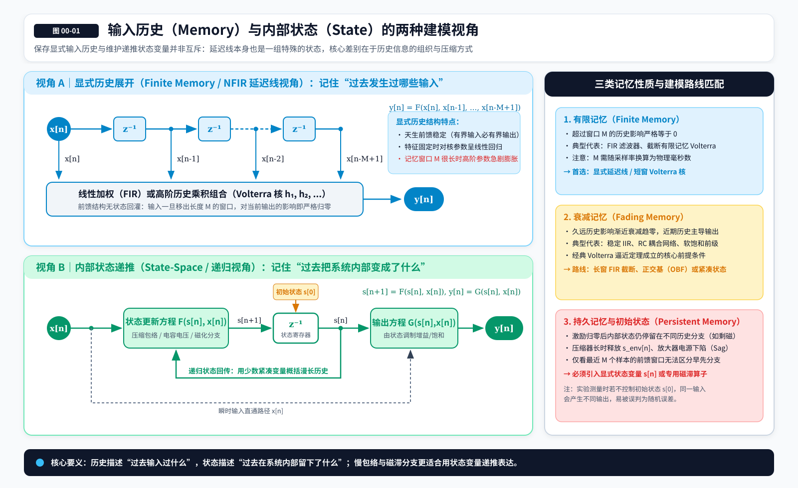
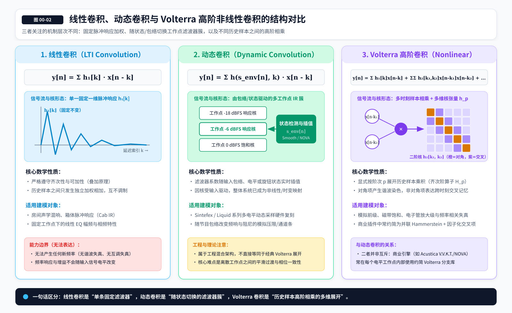
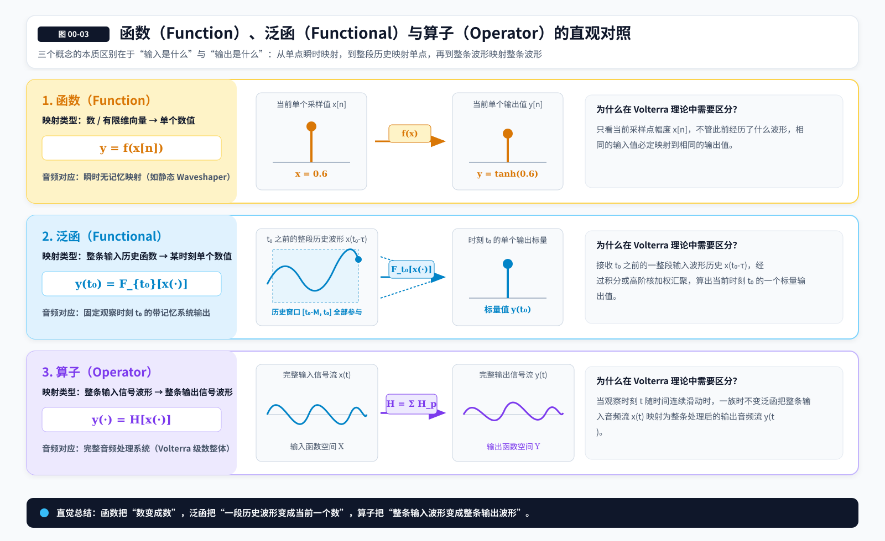

# 00 前置概念与术语约定

> **版本：v7 · 跨章去重与符号统一修订版（继承 v6 图文版）**  
> **所属系列：Volterra Wiki**  
> **阅读定位：在学习 Volterra 级数之前，建立音频非线性系统建模所需的直觉、基本语言和判断边界。**  
> **配图说明：** 本章 3 张 SVG 示意图采用相对路径，建议与 `figures/` 文件夹一起保存。
> **阅读方式：先理解现象，再认识概念，最后接触用于表达现象的数学形式。本章不要求读者预先掌握泛函分析、张量分解或系统辨识算法。**

## 0.1 我们为什么要先讨论“系统”，而不是直接学习 Volterra？

假设面前有一台模拟音频设备。我们输入一段音乐，再录下它输出的声音，听起来可能有新的谐波、更柔和的瞬态，也可能出现与输入电平有关的频率响应变化。我们想把这些现象做进一个数字插件里，最直接的想法当然是研究它内部的电子元器件：电阻、电容、电子管、晶体管、变压器，甚至磁带和磁头。但现实中，我们未必能取得电路图，也未必能把所有物理机制都完整地写成数学方程。即便拿到了这些资料，把方程转化成稳定、低延迟、低 CPU 占用的实时程序，仍然是另一项困难的工作。

于是可以换一个问题：**暂时不追问设备内部由什么构成，而是问它会怎样响应不同的输入。** 如果输入一个较小的正弦波，它会怎样输出？把电平提高以后呢？连续输入两个瞬态，与分开输入相比又有什么不同？这些问题的答案都能通过输入与输出的数据观察到。我们希望建立的数学模型，就是一种可以根据输入预测输出的规则。

这并不意味着物理机制不重要。输入—输出建模回答的是“设备表现出了什么规律”，电路与物理建模则进一步回答“这些规律为什么出现”。两种路径可以互相验证，也可以结合起来使用。Volterra 级数属于前一种路径中非常重要的一套数学工具：它尝试在同一个模型中描述**非线性、时间记忆，以及不同历史时刻之间的非线性交互**。不过在真正理解这句话以前，我们需要把其中每一个概念拆开。

## 0.2 一段声音怎样变成可计算的输入与输出？

在数学里，我们通常用 $x$ 表示输入，用 $y$ 表示输出。连续时间的模拟信号写作 $x(t)$ 和 $y(t)$；经过采样，变成数字音频以后，则写作 $x[n]$ 和 $y[n]$。这里的 $t$ 是以秒为单位的连续时间，$n$ 是一个整数，表示“第几个采样点”。方括号 $[n]$ 不是数组装饰，而是在提醒我们：现在讨论的是离散时间信号。

例如在 $48\,\mathrm{kHz}$ 采样率下，系统每秒处理 $48\,000$ 个采样点。$x[n-1]$ 表示输入的前一个采样点，$x[n-48]$ 表示约 $1\,\mathrm{ms}$ 以前的输入。此后遇到 $x[n-k]$ 时，可以先把它读成“距离现在 $k$ 个采样点以前的输入”，不必一开始就将它视为复杂的数学表达式。

我们还需要区分真实输出与模型预测。设实际设备输出为 $y[n]$，计算机模型给出的预测为 $\hat{y}[n]$，那么建模的直接目标就是让它们在我们关心的工作条件下足够接近。符号上方的尖帽（如 $\hat{y}$）表示“估计值”或“预测值”，并不保证它已经正确。

在后面的示例里，我们大多先研究单输入单输出系统，即 **SISO（Single-Input Single-Output）**。立体声和多通道设备当然也能研究，只不过它们还需要描述声道之间的相互作用。SISO 是用来建立直觉的起点，不是对真实音频设备的最终限制。

## 0.3 什么叫系统：真正重要的是它遵循什么规律

**系统（System）**可以理解成一套从输入产生输出的规则。EQ、延迟器、失真器、压缩器、磁带机，乃至神经网络音频插件，都可以在某种条件下被当作一个系统。我们可以先统一写成

$$
y=\mathcal{S}[x].
$$

其中 $\mathcal{S}$ 代表处理规则。这个符号特意没有告诉我们内部是卷积、电子管方程还是神经网络，因为“系统”首先是一种观察角度，而不必然是一种具体算法。对于音频工程师来说，只要明确输入、输出、测试条件和观察的时间范围，就能开始研究它。

然而，同一台设备不一定只有一种固定行为。旋钮位置、输入电平、通道负载、采样率、电源状况、磁性材料的初始状态，都可能改变输出。如果测量时某个旋钮在变化，那么在数学上，它就可能需要被视为额外的输入，或者作为一个随时间变化的参数。只记录音频输入和输出，却忽略这些条件，很容易把原本可以解释的行为误判为模型误差。

因此，对一个未知设备建立模型，第一步不是马上选择算法，而是先限定问题：我们想复刻哪个操作模式、什么电平范围、什么采样率、什么初始化方式，以及允许多大的误差？**一个模型是否正确，总是相对于明确的条件和评价标准而言。**

## 0.4 线性与非线性：为什么“有失真”不是完整定义

音频工程里经常将线性与非线性简单理解为“没有失真”和“有失真”，但这并不准确。理想 EQ 会改变原有信号的频率成分和相位，因此存在通常所说的线性失真；它却仍然是一个线性系统。真正定义线性的，是系统是否遵守**叠加原理（Superposition）**。

假设 $x_1$ 与 $x_2$ 是两段输入，$a$ 与 $b$ 是两个数。如果系统满足

$$
\mathcal{S}[ax_1+bx_2]=a\mathcal{S}[x_1]+b\mathcal{S}[x_2],
$$

它就是线性的。这个式子包含两项要求：将输入整体缩放，输出也按同样比例缩放；将两路输入相加再处理，等于分别处理以后再相加。两个条件需要同时成立。一个带固定延迟或固定频率响应的理想 EQ 可以满足它们；静态平方器 $y=x^2$ 则不能，因为输入放大两倍会使输出变成原来的四倍。

**非线性（Nonlinearity）**首先意味着叠加原理不再成立，而不只是“声音变脏了”。硬削波、软饱和、压缩器的电平相关增益、随输入幅度变化的频率响应，都可能具有非线性。非线性也不一定总是让声音更响、更亮或产生明显可听的谐波。有些非线性效应只有在特定电平、频率组合或输入历史下才容易被观察出来。

## 0.5 时不变、因果与稳定：同样重要的另外三个问题

讨论系统时，除了线性，还常常需要问它是否**时不变（Time-Invariant）**。时不变不等于输出永远不变化，而是说：如果输入的整段声音推迟了一秒，输出也只是整体推迟一秒，处理规则本身没有改变。固定参数的线性 EQ 是时不变的；一个受外部 LFO 调制频率的滤波器，在只把音频当作输入、把 LFO 相位视为外部时间参考时，通常就是时变系统。非线性和时变性属于不同的分类轴：系统可以线性时不变，也可以线性时变、非线性时不变或非线性时变。

**因果性（Causality）**关心的是信息从哪里来。因果系统在计算某一时刻输出时，只依赖当时和此前能够获得的信息，不能无缘无故知道真正的未来。Look-ahead limiter 看起来会“提前处理即将出现的峰值”，其实是把信号缓冲并延迟输出，于是在播放某个输出采样点时，相应的后续输入已经到达。它仍可以是因果的实时系统，只是付出了处理延迟。

**稳定性（Stability）**则是在问：系统面对合理、有限的输入，会不会产生无法控制的输出？初学时可以先认识**有界输入—有界输出稳定性（BIBO Stability）**：在规定的系统条件下，有界输入应当对应有界输出。这里容易混淆两种问题：某些反馈算法会因为内部状态不断积累而随时间失稳；有限阶、有限记忆 Volterra 多项式则可能在输入幅度超出训练范围以后产生极大的数值输出。两者都危险，但后一种通常属于**幅度外推失控**，不等同于在固定有界输入下随时间自发发散。

这三种性质会直接影响模型能否作为 VST 插件运行，也关系到测试方法能否成立。后文默认讨论的经典 Volterra 结构，多数情况下是针对因果、时不变系统写出的；对于时变设备、随机噪声和状态初始化，还必须另外交代条件。

## 0.6 什么叫记忆：当前这个采样点，为什么不足以决定输出？

先考虑一个静态 waveshaper：

$$
y[n]=f(x[n]).
$$

它只看当前采样点的输入幅度。不论先前经过了安静片段、强烈鼓点还是持续的低频正弦波，只要现在的 $x[n]$ 一样，且参数不变，得到的 $y[n]$ 就一样。这类系统叫**无记忆系统（Memoryless System）**。它能产生谐波与互调，却不能自行表示“过去发生过什么正在影响现在”。

接着想象两个输入片段：当前采样点都等于 $0.3$，但片段 A 的前面一直很安静，片段 B 的前面刚刚出现一个大瞬态。若设备对这两个 $0.3$ 给出不同输出，就说明单凭当前输入已经不足以预测结果。我们需要把输入历史也写进规则：

$$
y[n]=F\bigl(x[n],x[n-1],x[n-2],\ldots\bigr).
$$

这就是**记忆（Memory）**最核心的含义：**系统现在的输出仍然受过去输入的影响。** 它不要求声音一定有可听的“尾巴”。一个纯粹延迟一个采样点的系统 $y[n]=x[n-1]$ 就有记忆，尽管它没有产生混响，也没有任何非线性。相反，静态削波可以产生很强的失真，却依然没有记忆。

因此，“有没有记忆”与“有没有非线性”并不是同一个问题。将它们分开，才有办法理解为什么有些动态饱和设备无法用一条静态失真曲线准确模仿。

## 0.7 有限记忆、衰减记忆和持久记忆：过去究竟会保留多久？

当我们说系统有记忆，还需要继续问：过去的影响会持续到什么时候？最容易理解的是**有限记忆（Finite Memory）**。如果系统当前只依赖最近 $M$ 个采样点，早于这一范围的输入严格不会再改变当前输出，就可以写成

$$
y[n]=F\bigl(x[n],x[n-1],\ldots,x[n-M+1]\bigr).
$$

这里的 $M$ 是**记忆长度**，不是非线性阶数。$M=64$ 意味着模型最多查看最近 64 个采样点；在不同采样率下，64 个采样点对应的真实时间也不同。讨论“长记忆”时，最好同时写出采样点数与毫秒、秒等物理时间单位。

许多滤波器与动态系统并不存在这种严格的截止时刻，它们受到久远输入的影响通常越来越弱。这种性质可以用**衰减记忆（Fading Memory）**的直觉理解：两段足够久以前不一样、但最近历史完全相同的输入，会使当前输出越来越接近。稳定 IIR 滤波器是很好的例子。它理论上可能保留无限长的历史作用，但由于影响逐渐衰减，在工程上往往可以截取一个足够长的近似时间窗。

**持久记忆（Persistent Memory）**是另外一种情况。某些材料的内部状态在外部激励撤除后不会自动回到唯一的原点，例如具有剩磁的磁性材料。即便当前输入为零，系统仍然可能因为早先采用过不同的磁化路径而处于不同状态。不过需要注意，真实磁性材料还可能同时存在温度相关弛豫、速率相关损耗和其他缓慢变化。因此“磁滞具有持久记忆”描述的是某类理想或特定工作条件下的重要性质，而不是断言一台真实磁带机的所有记忆都永久不衰减。

这一区分对模型架构非常关键：有限记忆可以直接保存近期样本；衰减记忆可能通过滤波器或紧凑状态有效表示；具有历史分支的持久记忆，往往需要显式保存能够区分不同历史路径的内部状态。它们都属于记忆，但并不要求使用同一种算法。

## 0.8 记忆与状态：历史发生了什么，和系统现在变成了什么

假设你正在设计一个压缩器。它需要知道输入此前有多响，才能决定当前的增益衰减。但它通常不需要逐一保存前面几秒钟里的每个采样值，而可以维护一个包络变量。过去大量输入信息最终被概括成少数几个当前有用的数值，这些数值就是**状态（State）**的一种例子。

一个简单的状态模型可以写成

$$
\mathbf{s}[n+1]=F\bigl(\mathbf{s}[n],x[n]\bigr),
$$

$$
y[n]=G\bigl(\mathbf{s}[n],x[n]\bigr).
$$

其中 $\mathbf{s}[n]$ 是当前内部状态，$F$ 决定它如何更新，$G$ 决定如何由输入与状态产生输出。符号上加粗，表示它可以是一组状态变量，而不一定只有一个值。压缩器的包络、滤波器积分器中的储存量、放大器电源下陷的慢变量，以及磁滞模型里与历史路径有关的内部变量，都可以放进这套语言里。

我们可以把两种观察角度区分为：**历史描述过去发生过哪些输入；状态描述这些过去的输入在系统内部留下了什么结果。** 不过这不是两种互斥的物理现象。状态通常是历史信息的一种表示方式；保存最近 $M$ 个采样点的延迟线本身也可以被视为一组状态。真正的区别在于建模结构：是显式列出较长的输入历史，还是通过递推方程把相关历史压缩到少数变量中。

还要特别留意**初始状态（Initial State）**。即使两段测量使用完全相同的输入，如果设备开始时的温度、包络值或磁化状态不同，输出也可能不同。此时“同一个输入对应两个输出”不一定说明设备是随机的，而可能只是我们没有控制或记录初始条件。这也是复杂硬件辨识经常出现重复性问题的原因之一。

*图 00-01｜输入历史与内部状态的两种建模视角。保存历史与递归状态并非互斥，延迟线本身也可以被视为状态。*

## 0.9 从普通卷积到非线性记忆：为什么一个 IR 不够？

对于线性时不变系统，输出可以通过**卷积（Convolution）**描述：

$$
y[n]=\sum_{k=0}^{\infty}h[k]x[n-k].
$$

这里的 $h[k]$ 是**脉冲响应（Impulse Response，IR）**。可以把它理解成一张按时间排列的权重表：每个过去的采样点都会乘上相应权重，再将贡献相加。这个式子非常强大，因为对于满足线性时不变条件的系统，脉冲响应就足以完整描述零初始状态下的输入—输出关系。FIR、稳定 IIR、房间响应与许多 EQ 的数学基础都可以从这里理解。

然而，卷积有一个明确限制：**不同历史采样点的贡献只能线性相加，不能在式子里直接相乘。** 假设真实设备的当前输出，除了受到 $x[n-2]$ 和 $x[n-7]$ 各自影响，还会受到这两个值共同出现时的交互影响，那么可能需要一个这样的项：

$$
c\,x[n-2]x[n-7].
$$

它与普通卷积中的 $h[2]x[n-2]+h[7]x[n-7]$ 完全不同。在线性相加的情形下，改变第一个历史采样点的作用不会因为第二个历史采样点的大小而改变；而在乘积项中，两者彼此影响。这个差别就是理解 Volterra 之前最重要的一道门槛。

当然，某些非线性设备可以通过“线性滤波 + 静态 waveshaper + 线性滤波”的组合得到很好的近似，并非一遇到记忆和失真就必须使用完整 Volterra。Volterra 的意义是允许我们用一种更一般、更明确的数学语言来安排历史输入之间的非线性交互，而不是宣称它取代了所有传统 DSP 结构。

*图 00-02｜线性卷积、动态卷积与 Volterra 高阶卷积的概念对照。注意“动态卷积”在商业音频语境中的定义并不统一：若卷积核由输入信号驱动而变化，整体处理也可以是非线性的；三者并非严格互斥的分类。*

## 0.10 函数、泛函与算子：三个看似抽象的词，其实只差在输入与输出是什么

先回到最熟悉的静态 waveshaper：$y=f(x)$。这里的 $f$ 是一个**函数（Function）**，它将一个数映射成另一个数。严格地说，函数可以有多个输入变量，也不只限于“数到数”；但对我们眼前的直觉而言，先把它理解成“给定几个数，算出一个结果”就够了。

如果当前输出要取决于一整段输入历史，就有必要用一个能够接收“函数或信号”的规则。固定观察时刻 $t_0$，我们可以写成

$$
y(t_0)=\mathcal{F}_{t_0}[x(\cdot)].
$$

这里的 $\mathcal{F}_{t_0}$ 是**泛函（Functional）**：它接收整条输入函数，却只返回时刻 $t_0$ 的一个标量输出。若希望一次描述从整条输入波形到整条输出波形的映射，则可以写成

$$
y(\cdot)=\mathcal{H}[x(\cdot)].
$$

这时 $\mathcal{H}$ 是**算子（Operator）**，作用对象是整个信号，结果也是一个信号。三个词之间的关系由此变得自然：**函数通常处理有限维变量，泛函将函数映射为数值，算子则将一个函数映射为另一个函数。** 在广义数学用法里，泛函也可被看作某类特殊算子，所以这些词并非完全隔绝的三种东西。

为什么 Volterra 要用到它们？因为我们最终需要描述的不是“一条静态曲线”，而是“对整个输入历史施加某种规律，生成输出波形”。Volterra 级数可以视为对这类输入—输出算子进行幂级数式表示的一条路径。知道这点已经足够继续阅读，暂时不需要深入泛函分析的严格定义。

*图 00-03｜函数、泛函与算子的直观对照。图中“数到数”的函数概念是教学简化，并不是对一般函数的完整数学定义。*

## 0.11 从 Taylor 展开到多项式：为什么要把复杂关系拆成一阶、二阶、三阶？

很多复杂函数，在选定工作点附近，可以用逐渐增加次数的多项式去描述。例如在某个参考点附近，一个静态非线性可以近似写成

$$
y\approx a_0+a_1x+a_2x^2+a_3x^3+\cdots.
$$

如果工作点不在 $x=0$，更严谨的写法应当是 $x-x_0$ 的幂次，其中 $x_0$ 是展开中心。这里的常数项表示基准偏移，一次项表示局部线性贡献，二次、三次及更高次项描述不同阶次的非线性偏离。这样的表达之所以有用，是因为我们可以通过观察不同阶次的贡献，逐渐增加模型复杂度，而不必在一开始就猜出真实设备的全部函数形式。

不过，多项式展开并不意味着**任意系统都能在所有输入范围内由一条收敛的幂级数精确表示**。Taylor 级数的收敛需要条件；有限阶多项式的近似精度也依赖工作范围。某些函数在局部表现得十分平滑，却在远处出现拐点、阈值或剧烈变化。模型在小信号下拟合得很好，不能据此保证它在强过载下也同样正确。

现在再把一个输入变量扩展成一段历史：$x[n],x[n-1],x[n-2],\ldots$。原先的 $x^2$ 变成了许多可能的二次组合，包括 $x^2[n]$、$x[n]x[n-1]$、$x[n-1]x[n-4]$；三次项则包含三个历史采样因子的乘积。**Volterra 思想的直觉，就是把普通多项式对幅度的展开，推广为对输入历史组合的展开。** 下一章才会正式解释它的积分形式、离散级数和数学适用条件。

## 0.12 “阶数”到底是什么？不要把 Volterra 阶数、谐波阶数和滤波器阶数混在一起

在 Volterra 相关资料中，**阶数（Order）**首先是指一个项里有多少个输入因子相乘。比如 $x[n-1]x[n-4]$ 是二阶项，$x[n]x[n-3]x[n-7]$ 是三阶项。记作 $p$ 阶时，意思是这个项包含 $p$ 个输入因子；即使其中几个因子对应同一时刻，也仍然按照乘积的总次数计算。

但我们在音频测量中还会遇到“三次谐波”“五次谐波”，它们指输出频率是基频的三倍、五倍，与 Volterra 阶数不是同一件事。例如一个三次非线性会产生三次谐波，但也会改变基频分量：

$$
\cos^3(\omega t)=\frac{3}{4}\cos(\omega t)+\frac{1}{4}\cos(3\omega t).
$$

这说明“三阶非线性”不是“只生成三次谐波”。在多音输入下，高阶非线性还可能形成不同频率之间的互调产物。二次项也不一定只贡献二次谐波：它还可能产生直流分量、两音和频以及差频。真实动态系统中，滤波器、反馈和非线性之间的相互作用还会让测得的频谱更加复杂。

至于“二阶 biquad”中的二阶，讨论的是线性滤波器传递函数中的系统阶数，通常与极点、状态维数等动态结构有关；它既不等于二阶谐波，也不等于二阶 Volterra 核。后文尽量把这几个词写完整，因为**同一个“阶”字，可能在描述三件完全不同的事**。

## 0.13 什么叫 Volterra 核：它不是一条神秘曲线，而是一张历史交互权重表

理解了卷积和多项式以后，Volterra **核（Kernel）**就容易想象了。一阶核 $h_1[k]$ 只有一个延迟坐标，形式上与普通的线性脉冲响应相同；二阶核 $h_2[k_1,k_2]$ 需要两个延迟坐标，因为它要给两个历史输入因子的乘积安排权重。比如

$$
h_2[2,7]x[n-2]x[n-7]
$$

就是一项二阶历史交互。它表示：过去第 2 个与第 7 个采样点上的输入共同参与时，这个乘积应当按照 $h_2[2,7]$ 所指定的权重影响当前输出。三阶核 $h_3[k_1,k_2,k_3]$ 则为三个历史位置的组合分配权重。

二阶核可以先想象成一张二维表，横坐标与纵坐标都是延迟。表格对角线上 $k_1=k_2$ 的元素，作用在同一历史样本的平方上；对角线以外的元素，则作用在不同时刻样本的乘积上。这也是我们后面区分 **Diagonal Volterra** 和具有**非对角交叉记忆（Cross-Memory）**的模型时最直接的几何直觉。这里的“非对角”是核坐标的含义，不是某个音频设备听起来更宽、更有立体感的直接证据。

由于输入样本的乘法可以交换顺序，$x[n-2]x[n-7]$ 与 $x[n-7]x[n-2]$ 表示同一个乘积。因此，同一阶核的许多坐标只是排列不同，通常可以将其对称化而不改变模型的输入—输出结果。需要注意，对称核的记账方式可能在不同文献中采用不同组合系数约定；本系列在涉及参数数量与公式展开时会明确说明约定，避免把相同贡献计算两遍。

机器学习中的 **kernel trick** 或支持向量机核函数同样使用“kernel”一词，但它们不是 Volterra 核的同义词。前者通常描述样本间的相似性或隐式特征内积；这里的核主要描述输入历史组合对输出的权重。不要因为名称相同，就认为两套理论使用的是同一种对象。

## 0.14 一个小实验：怎样区分线性记忆与非线性交互？

假设我们在观察一个只依赖当前输入 $x[n]$ 和前一时刻输入 $x[n-1]$ 的系统。固定当前输入 $x[n]$ 不变，只改变前一时刻的 $x[n-1]$，如果输出随之改变，我们就能确认系统具有**记忆**。但仅凭这一现象，还无法判断这段记忆究竟是普通的**线性历史叠加**（如滤波器延迟项），还是两个时刻之间发生了**非线性交互**（如乘积项 $x[n]x[n-1]$）。

怎样在实验上把这两种机制分开？核心思想是利用叠加原理设计受控对比实验：分别测量“只送入当前样本”“只送入前一样本”“两者同时送入”以及“零输入基线”四组响应。如果系统只有线性记忆，那么“前一样本对输出的增量贡献”应当与当前样本的大小无关；反之，如果改变当前样本的幅度，会同时改变前一样本留下的影响大小，就证明两个历史时刻之间存在无法拆成独立加和的联合作用（下一章第 1.2 节将用具体的二变量代数模型推导这一“四次测量相消”过程）。

真实硬件的测量当然远比二变量思想实验复杂，尤其要控制更早的历史、内部状态与本底噪声；但它揭示了一项贯穿全书的实验原则：**如果想证明历史之间存在非线性相互作用，就不能只证明“不同前史导致不同输出”，还必须设法剥离单纯的线性历史叠加。** 测试信号不仅是喂给模型的数据，更是用于区分竞争性模型假设的实验工具。

## 0.15 Volterra 能做什么，又为什么不是所有非线性设备的通用答案？

在限定工作范围内，有限阶 Volterra 可以很好地描述很多具有有限或有效衰减记忆的弱至中等非线性行为。它把非线性阶数与历史交互显式组织起来，因此很适合研究：某个失真成分是否依赖过去的输入？二阶、三阶贡献有什么区别？对角模型遗漏了哪些交叉项？不同模型为了达到类似误差需要多少参数？这些问题恰好是黑盒音频建模最关心的内容。

但它存在重要边界。**硬削波（Hard Clipping）**具有明确阈值和折点，完整的全局映射不能由普通有限阶多项式精确等同表示。有限阶多项式仍然可以在指定有界幅度范围内近似削波曲线，只是精度、所需阶数与超范围行为必须分别评估。对足够光滑的软饱和函数，局部或有限范围内的多项式模型可能非常有效；但“能够近似一个失真效果”不意味着模型自动具有真实器件的全局饱和约束。

**压缩器与限制器（Compressor / Limiter）**的问题又不同。它们的核心不仅是瞬时非线性，还包含电平检测、attack/release、峰值控制、历史包络，某些实现还包含前瞻、反馈或程序相关时常。有限历史 Volterra 可以在选定工作条件、有限观察时间与误差容忍度内近似某些动态行为，但想用一个低阶、短记忆的普通多项式模型，在任意电平和时间条件下精确复现复杂的递归动态，往往既不现实，也没有工程效率优势。状态空间、专用动态处理结构或混合模型可能更合适。

**具有持久历史分支的磁滞系统**则进一步提醒我们：如果两段设备历史最终得到不同的内部磁化状态，那么一个只查看最近有限输入窗口、又不知道初始状态的模型，就无法始终区分这些情形。它可以近似有限时间尺度上的某些磁滞表现，却不应因此被当作磁性历史状态的完整替代。

还要记住一类容易忽视的风险：有限阶多项式中的最高阶项，可能在输入幅度超出训练范围后迅速增长。即使训练区间内误差极低，也不能自动获得过载安全性。这不代表每个 Volterra 模型在规定工作区间里都必然发散；正确的说法是：**经典有限阶多项式并不自动保证全局有界或外推可靠，这是一项必须主动处理的结构风险。**

## 0.16 模型结构与参数：为什么“调得不够好”和“根本表示不了”是两种失败？

我们会经常使用 **模型（Model）** 这个词。模型不是设备本体，而是一套用来近似或解释设备的数学规则。假设我们写成

$$
\hat{y}[n]=F\bigl(x[n],x[n-1],\ldots;\boldsymbol{\theta}\bigr),
$$

其中 $F$ 表示模型采取什么组织方式，$\boldsymbol{\theta}$ 表示需要确定的参数。理解时必须将**结构（Structure）**和**参数（Parameters）**分开。结构决定模型允许哪些关系存在；参数决定这些关系的具体权重、增益或时间常数。例如“只保留 Volterra 核对角线”是一种结构假设；某个对角核系数具体等于多少，是参数估计问题。

一个模型预测不准，至少有三种可能：首先，结构允许描述目标行为，但参数估计得不好；其次，结构本身缺少必要的历史或状态关系，再怎么调整参数也无济于事；最后，测量的数据并未充分控制状态、延迟或噪声，甚至目标本身发生了变化。它们对应不同的解决办法，不能简单归结为“训练轮次还不够”。

在后续章节中会出现 **Memory Polynomial、GMP、Low-Rank Volterra、Hammerstein、Wiener、状态空间模型、WaveNet** 等名称。它们不是按“高级程度”从低到高排列的阶梯，而是对系统结构作出了不同假设。一个结构复杂的神经网络不必然比设计得当的简洁模型更准确；一个误差很低的 Volterra 模型也不必然更接近设备的真实物理机制。

## 0.17 黑盒、白盒与灰盒：我们究竟知道设备内部多少？

**黑盒建模（Black-Box Modeling）**主要依靠可观察的输入与输出推断规则，即便不知道内部是什么，也可以尝试复刻它的行为。Volterra 系数回归与音频神经网络都可以采用黑盒方式。**白盒建模（White-Box Modeling）**则从已知物理或电路结构出发，建立电阻、电容、非线性器件与反馈网络等对应的方程，再进行离散化与数值求解。白盒模型也需要参数，并不意味着每个参数都可以不经测量就精确获知。

**灰盒建模（Gray-Box Modeling）**介于两者之间。例如我们已知某个系统大体包含线性频率整形、动态状态和非线性饱和，但各部分的参数仍由测试数据决定；或者先用物理磁滞模型解释主要历史行为，再用数据驱动的非线性残差校正模型无法解释的部分。这些路线都可能构成灰盒系统。

这三个名称描述的是建模过程中使用了多少先验知识，不是声音品质、数学先进程度或最终准确度的评级。黑盒模型可以非常精确；白盒模型也可能因为物理简化或参数不准而失真。工程选择要看原型资料、测试能力、计算预算以及我们究竟要解释什么现象。

## 0.18 什么叫系统辨识：不是“录一段音乐，训练一个模型”那么简单

**系统辨识（System Identification）**是一套从实验中发现、估计并验证系统模型的方法。**拟合（Fitting）**和**参数估计（Parameter Estimation）**只是其中的一个环节。假设我们已有真实输出 $y[n]$ 与模型输出 $\hat{y}[n]$，调节参数使两者接近，是拟合；但研究目标要不要包含磁滞、数据如何采集、是否需要多电平激励、模型验证失败以后如何重新设计实验，这些都属于系统辨识。

音频工程尤其需要注意测量链自身的问题。若真实硬件通过 AD/DA 回路接入，输出可能带有固定延迟、时钟漂移、噪声、增益误差或通道串扰。即便只测软件插件，也要确认过采样模式、插件延迟、参数自动化、旁路行为和初始状态是否一致。**数据没有对齐时，逐采样误差可以很大，但这未必是模型的非线性结构错误。** 因此，时间对齐、增益校准、重复测量与异常数据检查都是建模工作的一部分。

我们还应当区分预测行为与解释机制。一个模型能够准确预测输入—输出，并不证明它内部对应设备里的真实电容、磁芯或电源节点。很多不同数学结构可能在当前测试范围内输出近乎相同的结果。系统辨识能帮助我们逐步排除错误假设，但没有额外的物理证据，就不应把一个成功拟合的数学部件直接命名为某个真实元器件。

## 0.19 激励、可辨识性与“看不见的参数”：为什么测试信号必须经过设计？

为了观察设备的行为，我们故意送入某种测试信号，这叫**激励（Excitation）**。单音适合检查谐波和幅度依赖性，双音适合观察互调，扫频适合观察随频率变化的响应，脉冲组合适合暴露不同历史之间的作用，长时间持续输入则有机会激发缓慢状态。真实音乐同样很重要，但更适合与受控测试互相补充，而不是自动替代所有实验。

**可辨识性（Identifiability）**问的是：现有观测是否足以把目标参数或模型结构区分开？假设我们只使用恒定的输入，于是 $x[n-1]$ 与 $x[n-2]$ 始终相等。一个模型给二者安排不同权重，我们也无法仅凭这组数据知道各个权重究竟是多少，因为它们的作用永远混在一起。换用更丰富的输入，可能会让原先分不开的参数显露出差异。

**持续激励（Persistent Excitation）**是系统辨识中的技术术语，严格含义与回归矩阵的秩、特征相关性和所选模型有关。初学时可以先记住它的工程含义：**要估计哪些自由度，就必须提供足以区分这些自由度的输入变化。** 但“信号种类很多”也不等于已经满足严格的持续激励条件；某些输入即便听起来很丰富，也可能无法区分特定非线性核坐标。

因此，如果两种模型对目前所有信号的预测都一样，只能说**当前实验还不能区分它们**，不能宣布它们在物理上完全等价。对于商业插件、未知硬件和复杂磁滞模型，这一原则格外重要：测量不仅是为模型寻找证据，也是在寻找能够推翻错误模型的反例。

## 0.20 残差、损失函数与泛化：把误差降低，不等于把问题解决

建模时常将真实输出与预测输出的差写成

$$
e[n]=y[n]-\hat{y}[n].
$$

这个 $e[n]$ 叫**残差（Residual）**。残差可以被听，也可以在时域、频域和不同测试条件下分析。假如残差出现清楚的谐波或互调线、与前一瞬态相关的结构、低频包络变化或依赖预处理历史的差别，说明模型可能遗漏了某类确定性行为。当然，也要先排除采集噪声、对齐误差与量化误差，否则我们可能会把测量系统的问题误当作设备特性。

训练时我们需要一个评价函数来决定参数怎样调整，这叫**损失函数（Loss Function）**。最直观的例子是平方误差：

$$
L=\sum_n\bigl(y[n]-\hat{y}[n]\bigr)^2.
$$

它在计算上方便，却不代表它与听感差异完全一致。例如一个很小的瞬态时间偏移，可能使逐采样误差显著上升；某些低幅度的高阶互调，虽然对总体均方误差贡献不大，却可能成为我们关心的染色来源。因此，时域波形误差、频谱与谐波/互调误差、瞬态行为、长时间状态测试、主观听感，可以一起构成多维评价，而不是互相替代。

另一个重要概念是**泛化（Generalization）**。用来估计参数的资料称为训练集；帮助选择模型阶数、结构及超参数的资料称为验证集；在选择完成后才使用、用于独立评估的资料称为测试集。如果模型在训练素材上几乎完美，换成新的输入电平、频率组合或历史条件就失效，它可能只是记住了局部数据。尤其对于音频非线性建模，我们不能只在同一种音乐片段上检验泛化，还应包含不同工作电平、瞬态密度、长短记忆和初始化状态。

## 0.21 特征、参数估计与正则化：Volterra 和机器学习其实离得没有那么远

模型不一定直接拿原始输入样本去求输出，它也可以先生成更适合计算的量，这些量叫**特征（Features）**。线性 FIR 的特征可以是 $x[n]$、$x[n-1]$ 等历史采样点；二阶 Volterra 的特征则可以进一步包含 $x^2[n]$、$x[n]x[n-1]$、$x[n-2]x[n-7]$。这些高阶组合是人为明确写出的**显式特征**，而一些神经网络会通过隐藏层学习自己的特征表示。

一个值得注意的性质是：**Volterra 模型对输入可以是非线性的，但对已经选定的核系数却可以是线性的。** 也就是说，先把这些输入乘积计算成特征后，我们往往能够将模型写成一个线性参数回归问题：

$$
\hat{\mathbf{y}}=\mathbf{X}\boldsymbol{\theta}.
$$

这里 $\mathbf{X}$ 的每一列是一种特征在样本序列上的取值，$\boldsymbol{\theta}$ 是待求参数。因此，求 Volterra 核不必然需要反向传播训练深层网络；最小二乘、Ridge、LASSO 或自适应滤波中的 LMS、RLS 等方法，都可能在相应条件下发挥作用。不同算法解决的是估计问题，不能自动弥补模型结构遗漏的行为。

当特征很多、数据有限或列之间高度相关时，模型容易过度追随训练数据。**正则化（Regularization）**用于在拟合误差之外加入某种约束。例如 Ridge 对过大的系数施加惩罚，LASSO 则可能把一些系数压成零，形成稀疏模型。这里并非“参数越小就必然越物理”，而是通过合理的先验和复杂度控制，争取在未见条件下更可靠的预测。

## 0.22 张量、稀疏、低秩与基函数：为什么后面会出现那么多 Volterra 约简形式？

假如只查看最近 $M$ 个历史位置，一阶核需要 $M$ 个系数；不利用对称性时，二阶完整核需要 $M^2$ 个位置，三阶需要 $M^3$ 个位置，$p$ 阶核则有 $M^p$ 个坐标。即便利用核的对称性合并重复排列（其精确组合计数公式与参数规模表见下一章第 1.13 节），独立参数数量依然随记忆长度 $M$ 与阶数 $p$ 呈高次多项式级激增。

这就是 **维数灾难（Curse of Dimensionality）**：每增加一阶或延长记忆，候选参数、所需测量信息与运算成本都会急剧膨胀。实际建模中的第一要务常常不是把所有项写出来，而是寻找哪些结构能够用较少自由度解释我们真正关心的行为。

这里会遇到三个容易混淆的术语。**张量（Tensor）**在本系列初级层面可先视为按多个索引组织的高维系数数组：一阶核像向量，二阶核像矩阵，三阶及以上的核则需要更多坐标。**稀疏（Sparse）**意味着大多数候选位置不重要，只留下少量显著系数。**低秩（Low Rank）**并不要求大部分位置为零；它意味着整体系数结构能够由少数可分离的模式组合出来。对于二维核，可以先想象为几张“横向形状 × 纵向形状”的简单图案叠加，而不是逐格存储全部权重。

还有一种思路是用**基函数（Basis Functions）**来压缩时间历史。既然许多设备的记忆可以表现为几种快慢不同的衰减模式，为什么要为过去每个采样点都建立一组独立参数？我们可以先用 Laguerre、Kautz 或其他适当的动态基，提取若干具有代表性的历史特征，再在这些特征上建立非线性模型。这不保证每种设备都能用很少的基函数拟合，但它为数百毫秒乃至秒级历史提供了比完整高维核更有希望的实现路线。

所以后文出现的 Diagonal Volterra、Memory Polynomial、GMP、Near-Diagonal、Sparse、Low-Rank、分阶记忆截断与基函数投影，并不是彼此孤立的术语。它们都在回答同一个工程问题：**完整高维核中，到底有哪些自由度值得保留，哪些可以通过合理假设压缩？** 不同约简假设是否成立，最终还得由针对性的辨识与验证实验决定。

## 0.23 NFIR、NARX 与递归：保存历史和反馈历史，不是一回事

在系统辨识中，**NFIR（Nonlinear Finite Impulse Response）**通常指当前输出是有限长度输入历史的某个非线性函数：

$$
y[n]=F\bigl(x[n],x[n-1],\ldots,x[n-M+1]\bigr).
$$

有限阶、有限记忆的普通 Volterra 就属于这类前馈式输入—输出模型。这里的“前馈”意味着模型不需要把自己以前的输出重新送回递推关系中，因此其运算依赖可以直接沿着输入历史展开。它仍然能具有非线性与记忆，并不是只有线性 FIR 才能被称为非递归结构。

**NARX（Nonlinear Autoregressive with Exogenous Inputs）**则允许过去的输出值也参与当前计算，例如

$$
y[n]=F\bigl(x[n],x[n-1],y[n-1],y[n-2]\bigr).
$$

这类**递归（Recursive）**结构可以用少量变量表示很长的动态过程，但也带来了误差回灌、稳定性、初始状态和训练方式等问题。状态空间模型与 NARX 不完全相同，不过都可以通过递推来表示历史对当前的作用。具体的状态是否能够从外部输入输出唯一恢复、不同初始条件是否会持续影响结果，还需要结合模型结构进一步讨论。

需要特别说明，NARX 里的“过去输出”既可能是真实设备的测量输出（某些训练设置），也可能是模型自己此前预测的输出（自由运行设置）。两种设置可能具有不同误差表现，所以不能仅凭训练时的一步预测成绩，就断定递归模型在长期实时运行中一定可靠。

## 0.24 约定一套以后不会混淆的符号

后续 Wiki 将尽可能遵守下表，出现特殊约定时会单独解释。

| 符号 | 本系列默认含义 | 首次阅读时应注意 |
|---|---|---|
| $x(t),\ y(t)$ | 连续时间输入、输出 | $t$ 以秒计 |
| $x[n],\ y[n]$ | 离散时间输入、输出 | $n$ 是采样点索引 |
| $\hat{y}[n]$ | 模型预测输出 | 不等同于真实测量输出 |
| $e[n]$ | 输出残差 | 默认 $e=y-\hat{y}$，必要时另作说明 |
| $k,\ k_1,\ k_2$ | 延迟索引 | 在因果模型里通常取非负整数 |
| $M$ | 输入历史窗口长度 | 单位是采样点，换算成时间需知道采样率 |
| $p$ | Volterra 非线性阶数 | 不等于谐波阶数或滤波器阶数 |
| $P$ | Volterra 模型保留的最高阶数 | 指截断阶数 |
| $h_1[k]$ | 一阶 Volterra 核 | 在相应条件下对应线性卷积项 |
| $h_p[k_1,\ldots,k_p]$ | 第 $p$ 阶完整 Volterra 核 | $p$ 个历史坐标组成一项多维权重 |
| $g_p[k]$ | 第 $p$ 阶对角／并联 Hammerstein 支路 FIR 核 | 作用在幂次特征 $x^p[n-k]$ 上的一维滤波器，区别于多维核 $h_p$ |
| $\mathbf{s}[n]$ | 系统内部状态向量 | 与直接存储全部输入历史不是同一个表述方式 |
| $s_{\mathrm{env}}[n]$ | 动态处理器的包络或慢速控制状态 | 专用于压缩／限制或渐变控制，避免与输出残差 $e[n]$ 混淆 |
| $\boldsymbol{\theta}$ | 待估计的参数向量 | 可以包含核系数或其他模型参数 |
| $\mathbf{X}$ | 回归特征矩阵 | 不是原始音频本身的同义词 |
| $R$ | 低秩分解的模式数量 | 越小表示使用越少的分离成分 |

数学式里还会出现求和符号 $\sum$，它表示“把指定范围内的贡献累加”；乘积符号 $\prod$，它表示“把指定范围内的因子相乘”。小写 $h$ 常用于表示脉冲响应或 Volterra 核；大写 $F$、$G$、$\mathcal{S}$ 等符号则用来表示函数、更新规则或系统。我们优先统一概念，而不是让读者在每一页里重新猜测符号的意义。

## 0.25 带着什么问题，进入下一章？

到这里，我们还没有正式推导 Volterra 级数，却已经建立了理解它所需的关键区分。一个音频系统可能是线性或非线性的，也可能有记忆或没有记忆；即使都有记忆，记忆还可能是有限的、衰减的或由持续状态保存的。同样一段输入历史，可以通过逐采样权重、非线性交互核、递归状态乃至神经网络表示。它们各自有能够描述的行为，也有计算成本、收敛性、可辨识性与物理解释方面的限制。

真正值得追问的不是“Volterra 是不是比某种算法更高级”，而是：**如果我们只能观察一个未知音频系统的输入与输出，怎样判断它到底利用了哪些历史信息，又怎样让这些历史信息共同影响当前输出？** 对这个问题，普通卷积只允许历史信息线性相加；静态 waveshaper 只处理当前幅度；Volterra 则允许不同时间位置的输入按阶次发生明确的非线性交互。

下一章《01 Volterra 级数》将在此基础上，把这些直觉正式写成数学表达，解释为什么它常被称为“带记忆的 Taylor 级数”，为什么二阶核会是一张二维表，为什么完整高阶核迅速产生维数灾难，以及为什么理解它的能力边界，与掌握它的表示能力同样重要。

---

### 本章使用边界与进一步阅读

本章是一份**面向音频建模的概念导论**，不是泛函分析或非线性系统辨识的严格定理汇编。关于线性、时不变、因果和稳定性的数学定义，可进一步参见 Oppenheim 与 Schafer 的 *Discrete-Time Signal Processing*；关于 Volterra / Wiener 显式系统模型，可进一步参见 Schetzen 的 *The Volterra and Wiener Theories of Nonlinear Systems* 与 Ogunfunmi 的 *Adaptive Nonlinear System Identification*；关于模型选择、实验设计和泛化问题，可进一步参见 Nelles 的 *Nonlinear System Identification*。磁性持久记忆及速率相关行为的物理讨论，则应与 Bertotti 的 *Hysteresis in Magnetism* 等材料对照阅读。

这些参考书提供不同层次的正式理论。本章的音频例子、章节顺序及教学解释是为本 Wiki 重新组织的，并非对某一本专著的逐段翻译。
