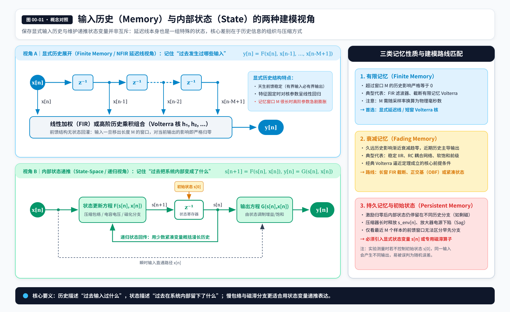

# 00 前置概念与术语约定

[在线阅读本章（完整合订版）](https://excillex-marisa.github.io/volterra-wiki/#chapter-00)

> **版本：v15 · 2026-11-16 · 前置知识精简与跨章节重构**
> **所属系列：Volterra Wiki**
> **阅读定位：在学习 Volterra 级数之前，建立音频非线性系统建模所需的直觉、基本语言和判断边界。**
> **配图说明：** 本章 2 张 SVG 示意图采用相对路径，建议与 `figures/` 文件夹一起保存。
> **阅读方式：先理解现象，再认识概念，最后接触用于表达现象的数学形式。本章不要求读者预先掌握泛函分析、张量分解或系统辨识算法。**

**本系列的研究对象是非线性音频系统的数字建模与系统辨识。** 从音频工程师熟悉的卷积出发，我们将逐步讨论 Volterra 核、状态空间、物理电路、唯象模型、神经网络、数据辨识以及实时模型约简。Volterra 级数提供了理解非线性历史交互的一套系统化数学表达；后续章节沿着共同的输入输出问题，逐步进入其他建模体系。全书围绕系统行为、数学结构、辨识方法与工程验证组织知识。

## 0.1 从声音到输入—输出系统

假设面前有一台模拟音频设备。我们输入一段音乐，再录下它输出的声音，听起来可能有新的谐波、更柔和的瞬态，也可能出现与输入电平有关的频率响应变化。我们想把这些现象做进一个数字插件里，最直接的想法当然是研究它内部的电子元器件：电阻、电容、电子管、晶体管、变压器，甚至磁带和磁头。但现实中，我们未必能取得电路图，也未必能把所有物理机制都完整地写成数学方程。即便拿到了这些资料，把方程转化成稳定、低延迟、低 CPU 占用的实时程序，仍然是另一项困难的工作。

因此可以从输入—输出关系入手：**先观察设备如何响应不同的外部激励。** 如果输入一个较小的正弦波，它会怎样输出？把电平提高以后呢？连续输入两个瞬态，与分开输入相比又有什么不同？这些问题的答案都能通过输入与输出的数据观察到。我们希望建立的数学模型，就是一种可以根据输入预测输出的规则。

输入—输出建模回答的是“设备表现出了什么规律”，电路与物理建模则进一步回答“这些规律为什么出现”。两种路径可以互相验证，也可以结合起来使用。Volterra 级数属于前一种路径中非常重要的一套数学工具：它尝试在同一个模型中描述**非线性、时间记忆，以及不同历史时刻之间的非线性交互**。不过在真正理解这句话以前，我们需要把其中每一个概念拆开。

在数学里，我们通常用 $`x`$ 表示输入，用 $`y`$ 表示输出。连续时间的模拟信号写作 $`x(t)`$ 和 $`y(t)`$；经过采样，变成数字音频以后，则写作 $`x[n]`$ 和 $`y[n]`$。这里的 $`t`$ 是以秒为单位的连续时间，$`n`$ 是一个整数，表示“第几个采样点”。方括号 $`[n]`$ 标明了离散时间索引，提醒我们：现在讨论的是离散时间信号。

例如在 $`48\,\mathrm{kHz}`$ 采样率下，系统每秒处理 $`48\,000`$ 个采样点。$`x[n-1]`$ 表示输入的前一个采样点，$`x[n-48]`$ 表示约 $`1\,\mathrm{ms}`$ 以前的输入。此后遇到 $`x[n-k]`$ 时，可以把它读成“距离现在 $`k`$ 个采样点以前的输入”，以此建立对时间延迟的直观认识。

我们还需要区分真实输出与模型预测。设实际设备输出为 $`y[n]`$，计算机模型给出的预测为 $`\hat{y}[n]`$，那么建模的直接目标就是让它们在我们关心的工作条件下足够接近。符号上方的尖帽（如 $`\hat{y}`$）表示“估计值”或“预测值”，准确性仍需通过测量验证。

在后面的示例里，我们大多先研究单输入单输出系统，即 **SISO（Single-Input Single-Output）**。立体声和多通道设备当然也能研究，只不过它们还需要描述声道之间的相互作用。SISO 是用来建立直觉的起点，对立体声与多通道耦合系统的扩展将在后续章节单独说明。

**系统（System）** 可以理解成一套从输入产生输出的规则。EQ、延迟器、失真器、压缩器、磁带机，乃至神经网络音频插件，都可以在某种条件下被当作一个系统。我们可以先统一写成

```math
y=\mathcal{S}[x].
```

其中 $`\mathcal{S}`$ 代表处理规则。这个符号特意没有限定内部是卷积、电子管方程还是神经网络，因为“系统”首先代表一种观察角度，具体算法则根据建模任务选取。对于音频工程师来说，只要明确输入、输出、测试条件和观察的时间范围，就能开始研究它。

同一台设备的行为也会随着工作条件改变。旋钮位置、输入电平、通道负载、采样率、电源状况、磁性材料的初始状态，都可能改变输出。如果测量时某个旋钮在变化，那么在数学上，它就可能需要被视为额外的输入，或者作为一个随时间变化的参数。只记录音频输入和输出，却忽略这些条件，很容易把原本可以解释的行为误判为模型误差。

因此，对一个未知设备建立模型，第一步应当限定研究问题：我们想复刻哪个操作模式、什么电平范围、什么采样率、什么初始化方式，以及允许多大的误差？**一个模型是否正确，总是相对于明确的条件和评价标准而言。**

## 0.2 线性与非线性：从叠加原理理解失真

音频工程里经常将线性与非线性简单对应为“没有失真”和“有失真”。理想 EQ 会改变原有信号的频率成分和相位，因此存在通常所说的线性失真，但它仍然是一个线性系统。区分线性与非线性的严格依据，是**叠加原理（Superposition）**。

假设 $`x_1`$ 与 $`x_2`$ 是两段输入，$`a`$ 与 $`b`$ 是两个数。如果系统满足

```math
\mathcal{S}[a x_1+b x_2]=a\mathcal{S}[x_1]+b\mathcal{S}[x_2].
```

它就是线性的。这个式子包含两项要求：将输入整体缩放，输出也按同样比例缩放（齐次性）；将两路输入相加再处理，等于分别处理以后再相加（可加性）。两个条件需要同时成立。一个带固定延迟或固定频率响应的理想 EQ 可以满足它们；静态平方器 $`y=x^2`$ 则不能，因为输入放大两倍会使输出变成原来的四倍。

**非线性（Nonlinearity）** 的严格定义是叠加原理失效，其外延远大于听感上的“声音变脏”。硬削波、软饱和、压缩器的电平相关增益、随输入幅度变化的频率响应，都属于非线性现象。有些非线性效应只有在特定电平、频率组合或输入历史下才容易被观察出来。

## 0.3 时不变、因果与稳定：三个独立的系统性质

讨论系统时，除了线性，还常常要问它是否**时不变（Time-Invariant）**。时不变的准确含义是：如果输入的整段声音推迟了一秒，输出也只是整体推迟一秒，系统本身的处理规律不随绝对时间起点改变。固定参数的线性 EQ 是时不变的；一个受外部 LFO 调制频率的滤波器，在只把音频当作输入、把 LFO 相位视为外部时间参考时，通常就是时变系统。非线性和时变性属于不同的分类轴：系统可以线性时不变，也可以线性时变、非线性时不变或非线性时变。

**因果性（Causality）** 关心的是信息从哪里来。因果系统在计算某一时刻输出时，只依赖当时和此前能够获得的信息。Look-ahead limiter 看起来会“提前处理即将出现的峰值”，其实是把信号缓冲并延迟输出，于是在播放某个输出采样点时，相应的后续输入已经到达。它仍可以是因果的实时系统，只是付出了处理延迟。

**稳定性（Stability）** 则是在问：系统面对合理、有限的输入，会不会产生无法控制的输出？初学时可以先认识**有界输入—有界输出稳定性（BIBO Stability）**：在规定的系统条件下，有界输入应当对应有界输出。这里容易混淆两种问题：某些反馈算法会因为内部状态不断积累而随时间失稳；有限阶、有限记忆 Volterra 多项式则可能在输入幅度超出训练范围以后产生极大的数值输出。两者都危险，但后一种通常属于**幅度外推失控**，有别于在固定有界输入下随时间自发发散的递归失稳。

这三种性质会直接影响模型能否作为 VST 插件运行，也关系到测试方法能否成立。后文默认讨论的经典 Volterra 结构，多数情况下是针对因果、时不变系统写出的；对于时变设备、随机噪声和状态初始化，还必须另外交代条件。

## 0.4 记忆与内部状态：过去的声音怎样影响现在？

先考虑一个静态 waveshaper：

```math
y[n]=f(x[n]).
```

它只看当前采样点的输入幅度。不论先前经过了安静片段、强烈鼓点还是持续的低频正弦波，只要现在的 $`x[n]`$ 一样，且参数不变，得到的 $`y[n]`$ 就一样。这类系统叫**无记忆系统（Memoryless System）**。它能产生谐波与互调，输出始终由当下的输入决定。

接着想象两个输入片段：当前采样点都等于 $`0.3`$，但片段 A 的前面一直很安静，片段 B 的前面刚刚出现一个大瞬态。若设备对这两个 $`0.3`$ 给出不同输出，就说明单凭当前输入已经不足以预测结果。我们需要把输入历史也写进规则：

```math
y[n]=F\bigl(x[n],x[n-1],x[n-2],\ldots\bigr).
```

这就是**记忆（Memory）** 最核心的含义：**系统现在的输出仍然受过去输入的影响。** 它不要求声音一定有可听的“尾巴”。一个纯粹延迟一个采样点的系统 $`y[n]=x[n-1]`$ 就有记忆，尽管它没有产生混响，也没有任何非线性。相反，静态削波可以产生很强的失真，却依然没有记忆。

因此，“有没有记忆”与“有没有非线性”属于两个独立的分类维度。动态饱和设备的建模需要同时考察非线性传递曲线与历史状态。

当我们说系统有记忆，还需要继续问：过去的影响会持续到什么时候？最容易理解的是**有限记忆（Finite Memory）**。如果系统当前只依赖最近 $`M`$ 个采样点，早于这一范围的输入严格不会再改变当前输出，就可以写成

```math
y[n]=F\bigl(x[n],x[n-1],\ldots,x[n-M+1]\bigr).
```

这里的 $`M`$ 表示**记忆长度**（区别于非线性阶数 $`p`$）。$`M=64`$ 意味着模型最多查看最近 64 个采样点；在不同采样率下，64 个采样点对应的真实时间也不同。讨论“长记忆”时，最好同时写出采样点数与毫秒、秒等物理时间单位。

许多滤波器与动态系统并不存在这种严格的截止时刻，它们受到久远输入的影响通常越来越弱。这种性质可以用**衰减记忆（Fading Memory）** 的直觉理解：两段足够久以前不一样、但最近历史完全相同的输入，会使当前输出越来越接近。稳定 IIR 滤波器是很好的例子。它理论上可能保留无限长的历史作用，但由于影响逐渐衰减，在工程上往往可以截取一个足够长的近似时间窗。关于衰减记忆的严格定义与逼近定理，留待《04》第 4.4—4.5 节展开。

**持久记忆（Persistent Memory）** 是另外一种情况。某些材料的内部状态在外部激励撤除后不会自动回到唯一的原点，例如具有剩磁的磁性材料。即便当前输入为零，系统仍然可能因为早先采用过不同的磁化路径而处于不同状态。不过需要注意，真实磁性材料还可能同时存在温度相关弛豫、速率相关损耗和其他缓慢变化。因此“磁滞具有持久记忆”描述的是某类理想或特定工作条件下的重要性质，实际硬件往往同时包含短时滤波、缓慢衰减和持久状态，需要分别设计激励来辨识。

这一区分对模型架构非常关键：有限记忆可以直接保存近期样本；衰减记忆可能通过滤波器或紧凑状态有效表示；具有历史分支的持久记忆，往往需要显式保存能够区分不同历史路径的内部状态。它们都属于记忆，但各自适配不同的数学结构。

假设你正在设计一个压缩器。它需要知道输入此前有多响，才能决定当前的增益衰减。在算法实现上，压缩器无需逐一保存前面几秒钟里的每个采样值，只需维护一个包络变量。过去大量输入信息最终被概括成少数几个当前有用的数值，这些数值就是**状态（State）** 的一种例子。

一个简单的状态模型可以写成

```math
\mathbf{s}[n+1]=F\bigl(\mathbf{s}[n],x[n]\bigr),
```

```math
y[n]=G\bigl(\mathbf{s}[n],x[n]\bigr).
```

其中 $`\mathbf{s}[n]`$ 是当前内部状态，$`F`$ 决定它如何更新，$`G`$ 决定如何由输入与状态产生输出。符号上加粗，表示它可以是一组状态变量。压缩器的包络、滤波器积分器中的储存量、放大器电源下陷的慢变量，以及磁滞模型里与历史路径有关的内部变量，都可以放进这套语言里。

我们可以把两种观察角度区分为：**历史描述过去发生过哪些输入；状态描述这些过去的输入在系统内部留下了什么结果。** 状态通常是历史信息的一种紧凑表示方式；保存最近 $`M`$ 个采样点的延迟线本身也可以被视为一组状态。两者的核心区别体现在建模结构上：显式历史模型直接列出较长的输入窗口，状态模型则通过递推方程把相关历史压缩到少数内部变量中。

还要特别留意**初始状态（Initial State）**。即使两段测量使用完全相同的输入，如果设备开始时的温度、包络值或磁化状态不同，输出也可能不同。此时“同一个输入对应两个输出”可能源于未受控的初始条件，而未必代表随机噪声。这也是复杂硬件辨识经常出现重复性问题的原因之一。



*图 00-01 | 输入历史与内部状态的两种建模视角。保存历史与递归状态可以相互转化，延迟线本身也可以被视为状态。*

## 0.5 从线性卷积进入非线性历史交互

对于线性时不变系统，输出可以通过**卷积（Convolution）** 描述：

```math
y[n]=\sum_{k=0}^{\infty}h[k]x[n-k].
```

这里的 $`h[k]`$ 是**脉冲响应（Impulse Response, IR）**。可以把它理解成一张按时间排列的权重表：每个过去的采样点都会乘上相应权重，再将贡献相加。对于满足线性时不变条件的系统，脉冲响应足以完整描述零初始状态下的输入—输出关系。FIR、稳定 IIR、房间响应与许多 EQ 的数学基础都可以从这里理解。

然而，卷积有一个明确限制：**不同历史采样点的贡献只能线性相加，无法在式子里直接相乘。** 假设真实设备的当前输出，除了受到 $`x[n-2]`$ 和 $`x[n-7]`$ 各自影响，还会受到这两个值共同出现时的交互影响，那么可能需要一个这样的项：

```math
c\,x[n-2]x[n-7].
```

它与普通卷积中的 $`h[2]x[n-2]+h[7]x[n-7]`$ 具有本质差异。在线性相加的情形下，改变第一个历史采样点的作用不会因为第二个历史采样点的大小而改变；而在乘积项中，两者彼此影响。这个差别就是理解 Volterra 之前最重要的一道门槛。

某些非线性设备可以通过“线性滤波 + 静态 waveshaper + 线性滤波”的组合得到很好的近似。具体建模时，可以根据测量表现与计算预算选择合适的块结构。Volterra 的核心价值在于提供一套统一、明确的数学语言来组织历史输入之间的非线性交互。


*图 00-02 | 线性卷积、动态卷积与 Volterra 高阶卷积的概念对照。注意“动态卷积”在商业音频语境中的定义并不统一：若卷积核由输入信号驱动而变化，整体处理也可以是非线性的；三者并非严格互斥的分类。*

## 0.6 函数、泛函与算子的直观语言

先回到最熟悉的静态 waveshaper：$`y=f(x)`$。这里的 $`f`$ 是一个**函数（Function）**，它将一个数映射成另一个数。严格地说，函数可以有多个输入变量；对我们眼前的直觉而言，先把它理解成“给定有限个数，算出一个结果”就够了。

如果当前输出要取决于一整段输入历史，就有必要用一个能够接收“函数或信号”的规则。固定观察时刻 $`t_0`$，我们可以写成

```math
y(t_0)=\mathcal{F}_{t_0}[x(\cdot)].
```

这里的 $`\mathcal{F}_{t_0}`$ 是**泛函（Functional）**：它接收整条输入函数，返回时刻 $`t_0`$ 的一个标量输出。若希望一次描述从整条输入波形到整条输出波形的映射，则可以写成

```math
y(\cdot)=\mathcal{H}[x(\cdot)].
```

这时 $`\mathcal{H}`$ 是**算子（Operator）**，作用对象是整个信号，结果也是一个信号。三个词之间的关系由此变得自然：**函数通常处理有限维变量，泛函将函数映射为数值，算子则将一个函数映射为另一个函数。** 在广义数学用法里，泛函也可被看作取值于标量的特殊算子。它们的严格数学性质将在《04》第 4.1—4.3 节中展开。

为什么 Volterra 要用到它们？因为我们最终需要描述的是一种对整个输入历史施加处理规律、生成输出波形的系统映射。Volterra 级数可以视为对这类输入—输出算子进行幂级数式表示的一条路径。阅读到这里，先建立这一概念即可。相关的严格定义将在后续章节展开。


## 0.7 建模结构与系统辨识的基本思路

**模型结构**规定允许哪些输入、历史与状态关系进入预测；**模型参数**决定这些关系在具体设备上的数值。例如对角 Volterra 属于结构选择，核系数则属于参数估计。拟合不理想时，可以依次检查测量是否一致、参数是否充分辨识，以及模型结构是否遗漏重要机制。

从可用先验出发，模型通常分为三条路线。**黑盒**依靠实测输入输出学习规律；**白盒**依据电路或物理方程进行数值求解；**灰盒**把已知结构与数据驱动校准结合起来。三者共享相同的最终问题：在明确的工作范围内，预测是否可靠，计算成本是否可接受？

**系统辨识（System Identification）** 涵盖激励设计、数据采集、参数估计、残差诊断与独立验证。训练素材能否覆盖目标工作状态、测量链的延迟与噪声是否已校准、模型在未见条件下能否保持精度，都会影响结论。《01》将从 Volterra 核的实际辨识展开，《02》和《03》分别讨论模型训练与混合结构的实验验证。

## 0.8 全书通用的数学符号

后续章节沿用下列通用记号；专业领域中的额外符号将由对应章节在首次使用时定义。

| 符号 | 本系列默认含义 | 首次阅读时应注意 |
|---|---|---|
| $`x(t),\ y(t)`$ | 连续时间输入、输出 | $`t`$ 以秒计 |
| $`x[n],\ y[n]`$ | 离散时间输入、输出 | $`n`$ 是采样点索引 |
| $`\hat{y}[n]`$ | 模型预测输出 | 区别于真实测量输出 $`y[n]`$ |
| $`e[n]`$ | 输出残差 | 默认 $`e=y-\hat{y}`$，必要时另作说明 |
| $`k,\ k_1,\ k_2`$ | 延迟索引 | 在因果模型里通常取非负整数 |
| $`M`$ | 输入历史窗口长度 | 单位是采样点，换算成时间需要知道采样率 |
| $`p`$ | Volterra 非线性阶数 | 区别于谐波阶数与滤波器阶数 |
| $`P`$ | Volterra 模型保留的最高阶数 | 指截断阶数 |
| $`h_1[k]`$ | 一阶 Volterra 核 | 在相应条件下对应线性卷积项 |
| $`h_p[k_1,\ldots,k_p]`$ | 第 $`p`$ 阶完整 Volterra 核 | $`p`$ 个历史坐标组成一项多维权重 |
| $`g_p[k]`$ | 第 $`p`$ 阶对角/并联 Hammerstein 支路 FIR 核 | 作用在幂次特征 $`x^p[n-k]`$ 上的一维滤波器，区别于多维核 $`h_p`$ |
| $`\mathbf{s}[n]`$ | 系统内部状态向量 | 区别于直接存储全部输入历史的延迟线向量 |
| $`s_{\mathrm{env}}[n]`$ | 动态处理器的包络或慢速控制状态 | 专用于压缩/限制或渐变控制，避免与输出残差 $`e[n]`$ 混淆 |
| $`\boldsymbol{\theta}`$ | 待估计的参数向量 | 可以包含核系数或其他模型参数 |
| $`\mathbf{X}`$ | 回归特征矩阵 | 由输入特征构造的设计矩阵 |
| $`R`$ | 低秩分解的模式数量 | 越小表示使用越少的分离成分 |

数学式里还会出现求和符号 $`\sum`$，它表示“把指定范围内的贡献累加”；乘积符号 $`\prod`$，它表示“把指定范围内的因子相乘”。小写 $`h`$ 常用于表示脉冲响应或 Volterra 核；大写 $`F,\;G,\;\mathcal{S}`$ 等符号则用来表示函数、更新规则或系统。

## 0.9 从前置概念进入 Volterra

至此，读者已经具备进入 Volterra 理论所需的共同语言：输入与输出、系统性质、时间记忆、内部状态、卷积以及函数与算子的基本概念。下一章将从 Volterra、Wiener 与系统辨识的历史开始，再以两段历史输入的乘积为起点，解释核的定义、阶数、交叉记忆与模型约简。

深入的数学工具会在它们真正发挥作用的地方出现：多项式拟合和核辨识见《01》，训练与神经网络见《02》，状态耦合和实验协议见《03》，函数空间与统计辨识见《04》，物理方程和数值收敛见《05》。本章只承担这些章节共同需要的基础。

---

### 本章使用边界与进一步阅读

本章是一份**面向音频建模的概念导论**，关于线性、时不变、因果和稳定性的数学定义，可进一步参见 Oppenheim 与 Schafer 的 *Discrete-Time Signal Processing*；关于 Volterra / Wiener 显式系统模型，可进一步参见 Schetzen 的 *The Volterra and Wiener Theories of Nonlinear Systems* 与 Ogunfunmi 的 *Adaptive Nonlinear System Identification*；关于模型选择、实验设计和泛化问题，可进一步参见 Nelles 的 *Nonlinear System Identification*。磁性持久记忆及速率相关行为的物理讨论，可与 Bertotti 的 *Hysteresis in Magnetism* 等材料对照阅读。

---

**章节导航：** [🏠 返回目录 (README)](README.md) ｜ [➡️ 下一章：01 Volterra 级数](01_Volterra级数_图文版.md)
