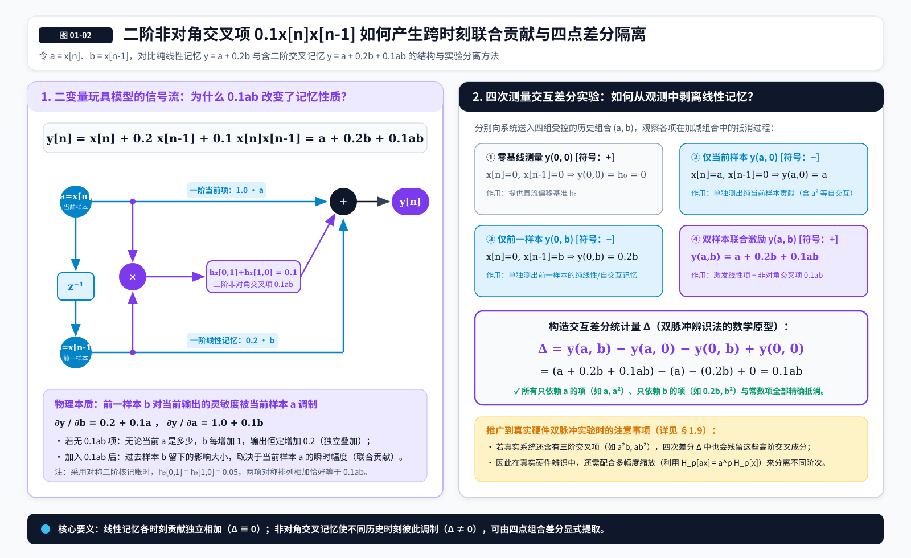
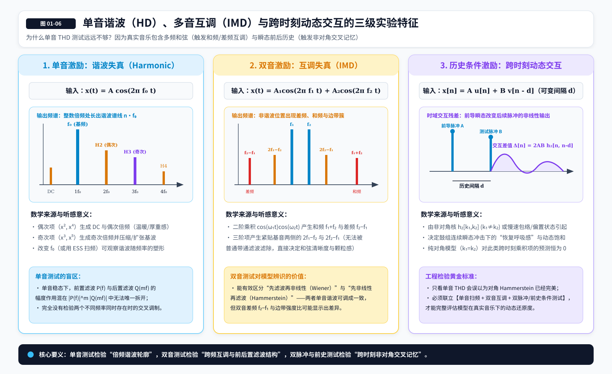
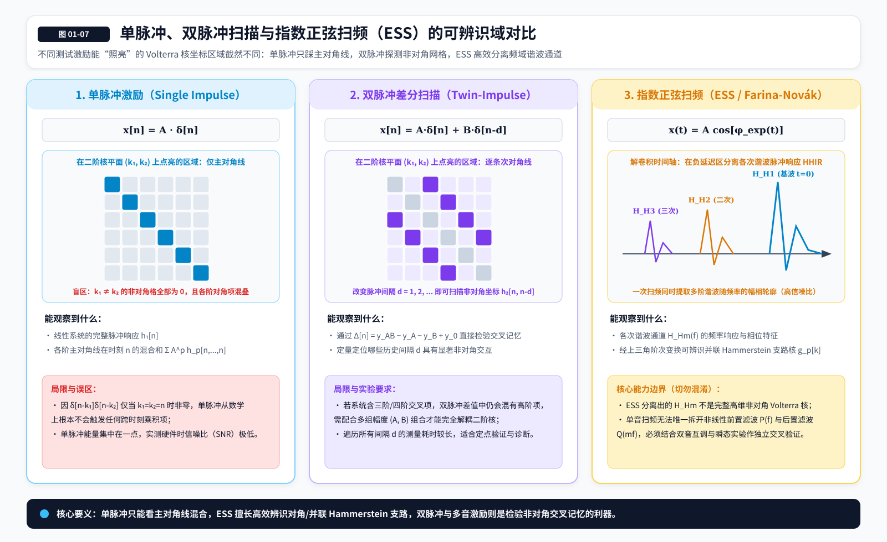
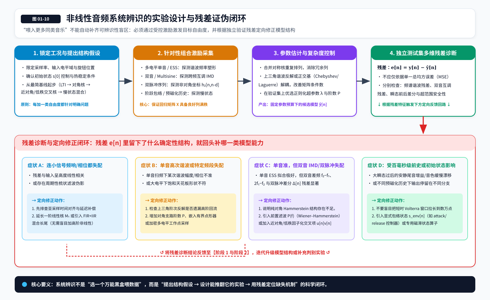
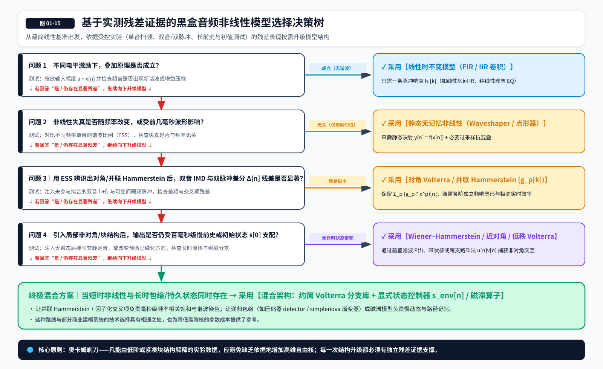

# 01 Volterra 级数

> **版本：v8 · 阶次反解矩阵、符号统一与混叠定量增补版（继承 v7 图文版）**  
> **所属系列：Volterra Wiki**  
> **配图说明：** 本章 16 张 SVG 配图与 Markdown 文件配套提供，建议使用完整素材包以保持相对路径有效。  
> **阅读定位：从前置概念进入 Volterra 的正式数学结构，建立它在非线性音频系统辨识中的用途、优势、成本与能力边界。**  
> **前置阅读：《00_前置概念与术语约定_图文版.md》。**  
> **本章原则：解释每一种数学结构为什么有必要出现，以及它到底比前一种模型多表达了什么。本章只概览常见约简形式，不把高维核辨识的算法细节提前塞进导论。**

## 1.1 我们真正想解决的，是哪一种音频建模问题？

在前置概念中，我们已经把一台音频设备视为从输入产生输出的系统，也区分了线性、非线性、记忆与状态。现在不妨提出一个更具体的问题：假设我们想复刻某台模拟前级，只能向它送入测试音频并录下输出，而且已经排除了接口增益、采样时钟和明显的测量误差，该怎样选择一个足以描述它的数学模型？

如果设备的作用只有固定的频率响应与相位变化，那么线性卷积便可以完成任务；如果它主要添加随瞬时幅度变化的失真，一条静态 waveshaper 曲线也许已经够用。但真实设备可能还会表现出第三种现象：在当前输入幅度相同的情况下，因为几毫秒以前经历的波形不同，当前输出的非线性部分也不同。单靠静态曲线不能解释它，而把历史样本简单地线性相加，也未必足够。

特别需要注意，**“一个系统有记忆”和“不同历史时刻之间存在非线性交互”是两件不同的事**。普通 EQ 当然有记忆，稳定的 IIR 滤波器也可能保留很长的衰减尾部，但这类线性记忆并不意味着历史样本会相互改变对输出的贡献。Volterra 级数最值得我们研究的地方，就是它允许非线性不只发生在某一个采样点上，还可以发生在**多个历史采样点之间**。

不过，这还不能直接证明实际设备必须使用完整 Volterra 核。许多滤波器与静态非线性的组合，同样能够制造复杂的动态失真。真正的研究问题应该是：**在指定的输入范围和测量条件下，哪一种结构能以合理的参数数量和运行成本，解释设备所表现出的输入—输出关系？** 接下来，我们先用一个只包含两个历史变量的模型把这件事讲清楚。

*图 01-01｜静态非线性、线性卷积与 Volterra 的能力对照。注意“静态非线性（有非线性、无记忆）”与“线性卷积（有记忆、无非线性）”分别扩展了两个正交的能力维度，二者并无从属或递进包含关系，汇合后才构成同时具备记忆与高阶非线性交互的 Volterra 模型。*

## 1.2 从两个采样点开始：为什么会出现“交叉记忆”？

假设某一时刻的输出只与当前输入及前一个采样点有关。为了让式子简单一些，令 $a=x[n]$，$b=x[n-1]$。最简单的线性模型可以写成

$$
y=a+0.2b.
$$

这里的 $a$ 是当前输入的贡献，$0.2b$ 是上一采样点留下的线性贡献。如果 $b$ 增加 $1$，输出始终增加 $0.2$，无论当前 $a$ 等于多少。这就体现了线性记忆的特点：**过去输入的影响可以有大有小，但各个输入变量的贡献彼此独立地相加。**

现在加入一个新的项：

$$
y=a+0.2b+0.1ab.
$$

多出来的 $0.1ab$ 看起来不过是两个数相乘，却使模型发生了本质变化。此时如果让 $b$ 增加 $1$，输出的变化量是 $0.2+0.1a$，也就是说，**上一采样点的影响大小，开始取决于当前采样点的幅度**。反过来，当前输入所产生的效果也取决于上一采样点是什么。这个乘积项描述的不是两个独立贡献的相加，而是二者的联合贡献。

我们还能设计一个非常小的实验，让这种交互单独显露出来。分别测量 $y(a,b)$、$y(a,0)$、$y(0,b)$ 和 $y(0,0)$，再计算

$$
\Delta=y(a,b)-y(a,0)-y(0,b)+y(0,0).
$$

对于刚才的模型，计算结果恰好是

$$
\Delta=0.1ab.
$$

为什么要使用这种四次测量的组合？因为只随 $a$ 改变的贡献、只随 $b$ 改变的贡献，以及常数偏移，都会在相减时被抵消，只有二者共同参与才产生的部分会留下来。这是一种非常基础的**交互作用隔离**思想。实际硬件存在更多历史变量、更高阶交互和噪声，因此四次测量不一定只留下纯二阶项；但这个例子已经说明，我们为什么需要超越线性卷积。

再往前走一步：如果模型不仅依赖 $x[n]$ 和 $x[n-1]$，而是依赖最近几十、几百个采样点，那么类似 $x[n-2]x[n-7]$ 的组合就会大量出现。我们不可能手工给每一种组合写一条单独的物理解释，于是需要一套统一的数学记账方式。**Volterra 级数，正是把这类不同阶数、不同历史位置的输入乘积组织起来的一种通用表示。**

*图 01-02｜二阶非对角项如何使两个不同历史位置的输入产生联合贡献。*

## 1.3 从多项式到 Volterra：把刚才的玩具模型写成一般形式

回忆普通多项式的结构：$y=a_0+a_1x+a_2x^2+\cdots$。它可以把一个复杂的静态非线性拆成常数贡献、一次贡献、二次贡献以及更高次贡献。这里的“一次、二次、三次”不是谐波频率的名称，而是每个项里面**有多少个输入因子相乘**。

当系统需要同时考虑一整段输入历史时，我们可以把最近 $M$ 个采样点排列成一个历史向量：

$$
\mathbf{x}_n= \begin{bmatrix} x[n] & x[n-1] & \cdots & x[n-M+1] \end{bmatrix}^{T}.
$$

如果当前输出是这个向量的某个函数，即 $y[n]=F(\mathbf{x}_n)$，那么在适当的光滑性条件与选定工作点附近，可以像展开多变量函数一样，把它写成若干不同次数的项。一次项包含 $x[n]$、$x[n-1]$ 等各个历史样本；二次项除了包含 $x^2[n]$ 和 $x^2[n-1]$，还允许 $x[n]x[n-1]$；三次项则允许三个输入因子相乘，其中的历史位置可以相同，也可以不同。

把这种思想推广到任意阶，就得到一个有限阶、有限记忆的离散时间 Volterra 模型：

$$
\hat{y}[n] = h_0 + \sum_{p=1}^{P} \sum_{k_1=0}^{M-1} \cdots \sum_{k_p=0}^{M-1} h_p[k_1,\ldots,k_p] \prod_{i=1}^{p} x[n-k_i].
$$

这个公式第一次看可能显得很复杂，但它实际上只做了三件事。外层的 $\sum_{p=1}^{P}$ 表示把一阶至 $P$ 阶的贡献相加；中间的一组求和表示遍历该阶允许使用的历史位置；最后的 $\prod$ 表示把这些历史位置上的输入相乘，再乘上对应的权重 $h_p$。其中 $P$ 是**最高保留阶数**，$M$ 是**输入历史长度**，$h_0$ 是常数项，而 $h_p[k_1,\ldots,k_p]$ 就是第 $p$ 阶 **Volterra 核（Volterra Kernel）**。

不妨把前三阶单独展开：

$$
\begin{aligned} \hat{y}[n] &= h_0 + \sum_{k_1=0}^{M-1} h_1[k_1]x[n-k_1] \\ &\quad + \sum_{k_1=0}^{M-1}\sum_{k_2=0}^{M-1} h_2[k_1,k_2]x[n-k_1]x[n-k_2] \\ &\quad + \sum_{k_1,k_2,k_3=0}^{M-1} h_3[k_1,k_2,k_3]x[n-k_1]x[n-k_2]x[n-k_3] + \cdots . \end{aligned}
$$

我们马上能看到一个重要联系：**一阶 Volterra 项就是普通线性卷积；二阶开始，模型才引入历史输入的乘积；阶数继续提高时，联合参与的历史输入因子也随之增加。** 因此 Volterra 并没有推翻传统的线性系统理论，而是在它的基础上扩展了非线性表达能力。只保留 $h_1$ 时，我们实际上又回到了熟悉的 FIR / 脉冲响应语言。

刚才使用的是离散时间形式，因为我们最终要在数字音频插件中逐采样计算。若阅读 Schetzen 等经典文献，还会遇到连续时间的形式。对于因果、时不变、单输入单输出系统，常用的形式化写法是

$$
y(t)=h_0+\sum_{p=1}^{\infty} \int_0^{\infty}\!\cdots\!\int_0^{\infty} h_p(\tau_1,\ldots,\tau_p) \prod_{i=1}^{p}x(t-\tau_i) \,d\tau_1\cdots d\tau_p.
$$

其中 $\tau_i$ 表示过去的第 $i$ 个延迟坐标。每一重积分都在累积一种历史位置组合的贡献，因此它可以看成离散模型中“对所有延迟索引求和”的连续时间对应形式。式子里的无穷阶与无穷历史是一般理论所使用的记法，**不意味着每一个物理系统都满足相应展开与收敛条件，更不意味着实时插件应该计算无穷多个项**。真正实现时，我们通常需要选定最高阶数、记忆范围或压缩结构。

上面的式子默认使用零附近的输入作为变量、采用因果历史，并且把各阶核直接定义为对应求和式里的系数。有的数学文献会在展开式里显式写出 $1/p!$，有的则把这一系数吸收到核定义中。两种写法在保持一致的情况下可以互相转换；**本 Wiki 默认使用已经吸收相关系数的核记法**，之后遇到不同教材的公式时应先核对这一约定。

*图 01-03｜一阶、二阶与三阶 Volterra 核的维度直觉。它们分别拥有一个、两个和三个延迟索引，而不是指空间音频维度。*

## 1.4 为什么它被叫作“带记忆的 Taylor 级数”？

Taylor 级数的出发点，是在某个参考点附近利用函数的导数，逐渐构造出能够描述该函数变化的多项式。一个静态函数若在工作点附近满足合适条件，就可以写成

$$
f(x_0+u)=f(x_0)+f'(x_0)u+\frac{f''(x_0)}{2!}u^2+\cdots.
$$

但音频系统的输出往往不是只依赖一个 $u$，而是依赖整个输入历史。对于固定的输出时刻，我们实际上面对一个从**输入函数到一个输出数值**的映射，也就是前置章节介绍过的泛函。Volterra 的思想，可以理解为把普通 Taylor 展开推广到这一类以函数或信号为自变量的对象。相应的一阶贡献变成对输入历史的线性作用，二阶贡献变成两份历史输入之间的双线性作用，更高阶依此类推。

因此，“带记忆的 Taylor 级数”是一条很有帮助的直觉，但它不能被误读为一个无条件成立的定理。不是任何非线性动态设备，都能在任意输入范围里用一条全局收敛的 Volterra 级数完整表示。系统的光滑性、输入工作域、初始条件、记忆性质和展开方式都会影响结果。**在某个工作点附近存在有效的局部展开**，与**能够用很低的阶数在整个音频电平范围内准确建模**，更是两种不同的要求。

这一理论最初来自 Vito Volterra 对泛函的研究，后来经由 Norbert Wiener、Y. W. Lee、Martin Schetzen 等人的工作，与非线性系统分析及黑盒辨识逐渐建立紧密联系。对音频工程师而言，这段历史的意义不在于背下人名，而在于理解：**从输入—输出测量中寻找非线性系统规律，并不依赖神经网络才成为可能。** 在现代机器学习形成之前，就已经存在一套可以明确讨论非线性阶次、输入历史、核函数和辨识误差的数学框架。

还需要分清一个容易产生检索混淆的名称：**Volterra 级数（Volterra Series）**与**Volterra 积分方程（Volterra Integral Equation）**属于有关联却并不等同的数学对象。阅读数学专著时，看到“Volterra”并不意味着章节一定是在讨论音频里使用的高阶核展开；我们在本 Wiki 里关注的是非线性系统的 Volterra 级数表示及其工程约简。

*图 01-04｜从静态 Taylor 幂级数到带历史输入的 Volterra 展开的直观对应。这样的推广需要适当的数学条件，并不是对任意非线性系统都无条件成立。*

## 1.5 为什么 Volterra 核是多维的？

普通线性脉冲响应 $h_1[k]$ 只需要一个延迟坐标：过去第 $k$ 个采样点对当前输出有多大影响。假设我们要讨论两个历史位置之间的交互，就必须为两个位置分别安排坐标 $k_1$ 和 $k_2$，因此二阶核自然写成 $h_2[k_1,k_2]$。如果要讨论三个位置联合参与的贡献，就需要 $h_3[k_1,k_2,k_3]$。这里的“二维”“三维”，首先指的是**核系数有几个独立的延迟索引**，并不是空间音频里的二维、三维声场。

对于二阶核，可以把它想象成一张表：横轴是第一个延迟位置，纵轴是第二个延迟位置，表中每个格子都存放一个交互权重。处于主对角线 $k_1=k_2$ 的元素，对应同一个历史样本的平方，例如 $x^2[n-4]$；离开主对角线的元素，则对应不同历史样本之间的乘积，例如 $x[n-2]x[n-7]$。二者都属于二阶非线性，但包含的历史结构并不相同。

这就是为什么一种只具有静态失真曲线的模型，与一种能够描述**非对角交叉记忆（Cross-Memory）**的模型，虽然都可能生成谐波，却不必然具有相同的动态行为。它们的差别并不在于谁能制造更多谐波，而在于模型是否允许“某个历史位置的非线性贡献，受到另一个历史位置的输入影响”。

这里可以用一个简单的对照来理解：普通卷积允许 $h_1[2]x[n-2]+h_1[7]x[n-7]$，它们只会独立相加；二阶 Volterra 还允许 $h_2[2,7]x[n-2]x[n-7]$，使两个历史位置通过相乘发生联系。随着阶数提高，模型能够描述更多变量的联合交互，但它需要保存和估计的自由度也会迅速增加。这是一项能力的获得，同时也是代价的开始。

## 1.6 为什么同一个核可以“对称化”？又为什么要小心系数翻倍？

假设一个二阶核中分别存在 $h_2[2,7]$ 与 $h_2[7,2]$。由于普通实数乘法满足交换律，$x[n-2]x[n-7]$ 和 $x[n-7]x[n-2]$ 实际上是同一项。因此，这两个核系数的**总贡献**会相加，我们没有必要给两种排列赋予彼此独立、可区分的物理意义。

一般情况下，可以把二阶核改写为对称形式：

$$
h_{2,\mathrm{sym}}[k_1,k_2] =\frac{h_2[k_1,k_2]+h_2[k_2,k_1]}{2}.
$$

更高阶的核同样可以对所有索引排列求平均。这样做不会改变同一阶 Volterra 算子的输出，但可以把重复排列合并成更合理的独立参数集合。对于 $M$ 个可用延迟，二阶对称核只需要考虑 $k_1\leq k_2$ 的坐标，而不必把整张 $M\times M$ 的表都当作独立未知量。

这里有一个很容易出现在 C++ 实现和论文公式里的陷阱。继续使用前面的例子 $y=a+0.2b+0.1ab$，如果我们把它写进一个**遍历全部索引组合**的二阶 Volterra 求和式，并要求核是对称的，那么应当令

$$
h_2[0,1]=h_2[1,0]=0.05,
$$

两项相加后才得到 $0.1ab$。如果程序改成**只遍历 $k_1\leq k_2$ 的唯一组合**，对应交叉特征的合并系数则应当直接设为 $0.1$。这是两种不同的记账方法，不能一边遍历全部排列，一边又把已经合并的系数使用两次，否则非对角项会发生重复计数。

这件事对后续的参数数量统计和核辨识同样重要。**核的对称性减少的是独立自由度；是否对某个非对角项乘以排列重数，则取决于我们实际使用的求和约定。** 本系列在给出独立参数数量时默认按照“重复排列视为一个独立组合”的方式统计，具体实现时再决定使用完整对称核还是合并后的特征字典。

## 1.7 Volterra 里的“阶”，怎样变成我们听到的谐波与互调？

对于经典 Volterra 模型，第 $p$ 阶算子具有一个非常直接的性质：如果把整段输入乘以常数 $a$，它的第 $p$ 阶贡献就会乘以 $a^p$，即

$$
H_p[ax](n)=a^pH_p[x](n).
$$

原因并不复杂：第 $p$ 阶的每一个项里都有 $p$ 个输入因子，输入整体放大以后，每个因子都被放大 $a$ 倍，合在一起自然就是 $a^p$。这种**齐次性（Homogeneity）**使不同阶次在幅度变化时呈现不同增长速度，也提供了通过多电平测试区分阶次贡献的理论依据。这里顺手先把一个容易混淆的问题钉死：**Volterra 的第 $p$ 阶贡献，确实对应第 $p$ 阶核；但它不等于“只产生第 $p$ 次谐波”。** 阶次描述的是“有多少个输入因子参与乘积”，谐波阶数描述的则是“输出频率是基频的多少倍”，这两者相关，但不是同一个概念。

那么这些阶次怎样与声音联系起来？假设输入为正弦波 $x(t)=\cos(\omega t)$。它的平方满足

$$
\cos^2(\omega t)=\frac{1}{2}+\frac{1}{2}\cos(2\omega t),
$$

而立方满足

$$
\cos^3(\omega t)=\frac{3}{4}\cos(\omega t)+\frac{1}{4}\cos(3\omega t).
$$

因此，二次非线性可以产生直流与二次谐波，三次非线性则同时作用于基波和三次谐波。对于一个含有时延的动态 Volterra 核，不同历史位置还会使各个频率分量具有不同的幅度和相位权重，但**第 $p$ 阶非线性并不等于只输出第 $p$ 次谐波**。在无直流偏置的单频正弦输入下，奇偶性严格分离：**第 $p$ 阶奇数项会向所有不高于 $p$ 的奇次谐波（$1,3,\ldots,p$ 倍频）贡献分量；第 $p$ 阶偶数项会向所有不高于 $p$ 的偶次谐波（$0,2,\ldots,p$ 倍频）贡献分量**。因此，同一基波成分会同时受到一阶、三阶、五阶等所有奇数阶项的回流影响；同一次奇（或偶）次谐波也会汇集所有高于或等于它的奇（或偶）数阶次贡献（除非系统存在直流偏置或工作点偏移，才会打破奇偶分离）。

如果输入是两个正弦波，乘积会把频率相加或相减。例如最简单的二音乘积满足

$$
\cos(\omega_1t)\cos(\omega_2t) =\frac{1}{2}\cos((\omega_1+\omega_2)t) +\frac{1}{2}\cos((\omega_1-\omega_2)t).
$$

这就是理解**互调失真（Intermodulation Distortion，IMD）**的起点。真实设备的二阶、三阶乃至更高阶响应，都可能在多音输入下制造组合频率；这些组合频率的强度还可以随原始频率、输入相位和历史结构变化。对于混音、母带以及模拟硬件建模来说，单音谐波测试很有价值，却不足以替代多音测试，因为真实音乐从来不是只有一个正弦波在工作。

*图 01-05｜Volterra 阶次、核阶数和输出谐波的区别：阶次对应乘积因子数量及核的阶数，但不能简单等同于某一次谐波。注意在无偏置单频激励下，同一次奇（或偶）次谐波会同时受到多个不同奇（或偶）数阶次的共同贡献，奇阶与偶阶不会交叉混入对方的谐波列。*

*图 01-06｜从单频谐波到多音互调，再到不同输入时刻之间的非线性交互。图中的频率关系适用于常规的稳态多项式分析。*

## 1.8 Waveshaper、滤波器与 Volterra：差距到底在哪里？

静态 waveshaper 的表达形式是 $y[n]=f(x[n])$。它能够产生丰富的非线性失真，而且如果真实设备的主要特征就是一条相对稳定的瞬时传递曲线，那么它可能是最合理的实现。我们不应因为 Volterra 有高维核，就先验地认定它比一条精心设计的 waveshaper 更“真实”。真正需要比较的是哪些输入—输出关系被保留了，哪些被省略了。

如果 waveshaper 前面或后面接上线性滤波器，模型就获得了动态特性。例如**Hammerstein 结构**通常是先通过静态非线性，再通过线性系统；**Wiener 结构**则是先通过线性滤波，再进入静态非线性。对于带适当多项式的块结构模型，我们也可以将它们展开成对应的 Volterra 核。这样一来，Volterra 并不是站在这些传统结构的对立面，而是提供了一个更一般的数学坐标系，让我们看到不同块结构实际上对高阶核施加了什么限制。

一个直观例子是线性滤波器后接平方非线性：

$$
v[n]=\sum_k g[k]x[n-k],\qquad y[n]=v^2[n].
$$

将平方展开后，便得到

$$
y[n]=\sum_{k_1}\sum_{k_2}g[k_1]g[k_2] x[n-k_1]x[n-k_2].
$$

因此它对应一个具有 $h_2[k_1,k_2]=g[k_1]g[k_2]$ 结构的二阶 Volterra 核。注意，这个核一般不只存在于主对角线上，它已经具有非对角交互；但整张二维核又不是任意独立的，因为每一个位置都由同一条滤波器响应 $g$ 的两个值相乘决定。**具有非对角核，不代表模型必然需要完整的自由高维核。** 有些交互其实可以由非常紧凑的滤波器与非线性组合产生。

这也提示了一个更有研究价值的问题：当实验显示严格对角模型不够准确时，我们应该先判断缺少的非对角结构是否具有简单的可分离模式，而不是直接上升到完整 Volterra。否则很容易用大量参数重新学习一件几条滤波器支路就能表示的事情。

## 1.9 为什么普通脉冲响应不够？两个脉冲又能揭示什么？

对于线性时不变系统，测得脉冲响应以后就能通过卷积预测任意输入，这是线性系统理论最重要的结论之一。对 Volterra 系统而言，单个脉冲却不能提供全部高阶核的独立信息。这个结论可以完全在离散时间里理解，而不需要先处理连续时间 Dirac 脉冲相乘带来的数学细节。

假设输入是一枚幅度为 $A$ 的离散脉冲，即 $x[n]=A\delta[n]$，其中 $\delta[0]=1$，其余位置为零。在观察时刻 $n$，各阶中能留下来的乘积，都必须让所有历史索引落到同一个脉冲位置。于是第 $p$ 阶项只会访问 $h_p[n,n,\ldots,n]$ 这样的**主对角坐标**。如果输出同时包含多个阶次，这些阶次的主对角贡献还会混在一起，必须借助输入幅度变化或其他辨识手段进一步分离。

那么怎样观察非对角位置？一个自然的办法是使用**两枚时间位置不同的脉冲**。设第一枚在 $n=0$，第二枚在 $n=d$，分别控制它们的幅度 $A$ 与 $B$。如果系统只有线性卷积，那么两枚脉冲一起输入的输出，就应当等于两次单脉冲输出之和（扣除必要的基线项）。如果两枚脉冲共同出现时还产生了额外贡献，就可以通过组合差值把这部分交互提取出来。

对于一个纯二阶、对称核的模型，记 $u[n]=\delta[n]$，$v[n]=\delta[n-d]$，则

$$
\Delta[n] =H_2[Au+Bv](n)-H_2[Au](n)-H_2[Bv](n) =2AB\,h_2[n,n-d]
$$

在相应索引有效的观察时刻成立。式子中出现的 $2$，正好与上一节所说的两个非对角排列有关。改变脉冲间隔 $d$ 与观察时刻，就有机会探测不同的核坐标。这里的“有机会”很重要：**对于包含三阶、四阶等贡献的真实设备，双脉冲差值通常也包含更高阶的交叉项，不能直接把它除以 $2AB$ 就宣布测得了完整二阶核。** 还需要多幅度设计、阶次分离、噪声控制和其他约束。

因此，普通 IR、谐波脉冲响应（HIR）和真正的高维 Volterra 核，不能不加区分地使用。指数扫频（ESS）等方法可以高效地提取某些非线性响应信息，并在特定块结构假设下辨识相应的支路，但**测出了不同谐波对应的响应，不自动意味着已经测出了所有非对角高阶核**。这也是为什么我们后面需要专门讨论多音、双脉冲与历史条件化实验：不同测试信号能够观察到的结构并不相同。

*图 01-07｜单脉冲、双脉冲和 ESS 可以观察的系统性质不同。ESS 分离出的谐波响应不应直接等同于完整高维 Volterra 核。*

*图 01-08｜从实验激励和响应数据到动态卷积分支、或到高阶 Volterra 核辨识的两条路径。原始卷积文件本身不自动等于高阶核。*

### 1.9.1 ESS 测出了“哪个频率更容易失真”，为什么仍不能直接还原硬件内部结构？

在音频制作中，我们可能观察到两台模拟前级有截然不同的染色习惯：一台受到低频驱动时更容易产生明显失真，另一台面对高频输入时却呈现更强烈的非线性响应。这类“频率相关的失真个性”，正是 ESS 阶次分离有机会帮助我们捕获的重要信息。在适当的测量条件下，把不同频率扫过设备，进行解卷积并分离谐波响应，就能获得关于各阶谐波幅度、相位和时间响应随频率变化的资料。**ESS 发现的是原设备已经存在的非线性特征，而不是在分离步骤中创造新的音色。**

为什么这些测量能够转化为可运行的模型？考虑一个对角 Volterra／并联 Hammerstein 支路：

$$
y_p[n]=\sum_k g_p[k]x^p[n-k].
$$

这里的 $g_p[k]$（对应频域响应 $G_p(f)$）是第 $p$ 阶多项式特征之后的一维 FIR 核。为什么从 ESS 解卷积分离出的“第 $m$ 次谐波响应” $H_{Hm}$ 不能直接拿来当作第 $p$ 阶支路核 $G_p$？不妨以包含 $p=1,3,5$ 三个奇次支路的并联 Hammerstein 模型为例。当输入单频余弦信号 $x(t)=A\cos(2\pi ft)$ 时，利用三角幂恒等式（或 Chebyshev 多项式展开）：

$$
\begin{aligned} \cos^3(\theta)&=\frac{3}{4}\cos(\theta)+\frac{1}{4}\cos(3\theta),\\ \cos^5(\theta)&=\frac{10}{16}\cos(\theta)+\frac{5}{16}\cos(3\theta)+\frac{1}{16}\cos(5\theta), \end{aligned}
$$

将各支路在倍频处的稳态复频响叠加后，实际测得的基波、三次谐波与五次谐波复频谱分量分别为：

$$
\begin{bmatrix} H_{H1}(\Omega) \\ H_{H3}(\Omega) \\ H_{H5}(\Omega) \end{bmatrix} = \begin{bmatrix} A & \frac{3}{4}A^3 & \frac{10}{16}A^5 \\ 0 & \frac{1}{4}A^3 & \frac{5}{16}A^5 \\ 0 & 0 & \frac{1}{16}A^5 \end{bmatrix} \begin{bmatrix} G_1(\Omega) \\ G_3(\Omega) \\ G_5(\Omega) \end{bmatrix}.
$$

展开来看，在任意目标频率 $\Omega$ 处，高阶支路会通过**上三角关系**向低次谐波逐级回流：

$$
\begin{aligned} H_{H5}(\Omega)&=\frac{A^5}{16}G_5(\Omega),\\ H_{H3}(\Omega)&=\frac{A^3}{4}G_3(\Omega)+\frac{5A^5}{16}G_5(\Omega),\\ H_{H1}(\Omega)&=A\,G_1(\Omega)+\frac{3A^3}{4}G_3(\Omega)+\frac{10A^5}{16}G_5(\Omega). \end{aligned}
$$

这组方程清楚地表明：**仅当最高只保留到三阶（$G_5=0$）时**，三次谐波幅度才单纯与 $A^3\lvert G_3(3f)\rvert/4$ 成正比；一旦模型包含五阶、七阶或更高阶支路（例如商业引擎常见的多支路配置），测得的“三次谐波响应”里就已经混入了五阶核 $G_5$ 乃至更高奇数阶核的分量。因此，在 Antonín Novák 等人建立的同步扫频（Synchronized Swept Sine）辨识流程中，必须利用上述上三角矩阵**从最高阶往低阶逐级回代反解**（同时配合相位约定与窗函数截断），才能把测得的谐波脉冲响应（HHIR）正确还原为并联 Hammerstein 支路的滤波器核 $g_p[k]$。若没有这一模型假设与线性反变换，谐波响应文件既不等于对角支路核 $g_p[k]$，更不能直接等同于完整的高维 Volterra 核。

还有一个更深的限制：**测到某个输入频率特别容易激发失真，不等于知道失真具体发生在设备的哪个内部环节。** 对一个“非线性之前有滤波、之后还有滤波”的系统，令前级线性频响为 $P(f)$，后级线性频响为 $Q(f)$，中间采用简单三次非线性，那么三次谐波的幅度可写成

$$
A_{H3}(f)=\frac{A^3}{4}\,\lvert P(f)\rvert^3 \lvert Q(3f)\rvert.
$$

这个式子说明，我们从单音测量中看到的低频失真偏重，可以由非线性**之前**的低频增强导致，也可以由非线性**之后**对相关谐波频率的塑形导致，甚至由两者共同造成。在限定工作范围内，不同内部拓扑有可能得到很接近的单音谐波结果。频率响应、相位、多电平测量与双音／多音互调能够帮助我们进一步区分候选模型，但单一 ESS 记录并不保证内部结构唯一可辨识。

对于音频建模，这恰好给出一条值得实验验证的路径：先用 ESS 估计不同阶次的谐波响应，在明确模型假设后辨识并联 Hammerstein 的 FIR 分支；再用双音、多音、瞬态和不同前史条件独立检验。如果一个模型能够准确重现单音频率相关失真，却不能重现同一台设备对多频音乐的互调结构，那么最应该怀疑的未必是“谐波阶数不够高”，也可能是它没有表示真实设备的前置滤波、非对角交叉记忆、状态依赖或时变行为。**单音中观察到的音色指纹与多音下的完整非线性行为，应当分开评估。**

## 1.10 从核系数看到的是输入—输出规律，不是电路内部的照片

当我们从测量中拟合出 $h_2[2,7]$ 或某个低秩核时，很容易进一步推断：它是不是某个电容的时间常数？是不是变压器的磁化过程？是不是电子管的偏置状态？这些设想可以作为物理假说，却不能仅凭核系数本身得到证明。因为不同电路、不同块结构，甚至不同的等效数学模型，都可能产生相同或近似相同的外部输入—输出关系。

Volterra 的优势是**输入—输出意义上的可解释性**：我们能够讨论哪些非线性阶次比较重要，哪些历史位置之间存在显著联合贡献，不同电平下各阶如何变化，以及某种约简究竟舍弃了哪些自由度。这种解释可以用于设计新的测量实验，也可以帮助我们比较多个候选模型。但**输入—输出可解释性不等于内部物理机制的唯一可辨识性**。如果要确认某个贡献的物理来源，就需要结合电路拓扑、受控条件变化、元件测试、白盒仿真或其他独立证据。

这一区分对于研究商业音频插件同样适用。即使通过黑盒测量、反编译线索或数值拟合，发现某种动态非线性结构与目标插件高度一致，也只能在证据允许的范围内讨论它的行为与可能实现。对于未知实现，**能拟合输出**、**能够推断内部结构**和**知道原厂实际上采用了什么算法**，仍然是证据等级不同的三个结论。

## 1.11 为什么 Volterra 也需要训练？它和神经网络的训练有什么不同？

写出了公式，并不意味着知道所有核系数。假设我们决定保留一阶、二阶和三阶项，且只考虑最近 $M$ 个采样点，那么每一种历史乘积都可以看成一个已知的**输入特征（Feature）**；需要估计的，是这些特征前面的权重。将所有特征排成向量，就可以写成

$$
\hat{y}[n]=\boldsymbol{\phi}^{T}[n]\boldsymbol{\theta}.
$$

这里的 $\boldsymbol{\phi}[n]$ 可以包含 $x[n]$、$x[n-1]$、$x^2[n]$、$x[n]x[n-1]$ 等等，而 $\boldsymbol{\theta}$ 包含相应系数。**虽然模型对输入是非线性的，但在特征字典已经固定时，输出对这些待估计系数仍然是线性的。** 这句话非常重要：它解释了为什么大量 Volterra 识别问题能够用最小二乘（LS）、Ridge、LASSO、LMS 或 RLS 等熟悉的估计方法处理，而不必总是采用深度神经网络那样的端到端非凸训练。

如果把多个采样时刻的特征堆叠起来，就形成

$$
\mathbf{y}\approx\mathbf{X}\boldsymbol{\theta}.
$$

在数据充分、矩阵条件良好并且模型假设适当时，我们能够通过优化输出误差估计参数。然而，**可以写出求解公式，不代表参数一定能被可靠识别**。例如训练素材只有一个固定频率、一个固定电平，那么大量不同的历史乘积特征可能高度相关，甚至根本无法独立变化。此时即使训练误差很低，不同系数组合也可能产生几乎相同的拟合结果。算法不能凭空从未被激励过的输入维度中恢复信息。

正则化之所以重要，就是因为我们并非只希望得到一个最能贴合已有数据的系数集合，还希望它在噪声存在、训练样本有限和输入条件变化时保持合理。例如 Ridge 倾向于限制系数幅度，LASSO 倾向于形成稀疏解；两者都可以改善某些欠定或病态问题，但也会引入不同的结构偏好。真正需要回答的是：**我们用什么输入激励设备、让哪些特征有机会被区分、选择何种结构先验，以及拿什么未见过的输入检验模型。**

*图 01-09｜神经网络权重学习与 Volterra 核系数辨识的共同点及区别。给定结构不等于自动知道参数。*

## 1.12 为什么“喂更多音乐”不等于“测到了更多系统结构”？

一段音乐可能同时包含大量频率、电平和瞬态变化，作为模型的最终听感测试非常有价值。但如果所有训练音频都来自相似的曲风、响度与动态范围，某些关键物理工作区间便可能始终没有被充分访问。即使总数据量很大，仍然可能缺少辨识某些参数真正需要的独立变化。

单音适合研究不同驱动电平下的谐波分布，却很难独立呈现多频互调；双音与 multisine 能让频率组合的交互更加清晰；扫频有利于观察随频率变化的响应，但必须明确采用哪一种非线性模型假设；单脉冲能够提供有用的瞬态资料，却不足以覆盖完整高阶核；双脉冲和多脉冲则可以主动改变历史位置关系；持续电平、包络调制以及不同预激励历史，可以用于观察慢动态、状态分支和释放行为。

因此，我们应当把**系统辨识的数据采集视为实验设计，而不只是收集音频素材**。先提出一个结构问题，例如“目标是不是只有对角记忆”“二阶非对角贡献是否显著”“持续大电平会不会改变随后小信号响应”，然后专门设计能够区分竞争假设的输入。这样得到的测量比盲目扩大数据集更具有解释价值。

验证同样不应该只剩下一个总体损失数值。波形对齐后的残差、不同电平下的误差、THD 与 IMD、瞬态前后的差分、条件化记忆测试、未参与训练的音乐素材，分别检验的是不同问题。**好的模型不仅应该在训练素材上拟合得好，还应该在我们事先约定的使用条件下，保留目标系统那些真正重要的行为。**

*图 01-10｜测量、建模与独立验证构成反复迭代的实验闭环，不是“喂入更多音乐”就能自动完成辨识。*

## 1.13 为什么完整 Volterra 会迅速变得难以实现？

到这里，我们已经知道高阶核多出来的自由度有什么作用，也知道它们的系数需要通过测量来估计。那么问题来了：既然更多自由度意味着更强的表示能力，为什么不直接建立一套完整的九阶、几十毫秒记忆的 Volterra 模型，再用大量数据训练？答案在于高维历史组合的数量增长得太快。

假设每一阶都允许使用 $M$ 个历史位置。如果暂时不利用核对称性，第 $p$ 阶具有 $M^p$ 个核坐标。如果将排列重复的坐标合并，在允许延迟索引重复的条件下，第 $p$ 阶的独立参数数量为

$$
N_p=\binom{M+p-1}{p}.
$$

例如取 $M=64$，将未利用对称性的原始张量坐标数 $M^p$ 与对称核独立参数数量 $N_p=\binom{M+p-1}{p}$ 对照如下：

| Volterra 阶数 $p$ | 原始张量坐标数 $M^p$（对应图 01-11） | 对称核独立参数数量 $\binom{M+p-1}{p}$ |
|---|---:|---:|
| 一阶 ($p=1$) | 64 | 64 |
| 二阶 ($p=2$) | 4,096 | 2,080 |
| 三阶 ($p=3$) | 262,144 | 45,760 |
| 四阶 ($p=4$) | 16,777,216 | 766,480 |
| 五阶 ($p=5$) | 1,073,741,824 | 10,424,128 |

在 $48\,\mathrm{kHz}$ 采样率下，64 个采样点只对应约 $1.33\,\mathrm{ms}$ 的历史。也就是说，我们还没有开始认真表示压缩器的释放时间、磁带机的慢变量或长时间尺度的材料记忆，仅仅是这不足两毫秒的完整五阶结构，就已经拥有超过一千万个独立参数。这里还没有计入更多阶次，也没有考虑为保证可靠估计而需要的训练数据、数值条件和模型验证成本。

让记忆窗口达到一秒会发生什么？此时 $M=48\,000$，单独一个二阶对称核就需要

$$
N_2=\frac{48\,000\times48\,001}{2}=1\,152\,024\,000
$$

个独立系数。这还只是二阶、还没有把一阶或更高阶加入进来。**因此，“Volterra 可以表示非线性记忆”并不等于“应该把所有记忆都表示成逐采样的完整高维核”。** 如果物理过程本来只需要几个慢速状态变量，那么使用数十亿个直接历史交互系数去描述它，很可能是在用最笨重的方式解决一个更低维的问题。

这也解释了为什么 Volterra 的实际研究往往很快从“研究完整核的表达能力”转向“研究完整核究竟有哪些自由度值得保留”。接下来出现的各种约简形式，并不是对理论的背离，而是将它变成可辨识、可运算、可实时运行的必要途径。

*图 01-11｜完整 Volterra 核的参数规模随阶数和记忆长度快速增长。图中同时并列对比了未利用对称性的全张量坐标数 $M^p$ 与对称核独立参数数量 $\binom{M+p-1}{p}$。*

## 1.14 Volterra 的常见约简形式：它们究竟各自舍弃了什么？

理解约简的最好方法，不是先记住十几个英文缩写，而是问每一种方法提出了什么结构假设。完整 Volterra 允许每一阶、每一种延迟组合拥有独立的系数；约简模型则认为，某些阶次可以忽略，某些历史可以缩短，某些交叉项不存在，或者大量核系数虽然非零，却能够由少量潜在模式生成。每减少一部分自由度，计算和辨识都会更容易，但我们也有可能失去真实设备所需的表达能力。

*图 01-12｜从完整核到对角、近对角、稀疏、低秩、正交基以及多项式记忆动态卷积的简化思路。后几种属于结构化实现方法，不能都简单理解为在二维核图上删掉几个格子。*

### 1.14.1 阶次截断与分阶记忆：先控制问题的大小

最直观的做法，是让 Volterra 级数只保留到第 $P$ 阶。它隐含的假设是：在目标电平范围内，更高阶的贡献对我们关心的误差与听感已经不够重要。几乎所有实际工程实现都需要某种程度的阶次截断，但需要保留到三阶、五阶还是更高阶，并不能单靠设备营销文案中的“某次谐波”来决定。

另一种非常自然的做法，是让不同阶次具有不同的记忆长度，例如 $M_1 \gt M_2 \gt M_3$。这样我们可以给一阶线性响应保留较长的尾部，却只给较高阶非线性保留较短的历史。如果目标设备的高阶失真主要集中在快速局部过程，这种做法会非常有效；但“阶数越高，记忆必然越短”并不是数学定律，它始终是一种需要验证的工程假设。

### 1.14.2 对角 Volterra、Memory Polynomial 与 Parallel Hammerstein

如果我们只保留满足 $k_1=k_2=\cdots=k_p=k$ 的高阶核坐标，并记主对角线上的一维权重序列为 $g_p[k]=h_p[k,k,\ldots,k]$，那么第 $p$ 阶就简化成

$$
H_p[x](n)=\sum_k g_p[k]x^p[n-k].
$$

它不再允许不同历史位置相乘，而是让每一个延迟位置先产生自己的 $p$ 次幂，再把结果线性相加。这种结构通常称为**对角 Volterra（Diagonal Volterra）**。将多个幂次合并，便得到一种实信号的**记忆多项式（Memory Polynomial）**形式。它用很少的系数保留了“不同历史位置可以经历不同强度、不同阶数的非线性”这一能力，却舍弃了非对角交叉项。

换一个信号流视角，同一个结构可以写成若干并行支路：每个支路先计算 $x^p[n]$，再通过属于该阶次的线性滤波器，最后把全部支路相加。这就是常见的**并行 Hammerstein（Parallel Hammerstein）**多项式模型。在实信号、有限阶且使用 $x^p$ 作为基函数的约定下，这两种写法具有直接的代数对应关系。前者强调核坐标，后者强调实际 DSP 信号流，因此不应将它们误认为两个在表达能力上完全独立的模型族。

需要补充一个跨领域术语差异：在射频功放建模里，Memory Polynomial 也常使用复基带形式 $x[n-k]\lvert x[n-k]\rvert^{p-1}$。这种写法与这里针对实数 PCM 音频使用的 $x^p[n-k]$ 并非在所有条件下都可以直接互换。本章主要讨论实信号的多项式 Volterra 表示，涉及射频文献时会单独说明信号与基函数约定。

### 1.14.3 Wiener、Wiener–Hammerstein：完整非对角核也可能有紧凑结构

上一节已经看到，“滤波后平方”能生成非对角二阶核，但这个核由两个相同的滤波器系数相乘得到，所以其自由度远少于任意二维表。一般的**Wiener 块结构**同样如此：先线性滤波，再通过某个静态非线性；如果静态非线性在研究区间内可以展开为多项式，每一阶便会出现由滤波器响应外积构成的高阶核。

如果再在静态非线性之后加入线性滤波，就得到**Wiener–Hammerstein** 一类结构。它所对应的 Volterra 核通常比简单 Wiener 支路更复杂，但仍然受到前后滤波器以及静态非线性形状的共同约束。这里最值得理解的不是块结构名字，而是**“具有交叉记忆”与“需要保存自由的全维核”之间没有必然关系**。当非对角结构由少量滤波器组合形成时，块结构模型可能以很低的 CPU 成本提供出色表现。

### 1.14.4 Near-Diagonal、Banded 与 GMP：保留局部交叉记忆

如果严格对角模型无法解释双脉冲、多音或其他交互实验，我们可以不必立即开放全部非对角位置，而是先允许对角线附近的一小片区域存在系数。例如对二阶核保留

$$
\lvert k_1-k_2\rvert \leq B,
$$

这就是**近对角 / 带状 Volterra（Near-Diagonal / Banded Volterra）**的一种直观约束：两个历史位置可以不同，但它们之间的距离不超过一个指定范围。更高阶模型也可以定义类似的局部历史邻域。这种结构适合验证一个具体的假设：目标系统的重要高阶交互是否主要发生在相邻或相近的时间位置？

**广义记忆多项式（Generalized Memory Polynomial，GMP）**同样经常通过增加少量前后相邻的交叉特征，去补足严格对角模型的不足。在常见复基带语境里，它可能含有 $x[n-k]\lvert x[n-k-m]\rvert^q$ 等形式。对于实信号、选择合适的整数幂并符合多项式条件的情形，可以把相应项放进受限的历史交互特征集合；但涉及绝对值、复共轭等具体定义时，应当注意它不总是与普通实多项式 Volterra 的有限阶形式严格相同。因此，GMP 更适合被看作与局部交叉记忆思想密切相关的一类结构，而不是不附条件地把所有 GMP 都宣布为同一种对称 Volterra 核。

### 1.14.5 Sparse Volterra：允许远距离交互，但只保留少量位置

近对角模型假设重要交互聚集在对角附近；**稀疏 Volterra（Sparse Volterra）**则不一定预先限定交互必须相邻。它可以在较大的候选核空间里寻找少量真正重要的位置，例如某几个明确的延迟组合，或者少数跨时间尺度的交互项。对于这类结构，LASSO、OMP 等稀疏选择方法可以提供辨识手段。

这种做法的优点是保留了发现意外延迟组合的可能性；缺点是候选空间本身可能十分巨大，而且测量噪声、输入特征相关性和正则化选择都可能改变稀疏结果。稀疏不是“某几个拟合出的系数很小，就直接删掉”那么简单。要证明真正需要哪些项，还需要独立验证它们的可辨识性、稳定性与跨素材泛化。

### 1.14.6 Low-Rank Volterra：大量非零系数，可以由少量模式生成

低秩约简提出了与稀疏模型不同的假设：完整高维核中也许有很多非零位置，但这些系数并非彼此独立，而是能够由少量可分离模式组合。以一种保持核对称性的简化形式为例，设

$$
h_p[k_1,\ldots,k_p] \approx\sum_{r=1}^{R}\lambda_r \prod_{i=1}^{p}g_r[k_i].
$$

如果把这个结构代入 Volterra 求和式，就可以将大量高维交互改写成

$$
H_p[x](n) \approx\sum_{r=1}^{R}\lambda_r \bigl((g_r \ast x)[n]\bigr)^p.
$$

它意味着：先用 $R$ 条滤波器提取不同的历史响应，再对各支路输出取幂并加权相加，就能形成一个在高维核坐标中可能十分稠密的非线性系统。**模型不需要逐项显式计算每一种历史乘积，却能通过滤波器输出之间的代数结构生成这些交互。** 这正是低秩约简在实时音频里具有吸引力的原因。

这里示范的是便于理解的对称可分离形式；更一般的 CP / PARAFAC、Tucker、Tensor Train 等张量分解，允许使用不同的因子组织方式，表达能力、参数数量与计算结构也并不完全一样。低秩模型不保证适合所有高阶核，但它将一个非常值得实验的问题带到台前：**真实硬件的复杂非线性记忆，是否由少数动态模态之间的作用主导？**

### 1.14.7 Laguerre、Kautz 与正交基：先压缩时间，再讨论非线性

前面几种约简主要在控制交互坐标，而另一类方法先考虑：我们有没有必要把过去每一个采样点都当作独立输入变量？假设某台设备包含几种快慢不同的响应，如果这些历史变化能够被少量合适的动态基函数概括，那么我们可以先计算

$$
z_r[n]=(B_r \ast x)[n],\qquad r=1,\ldots,R,
$$

再在 $z_1[n],\ldots,z_R[n]$ 上建立多项式模型。**Laguerre、Kautz 以及更一般的正交基函数（Orthogonal Basis Functions，OBF）**，都可以服务于这种思路。它们的共同目标是用少量具有一定时间或频率特性的滤波器输出，代替直接保存大量彼此独立的逐采样历史特征。

这种压缩对于较长衰减记忆尤其有潜力，但基函数本身需要选择。若基函数的时间常数、振荡模式或频率区域与设备实际行为相差很远，就算后面接了很高阶的多项式，也可能产生结构性误差。**压缩历史不是凭空消除记忆信息，而是在提出“这些少量特征已经足够描述历史作用”的假设。**

### 1.14.8 混合结构：不同阶次、不同时间尺度，不必采用同一种约简

真实设备的不同非线性阶次未必具有相同的时间分布：一阶可能需要较长的频响尾部，二阶可能包含局部非对角交互，三阶可能具有少数可分离动态模式，更高阶可能主要发生在非常短的局部历史。于是我们可以设想一种混合模型，让一阶采用较长的 FIR，二阶采用 Near-Diagonal，三阶采用 Low-Rank，其他高阶仅保留对角项，再按需要使用少量慢状态表示超过直接历史窗口的变化。

这种设想不是某一种已经被证明普遍最优的“终极 Volterra 模型”，而是一套**按阶次、时间尺度和交互形状分别配置表示能力**的工程方法。它是否比单一结构更准确、更高效，必须在统一的训练数据、独立测试、参数预算和 CPU 预算下比较。对于我们的音频建模研究，这也是一个很自然的探索方向：不预设完整核绝对正确，也不预设所有高阶交互都必须被压缩到主对角线。

为了把这些概念放进同一张地图，可以将常见约简概括如下：

| 结构 | 核心假设 | 主要节省的资源或保留的能力 |
|---|---|---|
| 阶次截断 | 高于某阶的贡献可以忽略 | 控制非线性最高复杂度 |
| 分阶记忆 | 各阶所需历史长度不同 | 减少不必要的高阶长记忆 |
| Diagonal / 实信号 Memory Polynomial | 同一历史位置的幂次贡献占主导 | 极紧凑的非线性记忆 |
| Parallel Hammerstein | 不同静态幂次具有各自的线性响应 | 用并行支路实现对角型核 |
| Wiener / Wiener–Hammerstein | 核由滤波器和静态非线性共同约束 | 保留结构化的非对角交互 |
| Near-Diagonal / Banded | 重要交互集中在邻近历史位置 | 保留局部 cross-memory |
| GMP 类结构 | 少量附加交叉特征足以补足对角模型 | 低成本扩展局部交互 |
| Sparse | 只有少量高维核坐标重要 | 选择有限但不一定相邻的交互项 |
| Low-Rank | 大量核元素由少量可分离模式生成 | 压缩稠密高维核 |
| Laguerre / Kautz / OBF | 长历史可以投影到少量动态特征 | 压缩历史维度 |
| Hybrid | 不同阶次和时间尺度有不同结构 | 按目标设备定制成本与表达能力 |

表中各项并非完全互斥。例如我们可以将“分阶记忆”“低秩”和“稀疏”同时用在不同阶次，也可以在正交基投影后的特征上使用局部交互。研究的关键不是凑齐全部名词，而是始终追问：**每一种约束具体删掉了什么，剩下的模型还能不能通过真实设备的验证实验？**

*图 01-13｜常见 Volterra 模型及相关块结构的关系导览。它用于理解工程联系，并非彼此互斥、严格从属的数学分类树。*

## 1.15 多项式为什么会在训练范围之外失控？

Volterra 与 Taylor 展开的关系，还意味着一项很重要的工程风险。设一个有限阶模型为

$$
\hat{y}[n]=h_0+H_1[x](n)+\cdots+H_P[x](n).
$$

如果把整段输入放大 $a$ 倍，各阶输出便分别按 $a,a^2,\ldots,a^P$ 缩放：

$$
\hat y_a[n]=h_0+aH_1[x](n)+a^2H_2[x](n)+\cdots+a^PH_P[x](n).
$$

如果最高的非零阶次为 $P$，且我们选取的输入方向使该阶贡献不为零，那么随着 $\lvert a\rvert$ 持续增大，高阶项最终会主导输出。对于任何非恒定的有限阶多项式输入—输出映射，至少存在使输出幅度随输入幅度无界增长的方向。因此，**普通有限阶 Volterra 并不自带真实硬件的饱和上界**。一个在正常驱动下拟合得很好的模型，在训练电平之外可能突然输出过大的数值，甚至使后续 DSP 运算溢出。

最直观的例子是用有限阶奇次多项式近似 $\tanh(x)$。真实的 $\tanh(x)$ 随输入增大会渐近趋向 $1$，但只要近似多项式含有非零最高次项，它在幅度足够大时便会被这个幂次主导，无法永远停留在饱和平台附近。这不意味着所有多项式在正常输入下都会失控，也不意味着局部多项式拟合没有价值；问题是**训练域内的近似精度与训练域外的安全行为，需要分别设计和验证**。

同时必须严格区分两种经常被混叫作“发散”的现象。对于有限阶、有限记忆的前馈 Volterra，在输入始终有界且核系数有限时，输出也有界；这是因为它只包含有限数量的加法与乘法，并不存在由自身输出反馈形成的无限时间累积。因此，它的主要风险是**输入幅度外推时的多项式非受限增长**，而不是“即使输入保持有限，内部状态仍随时间自发爆炸”的递归不稳定。若我们在模型外面加入反馈，稳定性问题就必须另行分析。

实际开发可以通过明确有效输入电平、使用多电平验证、测量超训练域行为、设计有界非线性支路或安全保护机制来处理这一问题。但保护措施本身可能改变目标传递特性，所以不应一边加入任意限幅，一边宣称模型在所有驱动电平上仍与目标硬件严格等价。

## 1.16 Hard Clipper 与软饱和：它们为什么不是同一种数学边界？

假设我们想表示一个理想的硬削波器：

$$
y=\begin{cases} -T, & x \lt -T, \\ x,&\lvert x\rvert \leq T,\\ T, & x \gt T. \end{cases}
$$

这个映射在 $\pm T$ 处出现折点，并且输出始终限制在 $[-T,T]$ 之内。任何非恒定的普通有限阶多项式，都不可能在整个无界实数输入域上与它完全相等，因为非恒定多项式的幅度终究会向无穷增长。同时，在折点处也不能像对光滑函数那样，依靠一个通常的局部 Taylor 展开跨越阈值并期待它精确复现两侧的分段规律。

不过，**“不能由有限阶多项式全局精确表示”并不等于“有限阶 Volterra 不能近似 clipper”**。在一个指定的有限幅度区间内，连续的硬削波曲线可以被多项式逼近，只是要求越严，可能需要更高的阶数，而且阈值附近与训练域之外的行为都要特别检查。真正的问题往往不在于是否存在近似，而在于为什么要用昂贵、高阶、外推又危险的多项式，去描述一个原本可以用简单分段函数精确实现的目标。

软饱和则必须根据具体曲线判断。像 $\tanh$ 这样光滑的函数，在局部工作区间可以使用幂级数思想分析，在有限区间也可以用适当的多项式获得良好近似；但“光滑”不自动保证它的某一个 Taylor 级数在任意大输入下收敛。对于复杂的模拟前级或磁带饱和，更需要分清**瞬时传递曲线的光滑性**与**整个动态系统是否具有能够被紧凑 Volterra 核描述的历史结构**。两者并不是同一个问题。

## 1.17 Compressor 与 Limiter：真正困难的是递归控制和状态

压缩器与限制器的难点，与硬削波器不完全一样。硬削波器至少可以是一个纯粹的无记忆函数，而典型动态处理器需要根据输入历史决定当前增益。我们可以把它抽象成四个环节：电平检测、状态更新、增益计算，以及对音频施加增益。

$$
\begin{aligned} d[n]&=D(x[n]),\\ s_{\mathrm{env}}[n]&=F(s_{\mathrm{env}}[n-1],d[n]),\\ g[n]&=G(s_{\mathrm{env}}[n]),\\ y[n]&=g[n]x[n]. \end{aligned}
$$

其中 $s_{\mathrm{env}}[n]$ 是包络或慢速控制状态（这里遵循《00》第 0.24 节符号约定，使用 $s_{\mathrm{env}}[n]$ 而非 $e[n]$，以免与模型输出残差 $e[n]=y[n]-\hat{y}[n]$ 混淆）。这个状态可能通过 attack/release 递推持续更新，还可能根据上升和下降阶段切换不同的时间常数。现代母带限制器还可能包含前瞻、峰值保持、多时间尺度释放、立体声联动和其他条件切换。于是，同一个瞬时输入幅度可能对应不同的增益，差别来自先前电平形成的控制状态，而不只是当前采样点的静态非线性。

有限阶、有限记忆 Volterra 能不能近似压缩器？**可以，在限定历史长度、初始条件、输入分布和误差目标下，它能够近似某些动态增益行为。** 但如果希望一套低阶、短窗口的前馈多项式，在任意时间尺度与驱动条件下精确复现复杂压缩器，就往往既不合理，也不经济。即使目标的有限时域映射可以被高阶多项式逼近，我们仍可能需要极多项数来表示本可由少数包络状态高效递推的行为。

Look-ahead 还引出另一种需要解释的边界。如果某个限制器控制量显式依赖相对于目标输出时刻的后续输入样本，那么一个在**同样时间对齐方式下**只读取当前与过去输入的零延迟 Volterra 模型，就不能直接复制这种未来依赖。实际实时插件可以通过缓冲输入、延迟输出而实现前瞻；如果允许模型采用相同的整体延迟，我们也应在这一延迟框架下重新定义输入—输出关系，而不能简单说“有 look-ahead 的系统绝对不能由 Volterra 近似”。

因此，对于 Compressor 和 Limiter，更重要的不是给 Volterra 下一个绝对的“能”或“不能”，而是认识到**递归状态、条件分支与长时间控制过程，通常更适合使用专门的动态结构表达**。Volterra 可以作为整个模型的一个子模块，例如表示电平相关失真、短时交叉记忆或某个非线性部件，却未必适合作为全部增益控制逻辑的唯一载体。

## 1.18 磁滞与持久记忆：为什么“把窗口加长”依然不够？

讨论磁带机、变压器与磁性材料时，我们经常会碰到**磁滞（Hysteresis）**。它最特殊的地方，不是简单地让波形“反应慢一点”，而是同一个外部激励值，可能因为此前经历过不同路径，对应不同的内部磁化状态。对于具有剩磁或历史分支的系统，外部激励撤除后，某些内部状态仍可以持续保留。真实材料还可能同时具有速率相关、温度相关或缓慢弛豫过程，因此磁滞绝不能被简单等同为一个延迟器或低通滤波器。

想象两段输入历史：第一段曾经把磁性材料驱动到较强的正向磁化状态，第二段曾经驱动到另一条磁化分支。经过一段时间以后，最近的输入采样窗口已经完全相同，但材料内部可能仍然处在不同的磁化状态。若这两种状态会影响随后的输出，那么一个只查看最近 $M$ 个输入采样点、又没有任何额外状态变量的模型，就无法区分它们。**不是训练不够充分，而是模型看到的信息本身不够。**

这与前面所说的衰减记忆不同。对于足够快地衰减的记忆，增加窗口或采用合适的动态基函数，有希望让遗漏的远期影响逐渐变小；对于具有长期保留的路径状态，如果这段远期历史始终没有从系统内部消失，仅靠固定长度的近期窗口，就不能保证精确重现任意历史条件下的响应。因此，Play / Prandtl–Ishlinskii、Preisach、Jiles–Atherton 及其他显式状态或磁滞算子，往往比直接无限增加 Volterra 延迟维度更适合表示这些机制。

这并不排斥 Volterra 在磁性音频设备中的价值。磁性设备里的某些频率相关失真、局部动态、衰减记忆以及有限轨迹上的非线性行为，完全可以成为 Volterra 或混合模型的研究对象。但我们应当区分两个结论：**在限定测试轨迹上拟合出磁滞样的输入—输出效果**，与**真正保存了能跨越任意久远历史的磁性内部状态**。两者可能在某次音频测试里听起来接近，却具有不同的泛化边界。特别是在磁带机建模中，还应当将磁性材料的内部磁化状态与实际录放电路最终测得的电压输出区别开来，不能把“存在剩磁”直接等同于“零输入时音频输出一定非零”。

*图 01-14｜不同类型非线性行为对有限阶、有限记忆 Volterra 实现的挑战。横向位置是工程难度的定性示意，不是可被普遍证明的严格排序。*

## 1.19 时变、随机噪声与真实硬件：为什么好的残差也有解释边界？

本章讨论的经典离散 Volterra 模型通常假设核系数固定，即相同的输入历史在相同的初始条件下遵循相同的处理规则。但真实硬件还可能随着温度、供电、参数调制、材料状态或长期漂移发生改变。若处理规律本身随绝对时间变化，就需要引入时变核、额外控制输入或相应的状态变量，而不能继续把所有差异都塞进一套不变的核系数里。

随机噪声又是另一件事。一个确定性的 Volterra 模型可以学习设备可重复的非线性响应，却不能单凭相同的输入历史，准确预测每一次都不同的随机噪声样本。对于硬件测量，模拟转换器噪声、时序漂移、设备自身随机成分和模型结构误差，都可能出现在残差里。残差很大不自动证明 Volterra 表示能力不足，残差很小也不自动证明我们恢复了物理机制。合理的做法是先测量设备自身的重复性，并把可重复规律与随机变化分开评估。

本章一直以单输入单输出（SISO）为例，是为了把历史交互的数学本质讲清楚。对于真实的立体声设备，左右声道可能拥有不同的核参数，也可能通过共享电源、联动控制或其他通道耦合发生交叉影响。若要表示一条通道的输出对另一条通道输入的依赖，就需要把模型推广到多输入多输出（MIMO）或带共享状态的结构。**同一套 SISO 核在左右声道各运行一次，不等于已经表示了跨声道非线性交互。**

因此，评价一个黑盒模型时，除了问“模型有没有拟合好”，还应该问“参考输出本身有多稳定”“数据是否已正确对齐”“测试是否控制了状态与参数”“目标差异究竟可否重复”。这些问题并不属于 Volterra 独有，但由于高阶模型很容易把测量噪声当成需要拟合的细节，它们在高维核辨识中尤其重要。

## 1.20 Volterra 与神经网络：它们为什么会在同一个问题上相遇？

神经网络与 Volterra 看起来属于不同年代的技术：前者擅长通过训练形成内部特征表示，后者擅长把不同阶次的历史乘积显式列出来。但从系统辨识的角度看，它们其实经常在回答同一个问题：怎样用有限资源近似一个复杂的非线性输入—输出映射？

考虑一个接受有限历史向量 $\mathbf{x}_n$ 的单隐藏层网络：

$$
\hat{y}[n]=\sum_{r=1}^{R}a_r\,\sigma\!\left(b_r+\mathbf{w}_r^{T}\mathbf{x}_n\right).
$$

若激活函数在所研究工作点附近满足合适的展开条件，那么某个隐藏单元的非线性可以局部写成关于 $\mathbf{w}_r^{T}\mathbf{x}_n$ 的多项式。以二次项为例，

$$
(\mathbf{w}_r^{T}\mathbf{x}_n)^2 =\sum_{k_1,k_2}w_r[k_1]w_r[k_2] x[n-k_1]x[n-k_2].
$$

这恰好产生了一种可分离的二阶 Volterra 核。多个隐藏单元叠加后，便能形成若干可分离核的和；更高阶的局部展开也会出现类似结构。因此，在有限历史、合适光滑性与局部展开的前提下，**某些神经网络可以从 Volterra 视角理解为自动学习紧凑的高阶交互表示**。

当然，这并不意味着一般的神经网络都等于某个低阶 Volterra 模型，也不意味着具有递归状态的 WaveNet 类或状态空间网络可以直接被一个有限历史多项式完整替代。神经网络的优势在于能够以更灵活的方式学习复杂表示，而显式 Volterra 结构的优势在于便于按阶次、延迟位置和交互模式展开分析。两者可以竞争，也可以结合：例如把少量可解释的 Volterra 特征送进可学习模块，或者使用神经网络拟合 Volterra 难以压缩的剩余部分。

因此，我们没有必要把“Volterra 还是神经网络”当成必须二选一的技术信仰。更值得研究的是**在同一组目标行为、数据、延迟和 CPU 预算下，它们分别保留了什么，又遗漏了什么**。显式的数学结构与数据驱动的表示学习，在音频设备数字建模中本来就可以互相提供线索。

## 1.21 离散音频还要面对一个额外问题：非线性与混叠

在模拟电路里，非线性可以产生超出原始音频带宽的高频谐波与互调分量；在数字系统里，采样率则规定了能够无歧义表示的频率范围。如果我们直接以 $44.1$ 或 $48\,\mathrm{kHz}$ 采样率计算强非线性，那些本应出现在奈奎斯特频率以上的成分，可能折返到可听频带，产生与目标模拟设备并不相同的**混叠失真（Aliasing）**。

这一问题与 Volterra 的表示能力密切相关，却不完全是同一个层面。一个核可能在数学上正确描述了某种连续时间非线性关系，但将它直接离散实现时，仍然可能因为中间生成的高频分量而出现混叠。因此，**辨识模型的结构是否正确**，与**实现这个模型时有没有产生额外数字伪影**，应当分开测试。从频域卷积定理可以定量理解这一代价：若输入离散信号的最高有效频率为 $f_{\max}$，那么在计算第 $p$ 阶多项式乘积（如对角支路的 $x^p[n]$ 或非对角交叉项 $\prod_{i=1}^p x[n-k_i]$）时，时域的 $p$ 重相乘对应频域的 $p$ 重自卷积，生成的非线性特征带宽最高将展宽至 $p\cdot f_{\max}$。一旦 $p\cdot f_{\max}$ 超过奈奎斯特频率 $f_s/2$，超出部分就会在进入后续线性滤波器 $g_p[k]$ 之前直接折返到可听频带内（即使后续 FIR $g_p[k]$ 在高频具有很强的衰减，也无法消除已经在逐点取幂阶段折返进低频的混叠伪影）。要完全避免第 $P$ 阶多项式运算在全频带（$f_{\max}\approx f_s/2$）下发生折返，理论上往往需要 $(P+1)/2$ 倍乃至 $P$ 倍量级的过采样处理（这也解释了为什么下一章讨论的商业磁带与前级插件在包含高阶支路或静态点形器时，往往需要配备 8 倍甚至 16 倍的过采样档位）。因此，对于高阶动态非线性，简单地提升模型阶数反而会让混叠问题更加突出。

过采样、合适的抗混叠滤波与某些专用非线性数值方法，可以降低这些伪影。但过采样会增加每秒执行的高阶运算量；ADAA 等方法主要针对可进行相应数学处理的静态 waveshaper，并不能未经推导就当作适用于任意高维 Volterra 核的通用解决方案。这也是为什么研究实时音频插件时，不能只比较模型拟合误差，还必须同时比较频谱混叠、处理延迟与 CPU 成本。

## 1.22 怎样判断一个 Volterra 模型是否真的值得继续做？

现在我们可以把这章的理论重新带回最初的黑盒音频设备。真正有效的开发路线，不应当以“先实现一个巨大完整核”为目标，而是从最简单的可检验基线开始：先测出线性响应，再确认静态非线性是否已经足够，然后逐渐引入对角记忆、有限交叉项、可分离非对角结构与更一般的核。每增加一类自由度，都应能回答一个明确的实验问题。

例如，如果对角记忆多项式在单音谐波上拟合得很好，却在双脉冲或多音交互中留下稳定残差，那么应当优先检查它缺少的历史交互，而不是无条件增加对角阶数。如果低秩结构能够用很少的参数复现同样的非对角响应，就应当比较它与带状核的成本和跨素材表现。如果所有有限历史模型都对长时间预激励高度敏感，那么进一步增加短时 Volterra 阶数可能已经不是最重要的方向，我们应当考虑状态模型、慢变量或混合架构。

一组公平的模型比较至少需要明确四类条件。首先是**相同的测量前提**，包括输入电平、采样率、初始状态、对齐和噪声基准；其次是**相同的训练与独立验证划分**，不能让模型只在自己训练过的音乐上竞争；第三是**真正与听感目标相关的测试**，不能把波形均方误差、单音 THD、互调、瞬态和长历史效果当作同一个指标；第四是**实际工程成本**，包括参数存储、每采样运算、实时 CPU 占用、处理延迟与超范围稳定性。

还应该为模型失败保留合理的解释空间。同一个失败结果，可能来自表达能力不足，也可能来自测量不够丰富、参数无法辨识、优化没有收敛、正则化不合适，或者目标系统本身并非当前假设下的固定时不变系统。**一个低分不能直接证明模型族理论上不能表示某种效果；一个高分也不能直接证明模型已经恢复了目标设备内部的物理机制。** 将结构、辨识、验证与工程实现分开审查，才能真正知道下一步该优化什么。

*图 01-15｜基于目标系统特征选择候选模型的初步启发式地图。图中的分支仅表示可能起点，若要判断是否需要状态模型，还必须单独测试长记忆和初始状态依赖。*

*图 01-16｜从实验目标到结构选择、参数训练、独立验证的工作流程。流程图只是研究闭环的导航，不代替每一步的资格检查。*

## 1.23 Volterra 在数字音频建模中的准确位置

经过前面的推导，我们可以对 Volterra 给出一个比“带记忆的非线性卷积”更完整的定位：**它是一套把非线性阶次、输入历史以及历史位置之间交互显式组织起来的输入—输出表示语言。** 在适当工作范围内，它能够把传统卷积、无记忆多项式和各种结构化动态非线性放到同一套框架中讨论，因此特别适合黑盒辨识、模型结构比较和非线性记忆的实验研究。

它的局限也同样清楚。完整高阶核的参数数量迅速增长；有限阶多项式不自带饱和边界；任意长的状态记忆不能自然地靠有限输入窗口表示；条件切换与递归增益控制往往更适合专门的动态结构；真实硬件的时变和随机成分也需要额外处理。更重要的是，这些局限并不意味着 Volterra 在某类设备中“绝对不能使用”。**模型的表示能力、有限资源下的逼近精度，以及作为实时插件的工程可行性，是必须分别判断的三个层次。**

如果用一句话概括它在研究中的价值，我会选择这样的表达：**Volterra 不只是用来复刻某一台设备的算法，更是一把用于检查非线性系统究竟需要多少历史、多少阶次和多少交叉作用的标尺。** 我们可以最终选择 Volterra 作为模型的一部分，也可以根据实验结果转向更合适的状态空间、磁滞算子、块结构或神经网络；但经过这套分析以后，这些选择就不再只是“听起来可能有效”的猜测，而可以建立在具体的输入—输出证据上。

## 1.24 从本章进入下一阶段

本章已经解决了 Volterra 入门最重要的几件事：为什么需要高阶历史交互，数学公式是如何从多变量多项式自然出现的，为什么核具有多个延迟维度，单音与多音能观察到哪些非线性成分，为什么脉冲响应不等于完整高维核，以及为什么完整 Volterra 最终必须走向结构化约简。与此同时，我们也明确了有限阶模型在削波、压缩器、限制器、磁滞和长时间状态上的使用边界。

下一阶段不必立即钻进更深的高维核泛函推导。更有价值的工作，是系统讨论**Volterra 模型怎样被辨识、比较和证伪**：训练输入应该如何构成，如何通过多电平、双脉冲、双音、multisine 与历史条件化实验区分不同结构，怎样处理对称核的特征重复、回归矩阵病态与正则化，以及如何在统一参数量和实时成本下比较 Diagonal、GMP、Near-Diagonal、Sparse、Low-Rank 与混合模型。

从这里开始，我们研究的中心便不只是“Volterra 能写成什么样”，而是**给定一个未知的真实或数字音频系统，怎样设计实验，判断它究竟需要什么样的模型**。这也是 Volterra Wiki 从数学概念走向实际 DSP 研究平台的真正起点。

---

## 主要参考资料与阅读说明

本章是为音频工程与非线性数字建模重新组织的教学性导论，不是以下著作的逐段翻译。有关严格的 Volterra / Wiener 系统表示、收敛条件、核辨识和高阶算子，应以相关原著的具体定理与符号约定为准；本章的音频实验例子、模型选择讨论与工程建议是围绕本 Wiki 的目标重新建立的说明。

- Martin Schetzen，*The Volterra and Wiener Theories of Nonlinear Systems*：Volterra / Wiener 显式系统表示、核分析与黑盒系统辨识的经典参考。
- Tokunbo Ogunfunmi，*Adaptive Nonlinear System Identification: The Volterra and Wiener Model Approaches*：Volterra / Wiener 模型及自适应辨识算法。
- Oliver Nelles，*Nonlinear System Identification: From Classical Approaches to Neural Networks, Fuzzy Models, and Gaussian Processes*：非线性模型结构、实验设计、参数估计、模型选择与泛化。
- Alan V. Oppenheim、Ronald W. Schafer，*Discrete-Time Signal Processing*：离散时间系统、卷积、稳定性与频域基础。
- Udo Zölzer，*Digital Audio Signal Processing* 及 *DAFX: Digital Audio Effects*：数字音频系统、非线性处理和实际 DSP 结构。
- Giorgio Bertotti，*Hysteresis in Magnetism*：磁滞中的历史依赖、速率相关行为、分支与材料状态，为理解为什么单纯有限历史核不能涵盖全部磁性记忆提供物理背景。
