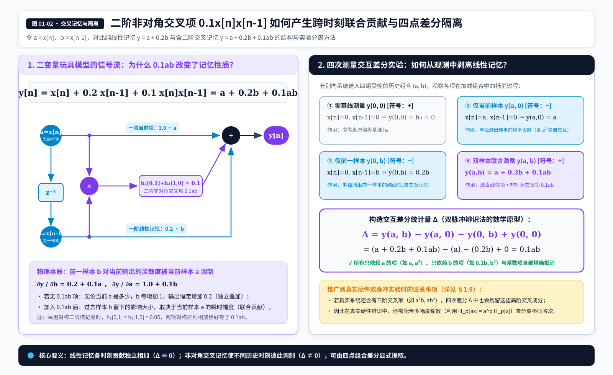
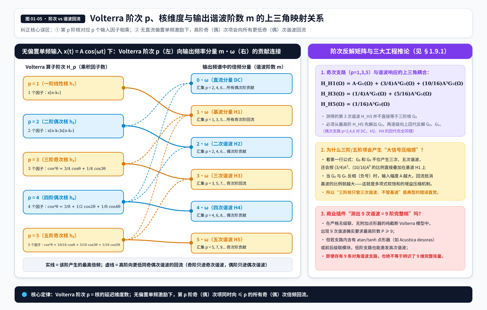
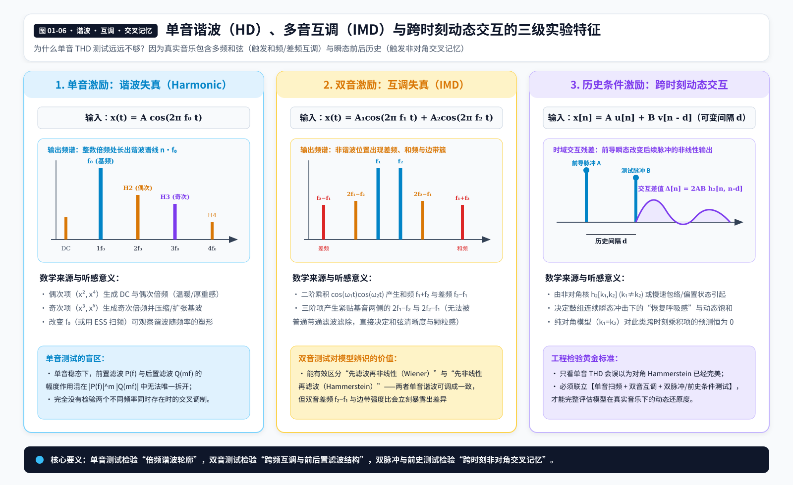
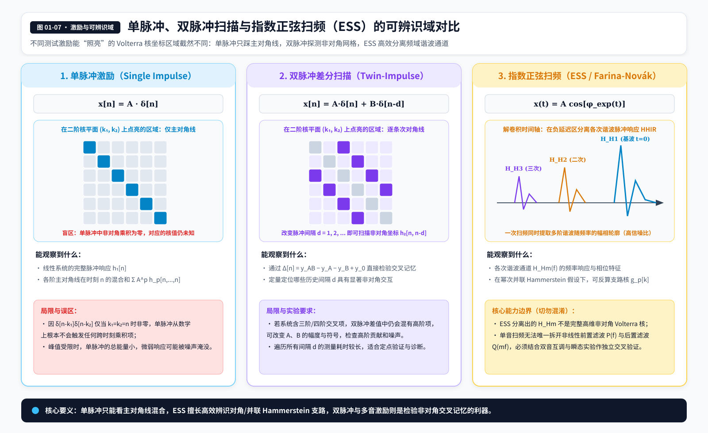
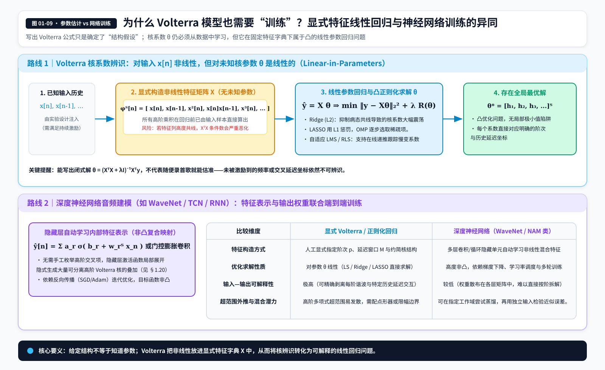
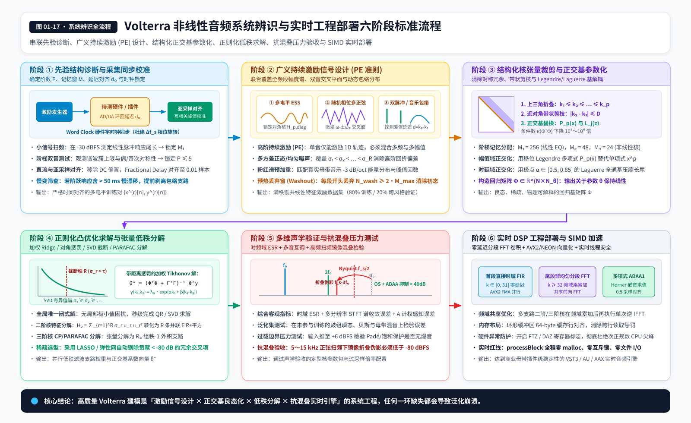

# 01 Volterra 级数

[在线阅读本章（完整合订版）](https://excillex-marisa.github.io/volterra-wiki/#chapter-01)

> **版本：v14 · 2026-11-16 · 核辨识、正交基与收敛知识结构融合**
> **所属系列：Volterra Wiki**
> **配图说明：** 本章 17 张 SVG 配图与 Markdown 文件配套提供，建议使用完整素材包以保持相对路径有效。
> **阅读定位：从前置概念进入 Volterra 的正式数学结构，建立它在非线性音频系统辨识中的用途、优势、成本与能力边界。**
> **前置阅读：《00_前置概念与术语约定_图文版.md》。**
> **本章原则：解释每一种数学结构为什么有必要出现，以及它到底比前一种模型多表达了什么。本章概览常见约简形式与核心辨识难点，为后续混合建模与高级算子章节打好基础。**

本章先回顾 Volterra 级数从泛函理论走向非线性系统辨识的历史，再以卷积及输入历史为切入点，建立它的数学表达、核辨识和约简方法。它为后续神经网络、白盒电路、唯象状态和混合建模提供共同的系统辨识语言。

## 历史导论：Volterra 级数是怎样从泛函理论走向系统辨识的？

我们今天谈论 Volterra，往往会想到非线性卷积、谐波分阶与音频硬件采样。但这套理论的起点比数字信号处理早了近一个世纪。理解它的历史，可以看出研究问题曾发生过几次重要转变：最初是“怎样描述以整个函数为输入的数学映射”，后来变成“怎样分析真实的非线性动力系统”，再进一步变成“怎样通过实验得到未知系统的核”。直到这些问题逐渐得到回答，Volterra 级数才有机会进入数字音频建模。[VH1]

### 十九世纪末至 1910 年：从普通函数走向泛函

意大利数学家 **Vito Volterra** 在十九世纪八十年代研究一种比普通函数更一般的数学对象：映射所接收的自变量，可以是一整个函数。普通 Taylor 展开通过若干阶导数描述数值变量在某个参考点附近的变化；当自变量变成整条函数时，类似的逐阶展开就需要作用于函数的多线性项，以及相应的多重积分核。Volterra 的早期工作正是沿着这条思路展开的。它所面对的最初问题与音频失真、采样率或数字滤波器都没有直接关系。[VH1]

1910 年，**Maurice Fréchet** 对连续泛函的表示问题进行了更严格的研究，并将其与 Weierstrass 多项式逼近思想联系起来。这里涉及两类不同的数学问题：对某类连续映射进行多项式泛函**逼近**，与在某个工作点求出一条实际**收敛的 Taylor 型无穷级数**，分别依赖不同的假设条件。后来 Boyd–Chua 关于衰减记忆的研究之所以重要，正因为它继续澄清了“怎样的系统、在什么输入集合上、按照什么误差标准可以逼近”这些问题。[VH1][VH4]

文献里还会出现 **Volterra 积分方程（Volterra Integral Equation）**。两者源于同一位数学家的研究，但用途不同：Volterra 积分方程以具有历史积分上限的关系描述未知函数，常用于求解动力学问题；Volterra 级数则用一阶、二阶直到更高阶的泛函项展开输入—输出映射。两者可以在某些非线性系统的分析中联系起来，阅读文献时需要依据具体定义辨认讨论对象。有关积分方程的专门数学体系，可参阅 Gripenberg、Londen 与 Staffans 的著作。[VH6]

### 1930—1950 年代：Wiener 将随机过程与非线性系统接入这套理论

**Norbert Wiener** 从布朗运动、随机积分和白噪声相关问题出发，逐渐发展出处理随机输入下非线性系统的方法。Schetzen 的历史回顾记录了 Wiener 在 **1942 年** 运用 Volterra 理论分析带非线性电阻的串联 RLC 电路的工作；这是早期将泛函展开用于实际非线性电路问题的重要案例。1945 年 **Cameron–Martin** 对随机泛函完备系统的工作，也为后来的正交展开提供了数学背景。[VH1]

到了 1949 年，Wiener 已向 MIT 的 **Y. W. Lee** 研究团队介绍自己的非线性系统方法；1958 年的讲义进一步系统呈现了相关理论。在这条研究路线中，Volterra 展开的不同阶次通常还需要额外的正交化处理。Wiener 通过针对高斯随机激励构造正交泛函，使不同阶的响应贡献能够在指定统计意义下分离。由此发展出的 **Wiener 核** 与通常的 **Volterra 核** 相互关联，各自具有不同的系数定义。它们的定义依赖所采用的展开体系与输入统计条件，转换时必须核对归一化和具体假设。有关 Wiener 正交泛函和核估计的推导将在《04》第 4.11–4.12 节展开。[VH1][VH2]

### 1950—1960 年代：从级数表示转向系统、反馈与核的测量

如果要用一条泛函级数研究真实设备，研究者就必须进一步面对级联、反馈、收敛与实际可计算性。**Bose** 在 1956 年提出 Gate Function Model；**Barrett** 在 1957 年系统研究了 Volterra 在非线性微分方程与反馈系统中的应用；**Brilliant** 在 1958 年讨论级联与收敛；**George** 在 1959 年建立系统代数并引入多维 Laplace 变换分析 Volterra 算子。与此同时，**Zames** 和 **Sandberg** 从算子、收缩映射与稳定性角度推动非线性反馈理论的发展。这些工作让 Volterra 从泛函表示逐渐进入工程系统分析。[VH1]

真正接近现代黑盒辨识的问题是：假设设备的电路未知，我们能否只通过设计输入并观察输出，测得描述非线性历史交互的核？**Lee–Schetzen 互相关法** 是这段历史的重要转折。根据 Schetzen 的回顾，相关方法在 1961 年已形成、1962 年得到实验验证，并在 1965 年有正式论文发表。它利用输入的统计性质与互相关关系辨识 **Wiener 核**；若希望得到特定记法的 Volterra 核，还需要处理两种展开之间的关系。这种方法建立了由实验数据走向非线性算子表示的具体途径。[VH1][VH3]

在同一时期，**Schetzen** 也研究有限 Volterra 算子的测量与综合；1964 年 **Alper** 和 **Bush** 的工作则推进了离散时间 Volterra 系统的研究。连续时间的多重积分核因而与后来在 DSP 中熟悉的多重延迟求和逐渐接轨。这里的关键困难随之显露：阶数与历史长度一旦增大，所需辨识的数据量和核参数量也会快速增长。[VH1]

### 1970—1980 年代：核辨识、衰减记忆与有限计算资源

进入二十世纪七十年代，研究已不局限于“级数能否写出来”。直接求解、基函数展开、时域互相关、频域方法及核形状的物理解释共同构成了系统辨识研究。1977 年的综述 *The Kernel Identification Method (1910–1977)* 对这段进展进行了系统梳理；1980 年 **Martin Schetzen** 出版 *The Volterra and Wiener Theories of Nonlinear Systems*，将算子展开、Wiener 体系、核测量与系统综合组织成较完整的工程理论框架。[VH1][VH5]

1985 年，**Stephen Boyd** 与 **Leon Chua** 对衰减记忆（Fading Memory）条件下非线性算子的逼近给出了重要结果。讨论 Volterra 的逼近能力，需要同时交代因果性、时不变性、连续性、输入集合和误差意义。与此同时，自适应非线性滤波研究逐渐关注 LMS、RLS 一类参数更新方案、核的截断以及如何在有限运算量下实现辨识。Ogunfunmi 的 *Adaptive Nonlinear System Identification* 对这些工程路线提供了后来的系统总结。[VH4][VH7]

### 从理论史回到现代音频：为什么这条路线走得如此漫长？

数学上的高阶表示能力与工程上的辨识、实时求值成本密切相关。**参数维度、激励信号、测量噪声、数值病态和计算预算**，都在限制完整 Volterra 核的部署。由此发展出对角核、并联 Hammerstein、正交基函数、稀疏/低秩约简和状态混合等不同方向。它们是对具体问题作出的结构选择，应根据具体任务的结构与资源需求比较。

这也解释了整套 Wiki 的叙事安排：本章接下来从输入历史与多项式结构出发，正式定义 Volterra 级数；《02》会讨论神经网络如何在非线性系统辨识这一共同问题上与它交汇；《06》则把测量、核数据库、计算引擎与商业音频插件连接起来。历史说明了研究动机，接下来的数学与实验仍然决定一个模型是否成立。

## 1.1 我们真正想解决的，是哪一种音频建模问题？

在前置概念中，我们已经把一台音频设备视为从输入产生输出的系统，也区分了线性、非线性、记忆与状态。现在不妨提出一个更具体的问题：假设我们想复刻某台模拟前级，只能向它送入测试音频并录下输出，而且已经排除了接口增益、采样时钟和明显的测量误差，该怎样选择一个足以描述它的数学模型？

如果设备的作用只有固定的频率响应与相位变化，那么线性卷积便可以完成任务；如果它主要添加随瞬时幅度变化的失真，一条静态 waveshaper 曲线也许已经够用。但真实设备可能还会表现出第三种现象：在当前输入幅度相同的情况下，因为几毫秒以前经历的波形不同，当前输出的非线性部分也不同。描述这种历史影响需要引入记忆模型，而跨时刻的非线性交互还需要乘积项或具有等效表达能力的模型结构。

需要明确的是，**“一个系统有记忆”和“不同历史时刻之间存在非线性交互”属于两个不同层面的性质**。普通 EQ 当然有记忆，稳定的 IIR 滤波器也可能保留很长的衰减尾部，但这类线性记忆中各个历史样本对输出的贡献相互独立。Volterra 级数最值得我们研究的地方，在于它允许非线性同时发生在单个采样点上以及**多个历史采样点之间**。

同时，许多滤波器与静态非线性的级联或并联组合，同样能够制造复杂的动态失真。真正的研究问题在于：**在指定的输入范围和测量条件下，哪一种结构能以合理的参数数量和运行成本，解释设备所表现出的输入—输出关系？** 接下来，我们先用一个只包含两个历史变量的模型把这件事讲清楚。


*图 01-01 | 静态非线性、线性卷积与 Volterra 的能力对照。注意“静态非线性（有非线性、无记忆）”与“线性卷积（有记忆、无非线性）”分别扩展了两个正交的能力维度，二者汇合后构成同时具备记忆与高阶非线性交互的 Volterra 模型。*

## 1.2 从两个采样点开始：为什么会出现“交叉记忆”？

假设某一时刻的输出只与当前输入及前一个采样点有关。为了让式子简单一些，令 $`a=x[n],\;b=x[n-1]`$。最简单的线性模型可以写成

```math
y=a+0.2b.
```

这里的 $`a`$ 是当前输入的贡献，$`0.2b`$ 是上一采样点留下的线性贡献。如果 $`b`$ 增加 $`1`$，输出始终增加 $`0.2`$，无论当前 $`a`$ 等于多少。这就体现了线性记忆的特点：**过去输入的影响可以有大有小，但各个输入变量的贡献彼此独立地相加。**

现在加入一个新的项：

```math
y=a+0.2b+0.1ab.
```

多出来的 $`0.1ab`$ 虽然只是两个数相乘，却使模型发生了本质变化。此时如果让 $`b`$ 增加 $`1`$，输出的变化量是 $`0.2+0.1a`$，也就是说，**上一采样点的影响大小，开始取决于当前采样点的幅度**。反过来，当前输入所产生的效果也取决于上一采样点是什么。这个乘积项描述了两个历史输入的联合贡献，其作用不同于各自贡献的独立相加。

我们还能设计一个受控实验，让这种交互单独显露出来。分别测量 $`y(a,b),\;y(a,0),\;y(0,b)`$ 和 $`y(0,0)`$，再计算

```math
\Delta=y(a,b)-y(a,0)-y(0,b)+y(0,0).
```

对于刚才的模型，计算结果恰好是

```math
\Delta=0.1ab.
```

为什么要使用这种四次测量的组合？因为只随 $`a`$ 改变的贡献、只随 $`b`$ 改变的贡献，以及常数偏移，都会在相减时被抵消，只有二者共同参与才产生的部分会留下来。这是一种非常基础的**交互作用隔离**思想。实际硬件存在更多历史变量、更高阶交互和噪声，因此四次测量在一般高阶系统中还会包含三阶及以上的交叉余项；但这个例子已经清楚说明，为什么我们需要超越线性卷积。

再往前走一步：如果模型同时依赖最近几十、几百个采样点，那么类似 $`x[n-2]x[n-7]`$ 的组合就会大量出现。我们需要一套统一的数学记账方式来组织这些乘积。**Volterra 级数，正是把这类不同阶数、不同历史位置的输入乘积组织起来的一种通用表示。**



*图 01-02 | 二阶非对角项如何使两个不同历史位置的输入产生联合贡献。*

## 1.3 从多项式到 Volterra：把刚才的玩具模型写成一般形式

回忆普通多项式的结构：$`y=a_0+a_1x+a_2x^2+\cdots`$。它可以把一个复杂的静态非线性拆成常数贡献、一次贡献、二次贡献以及更高次贡献。这里的“一次、二次、三次”表示每个项里面**有多少个输入因子相乘**。

当系统需要同时考虑一整段输入历史时，我们可以把最近 $`M`$ 个采样点排列成一个历史向量：

```math
\mathbf{x}_n=
\begin{bmatrix}
x[n] & x[n-1] & \cdots & x[n-M+1]
\end{bmatrix}^{T}.
```

如果当前输出是这个向量的某个函数，即 $`y[n]=F(\mathbf{x}_n)`$，那么在适当的光滑性条件与选定工作点附近，可以像展开多变量函数一样，把它写成若干不同次数的项。一次项包含 $`x[n],\;x[n-1]`$ 等各个历史样本；二次项除了包含 $`x^2[n]`$ 和 $`x^2[n-1]`$，还允许 $`x[n]x[n-1]`$；三次项则允许三个输入因子相乘，其中的历史位置可以相同，也可以不同。

把这种思想推广到任意阶，就得到一个有限阶、有限记忆的离散时间 Volterra 模型：

```math
\hat{y}[n] = h_0 + \sum_{p=1}^{P}
\sum_{k_1=0}^{M-1} \cdots \sum_{k_p=0}^{M-1}
h_p[k_1,\ldots,k_p]
\prod_{i=1}^{p} x[n-k_i].
```

这个公式由三部分构成：外层的 $`\sum_{p=1}^{P}`$ 表示把一阶至 $`P`$ 阶的贡献相加；中间的一组求和表示遍历该阶允许使用的历史位置；最后的 $`\prod`$ 表示把这些历史位置上的输入相乘，再乘上对应的权重 $`h_p`$。其中 $`P`$ 是**最高保留阶数**，$`M`$ 是**输入历史长度**，$`h_0`$ 是常数项，而 $`h_p[k_1,\ldots,k_p]`$ 就是第 $`p`$ 阶 **Volterra 核（Volterra Kernel）**。

不妨把前三阶单独展开：

```math
\begin{aligned}
\hat{y}[n] &= h_0 + \sum_{k_1=0}^{M-1} h_1[k_1]x[n-k_1] \\
&\quad + \sum_{k_1=0}^{M-1}\sum_{k_2=0}^{M-1} h_2[k_1,k_2]x[n-k_1]x[n-k_2] \\
&\quad + \sum_{k_1=0}^{M-1}\sum_{k_2=0}^{M-1}\sum_{k_3=0}^{M-1} h_3[k_1,k_2,k_3]x[n-k_1]x[n-k_2]x[n-k_3] + \cdots .
\end{aligned}
```

由此可以看到：**一阶 Volterra 项就是普通线性卷积；二阶开始，模型引入两个历史输入的乘积；阶数继续提高时，联合参与的历史输入因子也随之增加。** 因此 Volterra 级数以线性卷积为一阶特例，并在其基础上逐阶扩展了多时刻非线性表达能力。只保留 $`h_1`$ 时，模型即退化为熟悉的线性 FIR 系统。

刚才使用的是离散时间形式，对应数字音频插件中的逐采样计算。在 Schetzen 等经典文献中，连续时间因果、时不变、单输入单输出系统的形式化写法为

```math
y(t)=h_0+\sum_{p=1}^{\infty}
\int_0^{\infty}\!\cdots\!\int_0^{\infty}
h_p(\tau_1,\ldots,\tau_p)
\prod_{i=1}^{p}x(t-\tau_i)
\,d\tau_1\cdots d\tau_p.
```

其中 $`\tau_i`$ 表示过去的第 $`i`$ 个延迟坐标。每一重积分都在累积一种历史位置组合的贡献，对应离散模型中的多重延迟求和。式中的无穷阶与无穷历史属于一般理论记法；实际实时计算总是基于双截断（有限阶数 $`P`$ 与有限记忆 $`M`$）或低维递归基结构。

上面的式子默认使用零附近的输入作为变量、采用因果历史，并且把各阶核直接定义为对应求和式里的系数。有的泛函分析文献会在展开式里显式写出 $`1/p!`$，有的则把这一系数吸收到核定义中（参见《04》第 4.3 节）。两种写法在保持一致的情况下可以互相转换；**本 Wiki 默认使用已经吸收 $`1/p!`$ 系数的工程核记法**，在对照不同文献时需先核对这一约定。


*图 01-03 | 一阶、二阶与三阶 Volterra 核的维度直觉。它们分别拥有一个、两个和三个延迟索引。*

## 1.4 为什么它被叫作“带记忆的 Taylor 级数”？

Taylor 级数的出发点，是在某个参考点附近利用函数的导数，逐渐构造出能够描述该函数变化的多项式。一个静态函数若在工作点附近满足解析条件，就可以写成

```math
f(x_0+u)=f(x_0)+f'(x_0)u+\frac{f''(x_0)}{2!}u^2+\cdots.
```

音频系统的输出通常依赖整个输入历史。对于固定的输出时刻，我们面对的是一个从**输入函数到一个输出数值**的映射，即泛函。Volterra 的思想，就是把普通标量函数的 Taylor 展开推广到以函数或信号为自变量的泛函与算子空间。相应的一阶贡献变成对输入历史的线性作用，二阶贡献变成两份历史输入之间的双线性作用，更高阶依此类推。

理解“带记忆的 Taylor 级数”这一比喻时，需要注意两点数学边界：第一，泛函幂级数的收敛域由系统的解析性质与输入幅度范围共同决定；第二，在固定点附近的局部泛函导数展开，与在宽动态范围上通过最小二乘拟合得到的双截断多项式核，具有不同的系数性质（参见第 1.11.1 节的多方差辨识）。

这一理论最初来自 Vito Volterra 对泛函的研究，后来经由 Norbert Wiener、Y. W. Lee、Martin Schetzen 等人的工作，与非线性系统分析及黑盒辨识建立紧密联系。对音频工程师而言，这段历史表明：在深度神经网络普及之前，信号处理领域就已经建立了一套可以明确剖析非线性阶次、输入历史、核函数和辨识误差的解析框架。

此外，在文献检索时应注意区分 **Volterra 级数（Volterra Series）** 与 **Volterra 积分方程（Volterra Integral Equation）**：两者同源但研究对象不同，本 Wiki 聚焦于非线性系统的 Volterra 级数表示及其工程约简。


*图 01-04 | 从静态 Taylor 幂级数到带历史输入的 Volterra 展开的直观对应。*

这里还需要区分两类看起来相似的多项式。**Taylor 多项式**的系数来自参考工作点处的各阶导数，属于局部展开；**区间多项式拟合**则利用一组实际测量数据，寻找在给定输入分布和误差准则下更合适的系数。后者的系数会随训练电平、样本权重与截断阶数改变。对于 Volterra 核，这一差异将在 1.11 节的多电平辨识中重新出现。

## 1.5 为什么 Volterra 核是多维的？

普通线性脉冲响应 $`h_1[k]`$ 只需要一个延迟坐标：过去第 $`k`$ 个采样点对当前输出有多大影响。假设我们要讨论两个历史位置之间的交互，就必须为两个位置分别安排坐标 $`k_1`$ 和 $`k_2`$，因此二阶核自然写成 $`h_2[k_1,k_2]`$。如果要讨论三个位置联合参与的贡献，就需要 $`h_3[k_1,k_2,k_3]`$。这里的“二维”“三维”，指的是**核系数拥有几个独立的延迟索引**。

对于二阶核，可以把它想象成一张二维表：横轴是第一个延迟位置，纵轴是第二个延迟位置，表中每个格子都存放一个交互权重。处于主对角线 $`k_1=k_2`$ 的元素，对应同一个历史样本的平方，例如 $`x^2[n-4]`$；离开主对角线的元素，则对应不同历史样本之间的乘积，例如 $`x[n-2]x[n-7]`$。二者都属于二阶非线性，但包含的历史耦合结构截然不同。

因此，仅包含对角项的模型与包含**非对角交叉记忆（Cross-Memory）** 的模型，虽然都能生成二次或三次谐波，但在双音互调、瞬态包络恢复和跨时刻调制上会表现出明显的动态差异：后者允许某个历史采样点的非线性作用随另一历史时刻的输入幅值发生调制。

## 1.6 为什么同一个核可以“对称化”？又为什么要小心系数翻倍？

假设一个二阶核中分别存在 $`h_2[2,7]`$ 与 $`h_2[7,2]`$。由于普通实数乘法满足交换律，$`x[n-2]x[n-7]`$ 和 $`x[n-7]x[n-2]`$ 实际上是同一项。因此，这两个核系数的**总贡献**会相加，它们在外部输入—输出测量中无法被单独区分。

一般情况下，可以把二阶核改写为对称形式：

```math
h_{2,\mathrm{sym}}[k_1,k_2]
=\frac{h_2[k_1,k_2]+h_2[k_2,k_1]}{2}.
```

更高阶的 $`p`$ 阶核同样可以对所有 $`p!`$ 种索引排列取平均：

```math
h_{p,\mathrm{sym}}[k_1,\ldots,k_p]=\frac{1}{p!}\sum_{\pi\in S_p}h_p\bigl[k_{\pi(1)},\ldots,k_{\pi(p)}\bigr].
```

这样做不会改变同一阶 Volterra 算子的输出，同时将重复排列归并为唯一的对称核表示。对于 $`M`$ 个可用延迟，二阶对称核只需要确定上三角区域 $`0\le k_1\leq k_2\le M-1`$ 的独立坐标。

在编写 C++ 引擎与辨识代码时，需要分别处理**全排列对称核记账**与**上三角唯一单项式特征记账**。继续使用前面的例子 $`y=a+0.2b+0.1ab`$：
- 若求和循环遍历全部 $`M^2`$ 个索引对 $`(k_1,k_2)`$，则对称核系数应赋值为 $`h_{2,\mathrm{sym}}[0,1]=h_{2,\mathrm{sym}}[1,0]=0.05`$，两项相加后恰好还原 $`0.1ab`$；
- 若求和循环仅遍历上三角唯一组合 $`k_1\le k_2`$（即构造无重复的特征字典 $`\boldsymbol{\phi}[n]`$），则单项式 $`x[n]x[n-1]`$ 的回归系数 $`c_2[0,1]`$ 直接等于 $`2h_{2,\mathrm{sym}}[0,1]=0.1`$。

更一般地，对于 $`p`$ 阶上三角有序索引 $`k_1\le k_2\le\cdots\le k_p`$，若其中有 $`m`$ 个互不相同的延迟值，各自重复出现 $`r_1,r_2,\ldots,r_m`$ 次（满足 $`\sum_{j=1}^m r_j=p`$），则该唯一单项式在全排列求和中共出现多项式系数（Multinomial Coefficient）次：

```math
\mu(k_1,\ldots,k_p)=\frac{p!}{r_1!\,r_2!\cdots r_m!}.
```

因此，唯一特征字典的合并回归系数与对称核张量元素之间的严格换算关系为：

```math
c_p[k_1,\ldots,k_p]=\mu(k_1,\ldots,k_p)\,h_{p,\mathrm{sym}}[k_1,\ldots,k_p].
```

混淆这两种记账方式会导致非对角交叉项被错误放大或缩小 $`\mu`$ 倍（在二阶中相差 $`2`$ 倍，在三阶全异索引 $`k_1\lt k_2\lt k_3`$ 中相差 $`3!=6`$ 倍）。本系列在统计独立参数规模时，统一按上三角唯一组合计数。

## 1.7 Volterra 里的“阶”，怎样变成我们听到的谐波与互调？

对于经典 Volterra 模型，第 $`p`$ 阶算子具有齐次性（Homogeneity）：如果把整段输入乘以常数 $`a`$，它的第 $`p`$ 阶贡献就会乘以 $`a^p`$，即

```math
H_p[ax](n)=a^pH_p[x](n).
```

原因在于第 $`p`$ 阶的每一个项里都有 $`p`$ 个输入因子，输入整体放大 $`a`$ 倍后，乘积自然放大 $`a^p`$ 倍（对应 dB 域中，输入每增加 $`1\,\mathrm{dB}`$，第 $`p`$ 阶分量的幅度增加 $`p\,\mathrm{dB}`$）。这种齐次性使不同阶次在幅度变化时呈现不同增长斜率，构成了通过多电平测试分离各阶贡献的数学基础。

在下面的连续时间例子中，$`\omega`$ 表示角频率（rad/s）；对应采样率 $`f_s`$ 的离散时间角频率可记为 $`\Omega=\omega/f_s`$（rad/sample）。

那么这些阶次怎样与输出频谱联系起来？假设输入为单频余弦波 $`x(t)=\cos(\omega t)`$。由三角幂展开公式：

```math
\cos^2(\omega t)=\frac{1}{2}+\frac{1}{2}\cos(2\omega t),\qquad
\cos^3(\omega t)=\frac{3}{4}\cos(\omega t)+\frac{1}{4}\cos(3\omega t).
```

可以看到，二次非线性同时产生直流（$`0\omega`$）与二次谐波（$`2\omega`$），三次非线性则同时作用于基波（$`1\omega`$）和三次谐波（$`3\omega`$）。在无直流偏置的单频正弦输入下，奇偶性严格分离：**第 $`p`$ 阶奇数项会向所有不高于 $`p`$ 的奇次谐波（$`1,3,\ldots,p`$ 倍频）贡献分量；第 $`p`$ 阶偶数项会向所有不高于 $`p`$ 的偶次谐波（$`0,2,\ldots,p`$ 倍频）贡献分量**。因此，同一基波成分会同时受到一阶、三阶、五阶等所有奇数阶项的回流影响（表现为增益压缩或扩展）；同一次奇（或偶）次谐波也会汇集所有高于或等于它的奇（或偶）数阶次贡献。

如果输入包含两个正弦波 $`x(t)=A_1\cos(\omega_1 t)+A_2\cos(\omega_2 t)`$，乘积会把频率相加或相减。二阶项除了产生 $`2\omega_1,\;2\omega_2`$ 和直流外，还会产生二阶和差频互调（IMD2）：

```math
\cos(\omega_1t)\cos(\omega_2t)
=\frac{1}{2}\cos\bigl((\omega_1+\omega_2)t\bigr)
+\frac{1}{2}\cos\bigl((\omega_1-\omega_2)t\bigr).
```

三阶项则会进一步产生 $`2\omega_1\pm\omega_2`$ 与 $`2\omega_2\pm\omega_1`$ 等三阶互调边带（IMD3）。特别是当 $`\omega_1`$ 与 $`\omega_2`$ 较为接近时，差频 $`\omega_2-\omega_1`$ 落入低频区，而三阶差频 $`2\omega_1-\omega_2`$ 与 $`2\omega_2-\omega_1`$ 紧贴在基频两侧，直接出现在基频附近的可听频段。对于混音、母带以及模拟硬件建模来说，单音谐波测试只能反映频域主对角切片，多音互调测试才是检验非对角交叉核与动态调制的关键手段。



*图 01-05 | Volterra 阶次、核阶数和输出谐波的区别：阶次对应乘积因子数量及核的阶数。在无偏置单频激励下，同一次奇（或偶）次谐波会同时受到多个不同奇（或偶）数阶次的共同贡献，奇阶与偶阶各自独立。*



*图 01-06 | 从单频谐波到多音互调，再到不同输入时刻之间的非线性交互。*

这里的“阶”还要与滤波器阶数分开理解：Volterra 的 $`p`$ 阶指每项相乘的输入因子数，$`p`$ 次谐波指输出频率是基频的 $`p`$ 倍；IIR 或模拟滤波器的阶数则涉及传递函数的极点数量或状态维度。同样的数字出现在这三类术语里，代表的是不同物理与数学量。

## 1.8 Waveshaper、块结构滤波器与 Volterra 的代数对应

静态 waveshaper 的表达形式是 $`y[n]=f(x[n])`$。如果真实设备的主要特征就是一条相对稳定的瞬时传递曲线，那么静态 waveshaper 就是最紧凑的实现。当 waveshaper 前面或后面接上线性滤波器时，模型便获得了频率相关的动态非线性特性：
- **Hammerstein 结构（N–L）**：输入先通过无记忆静态非线性 $`f(\cdot)`$，再通过线性滤波器 $`h[k]`$；
- **Wiener 结构（L–N）**：输入先通过线性滤波器 $`g[k]`$，再进入无记忆静态非线性 $`f(\cdot)`$；
- **Wiener–Hammerstein 结构（L–N–L）**：静态非线性前后分别带有前置线性滤波器 $`g[k]`$ 与后置线性滤波器 $`h[k]`$。

当中间的静态非线性在工作区间内展开为多项式 $`f(v)=\sum_{p=1}^P a_p v^p`$ 时，这三类经典块结构均可直接写出其等效的 Volterra 核：
1. **Hammerstein 模型的等效核**：由于 $`y[n]=\sum_{k=0}^{M-1}h[k]\sum_{p=1}^P a_p x^p[n-k]`$，其第 $`p`$ 阶核仅在主对角线 $`k_1=\cdots=k_p=k`$ 上非零：

```math
h_p^{\mathrm{H}}[k_1,\ldots,k_p]=a_p h[k_1]\,\delta[k_1-k_2]\cdots\delta[k_1-k_p].
```

2. **Wiener 模型的等效核**：由于 $`v[n]=\sum_{k=0}^{M-1}g[k]x[n-k]`$，将其 $`p`$ 次幂展开后，第 $`p`$ 阶核是前置滤波器脉冲响应 $`g[k]`$ 的 $`p`$ 重外积（秩-1 可分离对称张量）：

```math
h_p^{\mathrm{W}}[k_1,\ldots,k_p]=a_p\prod_{i=1}^{p}g[k_i].
```

可以看到，Wiener 模型的核天然遍布整个非对角平面（$`k_1\neq k_2`$ 处非零），但整张高维核完全由同一条一维滤波器 $`g[k]`$ 决定。
3. **Wiener–Hammerstein 模型的等效核**：将前置滤波输出 $`v[n-m]`$ 的 $`p`$ 次幂再与后置滤波器 $`h[m]`$ 卷积，其第 $`p`$ 阶核为：

```math
h_p^{\mathrm{WH}}[k_1,\ldots,k_p]=a_p\sum_{m=0}^{M_h-1}h[m]\prod_{i=1}^{p}g[k_i-m].
```

这组代数对应关系揭示了一个重要的工程结论：**非对角交叉记忆可以通过结构化分解紧凑表示，从而减少对完整 $`M^p`$ 维稠密张量的存储与辨识需求。** 许多由前后级频响耦合产生的交叉记忆，本质上是由少量前置与后置滤波器支路张成的低秩结构化非对角核。

## 1.9 为什么普通脉冲响应不够？双脉冲与指数扫频能揭示什么？

对于线性时不变系统，测得单位脉冲响应 $`h[k]`$ 即可通过卷积预测任意输入下的输出。对 Volterra 系统而言，单个脉冲却只能探测高阶核的主对角切片。假设输入为幅度 $`A`$ 的离散脉冲 $`x[n]=A\delta[n]`$，在观察时刻 $`n`$，由于 $`\delta[n-k_i]`$ 仅在 $`k_i=n`$ 时非零，第 $`p`$ 阶多重求和简化为：

```math
y[n]=h_0+\sum_{p=1}^{P}A^p\,h_p[n,n,\ldots,n].
```

也就是说，单脉冲响应只访问了各阶核的**主对角线坐标** $`h_p[n,n,\ldots,n]`$，所有离对角交叉项 $`h_p[k_1,\ldots,k_p]`$（存在 $`k_i\neq k_j`$）在单脉冲激励下乘积恒为零，完全处于不可观测状态。

为了探测非对角位置，可以使用**双脉冲激励（Doublet Excitation）**：令第一枚脉冲位于 $`n=0`$（幅度 $`A`$），第二枚脉冲位于 $`n=d`$（幅度 $`B`$），即 $`x[n]=A\delta[n]+B\delta[n-d]`$。对纯二阶对称核模型，扣除两次单脉冲响应后，交互差值信号为：

```math
\Delta[n]
=H_2[A\delta[\cdot]+B\delta[\cdot-d]](n)-H_2[A\delta[\cdot]](n)-H_2[B\delta[\cdot-d]](n)
=2AB\,h_{2,\mathrm{sym}}[n,n-d].
```

通过遍历脉冲间隔 $`d`$ 并结合多幅度电平组合（剥离三阶及以上交叉项的混入），双脉冲实验能够直接测量二阶核在距离主对角线为 $`d`$ 的次对角线上的分布。



*图 01-07 | 单脉冲、双脉冲和 ESS 可以观察的系统性质不同。ESS 分离出的谐波响应对应频域一维切片，不应直接等同于完整高维 Volterra 核。*


*图 01-08 | 从实验激励和响应数据到动态卷积分支、或到高阶 Volterra 核辨识的两条路径。*

### 1.9.1 Farina 指数扫频（ESS）与 Novák 同步扫频的精确反解条件

在声学与商业音频采样中，Angelo Farina (2000) 提出的**指数正弦扫频（Exponential Sine Sweep, ESS）** 是获取设备频率相关失真特性的标准工具。设扫频信号在时间 $`T`$ 内从起始角频率 $`\omega_1`$ 指数增长至终止角频率 $`\omega_2`$，扫频速率参数定义为 $`L=T/\ln(\omega_2/\omega_1)`$。当该信号通过弱非线性系统时，第 $`m`$ 次谐波的瞬时频率为基频的 $`m`$ 倍，而在指数时间轴上，频率乘以 $`m`$ 恰好等价于时间提前一个固定偏移量：

```math
\Delta t_m = L\ln(m) = \frac{T}{\ln(\omega_2/\omega_1)}\ln(m).
```

因此，将录制到的系统输出与线性逆滤波器卷积后，基波脉冲响应出现在 $`t=0`$ 处，而第 $`m`$ 次谐波脉冲响应（HIR）则依次分离在负时间轴 $`t=-\Delta t_m`$ 处。

要把这些分离出的高次谐波脉冲响应 $`H_{Hm}(\Omega)`$ 严格转化为**并联 Hammerstein 模型（即对角 Volterra 模型）**

```math
y[n]=\sum_{p=1}^{P}\sum_{k=0}^{M_p-1}g_p[k]x^p[n-k]
```

中的各阶支路滤波器核 $`g_p[k]`$（频域为 $`G_p(\Omega)`$），需要满足两个关键数学条件（Antonín Novák et al., 2010）：

1. **同步相位条件（Synchronized Swept Sine）**：若激励采用余弦相位 $`\cos(\phi(t))`$，利用三角恒等式将 $`\cos^p(\phi(t))`$ 展开为倍频余弦和时，各倍频项均保持零初相；若采用正弦相位 $`\sin(\phi(t))`$，则 $`\sin^3(\theta)=\frac{3}{4}\sin\theta-\frac{1}{4}\sin(3\theta)`$ 等展开中会出现随阶次交替的符号与 $`\pm\pi/2`$ 相位旋转（偶次幂变成 $`\cos`$，奇次幂带交替正负号）。此外，只有合理选择扫频参数使起始相位在各阶倍频分离点处满足相位同步，解卷积分离出的 $`H_{Hm}(\Omega)`$ 才能保持正确的复相位关系。
2. **高阶向低次谐波回流的上三角反解**：以包含 $`p=1,3,5`$ 三个奇次支路的余弦扫频为例，由于

```math
\begin{aligned}
\cos^3(\theta)&=\frac{3}{4}\cos(\theta)+\frac{1}{4}\cos(3\theta),\\
\cos^5(\theta)&=\frac{10}{16}\cos(\theta)+\frac{5}{16}\cos(3\theta)+\frac{1}{16}\cos(5\theta),
\end{aligned}
```

   实际测得的基波、三次与五次谐波复频谱 $`H_{H1}(\Omega), H_{H3}(\Omega), H_{H5}(\Omega)`$ 与对角支路传递函数 $`G_1(\Omega), G_3(\Omega), G_5(\Omega)`$ 满足上三角矩阵方程：

```math
\begin{bmatrix}
H_{H1}(\Omega) \\
H_{H3}(\Omega) \\
H_{H5}(\Omega)
\end{bmatrix}
=
\begin{bmatrix}
A & \frac{3}{4}A^3 & \frac{10}{16}A^5 \\
0 & \frac{1}{4}A^3 & \frac{5}{16}A^5 \\
0 & 0 & \frac{1}{16}A^5
\end{bmatrix}
\begin{bmatrix}
G_1(\Omega) \\
G_3(\Omega) \\
G_5(\Omega)
\end{bmatrix}.
```

   一般地，对任意最高阶数 $`P`$，转换矩阵 $`\mathbf{T}_c`$ 的元素由单项式向 Chebyshev 多项式展开的二项式系数决定，必须**从最高阶 $`P`$ 向一阶逐级回代消元**，才能解出真正的支路核 $`G_p(\Omega)`$。

同时，单次 ESS 测量存在固有的拓扑可辨识性边界：对一个前级频响为 $`P(f)`$、后级频响为 $`Q(f)`$ 的三阶 Wiener–Hammerstein 级联系统，单音扫频测得的三次谐波复频谱仅取决于乘积

```math
A_{H3}(f)=\frac{A^3}{4}\,P^3(f)\,Q(3f).
```

一条固定电平的 ESS 记录反映了非线性前的输入选频塑形 $`P(f)`$ 与非线性后的谐波滤波 $`Q(3f)`$ 的合成影响。结合双音互调（如探测 $`2f_1-f_2`$ 随 $`f_1,f_2`$ 独立变化的二维频域核切片）与多电平激励，可以进一步分辨前置滤波与后置滤波的作用。

## 1.10 从核系数看到的是输入—输出规律，而非物理电路拓扑

当我们从测量中辨识出 $`h_2[2,7]`$ 或某个低秩核时，需要明确其解释边界：Volterra 核提供的是**输入—输出意义上的行为可解释性**（如各阶贡献比例、主对角与离对角记忆分布、不同电平下的增长斜率），若要进一步对应具体内部物理元件（如耦合电容、电子管偏置电阻或变压器漏感），还需电路信息与独立物理测量证据。不同电路拓扑或块结构在有限频带与工作电平内完全可能映射出极度接近的等效 Volterra 核。对于未知商业插件或硬件，**能拟合外部输出**、**能辨识等效块结构**与**还原真实物理电路或源码**，对应三个不同的证据层级（详见《06》第 6.17 节）。

## 1.11 为什么 Volterra 也需要训练？线性参数回归与多方差局域性

当选定保留阶数 $`P`$ 与记忆窗口 $`M`$ 后，每一种历史乘积（如 $`x[n],\;x^2[n],\;x[n]x[n-1]`$）都成为已知的显式特征。将这些特征排列为向量 $`\boldsymbol{\phi}[n]`$，模型预测即可写为参数线性形式：

```math
\hat{y}[n]=\boldsymbol{\phi}^{T}[n]\boldsymbol{\theta},\qquad \mathbf{y}\approx\mathbf{X}\boldsymbol{\theta}.
```

这一性质使得固定结构 Volterra 的参数辨识可直接采用带正则化的线性最小二乘（如 Ridge / Tikhonov 正则化）：

```math
\boldsymbol{\theta}^\star = \bigl(\mathbf{X}^\top\mathbf{X} + \lambda\mathbf{I}\bigr)^{-1}\mathbf{X}^\top\mathbf{y},
```

或使用自适应滤波中的 LMS、RLS 算法递推求解，而无需像深度神经网络那样在高度非凸的参数空间中进行反向传播搜索。



*图 01-09 | 神经网络权重学习与 Volterra 核系数辨识的共同点及区别。*

### 1.11.1 截断 Volterra 辨识的“局域性问题”与多方差辨识法（Multiple-Variance Method）

在工程实践中，固定核 Volterra 辨识有一个极易被忽略的数学陷阱——**双截断级数的方差局域性（Locality of the Solution）**。

在连续时间无穷阶解析理论中，系统的真实 Volterra 核是与输入激励电平无关的固有常数。然而，在实际数字音频建模中，我们总是使用**阶数截断（$`P<\infty`$）且记忆截断（$`M<\infty`$）的双截断 Volterra 级数**去逼近真实硬件（例如包含无穷阶奇次项的电子管饱和曲线）。当使用单一固定方差 $`\sigma_x^2`$（即单一固定 RMS 电平）的宽带信号通过最小二乘或互相关法辨识 $`P`$ 阶截断模型时，被截断的 $`P+2, P+4, \ldots`$ 等更高阶未建模非线性并不会消失，而是通过偶次矩相关性（如高斯信号下 $`\mathbb{E}[x^6]=15\sigma_x^6`$ 与 $`\mathbb{E}[x^2]=\sigma_x^2`$ 相关）**向下折叠偏置（Bias）所估计的低阶核系数**。

其直接后果是：**在单一固定电平 $`\sigma_0`$ 下拟合最优的截断 Volterra 核 $`\hat{h}_p^{(\sigma_0)}`$，实际上是一个依赖训练电平的等效近似核**：
- 当测试音频处于训练电平 $`\sigma_0`$ 附近时，低阶核中的偏置项恰好补偿了被截断的高阶贡献，均方误差极小；
- 一旦测试音频切换到远低于 $`\sigma_0`$ 的小信号区间（此时真实高阶贡献已按 $`a^p`$ 迅速消失），被高电平训练污染的一阶与三阶核系数反而会产生严重的过补偿失真；反之，在高于 $`\sigma_0`$ 的大信号下则会迅速偏离。

为了克服这一局域性瓶颈，Simone Orcioni 等人（2014, 2018）提出了针对电子管音频设备辨识的**多方差方法（Multiple-Variance Method）**[V2]：
1. **分阶分电平激励设计**：利用不同阶算子随输入幅度呈 $`a^p`$ 齐次缩放的性质，使用低方差（小信号）激励专门辨识一阶核 $`h_1`$（此时高阶项以 $`O(\sigma^3)`$ 衰减，不会污染一阶估计）；随后逐步提高输入方差，依次在各自信噪比与截断偏置最优的电平窗口下辨识二阶、三阶与五阶核；
2. **多方差联合最小二乘 / 核插值**：或者在构建回归矩阵 $`\mathbf{X}`$ 时，将跨越多个 dB 台阶（如 $`-30\,\mathrm{dBFS}`$ 至 $`0\,\mathrm{dBFS}`$）的多方差激励序列按幅度加权拼接，迫使估计出的核系数在整个动态范围内保持一致的阶次缩放规律，并在強过载区配合多电平核插值（如 Tronchin & Coli 2015 的连续电平核插值框架 [V3]）。

这一原理也说明多方差激励的必要性：**覆盖小信号到强驱动区的多方差激励，有助于区分不同阶次的贡献，并检验截断 Volterra 模型在宽动态范围内的泛化表现。**


*图 01-16：左篇展示单一高电平辨识中未建模高阶奇次项（$`p=5,7`$）向低阶核（$`\hat{h}_1, \hat{h}_3`$）回折投影引发的“局域性失配问题（Locality Problem）”及多方差 Vandermonde 尺度解耦；右篇展示 Hopman–Bennett 无分母多项式一阶/二阶反导数抗混叠（Polynomial ADAA）代数因式分解与基于移位 Legendre 正交基的紧凑型 SNLM 架构。*

#### 核估计的条件数：怎样识别“参数看似学会、换一组数据就变了”？

固定特征字典决定了回归矩阵 $`\mathbf X`$ 的各列。若两个延迟样本在窄带激励下高度相关，或单一电平使 $`x[n]`$ 与 $`x^3[n]`$ 的特征列接近共线，不同核系数组合就可能生成几乎相同的输出。此时，测量噪声会被放大到参数估计中。对满列秩矩阵，其二范数条件数是

```math
\kappa_2(\mathbf X)=\frac{\sigma_{\max}(\mathbf X)}{\sigma_{\min}(\mathbf X)}.
```

最小奇异值越小，回归结果对数据误差越敏感；使用正规方程时，$`\mathbf X^\top\mathbf X`$ 的条件数还会平方。多电平与宽频激励、特征归一化、正交基、Ridge、截断 SVD 或 QR 分解等方法，可以分别改善数据覆盖与数值求解稳定性。这里的病态属于**实验与参数估计问题**，须与第 1.15 节多项式向训练范围外增长的问题区分。

## 1.12 为什么“喂更多音乐”不等于“测到了更多系统结构”？

一段音乐可能同时包含大量频率、电平和瞬态变化，作为模型的最终听感测试非常有价值。但如果所有训练音频都来自相似的曲风、响度与动态范围，某些关键物理工作区间便可能始终没有被充分访问。即使总数据量很大，仍然可能缺少辨识某些参数真正需要的独立变化。

不同激励信号在系统辨识中承担着明确分工：
- **单音多电平扫描**：检验各阶谐波随驱动幅度的增长斜率与奇偶对称性；
- **双音与随机相位多音（Multisine）**：分离和频、差频与带内高阶互调，探测二维及三维频域核切片；
- **同步指数扫频（ESS）**：高效提取各阶对角支路的频率响应与群延迟；
- **双脉冲与多脉冲序列**：直接激发并测量离对角交叉记忆坐标 $`h_2[k_1,k_2]`$；
- **阶跃包络与长时预激励探针**：暴露慢速动态恢复、电源下陷与磁滞路径依赖。

因此，系统辨识的数据采集本质上是受控实验设计。验证同样需要覆盖对齐后的时域残差、跨电平 THD/IMD、瞬态包络差分、历史条件化探针与未见音乐素材。


*图 01-10 | 测量、建模与独立验证构成反复迭代的实验闭环。*

## 1.13 为什么完整 Volterra 会迅速变得难以实现？

假设每一阶都允许使用 $`M`$ 个历史位置。如果不利用核对称性，第 $`p`$ 阶具有 $`M^p`$ 个核坐标。利用核对称性将重复排列合并后，第 $`p`$ 阶的独立参数数量为多重组合数：

```math
N_p=\binom{M+p-1}{p}=\frac{(M+p-1)!}{p!\,(M-1)!}.
```

例如取 $`M=64`$（在 $`48\,\mathrm{kHz}`$ 下仅对应约 $`1.33\,\mathrm{ms}`$），未利用对称性的原始张量坐标数 $`M^p`$ 与对称核独立参数数量 $`N_p=\binom{M+p-1}{p}`$ 对照如下：

| Volterra 阶数 $`p`$ | 原始张量坐标数 $`M^p`$ (对应图 01-11) | 对称核独立参数数量 $`\binom{M+p-1}{p}`$ |
|---|---|---|
| 一阶 ($`p=1`$) | 64 | 64 |
| 二阶 ($`p=2`$) | 4,096 | 2,080 |
| 三阶 ($`p=3`$) | 262,144 | 45,760 |
| 四阶 ($`p=4`$) | 16,777,216 | 766,480 |
| 五阶 ($`p=5`$) | 1,073,741,824 | 10,424,128 |

仅仅是不足两毫秒的完整五阶结构，就已经拥有超过一千万个独立参数。若将记忆窗口延长至一秒（$`M=48\,000`$），仅一个二阶对称核就需要

```math
N_2=\frac{48\,000\times48\,001}{2}=1\,152\,024\,000
```

个独立系数。因此，工程上必须从“完整高维张量”转向“结构化约简”与“慢速状态解耦”。


*图 01-11 | 完整 Volterra 核的参数规模随阶数和记忆长度快速增长。图中并列对比了全张量坐标数 $`M^p`$ 与对称核独立参数数量 $`\binom{M+p-1}{p}`$。*

高阶核可以按多个延迟索引组织成张量：一阶是向量，二阶是矩阵，更高阶是多维数组。**稀疏**描述只有少数延迟组合值得保留；**低秩**描述一张复杂核可以由少量可分离的一维模式组合生成；**基函数投影**则先压缩历史坐标，再在紧凑特征上建立非线性。后面的约简方法围绕这三类不同的结构假设展开。

## 1.14 Volterra 的常见约简形式：它们究竟各自舍弃了什么？

理解约简时，应首先分析每一种方法提出的结构假设。完整 Volterra 允许每一阶、每一种延迟组合拥有独立的系数；约简模型则通过限制阶次、限制非对角支撑集、利用低秩可分离分解或正交时间基投影，用极少自由度保留目标系统的核心非线性记忆。


*图 01-12 | 从完整核到对角、近对角、稀疏、低秩、正交基以及多项式记忆动态卷积的简化思路。*

### 1.14.1 阶次截断与分阶记忆：先控制问题的大小

最直观的做法是将级数保留至第 $`P`$ 阶，并为不同阶次分配递减的记忆长度 $`M_1 \gt M_2 \gt M_3 \ge \cdots \ge M_P`$。这一策略允许一阶线性路径完整保留长尾频响（如房间或变压器低频谐振），同时将高阶非线性严格约束在短时局部窗口内。

### 1.14.2 对角 Volterra、Memory Polynomial、Parallel Hammerstein 与 Legendre 正交改进

如果我们只保留满足 $`k_1=k_2=\cdots=k_p=k`$ 的高阶核主对角坐标，并记 $`g_p[k]=h_p[k,k,\ldots,k]`$，第 $`p`$ 阶算子即简化为：

```math
H_p[x](n)=\sum_{k=0}^{M_p-1} g_p[k]x^p[n-k].
```

这种结构称为**对角 Volterra（Diagonal Volterra）** 或**简化非线性 Volterra 模型（Simplified Nonlinear Volterra Model, SNVM）**。将各阶相加即为实信号**记忆多项式（Memory Polynomial）**，在信号流上等价于**并行 Hammerstein（Parallel Hammerstein）** 模型（每条支路先计算无记忆幂次 $`x^p[n]`$，再通过专属一维 FIR 滤波器 $`g_p[k]`$）。

需要注意，传统单项式幂基 $`x^p[n]`$ 在高阶（如 $`p=7, 9, 11`$）和小信号输入（如 $`\lvert x\rvert \le 10^{-3}`$）下极易发生浮点数**数值下溢（Underflow）**，且当支路内插入抗混叠低通滤波器引起微小相移时，由于各奇次幂均包含基波与低次谐波分量，支路间的相移失配会破坏上三角消元关系并劣化频响。Stefan Hopman (2023) 提出的**简化非线性 Legendre 模型（Simplified Nonlinear Legendre Model, SNLM）**[V4] 将单项式 $`x^p`$ 替换为正交 Legendre 多项式 $`P_p(x)`$：由于 $`P_p(x)`$ 包含零次或一阶线性主项且在 $`[-1,1]`$ 上正交有界，不仅显著抑制了小信号高阶下溢，还大幅提升了模型对支路滤波相移的鲁棒性。

#### 幅值正交基与时间正交基的不同职责

Legendre 与 Chebyshev 多项式主要用于重新组织**非线性幅值轴**上的基函数；后面 1.14.7 节的 Laguerre 与 Kautz 则主要压缩**历史时间轴**。第一类 Chebyshev 多项式可写为

```math
T_n(x)=\cos\!\bigl(n\arccos x\bigr),\qquad -1\leq x\leq 1,
```

并满足 $`T_0(x)=1`$、$`T_1(x)=x`$ 和递推关系 $`T_{n+1}(x)=2xT_n(x)-T_{n-1}(x)`$。它在标准区间内有界，并在权重 $`1/\sqrt{1-x^2}`$ 下正交；Legendre 多项式则在均匀权重下正交。 在实时实现中，Chebyshev 展开也可通过 Clenshaw 递推高效求值。在较高阶多项式建模中，选择合适的幅值归一化与正交基，通常比直接叠加大量单项式幂次更有利于控制参数相关性。基函数的改变和测试激励的改进需要配合考虑，正交性本身也取决于内积所采用的权重。

### 1.14.3 Wiener 与 Wiener-Hammerstein：由紧凑块结构生成的非对角核

如第 1.8 节所证，Wiener（L–N）与 Wiener–Hammerstein（L–N–L）结构生成的等效高阶核虽然遍布非对角区域，但其自由度仅取决于前后置一维滤波器与静态多项式系数。当硬件的非对角交叉记忆主要源于非线性器件前后的线性阻抗与选频网络时，这类块结构能以极低的运算成本精确复现非对角交互。

### 1.14.4 Near-Diagonal、Banded 与 GMP：保留局部交叉记忆

当严格对角模型无法解释双脉冲或多音交互实验时，可以先开放主对角线邻域内的带状区域：

```math
\lvert k_1-k_2\rvert \leq B.
```

这就是**近对角 / 带状 Volterra（Near-Diagonal / Banded Volterra）**。**广义记忆多项式（Generalized Memory Polynomial, GMP）** 同样通过引入少量超前与滞后交叉乘积项（如 $`x[n-k]x^{p-1}[n-k-m]`$，其中 $`\lvert m\rvert\le B`$），以线性增长的参数量补足局部跨时刻耦合。

### 1.14.5 Sparse Volterra：允许远距离交互，但只保留少量坐标

**稀疏 Volterra（Sparse Volterra）** 不预先限制交互必须紧邻主对角线，而是利用 LASSO（$`L_1`$ 正则化）或正交匹配追踪（OMP）在候选核空间中筛选少数显著的延迟组合。为确保所选稀疏坐标具有物理泛化意义，需结合交叉验证与条件数检查，排除由训练信号共线性造成的伪稀疏项。

### 1.14.6 Low-Rank Volterra：用少量滤波器支路的乘积生成稠密高维核

低秩约简假设高维核张量可由 $`R`$ 个秩-1 可分离分量的和近似。以对称 CP（PARAFAC）分解为例：

```math
h_p[k_1,\ldots,k_p]
\approx\sum_{r=1}^{R}\lambda_r \prod_{i=1}^{p}g_r[k_i],\qquad
H_p[x](n)
\approx\sum_{r=1}^{R}\lambda_r \bigl((g_r \ast x)[n]\bigr)^p.
```

更一般地，非对称或跨支路因子化二阶核可写为 $`H_2[x](n)=\sum_{r=1}^R \bigl((a_r\ast x)[n]\bigr)\bigl((b_r\ast x)[n]\bigr)`$。这意味着：**只需运行少数几条一维线性滤波器并将它们的输出逐点相乘，就能在等效核空间中合成稠密的非对角交叉记忆，而将每采样复杂度从 $`O(M^p)`$ 降至 $`O(R\cdot M)`$。**（这一定理同样对应了《06》第 6.7 与 6.13.1 节中商业引擎的跨缓冲乘法原语。）

### 1.14.7 Laguerre、Kautz 与正交基：先用极点滤波器压缩时间历史

当系统具有较长的指数衰减记忆时，可以先通过一组带极点的正交动态基函数（如离散 Laguerre 基或共轭复极点 Kautz 基）对输入历史做特征投影：

```math
z_r[n]=(B_r \ast x)[n],\qquad r=1,\ldots,K,
```

随后仅在 $`K`$ 维特征向量 $`(z_1[n],\ldots,z_K[n])`$ 上建立高阶多项式展开（完整传递函数与参数复杂度推导见《03》第 3.3.1 节）。

### 1.14.8 混合结构与约简模型总览

实际工程中可将不同约简方法按阶次组合（例如一阶采用长 FIR/IIR，二阶采用 Near-Diagonal 或 Low-Rank，三阶及以上采用对角支路）。常见约简形式总结如下：

| 结构 | 核心假设 | 主要节省的资源或保留的能力 |
|---|---|---|
| 阶次截断与分阶记忆 | 高阶贡献集中在短时局部窗口 ($`M_1>M_2>M_3`$) | 控制高阶张量维度膨胀 |
| Diagonal / Memory Polynomial / Parallel Hammerstein | 同一历史时刻的幂次贡献占主导 ($`k_1=\cdots=k_p`$) | 极紧凑的一维支路滤波，支持 ESS 辨识 |
| Simplified Legendre (SNLM) | 用正交 Legendre 基 $`P_p(x)`$ 替代单项式 $`x^p`$ | 消除高阶小信号下溢，增强对支路滤波相移的鲁棒性 |
| Wiener / Wiener-Hammerstein | 核由前后级线性滤波器与静态非线性耦合生成 | 用一维滤波器组表达结构化非对角交互 |
| Near-Diagonal / Banded / GMP | 重要交叉记忆集中在主对角线邻域 ($`\lvert k_1-k_2\rvert\le B`$) | 以 $`O(B\cdot M)`$ 成本保留局部跨时刻交互 |
| Sparse Volterra | 仅少数离散延迟坐标对输出有显著贡献 | 允许捕获非局部稀疏交叉项 |
| Low-Rank (CP / Tucker / TT) | 稠密高维核由少数一维滤波器模态的外积生成 | 将 $`O(M^p)`$ 乘加降为 $`O(R\cdot M)`$ 滤波器支路乘积 |
| Laguerre / Kautz / OBF | 长衰减记忆可由少数极点正交基概括 | 将历史维度从采样点数 $`M`$ 压缩至基数量 $`K\ll M`$ |
| Hybrid (分阶/状态混合) | 不同阶次与时间尺度具有异构物理机制 | 按需组合短时核与慢速状态变量 |


*图 01-13 | 常见 Volterra 模型及相关块结构的关系导览。*

## 1.15 多项式收敛半径、外推失控与 Padé 有理逼近

设有限阶 Volterra 模型为 $`\hat{y}[n]=h_0+\sum_{p=1}^P H_p[x](n)`$。将输入整体放大 $`a`$ 倍时，输出按 $`\sum_{p=1}^P a^p H_p[x](n)`$ 缩放。只要最高阶项 $`H_P[x](n)\neq 0`$，当输入幅度 $`\lvert a\rvert`$ 超出训练范围并持续增大时，$`a^P`$ 项终将主导输出并向无穷大发散。

从复分析角度看，这一现象源于幂级数的**收敛半径（Radius of Convergence）** 限制：即使一个饱和函数在实轴上处处光滑有界，其幂级数展开的收敛半径仍受限于该函数在复平面上距离原点最近的奇点（非解析悬崖）。例如理想软饱和函数 $`\tanh(g x)`$ 在复平面虚轴 $`x=\pm\mathrm{i}\pi/(2g)`$ 处存在极点，导致其 Taylor 级数的收敛半径严格受限于 $`R_c=\pi/(2g)`$；一旦输入驱动超出该半径，多项式截断非但无法贴合水平饱和渐近线，反而会在边界外剧烈向上或向下发散。

在工程实现中，除了严格限制输入工作电平或串联软限幅保护外，还可以采用**Padé 有理函数逼近（Padé Approximant）**：

```math
R_{[L/M]}(x)=\frac{\sum_{i=0}^{L}p_i x^i}{1+\sum_{j=1}^{M}q_j x^j}.
```

其中，系数 $`q_j`$ 应使分母多项式在实轴上无零点，以避免产生实极点。通过引入分母多项式并令分子与分母阶次相匹配（如奇对称饱和取 $`L=M`$ 或分子高一阶配合偶次正定分母），有理逼近能够在 $`x\to\pm\infty`$ 时自然形成水平渐近饱和平台或受控斜率，以极低阶次跨越多项式的收敛半径瓶颈。

#### 收敛域、区间拟合与插值节点

**级数收敛**讨论无限阶展开是否在给定输入处趋向目标；**有限阶函数逼近**讨论截断模型在指定范围内的最大或平均误差，两者对应不同的评价标准。最简单的几何级数就体现了这一点：

```math
1+x+x^2+\cdots=\frac{1}{1-x},\qquad |x|<1.
```

右侧有理函数在许多级数发散的实数位置仍有定义，说明展开式的收敛域与目标函数本身的定义域可以不同。

另一个需要注意的数值问题是**龙格现象（Runge's Phenomenon）**。例如对 $`f(x)=1/(1+25x^2)`$ 在 $`[-1,1]`$ 上使用越来越多的等间距节点，要求单条高阶插值多项式严格经过每个采样点，端点附近反而可能出现越来越明显的振荡。采用非均匀的 Chebyshev 节点

```math
x_j=\cos\!\left(\frac{(2j+1)\pi}{2(N+1)}\right),\qquad j=0,\ldots,N,
```

能够改善这类高阶插值的节点分布。应将**等距高阶插值的端点振荡**、**最小二乘回归的特征共线性**及**多项式区间外推增长**分别诊断；它们可能在同一个音频建模平台里同时出现，却需要不同的解决手段。

## 1.16 Hard Clipper 与软饱和：光滑性与奇点边界

对于理想硬削波器：

```math
y=\begin{cases}
-T, & x \lt -T, \\
x, &\lvert x\rvert \leq T,\\
T, & x \gt T.
\end{cases}
```

该映射在 $`\pm T`$ 处存在一阶导数不连续的硬折点（$`C^0`$ 连续但非 $`C^1`$ 光滑）。根据逼近论，用 $`P`$ 阶多项式在有界区间上逼近带折点的函数时，一致收敛速度会从光滑解析函数的指数级（几何级数级）退化为代数级 $`O(1/P)`$，且在折点 $`\pm T`$ 附近会出现类似 Gibbs 现象的过冲波纹。因此，遇到明确的分段折点或硬限幅阈值时，直接采用分段多项式（如三次软削波分段样条）配合抗混叠算法（ADAA），在精度与实时效率上远优于盲目堆叠高阶全局 Volterra 多项式。

## 1.17 Compressor 与 Limiter：递归增益控制与时间尺度失配

典型压缩器与限制器包含四个核心环节：电平检测、慢速包络状态递推、非线性增益映射以及乘法调制：

```math
\begin{aligned}
d[n]&=D(x[n]),\\
s_{\mathrm{env}}[n]&=F(s_{\mathrm{env}}[n-1],d[n]),\\
g[n]&=G(s_{\mathrm{env}}[n]),\\
y[n]&=g[n]x[n].
\end{aligned}
```

其中包络状态 $`s_{\mathrm{env}}[n]`$ 的释放时间常数往往长达 $`50\,\mathrm{ms}`$ 至数秒（在 $`48\,\mathrm{kHz}`$ 下对应数千至数十万个采样点），且在上升（Attack）与下降（Release）阶段具有非对称的分段递推规律。若强行用前馈有限窗口 Volterra 直接展开 $`y[n]=g(s_{\mathrm{env}}[n])x[n]`$，不仅窗口 $`M`$ 必须覆盖整个释放周期，而且分段非对称切换还会破坏高阶光滑性。因此，对于动态处理器，正确的设计分工是将包络检测与增益控制保留为显式递归状态 $`s_{\mathrm{env}}[n]`$，而将 Volterra 用作模拟电子管/变压器放大级的短时非线性子模块（或构建以 $`s_{\mathrm{env}}[n]`$ 为条件变量的混合核，见《03》第 3.10 节）。

压缩器的谐波既可能来自电子管和变压器的静态非线性，也可能由增益控制的动态调制产生。即使音频通路本身只有线性乘法增益单元，只要增益控制信号 $`g[n]`$ 带有与输入相关的音频速率纹波，乘法 $`y[n]=g[n]x[n]`$ 也会产生谐波与互调边带。这类失真可由包络检测、增益律和多时间常数的动态状态共同决定。商业光电压缩器的建模因此常把**控制路径的动态行为**与**音频路径的谐波染色**分开设计；两者在最终输出中又发生耦合，具体例子见《03》第 3.9–3.10 节及《06》第 6.13 节。

以上讨论的是**有限阶、有限记忆并受实时算力约束的实现选择**。在有界输入域、适当连续性和衰减记忆等条件下，Volterra 型算子仍有逼近非线性动态系统的理论基础。

## 1.18 磁滞与持久记忆：为什么“把窗口加长”依然不够？

磁带机与音频变压器中的磁性材料具有**磁滞（Hysteresis）** 与**持久记忆（Persistent Memory）**：同一个当前输入电平，可能因为此前经历过不同的磁化极值与路径分支（Major Loop / Minor Loops），而停留在不同的剩磁状态（Remanence）上。

只要这一远期历史留下的内部磁化状态差异没有随时间完全衰减，任何仅查看最近 $`M`$ 个输入采样点、且不包含内部状态变量的前馈模型（无论是有限记忆 Volterra 还是固定感受野的 WaveNet），在静音或相同近期输入持续超过 $`M`$ 个采样点后，其输出必然完全重合，从而在结构上丢失区分历史路径的能力。对于此类持久路径依赖现象，必须引入 Play / Prandtl–Ishlinskii 算子、速率依赖（RD-Play）算子、Preisach 或 Jiles–Atherton 等显式磁滞状态模型（详见《03》第 3.7、3.14 节）。


*图 01-14 | 不同类型非线性行为对有限阶、有限记忆 Volterra 实现的挑战。*

## 1.19 时变、随机噪声与多通道耦合

在评估真实硬件的辨识残差时，还需明确三项物理边界：
1. **时变漂移**：热漂移、电源纹波或外部 LFO 调制会使系统违背时不变假设，需要作为慢变状态或外部控制参数建模；
2. **本底随机噪声**：确定性 Volterra 核只应拟合可重复的确定性响应，硬件热噪声与转换器量化抖动应通过多次重复采集平均剥离，并在评估时按统计功率谱检验；
3. **跨声道耦合（MIMO）**：立体声硬件可能通过公共电源内阻或联动侧链产生声道间交叉调制，独立运行两套 SISO 核无法表达跨声道乘积项 $`x_L[n-k_1]x_R[n-k_2]`$。

## 1.20 Volterra 与神经网络：在同一个函数逼近问题上相遇

考虑一个接收有限历史向量 $`\mathbf{x}_n`$ 的单隐藏层神经网络：

```math
\hat{y}[n]=\sum_{r=1}^{R}a_r\,\sigma\!\left(b_r+\mathbf{w}_r^{T}\mathbf{x}_n\right).
```

若光滑激活函数 $`\sigma(\cdot)`$ 在工作点附近按幂级数展开，其第 $`p`$ 次幂项满足：

```math
\bigl(\mathbf{w}_r^{T}\mathbf{x}_n\bigr)^p
=\sum_{k_1=0}^{M-1}\cdots\sum_{k_p=0}^{M-1}
\Biggl(\prod_{i=1}^{p}w_r[k_i]\Biggr)\prod_{i=1}^{p}x[n-k_i].
```

将 $`R`$ 个隐藏单元叠加后，网络在局部等价于一个**秩至多为 $`R`$ 的对称 CP 低秩 Volterra 模型**（参见第 1.14.6 节），其中隐藏层权重向量 $`\mathbf{w}_r`$ 直接充当低秩滤波器模态。这一数学等价性清晰揭示了两者的内在联系：固定核 Volterra 预先固定特征基并直接拟合线性输出权重，而前馈神经网络则通过梯度优化同时学习低秩滤波器基 $`\mathbf{w}_r`$ 与非线性组合系数。下一章《02 从 Volterra 到神经网络》将在此基础上全面展开两者的对比。

## 1.21 离散音频的混叠代价与多项式分支抗混叠（ADAA）

在离散时间系统中，计算第 $`p`$ 阶时域乘积（如 $`x^p[n]`$ 或 $`\prod_{i=1}^p x[n-k_i]`$）对应频域的 $`p`$ 重自卷积：若输入信号最高频率为 $`f_{\max}`$，第 $`p`$ 阶非线性产物的最高频率将展宽至 $`p\cdot f_{\max}`$。一旦 $`p\cdot f_{\max} \gt f_s/2`$，高频分量在进入后续支路滤波器 $`g_p[k]`$ 之前就已经折返到可听频带内，后续线性滤波无法消除已经发生的混叠。

为了抑制这一数字伪影，工程上有两条互补路径：
1. **过采样（Oversampling）**：将采样率提升 $`M_{\mathrm{OS}}`$ 倍。要使最高 $`P`$ 阶多项式生成的谐波在折叠后不落入原始基带 $`[0, f_{\max}]`$，需满足 $`P\cdot f_{\max} \lt M_{\mathrm{OS}} f_s - f_{\max}`$，即在满带宽 $`f_{\max}\approx f_s/2`$ 下需满足

```math
M_{\mathrm{OS}} \ge \frac{P+1}{2}
```

   才可保证基带无混叠（若要求整个过采样奈奎斯特带内完全不折返则需 $`M_{\mathrm{OS}}\ge P`$）。
2. **简化 Volterra / 并联 Hammerstein 支路的无分母多项式 ADAA**：在并行 Hammerstein（对角 Volterra）结构中，由于每条支路的非线性是纯单项式 $`f_p(x)=x^p`$（或 Legendre 多项式），其一阶反导数为 $`F_p(x)=\frac{x^{p+1}}{p+1}`$。Stefan Hopman 与 Christopher Bennett (2022) 指出 [V4]，将一阶反导数抗混叠（ADAA1）应用于单项式 $`x^p`$ 时，差商分母 $`x[n]-x[n-1]`$ 可由代数因式分解 $`a^{p+1}-b^{p+1}=(a-b)\sum_{j=0}^p a^{p-j}b^j`$ **精确消去**，化简为完全无除法、无小分母奇点且无需条件分支切换的闭式齐次多项式：

```math
\mathrm{ADAA}_1\bigl(x^p\bigr)[n]
=\frac{x^{p+1}[n]-x^{p+1}[n-1]}{(p+1)\bigl(x[n]-x[n-1]\bigr)}
=\frac{1}{p+1}\sum_{j=0}^{p}x^{p-j}[n]\,x^j[n-1].
```

   例如对三阶支路 $`x^3[n]`$，其 ADAA1 等效特征直接化为四项二元对称齐次式 $`\frac{1}{4}\bigl(x^3[n]+x^2[n]x[n-1]+x[n]x^2[n-1]+x^3[n-1]\bigr)`$，在代价上仅相当于向对角模型引入了固定权重的相邻一拍近对角交叉项，却能在无需高倍过采样除法的条件下显著压低高频混叠，并与输入低通滤波或适度过采样形成叠加增益（详见《03》第 3.8 节）。

## 1.22 怎样判断一个 Volterra 模型是否真的值得继续做？

面对未知的音频设备，合理的研发路径应当遵循“由简入繁、逐级证伪”的实验闭环：先建立线性脉冲响应与静态 waveshaper 基线，再依次测试对角记忆多项式（或 SNLM）、近对角/低秩交叉核与正交基展开。在统一的训练/测试集划分、统一的对齐基准与相同的实时 CPU 预算下，用多维指标（时域残差、多电平 THD、双音 IMD、双脉冲交互与长历史探针）检验每一项新增自由度是否带来真实的泛化收益。


*图 01-15 | 基于目标系统特征选择候选模型的初步启发式地图。*



*图 01-16 | 从实验目标到结构选择、参数训练、独立验证的工作流程。*

## 1.23 Volterra 在数字音频建模中的准确位置

综上所述，**Volterra 级数是一套把非线性阶次、输入历史以及跨时刻交互显式组织起来的输入—输出算子表示语言。** 它既可以作为弱至中等非线性硬件的高精度实时模型，更是一把用于诊断目标系统究竟需要多少历史、多少阶次和多少交叉作用的度量标尺。

### 1.23.1 衰减记忆为何支撑了 Volterra 的逼近能力？

理解 Volterra 的表达能力，需要区分局部高阶展开与系统类的整体逼近。在适当的因果性、时不变性、有界输入集及**衰减记忆（Fading Memory）** 条件下，Boyd 与 Chua (1985) 证明了具有无限历史的连续非线性算子可在一致误差意义下由有限阶、有限维线性动力学加多项式读出的 Volterra 型算子任意逼近 [V1]。这一基本定理从理论上打通了“短时高阶 FIR 核”、“正交极点基展开（Laguerre/Kautz）”与“结构化块模型”之间的内在联系，其严格泛函定义将在《04 高级系统辨识》第 4.4–4.5 节展开。

## 1.24 从本章进入下一阶段

本章建立了 Volterra 级数的核心数学结构、对称核记账规则、ESS 与多方差辨识条件、低秩与正交基约简谱系、无分母多项式 ADAA 以及四大能力边界。下一章《02 从 Volterra 到神经网络》将把固定核回归与现代音频神经网络（WaveNet、LSTM、NAM、可微分 DSP 与储备池计算）放入同一个系统辨识框架中，对比它们的优化机制与实时工程权衡。

---

## 主要参考资料与阅读说明

- Martin Schetzen, *The Volterra and Wiener Theories of Nonlinear Systems*：Volterra / Wiener 显式系统表示、核分析与黑盒系统辨识的经典参考。
- Tokunbo Ogunfunmi, *Adaptive Nonlinear System Identification: The Volterra and Wiener Model Approaches*：Volterra / Wiener 模型及自适应辨识算法。
- Oliver Nelles, *Nonlinear System Identification: From Classical Approaches to Neural Networks, Fuzzy Models, and Gaussian Processes*：非线性模型结构、实验设计、参数估计、模型选择与泛化。
- Alan V. Oppenheim, Ronald W. Schafer, *Discrete-Time Signal Processing*：离散时间系统、卷积、稳定性与频域基础。
- Udo Zölzer, *Digital Audio Signal Processing* 及 *DAFX: Digital Audio Effects*：数字音频系统、非线性处理和实际 DSP 结构。
- Giorgio Bertotti, *Hysteresis in Magnetism*：磁滞中的历史依赖、速率相关行为、分支与材料状态。

### 历史资料补充

- **[VH1]** Martin Schetzen (1980), *The Volterra and Wiener Theories of Nonlinear Systems*, Appendix B, pp. 517–521：Volterra、Fréchet、Wiener、Lee–Schetzen、Barrett、George、Brilliant、Zames 与离散 Volterra 的历史回顾。
- **[VH2]** Norbert Wiener (1958), *Nonlinear Problems in Random Theory*：正交随机泛函与非线性系统分析的经典讲义。
- **[VH3]** Y. W. Lee & Martin Schetzen (1965), *Measurement of the Wiener Kernels of a Non-linear System by Cross-correlation*, *International Journal of Control*. [NASA 文献记录](https://ntrs.nasa.gov/citations/19660032499)。
- **[VH4]** S. Boyd & L. O. Chua (1985), *Fading Memory and the Problem of Approximating Nonlinear Operators with Volterra Series*. [Stanford 作者论文页](https://web.stanford.edu/~boyd/papers/fading_volterra.html)。
- **[VH5]** *The Kernel Identification Method (1910–1977): Review of Theory, Calculation, Application, and Interpretation*, *Mathematical Biosciences*, 37, 135–190 (1977). [DOI](https://doi.org/10.1016/0025-5564(77)90091-8)。
- **[VH6]** G. Gripenberg, S.-O. Londen & O. Staffans (1990), *Volterra Integral and Functional Equations*：积分方程及其数学背景，注意与 Volterra 级数的术语区别。
- **[VH7]** T. Ogunfunmi (2007), *Adaptive Nonlinear System Identification: The Volterra and Wiener Model Approaches*：离散与自适应辨识方法、计算开销及参数估计。

- **[V1]** S. Boyd & L. O. Chua (1985), *Fading Memory and the Problem of Approximating Nonlinear Operators with Volterra Series*, IEEE Trans. Circuits Syst., [DOI:10.1109/TCS.1985.1085649](https://doi.org/10.1109/TCS.1985.1085649)；[作者论文页](https://web.stanford.edu/~boyd/papers/fading_volterra.html)。
- **[V2]** S. Orcioni, A. Terenzi, S. Cecchi, F. Piazza & A. Carini (2018), *Identification of Volterra Models of Tube Audio Devices Using Multiple-Variance Method*, J. Audio Eng. Soc., 66(10), 823–838, [DOI:10.17743/jaes.2018.0046](https://doi.org/10.17743/jaes.2018.0046)。
- **[V3]** L. Tronchin & V. L. Coli (2015), *Further Investigations in the Emulation of Nonlinear Systems with Volterra Series*, J. Audio Eng. Soc., 63(9), 671–683, [DOI:10.17743/jaes.2015.0065](https://doi.org/10.17743/jaes.2015.0065)。
- **[V4]** S. Hopman & C. L. Bennett (2022/2023), *Antialiasing for Simplified Nonlinear Volterra Models*, J. Audio Eng. Soc., 70(9), 672–682；以及 *Advances in the Simplified Nonlinear Volterra Model* (University of Miami Master's Thesis, 2023)，提出无分母多项式 ADAA 与简化非线性 Legendre 模型（SNLM）。

---

**章节导航：** [⬅️ 上一章：00 前置概念与术语约定](00_前置概念与术语约定_图文版.md) ｜ [🏠 返回目录 (README)](README.md) ｜ [➡️ 下一章：02 从 Volterra 到神经网络](02_从Volterra到神经网络_模型辨识与NAM.md)
