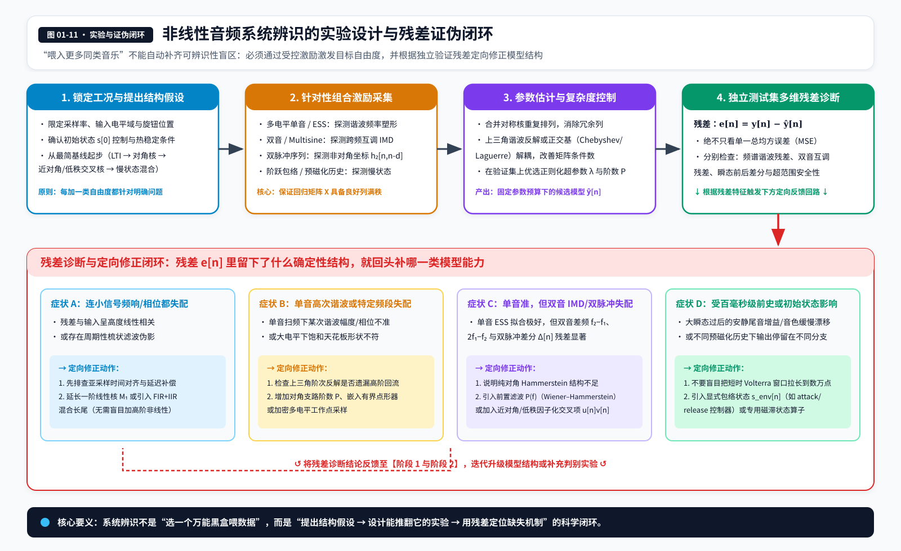

# 01 Volterra 级数

[在线阅读本章（完整合订版）](https://excillex-marisa.github.io/volterra-wiki/#chapter-01)

> **版本：v19 · 2026-11-17 · 四类块结构基础概念与音频直觉补充**
> **所属系列：Volterra Wiki**
> **配图说明：** 本章 17 张 SVG 配图与 Markdown 文件配套提供，建议使用完整素材包以保持相对路径有效。
> **阅读定位：从前置概念进入 Volterra 的正式数学结构，建立它在非线性音频系统辨识中的用途、优势、成本与能力边界。**
> **前置阅读：《00_前置概念与术语约定_图文版.md》。**
> **本章原则：解释每一种数学结构为什么有必要出现，以及它到底比前一种模型多表达了什么。本章概览常见约简形式与核心辨识难点，为后续混合建模与高级算子章节打好基础。**

本章先回顾 Volterra 级数从泛函理论走向非线性系统辨识的历史，再以卷积及输入历史为切入点，建立它的数学表达、核辨识和约简方法。它为后续神经网络、白盒电路、唯象状态和混合建模提供共同的系统辨识语言。

**第一遍的核心学习路线。** 历史导论可了解发展主线，随后按 1.1—1.8 建立交叉记忆、核、对称化及谐波概念；1.9 先理解单脉冲、双脉冲与扫频各能观察到什么，1.10—1.13 理解测量对象、拟合与参数规模；在 1.14 先读模型约简的总体分类与 1.14.8 的汇总，然后阅读 1.16—1.20、1.22—1.24 的能力边界和模型选择。理解这些内容，已经可以继续第 02 章。

**第二遍的进阶研究路线。** 1.9.1 讨论 ESS 同步相位与核反解，1.11.1 讨论多方差核辨识；1.14.2—1.14.7 展开各类约简的数学结构，1.15 涉及收敛与 Padé，1.21 进入抗混叠与 ADAA。它们保留完整推导，供准备做实际测量、训练和 DSP 实现的读者深入。本章的编号依旧连续，方便后续章节精确引用。

## 历史导论：Volterra 级数是怎样从泛函理论走向系统辨识的？

我们今天谈论 Volterra，往往会想到非线性卷积、谐波分阶与音频硬件测量。但这套理论的起点比数字信号处理早了近一个世纪。它的发展也不是某一位数学家一次性完成的单线发明史，而是几条研究路线逐渐交汇的结果：一条路线研究如何用泛函级数表示非线性映射；一条路线研究随机激励下如何正交分解和测量系统响应；另一条路线研究如何将这些表示用于真实动力系统，并控制辨识与计算成本。[VH1][VH5]

### 1887—1913 年：Volterra 与 Fréchet，把函数映射写成级数

意大利数学家 **Vito Volterra** 在 1887 年发表了关于“依赖于其他函数的函数”的系列研究。他关心的对象已经超出普通函数：自变量不再只是一个数，而可以是一整条函数或曲线。普通 Taylor 展开将数值函数拆成不同阶次的幂项；当输入对象变成函数时，对应的展开就需要多线性泛函以及多重积分形式。Volterra 的研究由此建立了后来以他命名的泛函级数思想。[VH1][VH8]

1910 年，**Maurice Fréchet** 在《Sur les fonctionnelles continues》中系统研究连续泛函，并将其表示为多重积分泛函级数。Schetzen 对这段历史的概括是：Fréchet 将 Weierstrass 多项式逼近思想推广到函数空间，使连续泛函能够在相应条件下由不同整数阶的泛函项表示。这里的关键词是“在相应条件下”：这项工作为 Fréchet–Volterra 级数建立了重要数学基础，但不能将它理解为任意非线性系统在任意输入幅度下都必然拥有收敛的 Taylor 型无穷展开。[VH1][VH9]

Volterra 后来又在 1912 年于巴黎讲授相关理论，并于 1913 年出版《Leçons sur les fonctions de lignes》。这使早期关于函数泛函的抽象思想逐渐形成更完整的数学体系。[VH1]

文献里还会出现 **Volterra 积分方程（Volterra Integral Equation）**。它与 Volterra 级数同样源于 Volterra 的研究，但数学对象和用途不同：积分方程通常以具有历史积分上限的关系描述未知函数；Volterra 级数则以不同阶的多线性积分核展开输入—输出映射。两者可以在非线性微分方程和动力系统分析中发生联系，阅读文献时应依据具体公式判断讨论对象。有关积分方程的专门数学体系，可参阅 Gripenberg、Londen 与 Staffans 的著作。[VH6]

### 1930—1949 年：Wiener 将随机过程、正交展开与非线性系统联系起来

**Norbert Wiener** 的研究路线来自随机过程、布朗运动与 Wiener 积分。1938 年，他发表《The Homogeneous Chaos》，为随机泛函的分层表示提供了重要理论背景。这里的“Chaos”属于随机泛函展开的历史术语，与后来动力系统中通常所说的混沌运动并非同一个概念。[VH10]

1942 年，Wiener 已经将 Volterra 理论用于一个具体的非线性电路问题：带非线性电阻的串联 RLC 电路在白色高斯激励下的响应。这是 Volterra 表示进入实际非线性器件分析的重要早期案例。1947 年，**R. H. Cameron** 与 **W. T. Martin** 发表关于 Fourier–Hermite 泛函正交展开的研究，进一步发展了高斯随机过程下非线性泛函的正交表示。Wiener 后来将这些随机积分和正交泛函研究与 Volterra 级数结合，逐渐形成用于非线性系统分析与综合的 Wiener 理论。[VH1][VH11]

1949 年，Wiener 将自己的非线性系统方法介绍给 MIT Research Laboratory of Electronics 中由 **Y. W. Lee** 领导的研究团队。1958 年，他以讲义形式出版《Nonlinear Problems in Random Theory》，系统呈现这条研究路线的重要成果。[VH1][VH2]

这段历史带来了一个后来极为重要的区别：Volterra 核与 Wiener 核都可以描述非线性系统的多阶响应，但它们来自不同的展开约定。Volterra 核组织确定性输入历史的多阶交互；Wiener 核则结合高斯随机输入的统计性质，对泛函项进行正交化，使不同阶次的贡献能够在相应统计意义下分离。两套核之间存在转换关系，但定义、归一化和辨识条件并不相同。

### 1950—1960 年代：从数学表示走向系统分析与实验核辨识

这一时期，Volterra 与 Wiener 两条研究路线逐渐形成各自的工程方法，并在系统辨识问题上相互交汇。

在 Wiener 路线上，**A. G. Bose** 于 1956 年提出 Gate Function Model，尝试将最优非线性建模推广到非高斯输入与加权均方误差准则。Lee 团队持续研究 Wiener 模型的分析与综合，绝大部分早期成果发表在 MIT 的 Quarterly Progress Reports 与技术报告中。[VH1]

真正改变实验辨识工作方式的是 **Lee–Schetzen 互相关法**。Martin Schetzen 的历史回顾将这项方法的形成时间记为 1961 年：它利用输入与输出之间的互相关关系测量 Wiener 核，并在 1962 年得到实验验证。Schetzen 随后将方法推广到非白色高斯输入；相关成果在 1965 年由 **Y. W. Lee** 与 **Martin Schetzen** 以《Measurement of the Wiener Kernels of a Non-linear System by Cross-correlation》正式发表。[VH1][VH3]

这里需要特别强调：Lee–Schetzen 方法直接辨识的是 **Wiener 核**。如果目标是获得采用另一套定义的 Volterra 核，还必须根据输入统计条件与核转换关系完成换算。把互相关结果直接称为 Volterra 核，会掩盖两种展开体系之间的区别。

与此同时，Volterra 理论也在发展。**Barrett** 于 1957 年系统研究 Volterra 级数在非线性微分方程和反馈系统中的应用；**Brilliant** 于 1958 年研究级联与收敛性质；**George** 于 1959 年建立系统代数，并使用多维 Laplace 变换分析 Volterra 算子；**Zames** 与 **Sandberg** 则从非线性算子、收缩映射和反馈稳定性角度推进相关研究。1963 年，Schetzen 研究了有限 Volterra 算子的测量与综合；1964 年，**Alper** 与 **Bush** 推进了离散时间 Volterra 系统的研究，使连续时间多重积分核与数字信号处理中熟悉的多重延迟求和进一步接轨。[VH1]

这一时期最重要的工程变化，是研究者开始系统回答三个问题：如何设计激励，使不同阶次的响应可以被分辨；如何从测量数据中估计核；如何在有限参数和运算量下实现模型。今天我们使用的互相关辨识、核测量、离散 Volterra 模型与实验激励设计，都能在这段历史中找到对应的研究源头。

### 1970—1980 年代：核辨识方法、工程体系与衰减记忆理论

进入 1970 年代，研究重点逐渐从“能否写出一个级数”转向“怎样计算、解释和验证这些核”。直接求解、基函数展开、时域互相关、频域方法，以及核形状与物理系统特征之间的联系，共同构成了非线性系统辨识的重要方向。

1977 年发表的综述《The Kernel Identification Method (1910–1977)》系统回顾了核辨识的理论、计算、应用和解释。1980 年，**Martin Schetzen** 出版《The Volterra and Wiener Theories of Nonlinear Systems》，将泛函展开、Wiener 正交化、核测量、系统综合及其历史文献组织成较完整的工程理论框架。对于今天希望从输入输出测量出发建立非线性音频模型的研究者，这本书仍然是重要的基础参考。[VH1][VH5]

1985 年，**Stephen Boyd** 与 **Leon O. Chua** 发表《Fading Memory and the Problem of Approximating Nonlinear Operators with Volterra Series》，进一步澄清 Volterra 级数的逼近能力。它研究的核心问题是：在因果、时不变、连续性及衰减记忆等条件下，能否用 Volterra 级数在规定的误差意义下逼近非线性算子；论文还讨论了由有限维线性动力学与非线性读出构成的逼近实现。它为“具有无限历史的系统为何可以由有限结构近似”提供了重要理论依据，但结论始终依赖输入集合、连续性和记忆条件，不能被解释成任意非线性系统都能被有限阶 Volterra 模型精确复刻。[VH4]

### 1990—2000 年代：正交基与参数约简，让高维核变得更可计算

完整 Volterra 核的参数数量会随阶数和记忆长度迅速增长。以 $`M`$ 个历史采样点构造的第 $`p`$ 阶完整核为例，其原始系数规模通常与 $`M^p`$ 同阶。即使系统理论上可以由 Volterra 型算子逼近，直接存储和估计全部核系数仍然可能不适合实际计算。

因此，研究者逐渐将正交基函数引入核表示。Laguerre、Kautz 以及广义正交基函数，可以沿核的各个延迟坐标展开原本高维的核函数。这样做的关键，是利用系统的主要时间尺度或模态结构，以较少的基函数表达较长的衰减记忆。基函数选择得当时，可以显著减少待估参数并改善数值条件；它并不会自动消除所有高阶交互，也不能保证任何系统都适合用同一组基函数表示。[VH12]

2004 年，**Campello、Favier 与 do Amaral** 将 Laguerre 基的优化选择系统推广到任意阶离散时间 Volterra 核，推导了相应的全局最优展开方案，以减少达到给定截断误差所需的基函数数量。2006 年的后续工作又讨论了各个核坐标采用独立 Laguerre 极点的情形。[VH12]

另一条重要路线是利用张量分解压缩高阶核。2011 年，**Favier、Kibangou 与 Bouilloc** 研究 Volterra-PARAFAC 模型，将高阶核视为对称张量并采用 PARAFAC 分解，以降低参数规模；论文还讨论了 Volterra 核正交基展开与 Tucker 型分解之间的联系。由此，Volterra 约简逐渐形成两种互补的思路：正交基主要压缩时间记忆坐标，张量分解主要压缩多维核的参数结构。[VH13]

### 2010 年代至今：数字音频应用与现代模型的交汇

进入现代数字音频研究之后，Volterra 级数逐渐与指数扫频测量、谐波阶次分离、硬件非线性辨识和实时插件实现结合。2012 年，Oliveira 等人对 Laguerre、Kautz 与其他正交基模型在非线性系统辨识中的应用进行了综述，比较了 Volterra、模糊模型和神经模型在正交基框架中的实现与限制。[VH14]

在音频领域，Tronchin 与 Coli 于 2015 年继续研究 Volterra 级数对非线性系统的仿真；Orcioni 等人于 2018 年将多方差方法用于电子管音频设备的 Volterra 模型辨识。2022—2023 年，Hopman 与 Bennett 又围绕简化非线性 Volterra 模型研究抗混叠方法与多项式 ADAA，为低计算成本的非线性音频实现提供了新的工程路径。[V3][V2][V4]

与此同时，神经网络、可微分 DSP、状态空间模型、物理电路求解和混合灰盒模型也在发展。它们并非 Volterra 理论的单一后继分支，而是在非线性系统表示、输入输出辨识、记忆建模和实时计算这些共同问题上逐渐交汇。固定核回归、低秩 Volterra、WaveNet、NAM、神经算子和物理约束网络之间的关系，正是后续章节要继续讨论的内容。

### 为什么历史上会同时出现 Volterra 核与 Wiener 核？

| 比较维度 | Volterra 展开 | Wiener 展开 |
|---|---|---|
| 数学出发点 | 多线性泛函与多重积分核 | 随机泛函与正交展开 |
| 核的含义 | 组织确定性输入历史的多阶交互 | 对特定输入统计条件下的正交响应进行分阶表示 |
| 重要条件 | 展开、收敛与逼近条件 | 输入统计性质及正交化约定 |
| 典型辨识路线 | 直接核测量、激励设计、参数回归 | 高斯随机激励与互相关测量 |
| 两者关系 | 可与 Wiener 表示建立核转换关系 | 正交化改变了核的定义和系数组织方式 |

可以将两者的历史关系概括为：Volterra 提供了显式组织非线性历史交互的泛函表示；Wiener 将随机过程和正交泛函引入非线性系统分析；Lee–Schetzen 则把 Wiener 核的互相关测量推进到可执行的实验方法。理解这条发展链，才能正确区分理论核、实验估计量与最终用于数字实现的模型系数。

### 从历史进入本章的数学问题

这段历史最终汇聚到我们今天真正关心的工程任务：如何设计输入激励，分离并估计系统的非线性阶次；如何判断需要多少记忆长度与多少个交叉项；如何在辨识精度、模型规模、抗混叠和实时 CPU 预算之间取得平衡。

本章接下来从输入历史与多项式结构出发，正式定义 Volterra 级数；《02》将讨论神经网络如何在非线性系统辨识这一共同问题上与它交汇；《03》继续研究状态耦合和混合模型；《04》展开泛函分析、随机正交展开与高级系统辨识；《06》则把测量、核数据库、计算引擎与商业音频插件连接起来。历史解释了研究问题如何形成，模型是否成立仍然需要数学条件和独立实验验证。

## 1.1 我们真正想解决的，是哪一种音频建模问题？

在前置概念中，我们已经把一台音频设备视为从输入产生输出的系统，也区分了线性、非线性、记忆与状态。现在不妨提出一个更具体的问题：假设我们想复刻某台模拟前级，只能向它送入测试音频并录下输出，而且已经排除了接口增益、采样时钟和明显的测量误差，该怎样选择一个足以描述它的数学模型？

如果设备的作用只有固定的频率响应与相位变化，那么线性卷积便可以完成任务；如果它主要添加随瞬时幅度变化的失真，一条静态 waveshaper 曲线也许已经够用。但真实设备可能还会表现出第三种现象：在当前输入幅度相同的情况下，因为几毫秒以前经历的波形不同，当前输出的非线性部分也不同。描述这种历史影响需要引入记忆模型，而跨时刻的非线性交互还需要乘积项或具有等效表达能力的模型结构。

需要明确的是，**“一个系统有记忆”和“不同历史时刻之间存在非线性交互”属于两个不同层面的性质**。普通 EQ 当然有记忆，稳定的 IIR 滤波器也可能保留很长的衰减尾部，但这类线性记忆中各个历史样本对输出的贡献相互独立。Volterra 级数最值得我们研究的地方，在于它允许非线性同时发生在单个采样点上以及**多个历史采样点之间**。

同时，许多滤波器与静态非线性的级联或并联组合，同样能够制造复杂的动态失真。真正的研究问题在于：**在指定的输入范围和测量条件下，哪一种结构能以合理的参数数量和运行成本，解释设备所表现出的输入—输出关系？** 接下来，我们先用一个只包含两个历史变量的模型把这件事讲清楚。


*图 01-01 | 静态非线性、线性卷积与 Volterra 的能力对照。注意“静态非线性（有非线性、无记忆）”与“线性卷积（有记忆、无非线性）”分别扩展了两个正交的能力维度，二者汇合后构成同时具备记忆与高阶非线性交互的 Volterra 模型。*

## 1.2 从两个采样点开始：为什么会出现“交叉记忆”？

假设某一时刻的输出只与当前输入及前一个采样点有关。为了让式子简单一些，令 $`a=x[n],\;b=x[n-1]`$。最简单的线性模型可以写成

```math
y=a+0.2b.
```

这里的 $`a`$ 是当前输入的贡献，$`0.2b`$ 是上一采样点留下的线性贡献。如果 $`b`$ 增加 $`1`$，输出始终增加 $`0.2`$，无论当前 $`a`$ 等于多少。这就体现了线性记忆的特点：**过去输入的影响可以有大有小，但各个输入变量的贡献彼此独立地相加。**

现在加入一个新的项：

```math
y=a+0.2b+0.1ab.
```

多出来的 $`0.1ab`$ 虽然只是两个数相乘，却使模型发生了本质变化。此时如果让 $`b`$ 增加 $`1`$，输出的变化量是 $`0.2+0.1a`$，也就是说，**上一采样点的影响大小，开始取决于当前采样点的幅度**。反过来，当前输入所产生的效果也取决于上一采样点是什么。这个乘积项描述了两个历史输入的联合贡献，其作用不同于各自贡献的独立相加。

我们还能设计一个受控实验，让这种交互单独显露出来。分别测量 $`y(a,b),\;y(a,0),\;y(0,b)`$ 和 $`y(0,0)`$，再计算

```math
\Delta=y(a,b)-y(a,0)-y(0,b)+y(0,0).
```

对于刚才的模型，计算结果恰好是

```math
\Delta=0.1ab.
```

为什么要使用这种四次测量的组合？因为只随 $`a`$ 改变的贡献、只随 $`b`$ 改变的贡献，以及常数偏移，都会在相减时被抵消，只有二者共同参与才产生的部分会留下来。这是一种非常基础的**交互作用隔离**思想。实际硬件存在更多历史变量、更高阶交互和噪声，因此四次测量在一般高阶系统中还会包含三阶及以上的交叉余项；但这个例子已经清楚说明，为什么我们需要超越线性卷积。

再往前走一步：如果模型同时依赖最近几十、几百个采样点，那么类似 $`x[n-2]x[n-7]`$ 的组合就会大量出现。我们需要一套统一的数学记账方式来组织这些乘积。**Volterra 级数，正是把这类不同阶数、不同历史位置的输入乘积组织起来的一种通用表示。**


*图 01-02 | 二阶非对角项如何使两个不同历史位置的输入产生联合贡献。*

## 1.3 从多项式到 Volterra：把刚才的玩具模型写成一般形式

回忆普通多项式的结构：$`y=a_0+a_1x+a_2x^2+\cdots`$。它可以把一个复杂的静态非线性拆成常数贡献、一次贡献、二次贡献以及更高次贡献。这里的“一次、二次、三次”表示每个项里面**有多少个输入因子相乘**。

当系统需要同时考虑一整段输入历史时，我们可以把最近 $`M`$ 个采样点排列成一个历史向量：

```math
\mathbf{x}_n=
\begin{bmatrix}
x[n] & x[n-1] & \cdots & x[n-M+1]
\end{bmatrix}^{T}.
```

如果当前输出是这个向量的某个函数，即 $`y[n]=F(\mathbf{x}_n)`$，那么在适当的光滑性条件与选定工作点附近，可以像展开多变量函数一样，把它写成若干不同次数的项。一次项包含 $`x[n],\;x[n-1]`$ 等各个历史样本；二次项除了包含 $`x^2[n]`$ 和 $`x^2[n-1]`$，还允许 $`x[n]x[n-1]`$；三次项则允许三个输入因子相乘，其中的历史位置可以相同，也可以不同。

把这种思想推广到任意阶，就得到一个有限阶、有限记忆的离散时间 Volterra 模型：

```math
\hat{y}[n] = h_0 + \sum_{p=1}^{P}
\sum_{k_1=0}^{M-1} \cdots \sum_{k_p=0}^{M-1}
h_p[k_1,\ldots,k_p]
\prod_{i=1}^{p} x[n-k_i].
```

这个公式由三部分构成：外层的 $`\sum_{p=1}^{P}`$ 表示把一阶至 $`P`$ 阶的贡献相加；中间的一组求和表示遍历该阶允许使用的历史位置；最后的 $`\prod`$ 表示把这些历史位置上的输入相乘，再乘上对应的权重 $`h_p`$。其中 $`P`$ 是**最高保留阶数**，$`M`$ 是**输入历史长度**，$`h_0`$ 是常数项，而 $`h_p[k_1,\ldots,k_p]`$ 就是第 $`p`$ 阶 **Volterra 核（Volterra Kernel）**。

不妨把前三阶单独展开：

```math
\begin{aligned}
\hat{y}[n] &= h_0 + \sum_{k_1=0}^{M-1} h_1[k_1]x[n-k_1] \\
&\quad + \sum_{k_1=0}^{M-1}\sum_{k_2=0}^{M-1} h_2[k_1,k_2]x[n-k_1]x[n-k_2] \\
&\quad + \sum_{k_1=0}^{M-1}\sum_{k_2=0}^{M-1}\sum_{k_3=0}^{M-1} h_3[k_1,k_2,k_3]x[n-k_1]x[n-k_2]x[n-k_3] + \cdots .
\end{aligned}
```

由此可以看到：**一阶 Volterra 项就是普通线性卷积；二阶开始，模型引入两个历史输入的乘积；阶数继续提高时，联合参与的历史输入因子也随之增加。** 因此 Volterra 级数以线性卷积为一阶特例，并在其基础上逐阶扩展了多时刻非线性表达能力。只保留 $`h_1`$ 时，模型即退化为熟悉的线性 FIR 系统。

刚才使用的是离散时间形式，对应数字音频插件中的逐采样计算。在 Schetzen 等经典文献中，连续时间因果、时不变、单输入单输出系统的形式化写法为

```math
y(t)=h_0+\sum_{p=1}^{\infty}
\int_0^{\infty}\!\cdots\!\int_0^{\infty}
h_p(\tau_1,\ldots,\tau_p)
\prod_{i=1}^{p}x(t-\tau_i)
\,d\tau_1\cdots d\tau_p.
```

其中 $`\tau_i`$ 表示过去的第 $`i`$ 个延迟坐标。每一重积分都在累积一种历史位置组合的贡献，对应离散模型中的多重延迟求和。式中的无穷阶与无穷历史属于一般理论记法；实际实时计算总是基于双截断（有限阶数 $`P`$ 与有限记忆 $`M`$）或低维递归基结构。

上面的式子默认使用零附近的输入作为变量、采用因果历史，并且把各阶核直接定义为对应求和式里的系数。有的泛函分析文献会在展开式里显式写出 $`1/p!`$，有的则把这一系数吸收到核定义中（参见《04》第 4.3 节）。两种写法在保持一致的情况下可以互相转换；**本 Wiki 默认使用已经吸收 $`1/p!`$ 系数的工程核记法**，在对照不同文献时需先核对这一约定。


*图 01-03 | 一阶、二阶与三阶 Volterra 核的维度直觉。它们分别拥有一个、两个和三个延迟索引。*

## 1.4 为什么它被叫作“带记忆的 Taylor 级数”？

Taylor 级数的出发点，是在某个参考点附近利用函数的导数，逐渐构造出能够描述该函数变化的多项式。一个静态函数若在工作点附近满足解析条件，就可以写成

```math
f(x_0+u)=f(x_0)+f'(x_0)u+\frac{f''(x_0)}{2!}u^2+\cdots.
```

音频系统的输出通常依赖整个输入历史。对于固定的输出时刻，我们面对的是一个从**输入函数到一个输出数值**的映射，即泛函。Volterra 的思想，就是把普通标量函数的 Taylor 展开推广到以函数或信号为自变量的泛函与算子空间。相应的一阶贡献变成对输入历史的线性作用，二阶贡献变成两份历史输入之间的双线性作用，更高阶依此类推。

理解“带记忆的 Taylor 级数”这一比喻时，需要注意两点数学边界：第一，泛函幂级数的收敛域由系统的解析性质与输入幅度范围共同决定；第二，在固定点附近的局部泛函导数展开，与在宽动态范围上通过最小二乘拟合得到的双截断多项式核，具有不同的系数性质（参见第 1.11.1 节的多方差辨识）。

这一理论最初来自 Vito Volterra 对泛函的研究，后来经由 Norbert Wiener、Y. W. Lee、Martin Schetzen 等人的工作，与非线性系统分析及黑盒辨识建立紧密联系。对音频工程师而言，这段历史表明：在深度神经网络普及之前，信号处理领域就已经建立了一套可以明确剖析非线性阶次、输入历史、核函数和辨识误差的解析框架。

此外，在文献检索时应注意区分 **Volterra 级数（Volterra Series）** 与 **Volterra 积分方程（Volterra Integral Equation）**：两者同源但研究对象不同，本 Wiki 聚焦于非线性系统的 Volterra 级数表示及其工程约简。


*图 01-04 | 从静态 Taylor 幂级数到带历史输入的 Volterra 展开的直观对应。*

这里还需要区分两类看起来相似的多项式。**Taylor 多项式**的系数来自参考工作点处的各阶导数，属于局部展开；**区间多项式拟合**则利用一组实际测量数据，寻找在给定输入分布和误差准则下更合适的系数。后者的系数会随训练电平、样本权重与截断阶数改变。对于 Volterra 核，这一差异将在 1.11 节的多电平辨识中重新出现。

## 1.5 为什么 Volterra 核是多维的？

普通线性脉冲响应 $`h_1[k]`$ 只需要一个延迟坐标：过去第 $`k`$ 个采样点对当前输出有多大影响。假设我们要讨论两个历史位置之间的交互，就必须为两个位置分别安排坐标 $`k_1`$ 和 $`k_2`$，因此二阶核自然写成 $`h_2[k_1,k_2]`$。如果要讨论三个位置联合参与的贡献，就需要 $`h_3[k_1,k_2,k_3]`$。这里的“二维”“三维”，指的是**核系数拥有几个独立的延迟索引**。

对于二阶核，可以把它想象成一张二维表：横轴是第一个延迟位置，纵轴是第二个延迟位置，表中每个格子都存放一个交互权重。处于主对角线 $`k_1=k_2`$ 的元素，对应同一个历史样本的平方，例如 $`x^2[n-4]`$；离开主对角线的元素，则对应不同历史样本之间的乘积，例如 $`x[n-2]x[n-7]`$。二者都属于二阶非线性，但包含的历史耦合结构截然不同。

因此，仅包含对角项的模型与包含**非对角交叉记忆（Cross-Memory）** 的模型，虽然都能生成二次或三次谐波，但在双音互调、瞬态包络恢复和跨时刻调制上会表现出明显的动态差异：后者允许某个历史采样点的非线性作用随另一历史时刻的输入幅值发生调制。

## 1.6 核对称化：为什么可以无损消除重复参数？又怎样影响计算量？

在进入模型约简以前，先处理一个最基本的数学冗余。对标准单输入、单输出的 Volterra 模型，同一阶输入乘积中的各个因子都来自同一条标量信号，实数乘法满足交换律。以二阶为例，$`x[n-2]x[n-7]`$ 与 $`x[n-7]x[n-2]`$ 产生相同的数值，因此分别记在 $`h_2[2,7]`$ 和 $`h_2[7,2]`$ 的两个系数，在输入—输出观测中只通过它们的**和**发挥作用。数据可以估计它们的合计贡献，却无法仅通过这种单输入输出实验将二者单独辨识出来。

**先把两个历史样本的核完全展开。** 令 $`a=x[n]`$、$`b=x[n-1]`$，一个保留两个延迟的二阶完整核共有四个坐标：

```math
\begin{aligned}
y_2[n]={}&h_2[0,0]a^2+h_2[0,1]ab\\
&+h_2[1,0]ba+h_2[1,1]b^2\\
={}&h_2[0,0]a^2
+\bigl(h_2[0,1]+h_2[1,0]\bigr)ab
+h_2[1,1]b^2.
\end{aligned}
```

例如两个非对角系数分别为 $`0.07`$ 和 $`0.03`$，它们共同贡献 $`0.10ab`$。我们可以把它们改写成一对相等的系数 $`0.05`$ 和 $`0.05`$，输出对任意 $`a,b`$ 都保持不变。这一步就是**核对称化（Kernel Symmetrization）**。它把具有相同输入乘积的核坐标合并为一个数学等价类，通常作为 Volterra 辨识与存储的基础处理。

**对称化的数学定义。** 二阶核沿主对角线镜像取平均：

```math
h_{2,\mathrm{sym}}[k_1,k_2]
=\frac{h_2[k_1,k_2]+h_2[k_2,k_1]}{2}.
```

对于一般 $`p`$ 阶核，设 $`S_p`$ 为全部 $`p!`$ 种索引排列组成的集合，则

```math
h_{p,\mathrm{sym}}[k_1,\ldots,k_p]
=\frac{1}{p!}\sum_{\pi\in S_p}
h_p[k_{\pi(1)},\ldots,k_{\pi(p)}].
```

**为什么高阶对称化也不会改变输出？** 对于任意排列 $`\pi`$，交换输入乘积内部的因子顺序，不会改变乘积 $`\prod_{i=1}^{p}x[n-k_i]`$；当每个延迟索引都遍历同样的完整取值集合时，给求和索引重新命名也不会改变求和值。于是每一种排列后的核对应完全相同的 $`p`$ 阶输出，取这些排列核的平均也得到同一个输出。该结论适用于这里约定的标量输入、交换性乘积和完整延迟组合求和；使用非交换矩阵乘法、不同支路输入或特殊有序积分域时，需先检查相应的索引与乘积约定。

**在程序中有两套等价的系数记账方法。** 第一种保存对称张量 $`h_{p,\mathrm{sym}}`$，并在完整的 $`M^p`$ 坐标上求和。第二种只保存唯一的非递减延迟组合 $`0\le k_1\le\cdots\le k_p<M`$，用合并系数 $`c_p`$ 直接计算一次对应的单项式。对二阶非对角项，上面的两种写法分别是

```math
0.05ab+0.05ba=0.10ab,
\qquad c_2[0,1]=0.10.
```

它们输出相同，但数组中存放的系数含义不同。若某个非递减延迟组合包含 $`m`$ 个不同延迟，分别出现了 $`r_1,\ldots,r_m`$ 次且 $`\sum_jr_j=p`$，则它在完整求和中的不同排列数量为

```math
\mu(k_1,\ldots,k_p)=\frac{p!}{r_1!\cdots r_m!},
\qquad
c_p[k_1,\ldots,k_p]
=\mu(k_1,\ldots,k_p)h_{p,\mathrm{sym}}[k_1,\ldots,k_p].
```

例如三阶核的 $`(0,0,1)`$ 只有三种不同排列，因而 $`c_3[0,0,1]=3h_{3,\mathrm{sym}}[0,0,1]`$；三个索引都不相同时有六种排列，合并系数需要乘以 6；三个索引完全相同则只出现一次。**把完整对称核系数直接放进唯一组合求和而遗漏重数因子，会产生错误的输出幅度。**

这样就可以将同一阶算子写成紧凑的唯一单项式求和：

```math
y_p[n]=
\sum_{0\le k_1\le\cdots\le k_p<M}
c_p[k_1,\ldots,k_p]
\prod_{i=1}^{p}x[n-k_i].
```

**对称化具体节省了什么？** 对于 $`M`$ 个可用延迟，原始核张量有 $`M^p`$ 个坐标，而唯一非递减组合的数量为

```math
N_p=\binom{M+p-1}{p}.
```

当 $`M=2`$、$`p=2`$ 时，四个有序坐标合并为三个独立单项式 $`a^2,ab,b^2`$；当 $`M=64`$、$`p=3`$ 时，原始 $`262\,144`$ 个坐标降为 $`45\,760`$ 个唯一组合。这是**参数数量与存储需求上的无损约简**。如果实时引擎仍按全部 $`M^p`$ 个坐标执行对称核求和，乘加循环不会自动变短；只有真正改成唯一组合遍历、利用单项式重用或其它专门的求值结构，才能同步节省运算。对固定阶数 $`p`$，完整对称核的组合数随 $`M`$ 仍按 $`O(M^p)`$ 增长，高阶维数爆炸依然存在。

**核辨识为什么应先考虑这一步？** 若直接把 $`h_2[0,1]`$ 和 $`h_2[1,0]`$ 当作互不相关的待估参数，回归矩阵中的两列特征完全相同，最小二乘无法唯一确定各自的值。按唯一单项式建模可以删除这种完全重复的特征列，让所估参数更有明确含义；但不同单项式之间仍可能由于激励相关而产生病态，仍需设计合适的输入、检查条件数并按需要使用正则化。若更改回归系数的重数归一化，还应相应检查正则化项的权重。

**它与真正的结构约简是什么关系？** 对称化利用交换律消除同一单项式的重复排列，在上述条件下不损失输入—输出表达能力；对角、带状、稀疏等方法进一步选择保留哪些不同延迟组合，低秩与时间基方法进一步限制核能够由什么结构生成。因此，在工程上可以把**对称化／唯一组合编码**视为完整核参数化的首要整理步骤，再判断是否需要引入具有额外结构假设的约简。第 1.13 节将量化它仍然留下多大的参数规模，1.14 节再分类讨论下一步的约简路线。

## 1.7 Volterra 里的“阶”，怎样变成我们听到的谐波与互调？

对于经典 Volterra 模型，第 $`p`$ 阶算子具有齐次性（Homogeneity）：如果把整段输入乘以常数 $`a`$，它的第 $`p`$ 阶贡献就会乘以 $`a^p`$，即

```math
H_p[ax](n)=a^pH_p[x](n).
```

原因在于第 $`p`$ 阶的每一个项里都有 $`p`$ 个输入因子，输入整体放大 $`a`$ 倍后，乘积自然放大 $`a^p`$ 倍（对应 dB 域中，输入每增加 $`1\,\mathrm{dB}`$，第 $`p`$ 阶分量的幅度增加 $`p\,\mathrm{dB}`$）。这种齐次性使不同阶次在幅度变化时呈现不同增长斜率，构成了通过多电平测试分离各阶贡献的数学基础。

在下面的连续时间例子中，$`\omega`$ 表示角频率（rad/s）；对应采样率 $`f_s`$ 的离散时间角频率可记为 $`\Omega=\omega/f_s`$（rad/sample）。

那么这些阶次怎样与输出频谱联系起来？假设输入为单频余弦波 $`x(t)=\cos(\omega t)`$。由三角幂展开公式：

```math
\cos^2(\omega t)=\frac{1}{2}+\frac{1}{2}\cos(2\omega t),\qquad
\cos^3(\omega t)=\frac{3}{4}\cos(\omega t)+\frac{1}{4}\cos(3\omega t).
```

可以看到，二次非线性同时产生直流（$`0\omega`$）与二次谐波（$`2\omega`$），三次非线性则同时作用于基波（$`1\omega`$）和三次谐波（$`3\omega`$）。在无直流偏置的单频正弦输入下，奇偶性严格分离：**第 $`p`$ 阶奇数项会向所有不高于 $`p`$ 的奇次谐波（$`1,3,\ldots,p`$ 倍频）贡献分量；第 $`p`$ 阶偶数项会向所有不高于 $`p`$ 的偶次谐波（$`0,2,\ldots,p`$ 倍频）贡献分量**。因此，同一基波成分会同时受到一阶、三阶、五阶等所有奇数阶项的回流影响（表现为增益压缩或扩展）；同一次奇（或偶）次谐波也会汇集所有高于或等于它的奇（或偶）数阶次贡献。

如果输入包含两个正弦波 $`x(t)=A_1\cos(\omega_1 t)+A_2\cos(\omega_2 t)`$，乘积会把频率相加或相减。二阶项除了产生 $`2\omega_1,\;2\omega_2`$ 和直流外，还会产生二阶和差频互调（IMD2）：

```math
\cos(\omega_1t)\cos(\omega_2t)
=\frac{1}{2}\cos\bigl((\omega_1+\omega_2)t\bigr)
+\frac{1}{2}\cos\bigl((\omega_1-\omega_2)t\bigr).
```

三阶项则会进一步产生 $`2\omega_1\pm\omega_2`$ 与 $`2\omega_2\pm\omega_1`$ 等三阶互调边带（IMD3）。特别是当 $`\omega_1`$ 与 $`\omega_2`$ 较为接近时，差频 $`\omega_2-\omega_1`$ 落入低频区，而三阶差频 $`2\omega_1-\omega_2`$ 与 $`2\omega_2-\omega_1`$ 紧贴在基频两侧，直接出现在基频附近的可听频段。对于混音、母带以及模拟硬件建模来说，单音谐波测试只能反映频域主对角切片，多音互调测试才是检验非对角交叉核与动态调制的关键手段。


*图 01-05 | Volterra 阶次、核阶数和输出谐波的区别：阶次对应乘积因子数量及核的阶数。在无偏置单频激励下，同一次奇（或偶）次谐波会同时受到多个不同奇（或偶）数阶次的共同贡献，奇阶与偶阶各自独立。*


*图 01-06 | 从单频谐波到多音互调，再到不同输入时刻之间的非线性交互。*

这里的“阶”还要与滤波器阶数分开理解：Volterra 的 $`p`$ 阶指每项相乘的输入因子数，$`p`$ 次谐波指输出频率是基频的 $`p`$ 倍；IIR 或模拟滤波器的阶数则涉及传递函数的极点数量或状态维度。同样的数字出现在这三类术语里，代表的是不同物理与数学量。

## 1.8 从 Waveshaper 到四种经典块结构：Volterra 的近亲

Volterra 级数把不同阶次、不同历史位置的交互直接记录在多维核中。实际音频建模还有一种更紧凑的选择：将**线性动态模块**和**静态非线性模块**按指定次序连接，通过少量滤波器与非线性曲线生成复杂输入—输出关系。这类模型统称**块结构非线性模型（Block-Oriented Nonlinear Models）**，Hammerstein、Wiener 及其扩展都是其中的代表。它们和 Volterra 的联系可以通过等效核精确建立；模型是否适合某台设备则要依赖测量和独立验证。[B1][B2][B3]

### 1.8.1 用 L 和 N 读懂四种名字与信号流

令 **L（Linear Dynamic Block）** 表示具有记忆的线性滤波器，**N（Memoryless Nonlinearity）** 表示对每个采样值执行一次静态函数。信号流从左向右阅读：

| 模型 | 信号流 | 哪个环节产生非线性记忆 |
|---|---|---|
| **Hammerstein** | 输入 → N → L → 输出 | 各历史采样先独立产生非线性，再经过输出滤波 |
| **Wiener** | 输入 → L → N → 输出 | 先混合不同历史位置，随后对混合结果进行非线性处理 |
| **Wiener–Hammerstein** | 输入 → L₁ → N → L₂ → 输出 | 前置滤波产生历史混合，后置滤波重新塑造新生频率 |
| **Hammerstein–Wiener** | 输入 → N₁ → L → N₂ → 输出 | 输入侧与输出侧各有一次非线性，线性动态位于中间 |

#### 从音频处理器的基本模块建立直觉

**L 模块负责线性动态。** 可以把它想成一段 EQ、带通滤波器、变压器线性工作区的等效频率响应，或者一个具有固定时间常数的线性平滑系统。它输出的当前采样值可能包含多个过去采样点的贡献，所以具备记忆；但只要参数固定且模型满足线性条件，输入按比例缩放时，输出也按相同比例变化。这里的“动态”表示信号的时间历史参与计算，并不要求滤波器参数随输入电平变化。L 可以用 FIR、IIR 或其它等效 LTI 结构实现。

**N 模块负责静态非线性。** 可以把它想成逐采样的柔性饱和曲线、静态整流、死区或 waveshaper。相同的当前输入值会得到相同的当前输出值；即使这一函数产生许多新的谐波，它自身也没有储存上一时刻的状态。比如 `f(x)=x+0.2x^2`，当 `x=1` 时，输出始终为 `1.2`。模型中的非线性“随时间表现不同”，往往是因为 N 的输入先经过有记忆的 L，或 N 的输出又被后面的 L 按时间累积。

**为什么要组合它们？** 对硬件进行纯黑盒测量时，频率选择和非线性曲线经常叠加在一起。如果只放一个静态 waveshaper，它能随幅度产生失真，却无法解释滤波器的历史影响；只放一个 LTI 滤波器，它能改变幅度与相位，但无法产生输入中原本没有的谐波。将 L 和 N 串联，便获得了成本低、参数容易理解的候选模型。信号流相同只说明我们选择了类似的**等效数学架构**，真实电路内可能还包含反馈、器件相互加载、温度效应和额外状态。

可以从一个听觉问题初步记住四种结构：**失真之后如何被滤波**，对应 N–L；**哪些频率先被送进失真**，对应 L–N；**失真前后的两段频响怎样共同作用**，对应 L–N–L；**动态过程两端是否各有独立的非线性变换**，对应 N–L–N。沿着这个问题阅读后面的推导，公式就能和音频处理过程对应起来。

需要认真区分最后两行：**Wiener–Hammerstein 为 L–N–L，Hammerstein–Wiener 为 N–L–N**。后者也用于 MathWorks 的系统辨识模型命名。[B1] 下面统一研究单输入单输出、因果 LTI 滤波、零初始状态，且在指定工作点附近把静态函数写成有限阶多项式

```math
f(v)=\sum_{p=1}^{P}a_pv^p.
```

其中 $`P`$ 是最高保留阶数，$`a_p`$ 是系数。这里暂取 $`f(0)=0`$；静态曲线有偏置或展开中心发生变化时，要重新整理常数项和低阶系数。LTI 滤波器可采用稳定 FIR 或 IIR；有限 FIR 的核表达最便于观察其结构。

### 1.8.2 Hammerstein（N–L）：为什么它的核集中在主对角线？

可以先想象一个简单的 **waveshaper 后接 EQ** 的音频插件。waveshaper 对当前输入产生新的谐波，后面的 EQ 决定这些已经生成的频率成分如何被削弱、增强或延迟。例如，用低通滤波器接在饱和器后面，可以使新生成的高频谐波更暗；滤波器的尾部会带来输出记忆，但不同输入历史位置的值仍然是在进入滤波器以前各自完成非线性计算的。

这种排列特别适合表示“**每个时刻独立产生失真，随后由一个动态网络统一塑造输出**”的假设。它具有明确的结构边界：同一个 N 块生成不同阶的失真，单一 L 块对这些阶次使用共同的输出频响。因此，后面还要比较它与**并行 Hammerstein** 的区别；后者允许每一阶失真走独立的滤波器。

先计算 $`v[n]=f(x[n])`$，再让它经过脉冲响应为 $`h[m]`$ 的滤波器：

```math
y[n]=\sum_m h[m]f(x[n-m])
=\sum_{p=1}^{P}a_p\sum_mh[m]x^p[n-m].
```

第 $`p`$ 阶项中的 $`p`$ 个输入因子都在同一历史位置 $`n-m`$。因此其等效 Volterra 核为

```math
h_p^{\mathrm H}[k_1,\ldots,k_p]
=a_ph[k_1]\prod_{i=2}^{p}\delta[k_i-k_1].
```

$`\delta[k]`$ 是 Kronecker delta：参数为 0 时等于 1，其余情况等于 0。这个核在二阶只有主对角元素可能非零，不包含 $`x[n-2]x[n-7]`$ 这样的跨时刻乘积。

还要区分**单一 Hammerstein** 与**并行 Hammerstein（Parallel Hammerstein）**。前者所有阶次共享同一输出滤波器 $`h`$，不同阶次的核系数受到 $`g_p[k]=a_ph[k]`$ 的比例约束；后者为每个阶次分别配置 $`g_p[k]`$：

```math
y[n]=\sum_{p=1}^{P}\sum_mg_p[m]x^p[n-m].
```

因此，一般**对角 Volterra／实信号记忆多项式**可以由并行 Hammerstein 实现，而单一 Hammerstein 是其中共享滤波器的一种受限情形。若高阶谐波在不同频段具有明显不同的后置响应，逐阶独立滤波器会增加表达自由度。

### 1.8.3 Wiener（L–N）：滤波器怎样生成非对角交叉记忆？

现在把同样的 EQ 放在 waveshaper **之前**。一个带共振的前置滤波器，会使某些频段在进入饱和曲线以前获得更大的瞬时幅度；因此，原本频谱相同但历史排列不同的输入，也可能在饱和器入口形成不同的瞬时峰值。新的谐波由滤波后的混合信号产生，饱和程度会随前置滤波器的历史输出变化。

可以把这一结构理解为“**线性网络负责记住和混合过去，静态曲线对当前混合结果作出非线性响应**”。它适合首先试验那些主要受前置滤波与饱和相互作用影响的系统。需要留意，N 本身仍然没有动态状态；这种结构表现出的记忆来自它前面的 L。它提供的非对角交叉作用还有秩一等数学约束，具体可由下面的核公式看出。

交换两个模块的顺序，先计算 $`v[n]=(g*x)[n]`$，再输出 $`y[n]=f(v[n])`$。由于

```math
v[n]=\sum_kg[k]x[n-k].
```

```math
h_p^{\mathrm W}[k_1,\ldots,k_p]
=a_p\prod_{i=1}^{p}g[k_i].
```

它的 $`p`$ 阶核是前置滤波器向量的 $`p`$ 重外积；二阶核矩阵 $`h_2^{\mathrm W}[k_1,k_2]=a_2g[k_1]g[k_2]`$ 为秩至多 1 的对称矩阵。只要两个不同延迟的 $`g`$ 值均非零，核就出现非对角交互。由此可见，单个静态 waveshaper 即使自身没有记忆，在**被送入的输入已经混合历史**时仍然可以产生非线性交叉记忆。

### 1.8.4 Wiener–Hammerstein（L–N–L）：输入滤波和输出滤波怎样共同构造核？

真实音频电路的非线性器件前后都可能存在频率选择、耦合电容或其它近似线性的网络。为了建立一个易于计算的等效模型，可以先用 L₁ 模拟非线性器件看到的频率与历史分布，由 N 产生非线性分量，再用 L₂ 表示输出侧的频率响应。这样我们既能研究“**什么信号驱动非线性**”，也能研究“**产生失真以后又经过什么滤波**”。

例如，前置共振会使特定输入频率更容易激发饱和，后置低通则会改变已经生成的高频谐波。调换这两段滤波器的位置，一般会改变谐波与互调的幅相表现。这个示例是用于辨识的**等效结构假设**，真实器件中的负载耦合、反馈以及电平相关的时间常数仍需要通过测量判断。对于存在这类额外机制的设备，L–N–L 往往可以作为基线，再进一步增加状态或反馈模型。

令前置滤波器为 $`g`$，后置滤波器为 $`h`$：

```math
v[n]=(g*x)[n],\qquad
w[n]=f(v[n]),\qquad
y[n]=(h*w)[n].
```

代入多项式并收集同阶乘积，可以得到

```math
h_p^{\mathrm{WH}}[k_1,\ldots,k_p]
=a_p\sum_m h[m]\prod_{i=1}^{p}g[k_i-m].
```

这里在滤波器有效支撑域之外约定 $`g[r]=0`$。对于二阶核，每个非零的后置滤波抽头 $`h[m]`$ 都生成一个**前置滤波器的平移向量外积**，最终核是这些外积的加权和。若后置 FIR 只有 $`M_h`$ 个可能非零的抽头，二阶矩阵的秩不超过这些移位外积的数量；更高阶也具有由移位秩一分量组成的对称张量结构。[B3]

这一结构特别适合说明**非线性之前与之后的频率选择**：输入侧滤波器决定哪些历史成分在非线性器件处叠加，输出侧滤波器继续改变已经生成的谐波与互调成分。后置滤波器若退化为单位脉冲，模型成为 Wiener；前置滤波器若退化为单位脉冲，则成为 Hammerstein。非零的两段滤波器让核同时具备结构化交叉项和后置频谱塑形。

### 1.8.5 Hammerstein–Wiener（N–L–N）：为什么两个二次静态块就能生成四阶响应？

这一排列可以先从“**输入端的静态变换—中间的动态系统—输出端的静态变换**”来理解。输入侧 N₁ 可以表示饱和、死区或其它无记忆映射；中间 L 负责时间历史与频率响应；输出侧 N₂ 再根据 L 的当前输出执行一次静态非线性。工程中的一个通用类比是具有输入执行器非线性、系统动态和输出传感器非线性的测量链。用于音频建模时，也可以假设信号先经历输入侧饱和，随后经过线性储能网络，最后再经历输出侧的静态曲线。这些都是候选数学模型，不能据此推定某台实际硬件确有这样的物理模块顺序。[B1][B2]

它为什么值得单独学习？输入端非线性生成的谐波会先被中间滤波器处理，然后又进入第二段非线性。第二段可以继续对这些谐波及其组合产生新的失真，导致整体阶次和交叉项比任何单个 N 块都复杂。读者接下来可以通过两段简单二次函数，看见这种**非线性再次作用于非线性产物**的过程。

这类模型将线性动态块放在两段静态非线性之间，输入和输出侧的函数可以分别表示不同器件或工作点：

```math
v[n]=f_{\mathrm{in}}(x[n]),\quad
z[n]=(g*v)[n],\quad
y[n]=f_{\mathrm{out}}(z[n]).
```

为了直接看到它和 Volterra 的联系，取最简单的两段二次曲线

```math
f_{\mathrm{in}}(x)=x+\alpha x^2,\qquad
f_{\mathrm{out}}(z)=z+\beta z^2.
```

用 $`G[x]=(g*x)`$ 表示线性滤波运算，展开后得到

```math
\begin{aligned}
z&=G[x]+\alpha G[x^2],\\
y&=G[x]+\alpha G[x^2]+\beta(G[x])^2\\
&\quad+2\alpha\beta\,G[x]G[x^2]
+\alpha^2\beta\,(G[x^2])^2.
\end{aligned}
```

读者可以按输入因子的数量逐项辨认：第一行的两部分分别是一阶与二阶；输出非线性又增加了二阶、三阶和四阶项。因此，即使两个静态模块都只保留至二阶，串联以后也可能出现**最高四阶的 Volterra 表达**。若两段分别是最高 $`P`$ 阶与 $`Q`$ 阶多项式，且没有特殊抵消，总体最高阶可以达到 $`PQ`$。

更重要的是，这一结构的二阶核同时含有对角项和非对角项：

```math
h_2^{\mathrm{HW}}[k_1,k_2]
=\alpha g[k_1]\delta[k_1-k_2]
+\beta g[k_1]g[k_2].
```

前一项来自输入侧的 $`G[x^2]`$，是一张对角核；后一项来自输出侧的 $`(G[x])^2`$，是一张秩一核。置 $`\beta=0`$ 时退化为 Hammerstein，置 $`\alpha=0`$ 时退化为 Wiener。这一核结构解释了 N–L–N 为何能同时继承两种简单模型的特征，也说明它与 L–N–L 的参数约束并不相同。[B1][B2]

### 1.8.6 两个采样点就能看见模块排列的区别

设当前输入 $`a=x[n]`$，前一个采样点 $`b=x[n-1]`$，两抽头 FIR 为 $`[1,0.5]`$，静态非线性为 $`f(u)=u+0.2u^2`$。两种基础结构的结果分别是：

```math
\begin{aligned}
y_{\mathrm H}&=f(a)+0.5f(b)
=a+0.5b+0.2a^2+0.1b^2,\\
y_{\mathrm W}&=f(a+0.5b)
=a+0.5b+0.2a^2+0.2ab+0.05b^2.
\end{aligned}
```

两者的一阶输出完全一致，二阶结构却发生变化。Hammerstein 只对两个历史采样分别求平方；Wiener 把滤波后的混合结果平方，多出了 $`0.2ab`$ 交叉作用。这种最小数值例子说明，**相同的 L 和 N 模块，交换次序以后就成为不同的非线性系统**。在核对称化的完整记账方式下，Wiener 的 $`0.2ab`$ 对应两个各为 $`0.1`$ 的非对角坐标（参见 1.6）。

### 1.8.7 从二阶频率核理解谐波位置与前后滤波

在时域中讨论核的延迟坐标；在频域中可以看到参与非线性交互的两个输入频率 $`\omega_1,\omega_2`$。它们的和频为 $`\omega_1+\omega_2`$，离散角频率按 $`2\pi`$ 周期理解。设前置和后置滤波器频率响应分别为 $`G(\omega)`$、$`H(\omega)`$，那么四类模型在二阶时满足

```math
\begin{aligned}
H_2^{\mathrm H}(\omega_1,\omega_2)
&=a_2H(\omega_1+\omega_2),\\
H_2^{\mathrm W}(\omega_1,\omega_2)
&=a_2G(\omega_1)G(\omega_2),\\
H_2^{\mathrm{WH}}(\omega_1,\omega_2)
&=a_2H(\omega_1+\omega_2)G(\omega_1)G(\omega_2),\\
H_2^{\mathrm{HW}}(\omega_1,\omega_2)
&=\alpha G(\omega_1+\omega_2)+\beta G(\omega_1)G(\omega_2).
\end{aligned}
```

这里最后一行对应上面的双二次 N–L–N 例子，其余三行采用相同的二次系数 $`a_2`$。对 Hammerstein，滤波器作用在已生成的和频上；对 Wiener，滤波器分别作用在两个输入频率上；对 Wiener–Hammerstein，两类影响相乘；对 Hammerstein–Wiener，两种不同位置产生的二阶贡献相加。因此，双音互调、谐波响应随激励频率的变化，都有助于比较这些候选结构。

#### L 的历史记忆与谐波相位：四类块结构还隐含了哪些约束？

音频工程师常常把 L 理解成前置或后置 EQ，把 N 理解成 Waveshaper。这里应当补充一个重要细节：**线性滤波器同样具有记忆。** FIR 卷积会叠加过去的采样；稳定 IIR 的内部状态可以形成更长的衰减尾部。线性记忆的持续时间，与非线性阶数或失真强度是独立维度。低频耦合、高低频相位旋转、瞬态振铃与线性恢复尾部，都可能来自 L。

先看一个两抽头的 Wiener 模型。令 `u[n]=x[n]+0.4x[n-1]`，随后用静态平方器 `y[n]=u^2[n]`，则

```math
\begin{aligned}
y[n]&=(x[n]+0.4x[n-1])^2\\
&=x^2[n]+0.8x[n]x[n-1]+0.16x^2[n-1].
\end{aligned}
```

其中 `0.8x[n]x[n-1]` 将当前采样和历史采样相乘，构成二阶 Volterra 核的非对角交叉记忆。静态 N 本身没有内部状态，交叉记忆来自 L 对输入历史的混合；与此同时，这三个系数都受同一滤波器抽头控制。完整 Volterra 核能够更加自由地估计各个历史坐标上的系数。

在单分支 Wiener–Hammerstein（L–N–L）中，设前置、后置 LTI 滤波器的频率响应分别为 `G(\omega)`、`H(\omega)`，静态多项式为 `f(u)=\sum_{p=1}^{P}a_pu^p`。第 `p` 阶 Volterra 核的广义频率响应为

```math
H_p(\omega_1,\ldots,\omega_p)=
a_p H\!\left(\sum_{i=1}^{p}\omega_i\right)
\prod_{i=1}^{p}G(\omega_i).
```

公式中的复数响应同时编码幅度和相位：前置滤波作用于参与非线性混合的各个输入频率，后置滤波作用于产物频率。因此 L–N–L 确实能生成不同相位的谐波和互调成分，**它的限制在于不同阶次和不同交互位置共享上述可分解的滤波器结构**。如果只考虑实系数多项式中第 `p` 次幂对第 `p` 次谐波的贡献，则其相位为

```math
\phi_p=p\phi_G(\omega)+\phi_H(p\omega)+\arg(a_p).
```

实际高次幂也可能贡献较低次谐波，完整结果需要叠加这些复数贡献。对于固定的静态实数 Waveshaper，单音稳态输入经过前置 L 后只发生幅度缩放和整体相移；在各谐波系数不为零的区间内，相对于输出基波的第 `p` 次谐波相位 `\Delta\phi_p=\phi_p-p\phi_1` 受到后置滤波器相位和静态谐波系数符号的约束。单分支模型通常难以复现随输入电平连续旋转的相对谐波相位，除非出现谐波系数过零造成的相位跳变。多分支结构相互叠加后，电平依赖相位可以变得更加丰富。

以变压器为例，小信号的耦合频响、低频振铃与相位响应可以交给 L；低频大信号饱和可以先尝试 L–N 或 L–N–L；与此前磁化路径有关的剩磁、磁滞及速率依赖磁芯动态则可能需要显式内部状态。如果所谓 rumble 来自机械振动、电源嗡声或随机噪声，还需要相应的激励源或耦合路径，零输入的固定 LTI 滤波器不会自行生成这类信号。

**怎样检验模型是否已经到达结构边界？** 比较多电平、多基频的复数谐波幅相，再通过双音互调检查跨频率相位。若单分支 L–N–L 的残差呈现可重复的电平相关相位变化，可继续检验并行分支、非对角 Volterra 核或显式状态模型。实验协议见《03》3.11；同时应避免仅凭一个谐波相位现象推断真实硬件的内部电路拓扑。

### 1.8.8 该怎样辨识与实现这些模型？

在选择模型以前，可以先把测试目标拆成三类：**小信号频率响应、不同驱动电平下的谐波变化、不同时间位置之间的非线性交互**。小信号测量为线性模块提供初始估计；多电平单音和扫频帮助观察频率与失真阶次之间的关系；双音、双脉冲等历史探针可以检验跨时刻乘积是否重要。随后在相同的输入输出对齐、训练数据和实时预算下，依次比较静态 N、单一 N–L 或 L–N、再到三个模块的结构。这样的顺序可以帮助判断新增模块是否确实解释了残差，避免仅凭名称或听感推测电路内部位置。

| 观察到的音频行为 | 可以优先测试的结构 | 测量时要追问的问题 |
|---|---|---|
| 各阶谐波在输出侧需要不同的频响 | 并行 Hammerstein / 对角 Volterra | 各阶核是否需要独立滤波器 |
| 输入选频改变饱和程度，出现跨时刻交叉项 | Wiener（L–N） | 二阶核是否接近同一滤波器向量的外积 |
| 输入历史混合与新生谐波输出滤波同时重要 | Wiener–Hammerstein（L–N–L） | 前后滤波器能否通过多电平、多频率激励区分 |
| 输入和输出侧均存在静态非线性 | Hammerstein–Wiener（N–L–N） | 二阶核是否有对角与外积混合，是否出现更高复合阶次 |

在指定阶数及 FIR 长度下，块结构可以用少量滤波器抽头和多项式系数直接计算：L–N–L 的基本运算量约为 $`O(M_g+M_h+P)`$ 每采样，N–L–N 在二端多项式阶数分别为 $`P,Q`$ 时约为 $`O(M_g+P+Q)`$。相较于直接遍历 $`O(M^p)`$ 的稠密高阶核，这些结构可能显著降低存储与每采样开销，但其实际误差取决于目标系统是否符合所假设的块排列。

**模型整体拟合精确，仍可能存在内部参数的尺度歧义。** 例如 Wiener 前置滤波器增益乘以非零常数 $`c`$，再令静态映射改为 $`f(v/c)`$，整体输入—输出结果可以不变。Wiener–Hammerstein 的前置与后置动态分配也可能存在辨识歧义，单次普通频率响应通常只看到某种等效总体行为。需要规定增益或静态曲线的归一化条件，结合多电平、多频率、双音及独立数据进行辨识；恢复真实硬件内部的模块位置还需其它物理证据。[B2][B3][B4]

**能力边界。** 上述精确核推导使用多项式静态函数。对 $`\tanh`$、光滑饱和、硬削波或分段死区等其他静态曲线，需要依照工作域及光滑性判断局部多项式逼近的有效性；含持续内部状态、时变控制、反馈或路径依赖磁滞的系统还可能需要额外结构。实时插件中的每个非线性块都有产生高频谐波的可能，输出线性滤波无法自动消除已经折返的混叠，需要在非线性计算处核对过采样、抗混叠与延迟（参见 1.21 和《03》3.7）。

**名称约定。** 这里的 Wiener 是 **L–N 块模型**；历史导论与《04》中的 Wiener 核、Wiener 正交混沌展开属于不同的数学构造，使用文献时应区分。


## 1.9 为什么普通脉冲响应不够？双脉冲与指数扫频能揭示什么？

对于线性时不变系统，测得单位脉冲响应 $`h[k]`$ 即可通过卷积预测任意输入下的输出。对 Volterra 系统而言，单个脉冲却只能探测高阶核的主对角切片。假设输入为幅度 $`A`$ 的离散脉冲 $`x[n]=A\delta[n]`$，在观察时刻 $`n`$，由于 $`\delta[n-k_i]`$ 仅在 $`k_i=n`$ 时非零，第 $`p`$ 阶多重求和简化为：

```math
y[n]=h_0+\sum_{p=1}^{P}A^p\,h_p[n,n,\ldots,n].
```

也就是说，单脉冲响应只访问了各阶核的**主对角线坐标** $`h_p[n,n,\ldots,n]`$，所有离对角交叉项 $`h_p[k_1,\ldots,k_p]`$（存在 $`k_i\neq k_j`$）在单脉冲激励下乘积恒为零，完全处于不可观测状态。

为了探测非对角位置，可以使用**双脉冲激励（Doublet Excitation）**：令第一枚脉冲位于 $`n=0`$（幅度 $`A`$），第二枚脉冲位于 $`n=d`$（幅度 $`B`$），即 $`x[n]=A\delta[n]+B\delta[n-d]`$。对纯二阶对称核模型，扣除两次单脉冲响应后，交互差值信号为：

```math
\Delta[n]
=H_2[A\delta[\cdot]+B\delta[\cdot-d]](n)-H_2[A\delta[\cdot]](n)-H_2[B\delta[\cdot-d]](n)
=2AB\,h_{2,\mathrm{sym}}[n,n-d].
```

通过遍历脉冲间隔 $`d`$ 并结合多幅度电平组合（剥离三阶及以上交叉项的混入），双脉冲实验能够直接测量二阶核在距离主对角线为 $`d`$ 的次对角线上的分布。


*图 01-07 | 单脉冲、双脉冲和 ESS 可以观察的系统性质不同。ESS 分离出的谐波响应对应频域一维切片，不应直接等同于完整高维 Volterra 核。*


*图 01-08 | 从实验激励和响应数据到动态卷积分支、或到高阶 Volterra 核辨识的两条路径。*

**进阶阅读提示。** 上一节的关键结论是：不同激励能够观察到不同层面的非线性系统行为。以下推导要求读者已经熟悉复频谱、谐波展开与矩阵方程，适合需要将测量结果转换为并联 Hammerstein 支路的研究者。初次阅读可以先记住“谐波响应与核需要依据模型假设转换”，再从 1.10 继续。

### 1.9.1 Farina 指数扫频（ESS）与 Novák 同步扫频的精确反解条件

在声学与商业音频采样中，Angelo Farina (2000) 提出的**指数正弦扫频（Exponential Sine Sweep, ESS）** 是获取设备频率相关失真特性的标准工具。设扫频信号在时间 $`T`$ 内从起始角频率 $`\omega_1`$ 指数增长至终止角频率 $`\omega_2`$，扫频速率参数定义为 $`L=T/\ln(\omega_2/\omega_1)`$。当该信号通过弱非线性系统时，第 $`m`$ 次谐波的瞬时频率为基频的 $`m`$ 倍，而在指数时间轴上，频率乘以 $`m`$ 恰好等价于时间提前一个固定偏移量：

```math
\Delta t_m = L\ln(m) = \frac{T}{\ln(\omega_2/\omega_1)}\ln(m).
```

因此，将录制到的系统输出与线性逆滤波器卷积后，基波脉冲响应出现在 $`t=0`$ 处，而第 $`m`$ 次谐波脉冲响应（HIR）则依次分离在负时间轴 $`t=-\Delta t_m`$ 处。

要把这些分离出的高次谐波脉冲响应 $`H_{Hm}(\Omega)`$ 严格转化为**并联 Hammerstein 模型（即对角 Volterra 模型）**

```math
y[n]=\sum_{p=1}^{P}\sum_{k=0}^{M_p-1}g_p[k]x^p[n-k]
```

中的各阶支路滤波器核 $`g_p[k]`$（频域为 $`G_p(\Omega)`$），需要满足两个关键数学条件（Antonín Novák et al., 2010）：

1. **同步相位条件（Synchronized Swept Sine）**：若激励采用余弦相位 $`\cos(\phi(t))`$，利用三角恒等式将 $`\cos^p(\phi(t))`$ 展开为倍频余弦和时，各倍频项均保持零初相；若采用正弦相位 $`\sin(\phi(t))`$，则 $`\sin^3(\theta)=\frac{3}{4}\sin\theta-\frac{1}{4}\sin(3\theta)`$ 等展开中会出现随阶次交替的符号与 $`\pm\pi/2`$ 相位旋转（偶次幂变成 $`\cos`$，奇次幂带交替正负号）。此外，只有合理选择扫频参数使起始相位在各阶倍频分离点处满足相位同步，解卷积分离出的 $`H_{Hm}(\Omega)`$ 才能保持正确的复相位关系。
2. **高阶向低次谐波回流的上三角反解**：以包含 $`p=1,3,5`$ 三个奇次支路的余弦扫频为例，由于

```math
\begin{aligned}
\cos^3(\theta)&=\frac{3}{4}\cos(\theta)+\frac{1}{4}\cos(3\theta),\\
\cos^5(\theta)&=\frac{10}{16}\cos(\theta)+\frac{5}{16}\cos(3\theta)+\frac{1}{16}\cos(5\theta),
\end{aligned}
```

   实际测得的基波、三次与五次谐波复频谱 $`H_{H1}(\Omega), H_{H3}(\Omega), H_{H5}(\Omega)`$ 与对角支路传递函数 $`G_1(\Omega), G_3(\Omega), G_5(\Omega)`$ 满足上三角矩阵方程：

```math
\begin{bmatrix}
H_{H1}(\Omega) \\
H_{H3}(\Omega) \\
H_{H5}(\Omega)
\end{bmatrix}
=
\begin{bmatrix}
A & \frac{3}{4}A^3 & \frac{10}{16}A^5 \\
0 & \frac{1}{4}A^3 & \frac{5}{16}A^5 \\
0 & 0 & \frac{1}{16}A^5
\end{bmatrix}
\begin{bmatrix}
G_1(\Omega) \\
G_3(\Omega) \\
G_5(\Omega)
\end{bmatrix}.
```

   一般地，对任意最高阶数 $`P`$，转换矩阵 $`\mathbf{T}_c`$ 的元素由单项式向 Chebyshev 多项式展开的二项式系数决定，必须**从最高阶 $`P`$ 向一阶逐级回代消元**，才能解出真正的支路核 $`G_p(\Omega)`$。

同时，单次 ESS 测量存在固有的拓扑可辨识性边界：对一个前级频响为 $`P(f)`$、后级频响为 $`Q(f)`$ 的三阶 Wiener–Hammerstein 级联系统，单音扫频测得的三次谐波复频谱仅取决于乘积

```math
A_{H3}(f)=\frac{A^3}{4}\,P^3(f)\,Q(3f).
```

一条固定电平的 ESS 记录反映了非线性前的输入选频塑形 $`P(f)`$ 与非线性后的谐波滤波 $`Q(3f)`$ 的合成影响。结合双音互调（如探测 $`2f_1-f_2`$ 随 $`f_1,f_2`$ 独立变化的二维频域核切片）与多电平激励，可以进一步分辨前置滤波与后置滤波的作用。

## 1.10 从核系数看到的是输入—输出规律，而非物理电路拓扑

当我们从测量中辨识出 $`h_2[2,7]`$ 或某个低秩核时，需要明确其解释边界：Volterra 核提供的是**输入—输出意义上的行为可解释性**（如各阶贡献比例、主对角与离对角记忆分布、不同电平下的增长斜率），若要进一步对应具体内部物理元件（如耦合电容、电子管偏置电阻或变压器漏感），还需电路信息与独立物理测量证据。不同电路拓扑或块结构在有限频带与工作电平内完全可能映射出极度接近的等效 Volterra 核。对于未知商业插件或硬件，**能拟合外部输出**、**能辨识等效块结构**与**还原真实物理电路或源码**，对应三个不同的证据层级（详见《06》第 6.17 节）。

## 1.11 为什么 Volterra 也需要训练？线性参数回归与多方差局域性

当选定保留阶数 $`P`$ 与记忆窗口 $`M`$ 后，每一种历史乘积（如 $`x[n],\;x^2[n],\;x[n]x[n-1]`$）都成为已知的显式特征。将这些特征排列为向量 $`\boldsymbol{\phi}[n]`$，模型预测即可写为参数线性形式：

```math
\hat{y}[n]=\boldsymbol{\phi}^{T}[n]\boldsymbol{\theta},\qquad \mathbf{y}\approx\mathbf{X}\boldsymbol{\theta}.
```

这一性质使得固定结构 Volterra 的参数辨识可直接采用带正则化的线性最小二乘（如 Ridge / Tikhonov 正则化）：

```math
\boldsymbol{\theta}^\star = \bigl(\mathbf{X}^\top\mathbf{X} + \lambda\mathbf{I}\bigr)^{-1}\mathbf{X}^\top\mathbf{y},
```

或使用自适应滤波中的 LMS、RLS 算法递推求解，而无需像深度神经网络那样在高度非凸的参数空间中进行反向传播搜索。


*图 01-09 | 神经网络权重学习与 Volterra 核系数辨识的共同点及区别。*

**进阶阅读提示。** 先掌握一个核心现象：测量范围与训练输入的幅度分布会改变高阶核估计的条件，单一电平下的拟合精度无法覆盖所有工作点。下面的多方差方法、统计矩与联合辨识推导供实际设计实验和训练矩阵时使用。

### 1.11.1 截断 Volterra 辨识的“局域性问题”与多方差辨识法（Multiple-Variance Method）

在工程实践中，固定核 Volterra 辨识有一个极易被忽略的数学陷阱——**双截断级数的方差局域性（Locality of the Solution）**。

在连续时间无穷阶解析理论中，系统的真实 Volterra 核是与输入激励电平无关的固有常数。然而，在实际数字音频建模中，我们总是使用**阶数截断（$`P<\infty`$）且记忆截断（$`M<\infty`$）的双截断 Volterra 级数**去逼近真实硬件（例如包含无穷阶奇次项的电子管饱和曲线）。当使用单一固定方差 $`\sigma_x^2`$（即单一固定 RMS 电平）的宽带信号通过最小二乘或互相关法辨识 $`P`$ 阶截断模型时，被截断的 $`P+2, P+4, \ldots`$ 等更高阶未建模非线性并不会消失，而是通过偶次矩相关性（如高斯信号下 $`\mathbb{E}[x^6]=15\sigma_x^6`$ 与 $`\mathbb{E}[x^2]=\sigma_x^2`$ 相关）**向下折叠偏置（Bias）所估计的低阶核系数**。

其直接后果是：**在单一固定电平 $`\sigma_0`$ 下拟合最优的截断 Volterra 核 $`\hat{h}_p^{(\sigma_0)}`$，实际上是一个依赖训练电平的等效近似核**：
- 当测试音频处于训练电平 $`\sigma_0`$ 附近时，低阶核中的偏置项恰好补偿了被截断的高阶贡献，均方误差极小；
- 一旦测试音频切换到远低于 $`\sigma_0`$ 的小信号区间（此时真实高阶贡献已按 $`a^p`$ 迅速消失），被高电平训练污染的一阶与三阶核系数反而会产生严重的过补偿失真；反之，在高于 $`\sigma_0`$ 的大信号下则会迅速偏离。

为了克服这一局域性瓶颈，Simone Orcioni 等人（2014, 2018）提出了针对电子管音频设备辨识的**多方差方法（Multiple-Variance Method）**[V2]：
1. **分阶分电平激励设计**：利用不同阶算子随输入幅度呈 $`a^p`$ 齐次缩放的性质，使用低方差（小信号）激励专门辨识一阶核 $`h_1`$（此时高阶项以 $`O(\sigma^3)`$ 衰减，不会污染一阶估计）；随后逐步提高输入方差，依次在各自信噪比与截断偏置最优的电平窗口下辨识二阶、三阶与五阶核；
2. **多方差联合最小二乘 / 核插值**：或者在构建回归矩阵 $`\mathbf{X}`$ 时，将跨越多个 dB 台阶（如 $`-30\,\mathrm{dBFS}`$ 至 $`0\,\mathrm{dBFS}`$）的多方差激励序列按幅度加权拼接，迫使估计出的核系数在整个动态范围内保持一致的阶次缩放规律，并在強过载区配合多电平核插值（如 Tronchin & Coli 2015 的连续电平核插值框架 [V3]）。

这一原理也说明多方差激励的必要性：**覆盖小信号到强驱动区的多方差激励，有助于区分不同阶次的贡献，并检验截断 Volterra 模型在宽动态范围内的泛化表现。**


*图 01-10：左篇展示单一高电平辨识中未建模高阶奇次项（$`p=5,7`$）向低阶核（$`\hat{h}_1, \hat{h}_3`$）回折投影引发的“局域性失配问题（Locality Problem）”及多方差 Vandermonde 尺度解耦；右篇展示 Hopman–Bennett 无分母多项式一阶/二阶反导数抗混叠（Polynomial ADAA）代数因式分解与基于移位 Legendre 正交基的紧凑型 SNLM 架构。*

#### 核估计的条件数：怎样识别“参数看似学会、换一组数据就变了”？

固定特征字典决定了回归矩阵 $`\mathbf X`$ 的各列。若两个延迟样本在窄带激励下高度相关，或单一电平使 $`x[n]`$ 与 $`x^3[n]`$ 的特征列接近共线，不同核系数组合就可能生成几乎相同的输出。此时，测量噪声会被放大到参数估计中。对满列秩矩阵，其二范数条件数是

```math
\kappa_2(\mathbf X)=\frac{\sigma_{\max}(\mathbf X)}{\sigma_{\min}(\mathbf X)}.
```

最小奇异值越小，回归结果对数据误差越敏感；使用正规方程时，$`\mathbf X^\top\mathbf X`$ 的条件数还会平方。多电平与宽频激励、特征归一化、正交基、Ridge、截断 SVD 或 QR 分解等方法，可以分别改善数据覆盖与数值求解稳定性。这里的病态属于**实验与参数估计问题**，须与第 1.15 节多项式向训练范围外增长的问题区分。

## 1.12 为什么“喂更多音乐”不等于“测到了更多系统结构”？

一段音乐可能同时包含大量频率、电平和瞬态变化，作为模型的最终听感测试非常有价值。但如果所有训练音频都来自相似的曲风、响度与动态范围，某些关键物理工作区间便可能始终没有被充分访问。即使总数据量很大，仍然可能缺少辨识某些参数真正需要的独立变化。

不同激励信号在系统辨识中承担着明确分工：
- **单音多电平扫描**：检验各阶谐波随驱动幅度的增长斜率与奇偶对称性；
- **双音与随机相位多音（Multisine）**：分离和频、差频与带内高阶互调，探测二维及三维频域核切片；
- **同步指数扫频（ESS）**：高效提取各阶对角支路的频率响应与群延迟；
- **双脉冲与多脉冲序列**：直接激发并测量离对角交叉记忆坐标 $`h_2[k_1,k_2]`$；
- **阶跃包络与长时预激励探针**：暴露慢速动态恢复、电源下陷与磁滞路径依赖。

因此，系统辨识的数据采集本质上是受控实验设计。验证同样需要覆盖对齐后的时域残差、跨电平 THD/IMD、瞬态包络差分、历史条件化探针与未见音乐素材。



*图 01-11 | 测量、建模与独立验证构成反复迭代的实验闭环。*

## 1.13 为什么完整 Volterra 会迅速变得难以实现？

阅读本节时，如果对向量、矩阵与张量的维度、张量阶数和秩的区别，或组合数与阶乘的记法还不熟悉，可以先参阅《00》0.8.11—0.8.13。这里将直接把这些记法用于 Volterra 核的参数规模分析。

假设每一阶都允许使用 $`M`$ 个历史位置。按照 1.6 节的对称化规则，可以把交换输入因子顺序所产生的重复排列消去：第 $`p`$ 阶原始张量有 $`M^p`$ 个坐标；在使用唯一非递减组合后，独立参数数量为可重复组合数：

```math
N_p=\binom{M+p-1}{p}=\frac{(M+p-1)!}{p!\,(M-1)!}.
```

例如取 $`M=64`$（在 $`48\,\mathrm{kHz}`$ 下仅对应约 $`1.33\,\mathrm{ms}`$），未利用对称性的原始张量坐标数 $`M^p`$ 与对称核独立参数数量 $`N_p=\binom{M+p-1}{p}`$ 对照如下：

| Volterra 阶数 $`p`$ | 原始张量坐标数 $`M^p`$ (对应图 01-11) | 对称核独立参数数量 $`\binom{M+p-1}{p}`$ |
|---|---|---|
| 一阶 ($`p=1`$) | 64 | 64 |
| 二阶 ($`p=2`$) | 4,096 | 2,080 |
| 三阶 ($`p=3`$) | 262,144 | 45,760 |
| 四阶 ($`p=4`$) | 16,777,216 | 766,480 |
| 五阶 ($`p=5`$) | 1,073,741,824 | 10,424,128 |

仅仅是不足两毫秒的完整五阶结构，就已经拥有超过一千万个独立参数。这里对称化已经消除了全部置换重复，却仍保留完整的非对角交叉记忆。若真实系统需要这些独立历史组合，则后续还要为它们辨识参数并计算输出；如果运行程序仍按完整对称张量的所有排列求和，运算量也不会自动减少。若将记忆窗口延长至一秒（$`M=48\,000`$），仅一个二阶对称核就需要

```math
N_2=\frac{48\,000\times48\,001}{2}=1\,152\,024\,000
```

个独立系数。因此，工程上必须从“完整高维张量”转向“结构化约简”与“慢速状态解耦”。


*图 01-12 | 完整 Volterra 核的参数规模随阶数和记忆长度快速增长。图中并列对比了全张量坐标数 $`M^p`$ 与对称核独立参数数量 $`\binom{M+p-1}{p}`$。*

高阶核可以按多个延迟索引组织成张量：一阶是向量，二阶是矩阵，更高阶是多维数组。**稀疏**描述只有少数延迟组合值得保留；**低秩**描述一张复杂核可以由少量可分离的一维模式组合生成；**基函数投影**则先压缩历史坐标，再在紧凑特征上建立非线性。后面的约简方法围绕这三类不同的结构假设展开。

## 1.14 Volterra 的常见约简形式：它们究竟各自舍弃了什么？

**先按建模问题选择约简方向。** 假如完整核的参数量已超过实时预算，可以先判断需要保留什么：只关心各时刻单独的频率相关饱和，可从对角核与并联 Hammerstein 入手；测到邻近采样之间的显著互调，可考虑带状或 GMP；真正存在分散的远距离交叉项，可研究稀疏核；如果大量核坐标来自少数相互耦合的滤波通路，可考虑低秩因子化；若历史窗口很长，可先用 Laguerre/Kautz 压缩时间轴。读者第一遍理解这些结构假设及 1.14.8 的总览即可，再回头阅读各小节公式。

**先做无损整理，再讨论有结构假设的约简。** 第 1.6 节的核对称化把重复排列映射到唯一单项式，在标准单输入 Volterra 展开中保持完整输入—输出映射；它可以作为实际核辨识和存储的首要步骤。下面的阶次截断、对角或带状限制、稀疏选择、低秩分解及正交时间基投影，则分别限制可用项、核的支撑位置或参数生成结构。这些方法可进一步降低成本，是否足够准确取决于目标系统与测量工作域。

理解约简时，应首先分析每一种方法提出的结构假设。完整 Volterra 允许每一阶、每一种延迟组合拥有独立的系数；约简模型则通过限制阶次、限制非对角支撑集、利用低秩可分离分解或正交时间基投影，用极少自由度保留目标系统的核心非线性记忆。


*图 01-13｜两类互补的 Volterra 约简视角。上排以二阶核平面展示坐标保留方式；下排以信号流展示并联 Hammerstein、低秩因子分解、正交时间基与块结构交叉耦合。*

### 1.14.1 阶次截断与分阶记忆：先控制问题的大小

最直观的做法是将级数保留至第 $`P`$ 阶，并为不同阶次分配递减的记忆长度 $`M_1 \gt M_2 \gt M_3 \ge \cdots \ge M_P`$。这一策略允许一阶线性路径完整保留长尾频响（如房间或变压器低频谐振），同时将高阶非线性严格约束在短时局部窗口内。

### 1.14.2 对角 Volterra、Memory Polynomial、Parallel Hammerstein 与 Legendre 正交改进

如果我们只保留满足 $`k_1=k_2=\cdots=k_p=k`$ 的高阶核主对角坐标，并记 $`g_p[k]=h_p[k,k,\ldots,k]`$，第 $`p`$ 阶算子即简化为：

```math
H_p[x](n)=\sum_{k=0}^{M_p-1} g_p[k]x^p[n-k].
```

这种结构称为**对角 Volterra（Diagonal Volterra）** 或**简化非线性 Volterra 模型（Simplified Nonlinear Volterra Model, SNVM）**。将各阶相加即为实信号**记忆多项式（Memory Polynomial）**，在信号流上等价于**并行 Hammerstein（Parallel Hammerstein）** 模型（每条支路先计算无记忆幂次 $`x^p[n]`$，再通过专属一维 FIR 滤波器 $`g_p[k]`$）。

需要注意，传统单项式幂基 $`x^p[n]`$ 在高阶（如 $`p=7, 9, 11`$）和小信号输入（如 $`\lvert x\rvert \le 10^{-3}`$）下极易发生浮点数**数值下溢（Underflow）**，且当支路内插入抗混叠低通滤波器引起微小相移时，由于各奇次幂均包含基波与低次谐波分量，支路间的相移失配会破坏上三角消元关系并劣化频响。Stefan Hopman (2023) 提出的**简化非线性 Legendre 模型（Simplified Nonlinear Legendre Model, SNLM）**[V4] 将单项式 $`x^p`$ 替换为正交 Legendre 多项式 $`P_p(x)`$：由于 $`P_p(x)`$ 包含零次或一阶线性主项且在 $`[-1,1]`$ 上正交有界，不仅显著抑制了小信号高阶下溢，还大幅提升了模型对支路滤波相移的鲁棒性。

#### 幅值正交基与时间正交基的不同职责

Legendre 与 Chebyshev 多项式主要用于重新组织**非线性幅值轴**上的基函数；后面 1.14.7 节的 Laguerre 与 Kautz 则主要压缩**历史时间轴**。第一类 Chebyshev 多项式可写为

```math
T_n(x)=\cos\!\bigl(n\arccos x\bigr),\qquad -1\leq x\leq 1,
```

并满足 $`T_0(x)=1`$、$`T_1(x)=x`$ 和递推关系 $`T_{n+1}(x)=2xT_n(x)-T_{n-1}(x)`$。它在标准区间内有界，并在权重 $`1/\sqrt{1-x^2}`$ 下正交；Legendre 多项式则在均匀权重下正交。 在实时实现中，Chebyshev 展开也可通过 Clenshaw 递推高效求值。在较高阶多项式建模中，选择合适的幅值归一化与正交基，通常比直接叠加大量单项式幂次更有利于控制参数相关性。基函数的改变和测试激励的改进需要配合考虑，正交性本身也取决于内积所采用的权重。

### 1.14.3 四类经典块结构：用结构先验生成受约束的 Volterra 核

在 1.8 节已经从信号流逐一推导了 Hammerstein（N–L）、Wiener（L–N）、Wiener–Hammerstein（L–N–L）及 Hammerstein–Wiener（N–L–N）的核表达。将它们与一般完整核比较，可以看到这些结构利用少量一维滤波器和静态函数为高维核施加了明确的**参数约束**。[B3]

**单一 Hammerstein** 的所有阶次只能沿主对角线保留历史乘积，而且各阶对角滤波器共享同一线性模块；**并行 Hammerstein** 可用独立的逐阶滤波器放松共享约束，等效于对角 Volterra。**Wiener** 的每阶核是同一向量的外积，二阶矩阵秩至多为 1；**Wiener–Hammerstein** 的等效核是多个平移外积的加权和；**Hammerstein–Wiener** 则由函数复合产生“对角结构＋低秩交叉结构”以及更高阶的混合项。

这些约束解释了块模型为何能在有限计算预算下表示某些复杂的非对角记忆，但也提示我们：如果真实设备的交叉核无法由指定滤波器、共享曲线和块顺序构造，模型就可能留下系统性残差。工程上可以先测试四类结构及其并行、级联扩展，再依据双音、双脉冲、多电平历史探针和实际 CPU 预算决定是否升级为带状、稀疏、低秩或更自由的 Volterra 核。**结构辨识和单个内部块的物理归因应分开验证**，具体的尺度歧义与模型前提见 1.8.8。


### 1.14.4 Near-Diagonal、Banded 与 GMP：保留局部交叉记忆

当严格对角模型无法解释双脉冲或多音交互实验时，可以先开放主对角线邻域内的带状区域：

```math
\lvert k_1-k_2\rvert \leq B.
```

这就是**近对角 / 带状 Volterra（Near-Diagonal / Banded Volterra）**。**广义记忆多项式（Generalized Memory Polynomial, GMP）** 同样通过引入少量超前与滞后交叉乘积项（如 $`x[n-k]x^{p-1}[n-k-m]`$，其中 $`\lvert m\rvert\le B`$），以线性增长的参数量补足局部跨时刻耦合。

### 1.14.5 Sparse Volterra：允许远距离交互，但只保留少量坐标

**稀疏 Volterra（Sparse Volterra）** 不预先限制交互必须紧邻主对角线，而是利用 LASSO（$`L_1`$ 正则化）或正交匹配追踪（OMP）在候选核空间中筛选少数显著的延迟组合。为确保所选稀疏坐标具有物理泛化意义，需结合交叉验证与条件数检查，排除由训练信号共线性造成的伪稀疏项。

### 1.14.6 Low-Rank Volterra：用少量滤波器支路的乘积生成稠密高维核

低秩约简假设高维核张量可由 $`R`$ 个秩-1 可分离分量的和近似。以对称 CP（PARAFAC）分解为例：

```math
h_p[k_1,\ldots,k_p]
\approx\sum_{r=1}^{R}\lambda_r \prod_{i=1}^{p}g_r[k_i],\qquad
H_p[x](n)
\approx\sum_{r=1}^{R}\lambda_r \bigl((g_r \ast x)[n]\bigr)^p.
```

更一般地，非对称或跨支路因子化二阶核可写为 $`H_2[x](n)=\sum_{r=1}^R \bigl((a_r\ast x)[n]\bigr)\bigl((b_r\ast x)[n]\bigr)`$。这意味着：**只需运行少数几条一维线性滤波器并将它们的输出逐点相乘，就能在等效核空间中合成稠密的非对角交叉记忆，而将每采样复杂度从 $`O(M^p)`$ 降至 $`O(R\cdot M)`$。**（这一定理同样对应了《06》第 6.7 与 6.13.1 节中商业引擎的跨缓冲乘法原语。）

### 1.14.7 Laguerre、Kautz 与正交基：先用极点滤波器压缩时间历史

当系统具有较长的指数衰减记忆时，可以先通过一组带极点的正交动态基函数（如离散 Laguerre 基或共轭复极点 Kautz 基）对输入历史做特征投影：

```math
z_r[n]=(B_r \ast x)[n],\qquad r=1,\ldots,K,
```

随后仅在 $`K`$ 维特征向量 $`(z_1[n],\ldots,z_K[n])`$ 上建立高阶多项式展开（完整传递函数与参数复杂度推导见《03》第 3.3.1 节）。

### 1.14.8 混合结构与约简模型总览

实际工程中可将不同约简方法按阶次组合（例如一阶采用长 FIR/IIR，二阶采用 Near-Diagonal 或 Low-Rank，三阶及以上采用对角支路）。常见约简形式总结如下：

| 结构 | 核心假设 | 主要节省的资源或保留的能力 |
|---|---|---|
| 核对称化 / 唯一组合编码 | 同一阶标量输入因子满足交换律，重复索引排列产生相同单项式 | 无损消除重复系数与回归特征；采用唯一组合求值可减少重复运算，但高阶规模仍迅速增长 |
| 阶次截断与分阶记忆 | 高阶贡献集中在短时局部窗口 ($`M_1>M_2>M_3`$) | 控制高阶张量维度膨胀 |
| Diagonal / Memory Polynomial / Parallel Hammerstein | 各阶只有同一历史时刻的乘积；并行分支允许独立 FIR，单一 Hammerstein 要求共享 FIR | 紧凑的一维分阶滤波，能够比较不同阶次频响 |
| Simplified Legendre (SNLM) | 用正交 Legendre 基 $`P_p(x)`$ 替代单项式 $`x^p`$ | 消除高阶小信号下溢，增强对支路滤波相移的鲁棒性 |
| Wiener / Wiener–Hammerstein / Hammerstein–Wiener | L–N 形成秩一核；L–N–L 形成平移外积和；N–L–N 在对角核和外积核之间形成复合交互 | 用少量滤波器与静态曲线表示受约束的交叉记忆，注意内部尺度与可辨识性 |
| Near-Diagonal / Banded / GMP | 重要交叉记忆集中在主对角线邻域 ($`\lvert k_1-k_2\rvert\le B`$) | 以 $`O(B\cdot M)`$ 成本保留局部跨时刻交互 |
| Sparse Volterra | 仅少数离散延迟坐标对输出有显著贡献 | 允许捕获非局部稀疏交叉项 |
| Low-Rank (CP / Tucker / TT) | 稠密高维核由少数一维滤波器模态的外积生成 | 将 $`O(M^p)`$ 乘加降为 $`O(R\cdot M)`$ 滤波器支路乘积 |
| Laguerre / Kautz / OBF | 长衰减记忆可由少数极点正交基概括 | 将历史维度从采样点数 $`M`$ 压缩至基数量 $`K\ll M`$ |
| Hybrid (分阶/状态混合) | 不同阶次与时间尺度具有异构物理机制 | 按需组合短时核与慢速状态变量 |


*图 01-14 | Volterra 模型家族与相关非线性块结构的分类导览：从核坐标裁剪、张量与时间基压缩，到经典块结构及显式状态混合。*

## 1.15 多项式收敛半径、外推失控与 Padé 有理逼近

设有限阶 Volterra 模型为 $`\hat{y}[n]=h_0+\sum_{p=1}^P H_p[x](n)`$。将输入整体放大 $`a`$ 倍时，输出按 $`\sum_{p=1}^P a^p H_p[x](n)`$ 缩放。只要最高阶项 $`H_P[x](n)\neq 0`$，当输入幅度 $`\lvert a\rvert`$ 超出训练范围并持续增大时，$`a^P`$ 项终将主导输出并向无穷大发散。

从复分析角度看，这一现象源于幂级数的**收敛半径（Radius of Convergence）** 限制：即使一个饱和函数在实轴上处处光滑有界，其幂级数展开的收敛半径仍受限于该函数在复平面上距离原点最近的奇点（非解析悬崖）。例如理想软饱和函数 $`\tanh(g x)`$ 在复平面虚轴 $`x=\pm\mathrm{i}\pi/(2g)`$ 处存在极点，导致其 Taylor 级数的收敛半径严格受限于 $`R_c=\pi/(2g)`$；一旦输入驱动超出该半径，多项式截断非但无法贴合水平饱和渐近线，反而会在边界外剧烈向上或向下发散。

在工程实现中，除了严格限制输入工作电平或串联软限幅保护外，还可以采用**Padé 有理函数逼近（Padé Approximant）**：

```math
R_{[L/M]}(x)=\frac{\sum_{i=0}^{L}p_i x^i}{1+\sum_{j=1}^{M}q_j x^j}.
```

其中，系数 $`q_j`$ 应使分母多项式在实轴上无零点，以避免产生实极点。通过引入分母多项式并令分子与分母阶次相匹配（如奇对称饱和取 $`L=M`$ 或分子高一阶配合偶次正定分母），有理逼近能够在 $`x\to\pm\infty`$ 时自然形成水平渐近饱和平台或受控斜率，以极低阶次跨越多项式的收敛半径瓶颈。

#### 收敛域、区间拟合与插值节点

**级数收敛**讨论无限阶展开是否在给定输入处趋向目标；**有限阶函数逼近**讨论截断模型在指定范围内的最大或平均误差，两者对应不同的评价标准。最简单的几何级数就体现了这一点：

```math
1+x+x^2+\cdots=\frac{1}{1-x},\qquad |x|<1.
```

右侧有理函数在许多级数发散的实数位置仍有定义，说明展开式的收敛域与目标函数本身的定义域可以不同。

另一个需要注意的数值问题是**龙格现象（Runge's Phenomenon）**。例如对 $`f(x)=1/(1+25x^2)`$ 在 $`[-1,1]`$ 上使用越来越多的等间距节点，要求单条高阶插值多项式严格经过每个采样点，端点附近反而可能出现越来越明显的振荡。采用非均匀的 Chebyshev 节点

```math
x_j=\cos\!\left(\frac{(2j+1)\pi}{2(N+1)}\right),\qquad j=0,\ldots,N,
```

能够改善这类高阶插值的节点分布。应将**等距高阶插值的端点振荡**、**最小二乘回归的特征共线性**及**多项式区间外推增长**分别诊断；它们可能在同一个音频建模平台里同时出现，却需要不同的解决手段。

## 1.16 Hard Clipper 与软饱和：光滑性与奇点边界

对于理想硬削波器：

```math
y=\begin{cases}
-T, & x \lt -T, \\
x, &\lvert x\rvert \leq T,\\
T, & x \gt T.
\end{cases}
```

该映射在 $`\pm T`$ 处存在一阶导数不连续的硬折点（$`C^0`$ 连续但非 $`C^1`$ 光滑）。根据逼近论，用 $`P`$ 阶多项式在有界区间上逼近带折点的函数时，一致收敛速度会从光滑解析函数的指数级（几何级数级）退化为代数级 $`O(1/P)`$，且在折点 $`\pm T`$ 附近会出现类似 Gibbs 现象的过冲波纹。因此，遇到明确的分段折点或硬限幅阈值时，直接采用分段多项式（如三次软削波分段样条）配合抗混叠算法（ADAA），在精度与实时效率上远优于盲目堆叠高阶全局 Volterra 多项式。

## 1.17 Compressor 与 Limiter：递归增益控制与时间尺度失配

典型压缩器与限制器包含四个核心环节：电平检测、慢速包络状态递推、非线性增益映射以及乘法调制：

```math
\begin{aligned}
d[n]&=D(x[n]),\\
s_{\mathrm{env}}[n]&=F(s_{\mathrm{env}}[n-1],d[n]),\\
g[n]&=G(s_{\mathrm{env}}[n]),\\
y[n]&=g[n]x[n].
\end{aligned}
```

其中包络状态 $`s_{\mathrm{env}}[n]`$ 的释放时间常数往往长达 $`50\,\mathrm{ms}`$ 至数秒（在 $`48\,\mathrm{kHz}`$ 下对应数千至数十万个采样点），且在上升（Attack）与下降（Release）阶段具有非对称的分段递推规律。若强行用前馈有限窗口 Volterra 直接展开 $`y[n]=g(s_{\mathrm{env}}[n])x[n]`$，不仅窗口 $`M`$ 必须覆盖整个释放周期，而且分段非对称切换还会破坏高阶光滑性。因此，对于动态处理器，正确的设计分工是将包络检测与增益控制保留为显式递归状态 $`s_{\mathrm{env}}[n]`$，而将 Volterra 用作模拟电子管/变压器放大级的短时非线性子模块（或构建以 $`s_{\mathrm{env}}[n]`$ 为条件变量的混合核，见《03》第 3.10 节）。

压缩器的谐波既可能来自电子管和变压器的静态非线性，也可能由增益控制的动态调制产生。即使音频通路本身只有线性乘法增益单元，只要增益控制信号 $`g[n]`$ 带有与输入相关的音频速率纹波，乘法 $`y[n]=g[n]x[n]`$ 也会产生谐波与互调边带。这类失真可由包络检测、增益律和多时间常数的动态状态共同决定。商业光电压缩器的建模因此常把**控制路径的动态行为**与**音频路径的谐波染色**分开设计；两者在最终输出中又发生耦合，具体例子见《03》第 3.9–3.10 节及《06》第 6.13 节。

以上讨论的是**有限阶、有限记忆并受实时算力约束的实现选择**。在有界输入域、适当连续性和衰减记忆等条件下，Volterra 型算子仍有逼近非线性动态系统的理论基础。

## 1.18 磁滞与持久记忆：为什么“把窗口加长”依然不够？

磁带机与音频变压器中的磁性材料具有**磁滞（Hysteresis）** 与**持久记忆（Persistent Memory）**：同一个当前输入电平，可能因为此前经历过不同的磁化极值与路径分支（Major Loop / Minor Loops），而停留在不同的剩磁状态（Remanence）上。

只要这一远期历史留下的内部磁化状态差异没有随时间完全衰减，任何仅查看最近 $`M`$ 个输入采样点、且不包含内部状态变量的前馈模型（无论是有限记忆 Volterra 还是固定感受野的 WaveNet），在静音或相同近期输入持续超过 $`M`$ 个采样点后，其输出必然完全重合，从而在结构上丢失区分历史路径的能力。对于此类持久路径依赖现象，必须引入 Play / Prandtl–Ishlinskii 算子、速率依赖（RD-Play）算子、Preisach 或 Jiles–Atherton 等显式磁滞状态模型（详见《03》第 3.7、3.14 节）。


*图 01-15｜Volterra 的能力边界与建模选择。分别考察理论逼近条件、有限阶精度与实时计算成本；以平滑短记忆、硬削波、慢动态和持久磁滞为例，说明 Volterra、正交基、分段映射及显式状态模型的适用场景。*

## 1.19 时变、随机噪声与多通道耦合

在评估真实硬件的辨识残差时，还需明确三项物理边界：
1. **时变漂移**：热漂移、电源纹波或外部 LFO 调制会使系统违背时不变假设，需要作为慢变状态或外部控制参数建模；
2. **本底随机噪声**：确定性 Volterra 核只应拟合可重复的确定性响应，硬件热噪声与转换器量化抖动应通过多次重复采集平均剥离，并在评估时按统计功率谱检验；
3. **跨声道耦合（MIMO）**：立体声硬件可能通过公共电源内阻或联动侧链产生声道间交叉调制，独立运行两套 SISO 核无法表达跨声道乘积项 $`x_L[n-k_1]x_R[n-k_2]`$。

## 1.20 Volterra 与神经网络：在同一个函数逼近问题上相遇

考虑一个接收有限历史向量 $`\mathbf{x}_n`$ 的单隐藏层神经网络：

```math
\hat{y}[n]=\sum_{r=1}^{R}a_r\,\sigma\!\left(b_r+\mathbf{w}_r^{T}\mathbf{x}_n\right).
```

若光滑激活函数 $`\sigma(\cdot)`$ 在工作点附近按幂级数展开，其第 $`p`$ 次幂项满足：

```math
\bigl(\mathbf{w}_r^{T}\mathbf{x}_n\bigr)^p
=\sum_{k_1=0}^{M-1}\cdots\sum_{k_p=0}^{M-1}
\Biggl(\prod_{i=1}^{p}w_r[k_i]\Biggr)\prod_{i=1}^{p}x[n-k_i].
```

将 $`R`$ 个隐藏单元叠加后，网络在局部等价于一个**秩至多为 $`R`$ 的对称 CP 低秩 Volterra 模型**（参见第 1.14.6 节），其中隐藏层权重向量 $`\mathbf{w}_r`$ 直接充当低秩滤波器模态。这一数学等价性清晰揭示了两者的内在联系：固定核 Volterra 预先固定特征基并直接拟合线性输出权重，而前馈神经网络则通过梯度优化同时学习低秩滤波器基 $`\mathbf{w}_r`$ 与非线性组合系数。下一章《02 从 Volterra 到神经网络》将在此基础上全面展开两者的对比。

## 1.21 离散音频的混叠代价与多项式分支抗混叠（ADAA）

**DSP 专项延伸。** 读者只需先理解“非线性会生成新的高频成分，采样率不足时会折叠成错误的低频信号”，即可掌握本章关于模型精度与实时成本的基本讨论。以下介绍多项式支路 ADAA 的数学来源；第 03 章 3.7 节进一步比较它与过采样、跨分支延迟对齐的工程使用方式。

在离散时间系统中，计算第 $`p`$ 阶时域乘积（如 $`x^p[n]`$ 或 $`\prod_{i=1}^p x[n-k_i]`$）对应频域的 $`p`$ 重自卷积：若输入信号最高频率为 $`f_{\max}`$，第 $`p`$ 阶非线性产物的最高频率将展宽至 $`p\cdot f_{\max}`$。一旦 $`p\cdot f_{\max} \gt f_s/2`$，高频分量在进入后续支路滤波器 $`g_p[k]`$ 之前就已经折返到可听频带内，后续线性滤波无法消除已经发生的混叠。

为了抑制这一数字伪影，工程上有两条互补路径：
1. **过采样（Oversampling）**：将采样率提升 $`M_{\mathrm{OS}}`$ 倍。要使最高 $`P`$ 阶多项式生成的谐波在折叠后不落入原始基带 $`[0, f_{\max}]`$，需满足 $`P\cdot f_{\max} \lt M_{\mathrm{OS}} f_s - f_{\max}`$，即在满带宽 $`f_{\max}\approx f_s/2`$ 下需满足

```math
M_{\mathrm{OS}} \ge \frac{P+1}{2}
```

   才可保证基带无混叠（若要求整个过采样奈奎斯特带内完全不折返则需 $`M_{\mathrm{OS}}\ge P`$）。
2. **简化 Volterra / 并联 Hammerstein 支路的无分母多项式 ADAA**：在并行 Hammerstein（对角 Volterra）结构中，由于每条支路的非线性是纯单项式 $`f_p(x)=x^p`$（或 Legendre 多项式），其一阶反导数为 $`F_p(x)=\frac{x^{p+1}}{p+1}`$。Stefan Hopman 与 Christopher Bennett (2022) 指出 [V4]，将一阶反导数抗混叠（ADAA1）应用于单项式 $`x^p`$ 时，差商分母 $`x[n]-x[n-1]`$ 可由代数因式分解 $`a^{p+1}-b^{p+1}=(a-b)\sum_{j=0}^p a^{p-j}b^j`$ **精确消去**，化简为完全无除法、无小分母奇点且无需条件分支切换的闭式齐次多项式：

```math
\mathrm{ADAA}_1\bigl(x^p\bigr)[n]
=\frac{x^{p+1}[n]-x^{p+1}[n-1]}{(p+1)\bigl(x[n]-x[n-1]\bigr)}
=\frac{1}{p+1}\sum_{j=0}^{p}x^{p-j}[n]\,x^j[n-1].
```

   例如对三阶支路 $`x^3[n]`$，其 ADAA1 等效特征直接化为四项二元对称齐次式 $`\frac{1}{4}\bigl(x^3[n]+x^2[n]x[n-1]+x[n]x^2[n-1]+x^3[n-1]\bigr)`$，在代价上仅相当于向对角模型引入了固定权重的相邻一拍近对角交叉项，却能在无需高倍过采样除法的条件下显著压低高频混叠，并与输入低通滤波或适度过采样形成叠加增益（详见《03》第 3.8 节）。

## 1.22 怎样判断一个 Volterra 模型是否真的值得继续做？

面对未知的音频设备，合理的研发路径应当遵循“由简入繁、逐级证伪”的实验闭环：先建立线性脉冲响应与静态 waveshaper 基线，再依次测试对角记忆多项式（或 SNLM）、近对角/低秩交叉核与正交基展开。在统一的训练/测试集划分、统一的对齐基准与相同的实时 CPU 预算下，用多维指标（时域残差、多电平 THD、双音 IMD、双脉冲交互与长历史探针）检验每一项新增自由度是否带来真实的泛化收益。


*图 01-16 | 非线性音频系统模型选择决策图。通过输入电平、静态非线性、交叉记忆与状态机制逐步筛选候选架构。*


*图 01-17 | Volterra 系统辨识六阶段流程：测量同步、持续激励、结构选择、参数估计、独立验证与实时部署。*

## 1.23 Volterra 在数字音频建模中的准确位置

综上所述，**Volterra 级数是一套把非线性阶次、输入历史以及跨时刻交互显式组织起来的输入—输出算子表示语言。** 它既可以作为弱至中等非线性硬件的高精度实时模型，更是一把用于诊断目标系统究竟需要多少历史、多少阶次和多少交叉作用的度量标尺。

### 1.23.1 衰减记忆为何支撑了 Volterra 的逼近能力？

理解 Volterra 的表达能力，需要区分局部高阶展开与系统类的整体逼近。在适当的因果性、时不变性、有界输入集及**衰减记忆（Fading Memory）** 条件下，Boyd 与 Chua (1985) 证明了具有无限历史的连续非线性算子可在一致误差意义下由有限阶、有限维线性动力学加多项式读出的 Volterra 型算子任意逼近 [V1]。这一基本定理从理论上打通了“短时高阶 FIR 核”、“正交极点基展开（Laguerre/Kautz）”与“结构化块模型”之间的内在联系，其严格泛函定义将在《04 高级系统辨识》第 4.4–4.5 节展开。

## 1.24 从本章进入下一阶段

本章建立了 Volterra 级数的核心数学结构、对称核记账规则、四类经典块结构及其等效核、ESS 与多方差辨识条件、低秩与正交基约简谱系、无分母多项式 ADAA 以及四大能力边界。下一章《02 从 Volterra 到神经网络》将把固定核回归与现代音频神经网络（WaveNet、LSTM、NAM、可微分 DSP 与储备池计算）放入同一个系统辨识框架中，对比它们的优化机制与实时工程权衡。

---

## 主要参考资料与阅读说明

- Martin Schetzen, *The Volterra and Wiener Theories of Nonlinear Systems*：Volterra / Wiener 显式系统表示、核分析与黑盒系统辨识的经典参考。
- Tokunbo Ogunfunmi, *Adaptive Nonlinear System Identification: The Volterra and Wiener Model Approaches*：Volterra / Wiener 模型及自适应辨识算法。
- Oliver Nelles, *Nonlinear System Identification: From Classical Approaches to Neural Networks, Fuzzy Models, and Gaussian Processes*：非线性模型结构、实验设计、参数估计、模型选择与泛化。
- Alan V. Oppenheim, Ronald W. Schafer, *Discrete-Time Signal Processing*：离散时间系统、卷积、稳定性与频域基础。
- Udo Zölzer, *Digital Audio Signal Processing* 及 *DAFX: Digital Audio Effects*：数字音频系统、非线性处理和实际 DSP 结构。
- Giorgio Bertotti, *Hysteresis in Magnetism*：磁滞中的历史依赖、速率相关行为、分支与材料状态。

### 历史资料补充

- **[VH1]** Martin Schetzen (1980), *The Volterra and Wiener Theories of Nonlinear Systems*, Appendix B, pp. 517–521：Volterra、Fréchet、Wiener、Lee–Schetzen、Barrett、George、Brilliant、Zames 与离散 Volterra 的历史回顾。
- **[VH2]** Norbert Wiener (1958), *Nonlinear Problems in Random Theory*：正交随机泛函与非线性系统分析的经典讲义。
- **[VH3]** Y. W. Lee & Martin Schetzen (1965), *Measurement of the Wiener Kernels of a Non-linear System by Cross-correlation*, *International Journal of Control*. [NASA 文献记录](https://ntrs.nasa.gov/citations/19660032499)。
- **[VH4]** S. Boyd & L. O. Chua (1985), *Fading Memory and the Problem of Approximating Nonlinear Operators with Volterra Series*. [Stanford 作者论文页](https://web.stanford.edu/~boyd/papers/fading_volterra.html)。
- **[VH5]** *The Kernel Identification Method (1910–1977): Review of Theory, Calculation, Application, and Interpretation*, *Mathematical Biosciences*, 37, 135–190 (1977). [DOI](https://doi.org/10.1016/0025-5564(77)90091-8)。
- **[VH6]** G. Gripenberg, S.-O. Londen & O. Staffans (1990), *Volterra Integral and Functional Equations*：积分方程及其数学背景，注意与 Volterra 级数的术语区别。
- **[VH7]** T. Ogunfunmi (2007), *Adaptive Nonlinear System Identification: The Volterra and Wiener Model Approaches*：离散与自适应辨识方法、计算开销及参数估计。
- **[VH8]** V. Volterra (1887), *Sopra le funzioni che dipendono da altre funzioni*, Rendiconti della Reale Accademia dei Lincei, 2° semestre, pp. 97–105, 141–146, 153–158。原始文献书目信息亦见 Schetzen (1980) 附录 B。
- **[VH9]** M. Fréchet (1910), *Sur les fonctionnelles continues*, *Annales scientifiques de l'École Normale Supérieure*, 3e série, 27, 193–216. [DOI:10.24033/asens.619](https://doi.org/10.24033/asens.619)。
- **[VH10]** N. Wiener (1938), *The Homogeneous Chaos*, *American Journal of Mathematics*, 60(4), 897–936. [DOI:10.2307/2371268](https://doi.org/10.2307/2371268)。
- **[VH11]** R. H. Cameron & W. T. Martin (1947), *The Orthogonal Development of Non-Linear Functionals in Series of Fourier-Hermite Functionals*, *Annals of Mathematics*, 48(2), 385–392. [DOI:10.2307/1969178](https://doi.org/10.2307/1969178)。
- **[VH12]** R. J. G. B. Campello, G. Favier & W. C. do Amaral (2004), *Optimal Expansions of Discrete-Time Volterra Models Using Laguerre Functions*, *Automatica*, 40(5), 815–822. [DOI:10.1016/j.automatica.2003.11.016](https://doi.org/10.1016/j.automatica.2003.11.016)。
- **[VH13]** G. Favier, A. Y. Kibangou & T. Bouilloc (2012; online 2011), *Nonlinear System Modeling and Identification Using Volterra-PARAFAC Models*, *International Journal of Adaptive Control and Signal Processing*, 26(1), 30–53. [DOI:10.1002/acs.1272](https://doi.org/10.1002/acs.1272)。
- **[VH14]** G. H. C. Oliveira, A. da Rosa, R. J. G. B. Campello, J. B. Machado & W. C. Amaral (2012), *An Introduction to Models Based on Laguerre, Kautz and Other Related Orthonormal Functions – Part II: Non-Linear Models*, *International Journal of Modelling, Identification and Control*, 16(1), 1–14. [DOI:10.1504/IJMIC.2012.046691](https://doi.org/10.1504/IJMIC.2012.046691)。

- **[V1]** S. Boyd & L. O. Chua (1985), *Fading Memory and the Problem of Approximating Nonlinear Operators with Volterra Series*, IEEE Trans. Circuits Syst., [DOI:10.1109/TCS.1985.1085649](https://doi.org/10.1109/TCS.1985.1085649)；[作者论文页](https://web.stanford.edu/~boyd/papers/fading_volterra.html)。
- **[V2]** S. Orcioni, A. Terenzi, S. Cecchi, F. Piazza & A. Carini (2018), *Identification of Volterra Models of Tube Audio Devices Using Multiple-Variance Method*, J. Audio Eng. Soc., 66(10), 823–838, [DOI:10.17743/jaes.2018.0046](https://doi.org/10.17743/jaes.2018.0046)。
- **[V3]** L. Tronchin & V. L. Coli (2015), *Further Investigations in the Emulation of Nonlinear Systems with Volterra Series*, J. Audio Eng. Soc., 63(9), 671–683, [DOI:10.17743/jaes.2015.0065](https://doi.org/10.17743/jaes.2015.0065)。
- **[V4]** S. Hopman & C. L. Bennett (2022/2023), *Antialiasing for Simplified Nonlinear Volterra Models*, J. Audio Eng. Soc., 70(9), 672–682；以及 *Advances in the Simplified Nonlinear Volterra Model* (University of Miami Master's Thesis, 2023)，提出无分母多项式 ADAA 与简化非线性 Legendre 模型（SNLM）。

- **[B1]** MathWorks, *What Are Hammerstein-Wiener Models?*：[官方系统辨识文档](https://www.mathworks.com/help/ident/ug/what-are-hammerstein-wiener-models.html)。
- **[B2]** A. Wills, T. B. Schön, L. Ljung & B. Ninness (2013), *Identification of Hammerstein–Wiener models*, *Automatica*, 49(1), 70–81. [DOI:10.1016/j.automatica.2012.09.018](https://doi.org/10.1016/j.automatica.2012.09.018)。
- **[B3]** P. Vijayan, P. Dreesen, J. Lataire & M. Ishteva (2025), *Enhancing Block-Oriented System Identification Using Prior-Informed Volterra Kernels*, *IEEE Trans. Instrum. Meas.*, 74, 6507311. [DOI:10.1109/TIM.2025.3575968](https://doi.org/10.1109/TIM.2025.3575968)。
- **[B4]** G. Mzyk & P. Wachel (2017), *Kernel-based identification of Wiener–Hammerstein system*, *Automatica*, 83, 275–281. [DOI:10.1016/j.automatica.2017.06.038](https://doi.org/10.1016/j.automatica.2017.06.038)。

---

**章节导航：** [⬅️ 上一章：00 前置概念与术语约定](00_前置概念与术语约定_图文版.md) ｜ [🏠 返回目录 (README)](README.md) ｜ [➡️ 下一章：02 从 Volterra 到神经网络](02_从Volterra到神经网络_模型辨识与NAM.md)
