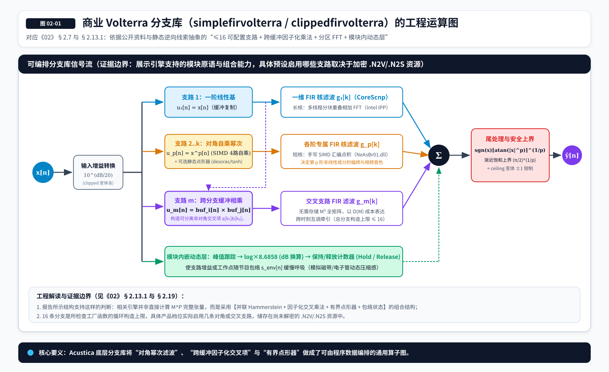
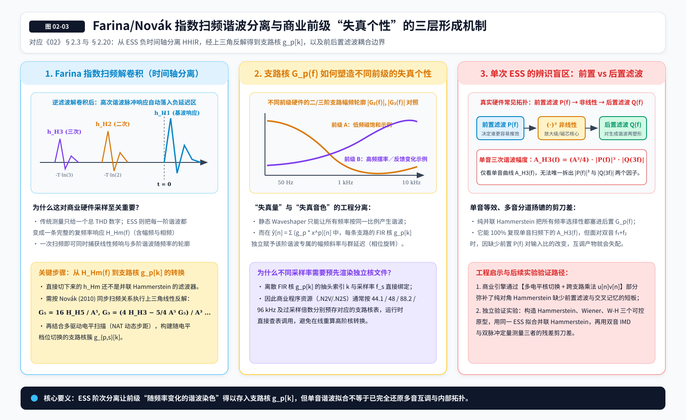

# 02 从 Volterra 理论到商业音频建模：Acustica Audio 的技术发展史

> **版本：v5 · 跨章精简、引用核校与前级工程案例深化版（继承 v4 逆向证据版）**  
> **所属系列：Volterra Wiki**  
> **阅读顺序：**《00_前置概念与术语约定_图文版.md》→《01_Volterra级数_图文版.md》→本章。  
> **配图说明：** 本章配有 3 张工程架构与测量机制 SVG 图（`figures/02_*.svg`），请与 `figures/` 目录保持同级相对路径。  
> **定位：**这不是第二遍解释 Volterra 的数学教材，而是一段从理论研究、测量技术到商业插件工程的案例史。以 Acustica Audio 为主线，同时交代 Sintefex、Focusrite 和非线性扫频研究构成的技术背景。  
> **证据说明：**本章把“公开产品资料”“用户提供的静态逆向工程报告”“建立在两者之上的解释性假设”分开讨论。逆向部分依据《REPORT_Volterra与NOVA架构详解_v2.md》（见文末 [R1]），其中列有具体函数与数据结构定位，但本章作者并未独立取得并复核原始 IDA 工程或加密程序资源。为避免误导，所有代码细节均写作“报告识别／报告指出”，不冒充独立验证。公开产品资料以 Acustica 官方 YELLOW 产品说明为主要交叉校验；本轮尚未取得可独立逐页核验的 YELLOW 原版 PDF 手册，因此不会编造手册页码或把网页材料冒充手册。资料检索截至 2026 年 10 月。

## 2.1 一个更现实的问题：数学理论怎样变成可以出售的音频插件？

在上一章，我们已经知道 Volterra 级数能够用不同阶数的核来描述一类具有记忆的非线性输入—输出关系，也了解为什么完整 Volterra 模型会受到核维度、参数数量和运行成本的限制。但知道一个理论能够表示某种系统，与真正做出一款音频插件，中间还隔着很长的工程距离。真实设备不能直接把自己的 Volterra 核交给我们；我们必须设计测试信号，采集输入输出，剥离声卡与噪声的影响，选择适合的模型结构，然后想办法在普通计算机上实时运行。更重要的是，模拟设备的可听特征未必能被一组固定系数充分描述：它可能随输入电平、设备旋钮、包络、时间以及过去的工作状态改变。

Acustica Audio 的故事恰好能帮助我们理解这段距离。它不是从“把一个完整的高阶多维 Volterra 级数照公式算完”这种容易陷入计算爆炸的思路起步，而是选择把设备当作一个能够被测量的声音处理系统，构建可以保存、组织并播放测量结果的技术平台。回顾其早期 Nebula、后来的 Acqua Engine，以及 Hyper、Aria、MUST 和 NOVA，我们看到的是一条逐步把**采样数据、非线性运算、动态控制、专用算法与神经建模组合起来**的商业工程路线。

这里先明确一个容易产生误会的地方：**“以 Volterra 为理论基础”并不等于“完整计算了任意阶、任意延迟组合的 Volterra 核”。** 同样，“插件听起来像某台硬件”也不意味着它内部对每一个元器件进行了电路求解。商业产品真正需要解决的问题，是在听感、测量准确性、CPU、内存、延迟、可调性与开发成本之间找到能够量产的平衡。

## 2.2 早于 Nebula 的技术背景：普通卷积为什么不够？

最早被广泛运用的脉冲响应采样，可以把房间、箱体和某些近似线性设备的响应保存成一条 FIR 滤波器。我们给房间一个测试信号，测出它的脉冲响应，再将未来的音频与这条响应进行卷积，就能够复现大量线性声学特征。然而，普通卷积捕捉到的是**某种固定工作条件下的线性映射**。如果一台前级的谐波结构随输入电平改变，或者一台压缩器在瞬态到来时才开始降低增益，单条固定脉冲响应显然不够。

正是在这个历史背景下，Sintefex 推出了 FX8000 Replicator，发展了称为 Dynamic Convolution 的技术，并将相关技术应用于 Focusrite 的 Liquid Channel 与 Liquid Mix。Focusrite 的官方历史明确把 2004 年推出的 Liquid Channel 归于与 Sintefex 的合作：它将模拟输入级、可变阻抗匹配与数字建模组合在一起。Sintefex 则公开说明，其专利涵盖了动态卷积，以及通过保存模拟系统参数来模拟动态处理器的技术。[S1][S2]

这一段历史非常重要，因为它说明 Nebula 并不是世界上第一次想到“测量一台模拟设备，并用多个响应来表示不同工作条件”。在 Nebula 之前，商业音频领域已经开始研究怎样让卷积模型随电平与动态状态变化。把这两条路线混为一谈，既会抹去此前的工程贡献，也容易误读 Acustica 后来真正值得研究的技术创新。

## 2.3 2000 年：Angelo Farina 为非线性采样提供了关键测量工具

另一个重要前史不是商业插件，而是声学测量。2000 年，Angelo Farina 在第 108 届 AES 大会上发表了《Simultaneous Measurement of Impulse Response and Distortion with a Swept-Sine Technique》。这项研究提出使用指数正弦扫频，在近似时不变、弱非线性的条件下，通过解卷积将线性响应与不同谐波产生的响应在时间位置上分离。过去测量频响和测量高次谐波往往是分开的流程；这种方法使我们能够用一次设计得当的激励，得到多阶失真响应的重要信息。[S3]

它对音频建模的意义在于：**设备的非线性不再只能被压缩成一个 THD 数字，而可以被记录为随频率改变的响应数据。** 例如，一台前级可能在低频产生较明显的二次谐波，而在高频呈现不同的三次谐波行为。这些现象已经不仅是“会不会失真”，而是“某一阶的失真随频率、相位和时间怎样变化”。

不过这里必须区别三个概念：扫频解卷积后分离得到的**高次谐波脉冲响应**，经数学变换估计得到的**对角 Volterra 核**，以及一般意义上包含全部交叉延迟坐标的**完整高维 Volterra 核**，不是同一个对象。后来的 Antonín Novák 等研究给出了同步扫频、谐波响应与广义 Hammerstein 滤波器（亦即对角 Volterra 模型）之间更明确的转换关系。[S4] 因此，“一次扫频分离了多个谐波”并不等于“测量了设备的全部高维非对角交叉记忆”。这项边界，会贯穿我们对 Acustica 技术的判断。

## 2.4 2005—2007 年：Nebula 是怎样诞生的？

关于早期历史，我们有一个相当难得的第一手材料。2007 年 8 月 6 日，Hispasonic 发表了对主要开发者 Giancarlo Del Sordo 的访谈。他回顾说，自己最初只是想在远离工作室的情况下，把熟悉的模拟设备和 Lexicon 等效果带到笔记本电脑上。2005 年中期，他开始尝试制作 Nebula 原型；项目最初甚至不是为大众市场或严格实时运行而设计的。[S5]

Giancarlo 在访谈中还特别提到 Sintefex 的启发及其专利约束。他们一开始想为自己制作类似 Sintefex 的工具，随后转而寻找不同的技术路线。在此过程中，团队将已有理论与 Angelo Farina 的研究结合起来：2005 年 9 月出现最初的 EQ 模型，约三个月后出现最初的压缩器模型，2006 年 3 月发展出失真模型，2006 年 7 月又实现了首个 flanger。到 2007 年，Nebula 已经不只是一个能够重放 EQ 脉冲响应的软件，而是在尝试采样和复现多类随时间改变的效果。[S5]

这组日期还有一个认识价值：当我们今天把 Nebula 与成熟的 Acqua 产品放在一起谈论时，很容易误以为他们一开始就拥有完整的设备采样、失真核管理与压缩器动态模型。实际上，**产品能力是在连续实验中逐步扩张出来的**。先用最简单、最容易验证的 EQ 建立流程，再扩展到压缩与失真，最后处理更难以由固定响应表达的时变效果。这比倒过来先设计一个包罗万象的“万能建模器”更符合实际工程研究的规律。

同一时期的《Sound On Sound》报道将 Nebula 2 Free 描述为利用 Diagonal Volterra Kernels 及实时核选择、变形技术的处理系统，并提到其矢量引擎能够受到 LFO 和包络等控制源驱动。[S6] 需要记住，这是当时行业媒体对早期产品的公开介绍，不应自动视作对 2026 年所有 Acustica 产品的精确源码描述。

## 2.5 Nebula 的真正创意：把“设备采样”做成一种数据与播放平台

如果只用“某种非线性卷积插件”概括 Nebula，我们会漏掉它最有价值的工程设计。普通软件采样器存储乐器音符在不同力度、音高和演奏状态下的录音，然后由播放引擎决定此刻应该调用哪段声音。Nebula 则把对象从“乐器发出的声音”换成“硬件对输入信号的处理规律”。它保存的不是一小段可直接播放的钢琴声音，而是测量后生成的处理响应、参数与控制数据；真正输入音乐时，再由引擎选择和计算相应的处理路径。

Acustica 官方对 N4 的介绍也沿用了这种思路：它的工作方式更接近软件采样器，但载入的是 vectors、programs 和界面等建模资源，而不是普通音频采样。Nebula 库可以由其专有采样工具 NAT 制作；后来的 Universal Acqua Engine 负责音频处理，N4 则负责库与界面的组织。[S7]

我们可以把这套平台抽象为三个不同的部分。第一部分是**测量层**：将设备在若干工作点的响应变成可存储、可检查的数据。第二部分是**控制层**：根据输入包络、用户参数、调制信号等决定当前应该选择或组合哪些数据。第三部分是**重放层**：尽可能高效地把这些响应作用于实时输入。这个三层划分是一种便于理解的工程解释，而不是 Acustica 官方公开的源代码模块图，但它与已知产品行为和官方架构描述相容。

这种做法带来很大的灵活性。对同一款硬件而言，我们可以测量不同的输入电平、旋钮位置、频率范围或其他有代表性的工况，再把这些结果放入库中；播放时则根据控制信号进行选择或插值。这样一来，模型能够保留许多难以从电路图直接推导的细节，例如非理想频响、相位变化与不同增益下的谐波染色。但与此同时，它也从根本上受制于采样空间：**没有测到的工作区域，需要依赖插值、外推或其他算法补全；没有被测量方法揭示的内部状态，也不会因为库足够大就自动出现。**

## 2.6 V.V.K.T.：Vectorial Volterra Kernels 究竟能确认什么？

Acustica 将其核心技术称为 **Vectorial Volterra Kernels Technology（V.V.K.T.）**。其技术介绍明确使用了非线性卷积、Volterra 核、向量化数据组织与动态控制等术语，宣称能够管理大量核数据，并使 LFO、包络跟随器与动态模块共同参与控制。[S8] 它同时提到可以重现多阶谐波响应。对我们而言，这些介绍很有价值，因为它们至少表明厂商是把**核数据的管理、选择与实时计算**视为独立的工程难题，而不是认为写下 Volterra 级数的求和符号就已经解决了商业化问题。

但这里必须克制。厂商声称能够实时管理多达十万个元素，不代表它一定是在每个采样点直接计算一个拥有十万个独立多维系数的完整 Volterra 算子；“最多九个谐波”也不能直接推出“完整的九阶 Volterra 核已经被精确辨识”。尤其在谐波响应与对角核之间还存在不同阶次的混合关系时，界面上呈现的 harmonic/kernel 数量与数学上独立的多维自由度并不等价。若**严格限定**为最高 $P$ 阶、没有后续其他非线性或级联运算的纯 Volterra 系统，那么无直流偏置的单频输入不可能产生高于 $P$ 次的谐波；观测到真实的第九次谐波至少说明整体模型存在相应的高阶非线性贡献，却仍不能证明资源库中恰好存放了一张独立九阶核。特别是在报告识别出点形器及跨分支乘法的情况下，整个插件的等效阶次与某条显式核的阶次更不能直接混同。

早期 Nebula 的一些使用文档和采样指南会出现 *Volterra Orders*、多个 harmonic kernels、动态采样数、时域/频域处理及 Smooth 等术语。这些是理解产品工程结构的重要线索，但不能单凭命名就证明每一条处理支路属于哪种完整核张量。更稳妥的判断是：**公开资料明确支持它采用了一类以非线性响应核为核心、可随控制状态变化的采样建模机制；完整核的阶数、维度、约简形式和不同产品版本中的实现差异，并未全部公开。**

另外，两份可直接核验的早期学术资料，能让我们把“最高几阶”的问题放到正确的时间线上。Armelloni 与 Farina 在 2005 年的非线性时变系统卷积研究里指出：面对其测试的强失真吉他效果，受限于五阶的对角 Volterra 近似不如所比较的 IR 切换方法，作者认为那个**具体实验**至少应考虑扩展到十阶。[S28] Farina 在 2008 年的公开讲座第 80 页又明确指出，**当时的 Nebula** 使用最高五阶的 Volterra 核，并展示了重建高频谐波的局限。[S29] 这两条早期资料能够支持对角 Volterra 实际阶次曾受到工程预算制约，却不能被拿来推断 2026 年 YELLOW 或其他现代 NOVA 产品也只能处理五阶，更不能证明厂商后来所说的九个谐波阶次恰好对应独立九阶核。

## 2.7 为什么“有很多谐波核”不等于“有完整的交叉记忆”？

这一问题值得暂时停留一下，因为它与我们自己的 Volterra 研究直接相关。对于一种对角 Volterra 或 Parallel Hammerstein 型结构，非线性处理可以直观写成下面的形式：

$$
\hat{y}[n]=\sum_{p=1}^{P}\sum_{k=0}^{M_p-1}g_p[k]x^p[n-k].
$$

这类模型的每个阶次都保留了一条具有频率选择能力的滤波器，因此它远比一条静态 waveshaper 丰富：二次失真可以有自己的频率响应，三次失真也可以有另一条频率响应；它们能够共同塑造相当复杂的谐波染色。但它没有直接保留一般二阶核中的 $x[n-2]x[n-7]$ 这种不同延迟位置的乘积。如果在频率、幅度、前史和瞬态条件下开展更全面的实验，就可能观察到这种简化的能力边界。

现在再给这个结构增加一组随工作条件而改变的参数，例如让第 $s$ 个工作点有一组 $g_{p,s}[k]$，然后由包络或其他控制状态决定各组权重：

$$
\hat{y}[n]=\sum_s w_s(\mathbf{z}[n])\sum_{p=1}^{P}\sum_{k=0}^{M_p-1}g_{p,s}[k]x^p[n-k].
$$

这里的 $\mathbf{z}[n]$ 可以表示输入包络、旋钮位置或其他控制量，而 $w_s$ 表示不同工作点所占的权重。**注意：这是一个解释“核库＋状态选择”的示意模型，不是已经证实的 Nebula、Acqua 或 Hyper 内部公式。** 它说明了一件很有启发性的事：即使每组固定的核只具有较低的结构复杂度，动态选择与插值仍然可以让整体系统表现出比单组固定核复杂得多的输入依赖性。

反过来说，测量发现一个插件存在输入前史影响，甚至有显著的非加性交互，也不能立即推断其内部真的存储了完整的高维非对角 Volterra 核。一个拥有包络跟随器和多个参数化处理支路的系统，同样可能表现出有效的交叉记忆。对黑盒研究来说，**可测量的输入—输出能力**与**实际实现该能力的代码结构**，始终是两种不同的证据对象。

这一点如今有了新的静态逆向线索。用户提供的 YELLOW／TAUPE 报告称，分支构造代码不仅能够让一个缓冲与自身逐点相乘，还具有让一个分支缓冲与另一个分支缓冲相乘的原语 [R1，§2.5、附录 A5]。如果这些缓冲分别是两个滤波结果，那么输出就可以形成例如 $u[n]v[n]$ 的结构，其中 $u[n]=\sum_i a[i]x[n-i]$、$v[n]=\sum_j b[j]x[n-j]$。把二者相乘即可得到 $\sum_{i,j}a[i]b[j]x[n-i]x[n-j]$，其二阶核等价于可分离的 $a[i]b[j]$（采用对称核记账时，还需对两个排列作对称化）。这是一种**因子化非对角交叉记忆**，不需要完整存储 $M^2$ 个任意系数。它的交互位置不一定贴近主对角线，因此也不能仅凭这条乘法指令就称为“近对角核”。更进一步，模块支持跨分支相乘并不代表某款实际预设调用了该功能：具体程序图及系数储存在尚未解密的资源中。

## 2.8 NAT：从采样模板到可复用设备库

2014 年，《Sound On Sound》邀请 Nebula 库开发者 Tim Wisecup 介绍如何利用 NAT 为前级与混响制作采样程序。文章展示了非常具体的实际工作：校准输入输出电平，选择 Online / Offline 模式，为库设置不同的动态采样点与电平步距，并在适当的情况下决定保留多少谐波核。[S9]

这样的材料比笼统的“我们使用先进数学算法”更有教学价值，因为它揭示出一个商业化建模系统最常见的现实：采样质量不仅取决于公式，更取决于**测量空间是否覆盖了设备工作区域、各工况的重复性、校准误差、采样点密度和最后的数据约简策略**。例如，某个前级在大多数电平下响应温和，但接近饱和前的几个 dB 内失真急剧增长，那么把所有采样点等距分布在整段幅度区间，就未必是最有效的选择。将更多测量资源集中于变化剧烈的位置，往往更值得研究。

另一个与我们近期工作很相关的事实是，NAT 的使用流程中存在着较明显的“模型类型差别”。制作前级或 EQ 的一个基本采样程序，与完整捕获压缩器的 attack、release、阈值和程序依赖行为，根本不是同一难度的任务。2014 年的指南甚至明确说明，面向入门的前级采样教程不会试图完整复刻压缩器和限制器的增益控制；如果仅采集动态处理器的染色特征，可以将这个结果与一个独立的常规压缩算法组合使用。[S9]

这给我们一个重要的工程提示：**一台设备不必用同一种模型去表达所有机制。** 失真与频率响应可以由测量数据主导，增益控制可以由显式状态算法主导，时变细节可以另外叠加。采用混合模型不是“放弃 Volterra”，而是让它承担最适合自己的工作。

需要提醒的是，NAT 的可用形式也随产品年代改变。Acustica 当前面向第三方开发者的商务页面介绍了基于模板的 NAT 4，但其 2025 年更新的 N4 / N4 Player 功能比较表又显示 N4 产品包本身不包含 NAT。这两条信息并不矛盾：**开发者工具存在，不等于普通用户购买 N4 就能直接获得同等授权和工具链。**[S10][S11]

## 2.9 从 Nebula 到 Acqua：从通用播放器变成独立商业产品线

Nebula 早期最鲜明的产品概念，是一个能够载入许多不同设备库的通用效果采样器。它的优势在于平台开放：库开发者可以测量新设备，用户则可以在同一插件框架下调用多个 EQ、前级、混响和其他处理程序。随后出现的 Acqua 产品线则更强调**围绕一台或一组目标设备构建独立插件**，把多个测量程序、功能模块、旋钮关系和专用 UI 组织成用户熟悉的操作形态。

这不只是视觉上的变化。通用库可以让用户选择“某台设备在某种固定设置下的程序”，但如果要复刻一台拥有多个联动频段、增益级、切换开关与动态控制的通道条，产品往往还需要建立许多响应之间的参数映射，并将它们组合成一个连续可调的系统。Acustica 的官方帮助文档便把 Acqua Library 解释成类似 Nebula Library、但可以合并多个仿真程序并提供自定义界面的形式，同时说明 N4 与 Acqua Effects 使用相近的底层处理引擎。[S7]

在这一步，商业产品的问题从“测到一组精确响应”进一步变成了“**如何在用户连续旋钮操作中，可靠、平滑地穿过大量离散的测量工作点**”。这涉及插值误差、切换伪影、CPU 突增、响应之间的相位连续性和参数映射。Acustica 后来公开介绍的 Smooth3，正是用于减少快速切换核时产生的伪影，并包含逐样本插值的处理思路。[S8]

因此，Acqua 时代的技术重点，并不只是增加 Volterra 阶数。它同样是在解决复杂建模资源如何被组织成真正可用、可调、可维护的插件产品的问题。

## 2.10 实时计算的代价：为什么早期产品常常很吃 CPU？

一个采样式非线性模型可能需要同时处理不同阶次、不同电平、不同旋钮位置和不同长度的脉冲响应。更长的滤波器保存更多时间信息，多组动态采样提供更丰富的工作点，但也会增加内存访问、卷积计算与核切换开销。延迟和运算量还会受到时域卷积、分块 FFT 处理、滤波器分割与宿主缓冲区长度的影响。即便数学上的多项式模型相对简洁，它与高效实时实现之间也并没有自动等号。

Giancarlo 在 2007 年访谈中提到，最初的 Nebula 甚至不是以实时运行作为先决目标，之后才持续进行性能优化。[S5] 早期使用者对 CPU 需求的印象因此并不意外：系统试图同时保存设备的线性频响、动态电平特征、谐波染色与时变控制，而个人电脑当时的单核计算能力有限。

从 DSP 角度看，这带来至少两层成本。第一层是**滤波器计算成本**，可以尝试利用频域分块卷积、按长度分区、不同精度或不同算法组合降低。第二层是**模型自由度的管理成本**：究竟要采样多少个状态、保留几阶谐波、什么条件下切换、需要多快的控制更新率，以及如何防止两个邻近程序的输出在切换时出现瞬时不连续。后一层成本往往不像乘加次数那样容易被注意到，却同样决定一个模型最终能否进入商业音频实时链路。

Acustica 在公开技术说明中提到多线程优化、分离处理路径，以及对频率响应与尾部响应的专门处理措施。[S8] 这些优化说明：其技术迭代的主战场逐渐从“能不能复现更多非线性特征”，延伸到“怎样以可接受的成本复现它们”。

YELLOW／TAUPE 的静态逆向报告进一步指出，引擎中可辨识出分区卷积调度、FFT 前后变换、频域复数乘法、按分区延迟叠加以及短核 SIMD 点积等运算；其 FFT 和数学底层实现涉及 Intel IPP 与多个外部 bridge DLL [R1，§3、附录 A6–A8]。因此，“每条支路是一维 FIR”并不等于“每采样逐系数进行昂贵的直接卷积”：引擎会依据核长度与分区策略选用不同的计算路径。这些汇编桥与资源调用的存在，也提醒我们，单独搜索主二进制内有没有某个熟悉的神经网络函数名，不能构成对全部运行时处理方式的完备排除证明。

## 2.11 2019 年与 2022 年：AI 预设、Hyper，以及压缩器问题的重新审视

进入新一代产品之后，Acustica 又先后公开介绍 AI 与 Hyper 等技术。厂商称 2019 年开始把人工智能和深度学习用于生成可随素材调整的插件预设。[S12] 这应当被准确理解为**利用学习方法辅助参数选择或工作流**，而不能未经证明地说成“Acustica 在 2019 年已经全面将 Volterra 音频核心替换为神经网络”。预设控制层使用 AI，与音频采样运算本身是否使用 AI，是两个不同问题。

厂商的公开技术页面明确记载，**Hyper 技术于 2022 年引入**，之后又发展出 Hyper2，并把更低的 CPU 消耗、更高的稳定性以及对压缩、饱和、滤波和前级的改进列为重点。最值得注意的是，厂商承认过去的引擎因计算成本等原因，对压缩器的 attack、release 与 look-ahead 时间存在限制。[S13] 这一点与我们上一章分析的 Volterra 边界形成了非常直接的对应：复杂压缩器首先是一个具有内部状态、时间常数和非线性增益控制的动态系统，仅凭为静态工作点测量若干失真核，很难让所有动态参数都获得任意精度的连续调节。

在 Tiger 的官方产品介绍中，这一变化变得更具体。厂商明确谈到采样压缩曲线、从测量设备中提取 attack / release 的多段形状、针对瞬态与持续部分设置不同的 detector、利用多个探测器进行加权，以及提供独立的 look-ahead、sidechain 处理和 oversampling。[S14] 这是一条非常重要的商业设计线索：**现代 Acustica 压缩器不应再被简单理解为“几个固定核随输入电平交叉淡化”。** 至少从功能层面看，公开材料已经能够证明其动态控制器包含明确的、相当复杂的独立处理机制。

同样，我们不能因此反向断言某款 Tiger 产品完全不使用 Volterra 相关处理。合理的结论只是：其商业建模机制已经发展出**采样响应与显式动态算法并存**的特征，而不同模块在一个特定版本中如何组合，仍需要产品级证据。

## 2.12 Hyper3、Aria 与 MUST：近年来最值得注意的三个方向

在 Hyper3 产品说明中，Acustica 对 EQ 的实现给出了一项非常具体的解释：**前段重要的瞬态响应保留 FIR 处理，较长的响应尾部则结合 IIR 实现。** 例如 SALT 与 Sand 4 Ultra 的技术文字均提到这种 FIR/IIR 混合方式，目标是在保持前段响应特征的同时，更有效地处理长尾与低频行为。[S15][S16] 这很有启发性：商业 Volterra 生态中的技术创新，不一定发生在非线性多项式公式上，也可能发生在负责每条响应的线性滤波实现上。

Aria 则在产品层面与可调整界面、实时动态显示和抗混叠改进联系在一起。多款 Ultra 产品的官方说明明确提到 Aria、Hyper3 以及更新的 Anti-Aliasing 算法，例如 Tiger Mix Ultra Flat、Amber 4 Ultra 与 Sand 4 Ultra。[S16][S17] 从中我们能够确认近期产品加强了实时反馈与抗混叠处理，但没有足够材料去指定它究竟采用 ADAA、某一固定倍数过采样，或某一特定多项式抗混叠公式。**“使用了抗混叠算法”不等于“已经确认其具体抗混叠数学路线”。**

另一条值得关注的路线是 MUST（Modular Unified Synthesis Technology）。Acustica 对 THING 等乐器产品的说明将其称为把模拟电路行为建模与自家的卷积式建模技术结合起来的混合合成架构，并继续提到非线性卷积、动态 Volterra 级数与时变模型。[S18] 这说明厂商正在尝试将原本以设备响应采样为核心的技术，扩展到需要生成声音、响应演奏控制与内部振荡器状态的乐器领域。

请注意，**MUST 的宣传描述本身还不能证明其内部有哪些具体 WDF、电路求解器、神经网络或完整 Volterra 张量**。但其方向具有清晰的研究意义：当单纯的设备响应库不足以承担全部动态状态时，通过引入其他结构表达这些状态，是一种自然而然的技术演进。这样的思路，与我们此前考虑过的 Volterra、双线性状态空间模型、速率依赖磁滞及混合结构，在研究方法论上存在呼应，而不意味着它们就是相同的内部实现。

## 2.13 NOVA：官方的混合建模叙述，与逆向报告中的具体运行结构

在 2026 年 3 月发布的 YELLOW 上，Acustica 将 NOVA 明确命名为 *Neural Optimized Volterra Audio*，并称它结合了 Vectorial Volterra Kernels 与神经音频建模，作为前级饱和的重要组成部分。官方的关键表述是：低电平时保留硬件的频率与相位特征，驱动增强后，神经模型对复杂非线性的贡献渐渐增大，而且不是简单地在两套互斥模型之间切换。[S19][S20] 这些是**厂商对产品功能机制的陈述**，不能自动转换成某个具体的 C++ 类名、运行时计算图或已验证的神经网络拓扑。

我们现在有了第二条证据线索。用户提供的《REPORT_Volterra与NOVA架构详解_v2.md》基于 TAUPE Studio 与 YELLOW 的静态逆向分析，列出模块注册表、Volterra 工厂、分支执行器、FFT 卷积例程、点形器以及一个命名为 `simplenova` 的模块 [R1]。这让我们不必只从营销词汇猜测算法，但仍须清楚区分三层对象：**某种代码原语已经存在、某种程序配置可以调用它、用户实际打开某个产品档位时是否调用了它**，是三件不同的事。报告目前对第一层提供了较具体的支持，而对加密程序资源规定的第二、三层仍有实质盲区。

### 2.13.1 分支库不是完整高维 Volterra 核，而是一种受限的可编排运算图

报告称，在共享底层引擎中识别出了 `simplefirvolterra` 和 `clippedfirvolterra` 两类模块。工厂代码按程序配置构造各条处理分支，并有 `0x10` 即 16 的循环上界 [R1，附录 A2–A5]。这个数字首先是**所检查工厂或模块的构造上限**，不能未经确认地写成 YELLOW 整个插件至多只能拥有 16 条信号路径，更不能据此反推出程序文件含有 16 个不同的物理失真机理。具体运行路径还可能存在多模块串联、多实例与不同数据配置。

报告识别出的基础操作包括样本缓冲复制、逐元素乘法、可选择的点形器，以及随后作用于处理分支的一维 FIR。对于“先计算 $x^p$、再通过专属于 $p$ 阶的 FIR”的支路，其数学形式与并联 Hammerstein／对角 Volterra 相容：

$$
\hat{y}[n]=\sum_{p=1}^{P}\sum_k g_p[k]x^p[n-k].
$$

这并不是一般意义下完整的 $p$ 维核，但在音频建模上已经具备明显的价值：各阶非线性通过不同的响应函数塑造谐波与互调的幅相分布。这里不能再沿用“二阶支路只生成二次谐波、三阶支路只生成三次谐波”的简化说法——三阶项还会对基频产生贡献，五阶项也可能同时影响基频、三次及五次谐波。各阶卷积核描述的是该幂次特征经过怎样的滤波，而不等于测得的一条同编号谐波响应可以不经转换直接写进该支路。

更加值得注意的是跨缓冲乘法：如果某个分支把滤波后的 $x$ 与另一支路的平方特征相乘，它可以形成某些三阶的分离型交叉项，并将不同历史位置耦合起来。这意味着运行引擎的**表达能力可能覆盖“对角核 + 因子化非对角项”**，而不是只包含纯对角结构；但它并不自动代表所有产品配置都启用了这类项，或者已经具备任意高阶完整核的可辨识性。报告还识别出模块内部的峰值跟踪、dB 换算及保持／释放计数器 [R1，附录 A10]，说明至少部分动态行为可能是由显式控制变量实现，而不是完全交给核系数本身。至于这些变量在 YELLOW 的哪段处理链中起作用、是否等同于用户可操作的压缩器 attack／release，则仍需程序图与行为实验进一步确认。

*图 02-02｜商业引擎中的可编排 Volterra 分支库架构（基于静态逆向报告的模块级工程抽象）。展示 $\le 16$ 条分支如何组合自乘幂次、跨分支缓冲乘法 $u[n]\cdot v[n]$、点形器与分区 FFT 卷积；具体产品启用哪些支路取决于加密程序配置。*

### 2.13.2 `simplenova`：从“神经渐变”说法落实为一个可分析的电平控制原语

静态报告最具体的新增证据，来自名为 `simplenova` 的模块。报告把它概括为：先估计输入通道能量，再用一条软膝映射曲线得到控制量，接着使用上行与下行不同的速度系数让控制量渐变，最后根据这个控制量组合两个信号缓冲 [R1，§4、附录 A12]。如果用便于读者理解的符号抽象，可以写成

$$
\hat{y}[n]=(1-g[n])\,u[n]+g[n]v[n] =u[n]+g[n]\bigl(v[n]-u[n]\bigr),
$$

其中 $u[n]$、$v[n]$ 代表两条可能具有不同频响、饱和或动态行为的信号路径，$g[n]$ 代表经能量检测、软膝变换和时间平滑的混合权重。**这是一种解释报告所识别运算序列的等价写法，而非已由完整运行跟踪确认的所有档位中唯一 NOVA 公式。** 同样，单独的 `simplenova` 模块不能被等同于厂商所谓整套 *Neural Optimized Volterra Audio* 技术：后者还可能涉及前后的信号分支、离线训练工具或其他模块。

为什么要为同一混合权重安排两种不同的平滑速度？如果权重直接跟随瞬时幅度，跨过膝点时就可能频繁变化，导致处理路径之间的幅相差形成可听调制、瞬态毛刺或响度不稳定。让权重以不同速度上升和回落，可以在较强输入到来时较快改变处理比例，在输入恢复安静后较慢地回到基础响应。这个时间行为在思路上类似压缩器的包络控制，但**压缩器通常把检测结果变成作用于某条信号的增益，而这种混合控制器把检测结果变成不同信号路径的组合比例**。若两路信号本身有相位差、延迟差或不完全相关，控制权重还会改变最终频响与瞬态，这也是它必须处理平滑和路径一致性的原因。

报告另外提到 `simplenova` 有多个运行模式，其中一种表现为维护或复制备选缓冲 [R1，§4.3]。它可能与跨模式连续性、路径预热或者避免状态过旧有关，但“备路径保鲜”属于**对代码用途的工程解释**，尚没有单靠这些运算就能排他的用途证明。我们可以把它写成值得关注的现象，而不能当成已证实的产品设计动机。官方同时工作的说法，与这个模块存在连续混合行为并不矛盾：两套路径可以都被计算，只是它们在输出中的有效权重随输入变化。即便某时刻一条路径的输出权重为零，也不等于程序就停止计算了那条路径。

*图 02-03｜`simplenova` 电平触发双路径渐变器与 Mode 1 备路径保鲜机制。不同于改变单一信号增益的传统压缩器，该模块通过能量检测、软膝映射与非对称 slew 在两条处理路径 $u[n], v[n]$ 之间平滑融和。*

### 2.13.3 点形器、分区卷积与程序数据：为什么模块发现不等于完整产品复原

报告进一步识别出约十五类静态点形函数，其中包括反正切和双曲正切函数及其快速近似。例如报告描述的一类 *desoras* 曲线具有如下形式：

$$
f_p(x)=\operatorname{sgn}(x)\bigl[\arctan(\lvert x\rvert^p)\bigr]^{1/p}.
$$

当 $\lvert x\rvert$ 很小时，该类函数近似线性；当输入增大时，它趋近有限的输出上界 $\left(\pi/2\right)^{1/p}$。需要严格区分**渐近饱和上界**和**硬削波阈值**：前者是输入无限增大时逼近的极限，除非另外存在显式钳制，否则不能说信号在某个有限输入点撞上了不可穿越的硬削波墙。逆向报告还描述了 ceiling 变体的附加钳制，具体是哪一种处理被产品配置选中，不能仅凭点形器函数存在就确认。[R1，§5、附录 A11]

所有这些运算单元之所以能组成不同插件，是因为它们并不一定固定排列在一个不可改变的算法链中。报告显示 YELLOW 和 TAUPE 共享大量底层程序代码，但加载不同的 `.N2V`／`.N2S` 数据资源，并由不同的程序配置安排信号图 [R1，§3、§6]。这些资源包含具体分支系数、配置与其他未知细节，而且报告承认它们尚未解密。因此，我们可以有相当具体的模块级理解，却仍无法回答每个品质档位调用了哪些支路、NOVA 的两条实际输入缓冲来自哪里，以及哪个数据块负责所谓的神经建模贡献。

### 2.13.4 最关键的悬案：神经网络到底在实时音频路径中，还是在离线研发流程里？

官方称 NOVA 使用神经音频建模、与 Volterra 部分同时协作，这属于厂商公开宣称的设计方向。[S19] 逆向报告则表示，在其检查范围内，没有找到具有明确神经网络层、权重矩阵乘法与学习型模块特征的实时推理代码 [R1，§4.5]。据此，**最稳健的结论应当是：报告未在已检查的运行时函数中识别出独立、清晰可辨的神经网络推理模块，而不是“已经证明运行时绝无任何神经网络”。** 一方面，神经运算可能被编译器融合为普通卷积、乘法与点形函数；另一方面，报告未解开模型资源，也没有覆盖所有可能的外部模块调用与特定档位的动态执行踪迹。对现代嵌入式 DSP 来说，缺少某种熟悉的矩阵乘函数名，本来就不足以构成普遍意义上的不存在证明。

报告提出一种很有研究价值、却尚待验证的解释：厂商可能在离线采集流程里使用 WaveNet 风格模型学习硬件行为，再将其中一部分响应**蒸馏或转写**到 FIR 分支、点形器与动态控制参数中，实时插件只需运行较小的确定性计算图。这与我们自己的混合 Volterra 研究思路相容，但当前并无离线训练工程、模型转换程序、网络权重映射或对比实验足以证明这正是 YELLOW 的实际管线。因此，文章既不能重复厂商宣传后就断言“插件实时跑着 WaveNet”，也不能把逆向报告的解释反向写成事实“WaveNet 只用于离线训练”。**NOVA 的训练环节与运行时表示之间的关系，是我们目前最值得保留的开放问题。**

### 2.13.5 YELLOW 的三个质量档位：重要，但仍需确认具体差异

报告在产品配置 XML 中识别到 *Nova*、*Nova HQ*、*Legacy* 三个质量档位，以及不同 `.N2S` 资源的映射 [R1，附录 A13、A15]。独立产品评论同样观察到了这三种操作档位，但仍不能仅凭名称断言“Legacy 完全不用神经网络”“Nova HQ 只不过多了若干阶 Volterra 核”或“切档只是把单一卷积核乘上更高过采样倍数”。这里较可靠的信息是**档位确实对应不同的产品处理选项／程序资源**，而其资源差别究竟是卷积核数量、采样率、过采样级数、信号图拓扑，还是神经／非神经模块参与比例，尚未通过逐档的可复核执行踪迹建立明确映射。

NOVA 相关商业技术并未局限于 YELLOW：厂商将 NOVA 与 Hyper 同时用于 SALT 2，推出针对乐器放大链的 NOVA Instrument，并在 CREAM 3 中展示 NOVA GPU Beta 等方向。[S22][S24][S25] 这些案例能够证明该技术名称覆盖多个产品场景，却也提醒我们不可把某个产品 `simplenova` 模块的行为不加限定地推广到所有 NOVA 设备。

在本章资料检索时，厂商 GOLD 6 产品页也明确确认，NOVA 已从 YELLOW 的前级扩展到 GOLD 系列的前级库，并与多款独立 EQ、压缩器产品整合。[S30] 这个后续案例进一步说明，NOVA 已经是一套可复用的产品建模技术名称，而不能把 YELLOW 中某个命名为 `simplenova` 的运行原语，等同于所有部署场景的完整信号图。

## 2.14 相同的引擎，不同的产品：YELLOW 与 TAUPE 的部署差别

这份报告带来的另一条重要认识是：我们不只发现了两个有趣的 DSP 函数，而是观察到一种由**共享通用引擎、产品配置资源和额外专用模块**组合而成的商业开发方式。按照报告的静态对照，YELLOW 的程序图包含前级与压缩器相关的串联配置；TAUPE 则以磁带整机模型为中心，额外叠加磁带传输相关的速度与抖晃处理 [R1，§6]。特别是在 TAUPE 中，报告把 Speed 和 Wow'n'Flutter 关联到可变速重采样及缓冲调度，而不是简单的一条静态谐波饱和曲线。这一观察能够解释为什么两款插件虽然具有共享的基础构件，却可能在瞬态、延迟与长期时间行为上表现得很不相同。

报告还认为，两款产品可通过独立的程序资源与采样率／过采样设置提供多套数据，并指出包装器、内嵌处理引擎及外部 bridge DLL 之间存在分工 [R1，附录 A14–A16]。这类分层设计非常值得放进商业技术史：**硬件声音并不是“直接写在插件源码里的一台机器”，它也可能被拆解为同一个可复用 DSP 引擎对不同参数化设备模型的执行。** 但这里仍有两条不能跨过的证据边界。第一，加载独立程序资源不代表我们已经知道资源内部所有核与模型的含义；第二，报告定位到某种模块或可选变体，不代表该模块在每个预设中都是活跃的。若要把这些结论推进到具体产品，就需要解析运行时处理图，或结合受控黑盒实验对分支贡献作独立验证。

这也改变了我们对“商业 Volterra 建模”的直觉。一个产品的可听效果，未必只由若干高阶卷积核产生；它可能同时包括一个受限 Volterra 分支库、可分离交叉项、静态饱和函数、状态控制器、卷积调度、重采样和产品程序图。对研究者而言，真正要追踪的是**数据如何进入算法，算法如何按图执行，最终输出又在哪一层发生变化**，而不是寻找一个被命名为“Volterra”的单一函数后就宣布找到整台设备的秘密。

## 2.15 一张时间线：Acustica 所代表的商业路线如何演化？

| 时间 | 可确认的事件 | 对技术史的意义 |
|---|---|---|
| 2000 年 | Angelo Farina 发表指数扫频测量方法 [S3] | 使线性与不同阶次非线性响应的分离更容易用于实践 |
| 2004 年 | Focusrite 推出与 Sintefex 合作的 Liquid Channel [S1] | 提供 Nebula 之前的动态卷积与硬件响应建模商业背景 |
| 2005 年中期 | Nebula 原型开始开发 [S5] | 将“采样效果器”逐渐变成可执行的产品实验 |
| 2005 年 9 月—2006 年 7 月 | EQ、压缩器、失真、flanger 模型相继出现 [S5] | 研究范围从固定响应扩大到非线性与时变行为 |
| 2007 年 | Nebula Free 与商业版本受到行业媒体关注 [S5][S6] | Volterra 相关采样建模开始进入更广泛的音频插件市场 |
| 2005—2008 年的研究与公开演示 | 对角 Volterra 方案在强失真案例里受限于五阶；2008 年讲座称当时 Nebula 使用最高五阶核 [S28][S29] | 提供旧版技术的具体阶数上限及其能力边界，不能外推到 2026 年产品 |
| 2014 年 | NAT 开发工作流有了详细公开实践介绍 [S9] | 设备测量、谐波核数量与动态采样配置的工程细节逐渐可见 |
| 2010 年代 | Nebula 库生态与 Acqua 独立插件产品线发展 [S7] | 从通用程序播放器走向复杂模块组合与专用操作界面 |
| 2019 年 | 厂商称开始将 AI 用于自适应预设 [S12] | 音频核心之外，开始探索机器学习辅助的控制层 |
| 2022 年 | Hyper 技术正式推出 [S13] | 将性能效率和动态算法灵活性置于更重要的位置 |
| Hyper2 / Hyper3 阶段 | Tiger、SALT、Sand 等产品公开更详细的动态与混合滤波方案 [S14][S15][S16] | 混合状态控制、FIR/IIR 分工与可扩展工程优化 |
| Aria 与 MUST 阶段 | 实时显示/抗混叠优化与混合合成建模出现在产品介绍中 [S17][S18] | 技术向现代可交互插件及虚拟乐器系统延伸 |
| 2026 年 3 月（可核实的产品发布） | YELLOW 使用 NOVA 前级，厂商明确提出 Volterra 与神经音频建模同时工作 [S19][S23] | 正式把混合 Volterra／神经技术放进商业处理器的公开技术说明；静态逆向报告又为分支库、状态控制、渐变器提供了新的模块级线索 [R1] |
| 2026 年 5 月 | AERO 2 采用 NOVA Instrument [S24][S26] | 将混合建模思路拓展到踏板、放大器、箱体等多级乐器放大链 |
| 2026 年的产品更新 | SALT 2 将 NOVA 与 Hyper 联合使用，CREAM 3 提供 NOVA GPU 测试版 [S22][S25] | 分别体现模型协同与新的算力部署探索 |
| 2026 年的 GOLD 6 | 官方说明将 NOVA 技术扩展至 GOLD 前级库 [S30] | 表明混合建模名称开始用于多设备型号、大规模前级库，而不止单款 NOVA 前级 |

这张表没有把每一个 CORE 版本强行对应到某一年、某个唯一算法特性。CORE 编号、产品发布时间和单个引擎能力之间未必存在简单的一一关系；在缺少逐版本的官方开发档案时，写出一张看似完整的 CORE1—CORE19 发明年表，反而容易制造没有根据的技术史。

## 2.16 从 Sintefex 到 Acustica：它们是不是同一种动态卷积？

现在可以整理一个经常被忽略的区别。Sintefex 的商业贡献之一，是通过多工作电平的响应和专门的动态模拟机制，突破普通静态卷积的限制。Acustica 的公开叙述则强调 Volterra 相关的非线性响应建模、矢量化数据组织，以及能够由不同控制信号驱动的核重放机制。它们在“设备测量驱动建模”这个大方向上有共同点，却不应被写成相同的算法实现。

Acustica 的创始开发者在 2007 年已明确表示，Nebula 的路线受到 Sintefex 启发，也是在寻找与相关专利不同的实现方法。[S5] 因此，严谨的技术史不应该写成“Acustica 发明了动态卷积”；更准确的表述是，**它在已有设备采样与动态卷积的历史背景下，发展出以 Volterra 相关核、控制器和专有播放引擎为中心的另一条商业化技术路线。** 随着 2026 年 NOVA 进入公开产品说明，厂商将路线描述为结构化采样模型与神经音频模型协作；而最新静态逆向报告又揭示出可以辨认的分支库、状态控制与渐变模块，但尚不能据此判定神经模型的完整部署方式。[S19][R1] 这种新的证据并不会抹去早期工作的独立价值。

同时，2007 年的独立报道、2014 年的第三方采样指南和今天的厂商技术说明之间，并不存在完全一致的术语体系。它们描述的是不同年代、不同角度、不同层级的技术：有人用“对角核”解释数学基础，有人用“动态卷积”解释操作效果，厂商则使用 V.V.K.T.、Acqua Engine、Hyper 等商业名称。阅读这些材料时，最需要警惕的不是哪个名字更漂亮，而是它们究竟在描述**测量对象、数据结构、数学运算还是运行时控制机制**。

## 2.17 几种最容易被宣传语掩盖的能力边界

首先，采样得到的不同谐波响应，不等于已经辨识了全部高维 Volterra 交叉核。要分辨对角核、局部交叉记忆与真正存在状态依赖的系统，仍需要双脉冲、不同前史、复合激励和独立验证。其次，插值可以让两个离散测量工作点之间的变化更加平滑，却无法保证它一定复现了原设备的真实物理过渡；如果两个测量点之间恰好存在阈值、分支切换或速率依赖效应，插值甚至可能生成原设备从未产生过的响应。

再次，静态饱和和带状态的压缩并不是同一个难度级别。压缩器与限制器的瞬态行为通常包含检测、attack、release、look-ahead、反馈或其他递归变量；为若干输入电平测量失真核，不代表已经测量了这些状态变量的所有轨迹。对于磁滞来说，持久状态、路径依赖与速率依赖还会提出进一步挑战。即使某种采样式模型能够在测试音乐上表现得非常接近硬件，仍然需要通过前史重置、往返激励与长时间保持实验，才能判断它是否真的重现了关键的记忆机制。

最后，**听感逼真度、测量拟合度和物理机制相似性，是三个不同的评价维度**。一款产品可能凭借高质量采样与听感调校，在日常音乐上具有很高的实用价值，却并不精确复刻真实电路的全部状态；另一套模型可能具有更严格的物理结构，却在有限采样条件、实时 CPU 或审美偏好上并不占优。商业插件的艺术与工程价值，不应该被单一指标代替，而对其内部技术的判断也不能只依靠品牌叙述。

## 2.18 从这些商业经验中，我们真正应该学习什么？

对我们此前进行的多种 Volterra 约简、动态交叉记忆以及硬件复刻平台研究而言，Acustica 的最大价值并不是告诉我们“选择 V.V.K.T. 这个名字”，而是给出一组更加普遍的工程思想。第一，测量平台必须是可以复用的：同一种测试体系要能服务于 EQ、前级、饱和、压缩器与磁带类设备，而不是每做一个原型就重新发明流程。第二，模型应当是可组合的：频响与谐波、瞬态状态、慢速控制和持久记忆，可以根据目标设备的实际行为由不同算法承担。第三，数据管理与运行效率应当在模型研发早期就被考虑，不能在离线拟合得分很高之后才发现它根本无法部署成 VST3。

第四，真正有效的黑盒研究必须能够反驳自己的假设。若一个对角模型能够解释普通扫频，却在双脉冲、互调或复杂前史下明显失效，我们才有充分理由引入近对角核、稀疏交叉项、低秩结构或状态空间模块；反过来，如果复杂模型的额外自由度在独立音乐测试上没有带来稳定收益，就不能因为它看起来更加接近完整 Volterra 理论而保留它。第五，商业插件不是一套孤立数学公式，它还是一条从采集、模型转换、库管理、运行时优化、测量验证到用户界面的完整生产链。

新的逆向报告还说明，我们不能只停留在“模型类型 A 对比模型类型 B”的层次。真正值得比较的是**同一组可编排分支原语如何分别形成对角记忆、因子化交叉记忆、动态状态控制与路径混合**。这是比单纯提高核阶数更加实际的工程研究议题。

可以由此得到一个与我们此前研究路线相当契合的判断：**在音频建模中，Volterra 理论提供的是一类强大的表达语言，而商业产品真正取得的突破，往往来自对这套表达语言的取舍、组织、测量和混合使用。** Acustica 的二十余年发展史提供了一个重要例证。它值得研究，不是因为每一代产品都被证实使用了越来越完整的 Volterra 核，而恰恰是因为它在有限的测量信息和计算资源下，一直尝试把更多实际设备行为转化成能够被音乐制作人直接使用的处理工具。NOVA 的出现进一步说明，商业技术的发展不必局限于“提高 Volterra 阶数”：让不同表示方式承担自己擅长的部分，也可能构成一种重要的结构性进步。

## 2.19 我们对 Acustica 内部技术究竟知道多少？

为了避免读者在以后阅读逆向工程报告时混淆证据层级，有必要将本章的判断作一个明确的区分。尤其不能把“找到模块工厂”“证明模块被某个资源实例化”“证明某个模式实际经过该处理路径”当成同一种证据，也不能把否定性静态搜索当成对整个运行时的数学证明。

| 判断 | 当前证据等级 | 应当怎样表述 |
|---|---|---|
| Nebula 从 2005 年开始开发，早期受 Sintefex 和 Farina 研究启发 | 创始人同期访谈 | 可以作为有出处的历史事实叙述 |
| Acustica 使用 Volterra 相关核、动态控制及专有数据管理 | 厂商公开说明、早期独立报道 | 可以作为产品技术路线的公开事实叙述 |
| NAT 允许通过不同动态采样点、阶次数量和模板组织采样 | 公开实操资料 | 可以描述其历史上公开的工具工作流，注意版本差异 |
| 某款插件实时计算了完整的非对角九阶 Volterra 张量 | 未见足够公开证据 | 不能断言 |
| 现代 Hyper 产品包含复杂的显式动态控制机制 | 具体产品官方说明 | 可以确认功能与厂商公开的设计方向，不能凭此确定全部代码结构 |
| 最新产品使用了 ADAA2、特定交叉核稀疏分解或某神经网络架构 | 未见足够公开证据 | 不应替厂商补写未公布的算法 |
| 不同工作点的对角核结合状态控制器，可以产生复杂的动态非线性行为 | 通用系统理论与工程分析 | 可以作为解释性模型，不可冒充实测或反编译结论 |
| NOVA 结合 Vectorial Volterra Kernels 与神经建模，两部分同时运行，神经部分在更强驱动下贡献增大 | 厂商对 YELLOW 与 FIRE THE TUBE 的明确技术说明 | 可以作为厂商公开的算法方向介绍，仍应标注为厂商自述 |
| YELLOW／TAUPE 的引擎存在 `simplefirvolterra`、`clippedfirvolterra`，并能配置有限数量的 FIR 支路 | 用户提供的静态逆向报告及其函数定位 [R1，A2–A5] | 可以写成“报告识别”，不是独立验证的完整运行图 |
| 运算原语支持跨分支缓冲逐元素相乘 | 静态逆向报告 [R1，A5] | 支持因子化交叉记忆的实现可能，不等于实际程序必定启用或属于近对角核 |
| `simplenova` 具有能量检测、软膝映射、非对称 slew 与双路径混合的运算 | 静态逆向报告 [R1，A12] | 可说明模块级机制；不能直接把该类名等同于整个 NOVA 混合神经架构 |
| YELLOW 的 Nova、Nova HQ、Legacy 档位通过程序资源进行配置 | 配置 XML 与静态报告 [R1，A13–A15] | 可确认档位与资源之间存在映射；具体差异仍需逐档跟踪 |
| 在已检查代码范围内未发现明确神经网络层、权重矩阵等推理结构 | 静态逆向报告的否定性发现 [R1，§4.5] | 只能说明“尚未识别”，不能证明整个程序在所有模式下绝无神经运算 |
| NOVA 具体采用神经残差叠加、门控公式、NAM 或某个特定网络结构 | 目前证据不足 | 只能写成候选工程假设；某个渐变器的公式不等于整体 NOVA 公式 |
| 神经网络用于离线学习并被蒸馏到 FIR／点形器参数 | 报告提出的解释性假设 [R1，§4.5] | 研究假说而非确认的产品训练管线 |
| AERO 2 使用 NOVA Instrument，CREAM 3 有 NOVA GPU Beta 选项 | 具体产品官方介绍 | 可以确认功能方向，不能反推网络或 GPU 内核运算细节 |

接下来即便通过静态二进制分析、行为测量或数据格式研究得到新线索，也应当分开记录“看见了哪些代码或数据结构”“某种解释可以预测哪些输入—输出行为”，以及“还有哪些替代解释尚未排除”。这样才能让商业插件研究真正成为技术论的一部分，而不是用另一套术语替换厂商的宣传。

## 2.20 ESS 阶次分离怎样形成不同前级的失真个性？

回到一个音频工程师最容易观察到的现象：Acustica 的不同前级模型（如经典的英式变压器前级、美式运放前级与电子管前级），有些在低频驱动下更容易产生厚重的偶次与奇次饱和，有些则在高频瞬态输入时表现得更敏感。为什么基于 ESS 的采样流程能够抓住这种“频率相关的失真个性”？

结合上一章第 1.9.1 节推导的**并联 Hammerstein 阶次反解方程**与**前后置滤波耦合规律**，我们可以把这种商业采样前级的声音机制拆解为三个工程层面：

1. **各阶支路 FIR 核 $g_p[k]$ 对谐波轮廓的独立塑形**：在经过上三角矩阵反变换（剥离高阶奇次项向低次谐波的回流、以及高阶偶次项向低次偶次谐波的回流）之后，每一阶支路滤波器 $G_p(f)$ 都记录了该阶非线性产物随频率变化的幅度与群延迟。例如，输入/输出变压器在低频接近磁芯饱和时，往往使二阶与三阶支路的 $G_2(f), G_3(f)$ 在 $50\sim 200\,\mathrm{Hz}$ 区间呈现显著抬升与相位旋转；而推挽放大级或局部负反馈网络的高频交越与摆率效应，则可能体现为高阶支路在中高频段的幅相特征。因此，前级的“音色指纹”首先存储在各阶 $g_p[k]$ 的滤波器形状差异中，而非单一的静态 Drive 曲线。
2. **多电平采样（Vector / NOVA）对工作点迁移的补偿**：真实硬件的前后置滤波关系并非固定不变——正如《01》第 1.9.1 节所示，单次固定电平的 ESS 只能测得 $\lvert P(f)\rvert^3 \lvert Q(3f)\rvert$ 的综合乘积，无法单独拆出非线性前的输入频率选择性 $P(f)$ 与非线性后的谐波塑形 $Q(3f)$。Acustica 在 NAT 采样与 NOVA 架构中引入**多驱动电平档位**与 **`simplenova` 电平渐变路径**，在工程上恰好部分缓解了这一结构限制：当低频大信号推入时，包络或能量检测器将权重平滑推向高驱动档位的核资源，从而用“随电平切换的支路核簇”去近似硬件工作点随输入幅度迁移的效果。
3. **单音染色还原与多音互调还原的剪刀差**：即便多档位并联 Hammerstein 支路能将单音扫频下的各次谐波轮廓还原得较为准确，如果原硬件的失真强烈依赖前置滤波 $P(f)$（Wiener 型成分）或跨时刻的电源下陷/偏置漂移，纯对角支路在面对双音或多频复杂音乐时，仍会在差频（如 $f_2-f_1$）与三阶互调（如 $2f_1-f_2$）上暴露出与硬件的残差。这也解释了为什么逆向报告中识别出的**跨分支缓冲乘法原语**（可构造 $u[n]\cdot v[n]$ 因子化非对角项）与**模块内峰值保持/释放计数器**具有重要的工程补位价值。

这一认识与用户提供的 YELLOW／TAUPE 静态逆向报告可以形成一种相互支持、但尚未完成证明的解释：报告识别了可配置的一维 FIR 分支、幂次及跨缓冲乘法原语，而这些恰好能够承载某些按阶次组织的频率相关失真；然而，加密程序资源仍然阻止我们确认每一台被采样设备究竟配置了哪些 $g_p$、哪些因子化交叉项，以及它们是否直接来自某一次 ESS 采样还是经过了更多离线处理。因此，**“ESS 阶次分离能够帮助保存 AA 前级的个性”是有数学依据的合理技术解释；“AA 的全部前级声音就是由 ESS 的谐波响应一一转换而来”则不是已证实的事实。**

如果未来想把这条解释从合理假说升级成可复核的实验结论，可以先构造三个可控原型：非线性后置滤波的 Hammerstein、非线性前置滤波的 Wiener、以及前后均有滤波的 Wiener–Hammerstein。对三个原型使用相同 ESS 激励，采用规定的转换方法拟合并联 Hammerstein，再用未参与拟合的双音、多音、瞬态及不同驱动电平测试残差。这样才能区分三类影响：**谐波幅相塑形、非线性之前的频率选择，以及不同历史或不同频率之间的额外交叉作用**。这条实验路线不仅有助于理解 Acustica，也直接服务于我们自己的约简 Volterra 模型研究。

*图 02-01｜Farina 指数扫频（ESS）谐波分离、Novák 上三角阶次反解与前级染色机制。展示负时间轴谐波脉冲响应 $H_{Hm}$ 如何经阶次反变换映射为支路核 $g_p[k]$，以及单次 ESS 在前后置滤波 $\lvert P(f)\rvert^3 \lvert Q(3f)\rvert$ 拆分上的可辨识性边界。*

## 本章参考资料与进一步阅读

以下优先使用厂商官方资料、同期访谈、AES 论文与具有可操作细节的第三方报道。厂商对声音品质的价值判断属于产品主张，不能与独立验证等同。

- **[S1] Focusrite，*Our Story*.** 包含 2004 年 Liquid Channel 与 Sintefex 合作的官方回顾。https://us.focusrite.com/about-us
- **[S2] Sintefex Audio，官方网站技术与专利介绍。** 说明 Dynamic Convolution、FX8000 与 Focusrite 产品之间的关系，以及美国专利 7,039,194、7,095,860。https://www.sintefex.com/?src=home&targ=consult
- **[S3] Angelo Farina，2000，*Simultaneous Measurement of Impulse Response and Distortion with a Swept-Sine Technique*.** AES 第 108 届大会论文 5093。https://aes.org/publications/elibrary-page/?id=10211
- **[S4] Antonín Novák，*Synchronized Swept Sine*.** 包含同步扫频的测量解释、HHIR/HHFR 与广义 Hammerstein／对角 Volterra 的联系。https://ant-novak.com/pages/sss/
- **[S5] Xavier Blanco，2007，*Acustica Audio: sonido de otra galaxia*.** Hispasonic 对 Giancarlo Del Sordo 的同期专访，是本章早期发展年表的主要依据。https://www.hispasonic.com/reportajes/acustica-audio-sonido-otra-galaxia/2101
- **[S6] Martin Walker (Sound On Sound)，2007，*PC Notes: PCI Soundcard Compatibility Issues*（见文末 *Nebula 2 Free* 专题子版块）。** 早期独立行业报道，明确记载 Nebula 2 Free 采用 Diagonal Volterra Kernels、核变形引擎以及受 LFO／包络驱动的向量控制。https://www.soundonsound.com/techniques/pci-soundcard-compatibility-issues
- **[S7] Acustica Audio，*Getting started with Nebula*，2023 年更新。** 介绍 N4、NAT 库、Acqua Libraries 和 Universal Acqua Engine。https://acusticaudio.freshdesk.com/support/solutions/articles/35000155485-getting-started-with-nebula
- **[S8] Acustica Audio，*The Engine* 与 *V.V.K. Technology*.** 官方对核数据、插值和引擎能力的说明。https://tech.acustica-audio.com/ ；https://tech.acustica-audio.com/vvkt-technology/
- **[S9] Tim Wisecup，2014，*Sample Your Gear With Acustica Audio Nebula*.** Sound On Sound 的 NAT 采样工作流文章。https://www.soundonsound.com/techniques/sample-your-gear-acustica-audio-nebula
- **[S10] Acustica Audio，*For Business*.** 关于 NAT 4 和第三方开发者采样工具的介绍。https://www.acustica-audio.com/pages/for-business
- **[S11] Acustica Audio，*N4 and N4 Player features comparison chart*，2025 年更新。** 确认 N4 产品包与开发工具授权的区别。https://acusticaudio.freshdesk.com/support/solutions/articles/35000093939-n4-and-n4-player-features-comparison-chart
- **[S12] Acustica Audio，*Artificial Intelligence*.** 2019 年引入 AI 预设相关技术的厂商回顾。https://tech.acustica-audio.com/artificial-intelligence/
- **[S13] Acustica Audio，*Hyper Technology*.** 2022 年引入 Hyper、之后发展 Hyper2 的官方介绍。https://tech.acustica-audio.com/hyper-technology/
- **[S14] Acustica Audio，*Tiger*.** 公开描述多段 attack / release、压缩曲线采样和多个 detector 等动态机制。https://www.acustica-audio.com/shop/products/TIGER
- **[S15] Acustica Audio，*SALT*.** 包含 Hyper3 的 FIR/IIR 混合响应技术介绍。https://acustica-audio.com/shop/products/SALT
- **[S16] Acustica Audio，*Sand 4 Ultra*.** 包含 Hyper3、Aria、抗混叠与 FIR/IIR 分工说明。https://www.acustica-audio.com/shop/products/SAND
- **[S17] Acustica Audio，*Tiger Mix Ultra Flat*.** 包含 Hyper3、Aria 与抗混叠技术说明。https://www.acustica-audio.com/shop/products/TIGERULTRA
- **[S18] Acustica Audio，*THING*.** 官方关于 MUST 将电路行为建模与卷积式技术结合的介绍。https://acustica-audio.com/shop/products/THING

- **[S19] Acustica Audio，*YELLOW*.** NOVA（Neural Optimized Volterra Audio）的官方定义，以及 Volterra 与神经模型同时运行、不同驱动电平下贡献变化的明确说明。https://acustica-audio.com/shop/products/YELLOW
- **[S20] Acustica Audio，*Your exclusive NOVA Upgrade is ready*.** 官方明确将 NOVA 定位为结合 Vectorial Volterra Kernels 与神经处理的新一代建模体系。https://www.acustica-audio.com/pages/and
- **[S21] Acustica Audio，*FIRE THE TUBE*.** 独立于 YELLOW 的另一份关于 NOVA 两部分同时工作及电平相关表现的官方说明。https://www.acustica-audio.com/shop/products/FIRETHETUBE
- **[S22] Acustica Audio，*SALT 2*.** 明确介绍 NOVA 与 Hyper 在同一产品中承担不同的建模和效率职责。https://www.acustica-audio.com/shop/products/SALT2
- **[S23] The Beat Community，2026-03-13，*Acustica Audio Release Yellow*.** 为 YELLOW 发布日期和 NOVA 在 2026 年产品中的公开应用提供同期时间证据。https://thebeatcommunity.com/2026/03/13/acustica-audio-release-yellow/
- **[S24] Acustica Audio，*AERO 2*.** 说明 NOVA Instrument 面向多级乐器放大链的设计定位。https://www.acustica-audio.com/shop/products/AERO2
- **[S25] Acustica Audio，*CREAM 3*.** NOVA 前级与 NOVA GPU (Beta) 官方说明。https://acustica-audio.com/shop/products/CREAM3
- **[S26] Sound On Sound，2026-05-20，*Aero 2 from Acustica Audio*.** NOVA Instrument 商业乐器放大产品的独立同期报道。https://www.soundonsound.com/news/aero-2-acustica-audio

> **本章结束语：**我们不必把 Acustica Audio 当作 Volterra 理论的最终答案。它更值得被视作一个持续二十余年的工程实验：怎样让一套本来昂贵、抽象、难以完整辨识的非线性理论，进入普通音乐制作人的插件列表，并逐步形成可以测量、压缩、存储、调用和优化的商业系统。

### 本轮新增：用户提供的静态逆向材料与产品资料

- **[R1] 用户提供，2026-10-04 四轮静态分析整理，*《REPORT_Volterra与NOVA架构详解_v2.md》***。内容包括 YELLOW／TAUPE 共享引擎模块表、FIR 分支与因子化乘法原语、FFT 与外部运算桥、`simplenova` 控制模块、点形器、产品资源映射及附录 A1–A16 的地址索引。此处引用的是报告本身，不代表本章独立复核过原始二进制、IDA 工程或加密资源。
- **[S27] Acustica Audio，*YELLOW — Tube Compressor with NOVA Preamp*，官方产品页。** 明确说明 NOVA 的品牌展开、面向前级的使用范围以及厂商宣称的 Volterra／神经模型协作关系。https://www.acustica-audio.com/shop/products/YELLOW

- **[S28] Armelloni 与 Angelo Farina，2005，*Emulation of Not-linear, Time-variant Devices by the Convolution Technique*.** PDF 第 6 页讨论强失真测试中五阶对角 Volterra 的不足，并提出该案例扩展到至少十阶可能更合适。https://angelofarina.it/Public/papers/211-AesItalia2005.pdf
- **[S29] Angelo Farina，2008，*Impulse Response Measurements by Exponential Sine Sweeps*，公开讲座。** 讲座第 80 页（PDF 第 80 页）明确写当时 Nebula 的 Volterra 核最高五阶；第 75–77 页也展示了谐波响应与对角核转换以及分支卷积。https://www.angelofarina.it/Public/Presentations/audioprecision-workshop.pdf
- **[S30] Acustica Audio，*GOLD 6*，产品官方说明。** 提到 GOLD 6 的 52 种前级模型、NOVA 技术用于前级库及其独立 PRE／EQ／COMP 插件。https://www.acustica-audio.com/shop/products/gold6

**手册核验状态：**本轮查到了 Acustica 官方产品页及产品手册目录入口，但未取得可逐页核验的 YELLOW 原版 PDF 手册。因此，文中没有把官方产品页称作“手册原文”，也没有编造对应页码；若后续补入手册原件，可再对品质档位、操作参数和模块术语做逐页审校。
