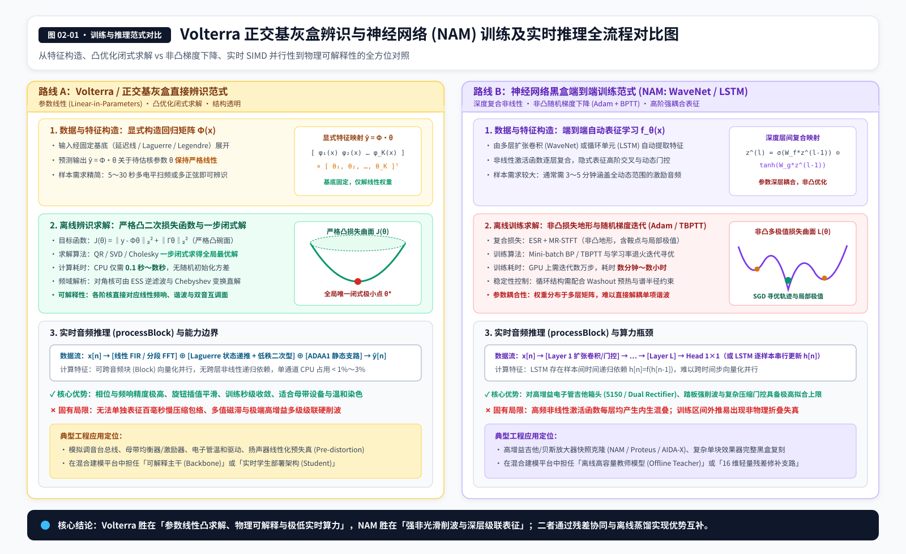
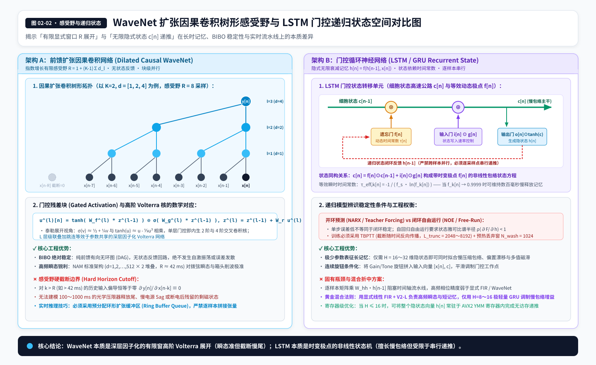
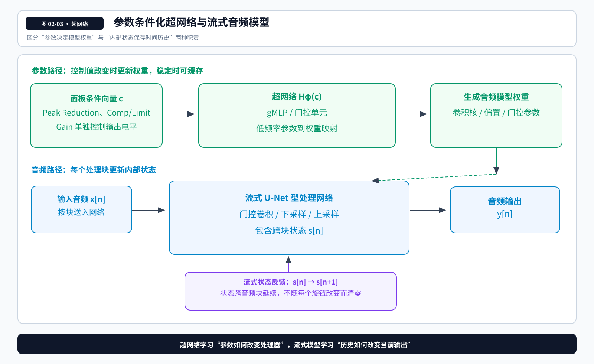
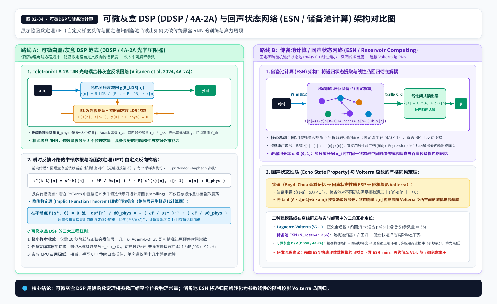

# 02 从 Volterra 级数到神经网络：同样是模型训练，本质与区别在哪里？

[在线阅读本章（完整合订版）](https://excillex-marisa.github.io/volterra-wiki/#chapter-02)

> **版本：v14 · 2026-11-19 · 神经网络历史与架构基础导论**
> **所属系列：Volterra Wiki**
> **阅读定位：** 从《01 Volterra 级数》的核辨识自然进入神经网络系统辨识；先解释为什么需要训练、两类模型如何学习、分别擅长什么，再认识 WaveNet、LSTM、NAM、可微分 DSP 与储备池计算及其实时音频工程。
> **阅读建议：** 本章不要求读者预先掌握反向传播或深度学习，已经理解《00》的输入输出、记忆与状态，以及《01》的 Volterra 核即可。

## 历史导论：Volterra 与神经网络为什么会在系统辨识中相遇？

上一章的历史始于泛函表示、随机过程和核测量。神经网络却有另一条发展脉络：早期人工神经元与感知机研究关注可学习的计算单元，后来多层网络、反向传播与序列模型逐渐形成独立体系。**两条理论路线分别发展，并在非线性系统辨识领域发生交汇**：显式多项式基与可训练的非线性函数族开始共同用于描述未知动力系统。

### 从可学习的函数到可辨识的动力系统

1940—1960 年代的人工神经元、感知机与自适应学习研究，为后来可训练网络奠定基础。1980 年代，误差反向传播的广泛应用，使多层网络能够联合调整隐藏层参数。**Cybenko** 在 1989 年证明了满足特定条件的单隐藏层 Sigmoid 网络对紧集上连续函数的一类一致逼近结果。它与 Volterra 的多项式泛函逼近具有相通的数学思想。比较这两类逼近定理时，需要分别限定函数空间、输入对象和误差条件；有限维静态函数与无限历史动态算子对应不同的数学问题。[NH1]

1990 年，**Narendra 与 Parthasarathy** 在 *Identification and Control of Dynamical Systems Using Neural Networks* 中明确讨论使用多层与递归神经网络辨识、控制非线性动力系统，以及静态与动态反向传播。这是连接神经网络与传统系统辨识的一个重要学术节点。由此，研究者可以在同一项任务中比较不同建模结构：预先设定核与延迟特征后估计系数，或者利用可训练网络从数据中寻找更适合的中间表示。[NH2]

### 历史记忆：从显式输入窗口到递归隐状态

传统有限记忆 Volterra 模型把历史样本写进核的延迟索引；带时序结构的神经网络，则可以通过输入窗口或递归状态保存过去的信息。1997 年 **Hochreiter 与 Schmidhuber** 提出 LSTM，重点处理普通循环网络学习长时间依赖时梯度衰减等问题。LSTM 提供了通过递归状态概括长历史的参数化方式；具体时间常数与自由运行稳定性仍需通过测试确认。[NH3]

2016 年的 **WaveNet** 使用因果扩张卷积处理原始音频，展示了在有限层数下覆盖较长历史窗口的高效结构。最初的 WaveNet 是自回归音频生成模型；后来用于硬件输入—输出辨识的 WaveNet 类网络通常调整为由外部音频驱动的前馈回归结构。两者可以共享因果扩张卷积等计算组件，但预测目标与运行方式不同。[NH4]

### 2019 年以后：音频硬件成为两类模型的共同实验对象

**Wright、Damskägg 与 Välimäki** 等人在 DAFx 2019 讨论了使用 LSTM、GRU 与 WaveNet 类网络对电子管放大器和失真踏板进行实时黑盒建模，并给出 C++/JUCE 部署与运算开销比较。2020 年的后续研究进一步比较了深度前馈网络与递归网络的音频设备建模表现。**Steve Atkinson** 在 NAM 项目的历史回顾中指出，该项目从 2019 年起便以开源仓库形式探索吉他放大器的神经网络建模，后来逐渐形成独立的训练与实时推理生态。[NH5][NH6]

到这一步，Volterra 与神经网络的交叉已经可以从三个层面理解。**表示层**：显式多项式核与可训练非线性特征，都在试图逼近同一个输入—输出映射；**记忆层**：有限核窗口、扩张卷积感受野与递归状态各自提供不同的历史组织方式；**训练层**：固定核 Volterra 常可化为对系数线性的回归，而一般深度网络需要对内部特征和权重共同优化。现实中还可以把 Volterra 核、物理状态、神经残差与参数生成网络组合起来，形成混合模型。这些模型的效果，应在相同激励、测试集和实时预算下比较。[NH2][NH7]

本章将沿这条历史交汇线索，依次比较固定核回归、神经网络训练、WaveNet、LSTM、NAM、参数条件化、可微 DSP 与储备池计算。至于这些技术如何成为商业插件中的核数据库、动态处理器和混合引擎，《06》再作集中讨论。

**本章的两层阅读。** 2.1—2.10 依次回答“为什么要训练”“网络如何保留历史”“WaveNet、LSTM、NAM 分别做什么”；2.12 与 2.15 用统一的误差和实时预算把比较落地。2.11.1 的超网络、2.13 的可微 DSP 和 2.14 的储备池计算可作为专项扩展，读者可以先了解它们在模型族中的位置，等到第 03、05 章需要混合架构或可微物理参数时再深入。

## 神经网络入门：历史、基本概念与模型家族

上一节追溯了神经网络与 Volterra 在系统辨识中的交汇。然而，读者还需要先理解一个更加基础的问题：**一台计算机如何从输入与输出示例中学习处理规则？** 下面暂时放下复杂的核函数和梯度推导，从人工神经元、训练过程和网络结构家族建立直觉，再进入 2.1 以后更严格的数学比较。

### 人工智能、机器学习、神经网络与深度学习

**人工智能（AI）** 是研究如何构造具有感知、推理、学习或决策能力的计算系统的宽泛学科。**机器学习（ML）** 研究根据数据估计参数与归纳规律的方法，既包括线性回归、决策树、核方法，也包括神经网络。**人工神经网络（ANN）** 由大量可以组合的参数化计算单元构成；**深度学习（DL）** 通常指通过多层可训练表示学习特征的方法。**DNN（深度神经网络）** 是深层网络的宽泛称呼，CNN、RNN 与 Transformer 则指向更具体的计算组织方式，这些名称在分类层级上有所区别。

音频设备建模的常见任务属于**有监督学习**：向硬件输入已知的干声，记录参考输出，再让模型通过成对数据学习输入到输出的映射。模型可以学习分类、回归或生成等不同任务；本章首先关注逐采样的输入—输出回归。

### 神经网络发展的重要历史节点

神经网络的发展经历了多条相互交叉的研究路线。1943 年 McCulloch 与 Pitts 将逻辑计算与简化神经元模型联系起来；1949 年 Hebb 提出与神经连接学习有关的重要思想；1957—1958 年 Rosenblatt 的感知机将可训练权重用于分类。Widrow 与 Hoff 在 1960 年代推动了 ADALINE 与误差驱动的学习方法。多层网络的反向传播思想经过数十年发展，于 1986 年 Rumelhart、Hinton 与 Williams 等人的工作后得到广泛传播。

随着序列数据和复杂输入的研究深入，卷积网络、循环网络以及门控结构逐渐发展。1997 年 Hochreiter 与 Schmidhuber 提出 LSTM；2014 年出现 GRU 的代表性论文以及 Goodfellow 等人的 GAN；2016 年 WaveNet 展示了因果扩张卷积对原始音频序列的建模能力；2017 年 Transformer 以注意力机制推动序列建模。2019 年前后，LSTM、GRU 与 WaveNet 类网络开始在实时音频硬件黑盒建模研究中得到系统比较，随后形成 NAM 等开源训练与推理生态。

这些年份代表关键论文或技术节点，并非严格的发明起点。新结构也不会自动取代旧结构。对于音频系统辨识，卷积网络的有限历史窗口、循环网络的内部状态和显式物理状态模型至今仍有各自的工程价值。

### 人工神经元：从两路输入开始手算

一个人工神经元先将输入乘以可调**权重（Weight）**，相加后加入**偏置（Bias）**，再通过**激活函数（Activation Function）**产生输出：

```math
z=w_1x_1+w_2x_2+b,\qquad a=\phi(z).
~~~

这里的两个输入为 x₁ 与 x₂，两个权重为 w₁ 与 w₂，b 是偏置，φ 表示激活函数。如果 x₁=0.5、x₂=1、w₁=2、w₂=-0.5、b=0.1，加权和便是 0.6。选择 ReLU 激活函数，即取输入与零的较大值，输出仍为 0.6；当加权和变成 -0.3 时，ReLU 输出为零。另一种常见函数 tanh 会产生平滑、有界并允许正负输出的非线性曲线。激活函数影响可拟合的函数形状、梯度传递与计算代价。

这个计算单元容易使音频工程师联想到一个拥有输入增益、求和节点和非线性传输曲线的小电路。但在黑盒网络中，权重通常不能直接解释成某个具体电阻或电容的值。

### 层、隐藏层、MLP 与 DNN：怎样组合单个神经元？

把多个神经元组成一层，再将一层输出送到下一层，即形成前馈网络。输入层读取数据，**隐藏层（Hidden Layer）**产生中间特征，输出层组合这些特征得到预测。**多层感知机（MLP）**通常由全连接层组成，即相邻两层的神经元可以通过独立权重相连；当隐藏层较多时，也属于 DNN 的范畴。

如果模型每次仅读取当前音频采样值，它适合拟合无记忆的非线性曲线，例如软饱和。将前几个采样值一起输入 MLP，它便能拟合一个有限输入历史的非线性映射；增加网络深度本身不会自动延长输入历史。权重、偏置属于通过数据优化的**参数**，层数、隐藏层宽度、输入窗口、学习率等通常属于预先选择的**超参数**。

### 训练怎样发生：前向传播、损失、反向传播

训练从一对实测信号开始：模型根据输入作出预测，将预测输出与硬件参考输出比较。计算预测的过程叫作**前向传播（Forward Pass）**，量化预测误差的规则叫作**损失函数（Loss Function）**。例如参考幅值为 0.7、预测为 0.5，单点平方误差便是 0.04。训练通过反复调整网络参数降低整体损失。

**梯度（Gradient）**描述某个参数微小变化时损失的变化方向与敏感度；**梯度下降（Gradient Descent）**根据梯度更新参数；**反向传播（Backpropagation）**利用链式法则，将输出误差对参数的影响逐层计算出来。实际训练通常采用小批量数据与 Adam 等优化器。一次遍历训练集称为一个 **Epoch**，一次批次参数更新称为一个 **Step**。训练误差下降后，仍需利用未参与参数拟合的验证集和独立测试集，检查模型面对新电平、新频率组合与新历史状态的表现。

### CNN、RNN、LSTM、GRU 与 WaveNet：如何表示声音的历史？

**CNN（卷积神经网络）**用可重复应用于各时间位置的局部权重提取特征。一维卷积与 FIR 滤波具有直观联系，但多个卷积层与非线性激活的复合可以表示更复杂的映射。**RNN（循环神经网络）**每个时刻同时接收新输入与上一时刻的内部状态，使历史信息随时间递推。普通 RNN 在长序列训练时可能遭遇梯度消失或爆炸。

**LSTM（长短期记忆）**引入遗忘门、输入门、输出门和单元状态，以调节历史信息的保留与更新。**GRU（门控循环单元）**通过更新门与重置门构造更精简的门控递归结构。它们改善长时依赖学习，但训练效果、实际记忆时间以及长期运行稳定性仍应通过设备激励测试确认。

**WaveNet** 使用因果扩张卷积及残差、跳跃连接等结构，使网络通过有限层数覆盖较长的历史窗口。最初 WaveNet 用于自回归音频生成；音频硬件建模中的 WaveNet 类网络往往改用外部输入驱动的非自回归回归结构。卷积网络的**感受野**描述当前预测可以直接访问的输入历史范围，并不等同于插件的前瞻延迟，也不自动等同于硬件的物理恢复时间。2.6—2.8 将进一步展开这些结构的公式和工程边界。

### Transformer、注意力机制与 GAN：不同维度的概念

**Transformer** 的重要组成部分是**注意力机制（Attention）**，它根据输入内容建立不同序列位置之间的关联。在处理长音频时，注意力窗口、因果约束、缓存、内存和计算量都会影响能否实时部署。Transformer 可以用于分类、预测或生成；其注意力范围不能直接用来衡量对硬件慢速物理状态的辨识精度。

**GAN（生成对抗网络）**则描述一种**训练框架**：生成器尝试生成与目标分布相似的样本，判别器学习辨别参考样本与生成样本。生成器可以采用卷积、循环或其他网络；GAN 自身并未规定实时音频处理器应采用哪种内部计算结构。在设备辨识中，对抗损失也可以作为辅助训练目标，但逐采样时序一致性、确定性误差和长期状态仍需要单独测试。

因此，MLP / DNN、CNN、RNN、LSTM、GRU、WaveNet、Transformer、GAN 可以同时出现在一份模型研究计划里，却分属不同的分类层次：有的是深度规模，有的是连接方式，有的是具体架构，有的是训练目标与训练机制。

### 用同一台假想前级建立模型选择直觉

回到《00》开始研究的模拟前级。如果单音测量显示其传输曲线随电平平滑进入饱和，可先比较静态多项式、静态 MLP 与结构化非线性块。如果输出还取决于过去几十个采样点，则可测试有限历史 MLP、CNN 或 WaveNet。如果相同短探针会因先前长时间激励与静默恢复而产生不同响应，应进一步比较更长的输入窗口、LSTM/GRU 和显式状态空间模型。若目标是研究样本波形的生成分布，GAN 与其他生成模型才获得不同的任务意义。

**网络名称揭示了计算组织方式，实际拟合能力由目标设备、激励数据、训练条件和独立验证共同决定。** 有了这套基础，再回到 Volterra 核与神经网络的比较，读者便可以把“固定的多项式特征”和“通过多层学习形成的特征”放进同一套系统辨识语言中理解。


## 2.1 我们为什么会从 Volterra 讨论到神经网络？

在上一章中，我们通过 Volterra 级数，尝试用数学模型复现未知音频设备的输入—输出规律。一台前级可能在不同输入幅度下生成不同阶次的谐波；在当前输入相同的情况下，不同历史波形可能又会改变输出。Volterra 的优势在于，这些作用可以写成各阶核的求和，并且能够明确讨论不同时间位置之间的交叉记忆。

同时，数学表达式能够描述某种行为，还需配合参数辨识才能落地。即使决定使用三阶 Volterra、64 个采样点的记忆，仍然要回答：每个核系数是多少？它们应当怎样随设备或工作点变化？这些参数从哪里来？

如果我们只知道设备输入 $`x[n]`$ 和输出 $`y[n]`$，一种自然的办法就是不断调整模型参数，让预测输出 $`\hat y[n]`$ 与参考输出的差距变小。到了这一步，**Volterra 建模已经进入了统计学习与系统辨识共同研究的问题范畴**。我们已经是在利用成对数据估计模型参数、控制模型复杂度并检验未见输入下的泛化表现。

于是出现新的结构选择：既然最终都要根据数据辨识参数，除了事先将特征固定为多项式乘积之外，能否采用一种可同时学习中间特征表示的参数化计算图，让它从数据中自动拟合复杂的非线性映射？神经网络正是在这个问题上，与 Volterra 级数形成了直接对话。

**继续使用同一台前级。** 如果《01》中的 L–N–L 已经解释了小信号频响，却仍在双音相位上留下稳定残差，可以比较并行块结构、释放更多 Volterra 核系数或训练有固定感受野的卷积网络。如果相同探针随预激励历史发生恢复差异，就需要进一步比较更长的输入窗口、循环隐状态与显式物理状态。训练神经网络时，研究重点也从核坐标的独立系数，转向网络内部特征是否能够在未见电平、频率及历史条件下保持预测精度；相同测量链、数据划分与实时成本预算是公平比较的前提。

## 2.2 两种模型共享系统辨识目标，但采用不同的函数逼近结构

先把目标系统统一写成算子：

```math
y[n]=\mathcal S\{x\}[n].
```

这里的 $`\mathcal S`$ 代表真实设备对输入历史的处理。其内部机制通常只能通过有限测量部分掌握，于是建立带参数的近似模型：

```math
\hat y[n]=\hat{\mathcal S}_{\boldsymbol{\theta}}\{x\}[n].
```

训练就是根据成对输入输出数据 $`\mathcal D=\{(x^{(i)},y^{(i)})\}_{i=1}^N`$，寻找一组参数 $`\boldsymbol{\theta}`$，使模型在指定工作范围内预测得尽可能准确。若使用平方误差，可以写成：

```math
\boldsymbol{\theta}^\star=\arg\min_{\boldsymbol{\theta}} \sum_i\sum_n\left(y^{(i)}[n]-\hat y_{\boldsymbol{\theta}}^{(i)}[n]\right)^2.
```

无论采用 Volterra 还是神经网络，通常都要经历测量、对齐、选结构、训练、独立验证和部署这几个阶段。它们共同面临激励不足、参数不可辨识、训练噪声、过拟合以及训练范围之外的外推问题。

**两者的共同点在于系统辨识任务本身，核心区别则在于预先假设的函数族结构以及参数寻优机制。** 对一个具体的数据集，低训练误差说明模型捕获了数据中可观测的输入—输出关联，至于是否具备跨工作点的泛化能力，仍需通过独立验证集检验。

## 2.3 Volterra 训练为什么有时可以是线性回归？

为了看清区别，不妨回顾《01》第 1.6 与 1.11 节中最简单的二阶、两点记忆模型（采用对称核记账 $`h_2[0,1]=h_2[1,0]`$）：

```math
\begin{aligned}
\hat y[n]={}&h_0+h_1[0]x[n]+h_1[1]x[n-1]\\
&+h_2[0,0]x^2[n]+2h_2[0,1]x[n]x[n-1]\\
&+h_2[1,1]x^2[n-1].
\end{aligned}
```

这里既有一阶记忆，也有平方和交叉乘积。模型对音频输入显然是非线性的；但如果输入数据已经给定，每一项 $`x[n],\;x^2[n],\;x[n]x[n-1]`$ 都可以预先计算出来，构成固定的显式特征向量 $`\boldsymbol{\phi}[n]`$。

将每个时刻的特征排成设计矩阵 $`\mathbf X`$ 的一行，待估计的核系数排成列向量 $`\boldsymbol{\theta}`$，整个辨识问题即写为线性参数回归形式：

```math
\mathbf y\approx\mathbf X\boldsymbol{\theta},\qquad
\boldsymbol{\theta}^\star
=\arg\min_{\boldsymbol{\theta}}
\bigl(\lVert\mathbf y-\mathbf X\boldsymbol{\theta}\rVert_2^2 + \lambda\lVert\boldsymbol{\theta}\rVert_2^2\bigr).
```

这体现了**参数线性性（Linear-in-the-Parameters）**：在阶次、核支撑集与特征字典固定后，最小二乘目标是关于未知系数 $`\boldsymbol{\theta}`$ 的凸二次函数。设计矩阵满列秩，或加入正的二次正则化系数时，可以获得唯一的最优参数；当数据激励不足、特征列共线时，则可能存在多个同样拟合良好的解。QR、SVD、Cholesky 或递推最小二乘分别适合不同的求解条件，参数是否稳定仍需检验奇异值与跨电平误差（参见《01》第 1.11 节）。

只有当核张量进一步参数化为可训练低秩因子乘积（如 CP / Tensor Train 分解）、极点可调的 Laguerre 基或状态条件化非线性核时，参数求解才会转化为非凸优化问题。

## 2.4 神经网络训练：嵌套复合映射与非凸优化

再看一个最小的无记忆单隐藏层神经网络：

```math
\hat y[n]=\sum_{j=1}^{J}a_j\tanh(b_jx[n]+c_j)+d.
```

这里的输出权重 $`a_j`$、内部缩放 $`b_j`$ 与偏置 $`c_j`$ 均需通过训练决定。由于参数 $`b_j, c_j`$ 嵌套在非线性激活函数 $`\tanh(\cdot)`$ 内部，模型输出对待估计参数呈高度非线性依赖，损失函数曲面不再是具有唯一极小值的凸碗面，而是包含大量鞍点、局部极小值与平坦区域的非凸地形。

对于多层深度网络，我们通过反向传播算法求取损失对各层参数的梯度，并利用一阶或二阶随机优化器（如 Adam）按步长 $`\eta_r`$ 迭代更新：

```math
\boldsymbol{\theta}_{r+1}=\boldsymbol{\theta}_r-\eta_r\nabla_{\boldsymbol{\theta}}\mathcal L(\boldsymbol{\theta}_r).
```

可以这样对比两者的表示机制：**固定核 Volterra 由研究者预先固定了一组描述输入历史的显式多项式基，优化器只需决定每个基函数的线性组合权重；深度神经网络则通过多层线性滤波与逐点非线性的交替复合，连同“用哪些中间特征来表征输入历史”也一并在训练中自适应习得。** 这种自适应特征学习赋予了神经网络逼近强饱和与复杂多级级联非线性的紧凑能力，同时也使内部权重难以像 Volterra 核那样直接拆解为独立的阶次贡献。

训练阶段还涉及**优化收敛**与**模型泛化**两类问题。梯度下降或 Adam 的训练损失下降，表示参数搜索在当前数据上取得进展；验证集误差与独立测试集表现则衡量模型在不同素材和工作状态下的预测能力。余弦退火可用于调整学习率，早停依据验证误差确定训练轮次，梯度裁剪用于控制长序列展开时的梯度范数。这些技术改善了参数搜索过程，模型的历史表达能力仍由网络结构及输入窗口、递归状态决定。

## 2.5 固定核 Volterra 与神经网络的系统对比

两种表示结构的参数效率，取决于目标系统的非线性强度、记忆长度和所选模型形式。对于短记忆、弱至中等非线性的模拟电路（如工作在温和驱动区的母带均衡器或变压器前级），少量低秩或对角 Volterra 支路往往用极少的参数与确定性的凸回归即可完成高精度辨识，且各阶谐波与互调贡献完全透明。反之，对于包含多级强过载放大、复杂二极管/电子管削波与交越失真的吉他放大器，固定多项式截断会面临严重的收敛半径瓶颈与参数爆炸，此时多层神经网络能够以更紧凑的计算图完成全局拟合。

| 比较维度 | 固定核 Volterra 辨识 | 常规神经网络辨识 |
| --- | --- | --- |
| 先验规定的结构 | 阶次 $`P`$、核支撑集、记忆长度 $`M_p`$ 及正交基 | 层类型、通道宽度、扩张率 $`d_\ell`$、激活函数或状态单元 |
| 参数的物理与数学意义 | 各阶多维脉冲响应及其跨时刻乘积权重 | 多层线性变换矩阵、卷积核权重与偏置 |
| 典型优化性质 | 线性参数凸回归（LS / Ridge / LASSO，一步闭式解） | 嵌套参数非凸优化（BP / Adam，多轮迭代搜索） |
| 强非线性与奇点逼近 | 受幂级数收敛半径限制，强削波需极高阶或有理/分段扩展 | 通过有界激活函数（如 $`\tanh`$、Softsign）的复合自然保持全局有界 |
| 主要工程代价 | 高阶完整核维度灾难、单项式共线性与幅度外推失控 | 训练超参数敏感、黑盒权重缺乏阶次可分性、实时推理算力开销 |
| 历史与状态机制 | 显式有限延迟窗口（或外接 Laguerre 极点基 / 状态变量） | 因果扩张卷积感受野（WaveNet/TCN）或门控循环状态（LSTM/GRU） |
| 公平比较基准 | 统一测试集误差、跨电平泛化、混叠抑制、峰值 CPU 与延迟 | 同左 |



*图 02-01｜固定核 Volterra 与神经网络在结构选择、训练和实时推理上的主要差别。SVG 文件名保留历史素材编号。*

## 2.6 怎样让神经网络学会“带记忆的声音”？

在《00》第 0.4 节建立的“显式输入历史”与“递推内部状态”直觉之上，音频神经网络可以进一步分为两类时间建模架构：

1. **前馈有限感受野架构（NFIR 型网络）**：网络在每个采样点显式读取过去有限长度 $`R_{\mathrm{RF}}`$ 的输入历史窗口，

```math
\hat y[n]=F_{\boldsymbol{\theta}}\bigl(x[n],x[n-1],\ldots,x[n-R_{\mathrm{RF}}+1]\bigr).
```

   一维因果卷积网络（ConvNet）、时间卷积网络（TCN）以及 NAM 中广泛使用的前馈 WaveNet 变体均属此类。由于不含输出或隐状态的跨时刻自回归闭环，这类网络在有限输入下天然满足 BIBO 稳定，且在训练阶段可在整段音频上高度并行计算。
2. **递归状态架构（State-Space / RNN 型网络）**：网络维护一个随采样点递推更新的内部隐状态向量 $`\mathbf{s}[n]`$，

```math
\begin{aligned}
\mathbf{s}[n+1]&=G_{\boldsymbol{\theta}}(\mathbf{s}[n],x[n]),\\
\hat y[n]&=H_{\boldsymbol{\theta}}(\mathbf{s}[n],x[n]).
\end{aligned}
```

   循环神经网络（RNN）、长短期记忆网络（LSTM）、门控循环单元（GRU）以及深度状态空间模型（SSM）均属此类。其历史影响通过状态向量持续传递，理论上可跨越任意长的时间尺度，但在训练时需采用沿时间反向传播（BPTT），且在部署时必须额外验证长序列闭环自由运行（Free-Run）的稳定性。

上面的前馈架构在系统辨识中通常归入 NFIR 型映射。**NARX** 则在输入历史之外，引入历史输出作为回归量，例如

```math
\hat y[n]=F_{\boldsymbol\theta}\bigl(x[n],x[n-1],y[n-1],y[n-2]\bigr).
```

训练时使用实测输出的历史样本，对应 **Teacher Forcing（教师强制）** 的单步预测；部署时需要把历史回归量替换为模型自身生成的输出，并持续更新隐状态，这对应闭环自由运行或非线性输出误差（NOE）形式。两种运行方式的误差传播规律不同，相关验证方法将在《03》第 3.8.1 节展开。

## 2.7 WaveNet 的因果扩张卷积：用对数级层数覆盖长历史窗口

普通因果一维卷积可写为 $`z[n]=\sum_{k=0}^{K-1}w[k]x[n-k]`$，若保持步长为 1 且不跳过采样点，要覆盖数千个采样点的历史窗口，单层卷积核长度 $`K`$ 或网络层数 $`L`$ 必须线性增长。**因果扩张卷积（Causal Dilated Convolution）** 通过引入扩张率（Dilation Factor）$`d_\ell`$，让卷积核每隔 $`d_\ell`$ 个采样点抽取一次历史特征：

```math
z[n]=\sum_{k=0}^{K_\ell-1}w_\ell[k]\,h_{\ell-1}[n-d_\ell k].
```

当扩张率按指数序列 $`d_\ell=2^{\ell-1}`$（如 $`1, 2, 4, 8, \ldots, 512`$）逐层堆叠时，网络的理论感受野随层数呈指数增长：

```math
R_{\mathrm{RF}}=1+\sum_{\ell=1}^{L}(K_\ell-1)d_\ell.
```

例如单组 10 层、核长 $`K_\ell=3`$、扩张率 $`1\sim 512`$ 的堆叠即可覆盖 $`R_{\mathrm{RF}}=1+2\times(2^{10}-1)=2047`$ 个采样点（在 $`48\,\mathrm{kHz}`$ 下约 $`42.6\,\mathrm{ms}`$）。配合门控激活单元（如 $`\tanh(\mathbf{W}_f\ast \mathbf{h})\odot\sigma(\mathbf{W}_g\ast \mathbf{h})`$ 或简化激活）、$`1\times 1`$ 残差连接与跳跃连接（Skip Connections），网络既能保留底层高频瞬态细节，又能跨越多尺度时间窗口构建高阶非线性交互。

需要注意两个工程细节：第一，若模型的总感受野为 $`40\,\mathrm{ms}`$，它仍属于有限记忆（NFIR）系统；要复现长达 $`500\,\mathrm{ms}`$ 的光电压缩器释放尾部，需要更长的记忆窗口或显式递归状态；第二，最初 DeepMind 提出的原版 WaveNet 是逐采样把自身预测输出送回输入端的**自回归语音生成模型**，而音频设备建模（如 NAM）使用的是将外部输入信号 $`x[n]`$ 直接映射为输出 $`\hat{y}[n]`$ 的**前馈回归式 WaveNet 变体**，推理时无需自回归采样循环。[N2]

理论感受野 $`R_{\mathrm{RF}}`$ 描述前馈网络在当前时刻可以直接访问的最长输入窗口；**有效感受野（Effective Receptive Field）** 则描述训练后模型对不同历史位置的实际敏感程度。二者还要与音频插件的 I/O 延迟区分：拥有上千采样点的因果历史窗口，并不必然意味着宿主需要报告等量的算法前瞻延迟。评估记忆能力时，可以对历史位置施加扰动，测量输出对延迟的敏感性，而后再与目标硬件的恢复时间比较。

## 2.8 LSTM：门控循环状态及其记忆边界

LSTM（长短期记忆网络）通过显式的门控循环单元来调节历史信息的写入、保留与擦除。设隐状态为 $`\mathbf{h}[n]`$、单元状态（Cell State）为 $`\mathbf{c}[n]`$，其标准状态递推方程为：

```math
\begin{aligned}
\mathbf{f}[n]&=\sigma\bigl(\mathbf{W}_f x[n]+\mathbf{U}_f\mathbf{h}[n-1]+\mathbf{b}_f\bigr),\\
\mathbf{i}[n]&=\sigma\bigl(\mathbf{W}_i x[n]+\mathbf{U}_i\mathbf{h}[n-1]+\mathbf{b}_i\bigr),\\
\widetilde{\mathbf{c}}[n]&=\tanh\bigl(\mathbf{W}_c x[n]+\mathbf{U}_c\mathbf{h}[n-1]+\mathbf{b}_c\bigr),\\
\mathbf{c}[n]&=\mathbf{f}[n]\odot \mathbf{c}[n-1]+\mathbf{i}[n]\odot\widetilde{\mathbf{c}}[n],\\
\mathbf{o}[n]&=\sigma\bigl(\mathbf{W}_o x[n]+\mathbf{U}_o\mathbf{h}[n-1]+\mathbf{b}_o\bigr),\qquad
\mathbf{h}[n]=\mathbf{o}[n]\odot\tanh(\mathbf{c}[n]).
\end{aligned}
```

其中 $`\sigma(z)=1/(1+e^{-z})`$ 是 Logistic Sigmoid 函数，逐元素作用后将门控值映射到 $`(0,1)`$；$`\tanh(z)`$ 是双曲正切函数，将候选状态和单元状态映射到 $`(-1,1)`$。$`\mathbf{f}[n]\in(0,1)^D`$ 是遗忘门，$`\mathbf{i}[n]`$ 是输入门，$`\mathbf{o}[n]`$ 是输出门，$`\widetilde{\mathbf c}[n]`$ 是候选单元状态（Candidate Cell State），$`\odot`$ 表示按元素 Hadamard 乘积。函数记号 $`\sigma(\cdot)`$ 与统计量中的标准差 $`\sigma_x`$ 语义不同；前者带函数自变量，后者通常带变量下标。从动态系统视角看，遗忘门 $`\mathbf{f}[n]`$ 相当于一个**依赖输入与当前状态的时变一阶极点系数**：当某维度的 $`f_d[n]`$ 接近 $`1`$ 时，该状态通道表现为极慢的时间常数；当 $`f_d[n]`$ 变小时，状态迅速重置。

这种门控递归机制为模拟放大器电源下陷（Sag）、热时间常数或程序依赖的动态释放提供了灵活的候选结构。循环状态究竟学到了怎样的物理历史，需要进一步检查：
- 在训练阶段，截断时间反向传播（TBPTT）的窗口长度与状态预热（Warm-up）长度直接决定了网络能否观测到慢速状态变化；
- 在推理阶段，当输入变为零（静音）时，若偏置项使得遗忘门 $`\mathbf{f}[n]\lt 1`$，单元状态 $`\mathbf{c}[n]`$ 仍会按指数速率缓慢衰减回固定不动点，无法天然保持速率无关磁滞（Rate-Independent Hysteresis）所需的永久多分支剩磁状态。



*图 02-02｜因果扩张感受野（有限窗口前馈展开）与门控递归状态（内部状态向量跨采样递推）是两种不同的历史信息组织方式。*

## 2.9 准确理解 NAM：开源音频神经网络系统辨识的工程生态

有了前面的铺垫，我们就可以准确定位 **Neural Amp Modeler (NAM)**：**NAM 是一套面向音频硬件黑盒系统辨识的开源工程工具链与生态标准，其底层承载的数学模型依然是前馈 WaveNet、一维 ConvNet、LSTM 或线性 FIR。**[N1][N4]

NAM 生态主要由三部分构成：
1. **标准化激励与配对采集协议**：提供包含多频段扫频、脉冲、不同幅度瞬态与随机多音片段的标准测试音频（`input.wav`），用于激发被测放大器或硬件前级并对齐录制输出（`output.wav`）；
2. **PyTorch 训练框架（`neural-amp-modeler`）**：自动化完成信号延迟校准、数据集切分、损失计算（时域 ESR 结合多分辨率频谱损失等）以及模型权重导出（`.nam` JSON 格式）；
3. **实时 C++ 推理核心（`NeuralAmpModelerCore`）**：使用 Eigen 等矩阵库针对小批量音频缓冲区（Block Processing）高度优化的前向推理引擎，供 VST3/AU 插件与硬件效果器直接加载。

对于音频系统辨识研究而言，NAM 的核心贡献在于提供了一个**透明、可复现的黑盒基准（Baseline）**：当我们研究自研的混合 Volterra–状态模型时，可以在完全相同的配对 WAV 数据集上同时运行 NAM 的标准 WaveNet 与 LSTM 配置，从而客观量化显式数学结构在参数量、实时 CPU 占用、混叠抑制与长历史泛化上的真实得失。

## 2.10 NAM 的 A1、A2 演进与实时推理的工程权衡

NAM 项目在 2026 年推出了新一代架构规范 **Architecture A2**（同时向下兼容 A1 模型）。[N3] 根据官方说明与 TONE3000 发布的 [A2 技术指南](https://www.tone3000.com/guides/nam-a2-the-complete-guide)，A2 针对实时 CPU 效率、模型尺寸分级（如 Slim / Standard 等）以及训练收敛效率（如 Packed Training）进行了结构重设计，并在官方测试集中报告了更低的 ESR 与高频伪影。[N5] 在学术与工程引用中，应将这些测试数据明确标注为特定吉他放大器样本集与固定采样率下的基准表现。

**离线训练计算图**与**实时插件推理特征**对应不同的计算约束：
- 实时音频插件必须在宿主音频缓冲区规定的硬实时截止期限（Deadline，例如 $`48\,\mathrm{kHz},\;64`$ 采样点缓冲区仅约 $`1.33\,\mathrm{ms}`$）内完成整个音频块的前向求值，需要避免内存动态分配、锁等待和不可预测的峰值耗时抖动；
- 模型的实际 CPU 占用不仅取决于乘加次数（MACs），还高度依赖**计算的数据局部性与并行度**：前馈扩张卷积（WaveNet）各层可在时间维度或通道维度利用 SIMD（AVX2 / NEON）向量化计算；而递归结构（LSTM）由于 $`\mathbf{h}[n]`$ 严格依赖上一采样点 $`\mathbf{h}[n-1]`$，在时间轴上存在逐采样串行数据依赖，当隐藏层维度较大时反而可能因缓存未命中和串行瓶颈消耗更高的实时 CPU。

## 2.11 固定快照（Snapshot）、参数条件化与内部状态记忆的区别

标准 `.nam` 模型文件通常对应被测硬件在某一组固定旋钮位置下的**单点快照（Snapshot）**。数字插件前端的 Input Gain 主要改变送入固定非线性映射的信号幅度。真实放大器的 Gain、Tone 或 Bias 旋钮则可能位于级间网络或局部负反馈回路，旋转后会同时改变频率响应、工作点偏置与反馈深度。

若要构建连续可调的**参数条件化模型（Parametric / Conditioned Model）**，必须将面板控制参数向量 $`\mathbf{c}[n]`$（如旋钮归一化位置；本节用 $`\mathbf{c}[n]`$ 表示可观测控制参数，以区别于 Volterra 阶数 $`p`$ 和内部物理状态 $`\mathbf{s}[n]`$）显式作为模型的附加输入：

```math
\hat y[n]=F_{\boldsymbol{\theta}}\bigl(x_{\le n},\mathbf{c}[n]\bigr).
```

在神经网络中，这通常通过拼接输入通道、HyperNetwork 动态生成卷积权重或 **FiLM（Feature-wise Linear Modulation）** 仿射调制层实现；在 Volterra 体系中，则对应随控制参数 $`\mathbf{c}`$ 插值的核张量簇 $`h_p(k_1,\ldots,k_p;\mathbf{c})`$。

因此，在评估任何神经或混合模型时，必须将三个正交维度分开检验：
1. **快照精度**：固定旋钮与固定采样率下的波形与频谱保真度；
2. **参数条件化泛化**：未采样旋钮中间位置上的插值平滑度与物理一致性；
3. **长程状态记忆**：固定旋钮下，模型能否正确捕获慢速包络恢复或磁滞路径历史。

### 2.11.1 超网络：让控制参数决定另一个模型的权重

参数条件化还有一种更进一步的实现：用较小的网络 $`H_{\boldsymbol\phi}`$ 接收面板参数 $`\mathbf{c}`$，输出音频处理网络 $`F`$ 所使用的一部分卷积核、偏置或门控权重：

```math
\boldsymbol\theta(\mathbf c)=H_{\boldsymbol\phi}(\mathbf c),\qquad
\begin{aligned}
\mathbf s[n+1]&=G_{\boldsymbol\theta(\mathbf c)}(\mathbf s[n],x[n]),\\
\hat y[n]&=F_{\boldsymbol\theta(\mathbf c)}(x[n],\mathbf s[n]).
\end{aligned}
```

其中，$`\boldsymbol\phi`$ 是训练后保持固定的超网络参数，$`\boldsymbol\theta(\mathbf c)`$ 才是随用户旋钮改变的音频网络参数。这与把 $`\mathbf c`$ 简单拼接到每个音频采样点的输入特征中不同：前者改变处理模型本身的权重，后者通常在固定权重的网络内部改变条件激活。超网络无须在每一个音频采样点重新执行；当控制参数保持不变时，可以缓存其输出，从而控制实时开销。旋钮自动化时则需要缓变、分块更新或双权重状态交叉过渡，以避免参数跳变造成瞬态失真。

**noshige2A 提供了一个具体的结构例子。** 其参数生成层采用带有 gMLP / Simple Gating Unit 的条件网络，主要以归一化 Peak Reduction 和 Comp/Limit 模式作为条件，生成后续音频网络所需的卷积权重及偏置；独立的 Gain 属于输出电平控制。音频计算层包含门控卷积、下采样/上采样及跨块递推状态，整体可理解为流式 U-Net 型动态模型。不同内部采样率域使用不同的模型组合，因此对网络文件名中的 `paramAtt`、`paramRel` 的解释仍需结合实际网络数据流和功能证据。

这套设计的启发在于，**可调旋钮空间和动态记忆状态属于两个不同的学习任务**。超网络解决“旋钮变动后模型参数如何连续变化”，流式网络解决“相同旋钮下设备的历史状态如何影响下一个采样点”。网络结构能够说明其设计思路，但特定设备上的声音误差和未采样参数位置的泛化精度，仍需独立的硬件配对测试验证。



*图 02-03｜Peak Reduction 与 Comp/Limit 等控制参数经超网络生成并缓存音频网络权重；流式 U-Net 保持跨块状态，Gain 独立控制输出电平。*

## 2.12 误差指标与评估范围：怎样理解较低的 ESR？

在音频系统辨识文献中，最常用的时域总体指标是**误差信号比（Error-to-Signal Ratio, ESR）**：

```math
\mathrm{ESR}=
\frac{\sum_{n=0}^{N-1}\bigl(y[n]-\hat y[n]\bigr)^2}{\sum_{n=0}^{N-1} y^2[n]}.
```

通常还会配合预加重滤波器 $`H_{\mathrm{pre}}(z)=1-0.95z^{-1}`$ 计算高频加权 ESR，或结合多分辨率短时傅里叶变换（MR-STFT）幅度谱损失进行训练。工程验收还应从以下四个方面补充 ESR 指标的评价：

1. **亚采样时间对齐敏感性**：哪怕参考信号与预测信号完全相同，仅存在 $`0.1`$ 个采样点（在 $`48\,\mathrm{kHz}`$ 下约 $`2\,\mu\mathrm{s}`$）的分数延迟偏差，高频段的逐点相减就会导致 ESR 急剧恶化，掩盖真实的非线性建模质量；
2. **大能量基波淹没微弱高阶失真**：音乐信号的能量高度集中在中低频基波，即使模型的高阶互调边带或高频折返混叠存在明显听感瑕疵，只要线性频响与主基波对齐良好，总体 ESR 依然可以低至 $`10^{-3}`$（$`-30\,\mathrm{dB}`$）以下；
3. **非同步随机过程与机械抖晃（Wow & Flutter）**：若被测硬件是真实磁带机或含有热噪声的电子管设备，输出信号中包含与输入激励非严格锁相的走带速度抖晃（时变分数延迟调制）与本底噪声。强行用确定性模型去逐采样最小化包含随机抖晃的波形误差，会导致核系数或网络权重被随机相位差抹平（表现为高频模糊发暗）；
4. **单步预测掩盖闭环漂移**：对递归模型，训练片段上的低 ESR 需要配合长时间连续演奏及极端输入条件下的状态有界性测试。

#### 残差、数据划分与工作条件外推

记参考输出为 $`y[n]`$，模型输出为 $`\hat y[n]`$，残差为 $`e[n]=y[n]-\hat y[n]`$。在时域分析它的瞬态位置，在频域检查谐波与互调，在不同预激励历史下比较恢复轨迹，可以发现单一总体指标掩盖的结构性误差。训练集用于估计权重，验证集用于选取架构及超参数，最后保留的测试集才用于独立报告最终表现。

**插值**指在已测电平、旋钮和工作状态之间预测；**外推**指模型面向覆盖范围外的条件。例如使用 $`-24\,\mathrm{dBFS}`$ 到 $`-6\,\mathrm{dBFS}`$ 的样本训练，却在近满幅度过载下要求同样精确，就涉及输入分布变化。新的双音频率组合、静音后的启动、不同预磁历史或采样率切换同样可能形成分布偏移。针对随机噪声、磁带抖晃等非同步过程，还应结合统计特征进行评估，避免将不可对齐的随机波形误差混入确定性失真残差。

## 2.13 从可微分 DSP（DDSP）看训练模型的第三条路线

在“显式多项式核（Volterra）”与“通用黑盒神经网络（WaveNet/LSTM）”之间，近年来快速发展出了第三条极具工程价值的路线——**可微分数字信号处理（Differentiable DSP, DDSP）与白盒/灰盒参数辨识**。

其核心思想是：**将由双二次滤波器（Biquads）、状态变量滤波器（SVF）、包络检波器、静态非线性曲线与反馈环路组成的经典 DSP 结构写进支持自动微分的计算图中，利用实测输入—输出数据通过梯度下降或二阶拟牛顿/Newton–Raphson 方法直接辨识物理或准物理参数。**

一个极具代表性的公开研究是伦敦玛丽女王大学（QMUL）团队的 **[4A-2A](https://github.com/aim-qmul/4a2a)** 项目。Yu 与 Fazekas (2025) 在 [*Sound Matching an Analogue Levelling Amplifier Using the Newton-Raphson Method*](https://arxiv.org/abs/2509.10706) 中，针对经典光电电平放大器 Teletronix LA-2A，构建了一个包含隐式反馈光电增益控制环路的紧凑可微灰盒压缩器模型，利用双曲函数与定制反向传播算子求解隐式不动点方程，并将面板 Peak Reduction 旋钮映射为仅 **5 个核心可解释参数**。[N6]

这一案例清楚表明：**机器学习也可以用于辨识和优化具有明确 DSP 结构的白盒、灰盒模型。** 只要算子可微（或可通过隐函数定理求取伴随梯度），无论是 Volterra 核、极点滤波器、经典动态压缩器还是物理电路方程，都可以纳入统一的数据驱动优化管线。

## 2.14 储备池计算（Reservoir Computing）与回声状态网络：连接随机递归状态与线性回归的桥梁

在 WaveNet 和 LSTM 之外，**储备池计算（Reservoir Computing）**——特别是**回声状态网络（Echo State Network, ESN）**——为非线性动态系统辨识提供了一条介于“固定核 Volterra 线性回归”与“全参数训练 RNN”之间的独特基线。

典型 ESN 维护一个维度较高的内部递归状态向量 $`\mathbf{s}[n]\in\mathbb{R}^D`$，其状态转移矩阵 $`\mathbf{A}`$ 与输入注入矩阵 $`\mathbf{B}`$ 在满足特定谱半径与缩放条件后**随机生成并保持固定**，训练阶段仅通过线性最小二乘或岭回归拟合输出读出层（Readout）$`\mathbf{C}`$ 与 $`d`$：

```math
\begin{aligned}
\mathbf{s}[n+1]&=(1-\alpha_{\mathrm{leak}})\mathbf{s}[n]+\alpha_{\mathrm{leak}}\,\sigma\bigl(\mathbf{A}\mathbf{s}[n]+\mathbf{B}x[n]+\mathbf{b}\bigr),\\
\hat y[n]&=\mathbf{C}\mathbf{s}[n]+d x[n].
\end{aligned}
```

从系统辨识理论看，ESN 与 Volterra 级数有着深刻的数学同源性：
- 当储备池满足**回声状态性质（Echo State Property, ESP）** 时，初始状态的影响随时间渐近消失，状态向量 $`\mathbf{s}[n]`$ 成为过去输入序列 $`x_{\le n}`$ 的唯一确定性泛函；
- Grigoryeva 与 Ortega (2018) 严格证明了：在有界输入与**衰减记忆（Fading Memory）** 算子空间上，ESN 与 Volterra 级数一样具备**通用一致逼近性质（Universal Uniform Approximation）**[N7]；
- 与固定核 Volterra 相同，ESN 将非线性历史映射固定在前端特征提取层（储备池状态），从而使**输出参数的训练完全退化为凸线性回归问题**，彻底避开了 LSTM 在长序列 BPTT 训练中的梯度消失/爆炸与局部极小值困扰。

对于磁带机与动态硬件建模研究，ESN 可以作为评估“随机高维递归特征 + 线性读出”与“精简正交极点基（Laguerre-Volterra）”之间参数效率差异的重要对照基线。



*图 02-04：左篇展示以 Teletronix LA-2A 光电耦合反馈环为例的可微灰盒 DSP（4A-2A）架构，通过隐函数定理（IFT）在不动点处直接计算闭式伴随梯度，将参数量压缩至 5 个物理可解释常量；右篇展示回声状态网络（ESN / 储备池计算），通过冻结满足回声状态性质（$`\rho(\mathbf{A})<1`$）的稀疏随机递归池并仅对读出层执行线性岭回归，架起无穷阶递归状态与 Volterra 线性回归之间的桥梁。*

## 2.15 应当怎样公平比较 Volterra、NAM 与灰盒模型？

为了避免在工程选型中陷入主观偏见，所有候选模型应在统一的基准协议下接受横向评测：
1. **统一数据集与严格隔离**：使用完全相同的训练、验证与封存测试集（涵盖单音多电平、双音互调、双脉冲、瞬态阶跃与真实干声音乐）；
2. **统一实时算力预算（Iso-CPU / Iso-Latency）**：在相同采样率与缓冲区大小下，对比等 CPU 占用档位下的模型精度（例如将轻量级对角/低秩 Volterra 与同等算力的微型 WaveNet / 灰盒 DDSP 对照，而非用三参数简化模型直接对比上万参数的重型网络）；
3. **归因分析驱动混合架构**：若前馈 WaveNet 在某类强失真上显著优于低阶 Volterra，说明问题出在瞬时强饱和的收敛半径；若两者在长时探针测试中均败给带显式状态的灰盒模型，则说明瓶颈在于超越前馈窗口的慢速物理状态。

## 2.16 从单一模型走向下一章

本章梳理了从显式 Volterra 核回归到现代神经与可微系统辨识的完整图景：
- **固定核 Volterra** 通过显式多项式历史特征将辨识转化为凸线性回归，具备极高的阶次可解释性与结构透明度；
- **WaveNet 与 LSTM** 分别通过因果扩张卷积感受野与门控循环状态学习自适应非线性表示，并在 **NAM** 生态中形成了标准化的开源训练与实时推理基线；
- **可微分 DSP（如 4A-2A）** 与 **储备池计算（ESN）** 则展示了如何将经典音频算子或随机衰减记忆状态与高效参数优化相结合。

接下来的核心工程问题是：当被测硬件同时包含短时频响染色、强非线性饱和、高频混叠风险以及长时程光电/磁滞状态时，应当如何划定各模块的职责边界，将白盒、唯象状态、Volterra 核与神经网络组装为稳定高效的实时混合系统？这一问题将在《03 混合建模、训练边界与实时约简》中深入展开。

---

## 本章参考资料


### 理论交叉史补充阅读

- **[NH1]** G. Cybenko (1989), *Approximation by Superpositions of a Sigmoidal Function*. [DOI](https://doi.org/10.1007/BF02551274)。
- **[NH2]** K. S. Narendra & K. Parthasarathy (1990), *Identification and Control of Dynamical Systems Using Neural Networks*. [DOI](https://doi.org/10.1109/72.80202)。
- **[NH3]** S. Hochreiter & J. Schmidhuber (1997), *Long Short-Term Memory*. [DOI](https://doi.org/10.1162/neco.1997.9.8.1735)。
- **[NH4]** A. van den Oord et al. (2016), *WaveNet: A Generative Model for Raw Audio*. [研究机构论文页](https://research.google/pubs/wavenet-a-generative-model-for-raw-audio/)。
- **[NH5]** A. Wright, E.-P. Damskägg & V. Välimäki (2019), *Real-Time Black-Box Modelling With Recurrent Neural Networks*. [DAFx 论文档案](https://dafx.de/paper-archive/details/tieFMcaohHBxl_2yPyIGFA)；Wright et al. (2020), *Real-Time Guitar Amplifier Emulation with Deep Learning*. [Aalto 论文页](https://research.aalto.fi/en/publications/real-time-guitar-amplifier-emulation-with-deep-learning/)。
- **[NH6]** Steve Atkinson (2024), *The History of NAM*. [NAM 官方历史回顾](https://www.neuralampmodeler.com/post/the-history-of-nam)。
- **[NH7]** S. Boyd & L. O. Chua (1985), *Fading Memory and the Problem of Approximating Nonlinear Operators with Volterra Series*. [作者论文页](https://web.stanford.edu/~boyd/papers/fading_volterra.html)；Martin Schetzen (1980), *The Volterra and Wiener Theories of Nonlinear Systems*。

- **[N1]** [NeuralAmpModelerCore 官方文档](https://neuralampmodelercore.readthedocs.io/en/latest/)：主要网络类型与 C++ 实时推理核心。
- **[N2]** [NAM WaveNet 计算过程](https://neuralampmodelercore.readthedocs.io/en/latest/wavenet_walkthrough.html)：因果扩张卷积、残差跳跃连接与前馈回归式 WaveNet。
- **[N3]** [NAM 作者关于 Architecture A2 的介绍](https://www.neuralampmodeler.com/post/architecture-a2)：2026 年 A2 架构演进及 A1 兼容性说明。
- **[N4]** [NAM 官方训练器源码](https://github.com/sdatkinson/neural-amp-modeler)：数据集处理、训练配置与模型导出实现。
- **[N5]** [TONE3000, NAM A2: The Complete Guide](https://www.tone3000.com/guides/nam-a2-the-complete-guide)：A2 架构感受野、Packed Training 及项目方对照测试指标。
- **[N6]** [Yu & Fazekas (2025), *Sound Matching an Analogue Levelling Amplifier Using the Newton-Raphson Method*](https://arxiv.org/abs/2509.10706)；[4A-2A 开源仓库](https://github.com/aim-qmul/4a2a)：参数化可微灰盒压缩器的完整研究与实现。
- **[N7]** Grigoryeva, L. & Ortega, J.-P. (2018), *Echo State Networks Are Universal*, Neural Networks, 108, 495–508, [DOI:10.1016/j.neunet.2018.08.025](https://doi.org/10.1016/j.neunet.2018.08.025)：证明回声状态网络在有界衰减记忆算子空间上的一致逼近性质。
- Martin Schetzen, *The Volterra and Wiener Theories of Nonlinear Systems*；Oliver Nelles, *Nonlinear System Identification*：关于显式模型、参数辨识、结构选择与泛化的理论参考。

---

**章节导航：** [⬅️ 上一章：01 Volterra 级数](01_Volterra级数_图文版.md) ｜ [🏠 返回目录 (README)](README.md) ｜ [➡️ 下一章：03 混合建模、训练边界与实时约简](03_混合建模训练边界与实时约简.md)
