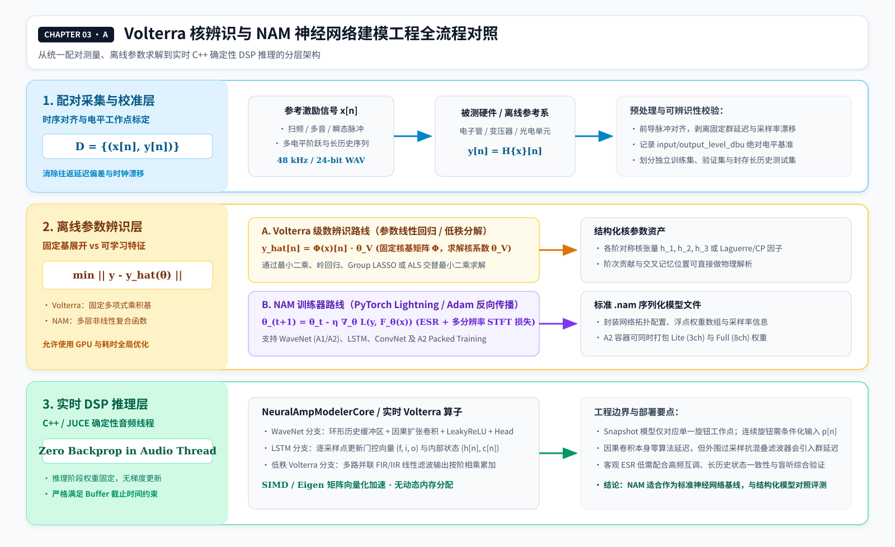
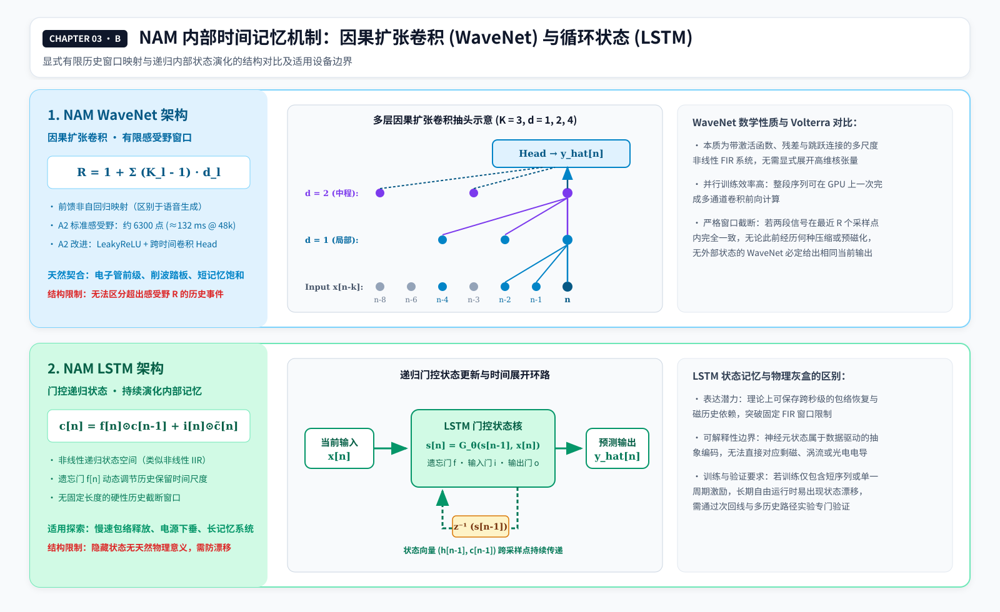

# 02 从 Volterra 级数到神经网络：同样是模型训练，本质与区别在哪里？

> **版本：v6 · 2026-11-13 · 公式排版和符号统一修订版**  
> **所属系列：Volterra Wiki**  
> **阅读定位：**从《01 Volterra 级数》的核辨识自然进入神经网络系统辨识；先解释为什么需要训练、两类模型如何学习、分别擅长什么，再认识 WaveNet、LSTM、NAM 及其实时音频工程。  
> **阅读建议：**本章不要求读者预先掌握反向传播或深度学习，已经理解《00》的输入、输出、状态、泛化，以及《01》的 Volterra 核即可。

## 2.1 我们为什么会从 Volterra 讨论到神经网络？

在上一章中，我们通过 Volterra 级数，尝试用数学模型复现未知音频设备的输入—输出规律。一台前级可能在不同输入幅度下生成不同阶次的谐波；在当前输入相同的情况下，不同历史波形可能又会改变输出。Volterra 的魅力在于，这些作用可以写成各阶核的求和，并且能够明确讨论不同时间位置之间的交叉记忆。

但是，数学表达式能够描述某种行为，并不意味着我们已经知道其中的系数。即使决定使用三阶 Volterra、64 个采样点的记忆，仍然要回答：每个核系数是多少？它们应当怎样随设备或工作点变化？这些参数从哪里来？

如果我们只知道设备输入 $x[n]$ 和输出 $y[n]$，一种自然的办法就是不断调整模型参数，让预测输出 $\hat y[n]$ 与参考输出的差距变小。到了这一步，**Volterra 建模已经进入了机器学习所研究的问题范畴**。我们不一定要使用“人工智能”这个名称，但已经在利用数据估计模型参数、控制复杂度并验证未见过的输入。

于是出现新的选择：既然最终都要根据数据辨识参数，为什么一定要事先把模型规定为 Volterra 多项式？能否规定一种更灵活的计算结构，让它自己学习复杂的非线性映射？神经网络正是在这个问题上，与 Volterra 产生了交集。

## 2.2 两种模型共享系统辨识目标，但采用不同的函数逼近结构

先把目标系统统一写成算子：

```math
y[n]=\mathcal S\{x\}[n].
```

这里的 $\mathcal S$ 代表真实设备对输入历史的处理。我们无法直接知道其完整内部机制，于是建立带参数的近似模型：

```math
\hat y[n]=\hat{\mathcal S}_{\theta}\{x\}[n].
```

训练就是根据成对输入输出数据 $\mathcal D=\{(x^{(i)},y^{(i)})\}_{i=1}^N$，寻找一组参数 $\theta$，使模型在指定工作范围内预测得尽可能准确。若使用平方误差，可以写成：

```math
\theta^\star=\arg\min_\theta
\sum_i\sum_n\left(y^{(i)}[n]-\hat y_\theta^{(i)}[n]\right)^2.
```

无论采用 Volterra 还是神经网络，通常都要经历测量、对齐、选结构、训练、独立验证和部署这几个阶段。它们共同面临激励不足、参数不可辨识、训练噪声、过拟合以及训练范围之外的外推问题。

**共同点在于任务，区别在于我们预先假设了怎样的函数，以及用什么办法寻找参数。** 对一个具体的数据集，低误差只说明模型学会了其中可被观察的规律，并不意味着真实电路结构已经被识别出来。

## 2.3 Volterra 训练为什么有时可以是线性回归？

为了看清区别，不妨从最简单的二阶、两点记忆模型开始：

```math
\begin{aligned}
\hat y[n]={}&h_0+h_1(0)x[n]+h_1(1)x[n-1]\\
&+h_2(0,0)x^2[n]+2h_2(0,1)x[n]x[n-1]\\
&+h_2(1,1)x^2[n-1].
\end{aligned}
```

这里既有一阶记忆，也有平方和交叉乘积。模型对音频输入显然是非线性的；但如果输入数据已经给定，每一项 $x[n]$、$x^2[n]$、$x[n]x[n-1]$ 都可以先计算出来。这些量对于核系数而言只是固定的特征。

将每个时刻的特征排成一行，便能把整个辨识问题写成：

```math
\mathbf y\approx\mathbf X\mathbf h,
```

其中 $\mathbf X$ 是由输入信号构建的设计矩阵，$\mathbf h$ 是待估计的核系数。若采用普通最小二乘，就得到：

```math
\mathbf h^\star
=\arg\min_{\mathbf h}
\|\mathbf y-\mathbf X\mathbf h\|_2^2.
```

请注意这个容易被误解的事实：**对输入非线性，并不妨碍模型对未知参数线性。** 对已固定阶次、固定核位置和固定特征的 Volterra 模型，核系数通常可以通过线性最小二乘、岭回归等方法辨识。在矩阵满列秩等条件下，相应的凸优化问题比较容易分析。

但这不代表所有 Volterra 训练都简单。当核张量表示为可训练低秩因子乘积、状态条件化非线性核，或将神经网络、内部状态与核系数联合优化时，参数求解便转化为非凸非线性优化问题。即使是线性回归形式，高阶核也可能因为维数巨大和特征高度相关而变得病态。

## 2.4 神经网络训练为什么不只是把系数换一个名字？

看一个最小的无记忆神经网络：

```math
\hat y[n]=\sum_{j=1}^{J}a_j\tanh(b_jx[n]+c_j)+d.
```

这里的 $a_j,b_j,c_j$ 都需要通过训练决定。与固定多项式特征不同，输入经过 $\tanh$ 前的变换、隐藏单元的位置和输出组合都在变化，因此模型对训练参数通常是非线性的。训练损失的地形也通常不是简单的凸二次曲面。

对于较大的网络，我们使用反向传播计算损失对每一层参数的梯度，再通过 Adam 等优化器逐步更新权重。其最简单的梯度下降原理可以概括成，其中 $r$ 表示训练迭代次数：

```math
\theta_{r+1}=\theta_r-\eta_r\nabla_\theta\mathcal L(\theta_r).
```

反向传播本身只是高效求导的方法，并不保证我们找到全局最优，也不保证未见过的激励会得到正确预测。训练过程中还需要选择初始化、学习率、批量大小、数据窗口、梯度裁剪与正则化方式。

可以这样理解：Volterra 的固定核特征相当于由研究者先规定了一套“描述输入历史的词汇”，训练器主要决定各个词有多重要；深度网络则在很大程度上连“用哪些中间特征来描述输入历史”也一起学习。这使神经网络具有较强灵活性，却也让它的内部表示更难与具体物理机制一一对应。

## 2.5 既然神经网络更灵活，为什么不全部换成神经网络？

灵活并不意味着在任何场景下效率更高。对于一个短记忆、弱至中等非线性的目标，少量低秩 Volterra 核可能用很少的参数就能完成可靠逼近，而且阶次、交叉延迟和频率依赖可以被直接检查。网络或许同样能拟合，但其状态和隐藏特征未必能够解释为什么出现特定阶次的失真。

另一方面，当系统的非线性不能被低阶多项式很好地表示，或者有复杂的多级结构时，固定的 Volterra 截断可能需要过多核系数，而经过设计的神经网络能用较紧凑的计算图进行逼近。前者更强调**数学表达的结构性与可分析性**，后者更强调**从数据中学习适合任务的函数表示**。

两者还有相同的原则性边界。一个不包含足够历史信息的模型，无论叫作 Volterra 还是卷积网络，都无法区分它看不到的历史。一个数据集如果没有激励某项状态，训练器也无法可靠辨识这项状态。模型误差可能来自表示能力、训练优化、数据质量或参考输出中的随机性，不能简单归结为“网络不够大”。

| 比较维度 | 固定核 Volterra 辨识 | 常规神经网络辨识 |
| --- | --- | --- |
| 先规定什么 | 阶次、核位置、记忆长度及约简结构 | 层类型、宽度、感受野、状态结构等 |
| 参数的主要意义 | 各阶核及其历史交互贡献 | 网络内部权重及学习到的特征 |
| 典型训练形式 | 对固定特征的线性/正则化回归 | 通过反向传播进行非凸优化 |
| 非线性表达 | 显式多项式阶次与交叉项 | 多层非线性映射的组合 |
| 主要代价 | 高阶完整核参数爆炸、共线性 | 优化与超参数复杂、解释性不足 |
| 历史与状态 | 由核窗口或另设递归状态决定 | 由卷积感受野或循环状态决定 |
| 公平比较标准 | 独立误差、泛化、稳定性、实时成本 | 同左 |

这张表描述的是典型情形，不是定理式分类。低秩 Volterra 训练可能同样是非凸优化，带物理约束的神经网络也可能获得一定程度的可解释性。



*图 02-01｜固定核 Volterra 与神经网络在结构选择、训练和实时推理上的主要差别。SVG 文件名保留历史素材编号。*

## 2.6 怎样让神经网络学会“带记忆的声音”？

对静态非线性而言，只要当前输入 $x[n]$ 就可能足够。但我们关心的模拟硬件往往有线性滤波、频率相关的非线性、攻击释放以及其他历史效应。于是神经网络需要一种能够接触过去的信息的结构。

第一种办法是显式给网络一段历史窗口：

```math
\hat y[n]=F_\theta(x[n],x[n-1],\ldots,x[n-M+1]).
```

这与 Volterra 的有限历史窗口在**可获得的信息**上是相似的，只是两者对输入历史进行不同的数学运算。卷积神经网络、因果 TCN 和 NAM 中使用的 WaveNet 类模型属于这一方向。

第二种办法是维护递归状态：

```math
\begin{aligned}
s[n+1]&=G_\theta(s[n],x[n]),\\
\hat y[n]&=H_\theta(s[n],x[n]).
\end{aligned}
```

在该递归结构中，历史输入信息通过内部状态向量跨采样点持续传递，无需在每个时刻重新读取完整的历史波形窗口。RNN、LSTM 及某些状态空间网络属于这一方向。递归状态可以处理较长历史，但能否学到正确的长期动态，仍要由训练和测试决定。

这种划分与《00》关于“记忆和状态”的区分相互呼应：历史是发生过的事情，状态是系统在当前时刻保留的、会影响未来的信息。二者不能直接画等号。

## 2.7 WaveNet 的扩张卷积：更少参数观察更长历史

普通因果一维卷积可写成 $z[n]=\sum_{k=0}^{K-1}w_kx[n-k]$。加入扩张系数 $d$ 后变为

```math
z[n]=\sum_{k=0}^{K-1}w_kx[n-dk].
```

改变 $d$，就能够让相同大小的卷积核在时间轴上覆盖不同的间隔。把多个扩张层与非线性激活、残差和跳跃连接叠加，网络可以用较少的局部权重构成较大的历史感受野。对于步长为 1、无额外时间尺度转换的卷积堆叠：

```math
R_{\mathrm{RF}}=1+\sum_{\ell=1}^{L}(K_\ell-1)d_\ell.
```

$R_{\mathrm{RF}}$ 个采样点所对应的过去时间跨度约为 $(R-1)/f_s$。如果模型的感受野只有百余毫秒，它无法凭借纯前馈输入窗口记住一秒前发生的压缩事件。扩大感受野可以改善这个结构限制，但会带来新的训练与部署成本，也不保证网络能有效利用全部历史。

还要区分两个名字相同的东西：最初的 WaveNet 是自回归音频生成技术；NAM 使用的是将外部输入音频映射为目标输出的前馈式 WaveNet 变体，不需要把自己每次预测的输出当作下一步的输入。[N2]

## 2.8 LSTM 为什么需要单独讨论？

LSTM（长短期记忆网络）通过门控循环状态来保存和更新历史信息。它不需要像普通因果卷积那样，为每个输出显式读取一个固定长度的输入窗口。其单元状态递推的一种形式为：

```math
c[n]=f[n]\odot c[n-1]+i[n]\odot\widetilde c[n].
```

$f[n]$ 是遗忘门，$i[n]$ 是输入门，$\widetilde c[n]$ 是候选状态，$\odot$ 表示按元素乘积。对于压缩器的程序依赖释放、放大器慢速供电状态或磁滞研究，这种结构提供了另一种表达历史的可能性。

但“具有循环状态”不等于“真实地表示磁滞”。LSTM 状态可能在长序列中漂移，也可能在未见过的激励下错误遗忘历史。训练序列长度、状态重置策略和验证信号必须与研究目标相配合。真正的持久磁滞记忆、不可逆操作和可解释的状态约束，依然可能需要物理或唯象模型参与。



*图 02-02｜因果感受野与递归状态是两种不同的历史信息组织方式。*

## 2.9 到这里，才能准确理解 NAM

现在再来引入 Neural Amp Modeler（NAM），它的意义就不会被误解。**NAM 是开源音频神经网络系统辨识的工程生态，不是另一种与 WaveNet、LSTM 平行的新数学结构。** 它包括 Python 训练工具、网络实现、模型文件、C++ 实时推理核心和插件。NeuralAmpModelerCore 文档列出的模型架构包括 WaveNet、ConvNet、LSTM 和 Linear；具体支持情况应以所安装版本的源码和模型格式为准。[N1][N4]

在常规工作流中，研究者向已知设备输入测试信号，记录输出，将对齐后的输入输出音频送入训练器，选择模型架构与训练配置，优化网络参数，再把得到的模型加载到实时推理端。在实际训练中，研究者通常根据目标设备特性从中选定单一架构进行独立训练与对比评估。我们可以分别训练 WaveNet 和 LSTM，比较同一数据集上的表现；某些特定训练方案可以联合处理不同规模的网络，但那又是另一项工程设计。

NAM 的成熟之处，在于它把常见训练和部署环节组织为可重复的工具链。对于我们曾经反复自行开发训练器的磁带机项目，这尤其重要：先拥有一个可信的黑盒基线，才更容易判断失败究竟来自数据、训练程序还是模型结构。

## 2.10 NAM 的 A1、A2 与实时执行

NAM 项目在 2026 年推进 A2 作为新一代快照架构，A1 模型继续兼容。[N3] A2 的研究重点包括模型在误差、CPU 计算和部署方面的权衡。TONE3000 发布的 [A2 技术指南](https://www.tone3000.com/guides/nam-a2-the-complete-guide) 介绍了实际使用的卷积感受野、不同规模模型及训练方案，并提供发布方的 A1/A2 对照测试。其测量条件与样本范围应随结论一起记录。[N5]这不等于 A2 自动突破所有历史范围、稳定性和物理一致性的限制，也不能将新架构的一组性能比较推广为所有硬件处理器的普遍结论。

训练时需要处理音频数据、计算损失、求梯度和更新参数，可以花费相当长的时间。**实时执行时则是使用训练完成的权重做前向计算**：输入采样或音频块进入优化后的推理引擎，输出预测的处理结果。训练与实时运算不应混淆。参数数量少不一定等于 CPU 更低，还要评估卷积和循环结构、历史缓存、SIMD、采样率、缓冲长度及最坏情况下的实时截止期限。

## 2.11 固定快照、参数条件化与状态记忆是三个不同问题

普通 NAM 模型通常对应参考设备的一组固定旋钮设置，也就是快照。把插件输入电平提高，不等于在真实电路上旋转 Gain：真实旋钮可能改变级间反馈、滤波、偏置与多个放大级的关系。若要学习连续可调的系统，需要将控制参数纳入训练和模型输入，例如：

```math
\hat y[n]=F_\theta(x_{\le n},p[n]).
```

此处 $	heta[n]$ 专指面板旋钮等外部可观测控制参数，与系统内部的隐式物理状态变量相互区分。一个支持连续控制参数的模型，仍可能因为感受野或状态结构不足，无法正确表达长时间释放。反过来，一张固定旋钮的快照也可能包含复杂的递归内部状态。参数化建模已经有公开研究与工程案例，但不应把这种能力默认为每个标准 .nam 快照都具备。[N4]

## 2.12 同样的训练数据，为什么结果可能完全不同？

设两种模型使用完全相同的输入输出音频。它们的训练结果仍可能受到结构容量、历史长度、参数初始化、特征共线性、损失函数和优化策略影响。一个常见归一化误差是：

```math
\mathrm{ESR}=
\frac{\sum_n(y[n]-\hat y[n])^2}{\sum_n y[n]^2}.
```

ESR 能度量波形近似，却不能代替频率响应、各阶谐波、互调、瞬态、循环状态长期稳定性和听感。若参考设备含有与输入不同步的噪声或 Wow/Flutter，单纯逐采样追求完全相同的输出，甚至可能把不可预测的随机性误认为模型误差。

数据采集的时钟偏差、固定延迟、电平标定、不同硬件个体和训练工作点同样重要。一个从未经历长时间释放的网络，不会因为堆叠更多层就自动理解复杂程序依赖；一个只看过主磁滞回线的模型，也不能据此证明它会预测全部次回线。

## 2.13 应当怎样比较 Volterra 与 NAM？

两者的公平比较应使用相同的训练、验证与封存测试数据，要求它们回答同一组问题。例如，一个短记忆饱和器可以比较幅度依赖、双音互调和高频混叠；一个光电压缩器需要加入攻击、长释放和不同历史条件；一个磁滞参考系统则需要主回线、次回线、预磁化和速率变化。

在相同的实时 CPU 预算下，先训练结构简洁的 Volterra，再训练 NAM 卷积网络与 LSTM。若神经网络获胜，应解释是哪种非线性或状态能力带来收益；若 Volterra 以更低成本达到同等精度，则没有必要强行加网络。若两者在不同区域有优势，才进入共享状态、残差和混合模型研究。

这种判断也要保留一个界限：用自建 DSP 参考系统训练，可以检验算法是否能复现那套已知系统，但不能直接证明已经复现了真实硬件。只有利用真实硬件的独立配对测量与可控听感比较，才能进一步评价硬件一致性。

## 2.14 从单一模型走向下一章

在这一章里，我们完成了一个概念过渡：Volterra 和神经网络都需要根据数据训练；固定核 Volterra 往往更像一个有明确特征的参数辨识问题，神经网络则让特征表示本身也参与学习。WaveNet 用因果卷积获取有限历史，LSTM 用循环状态保存历史，NAM 则将这些可训练架构与成熟的实时推理工具组织到一起。

接下来需要研究的，不再是“谁能拟合更多声音”，而是当设备的电路、磁滞、压缩状态和长时间记忆已知或部分已知时，是否应让 Volterra、唯象模型、白盒和网络分别承担不同的行为。这一问题进入《03 混合建模：训练边界与实时约简》。

---

## 2.15 从可微分 DSP 看训练模型的第三条路线

神经网络和显式 Volterra 共同使用数据拟合输入输出。另有一类方法直接把数字压缩器、滤波器等带可调参数的 DSP 结构放入优化流程，通过自动微分或专门构造的梯度方法估计参数。其计算图包含具有明确含义的音频处理算子，参数也往往可以对应阈值、压缩比、攻击和释放。

一个公开实例是 Queen Mary University of London 的 [4A-2A](https://github.com/aim-qmul/4a2a)。Yu 与 Fazekas 在 2025 年发表的 [*Sound Matching an Analogue Levelling Amplifier Using the Newton-Raphson Method*](https://arxiv.org/abs/2509.10706) 以可微分前馈压缩器近似 LA-2A，训练涉及 Newton–Raphson 优化，并将 Peak Reduction 映射到压缩器的五个参数。它为研究提供了一个参数较少、易于进行受控对比的灰盒基线。

这个例子说明，**数据驱动辨识并不要求最终运行的模型必须是一张深度神经网络**。Volterra 核、参数化 DSP、递归状态和神经网络均可进入训练优化，只要它们的参数、输入输出与损失函数被明确规定。下一章将讨论这些结构如何进行分工、联合辨识与实时约简。

## 2.16 储备池计算与衰减记忆网络：另一个神经系统辨识基线

在 WaveNet 和 LSTM 之外，Reservoir Computing（储备池计算）提供了一条结构不同的动态模型路线。典型 Echo State Network（ESN）维护一组受输入驱动的递归状态，将非线性动态映射到较丰富的特征，再训练相对简单的读出层：

```math
\begin{aligned}
\mathbf s[n+1]&=\sigma(\mathbf A\mathbf s[n]+\mathbf B u[n]),\\
\hat y[n]&=\mathbf C\mathbf s[n]+d.
\end{aligned}
```

其中 $\mathbf A$、$\mathbf B$ 在一些标准训练方案中保持固定，主要学习 $\mathbf C$、$d$；也可以研究具有其他可训练部分的变体。研究时应关注 Echo State Property、历史状态的唯一性和衰减记忆性质。Grigoryeva 与 Ortega (2018) 给出了 ESN 在特定有界输入及衰减记忆滤波器类中的通用逼近结果。[N7]

它与 NAM 的主要差异是训练组织和动态状态的处理策略。对于我们的磁带机实验，可以把 ESN 放在“成熟神经动态基线”的候选列表中，尤其检查长期自由运行稳定性和与物理状态的协作。储备池维度、状态衰减及输出拟合误差都需要和推理计算成本一起评价。

## 本章参考资料

- [N1] [NeuralAmpModelerCore 官方文档](https://neuralampmodelercore.readthedocs.io/en/latest/)：主要网络类型与 C++ 实时核心。
- [N2] [NAM WaveNet 计算过程](https://neuralampmodelercore.readthedocs.io/en/latest/wavenet_walkthrough.html)：因果卷积、残差与 NAM 的回归式 WaveNet。
- [N3] [NAM 作者关于 Architecture A2 的介绍](https://www.neuralampmodeler.com/post/architecture-a2)：2026 年 A2 及 A1 兼容。
- [N4] [NAM 官方训练器源码](https://github.com/sdatkinson/neural-amp-modeler)：训练配置、扩展和实现方式。
- [N5] [TONE3000，NAM A2: The Complete Guide](https://www.tone3000.com/guides/nam-a2-the-complete-guide)：A2 架构、感受野、Packed Training 及厂商自测指标；数值属于项目方报告，适合与独立评估分开引用。
- [N6] [Yu & Fazekas (2025)，*Sound Matching an Analogue Levelling Amplifier Using the Newton-Raphson Method*](https://arxiv.org/abs/2509.10706)；[4A-2A 开源仓库](https://github.com/aim-qmul/4a2a)：参数化可微分压缩器的完整研究入口。
- Martin Schetzen，*The Volterra and Wiener Theories of Nonlinear Systems*；Oliver Nelles，*Nonlinear System Identification*：关于显式模型、参数辨识、结构选择与泛化的深入理论。

本章是面向音频工程的教材化组织，不是对任何仓库文档或专著的逐段翻译。

- **[N7]** Grigoryeva, L. & Ortega, J.-P. (2018), *Echo State Networks Are Universal*, [DOI:10.1016/j.neunet.2018.08.025](https://doi.org/10.1016/j.neunet.2018.08.025)。该通用逼近结果依赖论文定义的输入和衰减记忆假设。
