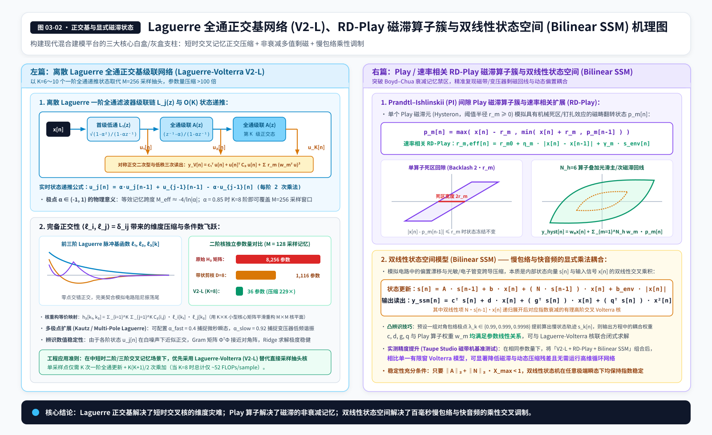
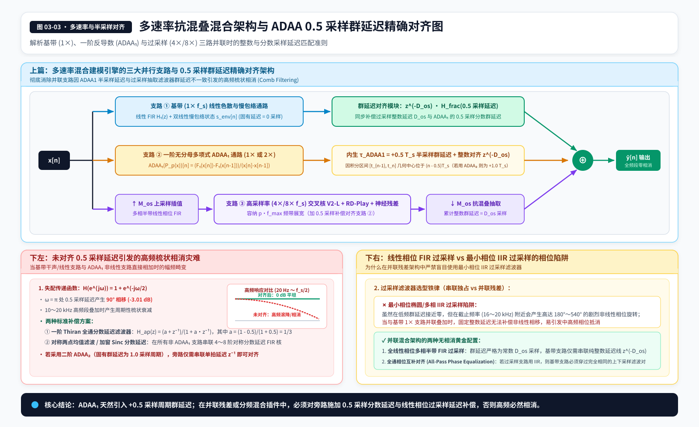
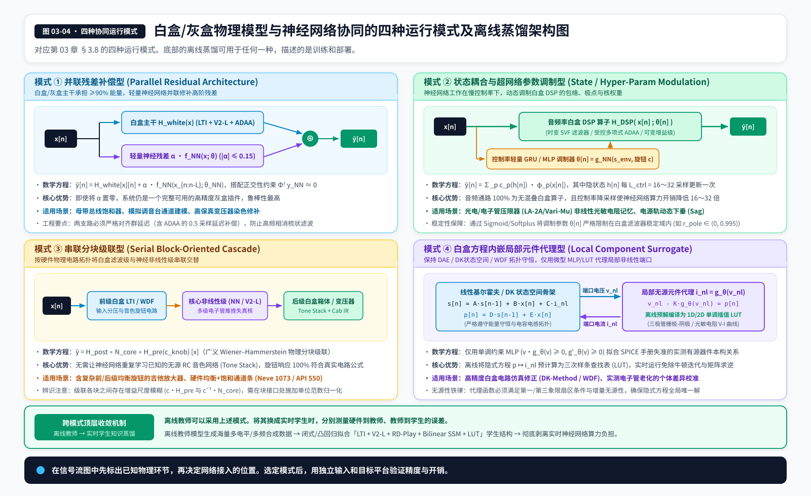

# 03 混合建模、训练边界与实时约简

[在线阅读本章（完整合订版）](https://excillex-marisa.github.io/volterra-wiki/#chapter-03)

> **版本：v14 · 2026-11-17 · 统一案例与模型验证衔接**
> **所属系列：Volterra Wiki**
> **阅读定位：** 承接《02》的训练比较，讨论如何决定 Volterra 核与长期状态的职责，怎样引入白盒、唯象与神经网络，如何进行实时约简，并以 SKY SA-1A、Revenger 2A 和 noshige2A 的不同光电动态建模结构检验这些思考。
> **阅读说明：** 本章把数学上的可实现结构与具体商业产品的行为特征放在一起理解。未获完整运行路径核对的细节只作为结构解释，不把单一测试点的符合程度等同于对全部内部机制的确认。

**本章定位与阅读次序。** 这一章先回答“为什么需要组合多个模型、怎样把可观测现象分配给不同结构”。核心路线是 3.1 的任务定义、3.2 的记忆分层、3.3 的候选模型分级、3.8 的协同模式和 3.11 的实验验收。3.6 的磁滞与双线性状态模型、3.7 的 ADAA 和多速率实现、3.8.1 的 NARX/NOE 属于可复用的工程示例，第一次阅读先认识输入、状态和输出关系即可。数学上对衰减记忆、正交辨识、可辨识性的深入条件见《04》；电路 DAE、WDF 与物理子系统代理的求解原理见《05》。这两章分别提供理论与物理计算的深化路线。

**设计的先后关系。** 先规定工作点、测量链、独立测试集和实时预算；然后用线性、静态非线性及对角核建立基线；只有当双音、历史探针或长时间恢复测试暴露明确残差时，再扩大交叉记忆、增加显式状态或引入神经残差。3.11 将这一思路写成可重复的测试协议，阅读 3.3 的模型分级表时可先对照它所列的测试目标。

**同一台前级在本章进入工程验收。** 《00》建立了观察方法，《01》说明块结构与 Volterra 核能表达什么，《02》引入可训练的神经模型；现在把各章共用的测试重新组织成决策：先让线性 L 承担小信号频响，再比较 N 和 L–N–L 是否解释大信号失真；若双音相位或瞬态交互仍有稳定残差，则尝试并行结构或更自由的高阶核；若不同预激励之后仍有可重复的恢复差异，且已经排除了可解释的线性尾部，便进一步检验显式状态或状态条件化模型。**记忆持续多久是一条重要线索，历史信息以什么方式进入非线性运算，则直接决定结构选择。**

## 3.1 混合建模的核心任务：确立多模型职责分工与表达边界

上一章已经说明，同样的输入输出数据可以用 Volterra、WaveNet 或 LSTM 进行辨识。现在假设我们知道目标设备的电路结构、光电元件行为，或者某一部分具有明确的磁滞和慢速恢复机制。此时可以把已知的物理机制交给结构化分支，再让数据驱动模型补足剩余误差，以便分别控制参数量和跨条件泛化能力。

将四种模型不加约束地并入同一个插件，同样会引入可辨识性冲突：如果 Volterra 与神经网络同时拟合电子管饱和，唯象磁滞状态与另一套循环网络又同时解释相同的慢速变化，虽然训练误差可能进一步降低，我们却难以确认哪个分支承担了真正可泛化的物理规律；两个分支甚至可能在训练集内互相抵消误差，而在新的输入历史下共同偏离。

因此，本章的核心原则是：**先确认目标系统表现出哪些可观测行为，再用最少、最有依据的结构分别承担这些行为；每一项新增复杂性都必须通过独立验证证明其增量价值。**

在启动训练前，至少需要明确六个设计维度：目标模拟的电平、频段、旋钮与工作点；哪些现象依赖短时历史；哪些属于慢速或路径依赖的内部状态；哪些属于非同步随机过程；实时音频线程允许多少延迟与 CPU 预算；以及是否需要跨采样率和跨硬件个体泛化。


*图 03-01｜混合建模研究平台总体架构图：按时间尺度与非线性机制将线性频响、短时高阶 Volterra 核、显式物理/唯象状态及神经残差解耦。*

从模型开发流程看，还需要将**结构选择、参数辨识与测量质量**分开诊断。例如某条前馈分支在训练集内拟合良好，却在保持当前输入相同、改变遥远预激励历史时出现系统性残差，可能说明模型缺少慢状态；同样的残差也可能来自测试时没有重置初始状态或校准测量延迟。先用控制实验排除采集误差，再判断应增加核坐标、延长感受野还是引入显式状态，可以有效避免在多模型之间重复分配同一物理机制。

## 3.2 训练 Volterra 之前，如何按时间尺度切分三类记忆？

回顾《01》第 1.3 与 1.13 节的分阶记忆 Volterra 模型：

```math
\hat y[n]=h_0+\sum_{p=1}^{P}\sum_{k_1,\ldots,k_p=0}^{M_p-1}h_p[k_1,\ldots,k_p]\prod_{j=1}^{p}x[n-k_j],\qquad N_p=\binom{M_p+p-1}{p}.
```

正如《01》第 1.13 节参数规模表所量化：在 $`48\,\mathrm{kHz}`$ 采样率下，$`M=64`$（约 $`1.33\,\mathrm{ms}`$）的三阶对称核已有 $`45,760`$ 个独立参数，$`M=256`$（约 $`5.33\,\mathrm{ms}`$）时飙升至 $`2,829,056`$ 个。这里已经按《01》第 1.6 节对称化并合并了重复排列；这些数量描述完整交叉记忆仍需保存的独立系数，后续对角、带状、低秩及状态混合结构是在此基础上继续减少实际负担。因此，面对真实音频硬件，必须首先将系统记忆按物理机制切分为三个层次，并分配给不同的数学算子：

1. **小信号线性记忆（数毫秒至数百毫秒）**：如变压器低频高通滚降、耦合电容时间常数与均衡网络振铃，由一阶长 FIR 核 $`h_1[k]`$ 或稳定 IIR 极点滤波器承担；
2. **短时非线性交叉记忆（亚毫秒至数毫秒）**：如放大级局部负反馈延迟、高频摆率限制（Slew-Rate Limiting）与级间瞬态互调，由短窗口高阶约简 Volterra 核（$`p\ge 2,\;M_p\ll M_1`$）承担；
3. **慢速宏观演化与持久状态记忆（数十毫秒至数秒乃至路径保持）**：如光电单元（T4B）的双时间常数释放、电源滤波电容下陷（Power Supply Sag）、电子管热漂移以及磁芯/磁带剩磁，交由**低维显式状态变量 $`\mathbf{s}[n]`$** 承担。

通过这一时间尺度解耦，高阶 Volterra 核无需强行扩展至秒级窗口，即可与慢速状态方程协同覆盖完整的硬件动态。

## 3.3 从对角到交叉：实验分级体系 V0–V5

在研究平台中，短时非线性核的复杂度按 **V0–V5 实验分级体系**逐级递增，每升一级均需回答一个明确的实验假设：

| 实验分级 | 候选结构 | 需要回答的验证问题 |
| --- | --- | --- |
| **V0** | 线性 FIR/IIR、静态 Waveshaper、简化 Hammerstein/Wiener | 最简无交叉记忆基线能解释多少方差与谐波？ |
| **V1** | 对角 Volterra / 实信号 Memory Polynomial / SNLM | 是否需要各阶独立的频率相关饱和与群延迟塑形？ |
| **V2** | Near-Diagonal / Banded（$`\lvert k_1-k_2\rvert\le B`$）/ GMP | 双脉冲与双音差频互调是否由相邻采样点的局部耦合主导？ |
| **V2-L** | Laguerre-Volterra / Kautz 正交时间基展开 | 较长的指数或振荡衰减记忆能否投影至少数极点滤波器输出？ |
| **V3** | 稀疏非局部交叉核（Sparse Volterra，LASSO/OMP 筛选） | 是否存在局部带状结构无法覆盖的特定远距离延迟交互？ |
| **V4** | 低秩张量核（CP / Tucker / Tensor Train 分解） | 稠密非对角交叉核能否由少数几条一维滤波器支路的乘积生成？ |
| **V5** | 状态条件化 Volterra 核 $`h_p(\mathbf{k};\mathbf{s}[n])`$ 与混合残差 | 短时核系数或支路增益是否随慢速物理状态 $`\mathbf{s}[n]`$ 显著迁移？ |

建议实验搜索从记忆网格 $`M\in\{32,64,128,256\}`$、阶数 $`P\in\{3,5,7\}`$ 及低秩模态数 $`R\in\{2,4,8,16\}`$ 起步。每次升级结构时，必须同时检查封存测试集上的双音 IMD、条件数 $`\kappa_2(\mathbf{X})`$ 与每采样点乘加开销：若某次升级仅令训练集 ESR 微降，却未改善未见双音互调或瞬态恢复，则应回退至更紧凑的低一级结构。

### 3.3.1 Laguerre-Volterra 网络（LVN）：极点正交基的时间压缩机制

在 V2-L 分支中，**Laguerre-Volterra Network (LVN)** 通过一组共享实极点 $`a\in(0,1)`$ 的离散正交全通级联滤波器，将长度为 $`M`$ 的原始延迟线压缩为 $`K`$ 个正交历史特征（$`K\ll M`$）。第 $`j`$ 阶规范化离散 Laguerre 滤波器的 $`z`$ 域传递函数定义为：

```math
L_j(z)=\frac{\sqrt{1-a^2}}{1-a z^{-1}}\left(\frac{z^{-1}-a}{1-a z^{-1}}\right)^j,\qquad j=0,1,\ldots,K-1.
```

在实时 DSP 实现中，各阶特征 $`u_j[n]=( \ell_j\ast x )[n]`$ 无需做长卷积，只需按一阶全通链逐采样递推更新（每采样点仅需 $`O(K)`$ 次乘加）：

```math
\begin{aligned}
u_0[n] &= a\,u_0[n-1] + \sqrt{1-a^2}\,x[n],\\
u_j[n] &= a\,u_j[n-1] + u_{j-1}[n-1] - a\,u_{j-1}[n],\qquad j=1,\ldots,K-1.
\end{aligned}
```

随后，第 $`p`$ 阶 Volterra 算子直接构建在这 $`K`$ 个正交特征的多重乘积之上：

```math
y_p[n]=\sum_{0\le j_1\le\cdots\le j_p\le K-1}c_p[j_1,\ldots,j_p]\prod_{i=1}^{p}u_{j_i}[n].
```

这样一来，第 $`p`$ 阶对称核的独立参数量从 $`\binom{M+p-1}{p}`$ 大幅降至 $`\binom{K+p-1}{p}`$（例如将 $`M=256`$ 压缩为 $`K=8`$ 个 Laguerre 基时，三阶独立参数量从 $`282.9`$ 万直接降至 $`\binom{10}{3}=120`$ 个），并可进一步与**主动态模态（Principal Dynamic Modes, PDM）** 结合。[L1][L2]

需要注意，单一实极点 $`a`$ 的 Laguerre 基适合表征单调指数衰减记忆；若目标包含显著欠阻尼谐振（如变压器高频谐振峰），可替换为成对共轭复极点的 **Kautz 正交基**；若目标包含永久剩磁或非对称攻击/释放切换，仍需配合第 3.7 节的显式非线性状态方程。

## 3.4 谐波阶数与核结构选择的解耦原则

正如《01》第 1.7 与 1.9.1 节所证明，单音激励下观测到第 9 次谐波，既可能来自九阶多项式支路，也可能由两个低阶三阶模块级联（$`(x^3)^3=x^9`$）、局部反馈环路或时变增益调制（见第 3.12 节）产生。因此，在 V0–V5 选型时，应依据多电平增长斜率与双音互调残差综合确定单级 Volterra 阶数 $`P`$。

## 3.5 白盒物理建模的实时瓶颈与模型降阶区分

当已知部分电路拓扑时，白盒方法通过基尔霍夫定律与元件本构方程建立非线性微分代数方程（DAE），离散化后在每个采样点求解隐式非线性代数方程组：

```math
\mathbf{F}(\mathbf{z}_n, \mathbf{z}_{n-1}, x[n]) = \mathbf{0}.
```

实时插件开发涉及两类优化：**无损数值加速**与**有损模型约简**：
1. **无损数值加速**：利用电路连接矩阵的稀疏性、Wave Digital Filters (WDF) 的树状散射解耦加上单非线性根部位隔离，或者对一维单调隐式方程构建高密度预计算查找表（LUT），在不改变物理方程解的前提下降低单步 Newton–Raphson 迭代开销；[R3][R4]
2. **有损模型约简与代理（Model Order Reduction / Surrogate）**：通过本征正交分解（POD）、模态截断（$`\mathbf{q}\approx\boldsymbol{\Phi}_r\mathbf{a}`$）或用轻量神经网络替换昂贵的磁性/多端口非线性子模块，这类方法改变了原始控制方程，必须在工作域内单独量化截断与近似误差（完整的 DAE、Port-Hamiltonian 保无源性离散化、POD/DEIM 超降阶及神经算子理论将在《05 物理约束与实时代理建模》第 5.2–5.10 节系统推导）。

## 3.6 唯象建模（Phenomenological Modeling）与三类核心显式状态算子

**为什么此时引入状态模型？** 前面已经将有限历史核与长时间演化分工。下面三种状态模型分别处理路径依赖磁滞、输入与状态相乘的耦合，以及多时间常数包络。这里优先解释状态如何更新、会产生什么可测响应；在第 04 章讨论其算子性质与可辨识性，第 05 章再讨论把它们接入物理方程后的数值求解与稳定性。

当白盒微观参数未知、而纯前馈黑盒又无法跨越长时记忆边界时，**唯象建模（Phenomenological Modeling）** 通过少量具有明确物理意义的宏观内部状态变量 $`\mathbf{s}[n]`$，以极低计算成本精确刻画慢速与路径依赖现象：

```math
\mathbf{s}[n+1] = \mathbf{f}\bigl(\mathbf{s}[n], x[n]; \boldsymbol{\theta}_s\bigr),\qquad
y[n] = g\bigl(x[n], \mathbf{s}[n]; \boldsymbol{\theta}_y\bigr).
```

在模拟磁带机、变压器与电子管光电压缩器的混合架构中，最重要、最常与 Volterra 核协同的三类显式状态算子如下：

### 3.6.1 速率无关与速率依赖 Play / Prandtl–Ishlinskii 磁滞算子

针对磁带与变压器铁芯的**多分支路径依赖与永久剩磁（Remanence）**，经典的**Play 算子（间隙算子）** 将磁滞分解为一组具有不同阈值半径 $`r_m \ge 0`$（$`m=1,\ldots,M_h`$）的死区回隙单元（Backlash / Play Hysteron）：

```math
s_m^{\mathrm{play}}[n] = \max\!\Bigl(x[n]-r_m,\ \min\bigl(x[n]+r_m,\ s_m^{\mathrm{play}}[n-1]\bigr)\Bigr).
```

当输入变化量未超出死区区间 $`[s_m[n-1]-r_m,\ s_m[n-1]+r_m]`$ 时，状态 $`s_m[n]`$ 保持原值不变（即便输入归零，剩磁状态依然永久保留）；一旦跨越阈值，状态便沿外包络线推进。将多个不同阈值的 Play 算子加权求和即构成 **Prandtl–Ishlinskii (PI) 模型**。

在磁性材料的物理记法中，$`H`$ 表示磁场强度，$`B`$ 表示磁通密度；一个完整磁化循环的回线积分可写作 $`\oint H\,\mathrm dB`$，积分方向按耗散能量为正的约定选取。当前 Play 算子以归一化输入 $`x[n]`$ 表示驱动坐标，具体实验中应说明它对应磁场、电流或其他经过标定的输入量。

进一步地，真实磁带涂层与铁芯在高频瞬态下还表现出涡流损耗与磁畴弛豫引起的**速率依赖磁滞（Rate-Dependent Hysteresis，回线面积随频率升高而展宽）**。为此可引入**速率依赖增强型 Play 算子（Rate-Dependent Play, RD-Play）**，在状态更新中加入与输入变化率 $`\Delta x[n]=x[n]-x[n-1]`$ 相关的动态弛豫项或动态阈值缩放。公式中的 $`\beta_m\in[0,1]`$ 是两种状态贡献之间的混合系数，$`r_m(\lvert\Delta x[n]\rvert)`$ 表示随输入变化速率调整的阈值函数：

```math
s_m^{\mathrm{RD}}[n] = (1-\beta_m)\,s_m^{\mathrm{play}}\bigl(x[n],\,s_m^{\mathrm{RD}}[n-1];\,r_m(\lvert\Delta x[n]\rvert)\bigr) + \beta_m\,x[n].
```

仅需 $`M_h=4\sim 8`$ 个标量 Play 状态，即可为前馈 Volterra 或神经分支提供真实的主回线、次回线（Minor Loops）与擦除记忆（Wiping-out Property）坐标。[R2]

### 3.6.2 双线性状态空间模型（Bilinear State-Space Model, Bilinear SSM）

针对放大器电源下陷（Sag）、偏置漂移以及输入信号对系统极点/增益的乘性调制，**双线性状态空间模型**在标准线性状态方程中显式加入了**状态与输入的交叉乘积项 $`\mathbf{s}[n]\cdot x[n]`$**：

```math
\begin{aligned}
\mathbf{s}[n+1] &= \mathbf{A}\mathbf{s}[n] + \mathbf{B}x[n] + \mathbf{N}\mathbf{s}[n]\,x[n],\\
y[n] &= \mathbf{C}\mathbf{s}[n] + d\,x[n].
\end{aligned}
```

其中矩阵 $`\mathbf{N}`$ 直接控制外部输入 $`x[n]`$ 对内部状态演化速率与耦合权重的瞬时调制。从泛函展开角度看，双线性状态空间模型若按输入幂次迭代展开，天然生成一个无限记忆长度但由矩阵幂次 $`(\mathbf{A}, \mathbf{B}, \mathbf{N}, \mathbf{C})`$ 紧凑参数化的有理高阶 Volterra 级数，是连接“有限维状态方程”与“无穷维交叉 Volterra 核”的经典桥梁。

### 3.6.3 非对称多时间常数光电/热包络状态（Asymmetric Multi-Stage Envelope）

针对 LA-2A（T4B 光电单元）或 Vari-Mu 压缩器中“初始快速释放、后段长达数秒的对数慢速尾部（Program-Dependent Dual Release）”，可采用耦合双电容或多级非对称状态方程：

```math
s_{\mathrm{env},i}[n] = \bigl(1-\alpha_i[n]\bigr)s_{\mathrm{env},i}[n-1] + \alpha_i[n]\,D(x[n]),\qquad
\alpha_i[n] = \begin{cases}
\alpha_{\mathrm{att},i}, & D(x[n]) \gt s_{\mathrm{env},i}[n-1],\\
\alpha_{\mathrm{rel},i}(\mathbf{s}_{\mathrm{env}}[n-1]), & D(x[n]) \le s_{\mathrm{env},i}[n-1].
\end{cases}
```

当慢速池状态积累较高时，动态调慢主释放系数 $`\alpha_{\mathrm{rel}}`$，即可用 2 至 3 个标量状态复现长达数秒的程序相关释放记忆。

SKY SA-1A 的一组光电压缩动态测试可以帮助理解为何需要多时间常数：在 $`48\,\mathrm{kHz}`$、MANUAL 模式、Attack / Release 设为 75/75 时，常规电平阶跃测得的 Release $`T_{63}`$ 约为 $`163\,\mathrm{ms}`$；但换成 $`-18\,\mathrm{dBFS}`$ 至 $`-6\,\mathrm{dBFS}`$ 的更强输入历史后，同类释放测量约为 $`327\,\mathrm{ms}`$。这说明在比较两个压缩器的“释放时间”时，应同时固定前导信号幅度、保持时长、增益衰减深度与测试判据。这里的 $`T_{63}`$ 是指定激励条件下的响应特征，与设备内部固定 RC 元件时间常数之间仍需额外的物理辨识。



*图 03-02：左篇展示离散 Laguerre 一阶全通级联正交基网络（V2-L），以 $`K=8`$ 个正交递推状态将 $`M=128`$ 的二阶交叉核参数从 $`8,256`$ 压缩至 $`36`$ 个；右篇展示突破 Boyd–Chua 衰减记忆限制的 Prandtl–Ishlinskii 速率相关 RD-Play 磁滞算子簇（复现多值剩磁回线 $`\pm B_r`$）以及显式耦合慢包络与快音频的双线性状态空间模型（Bilinear SSM）。*

## 3.7 混合架构的抗混叠与多速率边界：ADAA、过采样和状态对齐

混合系统通常同时包含静态 Waveshaper、Volterra 交叉乘积、递归状态和神经网络残差。为了在不引爆 CPU 的前提下抑制混叠，需按各子模块的数学结构实施差异化的多速率与反导数抗混叠（ADAA）方案：

| 运算模块 | 候选实时抗混叠策略 | 必须验证的工程边界 |
| --- | --- | --- |
| 线性滤波、慢速包络与热/电源状态 | 基带采样率（1×）更新；极慢状态可降采样更新并线性插值 | 多速率接口的群延迟补偿与块边界连续性 |
| 可解析求反导的无记忆静态非线性 | 一阶/二阶反导数抗混叠（ADAA1 / ADAA2）配合 2× 过采样 | 小分母病态阈值切换、补偿滤波器高频相位与群延迟 |
| 对角 Volterra / 并联 Hammerstein 单项式支路 | Hopman–Bennett 无分母闭式多项式 ADAA（见《01》1.21 节）或支路过采样 | 各阶支路間の整数/半采样点延迟对齐（0.5 sample delay） |
| 一般非对角 Volterra、反馈环路与神经网络残差 | 在统一的过采样域（如 2× / 4× / 8×）执行，经线性相位或最小相位抗混叠滤波器降采样回基带 | 感受野对应的真实物理时间缩放、训练采样率与推理采样率严格匹配 |
| 动态门控与双路径混合输出 | 校准各支路相位与亚采样延迟后再执行非对称 Slew 平滑合成 | 时变门控权重 $`\alpha[n]`$ 自身带宽引起的调幅边带（AM Sidebands） |

### 3.7.1 静态 Waveshaper 的 ADAA1 / ADAA2 显式公式与小分母阈值

对于无记忆静态非线性 $`y=f(x)`$，设其一阶反导数（原函数）为 $`F_1(x)=\int_0^x f(u)\,du`$，二阶反导数为 $`F_2(x)=\int_0^x F_1(u)\,du`$。将离散输入序列视为分段线性连续信号并与三角/矩形保持核卷积后，**一阶与二阶反导数抗混叠（ADAA1 / ADAA2）** 的计算公式分别为：

```math
\mathrm{ADAA}_1[f](x[n],x[n-1]) = \begin{cases}
\dfrac{F_1(x[n])-F_1(x[n-1])}{x[n]-x[n-1]}, & \lvert x[n]-x[n-1]\rvert \ge \varepsilon_{\mathrm{tol}}, \\[10pt]
f\!\left(\dfrac{x[n]+x[n-1]}{2}\right), & \lvert x[n]-x[n-1]\rvert \lt \varepsilon_{\mathrm{tol}}.
\end{cases}
```

```math
\mathrm{ADAA}_2[f](x[n],x[n-1],x[n-2]) = \frac{2}{x[n]-x[n-2]}\Biggl(
\frac{F_2(x[n])-F_2(x[n-1])}{x[n]-x[n-1]} - \frac{F_2(x[n-1])-F_2(x[n-2])}{x[n-1]-x[n-2]}
\Biggr).
```

工程实现需要处理以下三个方面：
1. **小分母病态退化保护**：当相邻采样点极其接近（$`\lvert x[n]-x[n-1]\rvert \lt \varepsilon_{\mathrm{tol}}`$，双精度下通常取 $`\varepsilon_{\mathrm{tol}}\approx 10^{-7}\sim 10^{-5}`$）时，直接相除会发生严重的浮点有效数字抵消（Catastrophic Cancellation），必须切换至中点 Taylor 展开值（而如《01》第 1.21 节所示，当 $`f(x)=x^p`$ 为简化 Volterra 的多项式支路时，可利用因式分解精确消去分母，彻底免除除法与分支切换）；
2. **固有亚采样延迟**：ADAA1 会引入 **$`0.5`$ 个采样点**的固定群延迟（对应零阶保持核的中心），ADAA2 则引入 **$`1.0`$ 个采样点**的群延迟。因此，在并行混合架构（如“一阶线性支路 + ADAA1 非线性支路”或干湿比混合）中，**未采用 ADAA 的并行线性支路必须同步串联 $`0.5`$（或 $`1.0`$）个采样点的全通/分数延迟滤波器**，否则两路信号在高频叠加时会发生严重的梳状滤波抵消。
3. **非无记忆算子的适用边界**：标准 ADAA 严格建立在一维静态映射 $`f(x)`$ 的原函数之上。对于包含跨时刻乘积 $`x[n-k_1]x[n-k_2]`$（$`\lvert k_1-k_2\rvert > 1`$）、多维状态耦合或多层神经网络的模块，通常需要采用过采样，并在统一的采样率下进行训练和推理。



*图 03-03：展示基带（$`1\times f_s`$）线性/慢包络通路、一阶无分母多项式 $`\mathrm{ADAA}_1`$ 通路与高采样率（$`4\times/8\times f_s`$）交叉核/神经残差通路并联时的群延迟精确对齐机制。由于 $`\mathrm{ADAA}_1`$ 在区间 $`[t_{n-1},t_n]`$ 积分天然引入 $`+0.5\,T_s`$ 半采样群延迟，并联旁路必须串联 $`0.5`$ 采样分数延迟与整数过采样延迟补偿，从而彻底根除高频梳状相消（Comb Filtering）。*

## 3.8 白盒、Volterra、神经网络与唯象状态协同的四种模式

**这里的四种模式是架构选择图谱。** 并行残差和状态耦合可以直接从上一章的神经网络与本章的状态递推理解；串行级联把不同硬件子模块按信号流连接；子系统代理需要保留电路拓扑、只替换某个计算昂贵的元件行为。对第四种模式，先理解“保留整体方程、替换局部函数”的工程含义即可，电路方程怎样形成以及如何求解将在《05》第 5.2、5.8—5.9 节详细讲解。

**和经典块模型的联系。** 《01》第 1.8 节已将 N–L、L–N、L–N–L 与 N–L–N 四种基础串联模型展开为对应的 Volterra 核。本节模式 3 可以使用更一般的神经与显式状态模块；其中只有一段无记忆非线性、前后为 LTI 时，就得到 Wiener–Hammerstein。多级非线性电路还可以通过这些基础块继续级联，但应分别检查模型的可辨识性和实时预算。

结合前述讨论，研究平台的混合架构归纳为以下四种标准运行模式：

| 模式名称 | 信号流与数学表达式 | 适用场景与核心优势 |
| --- | --- | --- |
| **模式 1：并行残差**<br>(Parallel Residual) | $`\hat y[n] = y_{\mathrm{base}}[n] + \alpha\bigl(\mathbf{s}[n]\bigr)\,\Delta y_{\mathrm{NN}}\bigl(\mathbf{x}_n, \mathbf{s}[n]\bigr)`$| 主干线性频响与低阶谐波由可解释 Volterra / 白盒 $`y_{\mathrm{base}}`$ 锁定，轻量网络仅拟合残余高阶非理想失真 |
| **模式 2：状态耦合**<br>(State-Coupled / Grey-Box) | $`\mathbf{s}[n+1] = \mathbf{G}_{\mathrm{phys}}(\mathbf{s}[n], x[n]) + \Delta\mathbf{G}_{\mathrm{NN}}(\mathbf{s}[n], x[n])`$| 物理/唯象状态方程定义主时间常数与剩磁拓扑，小型网络修正非线性状态转移或调制 Volterra 核 $`h_p(\mathbf{k};\mathbf{s}[n])`$ |
| **模式 3：串行级联**<br>(Serial Cascade) | $`v[n]=\mathcal{H}_{\mathrm{pre}}[x](n) \to z[n]=\mathcal{N}_{\theta}[v,\mathbf{s}](n) \to \hat{y}[n]=\mathcal{H}_{\mathrm{post}}[z](n)`$| 严格对应“输入变压器/选频 $`\to`$ 电子管放大/压缩核 $`\to`$ 输出变压器/均衡”的多级硬件物理拓扑 |
| **模式 4：子系统代理**<br>(Component Surrogate) | $`\mathbf{F}_{\mathrm{circuit}}\bigl(\mathbf{z}_n, \mathbf{z}_{n-1}, \mathcal{M}_{\mathrm{NN}}(\mathbf{v}_{\mathrm{port},n})\bigr)=\mathbf{0}`$ | 保留完整电路拓扑与旋钮交互，仅将局部极昂贵的磁芯或电子管多极本构方程替换为神经/Chebyshev 代理 |



*图 03-04｜白盒、Volterra 与神经网络协同的四种运行模式架构图。*

### 3.8.1 NARX、NOE 与长期自由运行（Free-Run）稳定性约束

当混合模型采用模式 2（状态耦合）或包含输出反馈时，训练过程与部署过程可能使用不同的历史信号；下面将《02》第 2.6 节介绍的 NARX 与 NOE 区别落实为两个实验体制：[R1]
- **NARX（Teacher Forcing / 开环单步预测）**：训练时将实测参考输出 $`y[n-k]`$（或由参考输出反推的教师状态）直接喂入回归器。由于每一步都被真实测量值强行拉回正轨，误差不会跨时刻累积，训练极易收敛；
- **NOE（Nonlinear Output-Error / 闭环自由运行 Free-Run）**：推理部署时，插件完全没有真实硬件输出可用，只能将模型自己上一时刻预测的状态 $`\hat{\mathbf{s}}[n]`$ 和输出 $`\hat{y}[n-k]`$ 持续回灌。

如果仅使用单步 Teacher Forcing 训练状态增量网络 $`\Delta\mathbf{G}_{\mathrm{NN}}`$，哪怕验证集单步 ESR 低至 $`-40\,\mathrm{dB}`$，一旦切换到数分钟的闭环 Free-Run，微小的单步状态偏差就可能通过正反馈环路指数级放大，导致直流漂移、极限环自激（Limit Cycle Oscillation）甚至浮点溢出（`NaN` / `Inf`）。

为确保闭环长期自由运行稳定，工程上需实施三层保障：
1. **多步展开课程训练（Unrolled BPTT Curriculum）**：从较短的展开窗口起步，逐步过渡到跨越数千至数万采样点的完全闭环 NOE / Free-Run 损失优化，并在初始状态上注入随机扰动以迫使轨迹具备吸引域恢复能力；
2. **局部收缩与耗散结构约束**：对指数衰减型状态（如包络、热、电源滤波状态），要求总状态更新映射 $`\mathbf{G}_{\mathrm{total}}(\mathbf{s},x)`$ 在不变集 $`\mathcal{D}`$ 上关于状态 $`\mathbf{s}`$ 的 Jacobian 谱范数满足一致收缩条件：

```math
\sup_{\mathbf{s}\in\mathcal{D},\, \lvert x\rvert\le x_{\max}}\left\lVert\frac{\partial \mathbf{G}_{\mathrm{total}}(\mathbf{s},x)}{\partial \mathbf{s}}\right\rVert_2 \le q_c \lt 1,
```

   例如将残差修正参数化为阻尼门控形式 $`s[n+1]=(1-\gamma(\mathbf{s},x))s[n]+\gamma(\mathbf{s},x)\,\tanh(\cdot)`$，其中强制 $`\gamma(\mathbf{s},x)\in[\gamma_{\min}, \gamma_{\max}]\subset(0,1)`$；
3. **磁滞系统的无源耗散边界（区分收缩性与多稳态剩磁）**：全局一致收缩（$`q_c<1`$）意味着相同输入下所有历史状态差异都会指数归零（即退化为衰减记忆），**若对速率无关磁滞状态（如 Play 算子 $`s_m^{\mathrm{play}}`$）强加严格收缩约束 $`q_c<1`$，反而会直接抹除其多分支永久剩磁记忆**。 对于磁滞子状态，正确的物理约束是**非扩张性（Non-expansiveness，$`q_c\le 1`$）、静态存储区间有界性（$`\lvert s_m\rvert\le x_{\max}`$）以及顺时针回线能量耗散正定性（$`\oint H\,dB \ge 0`$）**。[R2]

## 3.9 三种商业光电压缩器的建模路线：状态库、物理求解与超网络

**案例的教学职责。** 本节用三类光电压缩器的建模方案比较“同一个动态问题可以交给怎样的模型结构”，主要考察状态、可解释性和计算预算。对电路变量如何迭代求解的详细推导可读《05》第 5.2 节；关于 Acustica 产品资源及 NOVA 的公开证据与历史演进则集中在《06》第 6.13 节。本节只抽取与架构选择有关的机制，不要求提前掌握那些专项推导。

把三款产品放在一起，可以直观看到相似的压缩动态目标如何分配给不同的计算结构。这三款产品的目标硬件分别是：Acustica Audio **SKY SA-1A** 对应 Stam Audio SA-1A，而 SevenTeamMusic **Revenger 2A** 与 **noshige2A** 对应 LA-2A 类设备。以下比较聚焦三种光电动态的数学处理路线，并保留各自的目标硬件背景。

| 产品与主表示 | 主要动态状态 | 参数改变时的处理方式 | 对研究平台的启发 |
| --- | --- | --- | --- |
| **SKY SA-1A：测量资源与包络调度** | 检测器、增益控制及核资源的工作点权重 | 有限状态资源按包络控制量插值或切换 | 测量资源可以存储增益及短时整形，不局限于一般频响 FIR |
| **Revenger 2A：电路方程 + Unit A 神经校正** | 电容/非线性元件等电路状态，辅以轻量递归网络 | 改变物理控制量或切换 Classic / Unit A 路线 | 保留电路拓扑，再用网络补偿难以拟合的状态相关误差 |
| **noshige2A：超网络 + 流式神经模型** | 音频网络跨块保持的隐藏状态 | 用参数条件化网络生成音频网络权重 | 控制参数泛化与长期记忆可以由两个网络分别承担 |

**SKY：状态条件化的核资源。** 其 48 kHz 资源组可分为 41 个 100 ms 主序列、20 个 5 ms 短序列及 6 个 150 ms 长序列。在主序列中，主要能量集中在一个延迟约 1.5 ms 的抽头附近，整体表现更接近多工作点增益资源，而一些短序列还保留较弱的频率选择性。将其概括为“增益—平滑状态资源 + 小幅频响整形”的模型，比一概视为高阶音色核更加贴近当前数据所支持的结构。具体状态权重怎样从包络映射到资源，仍应视为尚待完整确认的控制关系。一个便于研究的等效表达式为：

```math
\hat y[n] = \sum_{i}w_i\bigl(\mathbf s_{\mathrm{env}}[n]\bigr)\,a_i\,x[n-d]
+\sum_m \mu_m\bigl(\mathbf s_{\mathrm{env}}[n]\bigr)\,(h_m*x)[n],
```

其中 $`a_i`$ 是主工作点增益，$`d`$ 是主通路的等效延迟，$`h_m`$ 是短时整形核。式中的 $`w_i,\;\mu_m`$ 是教学抽象中的状态权重；具体产品的内部调度公式仍需独立证据确认。对于具有包络纹波的压缩器，哪怕各个 $`h_m`$ 都是线性的，随输入改变的乘法权重仍然可能生成谐波或互调边带（见第 3.10 节）。

**Revenger 2A：由电路承担主行为，网络修正残差。** Classic 路线以 21 节点的 MNA 数值求解为核心，对非线性支路实施迭代线性化，数值求解器自身保留跨采样点的电路状态。Unit A 另外使用较小的门控递归结构，将短帧音频特征映射为缓变增益修正；其实际应用形式更接近**乘性残差** $`\hat y[n]=g_{\mathrm{corr}}[k]y_{\mathrm{circuit}}[n]`$，主要用于随控制状态更新输出增益。$`k`$ 是相对音频采样较慢的网络更新帧。这里的电路求解与神经修正协作，使网络可以集中拟合电路主模型的残余偏差。

**noshige2A：用参数生成权重，用递归状态保存历史。** 其主要控制条件是 Peak Reduction 和 Comp/Limit。参数通过 gMLP 型超网络映射为后级音频网络的部分卷积权重、偏置和门控参数，流式网络则维持跨处理块的隐藏状态。其结构可写成 $`\boldsymbol\theta=H_{\boldsymbol\phi}(\mathbf c),\;\mathbf s[n+1]=F_{\boldsymbol\theta}(\mathbf s[n],x[n])`$。模型结构与资源配置解释了可能的推理路径；实际硬件复刻误差则需要通过完整音频输出与未见工作点的独立测试来测定。

三类方法都要回答同一组问题：**哪些动态来自设备自身状态，哪些可以离散成工作点，哪些适合用神经网络表示，以及旋钮变化是否需要更新模型参数**。比较模型时，除了同一输入条件下的 THD、ESR，也应加入程序依赖释放、相同瞬时 GR 下的不同前史、双音侧带及实时延迟等测试。

## 3.10 动态增益调制引发谐波与互调失真的解析机制

分析压缩器的测量数据时，可以分别考察**电子管/变压器放大级的固有非线性失真**与**时变增益调制自身产生的调制失真（Gain Modulation Distortion）**。

考虑一个不含任何电子管削波的理想乘法压控增益单元 $`y(t)=g(t)x(t)`$。当输入单频正弦波 $`x(t)=A\sin(\omega_0 t)`$ 时，若全波整流检波与平滑滤波器未能完全滤除 $`2\omega_0`$ 纹波，使增益控制信号保留了微弱的二倍频波动：

```math
g(t) = g_0 + \eta\,x^2(t) = g_0 + \eta A^2\sin^2(\omega_0 t),
```

则输出信号直接展开为：

```math
y(t)=g(t)x(t)=\left(g_0+\frac{3}{4}\eta A^2\right)A\sin(\omega_0 t) - \frac{1}{4}\eta A^3\sin(3\omega_0 t).
```

可以看到，**哪怕放大通路本身完全线性，仅靠包络跟随器泄露的二倍频增益调制，就会在输出端通过乘法器精确生成与 $`A^3`$ 成正比的三次谐波（且低频信号周期越接近 Attack/Release 时间常数，该调制三次谐波越强烈）**。 同理，在双音激励 $`\omega_1, \omega_2`$ 下，包络差频波动 $`\lvert\omega_1-\omega_2\rvert`$ 调制高频探测音也会直接生成对称的调幅边带。因此，在利用 [SignalTrain LA-2A 公开数据集](https://zenodo.org/records/3824876) [C4] 或实测硬件数据训练混合模型时，应建立纯增益调制基线，再对比放大级非线性及磁滞模型的额外贡献。**H3 或亚谐波可能具有多种生成机制**；若同时存在非线性整流、控制信号非对称性、周期倍化或其他动态状态，仍需通过固定增益、冻结包络或旁路局部模块等对照实验逐一排除。

实验设计也决定了参数的可辨识性。单音、多音、脉冲组合与缓慢扫幅各自激发不同的自由度；当两个候选核坐标在目前的输入集合上总产生相同输出时，增加更多同类型数据通常无法解决共线性，需要改变激励结构。对于带物理状态的模型，还要分别考察**可观测性**（历史输出能否区分内部状态）和**可辨识性**（测量数据能否区分模型参数）；严格的灵敏度矩阵与 Fisher 信息判据见《04》第 4.14—4.15 节。

## 3.11 黑盒系统辨识的可操作测试协议 (Test Bench T1–T6)

**本章的实验出口。** 读者可以把 3.3 的 V0—V5 当作候选模型阶梯，将下面 T1—T6 作为检验这些候选结构的对照试验。实验先比较最简单基线，再逐项引入额外机制，并记录新模型改善了哪些可观测指标。这些协议侧重“如何设计可判别的测量”；《04》第 4.14—4.16 节进一步研究可辨识性与最优激励的数学条件，《05》第 5.14 节则关注物理与实时部署的验收。

为了在统一标准下检验“单一 GR 标量是否足够”“系统是否存在路径依赖磁滞”“交叉互调是否来自非对角核”等核心假说，研究平台定义了六组标准化的可操作测试协议（Test Bench）：

| 测试组 | 激励信号与实验操作 | 核心观测指标 | 主要用来证伪或检验的假说 |
| --- | --- | --- | --- |
| **T1 双稳态/预磁化次回线测试** | 先施加正向或反向大幅预激励脉冲/半波，经规定静音间隔（超越前馈窗口 $`M`$）后注入完全相同的微弱探针；遍历预激励幅度绘制局部次回线 | 探针输出差值 $`\Delta y[n]`$、磁滞回线面积、剩磁保持时长 | 检验是否存在超越有限窗口 $`M`$ 的路径依赖与持久剩磁（区分 Play 磁滞与衰减记忆） |
| **T2 等瞬时 GR / 异历史探针测试** | 构造两条不同前导包络（如“短促强瞬态”与“长时中等持续音”），精确调节幅度使两者在时刻 $`t_0`$ 达到完全相同的瞬时增益衰减量 $`\mathrm{GR}(t_0)`$，随即注入同一高频/复合探针 |$`t_0`$ 之后的恢复轨迹斜率、瞬时频响与谐波谱差异 | 证伪“单标量包络状态 $`s_{\mathrm{env}}`$ 足以表征全部压缩历史”（检验 T4B 多时间常数记忆） |
| **T3 双音与包络调幅边带分离** | 固定低频强驱动音 $`f_1`$ 叠加微弱高频探针 $`f_2`$，扫描频率差 $`\Delta f`$；同时运行一个具有相同包络轨迹但无放大级失真的纯乘法增益基线模型 | 扣除纯增益调制基线后的边带幅相残差（$`f_2\pm k f_1`$） | 将“快包络增益调制产生的边带”与“电子管/变压器高阶 Volterra 交叉核互调”严格剥离 |
| **T4 动态包络与稳态失真分离** | 在相同 RMS 电平下，交替送入稳态正弦与高波峰因数（Crest Factor）突发脉冲串，对比不同 Attack/Release 阶段下的瞬时谐波切片 | 动态 THD/IMD 随压缩状态的轨迹漂移 | 检验短时非线性核是否受慢速状态 $`\mathbf{s}[n]`$ 显著调制（验证 V5 状态条件化核） |
| **T5 多速率与抗混叠边界测试** | 送入高频高电平单音（如 $`12\sim 18\,\mathrm{kHz}`$）与高频双音，分别在 1× / 2× / 4× / 8× 及 ADAA 开关下运行并重采样回基带比对 | 镜像折返伪影电平（Alias-to-Harmonic Ratio）、基带相位偏移与 CPU 耗时 | 量化无分母多项式 ADAA、静态 ADAA 与多速率滤波器的抗混叠性价比及支路对齐精度 |
| **T6 长时间闭环 Free-Run 压力测试** | 从多组极端初始状态出发，连续运行数分钟复合信号（含满幅过载、阶跃直流偏置、静音恢复与旋钮快速自动化） | 状态范数有界性、是否出现 `NaN`/极限环自激、长时误差漂移与最坏块耗时 | 检验递归灰盒与 NOE 模型在宿主实时线程中的长期闭环可靠性 |

当模型在 T1–T6 的某一特定测试组中暴露显著残差时，可结合参数灵敏度矩阵（Jacobian）或 Fisher 信息矩阵（见《04》第 4.14–4.15 节）定向补充下一轮辨识激励，从而形成“基线训练 $`\to`$ 专项证伪 $`\to`$ 靶向补测 $`\to`$ 实时约简”的完整工程闭环。

**谐波相位的专项辨识补充。** 为区分经典 L–N–L 与更自由的非线性记忆结构，在 T3、T4 的基础上固定设备工作点、增益校准与采样率，用多个输入电平 $`A`$ 和基频 $`\omega`$ 测量第 $`p`$ 次谐波的复数谱系数 $`Y_p(A,\omega)`$。令 $`\phi_p=\arg Y_p`$，计算相对于输出基波的相位

```math
\Delta\phi_p(A,\omega)=
\operatorname{wrap}\!\left(\phi_p(A,\omega)-p\phi_1(A,\omega)\right).
```

$`\operatorname{wrap}`$ 表示将相位映射回同一个 $`2\pi`$ 周期；应排除谐波接近噪声底的测点，并记录时间对齐、稳态截取区间和相位展开方式。对固定频率的单分支 L–N–L，静态实数非线性所形成的相对谐波相位有明确的结构约束；若实测出现连续的电平相关旋转，再用双音互调的复数相位判断这种变化是否涉及更自由的交叉记忆。比较单分支、并行分支、完整或稀疏核及状态模型的独立测试误差，才能明确增加结构复杂度的收益。这里得到的是输入—输出模型的表达能力判断，不能直接认定设备内部的真实拓扑。

**测量链也属于模型的一部分。** 对真实硬件，应记录 AD/DA 的增益、固定往返延迟、时钟漂移、噪声底与负载条件；对软件插件，应固定过采样模式、参数自动化、插件报告延迟、初始状态和旁路行为。逐采样损失对亚采样延迟特别敏感，因此需要先完成时间对齐与增益校准，再解释非线性残差。用重复采集或独立参考信号估计测量的不确定性，可以避免让模型追逐采集链的随机误差。

完整辨识流程可以理解为：定义目标工作域 → 设计能够区分候选模型的激励 → 采集并校准 → 估计参数 → 用独立数据分析残差 → 依据失败类型补测或改变结构。最后的验收应包含未见电平、未见历史、不同旋钮位置及采样率，而每个新增计算分支都要给出相对于基线模型的增量收益。

---

## 本章资料与证据边界

**理论、论文与开源项目：**

- **[L1]** Campello, R. J. G. B., do Amaral, W. C. & Favier, G. (2006), *A note on the optimal expansion of Volterra models using Laguerre functions*, *Automatica* 42(4), 689–693, [DOI:10.1016/j.automatica.2005.12.003](https://doi.org/10.1016/j.automatica.2005.12.003)。
- **[L2]** Marmarelis, V. Z. 等, *Methodology of Recurrent Laguerre-Volterra Network for Modeling Nonlinear Dynamic Systems*, [开放全文](https://pmc.ncbi.nlm.nih.gov/articles/PMC5596897/)。
- **[R1]** Oliver Nelles (2020), *Nonlinear System Identification: From Classical Approaches to Neural Networks, Fuzzy Models, and Gaussian Processes*, 2nd ed., Springer, [DOI:10.1007/978-3-030-47439-3](https://doi.org/10.1007/978-3-030-47439-3)。
- **[R2]** Giorgio Bertotti (1998), *Hysteresis in Magnetism*, Academic Press, [DOI:10.1016/B978-0-12-093270-2.X5048-X](https://doi.org/10.1016/B978-0-12-093270-2.X5048-X)。
- **[R3]** Bernardini, A., Bozzo, E., Fontana, F. & Sarti, A. (2021), *A Wave Digital Newton-Raphson Method for Virtual Analog Modeling of Audio Circuits with Multiple One-Port Nonlinearities*, IEEE/ACM TASLP, [DOI:10.1109/TASLP.2021.3084337](https://doi.org/10.1109/TASLP.2021.3084337)。
- **[R4]** Ducceschi, M. & Bilbao, S. (2022), *Non-Iterative Simulation Methods for Virtual Analog Modelling*, IEEE/ACM TASLP, [DOI:10.1109/TASLP.2022.3209934](https://doi.org/10.1109/TASLP.2022.3209934)。
- **[R5]** Yu, C.-Y. & Fazekas, G. (2025), *Sound Matching an Analogue Levelling Amplifier Using the Newton-Raphson Method*, [arXiv:2509.10706](https://arxiv.org/abs/2509.10706), [4A-2A GitHub](https://github.com/aim-qmul/4a2a)。
- **[R6]** [NAM 官方 C++ 核心](https://github.com/sdatkinson/NeuralAmpModelerCore)；[NAM 官方训练器](https://github.com/sdatkinson/neural-amp-modeler)；[TONE3000 A2 技术评测](https://www.tone3000.com/guides/nam-a2-the-complete-guide)。

**关于商业项目与公开数据集：**

- **[C1]** [Acustica Audio SKY SA-1A 官方产品页](https://www.acustica-audio.com/shop/products/SKYSA1A)：产品定位和官方混合建模描述。
- **[C2]** [Gearspace SKY SA-1A 官方讨论帖](https://gearspace.com/threads/acustica-audio-sky-sa-1a-official-stam-audio-tube-opto-compressor-plug-in.1471233/)：开发者关于压缩状态与谐波耦合的公开讨论。
- **[C3]** [SevenTeamMusic Revenger 2A 产品介绍](https://www.seventeammusic.com/plugins/revenger-2a)：白盒电路、T4 光电状态与神经网络校正的混合架构说明。
- **[C4]** [SignalTrain LA-2A Dataset 1.1](https://zenodo.org/records/3824876)：公开的 LA-2A 硬件配对音频数据集。

---

**章节导航：** [⬅️ 上一章：02 从 Volterra 到神经网络](02_从Volterra到神经网络_模型辨识与NAM.md) ｜ [🏠 返回目录 (README)](README.md) ｜ [➡️ 下一章：04 高级系统辨识：非线性算子与混沌分解](04_高级系统辨识_非线性算子与混沌分解.md)
