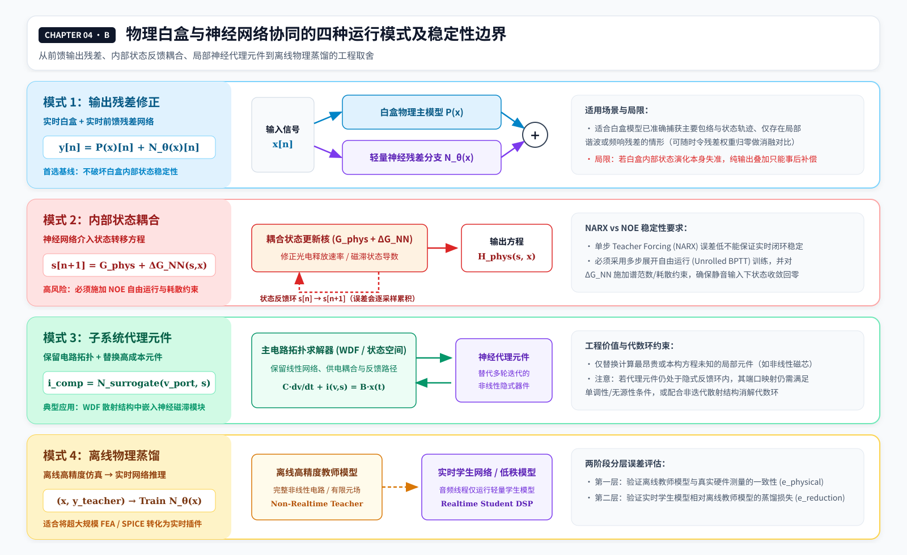

# 03 混合建模、训练边界与实时约简

> **版本：v6 · 2026-11-13 · Laguerre 公式排版及全书符号一致性修订版**
> **所属系列：Volterra Wiki**
> **阅读定位：** 承接《02》的训练比较，讨论如何决定 Volterra 核与长期状态的职责，怎样引入白盒、唯象与神经网络，如何进行实时约简，并用 SKY SA-1A 与 Revenger 2A 两个商业项目检验这些思考。
> **证据约定：** 数学推导是本章的候选研究框架，商业实现情况以可核查的公开材料为准；厂商宣传、用户评价、黑盒测量与内部源码证据不属于相同证据等级。

## 3.1 混合建模的核心任务：确立多模型职责分工与表达边界

上一章已经说明，同样的输入输出数据可以用 Volterra、WaveNet 或 LSTM 进行辨识。现在假设我们知道目标设备的电路结构、光电元件行为，或者某一部分具有明确的磁滞和慢速恢复机制。此时继续要求单一模型学习全部行为，未必最准确，也未必最经济。

但将四种模型全部放进一个插件，同样不是必然更好的方案。如果 Volterra 与神经网络都在拟合电子管饱和，唯象磁滞状态与另一套循环网络又同时解释相同的慢速变化，虽然训练误差可能进一步降低，我们却很难知道哪个分支承担了真正泛化的规律。更严重的是，两个分支可能在训练集内互相抵消，而在新的输入历史下共同偏离。

因此，本章的核心原则是：**先确认目标系统表现出哪些可观察行为，再用最少、最有依据的结构承担这些行为；复杂性必须通过独立验证获得存在的理由。**

我们至少需要同时回答：要模拟哪些电平、频段、旋钮与工作点；哪些现象需要历史；哪些属于真正的内部状态；哪些是随机事件；允许多少延迟与 CPU；是否需要跨采样率和跨硬件个体泛化。只有回答这些问题，核约简、神经网络或电路求解才具有可判断的目标。


## 3.2 训练 Volterra 之前，究竟要划定哪些边界？

离散有限记忆 Volterra 的一个形式为：

```math
\hat y[n]=h_0+\sum_{p=1}^{P}\sum_{k_1,\ldots,k_p=0}^{M_p-1}h_p(k_1,\ldots,k_p)\prod_{j=1}^{p}x[n-k_j].
```

这里 $`P`$ 是截断阶数，$`M_p`$ 可以随阶次变化。不同阶次使用不同历史长度，是非常实际的工程选择：线性响应可能需要较长记忆，而高阶交叉项只需要在更短的时间内被保留。

在对称核的独立系数表示下，第 $`p`$ 阶数量为

```math
N_p=\binom{M_p+p-1}{p}.
```

例如在 $`M=64`$ 时，三阶就有 45,760 个独立系数；当 $`M=256`$ 时达到 2,829,056 个。在 48 kHz 下，64 点约 1.33 ms，256 点约 5.33 ms，2048 点约 42.67 ms，一秒为 48,000 点。完整高阶核若强行扩展到数秒，参数和计算量都可能迅速失去实际意义。

因此，记忆范围不能只靠“256 点通常够用”这样的经验选择。我们至少应分别测量三类历史：小信号滤波与振铃的**线性记忆**；不同采样位置共同参与非线性失真的**交叉记忆**；以及压缩释放、磁化、供电恢复等**内部状态记忆**。前两者可以通过脉冲、扫频、不同幅度的双脉冲及多音测量辨识；第三者更需要让设备经历不同历史，再在相同当前输入下比较探针响应。

核记忆长度无需随系统历史跨度无限制扩展。当超出短时 Volterra 窗口的历史信号仍显著影响当前输出时，优先引入低维内部状态变量来表征慢变过程，从而避免将高阶核直接扩展至秒级尺度。

## 3.3 从对角到交叉：增加哪些核项才有意义？

对角 Volterra 或 Memory Polynomial 保留相同延迟位置上的幂函数项，例如 $`\sum_k h_2(k,k)x^2[n-k]`$。它能以较低成本表达一些频率依赖饱和，却无法独立调节所有非对角交叉。二阶一般的 $`x[n-k_1]x[n-k_2]`$，在 $`k_1\ne k_2`$ 时反映不同历史位置的共同作用；三阶的 $`x^2[n-k_1]x[n-k_2]`$ 又提供了另一种交叉方式。

在我们的研究平台中，可以按以下顺序增加复杂性：

| 实验分级 | 候选结构 | 需要回答的问题 |
| --- | --- | --- |
| V0 | 线性核、静态非线性、简化 Hammerstein | 最低复杂度能解释多少？ |
| V1 | 对角 Volterra / Memory Polynomial | 是否需要幅度相关的有限记忆？ |
| V2 | Near-Diagonal / Banded / GMP 类局部交叉项 | 相邻历史采样点是否需要共同作用？ |
| V2-L（横向分支） | Laguerre–Volterra / Kautz 正交时间基 | 较长衰减记忆能否由少量滤波器响应表示？ |
| V3 | 稀疏的远距离非对角项 | 是否存在局部带状结构无法解释的交叉？ |
| V4 | CP、Tucker、TT 等低秩核 | 能否以更少系数表达丰富的耦合？ |
| V5 | 状态条件化核与其他混合形式 | 核是否确实需要随慢速物理状态改变？ |

V0—V5 为本研究平台内部用于梳理模型复杂度的实验分级体系。对于低秩二阶核，可以使用

```math
h_2(k_1,k_2)\approx\sum_{r=1}^{R}a_r(k_1)b_r(k_2),
```

于是二阶输出可由若干个滤波器输出的乘积生成，避免直接保存整个二维核。低秩、高阶稀疏与正交基各有不同的数学假设；不同硬件的交叉记忆分布各异：带状核适用于邻近延迟耦合，低秩分解则适用于可由少数滤波器乘积近似的非局部耦合。

建议最初使用 32/64/128/256 点记忆，3/5/7 阶以及秩 2/4/8/16 等候选网格，并逐步增加结构。这是搜索起点，不能事先宣称它们是任何硬件的最佳值。每次结构改变都必须比较独立测试误差、共线性、参数稳定性、CPU 和内存。ESR 下降但互调或历史泛化不改善，不足以证明新交叉项真正有价值。

### 3.3.1 Laguerre–Volterra：先压缩时间基底，再辨识交叉核

在 V0—V5 的结构选择中，Laguerre–Volterra Network（LVN）是一条**与对角、稀疏及低秩核可以组合的时间基底约简路径**。相邻延迟截断减少需要考虑的核坐标，低秩因子分解压缩高维核系数；Laguerre 展开先对输入历史做一组正交动态滤波，再对滤波后的少量特征构建高阶乘积。

令 $`\ell_j[k]`$ 为第 $`j`$ 个离散 Laguerre 基函数，定义

```math
u_j[n]=\sum_{k\ge 0}\ell_j[k]x[n-k],\qquad j=0,\ldots,K-1.
```

于是 $`p`$ 阶有限维展开可写成

```math
y_p[n]\approx\sum_{j_1,\ldots,j_p=0}^{K-1}
c_p(j_1,\ldots,j_p)\prod_{i=1}^{p}u_{j_i}[n].
```

若原始离散 FIR 核记忆长度是 $`M`$，未经对称处理的参数规模从 $`O(M^p)`$ 变为 $`O(K^p)`$；在 $`K\ll M`$ 时，有望大幅降低训练难度。它依赖所选基底能够充分表达目标历史响应，因此仍需对基底数、极点、阶数与实验误差进行联合选择。

以单一实极点 $`a\in(0,1)`$ 的一种规范化离散 Laguerre 滤波器组为例，其传递函数可写为

```math
L_j(z)=\frac{\sqrt{1-a^2}}{1-a z^{-1}}
\left(\frac{z^{-1}-a}{1-a z^{-1}}\right)^j.
```

$`a`$ 越接近 $`1`$，低阶滤波器通常越关注较长时间尺度；与此同时，所需阶数、有效历史、数值条件以及瞬态拟合仍需通过验证确定。单一极点系列适合以衰减记忆为主要特征的部分系统；涉及明显振荡共振时，可比较 Kautz 或不同极点的广义正交基。文献中还存在将 Laguerre 基进一步与主动态模态（PDM）和关联非线性函数组合的模型。[L1][L2]

对磁带机和光电压缩器，需要严格区分**衰减记忆的长 FIR 近似**与**独立演化的物理状态**。即使 Laguerre 滤波器能以极低维度描述较长的线性衰减，具备永久剩磁、次回线或复杂程序依赖的系统依然可能需要 Play、Preisach、光电状态等显式机制。两类结构可以共享状态或形成混合模型，而无须相互替代。验证应加入不同预处理历史下的相同探针，检验模型能否区别历史路径。


## 3.4 为什么“测出高次谐波”仍不能决定 Volterra 阶数？

我们在《01》及末章《06》的技术史中区分过谐波阶次、Volterra 截断阶数和完整高维核。一个指数正弦扫频能帮助分析不同频率下的高次失真，但从谐波响应恢复对角或广义 Hammerstein 分支，与辨识完整非对角核不是同一个任务。

观察到第九次谐波，不意味着设备内部一定具有可直接识别的九阶 Volterra 核。级联非线性、反馈、时变增益和其他动态系统也能产生复杂的谐波谱。反过来，二阶或三阶非对角核所表达的互调与交叉记忆，未必能通过单一正弦的 THD 显示出来。

因此，核结构选择应由多电平、双音、多音、历史配对与残差诊断共同驱动，结合高次谐波与动态互调表现综合确定阶次与记忆结构。

## 3.5 白盒物理建模的精度瓶颈与元件参数依赖

拥有电子管放大器或光电压缩器的原理图，只意味着知道了部分电路连接关系。实际变压器的 B-H 曲线、漏感与寄生参数，电子管的个体差异，光敏元件的历史响应，以及电源与温度状态，都可能在原理图上不可辨识。即使计算资源无限充足，错误的元件本构关系也会产生错误的输出。

一个经过离散化的非线性电路系统通常需要求解：

```math
F(z_n, z_{n-1}, x[n]) = 0.
```

如果使用 Newton-Raphson，需要在每个采样点或每个内部子步骤求解线性化方程，并关心迭代次数、Jacobian、初值和收敛性。计算成本不只是算术平均值，实时音频线程还要满足每个音频块的截止期限。

**必须区分运算优化与模型约简。** 利用电路拓扑中天然存在的 Jacobian 稀疏性，可能在保留同一数值方程的情况下避免无效计算；而低秩截断、模态截断、查找表替代、神经网络代理和其他模型降阶，通常都需要额外验证近似引入的误差。WDF、TPT/ZDF 等数值结构可以改善某些实现的稳定性或求解效率，但如果根本物理假设偏离了真实的寄生效应或热恢复，数值结构的优势并不能弥补建模误差。

**有限元与离线降阶。** 对振膜、共振板或磁场这样具有大量空间自由度的系统，可以先离线用有限元求解高维物理模型，再针对线性化动力学 $`M\ddot q+C\dot q+Kq=f`$ 使用 $`q\approx\Phi_r a`$ 进行模态降阶。此处减少的是物理状态维度，和低秩 Volterra 压缩高维输入输出核不同；强非线性耦合、碰撞及磁滞应重新检查截断误差。高精度离线模型也可以做神经网络训练教师，但教师若未经过硬件标定，蒸馏得再好也只能逼近一个未经验证的物理模拟器。

## 3.6 如果白盒不够准确，纯神经网络是唯一的路吗？

神经网络在固定输入输出对下具有很强的拟合能力，但它也存在自身的局限：

1. **结构不可解释**：很难从权重中直接提取出哪一部分对应变压器饱和，哪一部分对应电容充放电；
2. **极端条件易发散或泛化失败**：在未训练过的极高电平或直流偏移下，输出可能出现无法预测的性状；
3. **参数开销与控制困难**：引入连续旋钮控制时，通常需要额外的条件网络或插值机制，增加了训练和调优的复杂度。

因此，灰盒建模与混合架构成为了连接物理先验与数据驱动的桥梁。

## 3.7 唯象建模与显式状态变量

唯象建模（Phenomenological Modeling）旨在依据可观测的物理现象建立低维有效的宏观演化规律，无需从微观材料或电磁场方程逐层推导。

如果在测量中发现设备存在慢速恢复、依赖前导电平的包络响应或非对称磁滞，建立一个显式状态变量 $`s[n]`$ 往往比扩展高维 Volterra 核更有效：

```math
s[n+1] = f(s[n], x[n]; \theta_s),
```

```math
y[n] = g(x[n], s[n]; \theta_y).
```

该结构的核心价值在于利用显式低维状态专门承担慢速宏观动态，将数秒尺度的历史演化与短时高阶 Volterra 核及局部神经网络解耦。

## 3.8 混合架构的抗混叠与多速率边界：ADAA、过采样和状态对齐

混合系统可能同时拥有静态 Waveshaper、Volterra 交叉乘积、递归状态和神经网络残差。频谱扩展来自非线性运算，离散系统若没有充分抑制 Nyquist 频率以上折回的分量，训练误差和听感都会受到混叠影响。不同模块具有不同的抗混叠条件，尤其应当保留训练参考与实时推理链路之间的采样率一致性。

| 运算部分 | 候选实时策略 | 必须验证的边界 |
| --- | --- | --- |
| 线性滤波、稳定慢速状态 | 基带率更新；经过验证后可采用低速率状态计算和插值 | 多速率接口的时序、瞬态、带宽和状态轨迹 |
| 可积分的无记忆静态非线性 | ADAA1 / ADAA2，或合适的过采样 | 反导函数实现、数值差分稳定性、强失真时的残余混叠 |
| 有记忆 Volterra、交叉乘积与反馈非线性 | 对相关音频路径进行过采样，再用合适的重采样滤波器回到基带 | 高频互调、分支间同步、级联反馈和运算顺序 |
| 神经网络或神经残差 | 使用匹配训练采样率的推理模型；必要时在统一的过采样域训练与执行 | 感受野对应的真实时间、训练/推理域差异、内部状态与相位 |
| 混合输出及动态门控 | 先校准时延与增益，再合成或交叉渐变 | 时变门控边带、并行抵消、音频块边界不连续 |

**ADAA 的适用条件首先取决于非线性结构。** 对于满足相应正则性与反导函数计算条件的静态映射，可以通过一阶、二阶反微分形式减少离散失真生成时的混叠。高阶交叉记忆、具有内部隐式反馈的元件及任意神经网络，通常难以直接套用同一套无记忆 ADAA 公式。在这些部分中，需要通过专用结构推导、过采样或经过验证的近似方法处理高频产物。

**过采样倍数由验证确定。** 例如测试 1×、2×、4×、8×，要求使用相同的输入物理时间与工作电平；对于非线性乘积相互作用且需共同合成的分支，可考虑放在统一的高采样率域，并使用明确的延迟补偿。另一种方案是只为昂贵的高频生成子系统过采样，在边界进行带限重采样。不存在所有分支都必须固定使用同一倍数的通用规则；关键在于接口准确、状态定义一致及计算预算可控。

对于 NAM A2 等有限感受野卷积网络，采样率变化同时改变“采样点数量对应的物理时间”。训练在 48 kHz，部署到更高内部速率时，需要明确模型是否自行重采样、是否使用与参考一致的输入带宽，以及延迟对齐后的输出误差。简单把既有权重在不同采样率下直接运行，不能保证维持原有系统辨识特性。

建议以相同测试信号比较输出频谱中的带外折叠、原本真实谐波、瞬态相位和总延迟，并对所有评估输出统一到同一采样率后再计算差异。高过采样率本身并不保证零混叠；有限重采样滤波器、复杂动态乘积及状态更新方式仍需独立测量。

## 3.9 白盒、Volterra、神经网络与唯象状态协同的四种模式

结合前述讨论，混合架构主要归纳为以下四种运行模式：

| 模式名称 | 核心结构 | 适合解决的问题 |
| --- | --- | --- |
| 模式 1：并行残差 | 低阶 Volterra / 白盒 + 神经残差 | 主干非线性已知，补充未知高阶失真 |
| 模式 2：状态耦合 | 显式物理状态方程 + 网络状态增量 | 包络跟踪、热漂移、光电电容慢速演化 |
| 模式 3：串行级联 | 线性/弱非线性前级 + 神经代理 + 状态调制 | 具有明确多级物理结构的硬件 |
| 模式 4：子系统代理 | 电路求解器 + 复杂非线性元件神经代理 | 整体电路拓扑确定，仅局部求解极昂贵 |

### 3.9.1 NARX、NOE 与长期自由运行稳定性

首先应区别**模型结构**与**训练方式**。在 NARX（Nonlinear AutoRegressive with eXogenous inputs）中，过去的输出及外部输入可以作为回归变量。使用测量到的真实输出构造训练回归量，通常称为 Teacher Forcing 或一步预测；在仿真时使用模型过去预测的输出作为回归量，称为 Free-Run 或闭环仿真。NOE（Nonlinear Output-Error）辨识常直接以模型自由运行的输出误差作为优化对象，因此与依赖实测输出的单步回归目标具有不同的误差传播性质。[R1]

对于神经网络直接修正状态转移的模型：

```math
s[n+1]=G_{\rm phys}(s[n],x[n])+\Delta G_{\rm NN}(s[n],x[n]),
```

训练时一步误差较小，仍可能在长时间自由运行中逐渐偏离参考系统。建议以若干秒到数分钟的完整序列，比较一步预测、固定历史窗口预测和完全自由运行三种评价。训练可引入长序列展开的 BPTT、适当的截断策略、状态扰动、不同初始化及多起点历史轨迹，实际训练长度与系统释放时间或磁滞特性对应。

稳定性约束可以从状态映射的 Lipschitz 常数、Jacobian、耗散和有界性入手。例如在具有正不变性的规定状态域 $`\mathcal D`$ 中，如果

```math
\sup_{s\in\mathcal D}\left\|\frac{\partial G_{\rm total}(s,x)}{\partial s}\right\|_2
\le q_c<1
```

对允许的输入成立，则在相应条件下，这种一致收缩有助于保证相同输入驱动的状态轨迹逐渐靠近。这是一种**偏强的充分条件**，不属于所有稳定系统的必要条件。特别是速率无关磁滞及持续剩磁，本来就可能允许同一外部输入对应不同历史状态；机械要求全局收缩会抹去我们打算保留的物理记忆。对此可改用状态约束、能量或耗散不等式、局部稳定性与物理回线保真度等适当准则。[R2]

部署测试应覆盖直流偏置、满幅及更高驱动、长时间静音恢复、突发瞬态、参数自动化、不同初始状态和音频线程暂停/恢复，并记录是否产生 NaN、状态越界、持续自激和长时误差漂移。对于递归灰盒，这些测试与一般的 ESR 具有同等重要性。


子系统代理若直接接入电路亦无法自动获得实时性能：如果被替换的元件仍在反馈回路中，求解器和网络之间可能依然存在代数环。

上述四种架构共同构成研究平台的候选运行模式，具体工程实现需依据被测设备的物理复杂度与算力预算按需选用。

**输出残差、运行门控与训练权重必须区分。** 可以先训练结构化 Volterra 或白盒模型 $`y_V`$，冻结后让网络学习 $`e_V=y_{\rm ref}-y_V`$，构造 $`\hat y=y_V+\alpha(s)\Delta N_\theta(x,s)`$。其中 $`\alpha`$ 控制实时分支贡献，不是训练优化器学习率；训练参数、运行时的模型贡献与模式切换渐变是三个概念。门控可按 $`\alpha[n]=\alpha[n-1]+\gamma(\alpha_{\rm target}[n]-\alpha[n-1])`$ 平滑，但仍需检查调制边带。独立训练网络间的逐参数插值也未必平滑，应考虑延迟对齐、同时维护递归状态，再在输出端渐变。

**离线物理教师与实时网络学生。** 除表中的四种实时拓扑，还可以只在研发阶段运行复杂电路、有限元或磁滞求解器，让轻量网络在插件中独立运行。这种部署属于教师—学生蒸馏；实时音频处理链仅运行学生网络；应分别验证硬件到教师、教师到学生的两段误差。



## 3.10 案例剖析 A：Acustica Audio SKY SA-1A 的“状态依赖失真”假设

Acustica Audio 在其 SKY SA-1A（Stam Audio SA-1A 真空管光电压缩器官方授权插件）的讨论中，强调了压缩状态与谐波特征的耦合；以下公式为根据这一公开描述构造的状态条件化建模示例。

式中以内部状态 $`s[n]`$ 调制核系数，适合用来讨论不同压缩历史下的非线性响应。它是研究者可以测试的数学候选形式。

```math
y[n] = \sum_k h_1(k; s[n]) x[n-k] + \sum_{k_1, k_2} h_2(k_1, k_2; s[n]) x[n-k_1] x[n-k_2],
```

其中内部状态 $`s[n]`$ 遵循慢速光电控制方程：

```math
s[n] = (1 - \gamma) s[n-1] + \gamma \cdot g(|x[n]|).
```

## 3.11 案例剖析 B：SevenTeamMusic Revenger 2A 的双模式与混合定位

SevenTeamMusic 在 Revenger 2A 官方页面中，将产品描述为基于 LA-2A 原始电路结构、结合神经网络修正的混合压缩器，区分 Classic 纯电路与 Unit A 混合模式，并讨论 T4 光电单元、电子管、变压器磁历史和供电的动态建模。[C3] 它和 SKY 的原型属于不同实体硬件，无法仅凭主观听感判定具体架构的建模精度。

## 3.12 动态增益调制引发谐波与互调失真的解析机制

考虑无滤波的理想压控增益单元，控制信号为 $`g(t)`$，输入信号为正弦波 $`x(t) = A \sin(\omega_0 t)`$。为突出增益调制的数学机制，暂以一个能够保留二倍频变化的控制路径为例：

```math
g(t) = g_0 + \eta \cdot x^2(t),
```

则输出信号为：

```math
\begin{aligned}
y(t)&=g(t)x(t)\\
&=\bigl(g_0+\eta A^2\sin^2(\omega_0 t)\bigr)A\sin(\omega_0 t)\\
&=\left(g_0+\frac{3}{4}\eta A^2\right)A\sin(\omega_0 t)
-\frac{1}{4}\eta A^3\sin(3\omega_0 t).
\end{aligned}
```

由三角恒等式可见，随输入变化的增益因子能够生成三次谐波。真实的慢速检波器会对二倍频成分施加频率相关的衰减，因此实际谐波强度取决于检波与控制路径的带宽、时间常数及非线性器件参数。双音互调也需要结合时变增益基线进行归因。

## 3.13 SignalTrain 独立基准与硬件数据局限

利用 SignalTrain LA-2A 公开数据集（https://zenodo.org/records/3824876）进行模型训练与测试时，需明确数据集本身的边界条件。切忌仅因一段公开录音来自真实 LA-2A，就把它训练的模型称为适用于所有 LA-2A 个体的精确复制品。

## 3.14 黑盒系统辨识的可操作测试协议（Test Bench）

研究平台应当提供同一套激励生成、参考记录、状态初始化、对齐、指标计算和报告导出流程。测试既用于比较 NAM、Volterra 与白盒模型的预测精度，也用于判断“单一 GR 状态足够”“系统具有路径依赖磁滞”“交叉互调来自特定核项”等假说是否成立。每一项实验同时记录原始 WAV、处理器或硬件版本、设置、输入输出电平与采样率、延迟补偿、随机种子和数据划分，确保复测具有相同条件。

| 测试组 | 激励与操作 | 核心观测 | 主要用来检验 |
| --- | --- | --- | --- |
| T1 双稳态／预磁化 | 采用正向和反向大幅预处理，经过规定静音间隔后输入完全相同的小探针；逐步改变预处理幅度并绘制次回线 | 当前输出差值、迟滞回线面积、残余状态及恢复时间 | 路径依赖、状态重置与剩磁假说 |
| T2 等瞬时 GR／异历史 | 使用短强瞬态、长时中等电平等不同历史，调整预处理强度，使探针到来时可观察 GR 和输入幅度尽量接近 | 探针传递函数、频率响应、谐波、包络恢复 | 单个 GR 标量能否描述全部压缩状态 |
| T3 双音与调幅边带 | 低频驱动叠加弱高频探针、双音/多音及不同调制频率；另外运行仅有时变增益的参考算法 | 和差频、边带幅相、阶次与调制频率相关性 | 区分普通增益调制与额外频率混合 |
| T4 动态与静态失真分离 | 恒定驱动与幅度包络变化交替，记录相同平均电平下不同 Attack/Release 历史 | 动态 THD/IMD、输出延迟及程序依赖 | 验证动态失真与状态耦合 |
| T5 多速率与抗混叠 | 固定物理频率与电平，分别在 1×/2×/4×/8× 计算，输出带限重采样到统一基准 | 折叠频率、原谐波、瞬态相位、CPU 与延迟 | ADAA、过采样与分支对齐的有效性 |
| T6 长时间 Free-Run | 从多种初始状态运行长序列、静音恢复、阶跃、直流偏置与参数快速变化 | 状态范围、长期误差、数值异常、峰值 CPU | 闭环预测稳定与实际部署可靠性 |

### 3.14.1 统一采集与误差评价

测试开始前，固定参考硬件的预热与工作点；对于数字插件，声明离线/实时渲染、OS 档位和自动化设置。使用脉冲或专用同步标记确定固定延迟，并用合适方法检查时钟漂移。所有参考和预测均按同一物理时间轴对齐，评估时同时保留未补偿的延迟信息与补偿后的波形误差。

建议同时报告 ESR、MAE、不同频率的谐波与互调谱、瞬态包络偏差、长历史探针差值、计算成本与主观听感。其中 ESR 等整体指标可用于选择模型，针对历史的假说则必须依赖专门实验。随机噪声应在重复采集中比较统计特性，避免要求确定性模型逐样本复现不同随机实现。

### 3.14.2 判读规则与对照基线

T1 观察到不同预磁化历史的持续差异，可以支持系统存在可观察路径依赖，但还需要排除电源漂移、随机扰动和未归零的其他状态；不同历史产生相同当前 GR 而输出仍不同，说明单标量 GR 模型存在信息不足。T3 的边带必须与纯时变增益参考进行对照，才能进一步识别需要额外非线性结构解释的残差。类似地，某个模型在 T5 的折叠频率下降，并不单独证明原谐波与听感也更准确。

平台应保留静态 Waveshaper、LTI、简化压缩器、对角 Volterra、低秩／Laguerre-Volterra、NAM WaveNet/LSTM、显式灰盒与混合残差模型作为统一基线，记录每项新结构在相同数据、测试和 CPU 预算下的增量收益。模型升级遵循**独立基线 → 记忆尺度与核结构选择 → 状态辨识 → 残差网络 → 联合优化 → 实时约简**的顺序。输出报告至少应包含实验条件表、关键波形或频谱、模型版本与可以重跑的配置记录。

### 3.14.3 由参数不确定性驱动的下一轮测量

当已有模型在某一类激励下保持较高残差，首先需要分析其对应的参数敏感性。对于固定核 Volterra，可以检查设计矩阵的奇异值、核系数置信区间和高阶特征之间的相关性；对于物理灰盒，可以通过有限差分或自动微分计算输出对未知参数的局部 Jacobian。若模型具有可用的测量噪声分布，可进一步构造 Fisher 信息矩阵并设计有较强辨识能力的输入。

研究平台可按“训练当前模型 → 找到误差与不确定性高的工作区域 → 设计新激励 → 重新测量 → 独立验证”的顺序迭代。对于光电状态和磁滞，应特别保留输入历史路径作为设计变量。信息量较大的激励需要同时满足真实设备电平、频段和安全驱动限制。详见《04 高级系统辨识》第 4.14—4.16 节。

## 3.15 模型分工与本书的研究范围

经过这一系列讨论，Volterra 作为可分析的结构化非线性模块，主要描述有限历史内的阶次贡献与交叉作用。电路求解承担已知物理结构，唯象或状态空间模型描述长期记忆，神经网络则可处理难以由当前解析模型准确表示的残差。对磁性器件，频率相关饱和与严格路径依赖磁滞需要通过不同实验分别识别。需要更长时间尺度时，可以把状态交给物理或唯象模型；遇到难以用紧凑公式解释的剩余行为，再尝试神经网络。

同样，白盒模型并非复杂度越高就越逼真，原理图、元件方程、数值离散化与实时计算之间存在多个不同的误差来源。神经网络与唯象模型各具表达边界，不同表示之间的职责分工应由实验数据与计算预算客观决定。

因此，本章的最终结论在于建立一套能回答“为什么需要这部分计算、它究竟改善了什么、付出了何种代价”的混合系统辨识框架。做到这一点之后，才能确保 Volterra、NAM、白盒与唯象建模高效协作、优势互补。

---

## 本章资料与证据边界

**理论、论文与开源项目（优先提供 DOI、原文页或源码）：**

- [L1] Campello、do Amaral 与 Favier (2006)，*A note on the optimal expansion of Volterra models using Laguerre functions*，*Automatica* 42(4)，689–693，[DOI:10.1016/j.automatica.2005.12.003](https://doi.org/10.1016/j.automatica.2005.12.003)。用于讨论 Laguerre 正交基的核展开与极点选择。
- [L2] *Methodology of Recurrent Laguerre–Volterra Network for Modeling Nonlinear Dynamic Systems*，[开放全文](https://pmc.ncbi.nlm.nih.gov/articles/PMC5596897/)。用于理解 Laguerre 基、PDM 和递归变体的关系。
- [R1] Oliver Nelles (2020)，*Nonlinear System Identification: From Classical Approaches to Neural Networks, Fuzzy Models, and Gaussian Processes*，Springer，[DOI:10.1007/978-3-030-47439-3](https://doi.org/10.1007/978-3-030-47439-3)。辨识结构、NARX/NOE、模型选择与泛化的系统参考。
- [R2] Giorgio Bertotti (1998)，*Hysteresis in Magnetism*，Academic Press，[DOI:10.1016/B978-0-12-093270-2.X5048-X](https://doi.org/10.1016/B978-0-12-093270-2.X5048-X)。磁滞历史、速率效应与唯象模型。
- [R3] Bernardini、Bozzo、Fontana 与 Sarti (2021)，*A Wave Digital Newton–Raphson Method for Virtual Analog Modeling of Audio Circuits with Multiple One-Port Nonlinearities*，[DOI:10.1109/TASLP.2021.3084337](https://doi.org/10.1109/TASLP.2021.3084337)。非线性 WDF 与 Newton 求解器的收敛条件。
- [R4] Ducceschi 与 Bilbao (2022)，*Non-Iterative Simulation Methods for Virtual Analog Modelling*，[DOI:10.1109/TASLP.2022.3209934](https://doi.org/10.1109/TASLP.2022.3209934)。非迭代虚拟模拟数值求解的另一条路线。
- [R5] Yu 与 Fazekas (2025)，*Sound Matching an Analogue Levelling Amplifier Using the Newton–Raphson Method*，[arXiv:2509.10706](https://arxiv.org/abs/2509.10706)，[4A-2A GitHub](https://github.com/aim-qmul/4a2a)。以少量参数可微分压缩器拟合 LA-2A 的灰盒对照。
- [R6] [NAM 官方 C++ 核心](https://github.com/sdatkinson/NeuralAmpModelerCore)；[NAM 官方训练器](https://github.com/sdatkinson/neural-amp-modeler)；[TONE3000 A2 技术评测](https://www.tone3000.com/guides/nam-a2-the-complete-guide)。A2 性能数值来源于项目方测试，引用时同时保留测试条件与样本范围。

**关于商业项目：**

- [C1] [Acustica Audio SKY SA-1A 官方产品页](https://www.acustica-audio.com/shop/products/SKYSA1A) : 产品定位和官方混合建模描述。
- [C2] [Gearspace SKY SA-1A 官方讨论帖](https://gearspace.com/threads/acustica-audio-sky-sa-1a-official-stam-audio-tube-opto-compressor-plug-in.1471233/) : 特别留意技术人员 zaphod 的 #11、#13 发言；开发者说明仅供技术参考，不代表可执行源码证据。
- [C3] [SevenTeamMusic Revenger 2A 产品介绍](https://www.seventeammusic.com/plugins/revenger-2a) : 白盒、光电状态、网络校正及发布方测试说明；未由本 Wiki 独立复测。

- [C4] [SignalTrain LA-2A Dataset 1.1](https://zenodo.org/records/3824876)：使用公开 LA-2A 数据前仍须核对版本、许可、时间对齐和测试集划分。

本章的混合模型公式与示意图是候选研究架构，不代表商业产品的已证实内部 DSP 路径。
