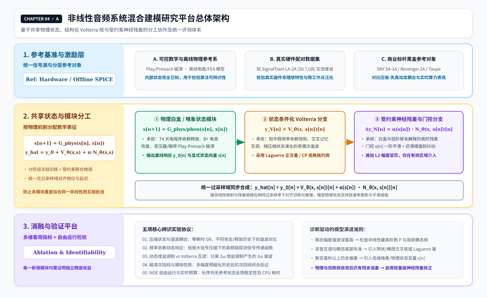
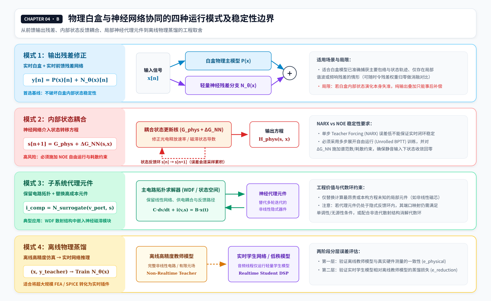

# 04 混合建模：从 Volterra 结构选择、物理状态到商业音频案例

> **版本：v2 · 2026-11-13 · 合并原 04 与 05**  
> **所属系列：Volterra Wiki**  
> **阅读定位：**承接《03》的训练比较，讨论如何决定 Volterra 核与长期状态的职责，怎样引入白盒、唯象与神经网络，如何进行实时约简，并用 SKY SA-1A 与 Revenger 2A 两个商业项目检验这些思考。  
> **证据约定：**数学推导是本章的候选研究框架，商业实现情况以可核查的公开材料为准；厂商宣称、用户评价、黑盒测量与内部源码证据不属于相同证据等级。

## 4.1 我们真正需要解决的是模型分工，而不是模型种类
# 04 混合建模、训练边界与实时约简

> **版本：v2 · 2026-11-13 · 合并原 04 与 05**
> **所属系列：Volterra Wiki**
> **阅读定位：** 承接《03》的训练比较，讨论如何决定 Volterra 核与长期状态的职责，怎样引入白盒、唯象与神经网络，如何进行实时约简，并用 SKY SA-1A 与 Revenger 2A 两个商业项目检验这些思考。
> **证据约定：** 数学推导是本章的候选研究框架，商业实现情况以可核查的公开材料为准；厂商宣传、用户评价、黑盒测量与内部源码证据不属于相同证据等级。

## 4.1 混合建模的核心任务：确立多模型职责分工与表达边界

上一章已经说明，同样的输入输出数据可以用 Volterra、WaveNet 或 LSTM 进行辨识。现在假设我们知道目标设备的电路结构、光电元件行为，或者某一部分具有明确的磁滞和慢速恢复机制。此时继续要求单一模型学习全部行为，未必最准确，也未必最经济。

但将四种模型全部放进一个插件，同样不是必然更好的方案。如果 Volterra 与神经网络都在拟合电子管饱和，唯象磁滞状态与另一套循环网络又同时解释相同的慢速变化，虽然训练误差可能进一步降低，我们却很难知道哪个分支承担了真正泛化的规律。更严重的是，两个分支可能在训练集内互相抵消，而在新的输入历史下共同偏离。

因此，本章的核心原则是：**先确认目标系统表现出哪些可观察行为，再用最少、最有依据的结构承担这些行为；复杂性必须通过独立验证获得存在的理由。**

我们至少需要同时回答：要模拟哪些电平、频段、旋钮与工作点；哪些现象需要历史；哪些属于真正的内部状态；哪些是随机事件；允许多少延迟与 CPU；是否需要跨采样率和跨硬件个体泛化。只有回答这些问题，核约简、神经网络或电路求解才具有可判断的目标。

## 4.2 训练 Volterra 之前，究竟要划定哪些边界？

离散有限记忆 Volterra 的一个形式为：

$$
\hat y[n]=h_0+\sum_{p=1}^{P}\sum_{k_1,\ldots,k_p=0}^{M_p-1}h_p(k_1,\ldots,k_p)\prod_{j=1}^{p}x[n-k_j].
$$

这里 $P$ 是截断阶数，$M_p$ 可以随阶次变化。不同阶次使用不同历史长度，是非常实际的工程选择：线性响应可能需要较长记忆，而高阶交叉项只需要在更短的时间内被保留。

在对称核的独立系数表示下，第 $p$ 阶数量为

$$
N_p=\binom{M_p+p-1}{p}.
$$

例如在 $M=64$ 时，三阶就有 45,760 个独立系数；当 $M=256$ 时达到 2,829,056 个。在 48 kHz 下，64 点约 1.33 ms，256 点约 5.33 ms，2048 点约 42.67 ms，一秒为 48,000 点。完整高阶核若强行扩展到数秒，参数和计算量都可能迅速失去实际意义。

因此，记忆范围不能只靠“256 点通常够用”这样的经验选择。我们至少应分别测量三类历史：小信号滤波与振铃的**线性记忆**；不同采样位置共同参与非线性失真的**交叉记忆**；以及压缩释放、磁化、供电恢复等**内部状态记忆**。前两者可以通过脉冲、扫频、不同幅度的双脉冲及多音测量辨识；第三者更需要让设备经历不同历史，再在相同当前输入下比较探针响应。

核记忆长度无需随系统历史跨度无限制扩展。当超出短时 Volterra 窗口的历史信号仍显著影响当前输出时，优先引入低维内部状态变量来表征慢变过程，从而避免将高阶核直接扩展至秒级尺度。

## 4.3 从对角到交叉：增加哪些核项才有意义？

对角 Volterra 或 Memory Polynomial 保留相同延迟位置上的幂函数项，例如 $\sum_k h_2(k,k)x^2[n-k]$。它能以较低成本表达一些频率依托饱和，却无法独立调节所有非对角交叉。二阶一般的 $x[n-k_1]x[n-k_2]$，在 $k_1\ne k_2$ 时反映不同历史位置的共同作用；三阶的 $x^2[n-k_1]x[n-k_2]$ 又提供了另一种交叉方式。

在我们的研究平台中，可以按以下顺序增加复杂性：

| 实验分级 | 候选结构 | 需要回答的问题 |
| --- | --- | --- |
| V0 | 线性核、静态非线性、简化 Hammerstein | 最低复杂度能解释多少？ |
| V1 | 对角 Volterra / Memory Polynomial | 是否需要幅度相关的有限记忆？ |
| V2 | Near-Diagonal / Banded / GMP 类局部交叉项 | 相邻历史采样点是否需要共同作用？ |
| V3 | 稀疏的远距离非对角项 | 是否存在局部带状结构无法解释的交叉？ |
| V4 | CP、Tucker、TT 等低秩核 | 能否以更少系数表达丰富的耦合？ |
| V5 | 状态条件化核与其他混合形式 | 核是否确实需要随慢速物理状态改变？ |

V0—V5 为本研究平台内部用于梳理模型复杂度的实验分级体系。对于低秩二阶核，可以使用

$$
h_2(k_1,k_2)\approx\sum_{r=1}^{R}a_r(k_1)b_r(k_2),
$$

于是二阶输出可由若干个滤波器输出的乘积生成，避免直接保存整个二维核。低秩、高阶稀疏与正交基各有不同的数学假设；不同硬件的交叉记忆分布各异：带状核适用于邻近延迟耦合，低秩分解则适用于可由少数滤波器乘积近似的非局部耦合。

建议最初使用 32/64/128/256 点记忆，3/5/7 阶以及秩 2/4/8/16 等候选网格，并逐步增加结构。这是搜索起点，不能事先宣称它们是任何硬件的最佳值。每次结构改变都必须比较独立测试误差、共线性、参数稳定性、CPU 和内存。ESR 下降但互调或历史泛化不改善，不足以证明新交叉项真正有价值。

此外，对于平滑的指数衰减记忆系统，还可引入 Laguerre-Volterra 正交基约简（LVN）方法。通过极点参数 $\alpha \in (0,1)$ 构建离散 Laguerre 正交滤波器组 $L_k(z) = \frac{\sqrt{1-\alpha^2}}{1-\alpha z^{-1}}\left(\frac{z^{-1}-\alpha}{1-\alpha z^{-1}}\right)^k$，将核展开从 FIR 基底投影至低维正交基空间，从而将参数复杂度从 $O(M^p)$ 显著降至 $O(K^p)$（其中 $K \ll M$）。该方法能够有效覆盖几十毫秒的指数衰减记忆，但需注意其适用于线性衰减动力学，与涉及路径依赖的物理磁滞状态存在本质区别。

## 4.4 为什么“测出高次谐波”仍不能决定 Volterra 阶数？

我们在《01》《02》中区分过波阶次、Volterra 截断阶数和完整高维核。一个指数正弦扫频能帮助分析不同频率下的高次失真，但从谐波响应恢复对角或广义 Hammerstein 分支，与辨识完整非对角核不是同一个任务。

观察到第九次谐波，不意味着设备内部一定具有可直接识别的九阶 Volterra 核。级联非线性、反馈、时变增益和其他动态系统也能产生复杂的谐波谱。反过来，二阶或三阶非对角核所表达的互调与交叉记忆，未必能通过单一正弦的 THD 显示出来。

因此，核结构选择应由多电平、双音、多音、历史配对与残差诊断共同驱动，结合高次谐波与动态互调表现综合确定阶次与记忆结构。

## 4.5 白盒物理建模的精度瓶颈与元件参数依赖

拥有电子管放大器或光电压缩器的原理图，只意味着知道了部分电路连接关系。实际变压器的 B-H 曲线、漏感与寄生参数，电子管的个体差异，光敏元件的历史响应，以及电源与温度状态，都可能在原理图上不可辨识。即使计算资源无限充足，错误的元件构型关系也会产生错误的输出。

一个经过离散化的非线性电路系统通常需要求解：

$$
F(z_n, z_{n-1}, x[n]) = 0.
$$

如果使用 Newton-Raphson，需要在每个采样点或每个内部子步骤求解线性化方程，并关心迭代次数、Jacobian、初值和收敛性。计算成本不只是算术平均值，实时音频线程还要满足每个音频块的截止期限。

**必须区分运算优化与模型约简。** 利用电路拓扑中天然存在的 Jacobian 稀疏性，可能在保留同一数值方程的情况下避免无效计算；而低秩截断、模态截断、查找表替代、神经网络代理和其他模型降阶，通常都需要额外验证近似引入的误差。WDF、TPT/ZDF 等数值结构可以改善某些实现的稳定性或求解效率，但如果根本物理假设偏离了真实的寄生效应或热恢复，数值结构的优势并不能弥补建模误差。

## 4.6 如果白盒不够准确，纯神经网络是唯一的路吗？

神经网络在固定输入输出对下具有很强的拟合能力，但它也存在自身的局限：

1. **结构不可解释**：很难从权重中直接提取出哪一部分对应变压器饱和，哪一部分对应电容充放电；
2. **极端条件易发散或泛化失败**：在未训练过的极高电平或直流偏移下，输出可能出现无法预测的性状；
3. **参数开销与控制困难**：引入连续旋钮控制时，通常需要额外的条件网络或插值机制，增加了训练和调优的复杂度。

因此，灰盒建模与混合架构成为了连接物理先验与数据驱动的桥梁。

## 4.7 唯象建模与显式状态变量

唯象建模（Phenomenological Modeling）旨在依据可观测的物理现象建立低维有效的宏观演化规律，无需从微观材料或电磁场方程逐层推导。

如果在测量中发现设备存在慢速恢复、依赖前导电平的包络响应或非对称磁滞，建立一个显式状态变量 $s[n]$ 往往比扩展高维 Volterra 核更有效：

$$
s[n+1] = f(s[n], x[n]; \theta_s),
$$

$$
y[n] = g(x[n], s[n]; \theta_y).
$$

该结构的核心价值在于利用显式低维状态专门承担慢速宏观动态，将数秒尺度的历史演化与短时高阶 Volterra 核及局部神经网络解耦。

## 4.8 混合架构中的抗混叠边界（ADAA 与过采样对齐）

在混合架构的音频实时处理中，必须严格确立抗混叠边界与多速率对齐机制（ADAA 与过采样对齐）。对于包含无记忆静态非线性的解析求解分支，可优先采用一阶或二阶反微分抗混叠算法（ADAA1/ADAA2）在基带率下直接抑制混叠失真；对于包含高阶有记忆交叉核与深度神经残差的分支，由于其频带扩展剧烈且难以解析求导，必须统一置于过采样域（如 4x/8x OS）中相位对齐运行；而对于慢速物理状态，则可采用低速率（如 Sub-sampling）更新计算，并通过一阶或高阶平滑插值接入音频率主路径，从而在消除混叠风险的同时最大化计算效率。

## 4.9 白盒、Volterra、神经网络与唯象状态协同的四种模式

结合前述讨论，混合架构主要归纳为以下四种运行模式：

| 模式名称 | 核心结构 | 适合解决的问题 |
| --- | --- | --- |
| 模式 1：并行残差 | 低阶 Volterra / 白盒 + 神经残差 | 主干非线性已知，补充未知高阶失真 |
| 模式 2：状态耦合 | 显式物理状态方程 + 网络状态增量 | 包络跟踪、热漂移、光电电容慢速演化 |
| 模式 3：串行级联 | 线性/弱非线性前级 + 神经代理 + 状态调制 | 具有明确多级物理结构的硬件 |
| 模式 4：子系统代理 | 电路求解器 + 复杂非线性元件神经代理 | 整体电路拓扑确定，仅局部求解极昂贵 |

在模式 2（状态修正/状态耦合）中，必须建立 NARX（Teacher Forcing）与 NOE（Free-Run）自由运行稳定性约束。由于单步 Teacher Forcing 训练未考量自由运行下的误差累积，微小的状态偏差可能在闭环反馈中被放大导致系统自激发散。工程上需满足三项要求：一是采用展开序列（BPTT）训练或注入状态噪声以模拟自由运行环境；二是在模型结构与损失函数中引入耗散性约束或 Jacobian 矩阵谱范数收缩约束（保证 $\Vert \frac{\partial s[n+1]}{\partial s[n]} \Vert < 1$）；三是在部署前通过 DC 偏移、大动态阶跃及极端幅度过驱动压力测试，确保状态变量始终保持有界收敛。

子系统代理若直接接入电路亦无法自动获得实时性能：如果被替换的元件仍在反馈回路中，求解器和网络之间可能依然存在代数环。

上述四种架构共同构成研究平台的候选运行模式，具体工程实现需依据被测设备的物理复杂度与算力预算按需选用。

## 4.10 案例剖析 A：Acustica Audio SKY SA-1A 的“状态依赖失真”假设

Acustica Audio 在其 SKY SA-1A（Stam Audio SA-1A 真空管光电压缩器官方授权插件）的讨论中，提出了状态依赖失真与动态核调制的概念。

该表达式为基于开发者公开技术描述构建的候选数学模型，用于刻画压缩器内部“状态依赖失真”的耦合机制。

$$
y[n] = \sum_k h_1(k; s[n]) x[n-k] + \sum_{k_1, k_2} h_2(k_1, k_2; s[n]) x[n-k_1] x[n-k_2],
$$

其中内部状态 $s[n]$ 遵循慢速光电控制方程：

$$
s[n] = (1 - \gamma) s[n-1] + \gamma \cdot g(|x[n]|).
$$

## 4.11 案例剖析 B：SevenTeamMusic Revenger 2A 的双模式与混合定位

SevenTeamMusic 在 Revenger 2A 官方页面中，将产品描述为基于 LA-2A 原始电路结构、结合神经网络修正的混合压缩器，区分 Classic 纯电路与 Unit A 混合模式，并讨论 T4 光电单元、电子管、变压器磁历史和供电的动态建模。[C3] 它和 SKY 的原型属于不同实体硬件，无法仅凭主观听感判定具体架构的建模精度。

## 4.12 动态增益调制引发谐波与互调失真的解析机制

考虑无滤波的理想压控增益单元，控制信号为 $g(t)$，输入信号为正弦波 $x(t) = A \sin(\omega_0 t)$。增益由慢速检波状态驱动：

$$
g(t) = g_0 + \eta \cdot x^2(t),
$$

则输出信号为：

$$
y(t) = g(t) x(t) = \left( g_0 + \eta A^2 \sin^2(\omega_0 t) \right) A \sin(\omega_0 t) = g_0 A \sin(\omega_0 t) + \frac{3}{4} \eta A^3 \sin(\omega_0 t) - \frac{1}{4} \eta A^3 \sin(3\omega_0 t).
$$

这从数学上证明了，即使不包含任何静态非线性 Waveshaper，纯粹的动态增益调制同样会产生高次谐波与互调成分。

## 4.13 SignalTrain 独立基准与硬件数据局限

利用 SignalTrain LA-2A 公开数据集（https://zenodo.org/records/3824876）进行模型训练与测试时，需明确数据集本身的边界条件。切忌仅因一段公开录音来自真实 LA-2A，就把它训练的模型称为适用于所有 LA-2A 个体的精确复制品。

## 4.14 建立面向工程落地的数据集与测试规范

研究平台的首要目标在于针对同一参考对象，在统一基准下定量对比不同模型的拟合精度、有效记忆跨度、参数可辨识性与实时计算开销。

从工程组织上，可以采用**独立模型基线 $\to$ 短长期记忆分离 $\to$ 结构化残差 $\to$ 共享状态或代理元件 $\to$ 实时降阶/蒸馏**的迭代顺序。如果增加的模型分支只在训练集改善，或以过高 CPU 换取很小的收益，应当停止或后退。所有结论尽量附上测试条件、数据划分、参数与运行版本，令下一次实验可以推翻或重复本次判断。

## 4.15 回到 Volterra 的位置

经过这一系列讨论，我们可以给 Volterra 一个准确的位置：它不必替代电路求解器，避免仅凭频率相关饱和推断已模拟严格磁滞；它很适合作为可分析的结构化非线性模块，描述有限历史里的阶次与交叉作用。需要更长时间尺度时，可以把状态交给物理或唯象模型；遇到难以用紧凑公式解释的剩余行为，再尝试神经网络。

同样，白盒模型并非复杂度越高就越逼真，原理图、元件方程、数值离散化与实时计算之间存在多个不同的误差来源。神经网络与唯象模型各具表达边界，不同表示之间的职责分工应由实验数据与计算预算客观决定。

因此，本章的最终结论在于建立一套能回答“为什么需要这部分计算、它究竟改善了什么、付出了何种代价”的混合系统辨识框架。做到这一点之后，才能确保 Volterra、NAM、白盒与唯象建模高效协作、优势互补。

---

## 本章资料与证据边界

**关于理论与工具：** Martin Schetzen, *The Volterra and Wiener Theories of Nonlinear Systems*; Oliver Nelles, *Nonlinear System Identification*; Giorgio Bertotti, *Hysteresis in Magnetism*; [NeuralAmpModelerCore](https://neuralampmodelercore.readthedocs.io/en/latest/)。

**关于商业项目：**

- [C1] [Acustica Audio SKY SA-1A 官方产品页](https://www.acustica-audio.com/shop/products/SKYSA1A) : 产品定位和官方混合建模描述。
- [C2] [Gearspace SKY SA-1A 官方讨论帖](https://gearspace.com/threads/acustica-audio-sky-sa-1a-official-stam-audio-tube-opto-compressor-plug-in.1471233/) : 特别留意技术人员 zaphod 的 #11、#13 发言；开发者说明仅供技术参考，不代表可执行源码证据。
- [C3] [SevenTeamMusic Revenger 2A 产品介绍](https://www.seventeammusic.com/plugins/revenger-2a) : 白盒、光电状态、网络校正及发布方测试说明；未由本 Wiki 独立复测。
上一章已经说明，同样的输入输出数据可以用 Volterra、WaveNet 或 LSTM 进行辨识。现在假设我们还知道目标设备的电路结构、光电元件行为，或者某一部分具有明确的磁滞和慢速恢复机制。此时继续要求单一模型学习全部行为，未必最准确，也未必最经济。

但将四种模型全部放进一个插件，同样不是必然更好的方案。如果 Volterra 与神经网络都在拟合电子管饱和，唯象磁滞状态与另一套循环网络又同时解释相同的慢速变化，虽然训练误差可能进一步降低，我们却很难知道哪个分支承担了真正可泛化的规律。更严重的是，两个分支可能在训练集内互相抵消，而在新的输入历史下共同偏离。

因此，本章的核心原则是：**先确认目标系统表现出哪些可观察行为，再用最少、最有依据的结构承担这些行为；复杂性必须通过独立验证获得存在的理由。**

我们至少需要同时回答：要模拟哪些电平、频段、旋钮与工作点；哪些现象需要历史；哪些属于真正的内部状态；哪些是随机事件；允许多少延迟与 CPU；是否需要跨采样率和跨硬件个体泛化。只有回答这些问题，核约简、神经网络或电路求解才具有可判断的目标。

## 4.2 训练 Volterra 之前，究竟要划定哪些边界？

离散有限记忆 Volterra 的一个形式为：

$$
\hat y[n]=h_0+
\sum_{p=1}^{P}
\sum_{k_1,\ldots,k_p=0}^{M_p-1}
h_p(k_1,\ldots,k_p)\prod_{j=1}^{p}x[n-k_j].
$$

这里 $P$ 是截断阶数，$M_p$ 可以随阶次变化。不同阶次使用不同历史长度，是非常实际的工程选择：线性响应可能需要较长记忆，而高阶交叉项只需在更短的时间内被保留。

在对称核的独立系数表示下，第 $p$ 阶参数量为

$$
N_p=\binom{M_p+p-1}{p}.
$$

例如在 $M=64$ 时，三阶就有 45,760 个独立系数；当 $M=256$ 时达到 2,829,056 个。在 48 kHz 下，64 点约 1.33 ms，256 点约 5.33 ms，2048 点约 42.67 ms，一秒为 48,000 点。完整高阶核若强行扩展到数秒，参数和计算量都可能迅速失去实际意义。

因此，记忆范围不能只靠“256 点通常够用”这样的经验选择。我们至少应分别测量三类历史：小信号滤波与振铃的**线性记忆**；不同采样位置共同参与非线性失真的**交叉记忆**；以及压缩释放、磁化、供电恢复等**内部状态记忆**。前两者可以通过脉冲、扫频、不同幅度的双脉冲及多音测量辨识；第三者更需要让设备经历不同历史，再在相同当前输入下比较探针响应。

**不是历史越长，核就必须越长。** 若一段历史已经超出有效 Volterra 窗口却仍影响输出，首先应考虑是否存在一个低维状态变量，而不是直接把所有高阶核都扩展到秒级。

## 4.3 从对角到交叉：增加哪些核项才有意义？

对角 Volterra 或 Memory Polynomial 保留相同延迟位置上的幂函数项，例如 $\sum_k h_2(k,k)x^2[n-k]$。它能以较低成本表达一些频率依赖饱和，却无法独立调节所有非对角交互。二阶一般核的 $x[n-k_1]x[n-k_2]$，在 $k_1\ne k_2$ 时反映不同历史位置的共同作用；三阶的 $x^2[n-k_1]x[n-k_2]$ 又提供了另一种交互方式。

在我们的研究平台中，可以按以下顺序增加复杂性：

| 实验层级 | 候选结构 | 需要回答的问题 |
| --- | --- | --- |
| V0 | 线性核、静态非线性、简化 Hammerstein | 最低复杂度能解释多少？ |
| V1 | 对角 Volterra / Memory Polynomial | 是否需要幅度相关的有限记忆？ |
| V2 | Near-Diagonal / Banded / GMP 类局部交叉项 | 相邻历史采样点是否需要共同作用？ |
| V3 | 稀疏的远距非对角项 | 是否存在局部带状结构无法解释的历史交互？ |
| V4 | CP、Tucker、TT 等低秩核 | 能否以更少系数表达较丰富的耦合？ |
| V5 | 状态条件化核与其他混合形式 | 核是否确实需要随慢速物理状态改变？ |

V0—V5 是本 Wiki 的实验分类，而不是某个正式的行业标准。对于低秩二阶核，可以使用

$$
h_2(k_1,k_2)\approx\sum_{r=1}^{R}a_r(k_1)b_r(k_2),
$$

于是二阶输出可由若干个滤波器输出的乘积生成，避免直接保存整个二维核。低秩、高阶稀疏与正交基各有不同的数学假设；并不是所有系统都存在低秩结构，也不是保留近对角项就能够覆盖全部交叉记忆。

建议最初使用 32/64/128/256 点记忆，3/5/7 阶以及秩 2/4/8/16 等候选网格，并逐步增加结构。这只是搜索起点，不能事先宣称它们是任何硬件的最佳值。每次结构改变都必须比较独立测试误差、共线性、参数稳定性、CPU 和内存。ESR 下降但互调或历史泛化不改善，不足以证明新交叉项真正有价值。

## 4.4 为什么“测出高次谐波”仍不能决定 Volterra 阶数？

我们在《01》《02》中区分过谐波阶次、Volterra 截断阶数和完整高维核。一个指数正弦扫频能帮助分析不同频率下的高次失真，但从谐波响应恢复对角或广义 Hammerstein 分支，与辨识完整非对角核不是同一个任务。

观察到第九次谐波，不意味着设备内部一定具有可直接识别的九阶 Volterra 核。级联非线性、反馈、时变增益和其他动态系统也可能产生复杂的谐波谱。反过来，二阶或三阶非对角核所表达的互调与交叉记忆，未必能通过单一正弦的 THD 显示出来。

因此，核结构选择应以多电平、双音、多音、历史配对和残差诊断共同驱动，而不是把“最高能产生多少次谐波”当作模型复杂度的唯一指标。

## 4.5 白盒不是有了原理图就能准确还原声音

拥有电子管放大器或光电压缩器的原理图，只意味着知道了部分电路连接关系。实际变压器的 B—H 曲线、漏感与寄生参数，电子管的个体差异，光敏元件的历史响应，以及电源与温度状态，都可能在原理图上不可辨识。即使计算资源无限充足，错误的元件本构关系也会产生错误的输出。

一个经过离散化的非线性电路系统常常需要求解：

$$
F(z_n,z_{n-1},x[n])=0.
$$

如果使用 Newton–Raphson，需要在每个采样点或每个内部子步求解线性化方程，并关心迭代次数、Jacobian、初值和收敛性。计算成本不只是算术平均值，实时音频线程还要满足每个音频块的截止期限。

**必须区分运算优化与模型约简。** 利用电路拓扑中天然存在的 Jacobian 稀疏性，可能在保留同一数值方程的情况下避免无效计算；而低秩截断、模态截断、查找表替代、神经代理和其他模型降阶，通常都需要额外验证由近似引入的误差。WDF、TPT/ZDF 等数值结构可以改善某些实现的稳定性或求解组织，但使用这些名称本身不等于已经消除了所有离散化和非线性误差。

## 4.6 有限元和复杂物理模型：先离线，再决定实时保留什么

对于扬声器振膜、共振薄板或磁场等空间分布系统，有限元分析可能具有大量自由度。以线性化的结构振动为例：

$$
M\ddot q+C\dot q+Kq=f(t).
$$

如果 $q$ 的自由度非常高，逐音频采样点求解完整系统往往不经济。模型降阶可以采用 $q(t)\approx\Phi_r a(t)$，让少量模态坐标承担主要响应。但在强非线性、碰撞、边界变化或者复杂磁滞条件下，少量线性模态可能无法忠实保留全部行为。

这里要注意与 Volterra 低秩的对象区别：模态降阶减少**物理空间状态**，Volterra 低秩减少**输入输出高维核**。它们都可能称作“约简”，却不属于同一类运算对象。

更可靠的工作流是：先用真实硬件或可信公开测量标定物理模型，再建立高精度离线参考；完成时间步长和求解收敛测试后，逐步做稀疏数值优化、降阶与蒸馏。离线模型如果没有接近真实硬件，那么再精确的神经网络蒸馏也只能证明它学会了一个可能错误的教师。

## 4.7 唯象模型该承担什么工作？

唯象学建模不是“在物理白盒、Volterra、神经网络之外再加一种声音着色器”。它指根据可观察现象建立有效的宏观规律，而不要求从所有微观物理机制逐层推导。Play、Preisach 或其他磁化状态模型，可以用较少可解释状态描述磁滞历史；多时间常数与状态依赖释放模型可以表示光电恢复；简化的供电储能模型可以描述 B+ 工作点变化；速度调制和随机过程可以分别对应 Wow/Flutter 与噪声统计。

例如，一个具有路径依赖的状态系统可写成：

$$
s[n+1]=G_{\rm phen}(s[n],x[n]),\qquad
y[n]=H(x[n],s[n]).
$$

这种结构的关键价值在于，用一个明确的历史状态承担某类宏观现象，而不是把几秒历史强行塞入完整 Volterra 核，或者要求一个没有相应训练激励的神经网络自动发现它。唯象、灰盒和白盒是关于知识来源与模型结构的分类，不一定与“使用哪种计算算子”一一对应。

对磁带机而言，磁滞、偏磁和频率依赖非线性、机械传输变化以及随机底噪不应未经测量就归入同一模型。特别是确定性模型无法逐样本预测独立随机噪声；更合理的评价目标可能是随机过程的统计特征。

## 4.8 神经网络加入 Volterra 时，究竟平滑什么“权重”？

我们需要区分三件事：训练时优化的核系数与网络参数、运行时各分支的输出贡献，以及用户切换模式时的音频交叉渐变。它们的数学含义不同。

最简单的并行混合是 $\hat y=(1-\alpha)y_V+\alpha y_N$。但如果两个分支都独立学习完整系统，它们可能重复拟合同一段失真；时序、相位、状态不一致时，直接混合也可能产生新的误差。因此，**我们更适合先研究结构化主模型加残差网络**：

$$
\begin{aligned}
y_V[n]&=V_{\theta_V}(x)[n],\\
e_V[n]&=y_{\rm ref}[n]-y_V[n],\\
\hat y[n]&=y_V[n]+\alpha(s[n])\Delta N_{\theta_N}(x,s)[n].
\end{aligned}
$$

建议先单独训练 Volterra，冻结后训练网络预测残差，再依据独立验证和消融实验决定是否进行受约束的联合微调。网络可能补偿原 Volterra 的不足，也可能不必要地重复其能力；必须让实验决定是否保留新增分支。

如果希望不同驱动或压缩状态下网络贡献平滑变化，可以对门控系数做一阶平滑：

$$
\alpha[n]=\alpha[n-1]+\gamma(\alpha_{\rm target}[n]-\alpha[n-1]),
\quad \gamma=1-e^{-1/(f_s\tau)}.
$$

但平滑并不能数学上保证没有调制边带，还需要频谱与瞬态测量。两个分别训练的神经网络不能默认通过逐参数线性插值获得良好的音频过渡；更常见的安全思路，是让两条分支持续更新其递归状态，完成延迟和相位对齐，再在输出端渐变。以上候选门控不能被写成 NOVA 的已证实内部公式。

## 4.9 白盒与神经网络有四种根本不同的混合方式

| 混合方式 | 实时运行什么 | 优势 | 主要风险 |
| --- | --- | --- | --- |
| 输出残差 | 白盒求解器 + 网络输出修正 | 容易对照、消融与回退 | 不一定修正白盒的错误内部状态 |
| 状态修正 | 白盒状态方程 + 网络状态增量 | 能改变未来的物理状态轨迹 | 递归误差、稳定性、物理约束 |
| 子系统代理 | 部分白盒 + 替代高成本元件的网络 | 降低特定模块的求解成本 | 处于隐式反馈环时仍可能需要迭代 |
| 离线蒸馏 | 实时只运行代理模型 | 可以离线使用复杂电路或有限元教师 | 学生未必泛化，教师本身也可能不准 |

例如状态修正可以写作：

$$
s[n+1]=G_{\rm phys}(s[n],x[n])+
\Delta G_\theta(s[n],x[n]).
$$

这比输出残差更深入，因为一次网络误差还会影响后续多个采样点，必须评估长期自由运行、状态范围、能量耗散与数值稳定。子系统代理同样不是把网络插入电路就自动获得实时性能：如果被替换的元件仍在反馈回路中，求解器和网络之间可能依然存在代数环。

这四种架构是我们研究平台可支持的候选模式，不是要求所有模拟设备都采用相同的结构。

## 4.10 为什么 SKY SA-1A 是研究“状态耦合”的重要线索？

Acustica Audio 于 2026 年 11 月推出与 Stam Audio 合作的 SKY SA-1A。官方产品页延续 NOVA 混合 Volterra 与神经处理的叙述，并强调光电压缩与电子管、变压器的整体音色变化。[C1] 在 Gearspace 官方讨论帖中，Acustica 技术人员 zaphod 的 #11、#13 回复提供了更具体的线索：SKY 仍属 NOVA 家族，但使用与过去不同的训练系统计算模型系数；研发采用多维模型、大量测量和 AI 辅助流程，亦曾尝试直接电路求解，却面临非线性元件的精度与实时成本矛盾。[C2]

更值得注意的是，开发者认为 SKY 的谐波失真强烈依赖压缩状态，无法简单把音色的非线性与压缩器动态当成互不相关的处理级。这里我们应当区分三种证据：产品页可支持其设计目标；开发者发言可支持其研发方法发生变化；但**两者尚不足以证明 NOVA 的整个实时 DSP 内核已经彻底重构**，也不能直接给出 Volterra 核的阶次、因子化形式或网络运行位置。

我们可以据此提出状态条件化 Volterra 作为候选：

$$
\begin{aligned}
s[n+1]&=G(s[n],x[n]),\\
\hat y[n]&=\sum_{p=1}^{P}\sum_{\boldsymbol k\in\mathcal I_p}
h_p(s[n],\boldsymbol k)\prod_{j=1}^p x[n-k_j].
\end{aligned}
$$

在这个假设里，核系数随内部状态变化；它已经超出传统固定核时不变 Volterra 的形式。**这不是 SKY 已被证实的算法**，而是从公开现象出发提出、可以用测量验证或否定的研究模型。

## 4.11 为什么 Revenger 2A 是研究“白盒加神经校正”的另一个参照？

SevenTeamMusic 在 Revenger 2A 官方页面中，将产品描述为基于 LA-2A 原始电路结构、结合神经网络修正的混合压缩器，区分 Classic 纯电路与 Unit A 混合模式，并讨论 T4 光电单元、电子管、变压器磁历史和供电的动态建模。[C3] 它和 SKY 的原型并不是同一台硬件，不能从“听起来更像”直接推出某一架构更准确。

Revenger 的公开介绍提出了很值得验证的理念：让电路或唯象模型承担已知的状态和反馈，让数据驱动模型补偿剩余误差。这与我们上一节的输出残差、状态修正或子系统代理研究均存在概念联系，但产品页没有完整公开网表、求解器实现及神经网络连接方式，因此不能把其中一种候选公式写成 Revenger 的确切内部架构。

开发团队公布的包络误差和 CPU/GPU 数值一致性数据值得记录，但它们属于发布方报告，不等于本 Wiki 已独立重测。包络拟合并不完整代表波形的瞬态、相位、谐波和互调；不同模型各自搜索最佳旋钮位置的测试，与固定旋钮位置上的硬件精确一致性又是两种不同的评价目标。

## 4.12 一个很容易忽视的机制：压缩器本身为什么会产生谐波？

并非所有压缩器的谐波都必须来自静态电子管 Waveshaper。设输入是

$$
x(t)=A\cos(\omega t),
$$

而压缩增益在同一段时间里包含二倍频调制成分：

$$
g(t)=g_0+g_2\cos(2\omega t).
$$

于是输出为 $y(t)=g(t)x(t)$，利用积化和差公式得到：

$$
y(t)=A\left(g_0+\frac{g_2}{2}\right)\cos(\omega t)
+\frac{Ag_2}{2}\cos(3\omega t).
$$

这样就出现了三次谐波，即使没有单独加入 $x^3$ 失真函数。这是一个简化的数学示例，并不排除真实压缩器中电子管、变压器等还会生成其他失真。

更一般地说，时变增益本身也会产生频率侧带。因此，测到双音互调并不能直接证明特殊的非对角 Volterra 核。要判断器件的状态相关非线性是否存在，必须使用只有动态增益调制的参考模型与被测设备对照。

## 4.13 把两个商业案例转化为可证伪的实验

我们不需要先知道 SKY 或 Revenger 的内部源码，仍然可以研究它们表现出的外部规律。关键是建立明确的对照实验，防止把所有听感差异归因于尚未证实的复杂算法。

**历史配对实验。** 给设备两种不同的前期激励，在当前探针附近匹配输入电平、可观察 GR 与控制参数，测量后续频率响应、谐波和瞬态。若仍然出现差异，就说明一个单独 GR 数值不足以解释全部可观察状态；这仍不能唯一证明是光电磁滞、供电恢复或某种网络状态。

**动态与互调实验。** 使用低频强驱动叠加较弱的频率探针，比较有无压缩、不同释放历史和不同工作点下的复数传递函数。双音与多音结果需和时变增益的理论侧带对照，区分普通增益调制与器件非线性产生的额外频率混合。

**磁历史实验。** 如果产品声称变压器模型保留磁历史，应检验不同预磁化、次回线与输入变化速率，而不是只凭频率相关饱和推断已模拟严格磁滞。磁通积分造成的动态依赖，与材料在同一外加磁场下保留不同磁化状态并非同一件事。

**实时工程实验。** 测量不同采样率、过采样、缓冲区大小、通道数和模式切换时的 CPU 峰值、延迟、稳定性与数值一致性。CPU/GPU 输出做 Null Test 只能说明给定条件下的计算结果接近，并不能自动证明音频线程调度可靠。

## 4.14 我们可以建立什么样的统一基准？

研究平台的首要目标不是制造越来越多的架构名称，而是针对同一对象同时比较模型精度、有效历史、可辨识性和计算成本。最初可从一个完全可控的数字参考系统出发，再过渡到真实 LA-2A 测量与商业插件黑盒测试。前者能够明确核对数学行为，却不能直接证明真实硬件的逼真度；后者如果缺乏同一台实体硬件的配对录音，也只能证明对软件教师的接近程度。

| 研究对象 | 首选对照 | 必测行为 |
| --- | --- | --- |
| 简单饱和/前级 | 对角/低秩 Volterra、NAM WaveNet | 谐波、互调、瞬态、频率依赖 |
| 光电压缩器 | 低维状态灰盒、NAM LSTM、混合模型 | 程序依赖释放、压缩状态与失真 |
| 变压器/磁带磁滞 | Play/Preisach、状态模型、NAM | 次回线、预磁化、速率依赖、长期状态 |
| 完整白盒教师 | 精细离线求解、降阶模型、神经代理 | 约简误差、稳定性、CPU 与外推 |

可以使用公开的 [SignalTrain LA-2A 数据集](https://zenodo.org/records/3824876) 作为真实硬件输入输出的一个研究来源，但在训练前必须重新核验授权、版本、对齐、工作点覆盖与训练/验证/测试划分。[C4] 不应因为一段公开录音来自真实 LA-2A，就把由它训练的模型称为适用于所有 LA-2A 个体的精确复制品。

从工程组织上，可以采用**独立模型基线 → 短长期记忆分离 → 结构化残差 → 共享状态或代理元件 → 实时降阶/蒸馏**的迭代顺序。如果增加的模型分支只在训练集改善，或以过高 CPU 换取很小的收益，应当停止或回退。所有结论尽量附上测试条件、数据划分、参数与运行版本，令下一次实验可以推翻或重复本次判断。

## 4.15 回到 Volterra 的位置

经过这一系列讨论，我们可以给 Volterra 一个准确的位置：它不必替代电路求解器，也不必为整个压缩器、磁带机或其他具有复杂状态的设备独自承担全部记忆；它很适合作为可分析的结构化非线性模块，描述有限历史里的阶次与交叉作用。需要更长时间尺度时，可以把状态交给物理或唯象模型；遇到难以用紧凑公式解释的剩余行为，再尝试神经网络。

同样，白盒模型也不是越复杂就越逼真。原理图、元件方程、数值离散化和实时计算之间存在多个不同的误差来源。神经网络不是万能补丁，唯象模型也不是缺乏依据的音色调味剂。不同表示之间的分工，应该由实验数据和计算预算来决定。

因此，本章的最终结论不是选出一个统一的“最先进模型”，而是建立一套能回答“为什么需要这部分计算、它究竟改善了什么、我们付出了什么代价”的混合系统辨识方法。做到这一点之后，才有可能让 Volterra、NAM、白盒和唯象建模真正协作，而不是互相遮掩问题。

---

## 本章资料与证据边界

**关于理论与工具：**Martin Schetzen，*The Volterra and Wiener Theories of Nonlinear Systems*；Oliver Nelles，*Nonlinear System Identification*；Giorgio Bertotti，*Hysteresis in Magnetism*；[NeuralAmpModelerCore](https://neuralampmodelercore.readthedocs.io/en/latest/)。

**关于商业项目：**

- [C1] [Acustica Audio SKY SA-1A 官方产品页](https://www.acustica-audio.com/shop/products/SKYSA1A)：产品定位和官方混合建模描述。
- [C2] [Gearspace SKY SA-1A 官方讨论帖](https://gearspace.com/threads/acustica-audio-sky-sa-1a-official-stam-audio-tube-opto-compressor-plug-in.1471233/)：特别留意技术人员 zaphod 的 #11、#13 发言；开发者说明不是可执行源码证据。
- [C3] [SevenTeamMusic Revenger 2A 产品介绍](https://www.seventeammusic.com/plugins/revenger-2a)：白盒、光电状态、网络校正及发布方测试说明；未由本 Wiki 独立复测。
- [C4] [SignalTrain LA-2A Dataset 1.1](https://zenodo.org/records/3824876)：公开输入输出研究数据，实际使用前应核验许可与版本。

本章示例公式、候选结构与实验设计由本 Wiki 独立组织。它们不代表 Acustica NOVA、SKY SA-1A 或 Revenger 2A 的已确认内部实现。
