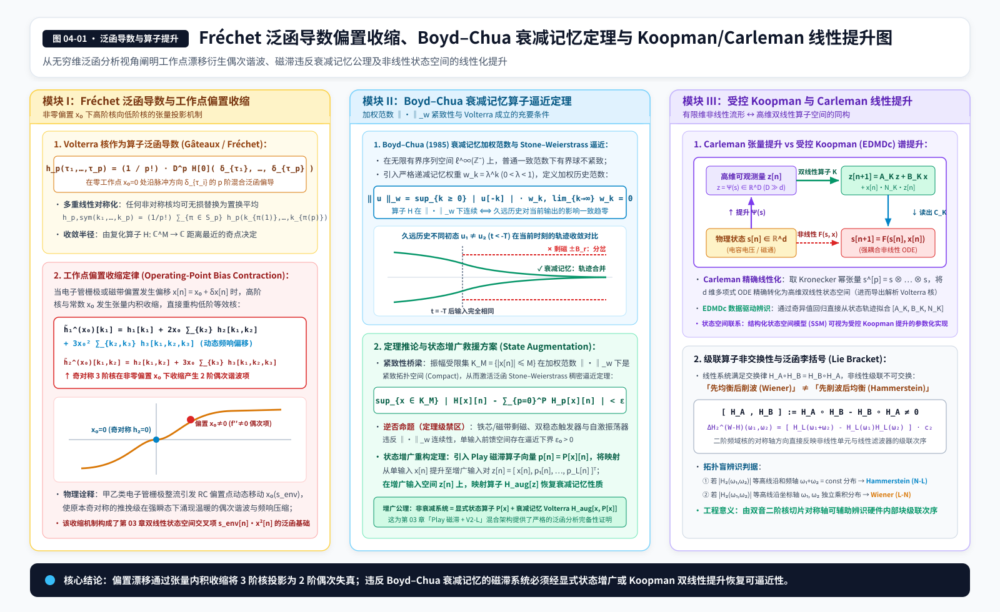
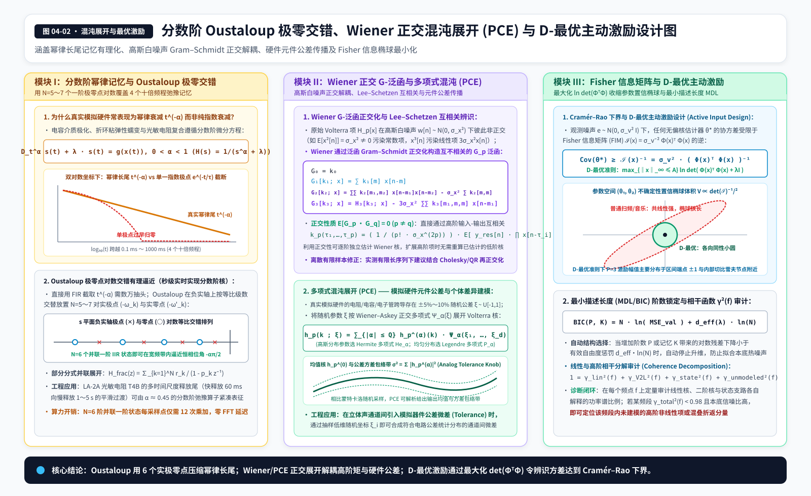

# 04 高级系统辨识：非线性算子、衰减记忆与随机正交展开

> **版本：v3 · 2026-11-14 · Lee–Schetzen 互相关法、Boyd–Chua 严格定义与受控 Koopman 深化版（继承 v2）**
> **所属系列：Volterra Wiki**
> **阅读定位：** 承接《01》的 Volterra 核、《02》的训练方法与《03》的混合模型边界。本章讨论能够直接用于音频非线性系统辨识的高级算子理论、记忆表示、统计正交展开与主动实验设计。

## 4.1 研究输入输出算子，为什么会遇到函数空间？

线性时不变系统通过卷积把整段输入历史映射成输出：

$$
y[n]=\sum_{k=0}^{\infty}h[k]x[n-k].
$$

对于非线性硬件，输出关系需要更一般的算子 \(\mathcal S,\;y=\mathcal S[x]\)。有限长度 WAV 是一个有限维向量，持续运行的系统却需要接收任意长的输入历史。因此，我们在数学上研究有界序列空间（如 \(\ell^\infty(\mathbb{Z}_-)\)）或函数空间上的算子映射，再用有限状态、有限缓冲和有限参数构造实时近似。

这里最核心的三个数学问题是：
1. **正则性与光滑性**：系统算子 \(\mathcal{S}\) 在工作点附近需要满足何种可微条件，才能合法展开为各阶多重线性积分/求和核？
2. **记忆衰减性质**：无穷远以前的历史如何随时间衰减，使得有限维模型能够在一致范数意义下逼近真实系统？
3. **统计正交性与可辨识性**：在随机激励或元件公差存在时，如何解除不同阶次之间的统计耦合，并定量设计最具信息量的测试信号？

## 4.2 Gâteaux 与 Fréchet 导数：算子局部敏感性的严格定义

设赋范函数空间 \(\mathcal{X}\) 上的参考输入波形为 \(x_0\)，沿任意扰动方向 \(v\in\mathcal{X}\) 施加幅度为 \(\varepsilon\) 的微弱探测信号。算子 \(\mathcal{S}\) 在 \(x_0\) 处沿方向 \(v\) 的 **Gâteaux 导数（方向导数）** 定义为：

$$
D_G\mathcal S[x_0;v]
=\lim_{\varepsilon\to0}
\frac{\mathcal S[x_0+\varepsilon v]-\mathcal S[x_0]}{\varepsilon}.
$$

在音频测量中，\(x_0\) 可以是一段正在驱动压缩器或磁带机的大幅度低频偏置信号，\(v\) 则是一枚叠加在其上的微弱高频正弦探针或单位脉冲。此时 \(D_G\mathcal{S}[x_0;v]\) 直接刻画了**系统在工作轨迹 \(x_0\) 瞬时偏置下的小信号线性化增量响应（动态微扰传递函数）**。

Gâteaux 导数仅要求沿单一方向 \(v\) 极限存在；而更强的 **Fréchet 导数**则要求存在一个有界线性算子 \(D\mathcal{S}[x_0]\in\mathcal{L}(\mathcal{X},\mathcal{Y})\), 使得对所有方向上的微小扰动 \(h\in\mathcal{X}\) 一致满足：

$$
\lim_{\lVert h\rVert_{\mathcal{X}}\to 0}
\frac{\bigl\lVert\mathcal S[x_0+h]-\mathcal S[x_0]-D\mathcal S[x_0](h)\bigr\rVert_{\mathcal{Y}}}{\lVert h\rVert_{\mathcal{X}}}=0,
$$

即余项满足 \(\lVert\mathcal{S}[x_0+h]-\mathcal{S}[x_0]-D\mathcal{S}[x_0](h)\rVert = o(\lVert h\rVert)\)。高阶 Fréchet 导数 \(D^p\mathcal{S}[x_0]\) 则是对称的有界 \(p\) 重线性算子（Multilinear Operator）。区分这两种导数具有直接的物理意义：理想硬削波或带死区折点的系统在某些轨迹上可能仅具有单侧方向导数而缺乏高阶 Fréchet 可微性，从而限制了局部泛函 Taylor 展开的有效域。

## 4.3 从泛函 Taylor 展开到工作点依赖的 Volterra 核

当算子 \(\mathcal{S}\) 在参考工作点 \(x_0\) 的邻域内满足 \(P\) 阶连续 Fréchet 可微条件时，其泛函 Taylor 展开可写为：

$$
\mathcal S[x_0+h]=
\mathcal S[x_0]+\sum_{p=1}^{P}\frac{1}{p!}
D^p\mathcal S[x_0](\underbrace{h,\ldots,h}_{p\text{ 个}})+R_{P+1}(x_0,h).
$$

若系统因果且时不变，由 Riesz 表示定理及核表示理论，在时刻 \(n\) 处的第 \(p\) 阶 \(p\) 重线性映射可表示为多重离散卷积。将组合阶乘因子 \(1/p!\) 吸收进对称核定义后：

$$
\frac{1}{p!}D^p\mathcal{S}[x_0](h,\ldots,h)[n]
=\sum_{k_1=0}^{\infty}\cdots\sum_{k_p=0}^{\infty}
h_p^{(x_0)}[k_1,\ldots,k_p]\prod_{i=1}^{p}h[n-k_i].
$$

这一严格推导揭示了两个极其关键的工程结论：
1. **展开核对工作点 \(x_0\) 的依赖性**：标准 Volterra 级数是算子在零输入平衡点 \(x_0\equiv 0\) 处的 Maclaurin 展开；若设备存在直流偏置或慢变工作点漂移 \(x_0[n]\)，则局部高阶核 \(h_p^{(x_0)}\) 会随工作点迁移（高阶核向低阶核发生缩并投影，例如零点处的三阶核 \(h_3\) 在偏置 \(x_0\) 下会向二阶核注入 \(3x_0 h_3\) 的偶次不对称分量）；
2. **局部导数核与宽带回归核的区别**：泛函导数 \(D^p\mathcal{S}[0]\) 描述的是无穷小信号极限 \(\lVert h\rVert\to 0\) 下的渐近曲率；而在有限大信号范围 \([-A,A]\) 内通过最小二乘拟合得到的有限阶多项式核，则是为了最小化区间整体均方误差而包含了高阶截断余项折返修正的最佳逼近核（参见《01》第 1.11.1 节的多方差辨识）。

## 4.4 衰减记忆（Fading Memory）的严格加权范数定义

假设两段有界输入序列在最近 \(M\) 个采样点完全相同，而在 \(k > M\) 的遥远过去经历过不同的激励。什么条件下我们可以用有限状态或有限窗口模型一致逼近该算子？

按照 Boyd 与 Chua (1985) 的经典框架 [A1]，定义有界过去序列集合 \(K_M = \{x\in\ell^\infty(\mathbb{Z}_-) : \sup_{k\ge 0}\lvert x[-k]\rvert \le M_{\max}\}\)，并选取一条严格正且在无穷远处单调递减趋于零的**记忆加权序列（Weighting Function）**\(w_k \gt 0\)（满足 \(\lim_{k\to\infty}w_k=0\)，例如指数衰减权重 \(w_k=\lambda^k,\ 0\lt\lambda\lt 1\)）。定义过去序列空间上的**加权上确界范数**：

$$
\lVert x-x'\rVert_w=\sup_{k\ge0}\,w_k\bigl\lvert x[-k]-x'[-k]\bigr\rvert.
$$

**定义（衰减记忆算子）**：若因果时不变算子 \(\mathcal{S}\) 在集合 \(K_M\) 上关于加权范数 \(\lVert\cdot\rVert_w\) 是连续的（由于 \(K_M\) 在加权范数拓扑下是紧致的，连续性自动等价于一致连续性），即对任意给定的误差容限 \(\varepsilon \gt 0\)，存在 \(\delta \gt 0\)，使得只要两段历史满足 \(\lVert P_{\le n}x - P_{\le n}x'\rVert_w \lt \delta\)，就有当前输出差值 \(\lvert \mathcal{S}[x](n)-\mathcal{S}[x'](n)\rvert \lt \varepsilon\)，则称系统 \(\mathcal{S}\) 在 \(K_M\) 上具有**衰减记忆（Fading Memory）**。

这一加权范数直观而严谨地刻画了“远期历史权重的渐近遗忘”：由于 \(w_k\to 0\)，无论两段输入在 \(k \gt M_0\) 之前相差多大（只要有界于 \(M_{\max}\)），只要选定足够大的截断窗口 \(M_0\) 使 \(2M_{\max}\sup_{k\gt M_0}w_k \lt \delta\)，远期历史差异在加权范数下就必然小于 \(\delta\)，从而保证当前输出的截断误差严格小于 \(\varepsilon\)。

## 4.5 Boyd–Chua 通用逼近定理及其在音频建模中的推论

基于上述衰减记忆定义，Boyd 与 Chua 利用紧致集 \((K_M, \lVert\cdot\rVert_w)\) 上的 **Stone–Weierstrass 定理**证明了非线性系统辨识中最核心的逼近定理 [A1]：

> **定理（Boyd & Chua, 1985）**：设 \(\mathcal{S}\) 是定义在有界输入球 \(\lVert x\rVert_\infty \le M_{\max}\) 上的因果、时不变且具有衰减记忆的连续非线性算子。则对任意误差容限 \(\varepsilon \gt 0\)，存在一个有限阶（\(P<\infty\)）、有限记忆（或由有限维稳定线性时不变滤波器组 \(\mathbf{L}(z)\) 驱动多元多项式读出函数 \(p(\cdot)\) 构成的）离散 Volterra 级数算子 \(\hat{\mathcal{S}}\)，使得在所有输入序列 \(x\in K_M\) 与所有时刻 \(n\) 上一致成立：
> ```math
> \sup_{\lVert x\rVert_\infty \le M_{\max}}\ \sup_{n\in\mathbb{Z}}\bigl\lvert \mathcal{S}[x](n) - \hat{\mathcal{S}}[x](n)\bigr\rvert \lt \varepsilon.
> ```

这一定理在工程上有三项直接推论：
1. **有限维线性滤波器组 + 多项式/神经读出的完备性**：定理中的逼近结构 \(\hat{y}[n]=p\bigl((B_1\ast x)[n],\ldots,(B_K\ast x)[n]\bigr)\) 直接证明了第 01、03 章介绍的 **Laguerre–Volterra 网络（LVN）**、**Generalized Wiener 模型**与**前馈扩张卷积网络（WaveNet）** 能够一致逼近任意衰减记忆音频硬件；
2. **持久磁滞的严格排除（反例定理）**：Boyd 与 Chua 在同一篇论文中证明，具有多分支剩磁或不可逆路径依赖的理想磁滞算子（以及具有双稳态触发或无穷周期保持的分频器）**违背加权范数下的连续性（即不具备衰减记忆）**，因此不可能在全输入集上由任何有限或无限阶收敛的纯前馈 Volterra 级数一致逼近。这从泛函分析层面彻底封死了“仅靠拉长前馈窗口 \(M\) 或加深前馈 WaveNet 层数来完备复刻磁滞”的幻想；
3. **存在性不等于低阶经济性**：Stone–Weierstrass 定理仅保证有限阶 \(P\) 与有限基数量 \(K\) 存在，但当目标接近强饱和折点或具有极慢松弛时间常数时，所需的 \((P, K)\) 可能超出实时 CPU 预算，此时仍需引入显式状态方程或有理逼近。

## 4.6 受控 Koopman 算子与扩展动态模态分解（EDMDc）

当系统包含显式内部状态 \(\mathbf{s}[n]\in\mathbb{R}^d\) 时，除了在输入历史空间做 Volterra 展开外，还可以在**状态可观测函数空间（Observable Space）** 进行线性化提升。

对于受外部音频信号 \(u[n]\) 持续驱动的受控非线性状态系统 \(\mathbf{s}[n+1]=\mathbf{F}(\mathbf{s}[n], u[n])\)，定义一组由 \(r\) 个非线性基函数构成的**状态提升字典（Lifting Dictionary）**：

$$
\boldsymbol{\psi}(\mathbf{s}) = \bigl[\psi_1(\mathbf{s}),\ \psi_2(\mathbf{s}),\ \ldots,\ \psi_r(\mathbf{s})\bigr]^\top \in \mathbb{R}^r,
$$

（例如包含原始状态、状态多项式单项式、径向基函数或神经网络编码特征）。根據 Korda 与 Mezić (2018) 的受控 Koopman 预测框架 [A2]，或带输入的双线性 Koopman 扩展，可以在提升空间中拟合如下线性或双线性演化方程：

$$
\begin{aligned}
\mathbf{z}[n] &= \boldsymbol{\psi}(\mathbf{s}[n]),\\
\mathbf{z}[n+1] &\approx \mathbf{A}_{\mathcal{K}}\mathbf{z}[n] + \mathbf{B}_{\mathcal{K}}u[n] + \Biggl(\sum_{j=1}^{r}\mathbf{N}_{\mathcal{K},j}z_j[n]\Biggr)u[n],\\
\hat{y}[n] &= \mathbf{C}_{\mathcal{K}}\mathbf{z}[n] + d_{\mathcal{K}}u[n].
\end{aligned}
$$

在给定状态—输入快照序列后，系数矩阵 \([\mathbf{A}_{\mathcal{K}}, \mathbf{B}_{\mathcal{K}}, \mathbf{N}_{\mathcal{K}}]\) 可直接通过**带控制的扩展动态模态分解（EDMD with Control, EDMDc）** 用一步正则化最小二乘求出，并可通过对 \(\mathbf{A}_{\mathcal{K}}\) 施加谱半径约束（\(\rho(\mathbf{A}_{\mathcal{K}})\lt 1\)）保证零输入自由演化渐近稳定。

## 4.7 Carleman 线性化：多项式状态动力学的张量提升与截断

与数据驱动的 Koopman 字典相平行，**Carleman 线性化（Carleman Linearization）** 针对已知解析多项式向量场的连续或离散非线性状态方程，通过构造状态的 Kronecker 幂张量将其转化为无穷维线性系统。[A3]

以受输入 \(u(t)\) 驱动的一维二次非线性状态方程为例：

$$
\dot{s}(t) = a_1 s(t) + a_2 s^2(t) + b_0 u(t) + b_1 s(t)u(t).
$$

定义第 \(k\) 阶状态单项式 \(z_k(t) = s^k(t)\)（\(k=1,2,\ldots,N_C\)），由链式法则 \(\dot{z}_k = k s^{k-1}\dot{s}\) 可得无穷维双线性微分方程组：

$$
\dot{z}_k(t) = k\bigl(a_1 + b_1 u(t)\bigr)z_k(t) + k a_2\,z_{k+1}(t) + k b_0 u(t)\,z_{k-1}(t).
$$

在第 \(N_C\) 阶处将 \(z_{N_C+1}\) 截断置零后，原非线性状态方程即化为一个 \(N_C\) 维的**双线性状态空间系统**（参见《03》第 3.6.2 节）：

$$
\dot{\mathbf{z}}(t) = \mathbf{A}_C\mathbf{z}(t) + u(t)\,\mathbf{N}_C\mathbf{z}(t) + \mathbf{b}_C u(t).
$$

这里可以清楚看到 **Carleman 提升**与 **Volterra 展开**的对偶性：Volterra 对**过去输入历史的多重乘积**做展开，而 Carleman 对**当前内部状态的幂次张量**做提升，并将提升后的系统直接投射为双线性状态空间模型。

## 4.8 五类非线性提升与动态建模范式的横向比较

| 模型范式 | 核心提升/展开对象 | 数学结构优势 | 工程实现中必须检验的约束 |
| --- | --- | --- | --- |
| **Volterra / Laguerre-Volterra** | 输入历史乘积 / 正交极点滤波特征 | 阶次、谐波回流与跨时刻互调完全透明，参数线性凸回归 | 高阶维度增长、幂级数收敛半径与多方差局域性 |
| **受控 Koopman / EDMDc** | 状态可观测函数字典 \(\boldsymbol{\psi}(\mathbf{s})\) | 将非线性状态转移转化为提升空间的线性/双线性矩阵乘法 | 字典函数完备性、不变子空间闭合误差与状态可获取性 |
| **Carleman 线性化** | 状态变量的 Kronecker 幂单项式 \(\mathbf{s}^{\otimes k}\)| 无需随机训练，直接由解析电路方程导出结构化双线性矩阵 | 有限阶截断半径、高维状态维度膨胀（\(O(d^{N_C})\)） |
| **双线性状态空间 (Bilinear SSM)** | 状态与输入的一阶乘积耦合 \(\mathbf{N}\mathbf{s}[n]x[n]\) | 极紧凑地表达电平依赖极点偏移、压缩调制与有理 Volterra 核 | 闭环 NOE 参数辨识与大信号输入下的谱半径稳定边界 |
| **门控循环网络 (LSTM / GRU / ESN)** | 自适应门控隐状态或随机高维储备池 | 黑盒拟合复杂多时间尺度非线性，ESN 保持线性输出回归 | 长序列自由运行漂移、缺乏永久多稳态剩磁及物理可解释性 |



*图 04-01：模块 I 展示 Gâteaux/Fréchet 泛函导数与非零工作点偏置 \(x_0\) 下的高阶张量内积收缩定律（揭示奇对称三阶核 \(\mathbf{H}_3\) 如何因动态偏置偏移衍生出二阶偶次谐波 \(3x_0\sum h_3\)）；模块 II 展示 Boyd–Chua 加权范数 \(\|\cdot\|_w\) 下的衰减记忆逼近定理及针对剩磁分岔的显式状态增广公理；模块 III 对比 Carleman 精确张量提升、受控 Koopman（EDMDc）双线性算子提升与级联泛函李括号（Lie Bracket）非交换性判据。*

## 4.9 分数阶微积分（Fractional Calculus）：幂律衰减记忆与有理逼近实现

在电子管热弛豫、铁氧体/磁带介质粘滞损耗（Magnetic After-effect / Viscosity）、扬声器悬边蠕变（Creep）以及电解电容介质吸收（Dielectric Absorption）中，系统在受激后的恢复往往不遵循单一指数衰减 \(e^{-t/\tau}\)，而是跨越多个数量级时间尺度的**幂律衰减（Power-Law Decay，\(t^{-\alpha}\)）**。

当标量阶数满足 \(0\lt \alpha_{\mathrm{frac}}\lt 1\) 时，连续时间 Caputo 分数阶导数与 Grünwald–Letnikov 离散分数阶差分分别定义为：

$$
{}^CD_t^{\alpha_{\mathrm{frac}}} s(t)=
\frac{1}{\Gamma(1-\alpha_{\mathrm{frac}})}
\int_0^t\frac{\dot s(\tau)}{(t-\tau)^{\alpha_{\mathrm{frac}}}}\,d\tau,\qquad
\Delta^{\alpha_{\mathrm{frac}}} x[n]=
\sum_{k=0}^{\infty}(-1)^k
\binom{\alpha_{\mathrm{frac}}}{k}x[n-k].
$$

其中广义二项式系数满足递推关系 \(w_k^{(\alpha_{\mathrm{frac}})} = (-1)^k\binom{\alpha_{\mathrm{frac}}}{k} = \bigl(1-\frac{\alpha_{\mathrm{frac}}+1}{k}\bigr)w_{k-1}^{(\alpha_{\mathrm{frac}})}\)，当延迟 \(k\to\infty\) 时按渐近幂律 \(O(k^{-\alpha_{\mathrm{frac}}-1})\) 缓慢衰减（属于长尾衰减记忆，但非永久剩磁）。

在实时音频插件中，直接截断 Grünwald–Letnikov 无穷级数需要数千个 FIR 抽头。更高效的工程实现是在目标听觉频带 \([\omega_{\min}, \omega_{\max}]\)（如 \(1\,\mathrm{Hz}\sim 20\,\mathrm{kHz}\)）内，采用 **Oustaloup 递归极零点交错有理逼近**或连分式展开（CFE），将分数阶算子 \(s^{\alpha_{\mathrm{frac}}}\) 近似为 \(N_f\) 个一阶 RC 弛豫状态的并联/级联（通常取 \(N_f=4\sim 7\) 个对数等距分布的极零点对即可在全频带内将幅相误差控制在 \(0.2\,\mathrm{dB}\) 以内）：[A4]

$$
H_{\mathrm{frac}}(s) = s^{\alpha_{\mathrm{frac}}} \approx C_0 \prod_{m=1}^{N_f} \frac{1 + s/\omega_{z,m}}{1 + s/\omega_{p,m}},
$$

再经双线性变换（Tustin）离散化为极低成本的 IIR 二阶节（Biquads）状态簇。

## 4.10 长尾衰减记忆与路径依赖的横向对照实验设计

为了在工程中客观决定何时采用 Laguerre 正交基、何时采用分数阶极零点簇、何时采用 Play 磁滞算子，建议在统一基准下对比脉冲恢复曲线与预磁化探针响应：
- 若余振尾部在对数—对数坐标（Log-Log Plot）下呈直线，说明系统受幂律弛豫主导，应优先选用 \(4\sim 6\) 阶 Oustaloup 分数阶状态簇（相比数千抽头 FIR 可节省 99% 以上的乘加运算）；
- 若静音足够长时间后，正负不同预激励极性下的微弱探针响应依然收敛到两条不同的基线，则说明存在非衰减的持久剩磁，必须引入第 3.6.1 节的 Play / Preisach 状态。

## 4.11 Wiener G-泛函与 Lee–Schetzen 互相关辨识法：解除阶次间的统计耦合

在《01》第 1.11.1 节中我们看到，普通 Volterra 级数的单项式基 \(1, x, x^2, x^3, \ldots\) 在随机输入下彼此非正交（例如对零均值高斯白噪声 \(x[n]\sim\mathcal{N}(0,\sigma_x^2)\)，有 \(\mathbb{E}[x[n]\cdot x^3[n]]=3\sigma_x^4\neq 0\)，导致三阶项严重污染一阶线性核的辨识）。

Norbert Wiener 提出的 **Wiener G-泛函（Wiener G-functionals）** 通过在功率谱密度（方差）为 \(\sigma_x^2\) 的高斯白噪声输入测度下对各阶 Volterra 泛函做 **Gram–Schmidt 正交化**，构造出一组满足跨阶严格统计正交的泛函展开 [A5]：

$$
y[n] = \sum_{p=0}^{\infty} G_p\bigl[k_p;\,x\bigr](n),\qquad
\mathbb{E}\Bigl[G_p\bigl[k_p;\,x\bigr](n)\,G_q\bigl[k_q;\,x\bigr](n)\Bigr] = 0\quad (p\neq q).
$$

离散时间下前四阶正交 Wiener G-泛函的显式结构为（在最高阶包含对角及下三角低阶减去项，恰好对应概率论 Hermite 多项式的泛函推广）：

$$
\begin{aligned}
G_0\bigl[k_0;\,x\bigr](n) &= k_0,\\
G_1\bigl[k_1;\,x\bigr](n) &= \sum_{m=0}^{M-1}k_1[m]x[n-m],\\
G_2\bigl[k_2;\,x\bigr](n) &= \sum_{m_1=0}^{M-1}\sum_{m_2=0}^{M-1}k_2[m_1,m_2]x[n-m_1]x[n-m_2] - \sigma_x^2\sum_{m=0}^{M-1}k_2[m,m],\\
G_3\bigl[k_3;\,x\bigr](n) &= \sum_{m_1,m_2,m_3=0}^{M-1}k_3[m_1,m_2,m_3]x[n-m_1]x[n-m_2]x[n-m_3] - 3\sigma_x^2\sum_{m_1=0}^{M-1}\Biggl(\sum_{m_2=0}^{M-1}k_3[m_1,m_2,m_2]\Biggr)x[n-m_1].
\end{aligned}
$$

正是因为减去了常数项 \(-\sigma_x^2\sum k_2[m,m]\)（消除二阶直流偏置对零阶的污染）与一阶回流项 \(-3\sigma_x^2\sum k_3[m_1,m_2,m_2]x[n-m_1]\)（消除三阶奇次项对一阶线性核的增益污染），**Y. W. Lee 与 Martin Schetzen (1965)** 证明了各阶对称 Wiener 核 \(k_p\) 可直接通过输出信号与高阶延迟乘积的**互相关（Lee–Schetzen Cross-Correlation Method）** 逐阶独立解出，而无需联立求解巨型病态矩阵：

$$
k_p[m_1,\ldots,m_p] = \frac{1}{p!\,\sigma_x^{2p}}\,\mathbb{E}\Biggl[\Biggl(y[n]-\sum_{q=0}^{p-1}G_q[k_q;\,x](n)\Biggr)\prod_{i=1}^{p}x[n-m_i]\Biggr].
$$

当所有遅延坐标互不相同时（\(m_i\neq m_j\)），由于低阶泛函与高阶多元乘积正交，公式进一步简化为直接高阶互相关 \(k_p[m_1,\ldots,m_p]=\frac{1}{p!\sigma_x^{2p}}\mathbb{E}[y[n]x[n-m_1]\cdots x[n-m_p]]\)。辨识出最高 \(P\) 阶 Wiener 核 \(\{k_0,\ldots,k_P\}\) 后，再将上述显式公式中的相同阶次项合并同类项（例如一阶等效 Volterra 核为 \(h_1[m]=k_1[m]-3\sigma_x^2\sum_{m_2}k_3[m,m_2,m_2]+\cdots\)），即可还原为标准 Volterra 核。

## 4.12 Wiener Chaos Decomposition（维纳混沌分解）在系统辨识中的确切含义

在一维标量标准正态变量 \(\xi\sim\mathcal{N}(0,1)\) 下，前几阶概率论 Hermite 多项式（Probabilists' Hermite Polynomials）定义为：

$$
H_0(\xi)=1,\quad H_1(\xi)=\xi,\quad
H_2(\xi)=\xi^2-1,\quad
H_3(\xi)=\xi^3-3\xi,\quad
H_4(\xi)=\xi^4-6\xi^2+3,
$$

满足高斯测度下的正交归一关系 \(\mathbb{E}[H_m(\xi)H_n(\xi)]=n!\,\delta_{mn}\)。

**Wiener Chaos Decomposition（维纳混沌分解）** 是这一正交性在无穷维高斯随机过程空间上的完备扩张定理（Cameron–Martin 定理）[A6]：任何具有有限二阶矩（\(\mathbb{E}[\lvert Y\rvert^2]\lt\infty\)）且由独立标准高斯随机变量序列 \(\boldsymbol{\xi}=(\xi_1,\xi_2,\ldots,\xi_d)\) 驱动的非线性泛函输出 \(Y(\boldsymbol{\xi})\), 均可唯一展开为多元正交 Hermite 多项式基 \(\Psi_{\boldsymbol{\alpha}}(\boldsymbol{\xi})\) 的均方收敛级数：

$$
Y(\boldsymbol\xi)\approx
\sum_{\lvert\boldsymbol\alpha\rvert\le P_{\mathrm{PCE}}}
c_{\boldsymbol\alpha}\,
\Psi_{\boldsymbol\alpha}(\boldsymbol\xi),
\qquad
\Psi_{\boldsymbol\alpha}(\boldsymbol\xi)=
\prod_{j=1}^{d}H_{\alpha_j}(\xi_j),
$$

其中多指标 \(\boldsymbol{\alpha}=(\alpha_1,\ldots,\alpha_d)\in\mathbb{N}_0^d\)，总阶数为 \(\lvert\boldsymbol{\alpha}\rvert=\sum_{j=1}^d \alpha_j \le P_{\mathrm{PCE}}\)。需要再次强调，这里的“Chaos（混沌）”源自 Norbert Wiener 1938 年命名的高斯纯随机空间（Homogeneous Chaos），属**概率论与随机泛函正交基术语**，与洛伦兹吸引子、正 Lyapunov 指数等确定性非线性动力学混沌无任何关系。

## 4.13 Polynomial Chaos Expansion (PCE)：器件公差与硬件个体差异的统计建模

在模拟音频硬件复刻中，同型号的两台真实机器（例如两台出厂年份不同的 LA-2A 或两台电子管前级）往往因为碳膜电阻 \(\pm 5\%\sim 10\%\) 公差、耦合电容老化、电子管跨导离散性或 T4B 光敏电阻批次差异而呈现出可听的个体差异。

利用 **广义多项式混沌展开（Generalized Polynomial Chaos Expansion, gPC / PCE）**（Xiu & Karniadakis, 2002）[A7]，我们可以将电路中的 \(d\) 个不确定器件参数（如偏置电阻、时间常数、磁芯饱和磁通）归一化为独立随机变量向量 \(\boldsymbol{\xi}=(\xi_1,\ldots,\xi_d)\)，并根据参数的先验概率分布选择对应的 Wiener–Askey 正交多项式族（高斯分布选 Hermite 多项式，有界均匀公差区间 \([-1,1]\) 选 **Legendre 多项式**，Beta 分布选 Jacobi 多项式），将系统输出展开为：

$$
y[n;\boldsymbol\xi]\approx
\sum_{\lvert\boldsymbol\alpha\rvert\le P_{\mathrm{PCE}}}
c_{\boldsymbol\alpha}[n]\,
\Psi_{\boldsymbol\alpha}(\boldsymbol\xi).
$$

只需在少量高斯求积节点（Stochastic Collocation）或稀疏网格上运行离线模型求出确定性系数序列 \(c_{\boldsymbol{\alpha}}[n]\)，即可利用基函数的正交性**零成本直接解析求出整个硬件种群在任意时刻的输出均值包络、方差波动带以及各元件对音色差异的全局方差贡献率（Sobol 灵敏度指标）**：

$$
\mathbb E_{\boldsymbol{\xi}}\bigl[y[n;\boldsymbol\xi]\bigr]= c_{\boldsymbol0}[n],\qquad
\mathrm{Var}_{\boldsymbol{\xi}}\bigl(y[n;\boldsymbol\xi]\bigr)=
\sum_{\boldsymbol\alpha\ne\boldsymbol0}
c_{\boldsymbol\alpha}^2[n]\,
\mathbb E\bigl[\Psi_{\boldsymbol\alpha}^2(\boldsymbol\xi)\bigr],\qquad
S_j[n] = \frac{\sum_{\boldsymbol{\alpha}\in\mathcal{A}_j}c_{\boldsymbol{\alpha}}^2[n]\mathbb{E}[\Psi_{\boldsymbol{\alpha}}^2]}{\mathrm{Var}_{\boldsymbol{\xi}}(y[n;\boldsymbol{\xi}])}.
$$

在商业插件设计中，若某个内部元件的 Sobol 灵敏度指标 \(S_j\) 极高，就可以将该随机坐标 \(\xi_j\) 直接暴露为插件面板上的“Variance / Tolerance / Tube Age（成色/老化度）”连续微调旋钮，从而用一套正交展开同时覆盖整个经典硬件家族的个体分布。

## 4.14 可观测性与结构可辨识性：Rank 判据与参数解耦

对于含内部状态与未知参数 \(\boldsymbol{\theta}\in\mathbb{R}^K\) 的非线性模型

$$
\mathbf{s}[n+1]=\mathbf{F}(\mathbf{s}[n],u[n];\boldsymbol{\theta}),\qquad
y[n]=H(\mathbf{s}[n],u[n];\boldsymbol{\theta}),
$$

在长度为 \(N\) 的激励序列 \(\mathbf{u}\) 下，设模型预测输出向量为 \(\hat{\mathbf{y}}(\boldsymbol{\theta},\mathbf{u})\in\mathbb{R}^N\)。定义输出关于参数向量 \(\boldsymbol{\theta}\) 的 **\(N\times K\) 局部灵敏度矩阵（Sensitivity Jacobian Matrix）**：

$$
\mathbf{J}_{\boldsymbol{\theta}}(\mathbf{u}) = \frac{\partial \hat{\mathbf{y}}(\boldsymbol{\theta},\mathbf{u})}{\partial \boldsymbol{\theta}^\top} \in \mathbb{R}^{N\times K},\qquad
\bigl[\mathbf{J}_{\boldsymbol{\theta}}(\mathbf{u})\bigr]_{n,i} = \frac{\partial \hat{y}[n]}{\partial \theta_i}.
$$

**局部参数可辨识性判据**：在标称参数 \(\boldsymbol{\theta}_0\) 邻域内，模型参数由激励 \(\mathbf{u}\) 局部唯一可辨识的充要条件是灵敏度矩阵满列秩，即 \(\mathrm{rank}\bigl(\mathbf{J}_{\boldsymbol{\theta}}(\mathbf{u})\bigr)=K\)（等价于信息矩阵 \(\mathbf{J}_{\boldsymbol{\theta}}^\top\mathbf{J}_{\boldsymbol{\theta}}\) 正定可逆）。若两个参数列向量线性相关（例如在第 1.9.1 节单音 ESS 激励下，Wiener–Hammerstein 前置增益与后置增益的灵敏度列完全共线），则矩阵奇异，必须通过改变激励结构（如引入双音或多幅度阶跃）打破列共线性。

## 4.15 Fisher 信息矩阵（FIM）、Cramér–Rao 下界与主动最优激励设计

当测量输出包含加性高斯白噪声 \(y[n]=\hat{y}_{\boldsymbol{\theta}}[n]+w[n]\)（\(w[n]\sim\mathcal{N}(0,\sigma_w^2)\)）时，似然函数 \(p(\mathbf{y}\mid\boldsymbol{\theta},\mathbf{u})\) 对应的 **Fisher 信息矩阵（Fisher Information Matrix, FIM）** 具有极其简洁的闭式表达：

$$
\mathcal I(\boldsymbol\theta;\mathbf u)=
\mathbb E\!\left[
\nabla_{\boldsymbol\theta}\log p(\mathbf y\mid\boldsymbol\theta,\mathbf u)
\nabla_{\boldsymbol\theta}\log p(\mathbf y\mid\boldsymbol\theta,\mathbf u)^\top
\right]
= \frac{1}{\sigma_w^2}\,\mathbf{J}_{\boldsymbol{\theta}}(\mathbf{u})^\top\mathbf{J}_{\boldsymbol{\theta}}(\mathbf{u}).
$$

对于固定核 Volterra 线性回归 \(\hat{\mathbf{y}}=\mathbf{X}(\mathbf{u})\boldsymbol{\theta}\)，灵敏度矩阵就是特征设计矩阵 \(\mathbf{J}_{\boldsymbol{\theta}}(\mathbf{u})=\mathbf{X}(\mathbf{u})\)，因此 Fisher 信息矩阵直接退化为 \(\mathcal{I}(\boldsymbol{\theta};\mathbf{u})=\frac{1}{\sigma_w^2}\mathbf{X}(\mathbf{u})^\top\mathbf{X}(\mathbf{u})\)。由数理统计中的 **Cramér–Rao 不等式（CRLB）**，任何无偏参数估计器 \(\hat{\boldsymbol{\theta}}\) 的协方差矩阵均受限于 Fisher 信息矩阵的逆：

$$
\mathrm{Cov}(\hat{\boldsymbol{\theta}}) \succeq \mathcal{I}(\boldsymbol{\theta};\mathbf{u})^{-1} = \sigma_w^2\bigl(\mathbf{J}_{\boldsymbol{\theta}}(\mathbf{u})^\top\mathbf{J}_{\boldsymbol{\theta}}(\mathbf{u})\bigr)^{-1}.
$$

这一公式将“设计什么样的测试音频最好”直接转化为一个可计算的数学优化问题——**主动最优激励设计（Optimal Input Design）**[A8]：在满足硬件安全峰值幅度 \(\lVert\mathbf{u}\rVert_\infty \le u_{\max}\) 与频带限制的前提下，优化测试信号参数（如多音信号的频率分布、多方差台阶权重或脉冲间隔），以极小化参数置信椭球的体积或轴长：
- **D-最优设计（D-Optimal）**：最大化 \(\log\det\mathcal{I}(\boldsymbol{\theta};\mathbf{u})\)，等价于最小化参数联合置信椭球的对数体积；
- **A-最优设计（A-Optimal）**：最小化 \(\mathrm{tr}\bigl(\mathcal{I}(\boldsymbol{\theta};\mathbf{u})^{-1}\bigr)\)，等价于最小化所有待估核系数的平均方差；
- **E-最优 / 条件数优化**：最大化最小特征值 \(\lambda_{\min}\bigl(\mathcal{I}(\boldsymbol{\theta};\mathbf{u})\bigr)\)，防止任何参数方向落入不可观测盲区。



*图 04-02：模块 I 展示分数阶幂律长尾记忆 \(t^{-\alpha}\) 与 Oustaloup 负实轴极零点对数等比交错有理逼近；模块 II 展示高斯白噪声下 Wiener G-泛函的 Gram–Schmidt 正交解耦（消除 \(-3\sigma_x^2\) 奇次交叉矩干扰）与用于硬件元件公差建模的多项式混沌展开（PCE）；模块 III 展示基于 Fisher 信息矩阵（FIM）的 D-最优主动激励设计（最大化 \(\ln\det(\boldsymbol{\Phi}^\top\boldsymbol{\Phi})\) 收缩置信椭球）与 BIC/MDL 阶数判定。*

## 4.16 高级理论的统一测试矩阵

| 实验编号 | 参考基准对象 | 参与对照的模型族 | 核心量化评估指标 |
| --- | --- | --- | --- |
| **Exp-A 衰减记忆逼近** | 多时间常数已知非线性系统 | 截断 FIR Volterra、Laguerre-Volterra (LVN)、ESN | 随基数量 \(K\) 增加的一致误差 \(\ell^\infty\) 衰减率 |
| **Exp-B 状态提升线性化** | 已知解析方程的非线性电路/压缩环路 | 受控 Koopman (EDMDc)、Carleman 截断、双线性 SSM | 闭环 Free-Run 轨迹误差、谱半径稳定裕度与每采样耗时 |
| **Exp-C 幂律长尾弛豫** | 含粘滞磁后效或介质吸收的长尾系统 | 截断 Grünwald 分数阶、Oustaloup 有理极零簇、单极点 IIR | 对数时间轴恢复曲线误差（\(1\,\mathrm{ms}\sim 10\,\mathrm{s}\)）与滤波器阶数 |
| **Exp-D 正交泛函解耦** | 多方差宽带激励下的电子管放大级 | 单项式幂基 Volterra、Wiener/Hermite 正交核、SNLM | 设计矩阵条件数 \(\kappa_2\)、跨电平泛化 ESR 与小信号奇次偏置 |
| **Exp-E 器件公差传播** | 含 \(\pm 10\%\) 随机元件公差的离线白盒电路 | Legendre/Hermite PCE、蒙特卡洛仿真（1000 次） | 均值/方差包络吻合度、Sobol 灵敏度排序与所需仿真次数 |
| **Exp-F 主动最优激励** | 含耦合光电/偏置未知参数的灰盒压缩器 | 常规干声音乐、等距扫频、D-Optimal 信息驱动激励 | 参数估计协方差迹 \(\mathrm{tr}(\mathcal{I}^{-1})\) 与未见测试集泛化误差 |

## 4.17 小结：高级理论如何赋能工程实践？

本章建立的六大数学工具各自对应明确的工程痛点：
- **Gâteaux / Fréchet 导数**界定了工作点局部展开与偏置缩并规律；
- **Boyd–Chua 衰减记忆定理**确立了有限维滤波器组逼近的适用范围，并严格划出了持久磁滞必须引入显式状态的理论边界；
- **Koopman 与 Carleman 提升**为慢速非线性状态提供了向双线性状态空间转化的结构化路径；
- **分数阶微积分与 Oustaloup 逼近**用极少数极零点对解决了幂律长尾弛豫的实时计算难题；
- **Wiener G-泛函与 PCE 多项式混沌**分别在随机信号域与器件公差域消除了高阶幂次的统计共线性；
- **Fisher 信息矩阵与 CRLB** 则指导我们用最少的硬件采集时间获取最高的参数辨识精度。

下一章《05 物理约束、模型降阶与神经代理》将把这些系统辨识理论与电路微分代数方程（DAE）、Port-Hamiltonian 能量守恒架构、有限元 POD 超降阶及实时模型蒸馏全面打通。

---

## 参考文献

- **[A1]** Boyd, S. & Chua, L. O. (1985), *Fading Memory and the Problem of Approximating Nonlinear Operators with Volterra Series*, IEEE Trans. Circuits Syst., 32(11), 1150–1161, [DOI:10.1109/TCS.1985.1085649](https://doi.org/10.1109/TCS.1985.1085649)；[作者开放文本](https://web.stanford.edu/~boyd/papers/fading_volterra.html)。
- **[A2]** Korda, M. & Mezić, I. (2018), *Linear Predictors for Nonlinear Dynamical Systems: Koopman Operator Meets Model Predictive Control*, *Automatica*, 93, 149–160, [DOI:10.1016/j.automatica.2018.03.046](https://doi.org/10.1016/j.automatica.2018.03.046)。
- **[A3]** Forets, M. & Pouzet, C. / Amini 等 (2022), *Carleman Linearization of Nonlinear Systems and Its Finite-Section Approximations*, [arXiv:2207.07755](https://arxiv.org/abs/2207.07755)。
- **[A4]** Ortigueira, M. D. 等 (2024), *Principles of Fractional Signal Processing*, Digital Signal Processing, [DOI:10.1016/j.dsp.2024.104490](https://doi.org/10.1016/j.dsp.2024.104490)。
- **[A5]** Lee, Y. W. & Schetzen, M. (1965), *Measurement of the Wiener Kernels of a Non-linear System by Cross-Correlation*, Int. J. Control, 2(3), 237–254；以及 Orcioni 等 (2019), *Nonlinear System Identification Using Wiener Basis Functions and Multiple-Variance Perfect Sequences*, Signal Processing, [论文入口](https://www.sciencedirect.com/science/article/pii/S0165168419300660)。
- **[A6]** Wiener, N. (1938), *The Homogeneous Chaos*, Amer. J. Math., 60(4), 897–936；[Polynomial Chaos 教学讲义](https://venturi.soe.ucsc.edu/sites/default/files/COURSE_NOTE_5_Polynomial_chaos.pdf)。
- **[A7]** Xiu, D. & Karniadakis, G. E. (2002), *The Wiener–Askey Polynomial Chaos for Stochastic Differential Equations*, SIAM J. Sci. Comput., 24(2), 619–644, [DOI:10.1137/S1064827501387826](https://doi.org/10.1137/S1064827501387826)。
- **[A8]** *Space-Filling Input Design for Nonlinear State-Space Identification* (2024), [论文入口](https://www.sciencedirect.com/science/article/pii/S2405896324013697)；*An Approximate Bayesian Approach to Optimal Input Signal Design for System Identification* (2025), [开放全文](https://pmc.ncbi.nlm.nih.gov/articles/PMC12562801/)。

---

**章节导航：** [⬅️ 上一章：03 混合建模、训练边界与实时约简](03_混合建模训练边界与实时约简.md) ｜ [🏠 返回目录 (README)](README.md) ｜ [➡️ 下一章：05 物理约束、模型降阶与实时代理](05_物理约束与实时代理建模.md)
