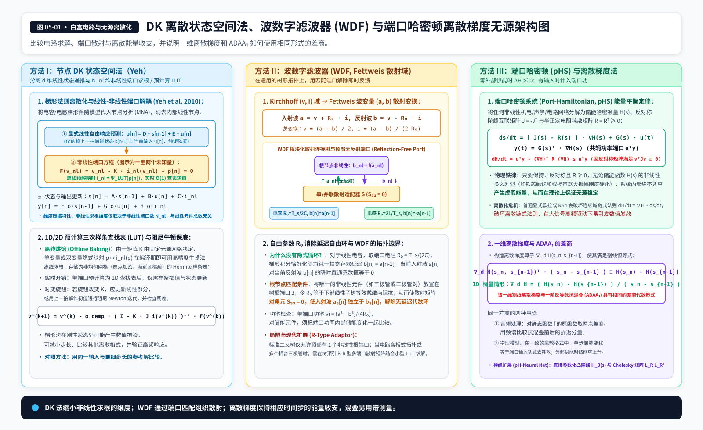
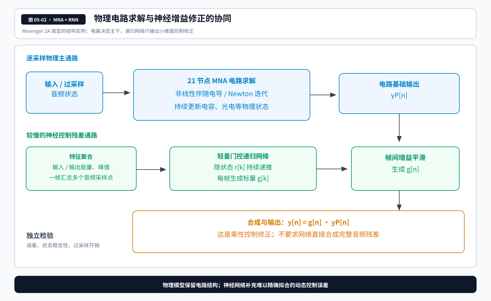
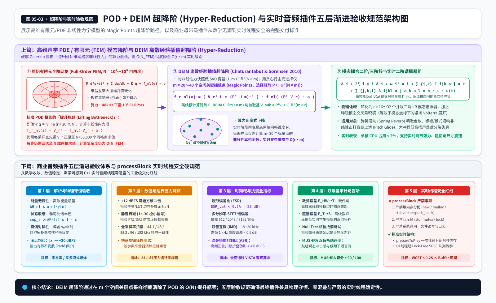

# 05 物理约束、模型降阶与神经代理：高精度数字建模如何进入实时音频

[在线阅读本章（完整合订版）](https://excillex-marisa.github.io/volterra-wiki/#chapter-05)

> **版本：v8 · 2026-11-20 · 从单个储能状态到电路求解与验收**
> **所属系列：Volterra Wiki**
> **阅读定位：** 可从《03》第 3.5 节直接进入本章。理解采样、递推状态和输入输出残差即可开始 5.1—5.4。器件公差需要的概率工具可在读到 5.7 时回查《04》第 4.13 节。
> **范围：** 只讨论具有具体数字建模任务的物理和数值方法。

**本章的两类物理问题与一条部署路线。** 5.1—5.4 主要研究电路节点、电容和非线性器件产生的低维耦合方程，以及如何离散化和迭代求解。5.5—5.6 面向钢板、振膜或磁场等空间连续问题，通过有限元建立大规模状态后再进行模态降阶和超降阶。5.7—5.14 则讨论器件公差、神经代理、物理信息损失、硬实时约束和教师—学生蒸馏如何组成可部署的工程流程。学习电路建模的读者可以先读 5.1—5.4，再按目标系统决定是否需要空间场的专项内容。

## 5.1 为什么需要区分物理精度、求解精度和实时成本？

一台真实模拟设备的原理图可以说明拓扑，却未必给出实际电子管曲线、变压器磁滞回线、寄生参数或每只光敏元件的恢复过程。若原始物理参数已经与真实硬件存在偏差，即使数值求解精确，也会产生偏离硬件的输出。另一方面，即使物理方程充分准确，离散时间积分、迭代求解和模型约简也会引入各自的数值误差。

对于完整的物理—数据联合建模流程，可以分别量化三类误差，并测量实时开销：
1. **物理建模误差**：真实硬件实测响应与连续时间微分代数方程（DAE）理论解之间的偏差；
2. **数值离散化误差**：连续时间方程与高采样率离线高精度数值解（Reference Solver）之间的偏差；
3. **降阶与代理误差**：高精度离线数值解与实时约简/神经代理模型之间的偏差；
4. **实时工程性能。** 在目标宿主记录算法延迟、平均块耗时、耗时分位数、实测最大值及掉音次数。WCET 指最坏情况执行时间；要给出保证，需要能覆盖最坏情况的上界分析。

因此，工程上应当将**高精度离线物理教师模型（Offline Teacher）** 与**实时音频运行模型（Real-Time Student / Surrogate）** 分开构建：离线模型允许采用高倍过采样、精细空间网格与严格收敛的隐式迭代；实时模型则在验证过的工作域内，利用结构化分解、模态超降阶、查找表（LUT）或神经蒸馏，以最少的每采样乘加次数复现关键动态。

## 5.2 从电路网表到非线性微分代数方程（DAE）、DK 方法与 WDF

先看一个 RC 低通：电阻 $`R`$ 串在输入 $`u`$ 与输出 $`v`$ 之间，电容 $`C`$ 从输出接地。电阻电流为 $`i=(u-v)/R`$，同一电流为电容充电，$`i=C\,dv/dt`$。前式给出当下必须满足的代数约束，后式记住上一刻的电压。消去电流，得到 $`RC\,dv/dt=u-v`$。这也说明为什么节点电压、电流等未知量里，只有一部分需要跨采样保存。

取 $`R=10\,\mathrm{k}\Omega`$、$`C=100\,\mathrm{nF}`$，则 $`RC=1\,\mathrm{ms}`$。在 48 kHz 下，用后向欧拉把导数近似为 $`(v[n]-v[n-1])/T_s`$，其中 $`T_s=1/f_s`$，整理得 $`v[n]=(48v[n-1]+u[n])/49`$。初始电压为零，输入从 0 跳到 1 V，第一拍的输出约为 20.4 mV。扩大到多节点时，下面的矩阵同时记录各元件的约束与储能关系；新增非线性元件后，单步方程可能需要迭代。

具有电容、电感、电子管、二极管、变压器及反馈路径的模拟音频电路，在节点分析或修正节点分析（Modified Nodal Analysis, MNA）下可统一写为非线性微分代数方程（DAE）：

```math
\mathbf E(\mathbf z,\boldsymbol\theta)\dot{\mathbf z}+\mathbf f(\mathbf z,\mathbf u,\boldsymbol\theta)=\mathbf 0,
\qquad \mathbf y=\mathbf g(\mathbf z,\mathbf u,\boldsymbol\theta).
```

其中 $`\mathbf z`$ 是节点电压、电感支路电流以及磁通或热状态等未知量的集合，$`\dot{\mathbf z}`$ 表示其时间导数；$`\mathbf E`$ 是由储能与约束关系形成的 DAE 系数矩阵，$`\boldsymbol\theta`$ 为器件参数，$`\mathbf u`$ 为外部输入和偏置源。这里的矩阵字母遵循电路领域的局部惯例，后面 FEM 部分会重新定义质量、阻尼和刚度矩阵。

在具体的光电压缩器实现中，**Revenger 2A 的电路主干可以作为 MNA 工程实例**：其求解器组织了 21 个节点变量，对非线性元件采用伴随电导和等效电流源的 Newton 型线性化，并将跨采样点持续演化的电容、光电相关状态留在电路求解过程中。每个采样点可以抽象为求解

```math
\mathbf F\bigl(\mathbf z[n];\mathbf z[n-1],\mathbf u[n],\mathbf c\bigr)=\mathbf 0,
\qquad
\mathbf J(\mathbf z^{(r)})\,\Delta\mathbf z^{(r)}=-\mathbf F(\mathbf z^{(r)}),
```

再令 $`\mathbf z^{(r+1)}=\mathbf z^{(r)}+\Delta\mathbf z^{(r)}`$ 迭代逼近当前时刻的一致解。实际实现还要设置不收敛回退、非有限数值清理及输入电平范围保护。这类结构与仅用一个非线性增益曲线乘以音频的模型有本质区别：**元件耦合与历史记忆由方程和持续状态共同产生**。对一般读者而言，这个案例说明 MNA 的用途；21 节点是该实例采用的规模；其他 LA-2A 建模方案可能具有不同的节点数量。

在虚拟模拟（Virtual Analog, VA）中，节点 DK 方法（Nodal DK Method）先离散储能元件，再把线性节点消去，留下较小的非线性端口方程。另一条路线是波数字滤波器（WDF），把端口的电压、电流换成入射波和反射波。

### 5.2.1 状态空间 DK 方法（Nodal DK Method）

David Yeh 等人系统化的 **DK 方法**[P8] 将线性储能元件（电容、电感）经梯形法则（Trapezoidal Rule / 双线性变换）离散化为伴随电阻模型，并将电路中的**线性动态状态更新**与**静态非线性代数环求解**显式分离为标准块结构：

```math
\begin{aligned}
\mathbf{p}[n] &= \mathbf{D}\,\mathbf{x}_{\mathrm{state}}[n-1] + \mathbf{E}_u\,\mathbf{u}[n],\\
\mathbf{v}_{\mathrm{nl}}[n] &= \mathbf{p}[n] + \mathbf{K}\,\mathbf{i}_{\mathrm{nl}}\bigl(\mathbf{v}_{\mathrm{nl}}[n]\bigr),\\
\mathbf{x}_{\mathrm{state}}[n] &= \mathbf{A}\,\mathbf{x}_{\mathrm{state}}[n-1] + \mathbf{B}\,\mathbf{u}[n] + \mathbf{C}\,\mathbf{i}_{\mathrm{nl}}\bigl(\mathbf{v}_{\mathrm{nl}}[n]\bigr),\\
\mathbf{y}[n] &= \mathbf{L}\,\mathbf{x}_{\mathrm{state}}[n-1] + \mathbf{M}_u\,\mathbf{u}[n] + \mathbf{N}_{\mathrm{nl}}\,\mathbf{i}_{\mathrm{nl}}\bigl(\mathbf{v}_{\mathrm{nl}}[n]\bigr).
\end{aligned}
```

其中，$`\mathbf{p}[n]`$ 汇总上一时刻线性状态与当前输入形成的已知项；第二式给出非线性端口电压的隐式关系，后两式分别完成状态更新与输出计算。

DK 方法的关键优势在于：无论电路包含多少个电阻、电容和运算放大器，**需要用 Newton–Raphson 迭代求解的非线性代数方程组被严格压缩到了非线性器件端口电压 $`\mathbf{v}_{\mathrm{nl}}\in\mathbb{R}^{N_{\mathrm{nl}}}`$ 的维度**：

```math
\begin{aligned}
\mathbf{F}_{\mathrm{DK}}(\mathbf{v}_{\mathrm{nl}})
&= \mathbf{v}_{\mathrm{nl}} - \mathbf{p}[n] - \mathbf{K}\,\mathbf{i}_{\mathrm{nl}}(\mathbf{v}_{\mathrm{nl}}) = \mathbf{0},\\
\mathbf{J}_{\mathrm{DK}}(\mathbf{v}_{\mathrm{nl}})
&= \mathbf{I} - \mathbf{K}\,\frac{\partial \mathbf{i}_{\mathrm{nl}}(\mathbf{v}_{\mathrm{nl}})}{\partial \mathbf{v}_{\mathrm{nl}}^{\mathsf T}}.
\end{aligned}
```

若只剩一个非线性端口未知量，Newton 步就只需一次标量除法。在已验证有唯一解的工作区间，也可以离线制成 $`p\mapsto i_{\mathrm{nl}}`$ 的一维查找表，在线插值。多端口矩阵即使对角占优，耦合项仍可能非零，一般仍要解联立方程。

### 5.2.2 波数字滤波器（WDF）与散射消除无延迟环

Alfred Fettweis 创立、Kurt Werner 与 Alberto Bernardini 等人扩展的**波数字滤波器（Wave Digital Filters, WDF）**[P1] 则不再直接以电压 $`v`$ 和电流 $`i`$ 为变量，而是引入端口参考电阻（Port Resistance）$`R_0 \gt 0`$，定义**入射波 $`a`$ 与反射波 $`b`$**：

```math
a = v + R_0 i,\qquad b = v - R_0 i\qquad
\Longleftrightarrow\qquad
v = \frac{a+b}{2},\qquad i = \frac{a-b}{2R_0}.
```

这些波变量是电压量。按电流流入端口的约定，瞬时功率为 $`vi=(a^2-b^2)/(4R_0)`$。多端口采用不同参考电阻时，要逐端口按 $`1/R_0`$ 加权，或先把波作功率归一化。电容取 $`R_0=T_s/(2C)`$、电感取 $`R_0=2L/T_s`$。对于合适的串并联树，端口匹配可使散射矩阵的相应对角元 $`S_{ii}=0`$，从而解除该端口的即时反馈。遇到多个耦合非线性端口时，可联立求解相应的波域方程。[P1]

## 5.3 能量、无源性与离散梯度法（Discrete Gradient）：超越梯形法的非线性稳定保证

对于物理电路、扬声器机电耦合或磁芯系统，系统的总储存能量由 **Hamiltonian 储能函数** $`H(\mathbf{s})\ge 0`$ 描述（如电容电荷能 $`q^2/(2C)`$、电感磁通能 $`\phi^2/(2L)`$）。**端口哈密顿系统（Port-Hamiltonian System, PHS）**[P3] 将能量守恒交换、内部热/电阻耗散与外部端口注入统一写为：

```math
\dot{\mathbf s}=\bigl[\mathbf J(\mathbf s)-\mathbf R(\mathbf s)\bigr]\nabla H(\mathbf s)+\mathbf G(\mathbf s)\mathbf u,\qquad
\mathbf{y} = \mathbf{G}(\mathbf{s})^\top\nabla H(\mathbf{s}),
```

其中反对称结构矩阵 $`\mathbf{J}(\mathbf{s})^\top=-\mathbf{J}(\mathbf{s})`$ 满足 $`\nabla H^\top\mathbf{J}\nabla H \equiv 0`$（内部能量无损流转），对称半正定耗散矩阵 $`\mathbf{R}(\mathbf{s})^\top=\mathbf{R}(\mathbf{s})\succeq \mathbf{0}`$ 描述不可逆损耗，从而保证连续时间下的**功率平衡与无源不等式（Passivity Inequality）**：

```math
\frac{d}{dt}H(\mathbf{s}) = -\nabla H(\mathbf{s})^\top\mathbf{R}(\mathbf{s})\nabla H(\mathbf{s}) + \mathbf{y}^\top\mathbf{u} \le \mathbf{y}^\top\mathbf{u}.
```

在数字音频实现中，还需考察离散化后的能量平衡：**当储能函数 $`H(\mathbf{s})`$ 本身是高度非二次的强非线性函数（例如非线性变容二极管或磁芯饱和电感 $`H(\phi)`$）时，常规梯形法则（双线性变换）不再严格保持离散能量平衡**，在大信号高频驱动下可能产生虚假的数值能量注入并引发自激爆炸。

为了在离散时间下严格保持非线性系统的能量平衡，Falaize & Hélie (2016) 与 Ducceschi & Bilbao (2022) 引入了**离散梯度法（Discrete Gradient Method）** 与**标量辅助变量/二次化非迭代格式**[P2][P3]：用满足方向差分恒等式与相容性条件的离散梯度算子 $`\overline{\nabla}H(\mathbf{s}_n, \mathbf{s}_{n-1})`$ 替代连续梯度 $`\nabla H(\mathbf{s})`$：

```math
\overline{\nabla}H(\mathbf{s}_n, \mathbf{s}_{n-1})^\top\bigl(\mathbf{s}_n - \mathbf{s}_{n-1}\bigr) = H(\mathbf{s}_n) - H(\mathbf{s}_{n-1}),\qquad
\lim_{\mathbf{s}_n\to\mathbf{s}_{n-1}}\overline{\nabla}H(\mathbf{s}_n, \mathbf{s}_{n-1}) = \nabla H(\mathbf{s}_{n-1}).
```

在一维标量状态 $`s`$ 下，离散梯度就是精确的割线差商：

```math
\overline{\nabla}H(s_n, s_{n-1}) = \frac{H(s_n)-H(s_{n-1})}{s_n - s_{n-1}}.
```

当 $`s_n=s_{n-1}`$ 时，用 $`H'(s_n)`$ 取连续极限。这个一维差商与《03》第 3.7.1 节的 ADAA1 形式相同，两个实验检验的量却各有定义。ADAA 对音频输入的静态非线性求区间平均，效果看频谱中的折返分量；离散梯度在相邻**状态**之间计算能量差，效果看每一步的端口功与储能收支。[P3]

设 $`T_s`$ 为时间步长，下标 $`\mathrm{mid}`$ 表示用于该步的中点量。结构矩阵保持反对称、耗散矩阵保持半正定，并一致求解离散状态和端口输出时，内积给出

```math
\frac{H(\mathbf{s}_n)-H(\mathbf{s}_{n-1})}{T_s} = -\overline{\nabla}H^\top\,\mathbf{R}_{\mathrm{mid}}\,\overline{\nabla}H + \mathbf{y}_{\mathrm{mid}}^\top\mathbf{u}_{\mathrm{mid}} \le \mathbf{y}_{\mathrm{mid}}^\top\mathbf{u}_{\mathrm{mid}},
```

无外部供能时，储能保持或降低。有输入时，端口功可以增加储能。实现中可逐步记录等式两边的差来检查迭代容差，另用扫频检验混叠。



*图 05-01｜左栏以节点 DK 法消去线性未知量，中栏用 WDF 端口匹配解除示例树中的即时反馈。右栏沿相邻状态计算能量差。无外部供能时，离散能量不增加；比较混叠仍需要独立的频谱测试。*

## 5.4 物理模型中的数值离散化收敛检验协议

针对同一套物理方程，隐式 Euler（一阶精度，带人工高频数值阻尼）、梯形法（二阶精度，无数值阻尼但高频存在频率弯曲 Frequency Warping）与保结构离散梯度法具有不同的频响与谐波表现。

这里说的**数值收敛**有明确对象：固定输入波形、物理参数和初始状态，逐步缩小离散积分步长，观察数值解是否靠近某个高精度参考解。它与《01》中提高 Volterra 截断阶数讨论的函数逼近、《02》中训练损失的优化收敛，以及《03》中递归状态的长期自由运行稳定性，是四种需要分别检验的性质。一个教师模型即使在训练数据上误差很小，也仍可能含有离散求解误差，因此物理教师的步长检验应先于学生模型的蒸馏训练。

构建离线参考时，固定连续输入、元件参数和初态，按 $`1,2,4,8,16,32`$ 倍采样率逐步减小步长。在相同物理时刻及带宽比较状态、谐波幅度与相位。若 16 倍与 32 倍的差已低于任务容差，可把细步长解用作本次参考；有解析解时优先与解析解核对。验证一阶或二阶收敛可比较连续几次步长减半时误差缩小的比例。

**从电路节点到空间连续场。** 前面的电路 MNA、DK 和 WDF 通常把节点电压、支路电流和储能状态组织为有限数量的未知量；当模型涉及振膜表面的位移分布、钢板的弯曲波或材料内部的电磁场时，未知量随空间位置连续变化。此时需要先把空间区域离散成网格，得到高维方程，再寻找少量具有代表性的模态。有限元降阶压缩的是空间自由度，前面 Volterra 核约简压缩的是时间历史坐标，两种约简可以针对不同计算瓶颈协作。

## 5.5 从有限元（FEM）到模态降阶：空间连续场的低维状态投影

当建模对象涉及扬声器盆架/振膜大振幅非线性振动、弹簧混响（Spring Reverb）、钢板混响（Plate Reverb）或变压器铁芯涡流场时，偏微分方程（PDE）经空间有限元（FEM）离散后会产生维度高达 $`N_{\mathrm{FEM}}\sim 10^3\text{–}10^5`$ 的二阶微分方程组：

```math
\mathbf M\ddot{\mathbf q}(t)+\mathbf C\dot{\mathbf q}(t)+\mathbf K\mathbf q(t) + \mathbf{f}_{\mathrm{nl}}\bigl(\mathbf{q}(t)\bigr)=\mathbf b_{\mathrm{in}}\,u(t).
```

通过求解线性化广义特征值问题 $`\mathbf{K}\boldsymbol{\phi}_i = \omega_i^2\mathbf{M}\boldsymbol{\phi}_i`$，选取听觉频带内耦合最强的 $`r\ll N_{\mathrm{FEM}}`$ 个本征模态组成模态矩阵 $`\boldsymbol{\Phi}_r=[\boldsymbol{\phi}_1,\ldots,\boldsymbol{\phi}_r]\in\mathbb{R}^{N_{\mathrm{FEM}}\times r}`$（满足质量正交化 $`\boldsymbol{\Phi}_r^\top\mathbf{M}\boldsymbol{\Phi}_r=\mathbf{I}_r`$），做 Galerkin 投影 $`\mathbf{q}(t)\approx\boldsymbol{\Phi}_r\mathbf{a}(t)`$，即可将线性部分对角化为 $`r`$ 个二阶模态振子：

```math
\ddot{\mathbf{a}}(t) + \mathbf{\Gamma}_r\dot{\mathbf{a}}(t) + \mathbf{\Omega}_r^2\mathbf{a}(t) + \boldsymbol{\Phi}_r^\top\mathbf{f}_{\mathrm{nl}}\bigl(\boldsymbol{\Phi}_r\mathbf{a}(t)\bigr) = \bigl(\boldsymbol{\Phi}_r^\top\mathbf{b}_{\mathrm{in}}\bigr)u(t).
```

其中 $`\mathbf{\Gamma}_r`$ 是降阶模态阻尼矩阵，$`\mathbf{\Omega}_r`$ 是由保留模态角频率组成的对角矩阵；$`\mathbf a(t)`$ 为低维模态坐标。

在这组方程中，$`\mathbf M`$、$`\mathbf C`$、$`\mathbf K`$ 分别是质量、阻尼与刚度矩阵；$`\mathbf q`$ 是物理位移自由度，$`\boldsymbol\Phi_r`$ 则把这些自由度投影到 $`r`$ 个低维模态坐标。**有限元模态降阶压缩的是物理空间自由度 $`\mathbf{q}\in\mathbb{R}^{N_{\mathrm{FEM}}}`$**，而《01》《03》中的 **Volterra 低秩与 Laguerre 约简压缩的是时间历史核坐标**。两种降阶可以在同一台多物理场设备中配合使用：前者减少空间计算，后者减少时域记忆的参数与滤波成本。

## 5.6 POD、SVD 与 DEIM 超降阶：突破非线性投影的计算瓶颈

对于缺乏解析本征模态的强非线性场，可通过离线收集 $`N_s`$ 个时间步的状态快照矩阵 $`\mathbf{X}_{\mathrm{snap}}=[\mathbf{q}(t_1),\ldots,\mathbf{q}(t_{N_s})]\in\mathbb{R}^{N_{\mathrm{FEM}}\times N_s}`$，执行奇异值分解（SVD）构建**本征正交分解（Proper Orthogonal Decomposition, POD）** 基底：

```math
\mathbf X_{\mathrm{snap}}=\mathbf U\boldsymbol\Sigma\mathbf V^\top,
```

其中 $`\mathbf U`$ 与 $`\mathbf V`$ 的列向量分别给出快照矩阵列空间与行空间的正交基，$`\boldsymbol\Sigma`$ 为非负奇异值构成的对角矩阵。记号 $`\mathbf U_{:,1:r}`$ 表示取 $`\mathbf U`$ 的全部行以及前 $`r`$ 列；这些列构成保留的 POD 基底。$`\sigma_i`$ 是第 $`i`$ 个奇异值，截断误差通过被舍弃奇异值的平方和衡量。

```math
\boldsymbol{\Phi}_r = \mathbf{U}_{:,1:r},\qquad
\frac{\sum_{i=r+1}^{\min(N_{\mathrm{FEM}},N_s)}\sigma_i^2}{\sum_{i=1}^{\min(N_{\mathrm{FEM}},N_s)}\sigma_i^2} \lt \varepsilon_{\mathrm{POD}}.
```

然而，在实时计算投影后的非线性恢复力项

```math
\tilde{\mathbf{f}}_{\mathrm{nl}}(\mathbf{a}) = \underbrace{\boldsymbol{\Phi}_r^\top}_{r\times N_{\mathrm{FEM}}}\,\mathbf{f}_{\mathrm{nl}}\bigl(\underbrace{\boldsymbol{\Phi}_r\mathbf{a}}_{N_{\mathrm{FEM}}\times 1}\bigr)
```

时，会出现一个著名的**伪降阶瓶颈（Lifting Bottleneck）**：为了算出 $`r`$ 维向量 $`\tilde{\mathbf{f}}_{\mathrm{nl}}(\mathbf{a})`$，程序必须先耗费 $`O(N_{\mathrm{FEM}}\cdot r)`$ 将 $`\mathbf{a}`$ 还原回 $`N_{\mathrm{FEM}}`$ 维全空间，在全部 $`N_{\mathrm{FEM}}`$ 个网格节点上逐点计算非线性函数 $`\mathbf{f}_{\mathrm{nl}}`$，再耗费 $`O(r\cdot N_{\mathrm{FEM}})`$ 投影回 $`r`$ 维空间——其每采样计算复杂度依然与庞大的原始网格数 $`N_{\mathrm{FEM}}`$ 成正比，使实时运行难以承受。

为了降低对全维网格 $`N_{\mathrm{FEM}}`$ 的运算依赖，可以引入**离散经验插值法（Discrete Empirical Interpolation Method, DEIM）** 等**超降阶（Hyper-Reduction）** 技术 [P9]：
1. 对离线收集的非线性力快照矩阵 $`[\mathbf{f}_{\mathrm{nl}}(\mathbf{q}(t_1)),\ldots,\mathbf{f}_{\mathrm{nl}}(\mathbf{q}(t_{N_s}))]`$ 再次执行 POD，提取 $`m`$ 个非线性力基向量 $`\mathbf{U}_f\in\mathbb{R}^{N_{\mathrm{FEM}}\times m}`$（$`m\sim r \ll N_{\mathrm{FEM}}`$）；
2. 利用贪心行枢轴选择算法，在原始网格中仅挑选 **$`m`$ 个最具代表性的空间插值采样点（Magic Points）**，记对应的行抽取选择矩阵为 $`\mathbf{P}=[\mathbf{e}_{p_1},\ldots,\mathbf{e}_{p_m}]\in\mathbb{R}^{N_{\mathrm{FEM}}\times m}`$；其中 $`\mathbf e_{p_i}`$ 是第 $`p_i`$ 个分量为 1、其余分量为 0 的标准基向量。
3. 预计算矩阵 $`\mathbf W_{\mathrm{DEIM}}=\boldsymbol{\Phi}_r^\top\mathbf U_f(\mathbf P^\top\mathbf U_f)^{-1}`$，尺寸为 $`r\times m`$。实时计算只需非线性力向量中选定的 $`m`$ 个分量。下式先写通式，$`\mathbf P^\top`$ 表示选取这些分量。

```math
\tilde{\mathbf{f}}_{\mathrm{nl}}(\mathbf{a}) \approx \mathbf{W}_{\mathrm{DEIM}}\,\bigl[\mathbf P^\top\mathbf{f}_{\mathrm{nl}}(\boldsymbol{\Phi}_r\mathbf{a})\bigr].
```

例如，每个节点若只对本节点位移施加立方恢复力，可先算 $`(\mathbf P^\top\boldsymbol{\Phi}_r)\mathbf a`$，将得到的 $`m`$ 个位移分别取立方，再乘 $`\mathbf W_{\mathrm{DEIM}}`$。这两次矩阵乘法约需 $`O(rm)`$ 次运算。若力还依赖相邻节点，则需一并重建相应邻域。能否在 $`48\,\mathrm{kHz}`$ 下实时运行，最后要在目标宿主测量。

## 5.7 器件公差与虚拟硬件族群：结合 PCE 指导参数化设计

将白盒 DAE 求解器与《04》第 4.13 节的广义多项式混沌展开（PCE）相结合，可以在离线阶段对真实硬件的元件公差（如电阻 $`\pm 5\%`$、电容 $`\pm 10\%`$、电子管跨导离散度）进行高效不确定性量化。这不仅能区分“单台参考样机的元件老化偏差”与“电路拓扑的固有特性”，还能根据各元件的 Sobol 灵敏度指标决定哪些内部物理量值得暴露为用户可调的校准旋钮。

## 5.8 物理白盒与神经网络的可解释协同与残差边界

**这一节的案例视角。** 《03》第 3.9 节比较三种商业光电模型的架构职责；这里沿用光电压缩器作为物理求解实例，重点研究电路状态怎样参与神经修正，以及计算中的残差约束和实时稳定性。涉及 Acustica 资源编排与产品技术发展的具体证据见《06》，两处案例分别服务于架构选择、物理求解与历史核查。

如《03》第 3.8 节所建立的四种协同模式，当拥有实时可运行的简化白盒或唯象模型 $`y_P[n]`$（带内部物理状态 $`\mathbf{s}_P[n]`$）时，神经网络可以遵循**最小侵入原则**：
- 在输出端做加性残差修正 $`\hat{y}[n]=y_P[n]+\Delta y_{\boldsymbol{\theta}}(\mathbf{x}_n, \mathbf{s}_P[n])`$ 时，必须将物理状态 $`\mathbf{s}_P[n]`$（如瞬时偏置电压、增益衰减状态或磁通估计）一并作为残差网络的辅助条件输入，否则纯短窗前馈残差网络将因看不见慢变物理状态而无法拟合依赖工作点的残余失真；
- 在状态转移方程内部做灰盒修正 $`\mathbf{s}[n+1]=\mathbf{G}_P(\mathbf{s}[n],u[n])+\Delta\mathbf{G}_{\boldsymbol{\theta}}(\mathbf{s}[n],u[n])`$ 时，则必须施加第 5.3 节的无源耗散约束或第 3.8.1 节的闭环 NOE 稳定性约束。

还应区分**波形加性残差**与**控制量乘性残差**。以 Revenger 2A 的 Unit A 为例，神经修正可以先对一帧输入/输出能量和峰值特征作编码，再由小型递归网络估计一项标量增益修正：

```math
\mathbf r[k+1]=\mathcal R_{\boldsymbol\theta}(\mathbf r[k],\mathbf f[k]),\qquad
\hat y[n]=g_{\boldsymbol\theta}[k]y_P[n],\quad n\in\mathcal B_k.
```

实际播放时需要将帧级增益 $`g_{\boldsymbol\theta}[k]`$ 在相邻帧之间平滑过渡，避免块边界阶跃。这样的网络以控制量残差修正为主，用于校正电路模型在不同压缩状态下的**动态增益误差**。控制量残差的优点是输出维度小、容易约束；若还需补足与输入频率相关的波形失真，则要结合更丰富的残差特征或物理分支。



*图 05-02｜以光电压缩器为例：MNA 逐采样求解电路状态；RNN 根据输入/输出帧级特征估计增益，并经平滑后乘到物理输出上。*

## 5.9 神经元件代理（Component Surrogate）与隐式代数环的单调性约束

在模式 4（子系统代理）中，我们保留完整电路的 MNA / DK / WDF 拓扑，仅用小型神经网络或 Chebyshev/样条代理模型 $`\hat{\mathbf{i}}_{\mathrm{nl}}(\mathbf{v}_{\mathrm{nl}})`$ 替换计算昂贵的多极真空管（如三极管/五极管跨导与栅极电流曲面）或磁滞本构关系。

误差怎样传进求解器？随端口电压作图时，代理电流曲线即使接近测量点，其斜率仍可能偏离。该斜率进入 $`\mathbf J_{\mathrm{DK}}=\mathbf I-\mathbf K\,\partial\hat{\mathbf i}_{\mathrm{nl}}/\partial\mathbf v_{\mathrm{nl}}^\top`$。若此矩阵接近奇异，一点电流误差就可能导致很大的 Newton 修正。

因此，嵌入隐式电路求解器的元件代理模型需要满足两项要求：
1. **按元件检查斜率。** 对单调无源一端口，可约束代理电流随电压单调，并检查整条端口方程是否有唯一根。有源器件和多端口应采用与其物理行为一致的约束。Newton 的局部二次收敛还要求根附近 Jacobian 非奇异、导数足够光滑且初值足够接近。
2. **解析预消解（Pre-computation out of the Loop）**：一旦元件代理确定，尽可能将隐式求根过程 $`\mathbf{p}\mapsto \hat{\mathbf{i}}_{\mathrm{nl}}(\mathbf{v}_{\mathrm{nl}}(\mathbf{p}))`$ 在离线阶段预计算并固化为直接映射代理或紧凑查找表，避免在实时音频回调的每个采样点内重复执行神经网络前向与 Jacobian 反向求导。

## 5.10 神经算子（Neural Operators）：从一维时间序列到多维物理场代理

当离线教师是依赖于几何尺寸、材料分布 $`a(\mathbf{r})`$ 与空间激励 $`u(\mathbf{r},t)`$ 的偏微分方程场（如箱体声学辐射或磁头三维边缘场）时，**神经算子（Neural Operators）**——如 **DeepONet**（通过 Branch Net 编码输入函数、Trunk Net 编码时空查询坐标）[P4] 与 **Fourier Neural Operator (FNO)**（在频域参数化全局积分核）[P5]——提供了在无穷维函数空间之间直接学习算子映射 $`\mathcal{G}_{\boldsymbol{\theta}}: (a, u)\mapsto q(\mathbf{r},t)`$ 的工具。

在音频工程分工中，DeepONet 与 FNO 主要定位于**研发阶段的快速离线参数空间探索与合成数据生成**（代替耗时数小时的 FEM 网格重划分与求解）；若最终目标只是一个单点或双声道的实时效果器插件，仍应将神经算子生成的响应进一步蒸馏为第 5.5–5.6 节的低维模态状态或 Volterra/NAM 实时架构。

## 5.11 物理信息损失（PINNs）中的量纲归一化与梯度冲突治理

在利用物理方程残差辅助训练神经网络时，联合损失函数通常写为：

```math
\mathcal L(\boldsymbol\theta)=
\lambda_y\lVert\mathbf y_{\rm ref}-\hat{\mathbf y}_{\boldsymbol\theta}\rVert_2^2
+\lambda_F\lVert\mathcal R_F(\hat{\mathbf z}_{\boldsymbol\theta})\rVert_2^2
+\lambda_E\mathcal L_{\rm passivity}(\boldsymbol\theta)
+\lambda_B\mathcal L_{\rm boundary}(\boldsymbol\theta).
```

在实际音频电路与磁滞训练中，直接相加这四项损失往往会遭遇严重的**量纲失配与多任务梯度冲突**：例如电路中的电容参数在纳法（$`10^{-9}\,\mathrm{F}`$）量级、电阻在百千欧（$`10^5\,\Omega`$）量级，而音频采样率在 $`4.8\times 10^4\,\mathrm{Hz}`$ 量级，未归一化的时间导数项 $`\dot{\mathbf{z}}`$ 与微分方程残差 $`\mathcal{R}_F`$ 的梯度范数可能比数据波形误差 $`\lVert\mathbf{y}_{\mathrm{ref}}-\hat{\mathbf{y}}\rVert^2`$ 大出 $`6\sim 10`$ 个数量级，导致优化器完全忽略真实硬件录音数据而退化为拟合一个参数不准的理想方程。

这可以通过两个步骤处理：
1. **无量纲化（Non-dimensionalization）**：在构造物理残差 $`\mathcal{R}_F`$ 前，先用特征参考电压 $`V_0`$、特征参考电流 $`I_0`$ 与特征时间尺度 $`\tau_0`$ 将所有电路状态、时间和阻抗无量纲化至 $`O(1)`$ 量级；
2. **动态梯度范数平衡（Gradient Norm Balancing）**：在训练迭代中定期统计各项损失对网络权重的梯度范数 $`\lVert\nabla_{\boldsymbol{\theta}}\mathcal{L}_k\rVert_2`$，动态更新权重系数 $`\lambda_k`$ 使其梯度幅值保持在同一数量级，并在物理先验不完备的区域以实测配对音频误差 $`\mathcal{L}_y`$ 为最终判据。

## 5.12 多速率实时部署与硬实时音频线程安全规范

一套工业级混合音频插件通常包含三个运行速率层级：
1. **过采样高频非线性层（$`2\times\sim 8\times f_s`$）**：运行核心无记忆/短记忆强非线性乘积、隐式元件求解或小型神经残差；
2. **基带采样率层（$`1\times f_s`$）**：运行一阶长线性 FIR/IIR、Laguerre/Kautz 正交基滤波器组、无分母多项式 ADAA 支路以及包络/磁滞状态更新；
3. **控制率 / 降采样慢速状态层（$`f_s/8\sim f_s/64`$ 或每音频块 Sub-block 更新）**：更新热时间常数、慢速电源恢复、面板旋钮平滑（Parameter Smoothing）与状态条件化核系数插值。

同时，任何进入 VST3 / AU / AAX `processBlock()` 回调的代码必须严格遵守**硬实时音频线程安全规范（Real-Time Audio Thread Safety）**：
- **零动态内存分配**：所有延迟线缓冲、FFT 工作区、Laguerre 状态与网络中间激活张量必须在 `prepareToPlay(sampleRate, maxBlockSize)` 阶段一次性预分配完毕，实时回调内严禁调用 `new`、`malloc`、`std::vector::push_back`；
- **零阻塞同步原语**：严禁在音频线程中使用 `std::mutex`、文件 I/O 或系统调用；UI 线程与音频线程之间的旋钮参数与预设切换必须通过无锁原子变量（`std::atomic`）或无锁环形缓冲区（Lock-free SPSC Ring Buffer）传递；
- **禁用非规格化浮点数（Flush-to-Zero / Denormals-Are-Zero, FTZ/DAZ）**：IIR 滤波器、Laguerre 全通链与慢速包络在静音衰减至 $`10^{-38}`$ 以下时会触发 CPU 微码级非规格化数（Subnormal Numbers）异常处理，导致 CPU 占用瞬间暴增数十倍，必须在音频块入口统一开启硬件 FTZ/DAZ 标志位。

## 5.13 离线白盒教师到实时混合学生的两阶段蒸馏管线

当高精度白盒或 FEM+DAE 模型过于庞大而无法直接满足上述硬实时约束时，可采用**离线物理教师 $`\to`$ 实时混合学生（Teacher–Student Distillation）** 管线：
1. **第一阶段（硬件校准离线教师）**：利用真实硬件的多方差扫频、双音与瞬态配对数据，校准离线白盒教师模型中的未知元件本构参数（记录**硬件—教师误差 $`E_{\mathrm{HW}\to\mathrm{T}}`$**）；
2. **第二阶段（合成全覆盖激励蒸馏实时学生）**：利用校准后的离线教师生成覆盖全部旋钮组合、极端过载与多分支磁滞轨迹的大规模无噪合成数据集（并可导出教师的内部物理状态轨迹 $`\mathbf{s}_{\mathrm{T}}[n]`$ 作为中间监督信号），训练紧凑的实时混合学生模型（如“Laguerre-Volterra + RD-Play 状态 + 微型残差网络”，记录**教师—学生误差 $`E_{\mathrm{T}\to\mathrm{S}}`$**）。

由三角不等式，最终插件相对于真实硬件的总体逼近误差受控于两段误差之和：

```math
\lVert \mathbf{y}_{\mathrm{HW}} - \hat{\mathbf{y}}_{\mathrm{Student}}\rVert \le
\underbrace{\lVert \mathbf{y}_{\mathrm{HW}} - \mathbf{y}_{\mathrm{Teacher}}\rVert}_{E_{\mathrm{HW}\to\mathrm{T}}} +
\underbrace{\lVert \mathbf{y}_{\mathrm{Teacher}} - \hat{\mathbf{y}}_{\mathrm{Student}}\rVert}_{E_{\mathrm{T}\to\mathrm{S}}}.
```

在同一激励、时间对齐方式与范数下，分别记录硬件到教师、教师到学生的误差，可判断应先排查哪一段。两段误差在某些时刻可能抵消，仍需把学生输出直接同硬件对照。

除了固定参数的学生网络，也可以采用**参数生成网络 + 流式学生网络**的部署形式。以 noshige2A 的结构为例，控制向量经较小的 gMLP 型超网络生成音频网络权重，真正逐块执行的音频网络保存递归状态。这样可以把昂贵的“参数到权重”映射放到控制线程或非音频实时准备阶段，而把具备确定计算上界的音频网络放进实时处理路径。实际插件应将大规模权重对象的构造安排在非实时线程；参数更新时的权重交接、连续性、延迟和跨采样率模型切换，也应纳入第 5.14 节的 L4/L5 验收。

## 5.14 实时物理—数据混合建模的五层验收协议

表中的 T1—T6 是《03》第 3.11 节的六组激励测试，L1—L5 是在这里验收的五个层级。例如 T6 用长序列测试状态漂移，为 L4 提供证据。同一次运行可以另记每块耗时，为 L5 提供数据。

| 验收层级 | 基准参考对象 | 核心量化验收指标 | 未达标时的第一排查方向 |
| --- | --- | --- | --- |
| **L1 物理校准层** | 真实模拟硬件配对实测 | 多电平频响、THD/IMD、T1–T4 历史探针残差 | 电路拓扑遗漏、磁滞/光电本构方程、测量链对齐 |
| **L2 数值收敛层** | 已对照解析解或经步长收敛检查的离线参考解 | 步长收敛阶、大信号下的输入功、储能与耗散、Newton 迭代次数上限 | 离散化方法（梯形 vs 离散梯度）、Jacobian 病态 |
| **L3 降阶与代理层** | 已校准的高精度离线教师 | POD/DEIM 模态截断误差、元件代理曲线单调性与导数误差 | 模态数 $`r`$、DEIM 插值点数 $`m`$、代理函数单调约束 |
| **L4 闭环泛化层** | 封存测试集与极端压力激励 | T6 数分钟 Free-Run 无漂移、未采样旋钮插值平滑度 | NOE 展开训练长度、状态耗散边界 $`q_c`$、PCE/FiLM 覆盖 |
| **L5 硬实时部署层** | 目标宿主 DAW（记录采样率和缓冲区） | 块耗时的 99.9% 分位数及实测最大值、超时／掉音次数、T5 混叠抑制 | 块截止时间、缓存与分配、多速率对齐、非正规数处理 |



*图 05-03｜上半图从整张有限元网格追到 DEIM 选出的采样点，对应 5.6 的立方恢复力例子。下半图与上表逐列对应。L1 对照硬件，L2 检查离散求解，L3 对照降阶前的教师，L4 检查未见输入下的闭环轨迹，L5 在目标宿主记录块耗时和掉音。*

## 5.15 本章与整部 Wiki 的关系

至此，我们已经走完了从基础概念（《00》）、显式 Volterra 级数（《01》）、神经网络与可微辨识（《02》）、混合架构与实验协议（《03》）、高级泛函与统计理论（《04》）到物理约束与实时降阶部署（《05》）的全部方法论闭环。

最后一章《06 从 Volterra 理论到商业音频建模：Acustica Audio 的技术发展史》将把这套完整的理论与工程标尺放回真实的商业音频插件工业史中，剖析 Nebula、V.V.K.T.、NAT、Acqua、Hyper 与 NOVA 如何一步步在测量限制与算力约束下演化成今天的产品形态。

---

## 参考文献与工程资料

- **[P1]** Bernardini, A., Bozzo, E., Fontana, F. & Sarti, A. (2021), *A Wave Digital Newton-Raphson Method for Virtual Analog Modeling of Audio Circuits with Multiple One-Port Nonlinearities*, IEEE/ACM TASLP, [DOI:10.1109/TASLP.2021.3084337](https://doi.org/10.1109/TASLP.2021.3084337)。
- **[P2]** Ducceschi, M. & Bilbao, S. (2022), *Non-Iterative Simulation Methods for Virtual Analog Modelling*, IEEE/ACM TASLP, [DOI:10.1109/TASLP.2022.3209934](https://doi.org/10.1109/TASLP.2022.3209934)。
- **[P3]** Falaize, A. & Hélie, T. (2016), *Passive Guaranteed Simulation of Analog Audio Circuits: A Port-Hamiltonian Approach*, Applied Sciences, 6(10), 273, [DOI:10.3390/app6100273](https://doi.org/10.3390/app6100273)。
- **[P4]** Lu, L., Jin, P., Pang, G., Zhang, Z. & Karniadakis, G. E. (2021), *Learning Nonlinear Operators via DeepONet Based on the Universal Approximation Theorem of Operators*, Nature Machine Intelligence, 3, 218–229, [DOI:10.1038/s42256-021-00302-5](https://doi.org/10.1038/s42256-021-00302-5)；[DeepONet 源码](https://github.com/lululxvi/deeponet)。
- **[P5]** Li, Z. 等 (2021), *Fourier Neural Operator for Parametric Partial Differential Equations*, ICLR 2021, [开放 PDF](https://openreview.net/pdf/53c47f849d1cd4d21b865caf7d774e07a5c42aa4.pdf)。
- **[P6]** Grigoryeva, L. & Ortega, J.-P. (2018), *Echo State Networks Are Universal*, Neural Networks, [DOI:10.1016/j.neunet.2018.08.025](https://doi.org/10.1016/j.neunet.2018.08.025)。
- **[P7]** Yu, C.-Y. & Fazekas, G. (2025), *Sound Matching an Analogue Levelling Amplifier Using the Newton-Raphson Method*, [arXiv:2509.10706](https://arxiv.org/abs/2509.10706)；[4A-2A 开源实现](https://github.com/aim-qmul/4a2a)。
- **[P8]** Yeh, D. T., Abel, J. S. & Smith, J. O. (2009/2010), *Automated Physical Modeling of Nonlinear Audio Circuits for Real-Time Audio Effects—Part I: Theoretical Development / Part II: BJT and Vacuum Tube Examples*, IEEE Trans. Audio, Speech, Lang. Process.；以及 David T. Yeh (2009), *Digital Implementation of Musical Distortion Circuits by Analysis and Simulation*, Stanford University PhD Dissertation。
- **[P9]** Chaturantabut, S. & Sorensen, D. C. (2010), *Nonlinear Model Reduction via Discrete Empirical Interpolation*, SIAM J. Sci. Comput., 32(5), 2737–2764, [DOI:10.1137/090766498](https://doi.org/10.1137/090766498)。

---

**章节导航：** [⬅️ 上一章：04 高级系统辨识：非线性算子与混沌分解](04_高级系统辨识_非线性算子与混沌分解.md) ｜ [🏠 返回目录 (README)](README.md) ｜ [➡️ 下一章：06 Acustica Audio 技术发展史](06_Acustica_Audio技术发展史_含NOVA与商业建模案例.md)
