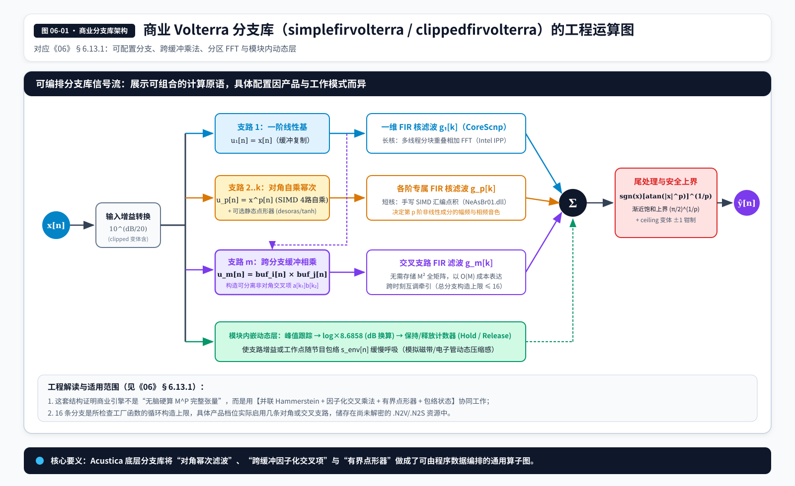
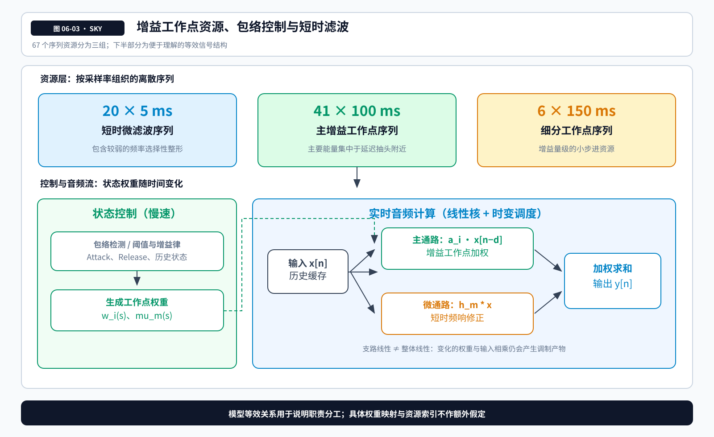
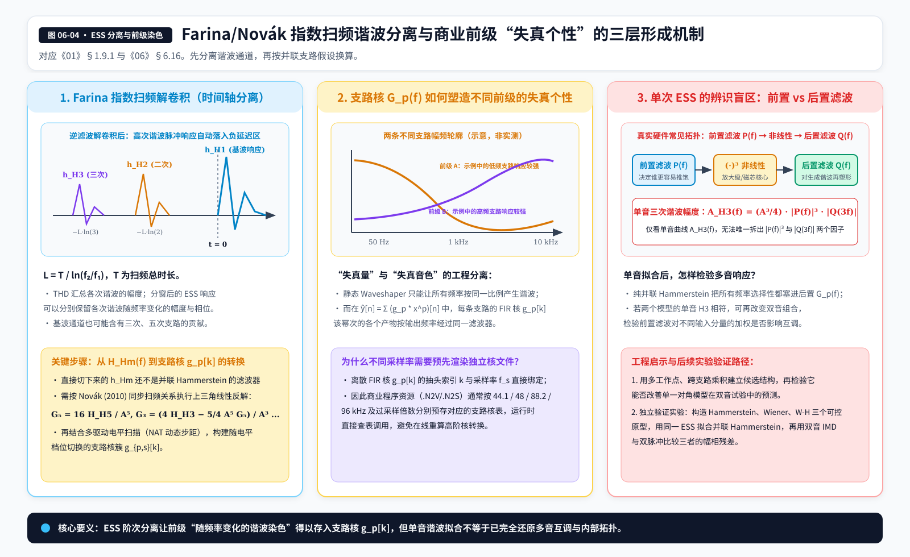

# 06 从 Volterra 理论到商业音频建模：Acustica Audio 的技术发展史

[在线阅读本章（完整合订版）](https://excillex-marisa.github.io/volterra-wiki/#chapter-06)

> **版本：v11 · 2026-11-15 · 增补现代商业音频建模的历史衔接**
> **所属系列：Volterra Wiki**
> **阅读顺序：**《00_前置概念与术语约定_图文版.md》→《01_Volterra级数_图文版.md》→《02_从Volterra到神经网络_模型辨识与NAM.md》→《03_混合建模训练边界与实时约简.md》→《04_高级系统辨识_非线性算子与混沌分解.md》→《05_物理约束与实时代理建模.md》→本章。
> **配图说明：** 本章配有 4 张工程架构与测量机制 SVG 图（`figures/06-*.svg`），请与 `figures/` 目录保持同级相对路径。
> **定位：** 作为全书最后一章，通过 Acustica Audio 的演进，将测量、模型约简、商业部署与证据边界串联起来。以 Acustica Audio 为主线，同时交代 Sintefex、Focusrite 和非线性扫频研究构成的技术背景。
> **阅读说明：** 本章把厂商公开的技术定义、代表性产品的结构实例和测量特征放在同一套数字建模语言中解释。商业产品的资源配置会随版本与工作模式变化。文中的数学等效结构主要解释可观察的系统行为；涉及厂商内部实现的推断，会标明证据来源与适用范围。

## 历史桥梁：从十九世纪的泛函表示到今天的商业音频模型

如果把《01》的发展史与《02》的神经网络史放在一起，现代音频建模就有了两条清楚的知识来源。第一条是 **Volterra—Wiener—Lee–Schetzen** 所代表的核表示与实验辨识传统：先建立可用于分析非线性历史响应的模型，再尝试通过测量估计参数。第二条是 **神经网络—非线性动力系统辨识—音频设备学习** 的路线：利用可训练的函数族从输入输出数据中学习复杂映射。两条路线具有各自的数学结构与发展脉络，后来在音频系统辨识和混合建模中逐渐相遇。

商业音频插件还面对第三项约束：**怎样把模型变成稳定、低延迟、CPU 可负担并可随旋钮连续变化的软件产品**。因此，理论核能否辨识、测量结果能否可靠复现、核数据和参数能否高效组织，以及用户操作时内部状态能否连续更新，都是独立的工程问题。一个产品即使使用 Volterra 型分支，也可能同时包含 FIR/IIR、静态非线性、包络检测器、状态插值或神经处理；理解整条处理链，需要考察不同模块的具体分工。

在这个背景下，二十世纪末至二十一世纪初出现了几项推动现代音频建模的条件：计算机卷积能力逐步提升，Sintefex 等厂商探索动态卷积，Angelo Farina 于 2000 年发表指数正弦扫频的非线性响应测量方法，随后 Nebula 将采样响应数据与通用播放引擎结合起来。这里还要区分 **ESS 分离得到的谐波响应**、按额外假设转换后的 **并联 Hammerstein 支路核**，以及完整多维 **Volterra 核**；单次测量能够识别的系统结构，总会受到激励方式和模型假设的限制。[S1][S2][S3][S4]

本章选择 Acustica Audio 作为主要商业案例，是因为 Nebula、Acqua、Hyper 与 NOVA 的演进能够让我们看到模型表示、测量技术、实时算力与动态控制之间的长期权衡。Sintefex/Focusrite、神经音频建模和电路求解是相邻但不同的技术路线；本章会在必要处交代它们，重点仍放在 Acustica 产品体系内部的工程发展。由此，整套 Wiki 的三段历史便连为一体：**理论怎样产生、表示方法怎样交汇、工程产品怎样落地。**

## 6.1 一个更现实的问题：数学理论怎样变成可以出售的音频插件？

在前面几章，我们已经知道 Volterra 级数能够用不同阶数的核来描述一类具有记忆的非线性输入—输出关系，也了解为什么完整 Volterra 模型会受到核维度、参数数量和运行成本的限制。但知道一个理论能够表示某种系统，与真正做出一款音频插件，中间还隔着很长的工程距离。从真实设备建立 Volterra 模型，需要设计测试信号、采集输入输出数据、处理转换链和噪声误差，再选择模型结构并将其优化为实时算法。模拟设备的可听特征还可能随输入电平、旋钮、包络、时间和历史工作状态变化，因此模型需要相应的参数与状态组织方式。

Acustica Audio 的发展历程恰好能帮助我们理解这段距离。这条路线先把设备视作可测量的声音处理系统，通过响应数据组织模型，避免完整高阶多维核直接计算带来的维度膨胀，构建可以保存、组织并播放测量结果的技术平台。回顾其早期 Nebula、后来的 Acqua Engine，以及 Hyper、Aria、MUST 和 NOVA，我们看到的是一条逐步把**采样数据、非线性运算、动态控制、专用算法与神经建模组合起来**的商业工程路线。

这里先明确一条核心判断准则：**“以 Volterra 为理论基础”代表采用非线性核展开框架，而在工程实现上则必然经过特定阶次与结构的约简；同样，“插件听起来像某台硬件”代表外部输入—输出特征吻合，其内部实现路径既可以是响应库插值，也可以是参数化电路或混合模型。** 商业产品真正需要解决的问题，是在听感、测量准确性、CPU、内存、延迟、可调性与开发成本之间找到能够量产的平衡。

## 6.2 早于 Nebula 的技术背景：普通卷积为什么不够？

最早被广泛运用的脉冲响应采样，可以把房间、箱体和某些近似线性设备的响应保存成一条 FIR 滤波器。我们给房间一个测试信号，测出它的脉冲响应，再将未来的音频与这条响应进行卷积，就能够复现大量线性声学特征。然而，普通卷积捕捉到的是**某种固定工作条件下的线性映射**。如果一台前级的谐波结构随输入电平改变，或者一台压缩器在瞬态到来时才开始降低增益，单条固定脉冲响应显然不够。

正是在这个历史背景下，Sintefex 推出了 FX8000 Replicator，发展了称为 Dynamic Convolution 的技术，并将相关技术应用于 Focusrite 的 Liquid Channel 与 Liquid Mix。Focusrite 的官方历史明确把 2004 年推出的 Liquid Channel 归于与 Sintefex 的合作：它将模拟输入级、可变阻抗匹配与数字建模组合在一起。Sintefex 则公开说明，其专利涵盖了动态卷积，以及通过保存模拟系统参数来模拟动态处理器的技术。[S1][S2]

这一段历史非常重要，因为它说明在 Nebula 之前，商业音频领域就已经开始研究怎样让卷积模型随电平与动态状态变化。理清这两条路线的先后关系与专利边界，有助于准确理解 Acustica 后来真正值得研究的技术创新。

## 6.3 2000 年：Angelo Farina 为非线性采样提供了关键测量工具

另一条重要的技术前史来自声学测量。2000 年，Angelo Farina 在第 108 届 AES 大会上发表了《Simultaneous Measurement of Impulse Response and Distortion with a Swept-Sine Technique》。这项研究提出使用指数正弦扫频，在近似时不变、弱非线性的条件下，通过解卷积将线性响应与不同谐波产生的响应在时间位置上分离。过去测量频响和测量高次谐波往往是分开的流程；这种方法使我们能够用一次设计得当的激励，得到多阶失真响应的重要信息。[S3]

它对音频建模的意义在于：**设备的非线性得以被记录为随频率、相位和时间演化的多阶响应数据，从而超越了单一标量 THD 指标的限制。** 例如，一台前级可能在低频产生较明显的二次谐波，而在高频呈现不同的三次谐波行为。

正如《01》第 1.9.1 节所严格推导，这里涉及三个不同层级的数学对象：扫频解卷积后在负时间轴分离得到的**高次谐波脉冲响应（HIR）**，经 Antonín Novák 上三角矩阵逐级回代反解得到的**对角 Volterra / 并联 Hammerstein 支路核 $`g_p[k]`$**，以及一般意义上包含全部跨时刻乘积坐标的**完整高维 Volterra 核 $`h_p[k_1,\ldots,k_p]`$**。[S4] 区分这三个层级，是客观评估商业采样建模能力的理论基石。

## 6.4 2005—2007 年：Nebula 是怎样诞生的？

关于早期历史，我们有一份关键的第一手材料。2007 年 8 月 6 日，Hispasonic 发表了对主要开发者 Giancarlo Del Sordo 的访谈。他回顾说，自己最初只是想在远离工作室的情况下，把熟悉的模拟设备和 Lexicon 等效果带到笔记本电脑上。2005 年中期，他开始尝试制作 Nebula 原型；项目最初甚至未以大众市场或严格实时运行作为首要目标。[S5]

Giancarlo 在访谈中还特别提到 Sintefex 的启发及其专利约束。团队在寻找不同于 Sintefex 专利的技术路线过程中，将 Volterra 理论与 Angelo Farina 的研究结合起来：2005 年 9 月出现最初的 EQ 模型，约三个月后出现最初的压缩器模型，2006 年 3 月发展出失真模型，2006 年 7 月又实现了首个 flanger。到 2007 年，Nebula 已经从重放 EQ 脉冲响应扩展至采样和复现多类随时间与电平改变的效果。[S5]

这组日期同样提供了清晰的研发方法论启示：**产品能力是在连续实验中由简入繁逐步扩张出来的**——先用最简单、最容易验证的 EQ 建立流程，再扩展到压缩与失真，最后处理更复杂的时变效果。

同一时期的《Sound On Sound》报道将 Nebula 2 Free 描述为利用 Diagonal Volterra Kernels 及实时核选择、变形技术的处理系统，并提到其矢量引擎能够受到 LFO 和包络等控制源驱动。[S6] 这是当时行业媒体对早期产品的公开记录，代表了 Nebula 早期的核心数学定位。

## 6.5 Nebula 的核心架构创意：把“设备采样”做成数据与播放平台

普通软件采样器存储乐器音符在不同力度、音高和演奏状态下的录音，然后由播放引擎决定此刻应该调用哪段声音。Nebula 的核心创意则是将采样对象从“乐器发出的声音”转换为“硬件对输入信号的处理算子”：它保存硬件经测量后形成的各阶处理响应、参数及控制数据；当实时输入音乐时，再由引擎动态选择、插值并计算相应的处理路径。

Acustica 官方对 N4 的介绍也沿用了这种思路：它的工作方式接近软件采样器，载入的是 vectors、programs 和界面等建模资源。Nebula 库可以由其专有采样工具 NAT 制作；后来的 Universal Acqua Engine 负责底层音频处理，N4 则负责库与界面的组织。[S7]

我们可以把这套平台抽象为三个功能层：
1. **测量与转换层**：将设备在若干工作点的扫频响应转化为可存储、可索引的核资源；
2. **动态控制层**：根据输入包络、面板旋钮、LFO 调制信号等决定当前时刻应当激活或插值哪些工作点核资源；
3. **实时重放层**：利用分区快速卷积与分支合成算法，将选定的核资源高效作用于实时音频流。

这种架构使模型能够保留许多难以从理想电路图直接推导的细节，例如变压器非理想频响、相位旋转与不同增益下的谐波染色；同时，其外推表现也受制于采样空间的覆盖密度与控制器的状态表达能力。

## 6.6 V.V.K.T.：Vectorial Volterra Kernels 的公开定义与历史阶数演进

Acustica 将其核心技术称为 **Vectorial Volterra Kernels Technology (V.V.K.T.)**。其技术介绍明确使用了非线性卷积、Volterra 核、向量化数据组织与动态控制等术语，说明其能够管理大规模核数据，并使 LFO、包络跟随器与动态模块共同参与控制，同时重现多阶谐波响应。[S8] 这表明厂商将**核数据的树状/向量化管理、平滑状态选择与实时卷积调度**视为核心工程架构。

在评估商业参数宣传时，保持数学概念的精确对应尤为重要：
- 厂商声称能够管理多达十万个元素，通常指整个多维度采样库（跨越不同旋钮档位、不同输入电平步距、不同阶次及脉冲长度）中管理的数据规模，而非在单个采样点上直接计算十万个独立的多维交叉张量项；
- 界面或文档中出现的“最多九个谐波（9 harmonics / Volterra orders）”与完整九维核张量不同。两份可直接核验的早期学术文献清晰记录了历史演进：Armelloni 与 Farina (2005) 在非线性时变系统卷积研究中指出，面对其测试的强失真吉他效果，五阶对角 Volterra 近似尚显不足，建议该具体实验考虑扩展至十阶；[S28] Farina 在 2008 年的公开讲座第 80 页则明确记录，**当时的 Nebula** 使用最高五阶的对角 Volterra 核，并展示了重建高次谐波的局限。[S29] 至于现代实现中的等效谐波阶次，还可能由“多支路核 + 静态点形器 + 跨支路乘积”协同产生，因此判断实际核结构，需要结合幅度增长规律、互调测试和独立的结构证据。

## 6.7 多工作点对角核插值与因子化非对角交叉记忆

对于单个固定工作点，对角 Volterra / 并联 Hammerstein 支路的输入—输出关系为：

```math
\hat{y}[n]=\sum_{p=1}^{P}\sum_{k=0}^{M_p-1}g_p[k]x^p[n-k].
```

当引入多工作点采样（Vector）与动态状态控制器后，设第 $`s`$ 个离散工作点拥有一组支路核 $`g_{p,s}[k]`$，并由控制向量 $`\mathbf{z}[n]`$（包含输入包络 $`s_{\mathrm{env}}[n]`$、面板旋钮位置等）决定各工作点的插值权重 $`w_s(\mathbf{z}[n])`$，则状态加权对角核模型可写为（注意此处内层求和上限严格为 $`M_p-1`$）：

```math
\hat{y}[n]=\sum_s w_s(\mathbf{z}[n])\sum_{p=1}^{P}\sum_{k=0}^{M_p-1}g_{p,s}[k]x^p[n-k].
```

**这一解释性模型说明：即使每个静态工作点仅存储对角支路核 $`g_{p,s}[k]`$，一旦权重 $`w_s(\mathbf{z}[n])`$ 随过去输入包络动态改变，当前时刻的核系数就与过去时刻的输入幅度发生了乘性耦合，从而在整体输入—输出行为上涌现出等效的跨时刻动态记忆。**

在结构化分支库中，除了单缓冲幂次处理，还可以引入**将一个已滤波分支与另一个已滤波分支逐点相乘**的运算。设两条分支缓冲分别为线性滤波输出 $`u[n]=\sum_{i=0}^{M-1} a[i]x[n-i]`$ 与 $`v[n]=\sum_{j=0}^{M-1} b[j]x[n-j]`$，将二者逐点相乘即得：

```math
u[n]\cdot v[n] = \sum_{i=0}^{M-1}\sum_{j=0}^{M-1} a[i]b[j]\,x[n-i]x[n-j].
```

这恰好构成了《01》第 1.14.6 节推导的**秩-1 因子化非对角二阶交叉核** $`h_2[i,j]=\frac{1}{2}(a[i]b[j]+a[j]b[i])`$。这说明只需两条一维滤波支路和一次逐点乘法，就能以约 $`O(M)`$ 的成本构造一个因子化非对角交叉核；在具体产品中是否采用该结构、采用多少条支路，仍须由实际模型配置与输出行为共同约束。

## 6.8 NAT：从采样模板到可复用设备库

2014 年，《Sound On Sound》邀请 Nebula 库开发者 Tim Wisecup 介绍如何利用 NAT 为前级与混响制作采样程序，展示了校准输入输出电平、选择 Online / Offline 模式、设置动态采样点与电平步距以及选择谐波核数量的具体工作流。[S9]

这揭示了一个商业化建模系统的关键经验：采样质量不仅取决于数学公式，更取决于**测量网格在非线性剧变区（如接近饱和膝点的几个 dB 内）的采样点分布密度、校准精度与数据约简策略**。同时，该指南明确指出：采集前级或 EQ 的染色响应，与完整捕获压缩器的 attack、release 和程序依赖增益控制属于不同性质的任务；在工程上，完全可以将采样得到的谐波染色模型与独立的常规动态压缩算法组合使用。[S9] 这一早期实践直接印证了《03》的核心论点：让测量核承担频响与短时谐波染色，让显式状态算法承担动态增益控制。

在授权形态上，Acustica 当前面向第三方开发者的商务页面介绍了基于模板的 NAT 4，而其 2025 年更新的 N4 / N4 Player 功能比较表显示面向普通终端用户的 N4 产品包不包含独立的 NAT 采样器授权。[S10][S11]

## 6.9 从 Nebula 到 Acqua：从通用采样播放器到独立商业产品线

Nebula 早期定位为能够载入第三方设备库的通用效果采样器；随后出现的 Acqua 产品线则围绕特定目标硬件构建独立插件，把多个测量程序、功能模块、旋钮联动映射和专用 UI 整合为完整的通道条或处理器。[S7]

在这一步，核心工程挑战从“测准单个静态工作点”转向了**“如何在用户连续旋转旋钮或输入包络剧烈变化时，平滑、无伪影地穿过大量离散测量工作点”**。Acustica 公开介绍的 Smooth3 技术正是为了抑制快速切换核时产生的瞬态咔哒声与相位跳变，引入了逐样本插值机制。[S8]

## 6.10 实时计算的代价与分区快速卷积引擎

一个多阶多工作点的采样式非线性模型若在时域逐样本直接计算长 FIR 卷积，CPU 消耗将极为高昂。Giancarlo 在 2007 年访谈中提到，最初的 Nebula 甚至未以实时运行作为先决目标，之后才持续进行多线程与算法级性能优化。[S5][S8]

以现代分支卷积引擎的实现方式为例，其计算底座可包括**非均匀分区快速卷积（Partitioned Fast Convolution）调度器**、FFT 正逆变换、频域复数乘累加、按分区延迟线叠加以及针对短核的 SIMD 点积例程，并结合 Intel IPP、AVX2 / AVX-512 等 SIMD 加速的短核运算。这类异构卷积计算可根据各支路核 $`g_p[k]`$ 的长度与块配置，在短核时域处理与长尾分区频域处理之间分配计算成本。

## 6.11 2019 年与 2022 年：AI 预设、Hyper 与显式动态控制器的演进

2019 年，Acustica 宣布将人工智能与深度学习用于生成可随音频素材自动匹配的参数预设，这属于控制层与工作流辅助范畴。[S12] **2022 年引入的 Hyper（及随后的 Hyper2）技术**则聚焦于底层音频引擎的 CPU 效率提升与压缩、饱和、滤波算法的彻底重构。厂商在 Hyper 技术说明中坦诚指出：早期引擎受限于纯采样架构与计算成本，对压缩器的 attack、release 与 look-ahead 时间存在较多限制。[S13]

在 Tiger 压缩器的官方介绍中，新一代动态控制架构得到了具体说明：包含采样压缩曲线、从实测硬件提取多段 attack / release 恢复包络形状、针对瞬态与持续音设置双探测器（Dual Detectors）加权、以及独立的 look-ahead、sidechain 滤波与过采样。[S14] 这证实了现代 Acustica 动态插件已全面演进为**“非线性采样响应核 + 复杂显式状态动态控制器”的灰盒混合架构**。

## 6.12 Hyper3、Aria 与 MUST：FIR/IIR 混合滤波、抗混叠与合成器扩展

近年来 Acustica 的技术演进主要体现在三个方向：
1. **Hyper3 的 FIR + IIR 混合线性响应**：在 SALT 与 Sand 4 Ultra 等产品说明中，厂商明确指出**前段关键的早期瞬态与相位响应保留 FIR 处理，而漫长的低频共振尾部则交由 IIR 极点滤波器实现**。[S15][S16] 这种“短时 FIR + 长尾 IIR”的分工与我们在《03》《04》中讨论的“FIR + 极点基（Laguerre/Kautz）”在工程思想上高度一致，大幅降低了长尾响应的 FFT 分区内存与 CPU 开销。
2. **Aria 与抗混叠更新**：在 Tiger Mix Ultra Flat、Amber 4 Ultra 与 Sand 4 Ultra 等产品中，Aria 引擎伴随实时动态计量显示与更新的抗混叠（Anti-Aliasing）算法推出。[S16][S17]
3. **MUST（Modular Unified Synthesis Technology）**：在 THING 等虚拟合成器产品中，厂商将模拟电路行为建模与自家的非线性卷积/动态 Volterra 技术结合，向需要实时受控自激振荡器与滤波器谐振的电子乐器领域延伸。[S18]

## 6.13 NOVA 与商业压缩器：结构化核、状态控制和神经模型如何协作？

Acustica 在 YELLOW 的产品资料中将 **NOVA（Neural Optimized Volterra Audio）** 描述为结合 Vectorial Volterra Kernels 与神经音频建模的处理体系。对这类技术的理解需要区分三层对象：第一，分支库能够表达哪些非线性音频运算；第二，具体产品部署了哪些资源及质量档；第三，包络、增益律和神经计算怎样在实际音频流中发挥作用。即使不同产品使用相似的基础引擎，也可能选择完全不同的数据资源和动态控制路径。[S19][S20][S21]

### 6.13.1 可编排 Volterra 分支：线性核、跨支路乘积与有界点形器

一类可编排非线性卷积结构由多个处理分支组成。单条分支可以包含信号幂次 $`x^p[n]`$、一维 FIR 滤波、静态 Waveshaper 与输出权重；把多个滤波支路 $`u[n]`$ 与 $`v[n]`$ 逐点相乘，则能产生《01》第 1.14.6 节介绍的因子化非对角核。对于这类结构，存在 `simplefirvolterra`、`clippedfirvolterra` 等分支执行形式：前者面向较直接的 FIR／多项式组合，后者可以额外安排点形器等强非线性处理。一个模块可以组织有限数量的支路，实际启用支路数还取决于具体产品的程序配置与运行模式。



*图 06-01｜结构化非线性分支库的运算抽象：一维 FIR、幂次、跨支路乘法与状态权重能够在同一条实时计算图中组合。*

### 6.13.2 `simplenova`：软膝、双路径权重与控制状态连续性

假设两条音频路径分别输出 $`u[n],\;v[n]`$，由电平检测得到平滑权重 $`g[n]\in[0,1]`$。一种合理的双路径混合形式是：

```math
\hat{y}[n]=\bigl(1-g[n]\bigr)u[n]+g[n]v[n].
```

在 `simplenova` 型控制中，可以先对输入能量做软膝映射，再用上升与下降速率不同的平滑器更新 $`g[n]`$；备选路径持续维护输入历史，有助于降低切换时的冷启动瞬态。这种结构说明，**模型融合需要同时兼顾各条路径的建模精度，以及路径之间的相位、延迟与状态连续性**。双路径混合原语描述的是控制与路由方式；具体产品的神经网络拓扑及实时执行路径，还需要运行数据确认。


*图 06-02｜电平触发的双路径软膝渐变、非对称平滑与备选路径状态更新。*

### 6.13.3 有界静态点形器与有限阶 Volterra 的互补作用

静态点形函数（Pointwise Waveshaper）为 Volterra 型分支提供了另一种非线性表达。以广义反正切族为例，令 $`p>0`$：

```math
f_p(x)=\operatorname{sgn}(x)\left[\arctan\left(\lvert x\rvert^p\right)\right]^{1/p}.

其中 $`\operatorname{sgn}(x)`$ 为符号函数，$`\arctan`$ 为反正切函数；$`p>0`$ 控制输入幅度进入饱和区间的形状。符号函数使该点形器保持奇对称。
```

其小信号近似为 $`f_p(x)\approx x`$，大信号渐近值为 $`\pm(\pi/2)^{1/p}`$。因此，有界非多项式点形器可以在较低复杂度下补足有限阶多项式在强过载区间缺乏全局饱和上界的问题。结合一维 FIR、分支乘积和电平条件权重，能够在同一套引擎中组合频率相关音色、强非线性与工作点变化，但仍须重视抗混叠与多路径延迟对齐。

### 6.13.4 YELLOW：Legacy、Nova 与 Nova HQ 的不同资源配置

YELLOW 将三种质量选项组织为不同的处理资源：**Legacy** 对应 HYPRE 型 Volterra 资源，**Nova** 对应 HYPRE_N 资源，**Nova HQ** 对应 HYPRE_NHQ 资源。Nova 系列另外配有专用 `NOVANAM.N2K` 数据容器（约 $`15.4\,\mathrm{MB}`$）。这说明 NOVA 家族至少包含独立命名的神经相关数据资源，也为“神经与向量化 Volterra 协同”的产品定位提供了一个具体的资源组织实例。

资源文件名和体积提供了资源组织的线索。目前可以确认：**YELLOW 具有纯 Volterra 与 NOVA 家族的不同程序资源。** 神经网络的精确拓扑、加载时机、融合位置和实时执行路径，则需要结合运行数据进一步辨识。这种多质量资源架构，也为单一品牌下按计算成本选择不同建模方案提供了设计参照。[S19]

### 6.13.5 SKY SA-1A：增益状态资源与音频短核的不同职责

SKY SA-1A 是面向 Stam Audio SA-1A 光电压缩器的模型，采用了与上述 YELLOW 前级不同的数据编排。以 $`48\,\mathrm{kHz}`$ 的 HYPERCOMP 资源为例，可见到 **20 个 5 ms 短序列、41 个 100 ms 主序列以及 6 个 150 ms 长序列**，合计 67 个序列资源。尤其是 41 个主序列，大部分能量集中在约第 72 个采样延迟位置，频率响应近乎平坦，主要表现为不同工作点的增益变化；短序列则承担较弱的频率选择性修正。

因此，把这组资源理解成**测量增益工作点、平滑特征和微弱滤波整形的组合**，比一概把全部 67 个序列解释成高阶非线性音色 IR 更合适。一个面向教学的等效模型为：

```math
\hat y[n]=\sum_i w_i\bigl(\mathbf s_{\mathrm{env}}[n]\bigr)a_i x[n-d]
+\sum_m\mu_m\bigl(\mathbf s_{\mathrm{env}}[n]\bigr)(h_m*x)[n].
```

这里 $`a_i`$ 是离散增益状态，$`h_m`$ 是短时整形 FIR，$`\mathbf s_{\mathrm{env}}[n]`$ 包含包络相关的控制状态；权重 $`w_i`$ 和 $`\mu_m`$ 是**解释性表示**，需要与已确认的产品内部插值公式区分。主序列中出现的多次回落和重新上升，可以提示存在分段组织的工作点轴，而具体光电元件状态变量的对应关系还需要额外的测量证据。



*图 06-03｜SKY 类状态条件化核模型的教学抽象。预制序列资源与实时控制状态分工不同，线性支路与非线性控制可以组合形成整体非线性处理。*

### 6.13.6 SNOW：离散程序选择与连续包络控制

SNOW 类压缩器展示了另一种有实际价值的分工：把可枚举的档位型控制配置为若干核程序，而将连续的阈值、起音、释放与动态增益控制留在实时检测回路中。例如 Mode 的三种检测方式可理解为前馈 RMS、反馈 RMS 与反馈峰值等拓扑选择，Ratio 关联另一组压缩/释放特性程序，两组离散选项构成最多 $`3\times3`$ 的组合维度；Attack、Release、Threshold 等连续参数则无须各自拥有无限密度的预制核库。

这里的关键结论是**结构离散化与动态参数连续化可以共存**。资源程序负责一个工作配置的频率与谐波特征，检测器、增益律和包络状态负责跨时间的实际增益动作。对测量密集型产品而言，这往往比为所有旋钮笛卡尔积组合都保存完整大规模资源更有实际可行性。不同 SNOW 程序的模式映射，应结合对应产品版本与程序配置分别解释。

### 6.13.7 SKY 的外部测量：复刻准确度与机理归因需要分开评价

在 2026 年 11 月 9 日的 SKY SA-1A Beta Vista 测量中，以 $`100\,\mathrm{Hz}`$、约 $`5\,\mathrm{dB}`$ 增益衰减为例，$`48\,\mathrm{kHz}`$ 下插件 THD 为 **5.46%**，目标硬件参考为 **5.59%**；当采样率提高到 $`96\,\mathrm{kHz}`$，插件结果为 **4.96%**。在 $`1\,\mathrm{kHz}`$、FIXED 模式的另一组条件下，插件 THD 约 **1.01%**，硬件参考约 **0.92%**。MANUAL 模式的 $`1\,\mathrm{kHz}`$ THD 约 **0.470%**，并可观察到 $`500\,\mathrm{Hz}`$ 与 $`1500\,\mathrm{Hz}`$ 附近的亚谐波谱线（约 $`-61.4`$ 与 $`-60.5\,\mathrm{dBc}`$）。[S31]

这些数值说明在给定测试条件下，模型的谐波响应可以接近目标硬件；具体失真机制还需通过冻结控制状态、分离支路等对照测试辨识。更能说明动态问题的，是相同旋钮 75/75 在不同前导输入下出现约 **163 ms** 与 **327 ms** 的释放 $`T_{63}`$ 差异；这说明系统辨识应覆盖不同输入历史，并结合稳态与瞬态激励。测试时应同时记录输入电平、GR、阈值、采样率、FFT 窗口、控制模式和状态预处理，才能把结果正确用于模型判别。[S31]

### 6.13.8 前级、EQ、磁带与压缩器：让每个子系统承担合适的任务

不同模块对核、状态和参数控制的要求差异很大。前级常围绕短时谐波、互调与幅相关频响构建多工作点非线性分支；EQ 的主要任务是重建线性频响及随控制旋钮变化的滤波参数，在电平依赖显著时还可能与非线性或工作点状态共同作用；磁带除了饱和染色，还可能需要明确表示磁滞、走带抖晃、变速重采样与慢速动态；压缩器则必须把检测器、增益律、程序依赖起音/释放和音频路径增益动作作为核心系统。

FIR、Waveshaper、包络、重采样与路由等计算原语可以在统一的 DSP 平台中复用，并组合成面向不同设备的 Volterra 与状态混合结构。尤其对于压缩器，**明确保存和更新动态状态通常比无限延长前馈记忆核更经济**；在符合相关连续性和衰减记忆条件的数学讨论中，Volterra 的逼近能力仍然存在，与工程选择并不矛盾。

## 6.14 同一计算平台上的不同产品：YELLOW、SKY 与 TAUPE Studio

YELLOW、SKY SA-1A 与 TAUPE Studio 可以用于解释“公共运算引擎”和“具体音频模型”之间的差别。前者提供分区卷积、静态非线性、动态状态、参数映射及跨路径混合等可复用原语；后者由产品专属的核资源、控制程序与信号路由决定其声音功能。YELLOW 具有 Legacy / Nova / Nova HQ 的分级资源组合，SKY 更突出光电包络驱动的增益工作点资源，TAUPE Studio 则还需要走带速度与 Wow & Flutter 对应的变速/分数延迟处理。通过在同一平台中替换数据、状态模型与处理链，能够实现差异很大的音频设备建模目标。

因此，分析一款商业模型时，可以沿着以下四个层次展开：**音频主通路、状态控制通路、核资源组织与实时执行预算**。这也与《03》第 3.8–3.9 节的混合架构划分保持一致。

## 6.15 Acustica Audio 商业建模路线演进时间线（2000–2026）

| 时间节点 | 可核实的里程碑事件 | 对非线性音频建模技术史的意义 |
|---|---|---|
| **2000 年** | Angelo Farina 发表指数正弦扫频（ESS）论文 [S3] | 实现单次测量在时间轴上同时分离线性脉冲响应与各次谐波脉冲响应 |
| **2004 年** | Focusrite 与 Sintefex 合作推出 Liquid Channel [S1][S2] | 确立 Nebula 之前的商业动态卷积（Dynamic Convolution）与多电平硬件采样先河 |
| **2005 年中–2006 年** | Giancarlo Del Sordo 开发 Nebula 原型，相继实现 EQ、压缩、失真与 Flanger [S5] | 在规避 Sintefex 专利的同时，将 Farina 扫频与对角 Volterra 核重放转化为通用插件平台 |
| **2005–2008 年** | Armelloni & Farina (2005) 及 Farina (2008) 讲座记录当时 Nebula 采用最高 5 阶核 [S28][S29] | 提供早期商业对角 Volterra 实现的确切阶数上限与强失真边界证据 |
| **2010 年** | Antonín Novák 等发表同步扫频（SSS）与广义 Hammerstein 反解理论 [S4] | 严格建立高次谐波脉冲响应（HHIR）向上三角并联 Hammerstein 支路核 $`g_p[k]`$ 的解析转换 |
| **2014 年** | 《Sound On Sound》刊登 NAT 采样实操长文 [S9] | 公开多电平采样步距配置、谐波核截断及“采样染色 + 独立压缩算法”混合思路 |
| **2010 年代中后期** | Acqua 独立插件线成熟，引入 Smooth3 逐样本核插值 [S7][S8] | 解决多离散工作点在旋钮调节与动态调制下的平滑过渡与伪影抑制 |
| **2019 年** | 引入 AI 自适应预设辅助系统 [S12] | 机器学习首先在控制参数推荐层落地，未改动底层音频卷积核 |
| **2022 年–2024 年** | 推出 Hyper / Hyper2 / Hyper3、Aria 与 MUST 架构 [S13–S18] | 引入多探测器显式动态控制、FIR（前段瞬态）+ IIR（长尾低频）混合滤波、抗混叠升级与电路—卷积混合乐器合成 |
| **2026 年 3 月–11 月** | 发布 YELLOW、FIRE THE TUBE、AERO 2、SALT 2、CREAM 3、GOLD 6 及 SKY SA-1A，全面推广 NOVA 技术 [S19–S30][C1] | Volterra 与神经建模协同成为可选产品路线，并逐渐形成多质量资源、结构化核、包络状态和动态滤波的组合方案 |

## 6.16 ESS 阶次分离与多路径架构如何共同塑造商业前级的失真个性？

结合《01》第 1.9.1 节的并联 Hammerstein 上三角反解方程与本章的架构分析，我们可以完整回答音频工程师最关心的问题：为什么商业采样前级（如英式变压器前级、美式运放前级与电子管前级）能够呈现出鲜明且各异的“频率相关失真个性”？

1. **各阶支路 FIR 核 $`g_p[k]`$ 对谐波幅相轮廓的独立雕刻**：经过上三角回代反解剥离高阶回流后，每一阶支路滤波器 $`G_p(f)`$ 独立记录了该阶非线性产物随频率变化的幅度与群延迟。例如，输入/输出变压器在低频（$`50\sim 200\,\mathrm{Hz}`$）接近磁芯饱和时，会使 $`G_2(f), G_3(f)`$ 在低频段显著抬升并伴随相位旋转；而放大级局部负反馈与高频摆率效应则体现在高阶支路的中高频幅相特征上。前级的“音色指纹”首先就编码在这些各阶异构的 $`G_p(f)`$ 滤波器形状中。
2. **多电平向量采样与 `simplenova` 渐变对工作点迁移的动态补偿**：单次固定电平的 ESS 只能测得前后置滤波的综合乘积 $`\lvert P(f)\rvert^p \lvert Q(pf)\rvert`$。NAT 的多驱动电平采样与 NOVA 的 `simplenova` 能量触发双路径渐变，通过随输入能量平滑切换/融和低驱动与高驱动支路核簇，在工程上动态逼近了硬件频响与饱和膝点随输入电平迁移的行为。
3. **跨分支缓冲乘法与有界点形器对多音互调及强过载的补全**：纯对角支路缺乏跨时刻乘积且受多项式收敛半径限制。引擎中引入的**跨缓冲乘法原语**（构造 $`u[n]\cdot v[n]`$ 因子化非对角交叉项）与 **`desoras` 等有界点形器**，恰好在低 CPU 开销下弥补了纯对角 Volterra 在多音差频互调与大信号软限幅边界上的短板。



*图 06-04 | Farina 指数扫频 (ESS) 谐波分离、Novák 上三角阶次反解与前级染色机制。展示负时间轴谐波脉冲响应 $`H_{Hm}`$ 如何经阶次反变换映射为支路核 $`g_p[k]`$，以及单次 ESS 在前后置滤波 $`\lvert P(f)\rvert^3 \lvert Q(3f)\rvert`$ 拆分上的可辨识性边界。*

## 6.17 从商业案例回到系统辨识：模型选择的统一判断

回顾本章的 Nebula、NAT、Hyper、NOVA，以及 SKY、YELLOW、SNOW 等不同产品，我们可以将现代数字建模归纳为四个可以独立设计的层级：

| 层级 | 需要解决的技术问题 | 可能采用的实现 |
| --- | --- | --- |
| **响应表达** | 怎样描述输入信号的短时频响、谐波与互调？ | FIR / IIR、结构化 Volterra、静态 Waveshaper、分支乘积 |
| **动态记忆** | 怎样描述起音、释放、磁滞、热状态及工作点迁移？ | 包络检测器、显式状态方程、状态资源表、递归神经网络 |
| **参数变化** | 旋钮如何连续影响频响、工作点和内部动力学？ | 程序切换、工作点插值、物理参数更新、超网络生成权重 |
| **实时部署** | 怎样控制延迟、CPU、内存、抗混叠和状态连续性？ | 分区 FFT、SIMD、过采样、多速率、模型分档与代理约简 |

这些层级提供了一套具体的研究顺序：先辨认资源与处理通路，再测量不同控制状态和输入历史下的行为，最后结合实时运行证据解释模型的分工。神经数据容器、FIR 型序列和单次 THD 测量各自提供不同侧面的信息，需要放在同一套实验框架中考察。显式状态控制还可以降低前馈记忆成本，与 Volterra 在相应函数类中的理论逼近价值相互补充。

对研究者来说，更有实际价值的提问顺序是：**先测量目标系统的可观测行为，再选择表示短时非线性与长时动态的不同结构，最后用跨工作点验证判断增加的模型复杂性是否真的值得。** 这样才能把商业产品的技术经验转化为可检验、可比较、可迁移的系统辨识方法。

---

## 本章参考资料与进一步阅读

- **[S1] Focusrite, *Our Story*.** 包含 2004 年 Liquid Channel 与 Sintefex 合作的官方回顾。https://us.focusrite.com/about-us
- **[S2] Sintefex Audio, 官方网站技术与专利介绍。** 说明 Dynamic Convolution、FX8000 与 Focusrite 产品之间的关系，以及美国专利 7,039,194、7,095,860。https://www.sintefex.com/?src=home&targ=consult
- **[S3] Angelo Farina, 2000, *Simultaneous Measurement of Impulse Response and Distortion with a Swept-Sine Technique*.** AES 第 108 届大会论文 5093。https://aes.org/publications/elibrary-page/?id=10211
- **[S4] Antonín Novák, *Synchronized Swept Sine*.** 包含同步扫频的测量解释、HHIR/HHFR 与广义 Hammerstein/对角 Volterra 的联系。https://ant-novak.com/pages/sss/
- **[S5] Xavier Blanco, 2007, *Acustica Audio: sonido de otra galaxia*.** Hispasonic 对 Giancarlo Del Sordo 的同期专访。https://www.hispasonic.com/reportajes/acustica-audio-sonido-otra-galaxia/2101
- **[S6] Martin Walker (Sound On Sound), 2007, *PC Notes: PCI Soundcard Compatibility Issues* (*Nebula 2 Free* 专题).** 记载 Nebula 2 Free 采用 Diagonal Volterra Kernels 与向量控制。https://www.soundonsound.com/techniques/pci-soundcard-compatibility-issues
- **[S7] Acustica Audio, *Getting started with Nebula*, 2023 年更新。** 介绍 N4、NAT 库、Acqua Libraries 和 Universal Acqua Engine。https://acusticaaudio.freshdesk.com/support/solutions/articles/35000155485-getting-started-with-nebula
- **[S8] Acustica Audio, *The Engine* 与 *V.V.K. Technology*.** 官方对核数据、Smooth3 插值和引擎能力的说明。https://tech.acustica-audio.com/ ；https://tech.acustica-audio.com/vvkt-technology/
- **[S9] Tim Wisecup, 2014, *Sample Your Gear With Acustica Audio Nebula*.** Sound On Sound 的 NAT 采样工作流文章。https://www.soundonsound.com/techniques/sample-your-gear-acustica-audio-nebula
- **[S10] Acustica Audio, *For Business*.** 关于 NAT 4 和第三方开发者采样工具的介绍。https://www.acustica-audio.com/pages/for-business
- **[S11] Acustica Audio, *N4 and N4 Player features comparison chart*, 2025 年更新。** https://acusticaaudio.freshdesk.com/support/solutions/articles/35000093939-n4-and-n4-player-features-comparison-chart
- **[S12] Acustica Audio, *Artificial Intelligence*.** 2019 年引入 AI 预设相关技术的厂商回顾。https://tech.acustica-audio.com/artificial-intelligence/
- **[S13] Acustica Audio, *Hyper Technology*.** 2022 年引入 Hyper、之后发展 Hyper2 的官方介绍。https://tech.acustica-audio.com/hyper-technology/
- **[S14] Acustica Audio, *Tiger*.** 公开描述多段 attack / release、压缩曲线采样和多个 detector 等动态机制。https://www.acustica-audio.com/shop/products/TIGER
- **[S15] Acustica Audio, *SALT*.** 包含 Hyper3 的 FIR/IIR 混合响应技术介绍。https://www.acustica-audio.com/shop/products/SALT
- **[S16] Acustica Audio, *Sand 4 Ultra*.** 包含 Hyper3、Aria、抗混叠与 FIR/IIR 分工说明。https://www.acustica-audio.com/shop/products/SAND
- **[S17] Acustica Audio, *Tiger Mix Ultra Flat*.** 包含 Hyper3、Aria 与抗混叠技术说明。https://www.acustica-audio.com/shop/products/TIGERULTRA
- **[S18] Acustica Audio, *THING*.** 官方关于 MUST 将电路行为建模与卷积式技术结合的介绍。https://www.acustica-audio.com/shop/products/THING
- **[S19] Acustica Audio, *YELLOW*.** NOVA (Neural Optimized Volterra Audio) 的官方定义与技术说明。https://www.acustica-audio.com/shop/products/YELLOW
- **[S20] Acustica Audio, *Your exclusive NOVA Upgrade is ready*.** https://www.acustica-audio.com/pages/and
- **[S21] Acustica Audio, *FIRE THE TUBE*.** 关于 NOVA 两部分同时工作及电平相关表现的官方说明。https://www.acustica-audio.com/shop/products/FIRETHETUBE
- **[S22] Acustica Audio, *SALT 2*.** 介绍 NOVA 与 Hyper 在同一产品中的协同分工。https://www.acustica-audio.com/shop/products/SALT2
- **[S23] The Beat Community, 2026-03-13, *Acustica Audio Release Yellow*.** https://thebeatcommunity.com/2026/03/13/acustica-audio-release-yellow/
- **[S24] Acustica Audio, *AERO 2*.** 说明 NOVA Instrument 面向多级乐器放大链的设计定位。https://www.acustica-audio.com/shop/products/AERO2
- **[S25] Acustica Audio, *CREAM 3*.** NOVA 前级与 NOVA GPU (Beta) 官方说明。https://www.acustica-audio.com/shop/products/CREAM3
- **[S26] Sound On Sound, 2026-05-20, *Aero 2 from Acustica Audio*.** https://www.soundonsound.com/news/aero-2-acustica-audio
- **[S27] Acustica Audio, *YELLOW — Tube Compressor with NOVA Preamp*.** https://www.acustica-audio.com/shop/products/YELLOW
- **[S28] Armelloni, E. & Farina, A., 2005, *Emulation of Not-linear, Time-variant Devices by the Convolution Technique*.** https://angelofarina.it/Public/papers/211-AesItalia2005.pdf
- **[S29] Angelo Farina, 2008, *Impulse Response Measurements by Exponential Sine Sweeps*, 公开讲座（第 75–80 页）.** https://www.angelofarina.it/Public/Presentations/audioprecision-workshop.pdf
- **[S30] Acustica Audio, *GOLD 6*, 产品官方说明。** https://www.acustica-audio.com/shop/products/gold6

- **[S31]** Acustica Audio, *SKY SA-1A Beta (9 November update) — Vista measurement analysis*, 2026-11-09，16 页：给出 100 Hz / 1 kHz THD、谐波与亚谐波、程序依赖释放、侧链 HPF 和不同采样率下的对照测量。

---

**章节导航：** [⬅️ 上一章：05 物理约束、模型降阶与实时代理](05_物理约束与实时代理建模.md) ｜ [🏠 返回目录 (README)](README.md)
