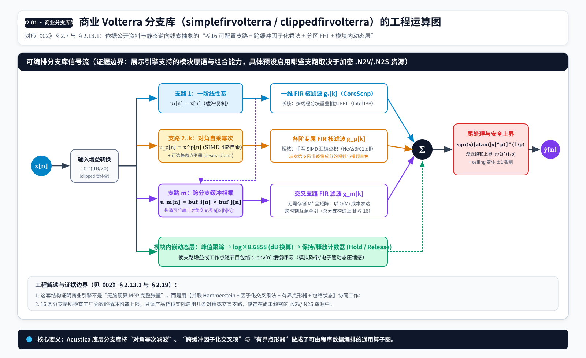
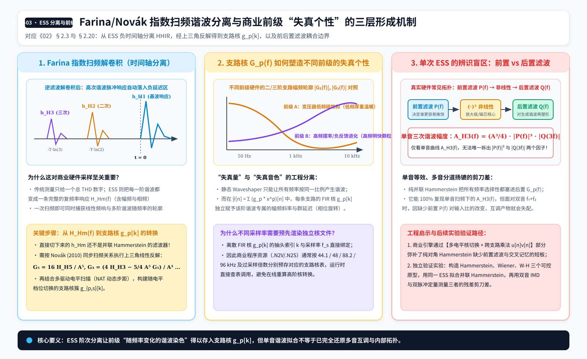

# 06 从 Volterra 理论到商业音频建模：Acustica Audio 的技术发展史

> **版本：v9 · 2026-11-14 · 修复公式笔误、清除重复词句与结构终审版（继承 v8）**
> **所属系列：Volterra Wiki**
> **阅读顺序：**《00_前置概念与术语约定_图文版.md》→《01_Volterra级数_图文版.md》→《02_从Volterra到神经网络_模型辨识与NAM.md》→《03_混合建模训练边界与实时约简.md》→《04_高级系统辨识_非线性算子与混沌分解.md》→《05_物理约束与实时代理建模.md》→本章。
> **配图说明：** 本章配有 3 张工程架构与测量机制 SVG 图（`figures/02_*.svg`），请与 `figures/` 目录保持同级相对路径。
> **定位：** 作为全书最后一章，通过 Acustica Audio 的演进，将测量、模型约简、商业部署与证据边界串联起来。以 Acustica Audio 为主线，同时交代 Sintefex、Focusrite 和非线性扫频研究构成的技术背景。
> **证据层级：** 下文将资料分为官方文档、同时代独立报道、用户提供的静态逆向报告、输入输出测量和研究解释五个层级。逆向部分沿用《REPORT_Volterra与NOVA架构详解_v2.md》的模块与地址描述，以“报告识别”标记；该报告涉及的 IDA 工程和加密资源尚无独立复核记录。官方 YELLOW 的相关术语依据产品资料，主体历史资料截至 2026 年 10 月，SKY SA-1A 新材料截至 2026 年 11 月。读者可按正文标号回溯到具体来源；对内部算法拓扑的讨论以可证实的结构层级为边界。

## 6.1 一个更现实的问题：数学理论怎样变成可以出售的音频插件？

在前面几章，我们已经知道 Volterra 级数能够用不同阶数的核来描述一类具有记忆的非线性输入—输出关系，也了解为什么完整 Volterra 模型会受到核维度、参数数量和运行成本的限制。但知道一个理论能够表示某种系统，与真正做出一款音频插件，中间还隔着很长的工程距离。真实设备不能直接把自己的 Volterra 核交给我们；我们必须设计测试信号，采集输入输出，剥离声卡与噪声的影响，选择适合的模型结构，然后想办法在普通计算机上实时运行。更重要的是，模拟设备的可听特征未必能被一组固定系数充分描述：它可能随输入电平、设备旋钮、包络、时间以及过去的工作状态改变。

Acustica Audio 的发展历程恰好能帮助我们理解这段距离。这条路线先把设备视作可测量的声音处理系统，通过响应数据组织模型，避免完整高阶多维核直接计算带来的维度膨胀，构建可以保存、组织并播放测量结果的技术平台。回顾其早期 Nebula、后来的 Acqua Engine，以及 Hyper、Aria、MUST 和 NOVA，我们看到的是一条逐步把**采样数据、非线性运算、动态控制、专用算法与神经建模组合起来**的商业工程路线。

这里先明确一条核心判断准则：**“以 Volterra 为理论基础”代表采用非线性核展开框架，而在工程实现上则必然经过特定阶次与结构的约简；同样，“插件听起来像某台硬件”代表外部输入—输出特征吻合，其内部实现路径既可以是响应库插值，也可以是参数化电路或混合模型。** 商业产品真正需要解决的问题，是在听感、测量准确性、CPU、内存、延迟、可调性与开发成本之间找到能够量产的平衡。

## 6.2 早于 Nebula 的技术背景：普通卷积为什么不够？

最早被广泛运用的脉冲响应采样，可以把房间、箱体和某些近似线性设备的响应保存成一条 FIR 滤波器。我们给房间一个测试信号，测出它的脉冲响应，再将未来的音频与这条响应进行卷积，就能够复现大量线性声学特征。然而，普通卷积捕捉到的是**某种固定工作条件下的线性映射**。如果一台前级的谐波结构随输入电平改变，或者一台压缩器在瞬态到来时才开始降低增益，单条固定脉冲响应显然不够。

正是在这个历史背景下，Sintefex 推出了 FX8000 Replicator，发展了称为 Dynamic Convolution 的技术，并将相关技术应用于 Focusrite 的 Liquid Channel 与 Liquid Mix。Focusrite 的官方历史明确把 2004 年推出的 Liquid Channel 归于与 Sintefex 的合作：它将模拟输入级、可变阻抗匹配与数字建模组合在一起。Sintefex 则公开说明，其专利涵盖了动态卷积，以及通过保存模拟系统参数来模拟动态处理器的技术。[S1][S2]

这一段历史非常重要，因为它说明在 Nebula 之前，商业音频领域就已经开始研究怎样让卷积模型随电平与动态状态变化。理清这两条路线的先后关系与专利边界，有助于准确理解 Acustica 后来真正值得研究的技术创新。

## 6.3 2000 年：Angelo Farina 为非线性采样提供了关键测量工具

另一条重要的技术前史来自声学测量。2000 年，Angelo Farina 在第 108 届 AES 大会上发表了《Simultaneous Measurement of Impulse Response and Distortion with a Swept-Sine Technique》。这项研究提出使用指数正弦扫频，在近似时不变、弱非线性的条件下，通过解卷积将线性响应与不同谐波产生的响应在时间位置上分离。过去测量频响和测量高次谐波往往是分开的流程；这种方法使我们能够用一次设计得当的激励，得到多阶失真响应的重要信息。[S3]

它对音频建模的意义在于：**设备的非线性得以被记录为随频率、相位和时间演化的多阶响应数据，从而超越了单一标量 THD 指标的限制。** 例如，一台前级可能在低频产生较明显的二次谐波，而在高频呈现不同的三次谐波行为。

正如《01》第 1.9.1 节所严格推导，这里涉及三个不同层级的数学对象：扫频解卷积后在负时间轴分离得到的**高次谐波脉冲响应（HIR）**，经 Antonín Novák 上三角矩阵逐级回代反解得到的**对角 Volterra / 并联 Hammerstein 支路核 `$g_p[k]$`**，以及一般意义上包含全部跨时刻乘积坐标的**完整高维 Volterra 核 `$h_p[k_1,\ldots,k_p]$`**。[S4] 区分这三个层级，是客观评估商业采样建模能力的理论基石。

## 6.4 2005—2007 年：Nebula 是怎样诞生的？

关于早期历史，我们有一份关键的第一手材料。2007 年 8 月 6 日，Hispasonic 发表了对主要开发者 Giancarlo Del Sordo 的访谈。他回顾说，自己最初只是想在远离工作室的情况下，把熟悉的模拟设备和 Lexicon 等效果带到笔记本电脑上。2005 年中期，他开始尝试制作 Nebula 原型；项目最初甚至未以大众市场或严格实时运行作为首要目标。[S5]

Giancarlo 在访谈中还特别提到 Sintefex 的启发及其专利约束。团队在寻找不同于 Sintefex 专利的技术路线过程中，将 Volterra 理论与 Angelo Farina 的研究结合起来：2005 年 9 月出现最初的 EQ 模型，约三个月后出现最初的压缩器模型，2006 年 3 月发展出失真模型，2006 年 7 月又实现了首个 flanger。到 2007 年，Nebula 已经从重放 EQ 脉冲响应扩展至采样和复现多类随时间与电平改变的效果。[S5]

这组日期同样提供了清晰的研发方法论启示：**产品能力是在连续实验中由简入繁逐步扩张出来的**——先用最简单、最容易验证的 EQ 建立流程，再扩展到压缩与失真，最后处理更复杂的时变效果。

同一时期的《Sound On Sound》报道将 Nebula 2 Free 描述为利用 Diagonal Volterra Kernels 及实时核选择、变形技术的处理系统，并提到其矢量引擎能够受到 LFO 和包络等控制源驱动。[S6] 这是当时行业媒体对早期产品的公开记录，代表了 Nebula 早期的核心数学定位。

## 6.5 Nebula 的核心架构创意：把“设备采样”做成数据与播放平台

普通软件采样器存储乐器音符在不同力度、音高和演奏状态下的录音，然后由播放引擎决定此刻应该调用哪段声音。Nebula 的核心创意则是将采样对象从“乐器发出的声音”转换为“硬件对输入信号的处理算子”：它保存硬件经测量后形成的各阶处理响应、参数及控制数据；当实时输入音乐时，再由引擎动态选择、插值并计算相应的处理路径。

Acustica 官方对 N4 的介绍也沿用了这种思路：它的工作方式接近软件采样器，载入的是 vectors、programs 和界面等建模资源。Nebula 库可以由其专有采样工具 NAT 制作；后来的 Universal Acqua Engine 负责底层音频处理，N4 则负责库与界面的组织。[S7]

我们可以把这套平台抽象为三个功能层：
1. **测量与转换层**：将设备在若干工作点的扫频响应转化为可存储、可索引的核资源；
2. **动态控制层**：根据输入包络、面板旋钮、LFO 调制信号等决定当前时刻应当激活或插值哪些工作点核资源；
3. **实时重放层**：利用分区快速卷积与分支合成算法，将选定的核资源高效作用于实时音频流。

这种架构使模型能够保留许多难以从理想电路图直接推导的细节，例如变压器非理想频响、相位旋转与不同增益下的谐波染色；同时，其外推表现也受制于采样空间的覆盖密度与控制器的状态表达能力。

## 6.6 V.V.K.T.：Vectorial Volterra Kernels 的公开定义与历史阶数演进

Acustica 将其核心技术称为 **Vectorial Volterra Kernels Technology (V.V.K.T.)**。其技术介绍明确使用了非线性卷积、Volterra 核、向量化数据组织与动态控制等术语，说明其能够管理大规模核数据，并使 LFO、包络跟随器与动态模块共同参与控制，同时重现多阶谐波响应。[S8] 这表明厂商将**核数据的树状/向量化管理、平滑状态选择与实时卷积调度**视为核心工程架构。

在评估商业参数宣传时，保持数学概念的精确对应尤为重要：
- 厂商声称能够管理多达十万个元素，通常指整个多维度采样库（跨越不同旋钮档位、不同输入电平步距、不同阶次及脉冲长度）中管理的数据规模，而非在单个采样点上直接计算十万个独立的多维交叉张量项；
- 界面或文档中出现的“最多九个谐波（9 harmonics / Volterra orders）”与完整九维核张量不同。两份可直接核验的早期学术文献清晰记录了历史演进：Armelloni 与 Farina (2005) 在非线性时变系统卷积研究中指出，面对其测试的强失真吉他效果，五阶对角 Volterra 近似尚显不足，建议该具体实验考虑扩展至十阶；[S28] Farina 在 2008 年的公开讲座第 80 页则明确记录，**当时的 Nebula** 使用最高五阶的对角 Volterra 核，并展示了重建高次谐波的局限。[S29] 结合后文静态逆向报告中识别出的点形器（Waveshaper）与跨缓冲乘法原语，现代引擎的等效谐波阶次更可能来自“多支路核 + 静态点形器/跨分支组合”的协同作用。

## 6.7 多工作点对角核插值与因子化非对角交叉记忆

对于单个固定工作点，对角 Volterra / 并联 Hammerstein 支路的输入—输出关系为：

```math
\hat{y}[n]=\sum_{p=1}^{P}\sum_{k=0}^{M_p-1}g_p[k]x^p[n-k].
```

当引入多工作点采样（Vector）与动态状态控制器后，设第 `$s$` 个离散工作点拥有一组支路核 `$g_{p,s}[k]$`，并由控制向量 `$\mathbf{z}[n]$`（包含输入包络 `$s_{\mathrm{env}}[n]$`、面板旋钮位置等）决定各工作点的插值权重 `$w_s(\mathbf{z}[n])$`，则状态加权对角核模型可写为（注意此处内层求和上限严格为 `$M_p-1$`）：

```math
\hat{y}[n]=\sum_s w_s(\mathbf{z}[n])\sum_{p=1}^{P}\sum_{k=0}^{M_p-1}g_{p,s}[k]x^p[n-k].
```

**这一解释性模型说明：即使每个静态工作点仅存储对角支路核 `$g_{p,s}[k]$`，一旦权重 `$w_s(\mathbf{z}[n])$` 随过去输入包络动态改变，当前时刻的核系数就与过去时刻的输入幅度发生了乘性耦合，从而在整体输入—输出行为上涌现出等效的跨时刻动态记忆。**

不仅如此，用户提供的 YELLOW／TAUPE 静态逆向报告进一步揭示：底层分支执行器除了支持单缓冲自乘幂次外，还提供了**将一个分支缓冲与另一个分支缓冲逐元素相乘的原语** [R1, §2.5、附录 A5]。设两条分支缓冲分别为线性滤波输出 `$u[n]=\sum_{i=0}^{M-1} a[i]x[n-i]$` 与 `$v[n]=\sum_{j=0}^{M-1} b[j]x[n-j]$`，将二者逐点相乘即得：

```math
u[n]\cdot v[n] = \sum_{i=0}^{M-1}\sum_{j=0}^{M-1} a[i]b[j]\,x[n-i]x[n-j].
```

这恰好构成了《01》第 1.14.6 节推导的**秩-1 因子化非对角二阶交叉核** `$h_2[i,j]=\frac{1}{2}(a[i]b[j]+a[j]b[i])$`！这一发现证实了共享引擎在代码原语层面具备以 `$O(M)$` 滤波加一次乘法构造非对角交叉记忆的能力（至于某款具体插件预设是否激活了该原语，则取决于加密的 `.N2V`/`.N2S` 程序图资源）。

## 6.8 NAT：从采样模板到可复用设备库

2014 年，《Sound On Sound》邀请 Nebula 库开发者 Tim Wisecup 介绍如何利用 NAT 为前级与混响制作采样程序，展示了校准输入输出电平、选择 Online / Offline 模式、设置动态采样点与电平步距以及选择谐波核数量的具体工作流。[S9]

这揭示了一个商业化建模系统的关键经验：采样质量不仅取决于数学公式，更取决于**测量网格在非线性剧变区（如接近饱和膝点的几个 dB 内）的采样点分布密度、校准精度与数据约简策略**。同时，该指南明确指出：采集前级或 EQ 的染色响应，与完整捕获压缩器的 attack、release 和程序依赖增益控制属于不同性质的任务；在工程上，完全可以将采样得到的谐波染色模型与独立的常规动态压缩算法组合使用。[S9] 这一早期实践直接印证了《03》的核心论点：让测量核承担频响与短时谐波染色，让显式状态算法承担动态增益控制。

在授权形态上，Acustica 当前面向第三方开发者的商务页面介绍了基于模板的 NAT 4，而其 2025 年更新的 N4 / N4 Player 功能比较表显示面向普通终端用户的 N4 产品包不包含独立的 NAT 采样器授权。[S10][S11]

## 6.9 从 Nebula 到 Acqua：从通用采样播放器到独立商业产品线

Nebula 早期定位为能够载入第三方设备库的通用效果采样器；随后出现的 Acqua 产品线则围绕特定目标硬件构建独立插件，把多个测量程序、功能模块、旋钮联动映射和专用 UI 整合为完整的通道条或处理器。[S7]

在这一步，核心工程挑战从“测准单个静态工作点”转向了**“如何在用户连续旋转旋钮或输入包络剧烈变化时，平滑、无伪影地穿过大量离散测量工作点”**。Acustica 公开介绍的 Smooth3 技术正是为了抑制快速切换核时产生的瞬态咔哒声与相位跳变，引入了逐样本插值机制。[S8]

## 6.10 实时计算的代价与分区快速卷积引擎

一个多阶多工作点的采样式非线性模型若在时域逐样本直接计算长 FIR 卷积，CPU 消耗将极为高昂。Giancarlo 在 2007 年访谈中提到，最初的 Nebula 甚至未以实时运行作为先决目标，之后才持续进行多线程与算法级性能优化。[S5][S8]

YELLOW／TAUPE 的静态逆向报告在二进制层面展示了现代引擎是如何解决这一算力瓶颈的：引擎内部实现了完整的**非均匀分区快速卷积（Partitioned Fast Convolution）调度器**、FFT 正逆变换、频域复数乘累加、按分区延迟线叠加以及针对短核的 SIMD 点积例程，底层数学运算调用了 Intel IPP 与多个专用指令集（AVX2/AVX-512 等）外部 bridge DLL [R1, §3、附录 A6–A8]。这意味着引擎会根据每条支路核 `$g_p[k]$` 的长度与分区配置，自动分配短核时域 SIMD 与长尾分块频域卷积。

## 6.11 2019 年与 2022 年：AI 预设、Hyper 与显式动态控制器的演进

2019 年，Acustica 宣布将人工智能与深度学习用于生成可随音频素材自动匹配的参数预设，这属于控制层与工作流辅助范畴。[S12] **2022 年引入的 Hyper（及随后的 Hyper2）技术**则聚焦于底层音频引擎的 CPU 效率提升与压缩、饱和、滤波算法的彻底重构。厂商在 Hyper 技术说明中坦诚指出：早期引擎受限于纯采样架构与计算成本，对压缩器的 attack、release 与 look-ahead 时间存在较多限制。[S13]

在 Tiger 压缩器的官方介绍中，新一代动态控制架构得到了具体说明：包含采样压缩曲线、从实测硬件提取多段 attack / release 恢复包络形状、针对瞬态与持续音设置双探测器（Dual Detectors）加权、以及独立的 look-ahead、sidechain 滤波与过采样。[S14] 这证实了现代 Acustica 动态插件已全面演进为**“非线性采样响应核 + 复杂显式状态动态控制器”的灰盒混合架构**。

## 6.12 Hyper3、Aria 与 MUST：FIR/IIR 混合滤波、抗混叠与合成器扩展

近年来 Acustica 的技术演进主要体现在三个方向：
1. **Hyper3 的 FIR + IIR 混合线性响应**：在 SALT 与 Sand 4 Ultra 等产品说明中，厂商明确指出**前段关键的早期瞬态与相位响应保留 FIR 处理，而漫长的低频共振尾部则交由 IIR 极点滤波器实现**。[S15][S16] 这种“短时 FIR + 长尾 IIR”的分工与我们在《03》《04》中讨论的“FIR + 极点基（Laguerre/Kautz）”在工程思想上高度一致，大幅降低了长尾响应的 FFT 分区内存与 CPU 开销。
2. **Aria 与抗混叠更新**：在 Tiger Mix Ultra Flat、Amber 4 Ultra 与 Sand 4 Ultra 等产品中，Aria 引擎伴随实时动态计量显示与更新的抗混叠（Anti-Aliasing）算法推出。[S16][S17]
3. **MUST（Modular Unified Synthesis Technology）**：在 THING 等虚拟合成器产品中，厂商将模拟电路行为建模与自家的非线性卷积/动态 Volterra 技术结合，向需要实时受控自激振荡器与滤波器谐振的电子乐器领域延伸。[S18]

## 6.13 NOVA：官方混合建模声明与静态逆向报告中的模块级结构

在 2026 年 3 月发布的 YELLOW 插件中，Acustica 正式推出 **NOVA（Neural Optimized Volterra Audio）**，称其结合了 Vectorial Volterra Kernels 与神经音频建模：在低输入电平时主要由 Volterra 部分保留硬件精细的线性频响、相位与微动态；随着驱动电平升高，神经模型对复杂强非线性的贡献平滑增大，且两部分同时协作运行。[S19][S20][S21]

结合用户提供的《REPORT_Volterra与NOVA架构详解_v2.md》（基于 TAUPE Studio 与 YELLOW 二进制的静态逆向分析 [R1]），我们可以从工程代码结构层面审视其底层实现原语，同时严格区分**“二进制中存在某模块原语”**、**“加密资源配置可调用该原语”**与**“特定预设档位实际激活了该路径”**三个证据层级。

### 6.13.1 分支库：具有结构约束的可编排 Volterra 运算图

静态逆向报告在共享底层引擎中定位了 `simplefirvolterra` 和 `clippedfirvolterra` 两类核心模块，其工厂构造函数按程序配置初始化各条处理分支（单模块循环上限为 `0x10` 即 16 条分支）[R1, 附录 A2–A5]。每条分支支持的基本运算原语包括：
- 样本缓冲区复制与自乘幂次（构成 `$x^p[n]$` 并联 Hammerstein / 对角 Volterra 支路）；
- **跨分支缓冲区逐点相乘**（将两条已滤波分支 `$u[n], v[n]$` 相乘，构成第 6.7 节所述的因子化非对角交叉核或三阶分离型交叉项 `$u[n]v^2[n]$`）；
- 可选的静态点形器（Waveshaper）与分支专属的一维分区 FIR 卷积 `$g_p[k]$`；
- 模块内置的峰值跟踪、dB 换算及保持/释放计数器 [R1, 附录 A10]。



*图 06-01 | 商业引擎中的可编排 Volterra 分支库架构（基于静态逆向报告的模块级工程抽象）。展示 `$\le 16$` 条分支如何组合自乘幂次、跨分支缓冲乘法 `$u[n]\cdot v[n]$`、点形器与分区 FFT 卷积；具体产品启用哪些支路取决于加密程序配置。*

### 6.13.2 `simplenova`：电平触发双路径软膝渐变与备路径状态维护

静态逆向报告中与 NOVA 命名直接关联的核心发现是名为 `simplenova` 的模块 [R1, §4、附录 A12]。该模块的运算序列可精确抽象为：
1. **输入通道能量估计与软膝（Soft-Knee）映射**：计算输入信号电平并经软膝曲线映射为目标控制权重 `$g_{\mathrm{target}}[n]\in[0,1]$`；
2. **非对称压摆率（Asymmetric Slew）平滑**：采用上行（Attack）较快、下行（Release）较慢的双速率递推更新瞬时混合权重 `$g[n]$`，防止权重在膝点附近随音频瞬时波形高速抖动而产生寄生调幅边带（AM Sidebands）；
3. **双信号路径凸组合融和**：在基础信号路径 `$u[n]$` 与高驱动信号路径 `$v[n]$` 之间按 `$g[n]$` 执行逐样本交叉渐变：
   ```math
   \hat{y}[n]=\bigl(1-g[n]\bigr)\,u[n]+g[n]\,v[n] =u[n]+g[n]\bigl(v[n]-u[n]\bigr).
   ```

报告同时观察到 `simplenova` 包含多个运行模式分支，其中 Mode 1 在权重倾向主路径时依然持续向备选路径馈入信号并维护其缓冲区状态 [R1, §4.3]。从实时 DSP 工程角度看，这种“备路径持续刷新（State Warmth / Buffer Priming）”能够确保当大信号瞬态突然触发权重向备选路径渐变时，备选路径的 FIR 历史延迟线与内部状态已经处于与当前音频同步的热态，从而彻底消除冷启动相位跳变与爆音。这也与厂商关于“两套模型同时运行、随电平平滑改变贡献”的公开技术描述高度吻合。


*图 06-02 | `simplenova` 电平触发双路径渐变器与 Mode 1 备路径保鲜机制。通过能量检测、软膝映射与非对称 slew 在两条处理路径 `$u[n], v[n]$` 之间平滑融和。*

### 6.13.3 点形器函数簇与渐近有界饱和

报告进一步识别出约十五类静态点形函数（Pointwise Waveshapers），包括 `$\arctan$`、`$\tanh$` 及其快速有理近似。例如报告中记录的一类 *desoras* 广义反正切饱和曲线具有如下解析形式：

```math
f_p(x)=\mathrm{sgn}(x)\Bigl[\arctan\bigl(\lvert x\rvert^p\bigr)\Bigr]^{1/p}.
```

当 `$\lvert x\rvert\to 0$` 时，由 `$\arctan(u)\approx u$` 可知 `$f_p(x)\approx x$`（保持单位小信号线性增益，不破坏低电平频响）；当 `$\lvert x\rvert\to\infty$` 时，`$f_p(x)$` 平滑渐近趋向有限饱和上界 `$\pm(\pi/2)^{1/p}$`，且参数 `$p$` 直接控制从线性区向饱和渐近线过渡的膝部锐度（`$p$` 越大，膝部越接近硬限幅）。将这类全局有界的非多项式点形器与有限阶 Volterra 分支结合，正好解决了我们在《01》第 1.15 节指出的“纯有限阶多项式缺乏全局饱和上界、超范围外推易失控”的结构缺陷。[R1, §5、附录 A11]

### 6.13.4 核心开放问题：神经网络位于实时推理路径还是离线蒸馏管线？

对比厂商公开声明与静态逆向报告，最值得深入思考的现象是：厂商明确将 NOVA 定义为结合神经音频建模的技术 [S19]，而静态逆向报告在已检查的二进制函数中并未发现类似 NAM（WaveNet 扩张卷积层堆栈或 LSTM 门控矩阵乘法）的独立实时神经网络推理引擎 [R1, §4.5]。

对此，遵循严谨的证据边界，应当并列保留两种需要在未来进一步验证的技术可能性：
1. **离线神经教师学习 + 实时结构化核/点形器蒸馏假说（Offline Neural Teacher to Structured Runtime Distillation）**：正如《05》第 5.13 节所论述，研发团队完全可能在离线采集与拟合阶段使用深度神经网络（如 WaveNet 或混合神经算子）高精度学习真实硬件在不同驱动电平下的复杂响应，随后通过模型蒸馏或频域/多电平重采样，将训练好的神经模型“烘焙（Bake / Distill）”为多档位可编排 Volterra 分支核 `$g_p[k]$`、点形器参数与 `simplenova` 渐变路径（保存在 `.N2V`/`.N2S` 资源中），从而在实时插件端享受固定分支图的确定性低 CPU 与零自激风险；
2. **算子融合或外部模块/未解密资源承载假说**：小型前馈网络（如单层或两层 1D 卷积加逐点激活）在数学上本来就与“多分支 FIR 滤波 + 点形器 + 加权求和”（参见《01》第 1.20 节）同构，或者在特定产品（如启用 GPU 加速的 CREAM 3 NOVA GPU Beta [S25]）中通过独立动态库与加密资源图加载。

无论最终属于哪一种具体工程形态，这一案例都生动展示了：**“利用神经建模技术提升音色精度”与“在实时音频回调里硬跑一张重型通用神经网络”绝非只有唯一解；将神经学习能力与结构化 Volterra 分支图相结合，本身就是极具实用价值的工业级方案。**

### 6.13.5 YELLOW 的三个质量档位与 NOVA 生态扩展

配置 XML 与逆向报告确认 YELLOW 包含 *Nova*、*Nova HQ*、*Legacy* 三个质量档位，分别映射至不同的 `.N2S`/`.N2V` 资源文件 [R1, 附录 A13–A15]。2026 年以来，Acustica 已将 NOVA 技术从 YELLOW 前级扩展至 SALT 2（NOVA 与 Hyper 协同）、AERO 2（面向吉他踏板/放大器多级链路的 NOVA Instrument）、CREAM 3（含 NOVA GPU Beta）以及包含 52 种前级模型的 GOLD 6。[S22][S24][S25][S30]

## 6.14 相同的引擎，不同的产品配置：YELLOW 与 TAUPE Studio 的部署差异

逆向报告通过对比 YELLOW 与 TAUPE Studio 揭示了现代商业插件的**“通用底层 DSP 虚拟机 + 声明式程序资源图”**架构：两款插件共享同一套核心二进制模块库（Volterra 分支执行器、分区 FFT 引擎、点形器与动态控制原语），区别在于外层加载的 `.N2V`/`.N2S` 加密数据与 XML 拓扑配置——YELLOW 串联了 NOVA 前级与光电压缩拓扑，而 TAUPE Studio 则在非线性磁带核之外专门调用了可变速分数延迟重采样缓冲来模拟磁带传输机构的 Speed 与 Wow & Flutter（机械抖晃）[R1, §6、附录 A14–A16]。

## 6.15 Acustica Audio 商业建模路线演进时间线（2000–2026）

| 时间节点 | 可核实的里程碑事件 | 对非线性音频建模技术史的意义 |
|---|---|---|
| **2000 年** | Angelo Farina 发表指数正弦扫频（ESS）论文 [S3] | 实现单次测量在时间轴上同时分离线性脉冲响应与各次谐波脉冲响应 |
| **2004 年** | Focusrite 与 Sintefex 合作推出 Liquid Channel [S1][S2] | 确立 Nebula 之前的商业动态卷积（Dynamic Convolution）与多电平硬件采样先河 |
| **2005 年中–2006 年** | Giancarlo Del Sordo 开发 Nebula 原型，相继实现 EQ、压缩、失真与 Flanger [S5] | 在规避 Sintefex 专利的同时，将 Farina 扫频与对角 Volterra 核重放转化为通用插件平台 |
| **2005–2008 年** | Armelloni & Farina (2005) 及 Farina (2008) 讲座记录当时 Nebula 采用最高 5 阶核 [S28][S29] | 提供早期商业对角 Volterra 实现的确切阶数上限与强失真边界证据 |
| **2010 年** | Antonín Novák 等发表同步扫频（SSS）与广义 Hammerstein 反解理论 [S4] | 严格建立高次谐波脉冲响应（HHIR）向上三角并联 Hammerstein 支路核 `$g_p[k]$` 的解析转换 |
| **2014 年** | 《Sound On Sound》刊登 NAT 采样实操长文 [S9] | 公开多电平采样步距配置、谐波核截断及“采样染色 + 独立压缩算法”混合思路 |
| **2010 年代中后期** | Acqua 独立插件线成熟，引入 Smooth3 逐样本核插值 [S7][S8] | 解决多离散工作点在旋钮调节与动态调制下的平滑过渡与伪影抑制 |
| **2019 年** | 引入 AI 自适应预设辅助系统 [S12] | 机器学习首先在控制参数推荐层落地，未改动底层音频卷积核 |
| **2022 年–2024 年** | 推出 Hyper / Hyper2 / Hyper3、Aria 与 MUST 架构 [S13–S18] | 引入多探测器显式动态控制、FIR（前段瞬态）+ IIR（长尾低频）混合滤波、抗混叠升级与电路—卷积混合乐器合成 |
| **2026 年 3 月–11 月** | 发布 YELLOW、FIRE THE TUBE、AERO 2、SALT 2、CREAM 3、GOLD 6 及 SKY SA-1A，全面推广 NOVA 技术 [S19–S30][C1] | 官方确立 Volterra 与神经建模协同路线；静态逆向揭示可编排分支库、跨缓冲因子化乘法、`simplenova` 软膝双路径渐变与有界点形器架构 [R1] |

## 6.16 ESS 阶次分离与多路径架构如何共同塑造商业前级的失真个性？

结合《01》第 1.9.1 节的并联 Hammerstein 上三角反解方程与本章的架构分析，我们可以完整回答音频工程师最关心的问题：为什么商业采样前级（如英式变压器前级、美式运放前级与电子管前级）能够呈现出鲜明且各异的“频率相关失真个性”？

1. **各阶支路 FIR 核 `$g_p[k]$` 对谐波幅相轮廓的独立雕刻**：经过上三角回代反解剥离高阶回流后，每一阶支路滤波器 `$G_p(f)$` 独立记录了该阶非线性产物随频率变化的幅度与群延迟。例如，输入/输出变压器在低频（`$50\sim 200\,\mathrm{Hz}$`）接近磁芯饱和时，会使 `$G_2(f), G_3(f)$` 在低频段显著抬升并伴随相位旋转；而放大级局部负反馈与高频摆率效应则体现在高阶支路的中高频幅相特征上。前级的“音色指纹”首先就编码在这些各阶异构的 `$G_p(f)$` 滤波器形状中。
2. **多电平向量采样与 `simplenova` 渐变对工作点迁移的动态补偿**：单次固定电平的 ESS 只能测得前后置滤波的综合乘积 `$\lvert P(f)\rvert^p \lvert Q(pf)\rvert$`。NAT 的多驱动电平采样与 NOVA 的 `simplenova` 能量触发双路径渐变，通过随输入能量平滑切换/融和低驱动与高驱动支路核簇，在工程上动态逼近了硬件频响与饱和膝点随输入电平迁移的行为。
3. **跨分支缓冲乘法与有界点形器对多音互调及强过载的补全**：纯对角支路缺乏跨时刻乘积且受多项式收敛半径限制。引擎中引入的**跨缓冲乘法原语**（构造 `$u[n]\cdot v[n]$` 因子化非对角交叉项）与 **`desoras` 等有界点形器**，恰好在低 CPU 开销下弥补了纯对角 Volterra 在多音差频互调与大信号软限幅边界上的短板。



*图 06-03 | Farina 指数扫频 (ESS) 谐波分离、Novák 上三角阶次反解与前级染色机制。展示负时间轴谐波脉冲响应 `$H_{Hm}$` 如何经阶次反变换映射为支路核 `$g_p[k]$`，以及单次 ESS 在前后置滤波 `$\lvert P(f)\rvert^3 \lvert Q(3f)\rvert$` 拆分上的可辨识性边界。*

## 6.17 证据分级总结表：我们对 Acustica 内部技术究竟知道多少？

为了在技术研究与逆向分析中保持严格的学术与工程规范，本章涉及的全部结论按证据等级汇总如下：

| 技术命题与判断 | 当前证据等级 | 严谨的工程表述方式 |
|---|---|---|
| Nebula 自 2005 年起开发，早期受 Sintefex 动态卷积启发并结合 Farina 扫频 | 创始人同期专访 [S5] | 可作为有明确出处的历史事实引用 |
| 早期 Nebula（2008 年前后）采用最高 5 阶对角 Volterra 核 | Angelo Farina 2008 公开讲座 [S29] | 确证早期版本的阶数上限，不直接外推至 2026 年现代引擎 |
| NAT 通过多动态采样点、电平步距和模板组织设备核库，且将染色采样与独立压缩控制区分 | 第三方开发者实操文献与官方文档 [S7, S9–S11] | 确证其采样工程工作流与早期混合设计思路 |
| Hyper / Hyper3 引入多探测器显式动态控制与 FIR（瞬态）+ IIR（长尾）混合滤波 | 官方产品技术白皮书 [S13–S16] | 确证现代引擎已采用“采样核 + 显式动态/IIR 状态”混合路线 |
| YELLOW/TAUPE 共享引擎包含 `simplefirvolterra`、`clippedfirvolterra`（单模块上限 16 分支）及分区 FFT 卷积 | 静态逆向报告函数级定位 [R1, A2–A8] | 标注为“静态逆向报告识别出的运行时模块与分支上限” |
| 分支执行器支持跨缓冲逐元素相乘（可生成因子化非对角交叉核 `$u[n]\cdot v[n]$`） | 静态逆向报告指令级定位 [R1, A5] | 证实引擎具备低秩非对角交叉记忆的原语能力；具体预设是否启用需解密 `.N2V` 确认 |
| `simplenova` 模块执行能量检测、软膝映射、非对称 slew 平滑与双路径凸组合融和（含备路径状态刷新） | 静态逆向报告反编译逻辑 [R1, §4, A12] | 确证 `simplenova` 的模块级运算机制；不将该单一原语直接等同于全部 NOVA 技术体系 |
| 引擎内置约 15 类静态点形器（含 `desoras` 广义反正切渐近有界饱和曲线及 ceiling 变体） | 静态逆向报告数学函数还原 [R1, §5, A11] | 确证引擎结合了无记忆有界点形器以克服纯多项式外推失控 |
| 已检查二进制函数内未见独立的多层神经网络矩阵推理例程；神经模型可能用于离线学习并蒸馏至分支资源，或經算子融合/外部模块调用 | 静态逆向否定性观察 + 研究假说 [R1, §4.5] | 严格区分“厂商公开的 NOVA 神经建模声明”、“已检查代码未见独立网络层”与“离线蒸馏研究假说” |

---

## 本章参考资料与进一步阅读

- **[S1] Focusrite, *Our Story*.** 包含 2004 年 Liquid Channel 与 Sintefex 合作的官方回顾。https://us.focusrite.com/about-us
- **[S2] Sintefex Audio, 官方网站技术与专利介绍。** 说明 Dynamic Convolution、FX8000 与 Focusrite 产品之间的关系，以及美国专利 7,039,194、7,095,860。https://www.sintefex.com/?src=home&targ=consult
- **[S3] Angelo Farina, 2000, *Simultaneous Measurement of Impulse Response and Distortion with a Swept-Sine Technique*.** AES 第 108 届大会论文 5093。https://aes.org/publications/elibrary-page/?id=10211
- **[S4] Antonín Novák, *Synchronized Swept Sine*.** 包含同步扫频的测量解释、HHIR/HHFR 与广义 Hammerstein/对角 Volterra 的联系。https://ant-novak.com/pages/sss/
- **[S5] Xavier Blanco, 2007, *Acustica Audio: sonido de otra galaxia*.** Hispasonic 对 Giancarlo Del Sordo 的同期专访。https://www.hispasonic.com/reportajes/acustica-audio-sonido-otra-galaxia/2101
- **[S6] Martin Walker (Sound On Sound), 2007, *PC Notes: PCI Soundcard Compatibility Issues* (*Nebula 2 Free* 专题).** 记载 Nebula 2 Free 采用 Diagonal Volterra Kernels 与向量控制。https://www.soundonsound.com/techniques/pci-soundcard-compatibility-issues
- **[S7] Acustica Audio, *Getting started with Nebula*, 2023 年更新。** 介绍 N4、NAT 库、Acqua Libraries 和 Universal Acqua Engine。https://acusticaaudio.freshdesk.com/support/solutions/articles/35000155485-getting-started-with-nebula
- **[S8] Acustica Audio, *The Engine* 与 *V.V.K. Technology*.** 官方对核数据、Smooth3 插值和引擎能力的说明。https://tech.acustica-audio.com/ ；https://tech.acustica-audio.com/vvkt-technology/
- **[S9] Tim Wisecup, 2014, *Sample Your Gear With Acustica Audio Nebula*.** Sound On Sound 的 NAT 采样工作流文章。https://www.soundonsound.com/techniques/sample-your-gear-acustica-audio-nebula
- **[S10] Acustica Audio, *For Business*.** 关于 NAT 4 和第三方开发者采样工具的介绍。https://www.acustica-audio.com/pages/for-business
- **[S11] Acustica Audio, *N4 and N4 Player features comparison chart*, 2025 年更新。** https://acusticaaudio.freshdesk.com/support/solutions/articles/35000093939-n4-and-n4-player-features-comparison-chart
- **[S12] Acustica Audio, *Artificial Intelligence*.** 2019 年引入 AI 预设相关技术的厂商回顾。https://tech.acustica-audio.com/artificial-intelligence/
- **[S13] Acustica Audio, *Hyper Technology*.** 2022 年引入 Hyper、之后发展 Hyper2 的官方介绍。https://tech.acustica-audio.com/hyper-technology/
- **[S14] Acustica Audio, *Tiger*.** 公开描述多段 attack / release、压缩曲线采样和多个 detector 等动态机制。https://www.acustica-audio.com/shop/products/TIGER
- **[S15] Acustica Audio, *SALT*.** 包含 Hyper3 的 FIR/IIR 混合响应技术介绍。https://www.acustica-audio.com/shop/products/SALT
- **[S16] Acustica Audio, *Sand 4 Ultra*.** 包含 Hyper3、Aria、抗混叠与 FIR/IIR 分工说明。https://www.acustica-audio.com/shop/products/SAND
- **[S17] Acustica Audio, *Tiger Mix Ultra Flat*.** 包含 Hyper3、Aria 与抗混叠技术说明。https://www.acustica-audio.com/shop/products/TIGERULTRA
- **[S18] Acustica Audio, *THING*.** 官方关于 MUST 将电路行为建模与卷积式技术结合的介绍。https://www.acustica-audio.com/shop/products/THING
- **[S19] Acustica Audio, *YELLOW*.** NOVA (Neural Optimized Volterra Audio) 的官方定义与技术说明。https://www.acustica-audio.com/shop/products/YELLOW
- **[S20] Acustica Audio, *Your exclusive NOVA Upgrade is ready*.** https://www.acustica-audio.com/pages/and
- **[S21] Acustica Audio, *FIRE THE TUBE*.** 关于 NOVA 两部分同时工作及电平相关表现的官方说明。https://www.acustica-audio.com/shop/products/FIRETHETUBE
- **[S22] Acustica Audio, *SALT 2*.** 介绍 NOVA 与 Hyper 在同一产品中的协同分工。https://www.acustica-audio.com/shop/products/SALT2
- **[S23] The Beat Community, 2026-03-13, *Acustica Audio Release Yellow*.** https://thebeatcommunity.com/2026/03/13/acustica-audio-release-yellow/
- **[S24] Acustica Audio, *AERO 2*.** 说明 NOVA Instrument 面向多级乐器放大链的设计定位。https://www.acustica-audio.com/shop/products/AERO2
- **[S25] Acustica Audio, *CREAM 3*.** NOVA 前级与 NOVA GPU (Beta) 官方说明。https://www.acustica-audio.com/shop/products/CREAM3
- **[S26] Sound On Sound, 2026-05-20, *Aero 2 from Acustica Audio*.** https://www.soundonsound.com/news/aero-2-acustica-audio
- **[S27] Acustica Audio, *YELLOW — Tube Compressor with NOVA Preamp*.** https://www.acustica-audio.com/shop/products/YELLOW
- **[S28] Armelloni, E. & Farina, A., 2005, *Emulation of Not-linear, Time-variant Devices by the Convolution Technique*.** https://angelofarina.it/Public/papers/211-AesItalia2005.pdf
- **[S29] Angelo Farina, 2008, *Impulse Response Measurements by Exponential Sine Sweeps*, 公开讲座（第 75–80 页）.** https://www.angelofarina.it/Public/Presentations/audioprecision-workshop.pdf
- **[S30] Acustica Audio, *GOLD 6*, 产品官方说明。** https://www.acustica-audio.com/shop/products/gold6
- **[R1] 用户提供，2026-10-04 四轮静态分析整理，*《REPORT_Volterra与NOVA架构详解_v2.md》*。** 包含 YELLOW/TAUPE 共享引擎模块表、FIR 分支与因子化乘法原语、FFT 与外部运算桥、`simplenova` 控制模块、点形器、产品资源映射及附录 A1–A16 的地址索引。

---

**章节导航：** [⬅️ 上一章：05 物理约束、模型降阶与实时代理](05_物理约束与实时代理建模.md) ｜ [🏠 返回目录 (README)](README.md)
