# 非线性音频系统的数字建模与系统辨识（00—06 完整合订版 · 37 张 SVG 教学图）

> **说明：** 本合订版与目录中的七篇独立 Markdown 同步；《01》《02》《06》分别补充理论起源、跨模型系统辨识与商业工程史，新增建模案例分别放在《01》《02》《03》《05》《06》。图片引用使用仓库 `main` 分支的 GitHub 原始文件链接；独立分章使用 `figures/` 相对路径。

---

# 00 前置概念与术语约定

> **版本：v14 · 2026-11-14 · 全篇去重、教材化句式与跨章索引精修版（继承 v13）**
> **所属系列：Volterra Wiki**
> **阅读定位：在学习 Volterra 级数之前，建立音频非线性系统建模所需的直觉、基本语言和判断边界。**
> **配图说明：** 本章 3 张 SVG 示意图采用相对路径，建议与 `figures/` 文件夹一起保存。
> **阅读方式：先理解现象，再认识概念，最后接触用于表达现象的数学形式。本章不要求读者预先掌握泛函分析、张量分解或系统辨识算法。**

**本系列的研究对象是非线性音频系统的数字建模与系统辨识。** 从音频工程师熟悉的卷积出发，我们将逐步讨论 Volterra 核、状态空间、物理电路、唯象模型、神经网络、数据辨识以及实时模型约简。Volterra 级数提供了理解非线性历史交互的一套系统化数学表达；后续章节沿着共同的输入输出问题，逐步进入其他建模体系。全书围绕系统行为、数学结构、辨识方法与工程验证组织知识。

## 0.1 我们为什么要先讨论系统与卷积？

假设面前有一台模拟音频设备。我们输入一段音乐，再录下它输出的声音，听起来可能有新的谐波、更柔和的瞬态，也可能出现与输入电平有关的频率响应变化。我们想把这些现象做进一个数字插件里，最直接的想法当然是研究它内部的电子元器件：电阻、电容、电子管、晶体管、变压器，甚至磁带和磁头。但现实中，我们未必能取得电路图，也未必能把所有物理机制都完整地写成数学方程。即便拿到了这些资料，把方程转化成稳定、低延迟、低 CPU 占用的实时程序，仍然是另一项困难的工作。

因此可以从输入—输出关系入手：**先观察设备如何响应不同的外部激励。** 如果输入一个较小的正弦波，它会怎样输出？把电平提高以后呢？连续输入两个瞬态，与分开输入相比又有什么不同？这些问题的答案都能通过输入与输出的数据观察到。我们希望建立的数学模型，就是一种可以根据输入预测输出的规则。

输入—输出建模回答的是“设备表现出了什么规律”，电路与物理建模则进一步回答“这些规律为什么出现”。两种路径可以互相验证，也可以结合起来使用。Volterra 级数属于前一种路径中非常重要的一套数学工具：它尝试在同一个模型中描述**非线性、时间记忆，以及不同历史时刻之间的非线性交互**。不过在真正理解这句话以前，我们需要把其中每一个概念拆开。

## 0.2 一段声音怎样变成可计算的输入与输出？

在数学里，我们通常用 $`x`$ 表示输入，用 $`y`$ 表示输出。连续时间的模拟信号写作 $`x(t)`$ 和 $`y(t)`$；经过采样，变成数字音频以后，则写作 $`x[n]`$ 和 $`y[n]`$。这里的 $`t`$ 是以秒为单位的连续时间，$`n`$ 是一个整数，表示“第几个采样点”。方括号 $`[n]`$ 标明了离散时间索引，提醒我们：现在讨论的是离散时间信号。

例如在 $`48\,\mathrm{kHz}`$ 采样率下，系统每秒处理 $`48\,000`$ 个采样点。$`x[n-1]`$ 表示输入的前一个采样点，$`x[n-48]`$ 表示约 $`1\,\mathrm{ms}`$ 以前的输入。此后遇到 $`x[n-k]`$ 时，可以把它读成“距离现在 $`k`$ 个采样点以前的输入”，以此建立对时间延迟的直观认识。

我们还需要区分真实输出与模型预测。设实际设备输出为 $`y[n]`$，计算机模型给出的预测为 $`\hat{y}[n]`$，那么建模的直接目标就是让它们在我们关心的工作条件下足够接近。符号上方的尖帽（如 $`\hat{y}`$）表示“估计值”或“预测值”，准确性仍需通过测量验证。

在后面的示例里，我们大多先研究单输入单输出系统，即 **SISO（Single-Input Single-Output）**。立体声和多通道设备当然也能研究，只不过它们还需要描述声道之间的相互作用。SISO 是用来建立直觉的起点，对立体声与多通道耦合系统的扩展将在后续章节单独说明。

## 0.3 什么叫系统：真正重要的是它遵循什么规律

**系统（System）** 可以理解成一套从输入产生输出的规则。EQ、延迟器、失真器、压缩器、磁带机，乃至神经网络音频插件，都可以在某种条件下被当作一个系统。我们可以先统一写成

$$
y=\mathcal{S}[x].
$$

其中 $`\mathcal{S}`$ 代表处理规则。这个符号特意没有限定内部是卷积、电子管方程还是神经网络，因为“系统”首先代表一种观察角度，具体算法则根据建模任务选取。对于音频工程师来说，只要明确输入、输出、测试条件和观察的时间范围，就能开始研究它。

同一台设备的行为也会随着工作条件改变。旋钮位置、输入电平、通道负载、采样率、电源状况、磁性材料的初始状态，都可能改变输出。如果测量时某个旋钮在变化，那么在数学上，它就可能需要被视为额外的输入，或者作为一个随时间变化的参数。只记录音频输入和输出，却忽略这些条件，很容易把原本可以解释的行为误判为模型误差。

因此，对一个未知设备建立模型，第一步应当限定研究问题：我们想复刻哪个操作模式、什么电平范围、什么采样率、什么初始化方式，以及允许多大的误差？**一个模型是否正确，总是相对于明确的条件和评价标准而言。**

## 0.4 线性与非线性：以叠加原理作为严格判据

音频工程里经常将线性与非线性简单对应为“没有失真”和“有失真”。理想 EQ 会改变原有信号的频率成分和相位，因此存在通常所说的线性失真，但它仍然是一个线性系统。区分线性与非线性的严格依据，是**叠加原理（Superposition）**。

假设 $`x_1`$ 与 $`x_2`$ 是两段输入，$`a`$ 与 $`b`$ 是两个数。如果系统满足

$$
\mathcal{S}[a x_1+b x_2]=a\mathcal{S}[x_1]+b\mathcal{S}[x_2].
$$

它就是线性的。这个式子包含两项要求：将输入整体缩放，输出也按同样比例缩放（齐次性）；将两路输入相加再处理，等于分别处理以后再相加（可加性）。两个条件需要同时成立。一个带固定延迟或固定频率响应的理想 EQ 可以满足它们；静态平方器 $`y=x^2`$ 则不能，因为输入放大两倍会使输出变成原来的四倍。

**非线性（Nonlinearity）** 的严格定义是叠加原理失效，其外延远大于听感上的“声音变脏”。硬削波、软饱和、压缩器的电平相关增益、随输入幅度变化的频率响应，都属于非线性现象。有些非线性效应只有在特定电平、频率组合或输入历史下才容易被观察出来。

## 0.5 时不变、因果与稳定：同样重要的另外三个问题

讨论系统时，除了线性，还常常要问它是否**时不变（Time-Invariant）**。时不变的准确含义是：如果输入的整段声音推迟了一秒，输出也只是整体推迟一秒，系统本身的处理规律不随绝对时间起点改变。固定参数的线性 EQ 是时不变的；一个受外部 LFO 调制频率的滤波器，在只把音频当作输入、把 LFO 相位视为外部时间参考时，通常就是时变系统。非线性和时变性属于不同的分类轴：系统可以线性时不变，也可以线性时变、非线性时不变或非线性时变。

**因果性（Causality）** 关心的是信息从哪里来。因果系统在计算某一时刻输出时，只依赖当时和此前能够获得的信息。Look-ahead limiter 看起来会“提前处理即将出现的峰值”，其实是把信号缓冲并延迟输出，于是在播放某个输出采样点时，相应的后续输入已经到达。它仍可以是因果的实时系统，只是付出了处理延迟。

**稳定性（Stability）** 则是在问：系统面对合理、有限的输入，会不会产生无法控制的输出？初学时可以先认识**有界输入—有界输出稳定性（BIBO Stability）**：在规定的系统条件下，有界输入应当对应有界输出。这里容易混淆两种问题：某些反馈算法会因为内部状态不断积累而随时间失稳；有限阶、有限记忆 Volterra 多项式则可能在输入幅度超出训练范围以后产生极大的数值输出。两者都危险，但后一种通常属于**幅度外推失控**，有别于在固定有界输入下随时间自发发散的递归失稳。

这三种性质会直接影响模型能否作为 VST 插件运行，也关系到测试方法能否成立。后文默认讨论的经典 Volterra 结构，多数情况下是针对因果、时不变系统写出的；对于时变设备、随机噪声和状态初始化，还必须另外交代条件。

## 0.6 什么叫记忆：当前这个采样点，为什么不足以决定输出？

先考虑一个静态 waveshaper：

$$
y[n]=f(x[n]).
$$

它只看当前采样点的输入幅度。不论先前经过了安静片段、强烈鼓点还是持续的低频正弦波，只要现在的 $`x[n]`$ 一样，且参数不变，得到的 $`y[n]`$ 就一样。这类系统叫**无记忆系统（Memoryless System）**。它能产生谐波与互调，输出始终由当下的输入决定。

接着想象两个输入片段：当前采样点都等于 $`0.3`$，但片段 A 的前面一直很安静，片段 B 的前面刚刚出现一个大瞬态。若设备对这两个 $`0.3`$ 给出不同输出，就说明单凭当前输入已经不足以预测结果。我们需要把输入历史也写进规则：

$$
y[n]=F\bigl(x[n],x[n-1],x[n-2],\ldots\bigr).
$$

这就是**记忆（Memory）** 最核心的含义：**系统现在的输出仍然受过去输入的影响。** 它不要求声音一定有可听的“尾巴”。一个纯粹延迟一个采样点的系统 $`y[n]=x[n-1]`$ 就有记忆，尽管它没有产生混响，也没有任何非线性。相反，静态削波可以产生很强的失真，却依然没有记忆。

因此，“有没有记忆”与“有没有非线性”属于两个独立的分类维度。动态饱和设备的建模需要同时考察非线性传递曲线与历史状态。

## 0.7 有限记忆、衰减记忆和持久记忆：过去究竟会保留多久？

当我们说系统有记忆，还需要继续问：过去的影响会持续到什么时候？最容易理解的是**有限记忆（Finite Memory）**。如果系统当前只依赖最近 $`M`$ 个采样点，早于这一范围的输入严格不会再改变当前输出，就可以写成

$$
y[n]=F\bigl(x[n],x[n-1],\ldots,x[n-M+1]\bigr).
$$

这里的 $`M`$ 表示**记忆长度**（区别于非线性阶数 $`p`$）。$`M=64`$ 意味着模型最多查看最近 64 个采样点；在不同采样率下，64 个采样点对应的真实时间也不同。讨论“长记忆”时，最好同时写出采样点数与毫秒、秒等物理时间单位。

许多滤波器与动态系统并不存在这种严格的截止时刻，它们受到久远输入的影响通常越来越弱。这种性质可以用**衰减记忆（Fading Memory）** 的直觉理解：两段足够久以前不一样、但最近历史完全相同的输入，会使当前输出越来越接近。稳定 IIR 滤波器是很好的例子。它理论上可能保留无限长的历史作用，但由于影响逐渐衰减，在工程上往往可以截取一个足够长的近似时间窗。关于衰减记忆的加权范数定义与 Boyd–Chua 逼近定理，将在《01》第 1.23.1 节与《04》第 4.4–4.5 节展开。

**持久记忆（Persistent Memory）** 是另外一种情况。某些材料的内部状态在外部激励撤除后不会自动回到唯一的原点，例如具有剩磁的磁性材料。即便当前输入为零，系统仍然可能因为早先采用过不同的磁化路径而处于不同状态。不过需要注意，真实磁性材料还可能同时存在温度相关弛豫、速率相关损耗和其他缓慢变化。因此“磁滞具有持久记忆”描述的是某类理想或特定工作条件下的重要性质，实际硬件往往同时包含短时滤波、缓慢衰减和持久状态，需要分别设计激励来辨识。

这一区分对模型架构非常关键：有限记忆可以直接保存近期样本；衰减记忆可能通过滤波器或紧凑状态有效表示；具有历史分支的持久记忆，往往需要显式保存能够区分不同历史路径的内部状态。它们都属于记忆，但各自适配不同的数学结构。

## 0.8 记忆与状态：历史发生了什么，和系统现在变成了什么

假设你正在设计一个压缩器。它需要知道输入此前有多响，才能决定当前的增益衰减。在算法实现上，压缩器无需逐一保存前面几秒钟里的每个采样值，只需维护一个包络变量。过去大量输入信息最终被概括成少数几个当前有用的数值，这些数值就是**状态（State）** 的一种例子。

一个简单的状态模型可以写成

$$
\mathbf{s}[n+1]=F\bigl(\mathbf{s}[n],x[n]\bigr),
$$

$$
y[n]=G\bigl(\mathbf{s}[n],x[n]\bigr).
$$

其中 $`\mathbf{s}[n]`$ 是当前内部状态，$`F`$ 决定它如何更新，$`G`$ 决定如何由输入与状态产生输出。符号上加粗，表示它可以是一组状态变量。压缩器的包络、滤波器积分器中的储存量、放大器电源下陷的慢变量，以及磁滞模型里与历史路径有关的内部变量，都可以放进这套语言里。

我们可以把两种观察角度区分为：**历史描述过去发生过哪些输入；状态描述这些过去的输入在系统内部留下了什么结果。** 状态通常是历史信息的一种紧凑表示方式；保存最近 $`M`$ 个采样点的延迟线本身也可以被视为一组状态。两者的核心区别体现在建模结构上：显式历史模型直接列出较长的输入窗口，状态模型则通过递推方程把相关历史压缩到少数内部变量中。

还要特别留意**初始状态（Initial State）**。即使两段测量使用完全相同的输入，如果设备开始时的温度、包络值或磁化状态不同，输出也可能不同。此时“同一个输入对应两个输出”可能源于未受控的初始条件，而未必代表随机噪声。这也是复杂硬件辨识经常出现重复性问题的原因之一。

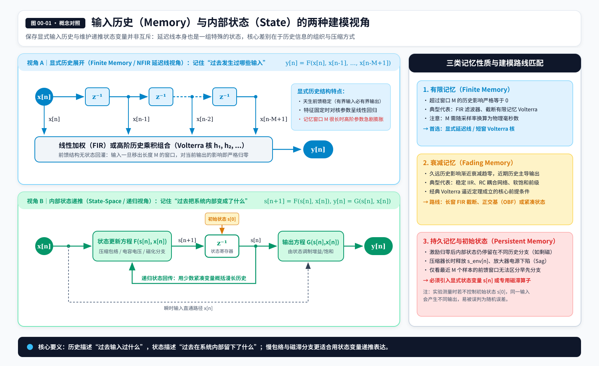

*图 00-01 | 输入历史与内部状态的两种建模视角。保存历史与递归状态可以相互转化，延迟线本身也可以被视为状态。*

## 0.9 从普通卷积到非线性记忆：为什么一个 IR 不够？

对于线性时不变系统，输出可以通过**卷积（Convolution）** 描述：

$$
y[n]=\sum_{k=0}^{\infty}h[k]x[n-k].
$$

这里的 $`h[k]`$ 是**脉冲响应（Impulse Response, IR）**。可以把它理解成一张按时间排列的权重表：每个过去的采样点都会乘上相应权重，再将贡献相加。对于满足线性时不变条件的系统，脉冲响应足以完整描述零初始状态下的输入—输出关系。FIR、稳定 IIR、房间响应与许多 EQ 的数学基础都可以从这里理解。

然而，卷积有一个明确限制：**不同历史采样点的贡献只能线性相加，无法在式子里直接相乘。** 假设真实设备的当前输出，除了受到 $`x[n-2]`$ 和 $`x[n-7]`$ 各自影响，还会受到这两个值共同出现时的交互影响，那么可能需要一个这样的项：

$$
c\,x[n-2]x[n-7].
$$

它与普通卷积中的 $`h[2]x[n-2]+h[7]x[n-7]`$ 具有本质差异。在线性相加的情形下，改变第一个历史采样点的作用不会因为第二个历史采样点的大小而改变；而在乘积项中，两者彼此影响。这个差别就是理解 Volterra 之前最重要的一道门槛。

某些非线性设备可以通过“线性滤波 + 静态 waveshaper + 线性滤波”的组合得到很好的近似。具体建模时，可以根据测量表现与计算预算选择合适的块结构。Volterra 的核心价值在于提供一套统一、明确的数学语言来组织历史输入之间的非线性交互。

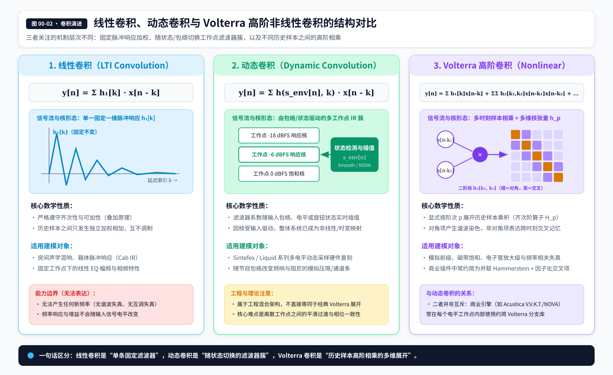

*图 00-02 | 线性卷积、动态卷积与 Volterra 高阶卷积的概念对照。注意“动态卷积”在商业音频语境中的定义并不统一：若卷积核由输入信号驱动而变化，整体处理也可以是非线性的；三者并非严格互斥的分类。*

## 0.10 函数、泛函与算子：三个看似抽象的词，其实只差在输入与输出是什么

先回到最熟悉的静态 waveshaper：$`y=f(x)`$。这里的 $`f`$ 是一个**函数（Function）**，它将一个数映射成另一个数。严格地说，函数可以有多个输入变量；对我们眼前的直觉而言，先把它理解成“给定有限个数，算出一个结果”就够了。

如果当前输出要取决于一整段输入历史，就有必要用一个能够接收“函数或信号”的规则。固定观察时刻 $`t_0`$，我们可以写成

$$
y(t_0)=\mathcal{F}_{t_0}[x(\cdot)].
$$

这里的 $`\mathcal{F}_{t_0}`$ 是**泛函（Functional）**：它接收整条输入函数，返回时刻 $`t_0`$ 的一个标量输出。若希望一次描述从整条输入波形到整条输出波形的映射，则可以写成

$$
y(\cdot)=\mathcal{H}[x(\cdot)].
$$

这时 $`\mathcal{H}`$ 是**算子（Operator）**，作用对象是整个信号，结果也是一个信号。三个词之间的关系由此变得自然：**函数通常处理有限维变量，泛函将函数映射为数值，算子则将一个函数映射为另一个函数。** 在广义数学用法里，泛函也可被看作取值于标量的特殊算子。当算子受到微弱输入扰动时，其局部变化率可通过 **Gâteaux 导数**与 **Fréchet 导数**刻画（完整定义见《04》第 4.2–4.3 节）。

为什么 Volterra 要用到它们？因为我们最终需要描述的是一种对整个输入历史施加处理规律、生成输出波形的系统映射。Volterra 级数可以视为对这类输入—输出算子进行幂级数式表示的一条路径。阅读到这里，先建立这一概念即可。相关的严格定义将在后续章节展开。

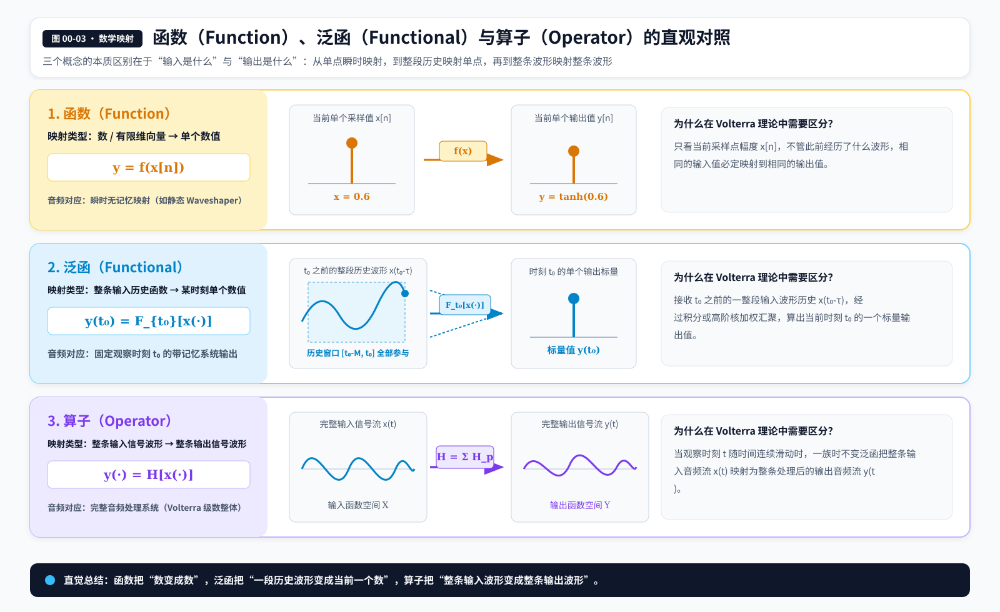

*图 00-03 | 函数、泛函与算子的直观对照。图中“数到数”的函数概念是教学简化，用于帮助建立直觉。*

## 0.11 从 Taylor 展开到多项式：为什么要把复杂关系拆成一阶、二阶、三阶？

很多复杂函数，在选定工作点附近，可以用逐渐增加次数的多项式去描述。例如在某个参考点附近，一个静态非线性可以近似写成

$$
y\approx a_0+a_1x+a_2x^2+a_3x^3+\cdots.
$$

如果工作点不在 $`x=0`$，更严谨的写法应当是 $`x-x_0`$ 的幂次，其中 $`x_0`$ 是展开中心。这里的常数项表示基准偏移，一次项表示局部线性贡献，二次、三次及更高次项描述不同阶次的非线性偏离。这样的表达之所以有用，是因为我们可以通过观察不同阶次的贡献，逐渐增加模型复杂度，并通过测量逐步确定需要保留的函数项。

不过，多项式展开有其严格的适用条件：Taylor 级数的收敛依赖函数的解析性质与收敛半径，有限阶多项式的近似精度也受限于工作范围。某些函数在局部表现得十分平滑，却在远处出现拐点、阈值或剧烈变化。小信号拟合与强过载表现，需要在各自的输入范围内分别验证。

现在再把一个输入变量扩展成一段历史：$`x[n],x[n-1],x[n-2],\ldots`$。原先的 $`x^2`$ 变成了许多可能的二次组合，包括 $`x^2[n],\;x[n]x[n-1],\;x[n-1]x[n-4]`$；三次项则包含三个历史采样因子的乘积。**Volterra 思想的直觉，就是把普通多项式对幅度的展开，推广为对输入历史组合的展开。** 下一章会正式解释它的积分形式、离散级数和数学适用条件。

## 0.12 “阶数”到底是什么？区分 Volterra 阶数、谐波阶数与滤波器阶数

在 Volterra 相关资料中，**阶数（Order）** 首先是指一个项里有多少个输入因子相乘。比如 $`x[n-1]x[n-4]`$ 是二阶项，$`x[n]x[n-3]x[n-7]`$ 是三阶项。记作 $`p`$ 阶时，意思是这个项包含 $`p`$ 个输入因子；即使其中几个因子对应同一时刻，也仍然按照乘积的总次数计算。

但我们在音频测量中还会遇到“三次谐波”“五次谐波”，它们指输出频率是基频的三倍、五倍，与 Volterra 阶数属于不同层面的概念。例如一个三次非线性不仅产生三次谐波，还会同时改变基频分量：

$$
\cos^3(\omega t)=\frac{3}{4}\cos(\omega t)+\frac{1}{4}\cos(3\omega t).
$$

这说明三阶非线性会向一倍频与三倍频同时注入能量。在多音输入下，高阶非线性还可能形成不同频率之间的互调产物。二次项除了贡献二次谐波，也会产生直流分量、两音和频以及差频。真实动态系统中，滤波器、反馈和非线性之间的相互作用还会让测得的频谱更加复杂。

至于“二阶 biquad”中的二阶，讨论的是线性滤波器传递函数中的系统阶数，通常与极点、状态维数等动态结构有关；它既不同于二阶谐波，也不同于二阶 Volterra 核。后文尽量把这几个词写完整，因为**同一个“阶”字，在不同语境下可能分别指代乘积因子数、倍频倍数或传递函数极点数**。

## 0.13 Volterra 核：输入历史交互的多维权重结构

理解了卷积和多项式以后，Volterra **核（Kernel）** 就容易想象了。一阶核 $`h_1[k]`$ 只有一个延迟坐标，形式上与普通的线性脉冲响应相同；二阶核 $`h_2[k_1,k_2]`$ 需要两个延迟坐标，因为它要给两个历史输入因子的乘积安排权重。比如

$$
h_2[2,7]x[n-2]x[n-7]
$$

就是一项二阶历史交互。它表示：过去第 2 个与第 7 个采样点上的输入共同参与时，这个乘积应当按照 $`h_2[2,7]`$ 所指定的权重影响当前输出。三阶核 $`h_3[k_1,k_2,k_3]`$ 则为三个历史位置的组合分配权重。

二阶核可以先想象成一张二维表，横坐标与纵坐标都是延迟。表格对角线上 $`k_1=k_2`$ 的元素，作用在同一历史样本的平方上；对角线以外的元素，则作用在不同时刻样本的乘积上。这也是我们后面区分 **Diagonal Volterra** 和具有**非对角交叉记忆（Cross-Memory）** 的模型时最直接的几何直觉。这里的“非对角”纯属核延迟坐标的数学属性，与空间声场宽度或立体声像无关。

由于输入样本的乘法可以交换顺序，$`x[n-2]x[n-7]`$ 与 $`x[n-7]x[n-2]`$ 表示同一个乘积。因此，同一阶核的许多坐标只是排列不同，通常可以将其对称化而不改变模型的输入—输出结果。需要注意，对称核的记账方式可能在不同文献中采用不同组合系数约定；本系列在涉及参数数量与公式展开时会明确说明约定，避免把相同贡献计算两遍。

机器学习中的 **kernel trick** 或支持向量机核函数同样使用“kernel”一词，但它们与 Volterra 核分属不同数学体系：前者通常描述样本间的相似性或再生核希尔伯特空间中的特征内积，后者则描述输入历史组合对系统输出的卷积权重。

## 0.14 一个小实验：怎样区分线性记忆与非线性交互？

假设我们在观察一个只依赖当前输入 $`x[n]`$ 和前一时刻输入 $`x[n-1]`$ 的系统。固定当前输入 $`x[n]`$ 不变，只改变前一时刻的 $`x[n-1]`$，如果输出随之改变，我们就能确认系统具有**记忆**。接下来还要判断这段记忆来自普通的**线性历史叠加**（如滤波器延迟项），还是两个时刻之间发生了**非线性交互**（如乘积项 $`x[n]x[n-1]`$）。

怎样在实验上把这两种机制分开？核心思想是利用叠加原理设计受控对比实验：分别测量“只送入当前样本”“只送入前一样本”“两者同时送入”以及“零输入基线”四组响应。如果系统只有线性记忆，那么“前一样本对输出的增量贡献”应当与当前样本的大小无关；反之，如果改变当前样本的幅度，会同时改变前一样本留下的影响大小，就证明两个历史时刻之间存在无法独立加和的联合作用（下一章第 1.2 节将用具体的二变量代数模型推导这一“四次测量相消”过程）。

真实硬件的测量当然远比二变量思想实验复杂，尤其要控制更早的历史、内部状态与本底噪声；但它揭示了一项贯穿全书的实验原则：**要证实历史时刻之间存在非线性交互，除了观察到不同前史导致不同输出外，还需通过差分离析剥离单纯的线性历史叠加。** 测试信号既是喂给模型的数据，也是区分竞争性模型假设的实验工具。

## 0.15 Volterra 的适用范围与工程边界概览

在限定工作范围内，有限阶 Volterra 可以很好地描述很多具有有限或有效衰减记忆的弱至中等非线性行为。它把非线性阶数与历史交互显式组织起来，因此很适合研究：某个失真成分是否依赖过去的输入？二阶、三阶贡献有什么区别？对角模型遗漏了哪些交叉项？不同模型为了达到类似误差需要多少参数？这些问题恰好是黑盒音频建模最关心的内容。

与此同时，工程应用必须正视其四类核心边界（详细数学分析见《01》第 1.15–1.18 节）：

1. **硬削波与非光滑奇点**：硬削波（Hard Clipping）在阈值处存在导数不连续的折点，且输出全局有界。有限阶多项式虽可在指定有界区间内逼近削波曲线，但在阈值附近易出现振荡，且缺乏天然的全局饱和上界。
2. **动态处理器的递归状态**：压缩器与限制器（Compressor / Limiter）依赖电平检测、attack/release 递推、峰值保持或前瞻控制。用低阶短窗口的前馈多项式直接硬拟合长达数百毫秒至数秒的增益恢复过程，在参数效率与跨条件泛化上均远不如显式状态方程或混合架构。
3. **持久路径依赖的磁滞系统**：若两段远期历史使磁芯或磁带停留在不同的剩磁分支上，仅查看最近 $`M`$ 个采样点且无内部状态变量的有限窗口模型将丢失窗口之外的路径信息。
4. **幅度外推风险**：有限阶多项式中的最高次幂项在输入幅度超出训练分布后会迅速增长。因此，训练区间内的误差与过载安全性需要分别检验，实际插件部署必须配合明确的工作电平约束或有界保护设计。

## 0.16 模型结构与参数：区分“参数未调优”与“结构表达力不足”

我们会经常使用 **模型（Model）** 这个词。模型是一套用来近似或解释设备的数学规则。假设我们写成

$$
\hat{y}[n]=F\bigl(x[n],x[n-1],\ldots;\boldsymbol{\theta}\bigr),
$$

其中 $`F`$ 表示模型采取什么组织方式，$`\boldsymbol{\theta}`$ 表示需要确定的参数。理解时必须将**结构（Structure）** 和**参数（Parameters）** 分开。结构决定模型允许哪些关系存在；参数决定这些关系的具体权重、增益或时间常数。例如“只保留 Volterra 核对角线”是一种结构假设；某个对角核系数具体等于多少，是参数估计问题。

一个模型预测不准，至少有三种可能：首先，结构允许描述目标行为，但参数估计得不好；其次，结构本身缺少必要的历史或状态关系，再怎么调整参数也无济于事；最后，测量的数据并未充分控制状态、延迟或噪声，甚至目标本身发生了变化。这三类原因对应截然不同的改进方向，需在诊断时严格区分。

在后续章节中会出现 **Memory Polynomial、GMP、Low-Rank Volterra、Hammerstein、Wiener、状态空间模型、WaveNet** 等名称。这些名称分别对应不同的系统结构假设。模型结构的取舍应依据目标物理机制、参数可辨识性与实时算力预算综合权衡。

## 0.17 黑盒、白盒与灰盒：我们究竟知道设备内部多少？

**黑盒建模（Black-Box Modeling）** 主要依靠可观察的输入与输出推断规则，即便不知道内部是什么，也可以尝试复刻它的行为。Volterra 系数回归与音频神经网络都可以采用黑盒方式。**白盒建模（White-Box Modeling）** 则从已知物理或电路结构出发，建立电阻、电容、非线性器件与反馈网络等对应的方程，再进行离散化与数值求解。白盒模型同样包含待标定的元件参数，通常仍需结合实测数据进行参数校准。

**灰盒建模（Gray-Box Modeling）** 介于两者之间。例如我们已知某个系统大体包含线性频率整形、动态状态和非线性饱和，但各部分的参数仍由测试数据决定；或者先用物理磁滞模型解释主要历史行为，再用数据驱动的非线性残差校正模型无法解释的部分。这些路线都可能构成灰盒系统。

这三个名称描述的是建模过程中使用了多少先验知识，与声音品质、数学先进程度或最终准确度无直接对应关系。黑盒模型可以非常精确；白盒模型也可能因为物理简化或参数不准而失真。工程选择要看原型资料、测试能力、计算预算以及我们究竟要解释什么现象。

## 0.18 系统辨识的完整内涵：从实验设计到模型验证

**系统辨识（System Identification）** 是一套从实验中发现、估计并验证系统模型的方法。**拟合（Fitting）** 和**参数估计（Parameter Estimation）** 只是其中的一个环节。假设我们已有真实输出 $`y[n]`$ 与模型输出 $`\hat{y}[n]`$，调节参数使两者接近，是拟合；但研究目标要不要包含磁滞、数据如何采集、是否需要多电平激励、模型验证失败以后如何重新设计实验，这些都属于系统辨识。

音频工程尤其需要注意测量链自身的问题。若真实硬件通过 AD/DA 回路接入，输出可能带有固定延迟、时钟漂移、噪声、增益误差或通道串扰。即便只测软件插件，也要确认过采样模式、插件延迟、参数自动化、旁路行为和初始状态是否一致。**当数据未精确对齐时，微小的时延偏差就会造成很大的逐采样波形误差，从而掩盖真实的非线性拟合表现。** 因此，时间对齐、增益校准、重复测量与异常数据检查都是建模工作的一部分。

我们还应当区分预测行为与解释机制。一个模型能够准确预测输入—输出，说明它在所测工作域内建立了等效的外部映射，系统辨识有助于筛选对系统行为的解释；若要进一步将模型参数对应到真实的电容、磁芯或电源节点，还需结合电路信息与独立物理测量证据。

## 0.19 激励、可观测性与可辨识性：为什么测试信号必须经过设计？

为了观察设备的行为，我们故意送入某种测试信号，这叫**激励（Excitation）**。单音适合检查谐波和幅度依赖性，双音适合观察互调，扫频适合观察随频率变化的响应，脉冲组合适合暴露不同历史之间的作用，长时间持续输入则有机会激发缓慢状态。真实音乐同样很重要，适合与受控测试信号配合使用。

在此基础上，需要区分两个密切相关的系统概念：

- **可观测性（Observability）**：讨论系统的**内部状态**能否通过已知输入和一段输出历史加以区分。例如，同一台压缩器可能同时存在光电释放状态与供电恢复状态，我们需要通过不同时间尺度和频段的测试，观察它们在输出中是否表现出可区分的规律。
- **可辨识性（Identifiability）**：进一步讨论数学模型的**结构和未知参数**能否由测量数据唯一或稳定地估计。假设我们只使用恒定的输入，使 $`x[n-1]`$ 与 $`x[n-2]`$ 始终相等，那么无论模型给二者安排什么权重，都无法仅凭这组数据区分各自的数值，因为它们的作用始终混在一起。

**持续激励（Persistent Excitation）** 是系统辨识中的技术术语，严格含义与回归矩阵的秩、特征相关性和所选模型有关。初学时可以先记住它的工程含义：**要估计哪些自由度，就必须提供足以区分这些自由度的输入变化。** 某些输入即便听起来很丰富，也可能无法激发特定的非线性核坐标。从概率统计角度，实验对未知参数的区分能力可以通过 **Fisher 信息矩阵（Fisher Information Matrix）** 定量刻画，并据此开展**最优激励设计（Optimal Input Design）** 与**不确定性量化（Uncertainty Quantification）**（详见《04》第 4.14–4.15 节）。

因此，如果两种模型对目前所有信号的预测都一样，说明**当前实验尚不足以区分它们**。对于商业插件、未知硬件和复杂磁滞模型，这一原则格外重要：测量既是为模型寻找支撑证据，也是通过构造关键测试来筛除不恰当的模型假设。

## 0.20 残差、损失函数与泛化：多维评估体系的必要性

建模时常将真实输出与预测输出的差写成

$$
e[n]=y[n]-\hat{y}[n].
$$

这个 $`e[n]`$ 叫**残差（Residual）**。残差可以被听，也可以在时域、频域和不同测试条件下分析。假如残差出现清楚的谐波或互调线、与前一瞬态相关的结构、低频包络变化或依赖预处理历史的差别，说明模型可能遗漏了某类确定性行为。当然，也要先排除采集噪声、对齐误差与量化误差，避免把测量链路自身的问题误判为被测设备特性。

训练时我们需要一个评价函数来决定参数怎样调整，这叫**损失函数（Loss Function）**。最直观的例子是平方误差：

$$
L=\sum_n\bigl(y[n]-\hat{y}[n]\bigr)^2.
$$

它在计算上方便，但单一时域均方误差只能反映听感差异的一个侧面。例如一个很小的瞬态时间偏移，可能使逐采样误差显著上升；某些低幅度的高阶互调，虽然对总体均方误差贡献不大，却可能成为我们关心的染色来源。因此，时域波形误差、频谱与谐波/互调误差、瞬态行为、长时间状态测试与主观听感，应当共同构成多维评价体系。

另一个重要概念是**泛化（Generalization）**。用来估计参数的资料称为训练集；帮助选择模型阶数、结构及超参数的资料称为验证集；在选择完成后才使用、用于独立评估的资料称为测试集。如果模型在训练素材上几乎完美，换成新的输入电平、频率组合或历史条件就失效，它可能只是记住了局部数据。尤其对于音频非线性建模，验证泛化时必须覆盖不同工作电平、瞬态密度、长短记忆和初始状态。

## 0.21 特征、参数估计与正则化：Volterra 与机器学习的数学交汇

模型还可以先从原始输入样本中生成更适合计算的量，这些量叫**特征（Features）**。线性 FIR 的特征可以是 $`x[n],\;x[n-1]`$ 等历史采样点；二阶 Volterra 的特征则可以进一步包含 $`x^2[n],\;x[n]x[n-1],\;x[n-2]x[n-7]`$。这些高阶组合是人为明确写出的**显式特征**，而深度神经网络则会通过隐藏层自动学习内部特征表示。

一个极其关键的数学性质是：**固定特征字典的 Volterra 模型对输入是非线性的，但对待估计的核系数却是线性的（Linear-in- the-Parameters）。** 也就是说，先把这些输入乘积计算成特征后，我们能够将模型写成一个线性参数回归问题：

$$
\hat{\mathbf{y}}=\mathbf{X}\boldsymbol{\theta}.
$$

这里 $`\mathbf{X}`$ 的每一列是一种特征在样本序列上的取值，$`\boldsymbol{\theta}`$ 是待求参数。因此，求固定核 Volterra 系数可以使用最小二乘、Ridge、LASSO 或自适应滤波中的 LMS、RLS 等凸优化与递推估计方法（详见《01》第 1.11 节与《02》第 2.3 节）。当特征很多、数据有限或列之间高度相关时，模型容易过度追随训练数据中的噪声。**正则化（Regularization）** 通过在拟合误差之外加入参数约束（如 Ridge 的 $`L_2`$ 惩罚或 LASSO 的 $`L_1`$ 稀疏惩罚），利用合理先验控制模型复杂度，从而改善未见条件下的预测稳定性。

## 0.22 张量、稀疏、低秩与基函数：为什么后面会出现那么多 Volterra 约简形式？

假如只查看最近 $`M`$ 个历史位置，一阶核需要 $`M`$ 个系数；不利用对称性时，二阶完整核需要 $`M^2`$ 个位置，三阶需要 $`M^3`$ 个位置，$`p`$ 阶核则有 $`M^p`$ 个坐标。即便利用核的对称性合并重复排列（其精确组合计数公式与参数规模表见下一章第 1.13 节），独立参数数量依然随记忆长度 $`M`$ 与阶数 $`p`$ 呈高次多项式级激增。

这就是 **维数灾难（Curse of Dimensionality）**：每增加一阶或延长记忆，候选参数、所需测量信息与运算成本都会急剧膨胀。实际建模中的第一要务是寻找哪些结构能够用较少自由度解释我们真正关心的行为。

这里会遇到三个容易混淆的术语：
- **张量（Tensor）**：在本系列初级层面可先视为按多个延迟索引组织的高维系数数组——一阶核对应向量，二阶核对应矩阵，三阶及以上的核则对应三阶或高阶张量。
- **稀疏（Sparse）**：意味着大多数候选坐标位置不重要，只保留少量显著的非零系数。
- **低秩（Low Rank）**：意味着整体系数结构能够由少数可分离的一维模式通过外积组合生成。对于二维核，可以先想象为几张“横向滤波器形状 × 纵向滤波器形状”的简单图案叠加，从而无需逐格独立存储全部权重。

还有一种思路是用**基函数（Basis Functions）** 来压缩时间历史。既然许多设备的记忆表现为几种快慢不同的衰减模式，我们可以先用 Laguerre、Kautz 或其他动态正交基提取若干具有代表性的历史特征，再在这些特征上建立非线性多项式模型。此外，当输入信号服从特定统计分布（如高斯白噪声）或系统存在器件公差时，还可以引入概率正交基——如 **Wiener G-functionals**、**Wiener Chaos Decomposition（维纳混沌分解）** 与 **Polynomial Chaos Expansion（PCE，多项式混沌展开）**（这里的“混沌”属概率论术语，详见《04》第 4.11–4.13 节）。

所以后文出现的 Diagonal Volterra、Memory Polynomial、GMP、Near-Diagonal、Sparse、Low-Rank、分阶记忆截断与基函数投影，都在回答同一个工程问题：**完整高维核中，到底有哪些自由度值得保留，哪些可以通过合理假设压缩？** 不同约简假设是否成立，最终由针对性的辨识与验证实验决定。

## 0.23 NFIR、NARX 与递归：显式保存历史与输出递归反馈

在系统辨识中，**NFIR（Nonlinear Finite Impulse Response）** 通常指当前输出是有限长度输入历史的某个非线性函数：

$$
y[n]=F\bigl(x[n],x[n-1],\ldots,x[n-M+1]\bigr).
$$

有限阶、有限记忆的普通 Volterra 就属于这类前馈式输入—输出模型。这里的“前馈”指模型根据输入历史直接计算输出，没有输出反馈递推环路。

**NARX（Nonlinear Autoregressive with Exogenous Inputs）** 则允许过去的输出值也参与当前计算，例如

$$
y[n]=F\bigl(x[n],x[n-1],y[n-1],y[n-2]\bigr).
$$

这类**递归（Recursive）** 结构可以用少量变量表示很长的动态过程，但也带来了误差回灌、稳定性、初始状态和训练方式等问题。训练时使用实测真实输出 $`y[n-k]`$ 作为回归量称为 **Teacher Forcing（单步预测）**；推理或使用模型自身历史预测输出 $`\hat{y}[n-k]`$ 构成闭环递推则称为 **Free-Run（自由运行 / NOE 模式）**。单步预测误差很小的递归模型，在长时间自由运行中仍可能因误差累积而发散，因此必须单独检验闭环长期稳定性（详见《03》第 3.9.1 节）。

## 0.24 约定一套以后不会混淆的符号

后续 Wiki 将尽可能遵守下表，出现特殊约定时会单独解释。

| 符号 | 本系列默认含义 | 首次阅读时应注意 |
|---|---|---|
| $`x(t),\ y(t)`$ | 连续时间输入、输出 | $`t`$ 以秒计 |
| $`x[n],\ y[n]`$ | 离散时间输入、输出 | $`n`$ 是采样点索引 |
| $`\hat{y}[n]`$ | 模型预测输出 | 区别于真实测量输出 $`y[n]`$ |
| $`e[n]`$ | 输出残差 | 默认 $`e=y-\hat{y}`$，必要时另作说明 |
| $`k,\ k_1,\ k_2`$ | 延迟索引 | 在因果模型里通常取非负整数 |
| $`M`$ | 输入历史窗口长度 | 单位是采样点，换算成时间需要知道采样率 |
| $`p`$ | Volterra 非线性阶数 | 区别于谐波阶数与滤波器阶数 |
| $`P`$ | Volterra 模型保留的最高阶数 | 指截断阶数 |
| $`h_1[k]`$ | 一阶 Volterra 核 | 在相应条件下对应线性卷积项 |
| $`h_p[k_1,\ldots,k_p]`$ | 第 $`p`$ 阶完整 Volterra 核 | $`p`$ 个历史坐标组成一项多维权重 |
| $`g_p[k]`$ | 第 $`p`$ 阶对角/并联 Hammerstein 支路 FIR 核 | 作用在幂次特征 $`x^p[n-k]`$ 上的一维滤波器，区别于多维核 $`h_p`$ |
| $`\mathbf{s}[n]`$ | 系统内部状态向量 | 区别于直接存储全部输入历史的延迟线向量 |
| $`s_{\mathrm{env}}[n]`$ | 动态处理器的包络或慢速控制状态 | 专用于压缩/限制或渐变控制，避免与输出残差 $`e[n]`$ 混淆 |
| $`\boldsymbol{\theta}`$ | 待估计的参数向量 | 可以包含核系数或其他模型参数 |
| $`\mathbf{X}`$ | 回归特征矩阵 | 由输入特征构造的设计矩阵 |
| $`R`$ | 低秩分解的模式数量 | 越小表示使用越少的分离成分 |

数学式里还会出现求和符号 $`\sum`$，它表示“把指定范围内的贡献累加”；乘积符号 $`\prod`$，它表示“把指定范围内的因子相乘”。小写 $`h`$ 常用于表示脉冲响应或 Volterra 核；大写 $`F,\;G,\;\mathcal{S}`$ 等符号则用来表示函数、更新规则或系统。

### 0.24.1 时间、频率、历史与模型阶数

为了阅读后续关于过采样、卷积网络和分数阶长记忆的章节，还需引入以下记号。

| 符号 | 默认含义 | 使用范围与单位 |
| --- | --- | --- |
| $`f_s,\;T_s=1/f_s`$ | 采样率与采样周期 | Hz 与秒；从采样点换算为物理时间 |
| $`n,\;k`$ | 当前采样索引与历史延迟索引 | 通常为非负或整数采样索引 |
| $`t,\;\tau`$ | 连续时间与时间延迟/时间常数 | 具体含义由函数参数或下标注明，通常以秒计 |
| $`\omega,\;\Omega`$ | 连续时间角频率、离散时间角频率 | 分别为 rad/s、rad/sample；可写 $`\Omega=\omega/f_s`$ |
| $`M,\;M_p`$ | 输入历史长度、第 $`p`$ 阶核的历史长度 | 单位为采样点；与物理质量矩阵 $`\mathbf{M}`$ 区分 |
| $`P`$ | Volterra 最高截断阶数 | PCE 小节也使用 $`P`$ 表示局部总阶截断，须以章节为准 |
| $`K,\;d_\ell,\;R_{\mathrm{RF}}`$ | 卷积核长度/基函数数量、扩张率、神经网络感受野 | $`K`$ 的具体角色以小节标明；$`R_{\mathrm{RF}}`$ 单位为采样点 |
| $`z^{-1},\;H(z)`$ | 单位样本延迟算子、离散传递函数 | 多速率与数字滤波器章节 |
| $`\mathcal S,\;\mathcal S_\theta`$ | 目标输入输出算子、参数化近似算子 | 作用对象是完整函数或序列 |

卷积网络的 $`L`$ 可表示层数；训练章节中 $`L`$ 或 $`\mathcal L`$ 表示损失函数。遇到字母重复时，我们以**字号、正斜体、下标、上标及所在公式中的局部定义**确定其含义。

### 0.24.2 特征、状态与函数空间符号

| 符号 | 默认含义 | 使用范围与数学性质 |
| --- | --- | --- |
| $`\mathbf x_n,\;\boldsymbol\phi[n]`$ | 历史输入向量、当前时刻的回归特征向量 | 多项式和核辨识 |
| $`\mathbf X,\;\mathbf y,\;\boldsymbol\theta`$ | 特征设计矩阵、参考输出向量、待估计参数 | $`\hat{\mathbf y}=\mathbf X\boldsymbol\theta`$ |
| $`\mathbf s[n],\;\mathbf s(t)`$ | 离散或连续时间的内部状态向量 | 标量状态在不会混淆时简写为 $`s`$ |
| $`\mathbf c[n]`$ | 面板旋钮等外部可观测控制参数向量 | 专用于参数条件化建模（如《02》第 2.11 节），区别于阶次 $`p`$ 与内部状态 $`\mathbf s[n]`$ |
| $`F,G,H`$ | 状态转移、读出函数或一般非线性映射 | **普通大写字母为章节局部函数名**，各章应就地定义 |
| $`D\mathcal S[x],\;D^p\mathcal S[x]`$ | 算子的一阶及 $`p`$ 阶导数 | Gâteaux / Fréchet 及泛函 Taylor 展开 |
| $`\nabla,\;J_F`$ | 梯度、函数 $`F`$ 的 Jacobian 矩阵 | 训练优化和 Newton 迭代 |
| $`\mathcal K,\;\psi(\mathbf s)`$ | Koopman 算子、状态可观测函数/提升特征 | 与结构刚度矩阵 $`\mathbf K`$ 区分 |
| $`\mathbf A,\mathbf B,\mathbf C`$ | 一般线性/双线性或神经状态模型中的矩阵 | 具体维度与物理意义由该章方程给出 |
| $`\ell_j[k],\;L_j(z),\;u_j[n]`$ | Laguerre 时间基、基滤波器传递函数及其滤波特征 | $`\ell`$ 是小写字母 ell，区别于数字 1 |
| $`\Phi_r,\;\mathbf X_{\mathrm{snap}}`$ | 降阶投影基、用于 POD 的状态快照矩阵 | 后者与回归设计矩阵 $`\mathbf X`$ 的用途不同 |
| $`\lVert v\rVert,\;o(\lVert h\rVert),\;O(M^p)`$ | 范数、小 $`o`$ 误差阶、大 $`O`$ 复杂度阶 | 所选范数和渐近变量须在局部说明 |

这里采用**字体区分与明确下标**：普通标量和函数通常用斜体，向量与矩阵倾向于粗体，算子用花体。个别理论沿用原始文献的专用符号时，会在相应公式前重新声明。

### 0.24.3 优化、概率与随机正交展开

| 符号 | 默认含义 | 使用范围 |
| --- | --- | --- |
| $`\mathcal L(\theta),\;L(\theta)`$ | 训练损失或目标函数 | 与 Laguerre 传递函数 $`L_j(z)`$ 区分 |
| $`\eta_r,\;\lambda`$ | 第 $`r`$ 次迭代的学习率、损失/正则化权重 | 训练迭代索引优先写 $`r`$，避免与连续时间 $`t`$ 混淆 |
| $`\theta^\star,\;\arg\min_\theta`$ | 优化得到的参数与最小值对应的参数搜索 | 常见于系统辨识 |
| $`\mathbb E[\cdot],\;\mathrm{Var}[\cdot]`$ | 期望与方差 | 随机激励、元件公差和噪声模型 |
| $`\boldsymbol\xi,\;\xi_j`$ | 随机参数向量及其分量 | Wiener Chaos、PCE |
| $`H_m(\xi),\;\Psi_{\boldsymbol\alpha}`$ | 概率论 Hermite 多项式及多元正交基 | $`H_m`$ 与能量函数 $`H(\mathbf s)`$ 不同 |
| $`\boldsymbol\alpha,\;\lvert\boldsymbol\alpha\rvert`$ | 多指标及其总阶 | 与分数阶导数的标量 $`\alpha`$ 区分 |
| $`\mathcal I(\theta;u),\;p(y\mid\theta,u)`$ | Fisher 信息矩阵、条件概率密度 | $`p(\cdot\mid\cdot)`$ 在此是概率密度函数，区别于 Volterra 阶数 $`p`$ |
| $`\alpha[n],\;\gamma`$ | 混合模型中的门控权重及其平滑系数 | $`\alpha`$ 在分数阶微积分中另有局部定义 |
| $`\delta_{ij},\;\Gamma(\cdot)`$ | Kronecker delta、Gamma 函数 | 正交性与分数阶导数 |

特别需要区分三种阶数：**Volterra 阶数 $`p`$（最高截断阶 $`P_V`$）、PCE 总阶 $`P_{\mathrm{PCE}}`$ 和分数阶导数的阶数 $`\alpha_{\mathrm{frac}}`$**。它们属于不同模型结构，在同一推导中同时出现时应使用明确下标加以区分。

### 0.24.4 物理电路、有限元与能量系统

| 符号 | 默认含义 | 使用范围 |
| --- | --- | --- |
| $`\mathbf z,\;\dot{\mathbf z}`$ | 电路微分代数方程中的未知状态/代数变量与其时间导数 | DAE、隐式数值求解 |
| $`\mathbf E,\;\mathbf J_F`$ | DAE 的质量/约束矩阵、非线性方程 Jacobian | 与期望算子 $`\mathbb E`$ 区分 |
| $`\mathbf M,\mathbf C,\mathbf K`$ | 质量、阻尼、刚度矩阵 | 有限元及结构振动 |
| $`\mathbf q,\;\dot{\mathbf q},\;\mathbf a`$ | 结构位移、速度与模态坐标 | 与状态收缩系数的 $`q_c`$ 区分 |
| $`\mathbf U,\boldsymbol\Sigma,\mathbf V^\top`$ | SVD 的左奇异向量、奇异值矩阵与右奇异向量 | POD 与数据降阶 |
| $`\mathrm{rank},\;R`$ | 矩阵秩、低秩约简的分离分量数 | 与耗散矩阵 $`\mathbf R`$ 区分 |
| $`H(\mathbf s),\;\nabla H`$ | 储存能量的 Hamiltonian 函数及其状态梯度 | 与 Hermite 基 $`H_m(\xi)`$ 区分 |
| $`\mathbf J(\mathbf s),\;\mathbf R(\mathbf s),\;\mathbf G(\mathbf s)`$ | 能量交换、耗散和端口耦合矩阵 | Port-Hamiltonian 方程 |
| $`\mathbf u,\;\mathbf y`$ | 物理输入端口变量与对应输出端口变量 | $`x[n],\;y[n]`$ 仍用于普通音频输入输出 |
| $`q_c`$ | 局部 Jacobian 收缩上界 | 可作为验证稳定性的一个充分条件，具体约束须注明 |

有限元中的刚度矩阵 $`\mathbf K`$、神经网络中的卷积长度 $`K`$ 以及 Koopman 算子 $`\mathcal K`$ 使用相似字母，但通过字体与上下文区分。其他高频冲突包括 $`M`$（记忆长度/质量矩阵）、$`R`$（低秩个数/耗散矩阵）、$`H`$（高阶响应/Hermite 基/能量函数）。这些均采用领域惯例，并在首次出现处就地声明。

### 0.24.5 GitHub 数学排版约定

本书采用 GitHub 支持的 MathJax 语法。行内公式统一使用 GitHub 官方支持的美元符号加反引号形式，例如 $`x[n-1]`$。这种写法适合包含下划线、方括号、反斜杠等 Markdown 特殊字符的表达式，也适用于 Markdown 表格单元格。独立公式使用 `$$` 块：开、闭定界符各自单独占一行，公式正文放在两行之间，前后各留一个空行。不要把整条显示公式写成同一行的 `$$...$$`，也不要把数学公式放入普通代码围栏。列表项内的长公式应移出列表缩进，作为独立数学段落；列表项只保留必要的文字说明。多行公式可以在数学块中使用 `\begin{aligned}...\end{aligned}`。

Markdown 表格里的竖线 `|` 是单元格分隔符。数学表达式在表格或行内需要绝对值或范数时，优先采用 `\lvert`、`\rvert`、`\lVert`、`\rVert` 等 LaTeX 指令，以避免与表格结构发生冲突。

## 0.25 有限维与无穷维函数空间：为什么一段音频不只是一个很长的向量？

我们在 DAW 中看到的 WAV 文件，总有一个有限的长度。假设它包含 $`N`$ 个采样点，就可以把它写成一个 $`N`$ 维向量 $`\mathbf x=(x[0],\ldots,x[N-1])`$。然而，在讨论一个能够持续接收音频、并且具有时间记忆的系统时，输入不一定预先有终点。所有可能的连续时间波形或无限长离散序列，构成的是一种**函数空间（Function Space）** 或**序列空间**。某些这样的空间是无限维的：无法只用固定数量的坐标，就精确表示其中任意一个成员。

从数学建模角度看，**理论上的输入对象可以是任意长、任意复杂的波形，而实际模型只能使用有限的参数和计算资源**。例如，平方可和序列空间 $`\ell^2`$ 与平方可积函数空间 $`L^2`$ 都是典型的无限维空间；实际 DSP 中，我们通常只处理其有限片段、有限参数近似或某种低维特征。

可以把一组基函数想成“描述波形的坐标轴”。如果用 $`K`$ 个滤波器响应、正交多项式或模态来近似一个复杂算子，我们实际是在选取一个有限维近似空间。这一有限维表示依据测量与先验判断哪些自由度在目标工作范围内值得保留。后文的 Laguerre-Volterra、切比雪夫多项式、模态降阶与低秩分解，都可以从这个角度理解。

## 0.26 收敛与发散：区分四类不同的收敛概念

**收敛（Convergence）** 的直觉，是一个近似过程在规定的意义下越来越接近某个确定目标；**发散（Divergence）** 则表示不满足所讨论的收敛条件。讨论收敛时，必须指明“趋近什么、用什么距离衡量、在哪个输入范围内”。我们至少会遇到四种不同的收敛问题：

1. **级数收敛**：例如几何级数

$$
1+x+x^2+\cdots=\frac{1}{1-x},\qquad \lvert x\rvert\lt 1.
$$

   这个幂级数在 $`\lvert x\rvert\lt 1`$ 时收敛，在 $`\lvert x\rvert\geq 1`$ 时发散；但右侧函数 $`\frac{1}{1-x}`$ 在 $`x=-2`$ 等级数发散点依然有良好定义。因此，“目标映射存在”与“它的幂级数展开在某点收敛”是两回事。
2. **函数逼近收敛**：当我们不断增加模型阶数、滤波器抽头或基函数数量时，预测函数是否在规定输入集合上靠近目标。这里还要区分逐点收敛与一致收敛（Uniform Convergence）：每个输入点分别变准，与整个工作区间最大误差上界趋于零仍是两个不同要求。
3. **数值迭代或训练优化的收敛**：Newton-Raphson 反复迭代可能收敛到某个方程解，也可能遇到不良初值或奇异 Jacobian；神经网络训练时损失下降，反映的是优化过程的局部进展，全局最优性与测试集泛化还需另行考察。
4. **动力系统稳定性**：系统在有界输入或受到扰动时，状态与输出随时间演化的有界性。训练优化算法收敛到一组参数，与递归 DSP 的长期闭环稳定性属于不同的验证任务。

因此，对于给定的函数类与有界输入域，某些 Volterra 展开具有明确的收敛域；而在收敛半径之外（如接近非解析拐点或强饱和区），高次多项式截断会出现剧烈增长。这正是我们需要讨论能力边界与有界重构的原因。

## 0.27 泰勒展开与普通多项式拟合的区别

第 0.11 节介绍了用多项式表示局部非线性的直觉，现在补充一个关键的数学区别。若函数在展开点 $`x_0`$ 具有足够多阶导数，它的 $`N`$ 阶 Taylor 多项式为

$$
T_N(x)=\sum_{k=0}^{N}\frac{f^{(k)}(x_0)}{k!}(x-x_0)^k.
$$

这里每个系数严格由函数在单点 $`x_0`$ 处的各阶局部导数唯一确定。**多项式拟合（Polynomial Fitting）** 则通常从分布在一段工作区间上的离散测量数据出发，通过最小二乘或极小化最大误差准则寻找使区间整体误差较小的系数。因此，回归拟合出的多项式系数一般会随训练信号的幅度分布（方差）与截断阶数 $`N`$ 改变，通常不同于原系统在 $`x_0`$ 处的严格 Taylor 导数。

此外，函数无限可微（$`C^\infty`$）和 Taylor 级数收敛于原函数是两个不同性质（实分析中的经典反例为 $`f(x)=\exp(-1/x^2)`$ 在 $`x=0`$ 处延拓为 $`0`$，其在该点各阶导数全为零，但函数在邻域内并非恒零；只有满足实解析条件时 Taylor 级数才局部收敛于原函数）。因此，Volterra 被称为“带记忆的 Taylor 级数”有助于建立泛函展开直觉，但在工程辨识中，最小二乘回归得到的有限阶核应与物理算子在零点的严格 Fréchet 导数分别讨论。

## 0.28 龙格现象：为什么高次等距插值可能在边界剧烈振荡？

**龙格现象（Runge's Phenomenon）** 是一类典型的多项式插值问题：如果我们在区间上选取一批**等间距节点**，用一条次数越来越高、并且必须严格穿过每个节点的多项式去插值某些光滑函数，区间端点附近的插值误差反而可能显著增大，并伴随剧烈的边界振荡。

经典示例是在 $`[-1,1]`$ 上对解析函数

$$
f(x)=\frac{1}{1+25x^2}
$$

做等间距多项式插值（该函数在复平面 $`\pm 0.2\mathrm{i}`$ 处存在极点，限制了幂级数收敛域）。增加等距节点数、提高插值多项式次数，端点附近的振荡幅度反而随次数发散。这里需要明确前提：龙格现象特指特定节点分布下的高次**插值**行为；带正则化的最小二乘回归虽然也会遇到高阶病态与区间外推发散，但其机理属于设计矩阵共线性与幂函数外推增长，应与等距插值的龙格振荡区分阐述。

在音频建模中，当我们对电子管饱和曲线或多档位动态核按有限个输入电平节点进行高次多项式插值时，如果强行要求高次多项式穿过稀疏的等距测量点，就容易在节点之间或最高电平边界附近产生非物理的波纹振荡。**测量点的拟合误差与节点之间的插值平滑度，需要分别检验。**

## 0.29 切比雪夫多项式与正交基：为什么换一组基和节点更稳健？

切比雪夫多项式（Chebyshev Polynomials）是定义在标准区间 $`[-1,1]`$ 上的一组常用正交多项式。第一类切比雪夫多项式满足

$$
T_n(x)=\cos\!\bigl(n\arccos x\bigr),\qquad -1\leq x\leq 1.
$$

它们可通过三项递推关系直接构造（在实时 DSP 中常用 Clenshaw 递推算法高效求值）：

$$
T_0(x)=1,\quad T_1(x)=x,\quad
T_{n+1}(x)=2xT_n(x)-T_{n-1}(x).
$$

与直接使用单项式幂基 $`1,x,x^2,\ldots,x^n`$（在 $`[-1,1]`$ 上高次幂集中在端点附近，彼此高度共线，构成病态的 Vandermonde 矩阵）相比，切比雪夫多项式在区间内均匀振荡且幅值严格有界于 $`[-1,1]`$，并在权函数 $`1/\sqrt{1-x^2}`$ 下满足正交性，更有利于数值稳定、各阶谐波分离（$`T_n(\cos\theta)=\cos(n\theta)`$）以及近似极小化最大误差（Minimax 逼近）。同理，在 $`[-1,1]`$ 均匀权函数下正交的 **Legendre 多项式** $`P_n(x)`$ 也被用于构建简化的非线性 Legendre 模型（SNLM），以缓解传统幂基 Volterra 在高阶下的数值下溢（Underflow）与滤波相移敏感性。

同时应把**多项式基**和**采样节点**分开理解。对于 $`N+1`$ 个插值节点，切比雪夫节点定义为

$$
x_j=\cos\!\left(\frac{(2j+1)\pi}{2(N+1)}\right),\quad j=0,\ldots,N.
$$

这些节点在区间两端更密集，能够有效抑制高次插值的龙格现象。对于静态 Waveshaper、非线性元件代理或随控制参数变化的核系数，将输入工作区间线性归一化至 $`[-1,1]`$ 后采用切比雪夫或 Legendre 正交基展开，是比裸单项式幂基更稳健的工程基准。

## 0.30 条件数、病态与奇异值：为什么系数有时会大幅抖动？

在第 0.21 节，我们已经把固定核 Volterra 写成了特征矩阵与参数向量的乘积。但如果很多特征彼此接近，例如 $`x[n],\;x[n-1]`$ 在某个窄带训练信号中高度相关，或者 $`x[n]`$ 与 $`x^3[n]`$ 在单一固定电平下高度共线，那么多个不同的核系数组合可能产生极其相似的输出。此时模型对微小测量噪声异常敏感，估计出的系数就会发生剧烈抖动。

这种数值敏感性由矩阵的**条件数（Condition Number）** 定量刻画。对满列秩矩阵 $`\mathbf X`$，其二范数条件数定义为最大奇异值与最小奇异值之比：

$$
\kappa_2(\mathbf X)=\frac{\sigma_{\max}(\mathbf X)}{\sigma_{\min}(\mathbf X)}.
$$

正规方程矩阵 $`\mathbf X^\top\mathbf X`$ 的条件数则会进一步平方至 $`\kappa_2^2(\mathbf X)`$。当最小奇异值接近零时，参数估计即处于高度**病态（Ill-Conditioned）** 状态。需要注意的是，矩阵病态往往源于激励信号在特征空间中的覆盖不足或基函数本身的共线性，而非求解器代码编写错误。

工程上可通过多电平/多方差激励设计、特征归一化、正交基变换（Chebyshev / Legendre / Laguerre / Wiener）、截断奇异值分解（TSVD）、岭回归（Tikhonov 正则化）以及合理的结构约简来降低条件数。

## 0.31 感受野、梯度优化与训练调度：阅读后续神经网络章节的准备

当第 02 章把 Volterra 与音频神经网络（如 WaveNet、LSTM）放在同一套系统辨识框架下比较时，还会用到以下三组基本术语：

1. **感受野（Receptive Field）**：对于因果扩张卷积网络（如 NAM 中的 WaveNet 变体），理论感受野指当前输出采样点最多能直接读取过去多少个输入采样点：

$$
R_{\mathrm{RF}}=1+\sum_{\ell=1}^{L}(K_\ell-1)d_\ell,
$$

   其中 $`K_\ell`$ 与 $`d_\ell`$ 分别为第 $`\ell`$ 层的卷积核长度与扩张率。理论感受野对应前馈网络的历史窗口上限（类比 Volterra 的记忆长度 $`M`$），而实际训练后网络真正敏感的历史跨度称为**有效感受野（Effective Receptive Field）**；两者均不同于插件向宿主报告的 I/O 缓冲处理延迟。
2. **梯度（Gradient）与反向传播（Backpropagation）**：当模型对参数呈非线性依赖时，无法直接用一步线性最小二乘求解，需通过反向传播在计算图上利用链式法则求取损失对参数的梯度 $`\nabla_{\boldsymbol{\theta}}L(\boldsymbol{\theta}_r)`$，并以学习率 $`\eta_r`$ 迭代更新参数：

$$
\boldsymbol{\theta}_{r+1}=\boldsymbol{\theta}_r-\eta_r\nabla_{\boldsymbol{\theta}}L(\boldsymbol{\theta}_r).
$$

3. **训练调度与正则化技巧**：训练过程中的**余弦退火（Cosine Annealing）** 用于平滑衰减学习率 $`\eta_r`$；**早停（Early Stopping）** 依据独立验证集误差停止迭代以抑制过拟合；**梯度裁剪（Gradient Clipping）** 限制单步梯度范数以缓解循环网络训练中的梯度爆炸。这些方法改善参数搜索效率与稳定性；历史表达能力和自由运行稳定性仍取决于模型结构与独立验证。

## 0.32 插值、外推与分布变化：怎样理解一张测试曲线的适用范围？

**插值（Interpolation）** 通常指在已观察过的参数或电平范围内部估计未测位置；**外推（Extrapolation）** 则是在已覆盖范围之外预测。对于模拟音频设备，我们可能只测过输入电平 $`-24`$ dBFS 到 $`-6`$ dBFS 的非线性曲线，却希望插件在接近满幅度的强过载下依然准确。这就要求模型预测训练分布以外的行为，风险明显更大。

音频系统辨识的“未知情况”不仅包括更大的电平。训练中没出现过的低频双音组合、极短瞬态、长时间静音后的启动、不同预磁历史、不同采样率和旋钮快速自动化，都可能让输入分布改变（Distribution Shift）。这些情形下的泛化能力需要单独测试。

因此，一套严肃的训练基准不仅需要训练集、验证集和封存测试集，还应明确**哪些变化属于插值、哪些属于外推、哪些已经是系统工作方式改变**。对 Volterra 与神经网络的公平比较，必须尽量使用同样的数据划分、相同的输入输出对齐和相同的实时资源预算。对于无法严格同步的随机噪声，还应单独用统计特性来评价，避免把不可预测的波形差异全部当成确定性模型的失败。

## 0.33 带着什么问题，进入下一章？

到这里，我们已经建立了理解非线性音频系统辨识所需的核心概念与术语体系：
- 系统是否遵守**叠加原理**决定了线性与非线性的严格边界；
- 系统输出对过去输入的依赖构成了**记忆**，并可进一步细分为**有限记忆、衰减记忆与持久路径依赖记忆**；
- 历史信息既可以展开为显式的**延迟线窗口（NFIR）**，也可以压缩进递推更新的**内部状态（State-Space / NARX）**；
- 在数学映射上，**泛函与算子**将普通标量函数的多项式展开推广至历史波形空间；
- 在工程辨识上，**激励设计、可观测性、可辨识性、条件数与正交基**共同决定了我们能否从实测输入—输出数据中稳定恢复模型参数。

本章贯穿的核心问题是：**如果我们只能观察一个未知音频系统的输入与输出，怎样判断它到底利用了哪些历史信息，又怎样让这些历史信息共同影响当前输出？** 普通卷积只允许历史信息线性相加；静态 waveshaper 只处理当前瞬时幅度；Volterra 级数则允许不同时间位置的输入按阶次发生明确的非线性交互。

下一章《01 Volterra 级数》将在此基础上，把这些直觉正式写成数学表达，解释为什么它常被称为“带记忆的 Taylor 级数”，为什么二阶核是一张二维表，为什么单次扫频或固定电平辨识存在局域性限制，以及为什么完整高阶核必须走向结构化约简。

---

### 本章使用边界与进一步阅读

本章是一份**面向音频建模的概念导论**，关于线性、时不变、因果和稳定性的数学定义，可进一步参见 Oppenheim 与 Schafer 的 *Discrete-Time Signal Processing*；关于 Volterra / Wiener 显式系统模型，可进一步参见 Schetzen 的 *The Volterra and Wiener Theories of Nonlinear Systems* 与 Ogunfunmi 的 *Adaptive Nonlinear System Identification*；关于模型选择、实验设计和泛化问题，可进一步参见 Nelles 的 *Nonlinear System Identification*。磁性持久记忆及速率相关行为的物理讨论，可与 Bertotti 的 *Hysteresis in Magnetism* 等材料对照阅读。

---

# 01 Volterra 级数

> **版本：v13 · 2026-11-15 · 增补 Volterra 理论与核辨识发展史**
> **所属系列：Volterra Wiki**
> **配图说明：** 本章 17 张 SVG 配图与 Markdown 文件配套提供，建议使用完整素材包以保持相对路径有效。
> **阅读定位：从前置概念进入 Volterra 的正式数学结构，建立它在非线性音频系统辨识中的用途、优势、成本与能力边界。**
> **前置阅读：《00_前置概念与术语约定_图文版.md》。**
> **本章原则：解释每一种数学结构为什么有必要出现，以及它到底比前一种模型多表达了什么。本章概览常见约简形式与核心辨识难点，为后续混合建模与高级算子章节打好基础。**

本章先回顾 Volterra 级数从泛函理论走向非线性系统辨识的历史，再以卷积及输入历史为切入点，建立它的数学表达、核辨识和约简方法。它为后续神经网络、白盒电路、唯象状态和混合建模提供共同的系统辨识语言。

## 历史导论：Volterra 级数是怎样从泛函理论走向系统辨识的？

我们今天谈论 Volterra，往往会想到非线性卷积、谐波分阶与音频硬件采样。但这套理论的起点比数字信号处理早了近一个世纪。理解它的历史，可以看出研究问题曾发生过几次重要转变：最初是“怎样描述以整个函数为输入的数学映射”，后来变成“怎样分析真实的非线性动力系统”，再进一步变成“怎样通过实验得到未知系统的核”。直到这些问题逐渐得到回答，Volterra 级数才有机会进入数字音频建模。[VH1]

### 十九世纪末至 1910 年：从普通函数走向泛函

意大利数学家 **Vito Volterra** 在十九世纪八十年代研究一种比普通函数更一般的数学对象：映射所接收的自变量，可以是一整个函数。普通 Taylor 展开通过若干阶导数描述数值变量在某个参考点附近的变化；当自变量变成整条函数时，类似的逐阶展开就需要作用于函数的多线性项，以及相应的多重积分核。Volterra 的早期工作正是沿着这条思路展开的。它所面对的最初问题与音频失真、采样率或数字滤波器都没有直接关系。[VH1]

1910 年，**Maurice Fréchet** 对连续泛函的表示问题进行了更严格的研究，并将其与 Weierstrass 多项式逼近思想联系起来。这里涉及两类不同的数学问题：对某类连续映射进行多项式泛函**逼近**，与在某个工作点求出一条实际**收敛的 Taylor 型无穷级数**，分别依赖不同的假设条件。后来 Boyd–Chua 关于衰减记忆的研究之所以重要，正因为它继续澄清了“怎样的系统、在什么输入集合上、按照什么误差标准可以逼近”这些问题。[VH1][VH4]

文献里还会出现 **Volterra 积分方程（Volterra Integral Equation）**。两者源于同一位数学家的研究，但用途不同：Volterra 积分方程以具有历史积分上限的关系描述未知函数，常用于求解动力学问题；Volterra 级数则用一阶、二阶直到更高阶的泛函项展开输入—输出映射。两者可以在某些非线性系统的分析中联系起来，阅读文献时需要依据具体定义辨认讨论对象。有关积分方程的专门数学体系，可参阅 Gripenberg、Londen 与 Staffans 的著作。[VH6]

### 1930—1950 年代：Wiener 将随机过程与非线性系统接入这套理论

**Norbert Wiener** 从布朗运动、随机积分和白噪声相关问题出发，逐渐发展出处理随机输入下非线性系统的方法。Schetzen 的历史回顾记录了 Wiener 在 **1942 年** 运用 Volterra 理论分析带非线性电阻的串联 RLC 电路的工作；这是早期将泛函展开用于实际非线性电路问题的重要案例。1945 年 **Cameron–Martin** 对随机泛函完备系统的工作，也为后来的正交展开提供了数学背景。[VH1]

到了 1949 年，Wiener 已向 MIT 的 **Y. W. Lee** 研究团队介绍自己的非线性系统方法；1958 年的讲义进一步系统呈现了相关理论。在这条研究路线中，Volterra 展开的不同阶次通常还需要额外的正交化处理。Wiener 通过针对高斯随机激励构造正交泛函，使不同阶的响应贡献能够在指定统计意义下分离。由此发展出的 **Wiener 核** 与通常的 **Volterra 核** 相互关联，各自具有不同的系数定义。它们的定义依赖所采用的展开体系与输入统计条件，转换时必须核对归一化和具体假设。有关 Wiener 正交泛函和核估计的推导将在《04》第 4.11–4.12 节展开。[VH1][VH2]

### 1950—1960 年代：从级数表示转向系统、反馈与核的测量

如果要用一条泛函级数研究真实设备，研究者就必须进一步面对级联、反馈、收敛与实际可计算性。**Bose** 在 1956 年提出 Gate Function Model；**Barrett** 在 1957 年系统研究了 Volterra 在非线性微分方程与反馈系统中的应用；**Brilliant** 在 1958 年讨论级联与收敛；**George** 在 1959 年建立系统代数并引入多维 Laplace 变换分析 Volterra 算子。与此同时，**Zames** 和 **Sandberg** 从算子、收缩映射与稳定性角度推动非线性反馈理论的发展。这些工作让 Volterra 从泛函表示逐渐进入工程系统分析。[VH1]

真正接近现代黑盒辨识的问题是：假设设备的电路未知，我们能否只通过设计输入并观察输出，测得描述非线性历史交互的核？**Lee–Schetzen 互相关法** 是这段历史的重要转折。根据 Schetzen 的回顾，相关方法在 1961 年已形成、1962 年得到实验验证，并在 1965 年有正式论文发表。它利用输入的统计性质与互相关关系辨识 **Wiener 核**；若希望得到特定记法的 Volterra 核，还需要处理两种展开之间的关系。这种方法建立了由实验数据走向非线性算子表示的具体途径。[VH1][VH3]

在同一时期，**Schetzen** 也研究有限 Volterra 算子的测量与综合；1964 年 **Alper** 和 **Bush** 的工作则推进了离散时间 Volterra 系统的研究。连续时间的多重积分核因而与后来在 DSP 中熟悉的多重延迟求和逐渐接轨。这里的关键困难随之显露：阶数与历史长度一旦增大，所需辨识的数据量和核参数量也会快速增长。[VH1]

### 1970—1980 年代：核辨识、衰减记忆与有限计算资源

进入二十世纪七十年代，研究已不局限于“级数能否写出来”。直接求解、基函数展开、时域互相关、频域方法及核形状的物理解释共同构成了系统辨识研究。1977 年的综述 *The Kernel Identification Method (1910–1977)* 对这段进展进行了系统梳理；1980 年 **Martin Schetzen** 出版 *The Volterra and Wiener Theories of Nonlinear Systems*，将算子展开、Wiener 体系、核测量与系统综合组织成较完整的工程理论框架。[VH1][VH5]

1985 年，**Stephen Boyd** 与 **Leon Chua** 对衰减记忆（Fading Memory）条件下非线性算子的逼近给出了重要结果。讨论 Volterra 的逼近能力，需要同时交代因果性、时不变性、连续性、输入集合和误差意义。与此同时，自适应非线性滤波研究逐渐关注 LMS、RLS 一类参数更新方案、核的截断以及如何在有限运算量下实现辨识。Ogunfunmi 的 *Adaptive Nonlinear System Identification* 对这些工程路线提供了后来的系统总结。[VH4][VH7]

### 从理论史回到现代音频：为什么这条路线走得如此漫长？

数学上的高阶表示能力与工程上的辨识、实时求值成本密切相关。**参数维度、激励信号、测量噪声、数值病态和计算预算**，都在限制完整 Volterra 核的部署。由此发展出对角核、并联 Hammerstein、正交基函数、稀疏/低秩约简和状态混合等不同方向。它们是对具体问题作出的结构选择，应根据具体任务的结构与资源需求比较。

这也解释了整套 Wiki 的叙事安排：本章接下来从输入历史与多项式结构出发，正式定义 Volterra 级数；《02》会讨论神经网络如何在非线性系统辨识这一共同问题上与它交汇；《06》则把测量、核数据库、计算引擎与商业音频插件连接起来。历史说明了研究动机，接下来的数学与实验仍然决定一个模型是否成立。

## 1.1 我们真正想解决的，是哪一种音频建模问题？

在前置概念中，我们已经把一台音频设备视为从输入产生输出的系统，也区分了线性、非线性、记忆与状态。现在不妨提出一个更具体的问题：假设我们想复刻某台模拟前级，只能向它送入测试音频并录下输出，而且已经排除了接口增益、采样时钟和明显的测量误差，该怎样选择一个足以描述它的数学模型？

如果设备的作用只有固定的频率响应与相位变化，那么线性卷积便可以完成任务；如果它主要添加随瞬时幅度变化的失真，一条静态 waveshaper 曲线也许已经够用。但真实设备可能还会表现出第三种现象：在当前输入幅度相同的情况下，因为几毫秒以前经历的波形不同，当前输出的非线性部分也不同。描述这种历史影响需要引入记忆模型，而跨时刻的非线性交互还需要乘积项或具有等效表达能力的模型结构。

需要明确的是，**“一个系统有记忆”和“不同历史时刻之间存在非线性交互”属于两个不同层面的性质**。普通 EQ 当然有记忆，稳定的 IIR 滤波器也可能保留很长的衰减尾部，但这类线性记忆中各个历史样本对输出的贡献相互独立。Volterra 级数最值得我们研究的地方，在于它允许非线性同时发生在单个采样点上以及**多个历史采样点之间**。

同时，许多滤波器与静态非线性的级联或并联组合，同样能够制造复杂的动态失真。真正的研究问题在于：**在指定的输入范围和测量条件下，哪一种结构能以合理的参数数量和运行成本，解释设备所表现出的输入—输出关系？** 接下来，我们先用一个只包含两个历史变量的模型把这件事讲清楚。


*图 01-01 | 静态非线性、线性卷积与 Volterra 的能力对照。注意“静态非线性（有非线性、无记忆）”与“线性卷积（有记忆、无非线性）”分别扩展了两个正交的能力维度，二者汇合后构成同时具备记忆与高阶非线性交互的 Volterra 模型。*

## 1.2 从两个采样点开始：为什么会出现“交叉记忆”？

假设某一时刻的输出只与当前输入及前一个采样点有关。为了让式子简单一些，令 $`a=x[n],\;b=x[n-1]`$。最简单的线性模型可以写成

$$
y=a+0.2b.
$$

这里的 $`a`$ 是当前输入的贡献，$`0.2b`$ 是上一采样点留下的线性贡献。如果 $`b`$ 增加 $`1`$，输出始终增加 $`0.2`$，无论当前 $`a`$ 等于多少。这就体现了线性记忆的特点：**过去输入的影响可以有大有小，但各个输入变量的贡献彼此独立地相加。**

现在加入一个新的项：

$$
y=a+0.2b+0.1ab.
$$

多出来的 $`0.1ab`$ 虽然只是两个数相乘，却使模型发生了本质变化。此时如果让 $`b`$ 增加 $`1`$，输出的变化量是 $`0.2+0.1a`$，也就是说，**上一采样点的影响大小，开始取决于当前采样点的幅度**。反过来，当前输入所产生的效果也取决于上一采样点是什么。这个乘积项描述了两个历史输入的联合贡献，其作用不同于各自贡献的独立相加。

我们还能设计一个受控实验，让这种交互单独显露出来。分别测量 $`y(a,b),\;y(a,0),\;y(0,b)`$ 和 $`y(0,0)`$，再计算

$$
\Delta=y(a,b)-y(a,0)-y(0,b)+y(0,0).
$$

对于刚才的模型，计算结果恰好是

$$
\Delta=0.1ab.
$$

为什么要使用这种四次测量的组合？因为只随 $`a`$ 改变的贡献、只随 $`b`$ 改变的贡献，以及常数偏移，都会在相减时被抵消，只有二者共同参与才产生的部分会留下来。这是一种非常基础的**交互作用隔离**思想。实际硬件存在更多历史变量、更高阶交互和噪声，因此四次测量在一般高阶系统中还会包含三阶及以上的交叉余项；但这个例子已经清楚说明，为什么我们需要超越线性卷积。

再往前走一步：如果模型同时依赖最近几十、几百个采样点，那么类似 $`x[n-2]x[n-7]`$ 的组合就会大量出现。我们需要一套统一的数学记账方式来组织这些乘积。**Volterra 级数，正是把这类不同阶数、不同历史位置的输入乘积组织起来的一种通用表示。**

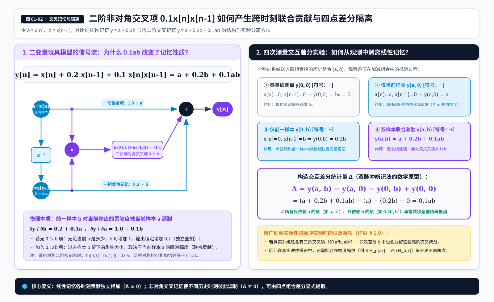

*图 01-02 | 二阶非对角项如何使两个不同历史位置的输入产生联合贡献。*

## 1.3 从多项式到 Volterra：把刚才的玩具模型写成一般形式

回忆普通多项式的结构：$`y=a_0+a_1x+a_2x^2+\cdots`$。它可以把一个复杂的静态非线性拆成常数贡献、一次贡献、二次贡献以及更高次贡献。这里的“一次、二次、三次”表示每个项里面**有多少个输入因子相乘**。

当系统需要同时考虑一整段输入历史时，我们可以把最近 $`M`$ 个采样点排列成一个历史向量：

$$
\mathbf{x}_n=
\begin{bmatrix}
x[n] & x[n-1] & \cdots & x[n-M+1]
\end{bmatrix}^{T}.
$$

如果当前输出是这个向量的某个函数，即 $`y[n]=F(\mathbf{x}_n)`$，那么在适当的光滑性条件与选定工作点附近，可以像展开多变量函数一样，把它写成若干不同次数的项。一次项包含 $`x[n],\;x[n-1]`$ 等各个历史样本；二次项除了包含 $`x^2[n]`$ 和 $`x^2[n-1]`$，还允许 $`x[n]x[n-1]`$；三次项则允许三个输入因子相乘，其中的历史位置可以相同，也可以不同。

把这种思想推广到任意阶，就得到一个有限阶、有限记忆的离散时间 Volterra 模型：

$$
\hat{y}[n] = h_0 + \sum_{p=1}^{P}
\sum_{k_1=0}^{M-1} \cdots \sum_{k_p=0}^{M-1}
h_p[k_1,\ldots,k_p]
\prod_{i=1}^{p} x[n-k_i].
$$

这个公式由三部分构成：外层的 $`\sum_{p=1}^{P}`$ 表示把一阶至 $`P`$ 阶的贡献相加；中间的一组求和表示遍历该阶允许使用的历史位置；最后的 $`\prod`$ 表示把这些历史位置上的输入相乘，再乘上对应的权重 $`h_p`$。其中 $`P`$ 是**最高保留阶数**，$`M`$ 是**输入历史长度**，$`h_0`$ 是常数项，而 $`h_p[k_1,\ldots,k_p]`$ 就是第 $`p`$ 阶 **Volterra 核（Volterra Kernel）**。

不妨把前三阶单独展开：

$$
\begin{aligned}
\hat{y}[n] &= h_0 + \sum_{k_1=0}^{M-1} h_1[k_1]x[n-k_1] \\
&\quad + \sum_{k_1=0}^{M-1}\sum_{k_2=0}^{M-1} h_2[k_1,k_2]x[n-k_1]x[n-k_2] \\
&\quad + \sum_{k_1=0}^{M-1}\sum_{k_2=0}^{M-1}\sum_{k_3=0}^{M-1} h_3[k_1,k_2,k_3]x[n-k_1]x[n-k_2]x[n-k_3] + \cdots .
\end{aligned}
$$

由此可以看到：**一阶 Volterra 项就是普通线性卷积；二阶开始，模型引入两个历史输入的乘积；阶数继续提高时，联合参与的历史输入因子也随之增加。** 因此 Volterra 级数以线性卷积为一阶特例，并在其基础上逐阶扩展了多时刻非线性表达能力。只保留 $`h_1`$ 时，模型即退化为熟悉的线性 FIR 系统。

刚才使用的是离散时间形式，对应数字音频插件中的逐采样计算。在 Schetzen 等经典文献中，连续时间因果、时不变、单输入单输出系统的形式化写法为

$$
y(t)=h_0+\sum_{p=1}^{\infty}
\int_0^{\infty}\!\cdots\!\int_0^{\infty}
h_p(\tau_1,\ldots,\tau_p)
\prod_{i=1}^{p}x(t-\tau_i)
\,d\tau_1\cdots d\tau_p.
$$

其中 $`\tau_i`$ 表示过去的第 $`i`$ 个延迟坐标。每一重积分都在累积一种历史位置组合的贡献，对应离散模型中的多重延迟求和。式中的无穷阶与无穷历史属于一般理论记法；实际实时计算总是基于双截断（有限阶数 $`P`$ 与有限记忆 $`M`$）或低维递归基结构。

上面的式子默认使用零附近的输入作为变量、采用因果历史，并且把各阶核直接定义为对应求和式里的系数。有的泛函分析文献会在展开式里显式写出 $`1/p!`$，有的则把这一系数吸收到核定义中（参见《04》第 4.3 节）。两种写法在保持一致的情况下可以互相转换；**本 Wiki 默认使用已经吸收 $`1/p!`$ 系数的工程核记法**，在对照不同文献时需先核对这一约定。


*图 01-03 | 一阶、二阶与三阶 Volterra 核的维度直觉。它们分别拥有一个、两个和三个延迟索引。*

## 1.4 为什么它被叫作“带记忆的 Taylor 级数”？

Taylor 级数的出发点，是在某个参考点附近利用函数的导数，逐渐构造出能够描述该函数变化的多项式。一个静态函数若在工作点附近满足解析条件，就可以写成

$$
f(x_0+u)=f(x_0)+f'(x_0)u+\frac{f''(x_0)}{2!}u^2+\cdots.
$$

音频系统的输出通常依赖整个输入历史。对于固定的输出时刻，我们面对的是一个从**输入函数到一个输出数值**的映射，即泛函。Volterra 的思想，就是把普通标量函数的 Taylor 展开推广到以函数或信号为自变量的泛函与算子空间。相应的一阶贡献变成对输入历史的线性作用，二阶贡献变成两份历史输入之间的双线性作用，更高阶依此类推。

理解“带记忆的 Taylor 级数”这一比喻时，需要注意两点数学边界：第一，泛函幂级数的收敛域由系统的解析性质与输入幅度范围共同决定；第二，如《00》第 0.27 节所述，在固定点附近的局部泛函导数展开，与在宽动态范围上通过最小二乘拟合得到的双截断多项式核，具有不同的系数性质（参见第 1.11.1 节的多方差辨识）。

这一理论最初来自 Vito Volterra 对泛函的研究，后来经由 Norbert Wiener、Y. W. Lee、Martin Schetzen 等人的工作，与非线性系统分析及黑盒辨识建立紧密联系。对音频工程师而言，这段历史表明：在深度神经网络普及之前，信号处理领域就已经建立了一套可以明确剖析非线性阶次、输入历史、核函数和辨识误差的解析框架。

此外，在文献检索时应注意区分 **Volterra 级数（Volterra Series）** 与 **Volterra 积分方程（Volterra Integral Equation）**：两者同源但研究对象不同，本 Wiki 聚焦于非线性系统的 Volterra 级数表示及其工程约简。

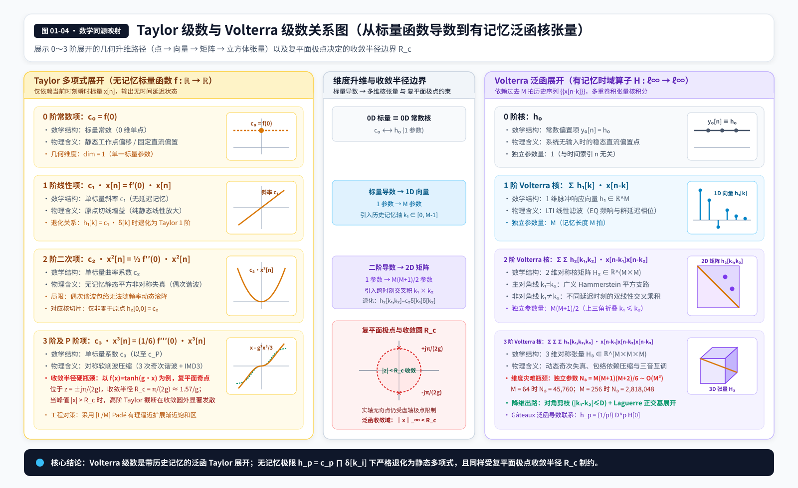

*图 01-04 | 从静态 Taylor 幂级数到带历史输入的 Volterra 展开的直观对应。*

## 1.5 为什么 Volterra 核是多维的？

普通线性脉冲响应 $`h_1[k]`$ 只需要一个延迟坐标：过去第 $`k`$ 个采样点对当前输出有多大影响。假设我们要讨论两个历史位置之间的交互，就必须为两个位置分别安排坐标 $`k_1`$ 和 $`k_2`$，因此二阶核自然写成 $`h_2[k_1,k_2]`$。如果要讨论三个位置联合参与的贡献，就需要 $`h_3[k_1,k_2,k_3]`$。这里的“二维”“三维”，指的是**核系数拥有几个独立的延迟索引**。

对于二阶核，可以把它想象成一张二维表：横轴是第一个延迟位置，纵轴是第二个延迟位置，表中每个格子都存放一个交互权重。处于主对角线 $`k_1=k_2`$ 的元素，对应同一个历史样本的平方，例如 $`x^2[n-4]`$；离开主对角线的元素，则对应不同历史样本之间的乘积，例如 $`x[n-2]x[n-7]`$。二者都属于二阶非线性，但包含的历史耦合结构截然不同。

因此，仅包含对角项的模型与包含**非对角交叉记忆（Cross-Memory）** 的模型，虽然都能生成二次或三次谐波，但在双音互调、瞬态包络恢复和跨时刻调制上会表现出明显的动态差异：后者允许某个历史采样点的非线性作用随另一历史时刻的输入幅值发生调制。

## 1.6 为什么同一个核可以“对称化”？又为什么要小心系数翻倍？

假设一个二阶核中分别存在 $`h_2[2,7]`$ 与 $`h_2[7,2]`$。由于普通实数乘法满足交换律，$`x[n-2]x[n-7]`$ 和 $`x[n-7]x[n-2]`$ 实际上是同一项。因此，这两个核系数的**总贡献**会相加，它们在外部输入—输出测量中无法被单独区分。

一般情况下，可以把二阶核改写为对称形式：

$$
h_{2,\mathrm{sym}}[k_1,k_2]
=\frac{h_2[k_1,k_2]+h_2[k_2,k_1]}{2}.
$$

更高阶的 $`p`$ 阶核同样可以对所有 $`p!`$ 种索引排列取平均：

$$
h_{p,\mathrm{sym}}[k_1,\ldots,k_p]=\frac{1}{p!}\sum_{\pi\in S_p}h_p\bigl[k_{\pi(1)},\ldots,k_{\pi(p)}\bigr].
$$

这样做不会改变同一阶 Volterra 算子的输出，同时将重复排列归并为唯一的对称核表示。对于 $`M`$ 个可用延迟，二阶对称核只需要确定上三角区域 $`0\le k_1\leq k_2\le M-1`$ 的独立坐标。

在编写 C++ 引擎与辨识代码时，需要分别处理**全排列对称核记账**与**上三角唯一单项式特征记账**。继续使用前面的例子 $`y=a+0.2b+0.1ab`$：
- 若求和循环遍历全部 $`M^2`$ 个索引对 $`(k_1,k_2)`$，则对称核系数应赋值为 $`h_{2,\mathrm{sym}}[0,1]=h_{2,\mathrm{sym}}[1,0]=0.05`$，两项相加后恰好还原 $`0.1ab`$；
- 若求和循环仅遍历上三角唯一组合 $`k_1\le k_2`$（即构造无重复的特征字典 $`\boldsymbol{\phi}[n]`$），则单项式 $`x[n]x[n-1]`$ 的回归系数 $`c_2[0,1]`$ 直接等于 $`2h_{2,\mathrm{sym}}[0,1]=0.1`$。

更一般地，对于 $`p`$ 阶上三角有序索引 $`k_1\le k_2\le\cdots\le k_p`$，若其中有 $`m`$ 个互不相同的延迟值，各自重复出现 $`r_1,r_2,\ldots,r_m`$ 次（满足 $`\sum_{j=1}^m r_j=p`$），则该唯一单项式在全排列求和中共出现多项式系数（Multinomial Coefficient）次：

$$
\mu(k_1,\ldots,k_p)=\frac{p!}{r_1!\,r_2!\cdots r_m!}.
$$

因此，唯一特征字典的合并回归系数与对称核张量元素之间的严格换算关系为：

$$
c_p[k_1,\ldots,k_p]=\mu(k_1,\ldots,k_p)\,h_{p,\mathrm{sym}}[k_1,\ldots,k_p].
$$

混淆这两种记账方式会导致非对角交叉项被错误放大或缩小 $`\mu`$ 倍（在二阶中相差 $`2`$ 倍，在三阶全异索引 $`k_1\lt k_2\lt k_3`$ 中相差 $`3!=6`$ 倍）。本系列在统计独立参数规模时，统一按上三角唯一组合计数。

## 1.7 Volterra 里的“阶”，怎样变成我们听到的谐波与互调？

对于经典 Volterra 模型，第 $`p`$ 阶算子具有齐次性（Homogeneity）：如果把整段输入乘以常数 $`a`$，它的第 $`p`$ 阶贡献就会乘以 $`a^p`$，即

$$
H_p[ax](n)=a^pH_p[x](n).
$$

原因在于第 $`p`$ 阶的每一个项里都有 $`p`$ 个输入因子，输入整体放大 $`a`$ 倍后，乘积自然放大 $`a^p`$ 倍（对应 dB 域中，输入每增加 $`1\,\mathrm{dB}`$，第 $`p`$ 阶分量的幅度增加 $`p\,\mathrm{dB}`$）。这种齐次性使不同阶次在幅度变化时呈现不同增长斜率，构成了通过多电平测试分离各阶贡献的数学基础。

那么这些阶次怎样与输出频谱联系起来？假设输入为单频余弦波 $`x(t)=\cos(\omega t)`$。由三角幂展开公式：

$$
\cos^2(\omega t)=\frac{1}{2}+\frac{1}{2}\cos(2\omega t),\qquad
\cos^3(\omega t)=\frac{3}{4}\cos(\omega t)+\frac{1}{4}\cos(3\omega t).
$$

可以看到，二次非线性同时产生直流（$`0\omega`$）与二次谐波（$`2\omega`$），三次非线性则同时作用于基波（$`1\omega`$）和三次谐波（$`3\omega`$）。在无直流偏置的单频正弦输入下，奇偶性严格分离：**第 $`p`$ 阶奇数项会向所有不高于 $`p`$ 的奇次谐波（$`1,3,\ldots,p`$ 倍频）贡献分量；第 $`p`$ 阶偶数项会向所有不高于 $`p`$ 的偶次谐波（$`0,2,\ldots,p`$ 倍频）贡献分量**。因此，同一基波成分会同时受到一阶、三阶、五阶等所有奇数阶项的回流影响（表现为增益压缩或扩展）；同一次奇（或偶）次谐波也会汇集所有高于或等于它的奇（或偶）数阶次贡献。

如果输入包含两个正弦波 $`x(t)=A_1\cos(\omega_1 t)+A_2\cos(\omega_2 t)`$，乘积会把频率相加或相减。二阶项除了产生 $`2\omega_1,\;2\omega_2`$ 和直流外，还会产生二阶和差频互调（IMD2）：

$$
\cos(\omega_1t)\cos(\omega_2t)
=\frac{1}{2}\cos\bigl((\omega_1+\omega_2)t\bigr)
+\frac{1}{2}\cos\bigl((\omega_1-\omega_2)t\bigr).
$$

三阶项则会进一步产生 $`2\omega_1\pm\omega_2`$ 与 $`2\omega_2\pm\omega_1`$ 等三阶互调边带（IMD3）。特别是当 $`\omega_1`$ 与 $`\omega_2`$ 较为接近时，差频 $`\omega_2-\omega_1`$ 落入低频区，而三阶差频 $`2\omega_1-\omega_2`$ 与 $`2\omega_2-\omega_1`$ 紧贴在基频两侧，直接出现在基频附近的可听频段。对于混音、母带以及模拟硬件建模来说，单音谐波测试只能反映频域主对角切片，多音互调测试才是检验非对角交叉核与动态调制的关键手段。

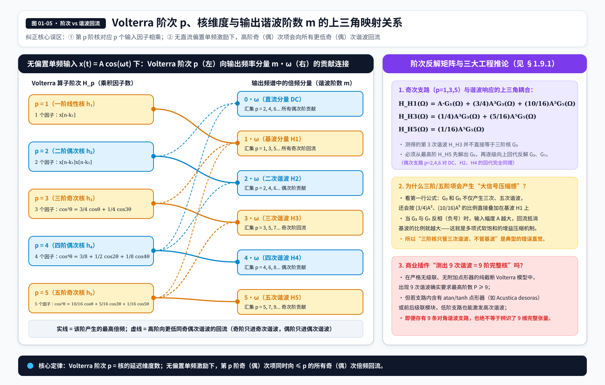

*图 01-05 | Volterra 阶次、核阶数和输出谐波的区别：阶次对应乘积因子数量及核的阶数。在无偏置单频激励下，同一次奇（或偶）次谐波会同时受到多个不同奇（或偶）数阶次的共同贡献，奇阶与偶阶各自独立。*

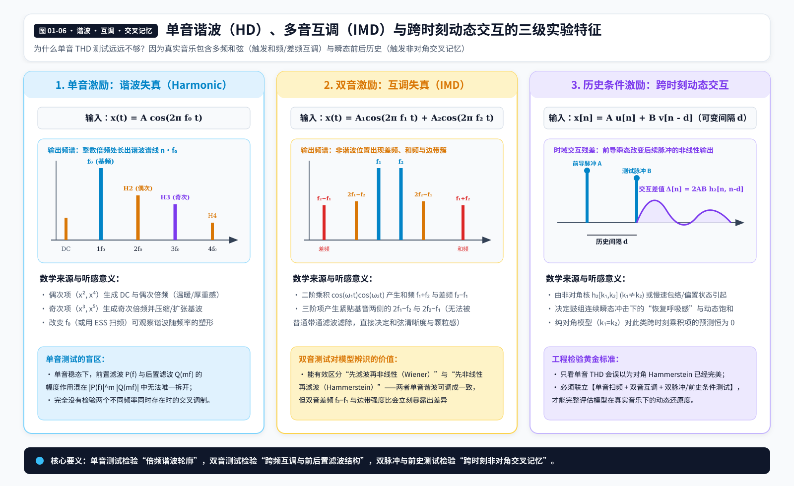

*图 01-06 | 从单频谐波到多音互调，再到不同输入时刻之间的非线性交互。*

## 1.8 Waveshaper、块结构滤波器与 Volterra 的代数对应

静态 waveshaper 的表达形式是 $`y[n]=f(x[n])`$。如果真实设备的主要特征就是一条相对稳定的瞬时传递曲线，那么静态 waveshaper 就是最紧凑的实现。当 waveshaper 前面或后面接上线性滤波器时，模型便获得了频率相关的动态非线性特性：
- **Hammerstein 结构（N–L）**：输入先通过无记忆静态非线性 $`f(\cdot)`$，再通过线性滤波器 $`h[k]`$；
- **Wiener 结构（L–N）**：输入先通过线性滤波器 $`g[k]`$，再进入无记忆静态非线性 $`f(\cdot)`$；
- **Wiener–Hammerstein 结构（L–N–L）**：静态非线性前后分别带有前置线性滤波器 $`g[k]`$ 与后置线性滤波器 $`h[k]`$。

当中间的静态非线性在工作区间内展开为多项式 $`f(v)=\sum_{p=1}^P a_p v^p`$ 时，这三类经典块结构均可直接写出其等效的 Volterra 核：
1. **Hammerstein 模型的等效核**：由于 $`y[n]=\sum_{k=0}^{M-1}h[k]\sum_{p=1}^P a_p x^p[n-k]`$，其第 $`p`$ 阶核仅在主对角线 $`k_1=\cdots=k_p=k`$ 上非零：

$$
h_p^{\mathrm{H}}[k_1,\ldots,k_p]=a_p h[k_1]\,\delta[k_1-k_2]\cdots\delta[k_1-k_p].
$$

2. **Wiener 模型的等效核**：由于 $`v[n]=\sum_{k=0}^{M-1}g[k]x[n-k]`$，将其 $`p`$ 次幂展开后，第 $`p`$ 阶核是前置滤波器脉冲响应 $`g[k]`$ 的 $`p`$ 重外积（秩-1 可分离对称张量）：

$$
h_p^{\mathrm{W}}[k_1,\ldots,k_p]=a_p\prod_{i=1}^{p}g[k_i].
$$

可以看到，Wiener 模型的核天然遍布整个非对角平面（$`k_1\neq k_2`$ 处非零），但整张高维核完全由同一条一维滤波器 $`g[k]`$ 决定。
3. **Wiener–Hammerstein 模型的等效核**：将前置滤波输出 $`v[n-m]`$ 的 $`p`$ 次幂再与后置滤波器 $`h[m]`$ 卷积，其第 $`p`$ 阶核为：

$$
h_p^{\mathrm{WH}}[k_1,\ldots,k_p]=a_p\sum_{m=0}^{M_h-1}h[m]\prod_{i=1}^{p}g[k_i-m].
$$

这组代数对应关系揭示了一个重要的工程结论：**非对角交叉记忆可以通过结构化分解紧凑表示，从而减少对完整 $`M^p`$ 维稠密张量的存储与辨识需求。** 许多由前后级频响耦合产生的交叉记忆，本质上是由少量前置与后置滤波器支路张成的低秩结构化非对角核。

## 1.9 为什么普通脉冲响应不够？双脉冲与指数扫频能揭示什么？

对于线性时不变系统，测得单位脉冲响应 $`h[k]`$ 即可通过卷积预测任意输入下的输出。对 Volterra 系统而言，单个脉冲却只能探测高阶核的主对角切片。假设输入为幅度 $`A`$ 的离散脉冲 $`x[n]=A\delta[n]`$，在观察时刻 $`n`$，由于 $`\delta[n-k_i]`$ 仅在 $`k_i=n`$ 时非零，第 $`p`$ 阶多重求和简化为：

$$
y[n]=h_0+\sum_{p=1}^{P}A^p\,h_p[n,n,\ldots,n].
$$

也就是说，单脉冲响应只访问了各阶核的**主对角线坐标** $`h_p[n,n,\ldots,n]`$，所有离对角交叉项 $`h_p[k_1,\ldots,k_p]`$（存在 $`k_i\neq k_j`$）在单脉冲激励下乘积恒为零，完全处于不可观测状态。

为了探测非对角位置，可以使用**双脉冲激励（Doublet Excitation）**：令第一枚脉冲位于 $`n=0`$（幅度 $`A`$），第二枚脉冲位于 $`n=d`$（幅度 $`B`$），即 $`x[n]=A\delta[n]+B\delta[n-d]`$。对纯二阶对称核模型，扣除两次单脉冲响应后，交互差值信号为：

$$
\Delta[n]
=H_2[A\delta[\cdot]+B\delta[\cdot-d]](n)-H_2[A\delta[\cdot]](n)-H_2[B\delta[\cdot-d]](n)
=2AB\,h_{2,\mathrm{sym}}[n,n-d].
$$

通过遍历脉冲间隔 $`d`$ 并结合多幅度电平组合（剥离三阶及以上交叉项的混入），双脉冲实验能够直接测量二阶核在距离主对角线为 $`d`$ 的次对角线上的分布。

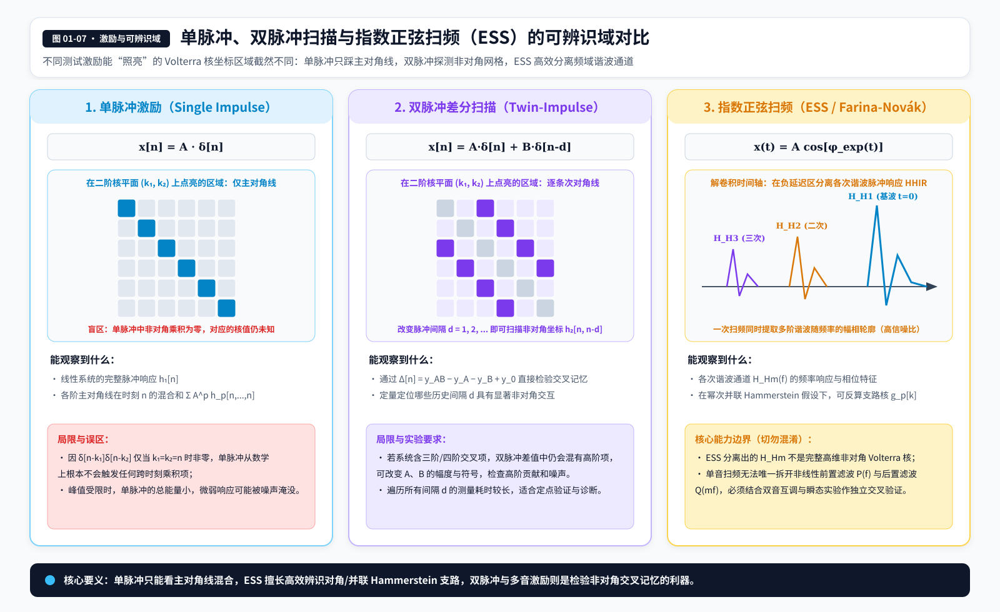

*图 01-07 | 单脉冲、双脉冲和 ESS 可以观察的系统性质不同。ESS 分离出的谐波响应对应频域一维切片，不应直接等同于完整高维 Volterra 核。*

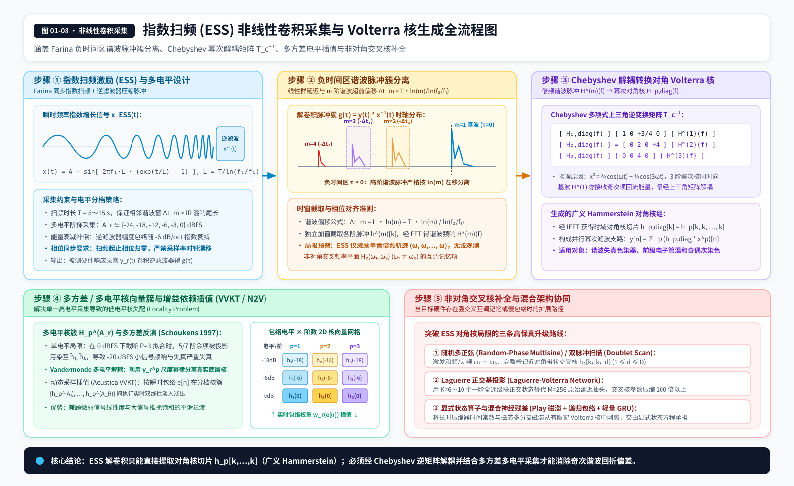

*图 01-08 | 从实验激励和响应数据到动态卷积分支、或到高阶 Volterra 核辨识的两条路径。*

### 1.9.1 Farina 指数扫频（ESS）与 Novák 同步扫频的精确反解条件

在声学与商业音频采样中，Angelo Farina (2000) 提出的**指数正弦扫频（Exponential Sine Sweep, ESS）** 是获取设备频率相关失真特性的标准工具。设扫频信号在时间 $`T`$ 内从起始角频率 $`\omega_1`$ 指数增长至终止角频率 $`\omega_2`$，扫频速率参数定义为 $`L=T/\ln(\omega_2/\omega_1)`$。当该信号通过弱非线性系统时，第 $`m`$ 次谐波的瞬时频率为基频的 $`m`$ 倍，而在指数时间轴上，频率乘以 $`m`$ 恰好等价于时间提前一个固定偏移量：

$$
\Delta t_m = L\ln(m) = \frac{T}{\ln(\omega_2/\omega_1)}\ln(m).
$$

因此，将录制到的系统输出与线性逆滤波器卷积后，基波脉冲响应出现在 $`t=0`$ 处，而第 $`m`$ 次谐波脉冲响应（HIR）则依次分离在负时间轴 $`t=-\Delta t_m`$ 处。

要把这些分离出的高次谐波脉冲响应 $`H_{Hm}(\Omega)`$ 严格转化为**并联 Hammerstein 模型（即对角 Volterra 模型）**

$$
y[n]=\sum_{p=1}^{P}\sum_{k=0}^{M_p-1}g_p[k]x^p[n-k]
$$

中的各阶支路滤波器核 $`g_p[k]`$（频域为 $`G_p(\Omega)`$），需要满足两个关键数学条件（Antonín Novák et al., 2010）：

1. **同步相位条件（Synchronized Swept Sine）**：若激励采用余弦相位 $`\cos(\phi(t))`$，利用三角恒等式将 $`\cos^p(\phi(t))`$ 展开为倍频余弦和时，各倍频项均保持零初相；若采用正弦相位 $`\sin(\phi(t))`$，则 $`\sin^3(\theta)=\frac{3}{4}\sin\theta-\frac{1}{4}\sin(3\theta)`$ 等展开中会出现随阶次交替的符号与 $`\pm\pi/2`$ 相位旋转（偶次幂变成 $`\cos`$，奇次幂带交替正负号）。此外，只有合理选择扫频参数使起始相位在各阶倍频分离点处满足相位同步，解卷积分离出的 $`H_{Hm}(\Omega)`$ 才能保持正确的复相位关系。
2. **高阶向低次谐波回流的上三角反解**：以包含 $`p=1,3,5`$ 三个奇次支路的余弦扫频为例，由于

$$
\begin{aligned}
\cos^3(\theta)&=\frac{3}{4}\cos(\theta)+\frac{1}{4}\cos(3\theta),\\
\cos^5(\theta)&=\frac{10}{16}\cos(\theta)+\frac{5}{16}\cos(3\theta)+\frac{1}{16}\cos(5\theta),
\end{aligned}
$$

   实际测得的基波、三次与五次谐波复频谱 $`H_{H1}(\Omega), H_{H3}(\Omega), H_{H5}(\Omega)`$ 与对角支路传递函数 $`G_1(\Omega), G_3(\Omega), G_5(\Omega)`$ 满足上三角矩阵方程：

$$
\begin{bmatrix}
H_{H1}(\Omega) \\
H_{H3}(\Omega) \\
H_{H5}(\Omega)
\end{bmatrix}
=
\begin{bmatrix}
A & \frac{3}{4}A^3 & \frac{10}{16}A^5 \\
0 & \frac{1}{4}A^3 & \frac{5}{16}A^5 \\
0 & 0 & \frac{1}{16}A^5
\end{bmatrix}
\begin{bmatrix}
G_1(\Omega) \\
G_3(\Omega) \\
G_5(\Omega)
\end{bmatrix}.
$$

   一般地，对任意最高阶数 $`P`$，转换矩阵 $`\mathbf{T}_c`$ 的元素由单项式向 Chebyshev 多项式展开的二项式系数决定，必须**从最高阶 $`P`$ 向一阶逐级回代消元**，才能解出真正的支路核 $`G_p(\Omega)`$。

同时，单次 ESS 测量存在固有的拓扑可辨识性边界：对一个前级频响为 $`P(f)`$、后级频响为 $`Q(f)`$ 的三阶 Wiener–Hammerstein 级联系统，单音扫频测得的三次谐波复频谱仅取决于乘积

$$
A_{H3}(f)=\frac{A^3}{4}\,P^3(f)\,Q(3f).
$$

一条固定电平的 ESS 记录反映了非线性前的输入选频塑形 $`P(f)`$ 与非线性后的谐波滤波 $`Q(3f)`$ 的合成影响。结合双音互调（如探测 $`2f_1-f_2`$ 随 $`f_1,f_2`$ 独立变化的二维频域核切片）与多电平激励，可以进一步分辨前置滤波与后置滤波的作用。

## 1.10 从核系数看到的是输入—输出规律，而非物理电路拓扑

当我们从测量中辨识出 $`h_2[2,7]`$ 或某个低秩核时，需要明确其解释边界：Volterra 核提供的是**输入—输出意义上的行为可解释性**（如各阶贡献比例、主对角与离对角记忆分布、不同电平下的增长斜率），若要进一步对应具体内部物理元件（如耦合电容、电子管偏置电阻或变压器漏感），还需电路信息与独立物理测量证据。不同电路拓扑或块结构在有限频带与工作电平内完全可能映射出极度接近的等效 Volterra 核。对于未知商业插件或硬件，**能拟合外部输出**、**能辨识等效块结构**与**还原真实物理电路或源码**，对应三个不同的证据层级（详见《06》第 6.19 节）。

## 1.11 为什么 Volterra 也需要训练？线性参数回归与多方差局域性

当选定保留阶数 $`P`$ 与记忆窗口 $`M`$ 后，每一种历史乘积（如 $`x[n],\;x^2[n],\;x[n]x[n-1]`$）都成为已知的显式特征。将这些特征排列为向量 $`\boldsymbol{\phi}[n]`$，模型预测即可写为参数线性形式：

$$
\hat{y}[n]=\boldsymbol{\phi}^{T}[n]\boldsymbol{\theta},\qquad \mathbf{y}\approx\mathbf{X}\boldsymbol{\theta}.
$$

这一性质使得固定结构 Volterra 的参数辨识可直接采用带正则化的线性最小二乘（如 Ridge / Tikhonov 正则化）：

$$
\boldsymbol{\theta}^\star = \bigl(\mathbf{X}^\top\mathbf{X} + \lambda\mathbf{I}\bigr)^{-1}\mathbf{X}^\top\mathbf{y},
$$

或使用自适应滤波中的 LMS、RLS 算法递推求解，而无需像深度神经网络那样在高度非凸的参数空间中进行反向传播搜索。

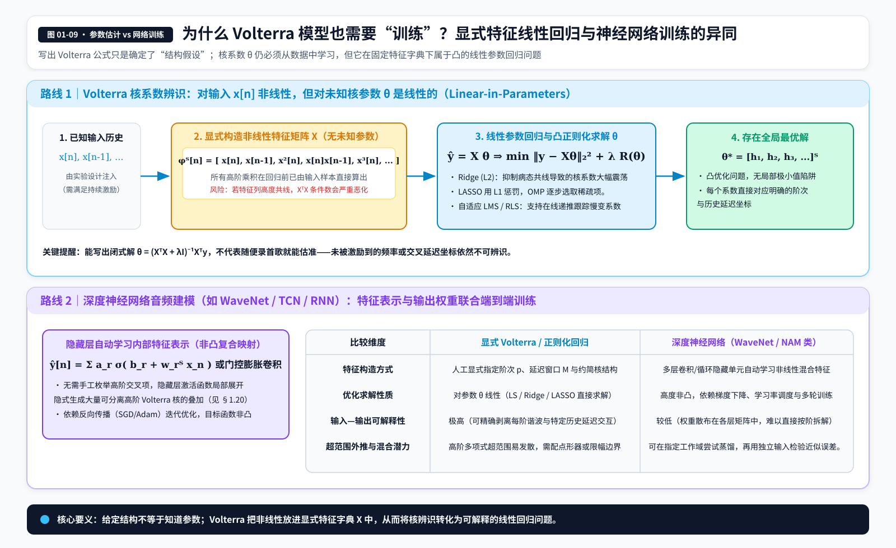

*图 01-09 | 神经网络权重学习与 Volterra 核系数辨识的共同点及区别。*

### 1.11.1 截断 Volterra 辨识的“局域性问题”与多方差辨识法（Multiple-Variance Method）

在工程实践中，固定核 Volterra 辨识有一个极易被忽略的数学陷阱——**双截断级数的方差局域性（Locality of the Solution）**。

在连续时间无穷阶解析理论中，系统的真实 Volterra 核是与输入激励电平无关的固有常数。然而，在实际数字音频建模中，我们总是使用**阶数截断（$`P<\infty`$）且记忆截断（$`M<\infty`$）的双截断 Volterra 级数**去逼近真实硬件（例如包含无穷阶奇次项的电子管饱和曲线）。当使用单一固定方差 $`\sigma_x^2`$（即单一固定 RMS 电平）的宽带信号通过最小二乘或互相关法辨识 $`P`$ 阶截断模型时，被截断的 $`P+2, P+4, \ldots`$ 等更高阶未建模非线性并不会消失，而是通过偶次矩相关性（如高斯信号下 $`\mathbb{E}[x^6]=15\sigma_x^6`$ 与 $`\mathbb{E}[x^2]=\sigma_x^2`$ 相关）**向下折叠偏置（Bias）所估计的低阶核系数**。

其直接后果是：**在单一固定电平 $`\sigma_0`$ 下拟合最优的截断 Volterra 核 $`\hat{h}_p^{(\sigma_0)}`$，实际上是一个依赖训练电平的等效近似核**：
- 当测试音频处于训练电平 $`\sigma_0`$ 附近时，低阶核中的偏置项恰好补偿了被截断的高阶贡献，均方误差极小；
- 一旦测试音频切换到远低于 $`\sigma_0`$ 的小信号区间（此时真实高阶贡献已按 $`a^p`$ 迅速消失），被高电平训练污染的一阶与三阶核系数反而会产生严重的过补偿失真；反之，在高于 $`\sigma_0`$ 的大信号下则会迅速偏离。

为了克服这一局域性瓶颈，Simone Orcioni 等人（2014, 2018）提出了针对电子管音频设备辨识的**多方差方法（Multiple-Variance Method）**[V2]：
1. **分阶分电平激励设计**：利用不同阶算子随输入幅度呈 $`a^p`$ 齐次缩放的性质，使用低方差（小信号）激励专门辨识一阶核 $`h_1`$（此时高阶项以 $`O(\sigma^3)`$ 衰减，不会污染一阶估计）；随后逐步提高输入方差，依次在各自信噪比与截断偏置最优的电平窗口下辨识二阶、三阶与五阶核；
2. **多方差联合最小二乘 / 核插值**：或者在构建回归矩阵 $`\mathbf{X}`$ 时，将跨越多个 dB 台阶（如 $`-30\,\mathrm{dBFS}`$ 至 $`0\,\mathrm{dBFS}`$）的多方差激励序列按幅度加权拼接，迫使估计出的核系数在整个动态范围内保持一致的阶次缩放规律，并在強过载区配合多电平核插值（如 Tronchin & Coli 2015 的连续电平核插值框架 [V3]）。

这一原理也说明多方差激励的必要性：**覆盖小信号到强驱动区的多方差激励，有助于区分不同阶次的贡献，并检验截断 Volterra 模型在宽动态范围内的泛化表现。**


*图 01-16：左篇展示单一高电平辨识中未建模高阶奇次项（$`p=5,7`$）向低阶核（$`\hat{h}_1, \hat{h}_3`$）回折投影引发的“局域性失配问题（Locality Problem）”及多方差 Vandermonde 尺度解耦；右篇展示 Hopman–Bennett 无分母多项式一阶/二阶反导数抗混叠（Polynomial ADAA）代数因式分解与基于移位 Legendre 正交基的紧凑型 SNLM 架构。*

## 1.12 为什么“喂更多音乐”不等于“测到了更多系统结构”？

一段音乐可能同时包含大量频率、电平和瞬态变化，作为模型的最终听感测试非常有价值。但如果所有训练音频都来自相似的曲风、响度与动态范围，某些关键物理工作区间便可能始终没有被充分访问。即使总数据量很大，仍然可能缺少辨识某些参数真正需要的独立变化。

不同激励信号在系统辨识中承担着明确分工：
- **单音多电平扫描**：检验各阶谐波随驱动幅度的增长斜率与奇偶对称性；
- **双音与随机相位多音（Multisine）**：分离和频、差频与带内高阶互调，探测二维及三维频域核切片；
- **同步指数扫频（ESS）**：高效提取各阶对角支路的频率响应与群延迟；
- **双脉冲与多脉冲序列**：直接激发并测量离对角交叉记忆坐标 $`h_2[k_1,k_2]`$；
- **阶跃包络与长时预激励探针**：暴露慢速动态恢复、电源下陷与磁滞路径依赖。

因此，系统辨识的数据采集本质上是受控实验设计。验证同样需要覆盖对齐后的时域残差、跨电平 THD/IMD、瞬态包络差分、历史条件化探针与未见音乐素材。

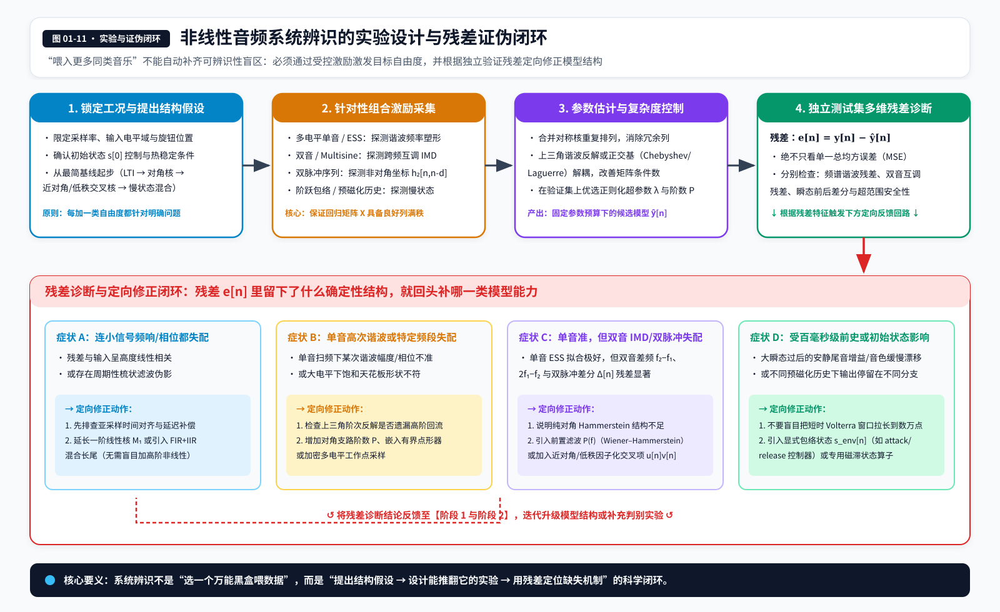

*图 01-10 | 测量、建模与独立验证构成反复迭代的实验闭环。*

## 1.13 为什么完整 Volterra 会迅速变得难以实现？

假设每一阶都允许使用 $`M`$ 个历史位置。如果不利用核对称性，第 $`p`$ 阶具有 $`M^p`$ 个核坐标。利用核对称性将重复排列合并后，第 $`p`$ 阶的独立参数数量为多重组合数：

$$
N_p=\binom{M+p-1}{p}=\frac{(M+p-1)!}{p!\,(M-1)!}.
$$

例如取 $`M=64`$（在 $`48\,\mathrm{kHz}`$ 下仅对应约 $`1.33\,\mathrm{ms}`$），未利用对称性的原始张量坐标数 $`M^p`$ 与对称核独立参数数量 $`N_p=\binom{M+p-1}{p}`$ 对照如下：

| Volterra 阶数 $`p`$ | 原始张量坐标数 $`M^p`$ (对应图 01-11) | 对称核独立参数数量 $`\binom{M+p-1}{p}`$ |
|---|---|---|
| 一阶 ($`p=1`$) | 64 | 64 |
| 二阶 ($`p=2`$) | 4,096 | 2,080 |
| 三阶 ($`p=3`$) | 262,144 | 45,760 |
| 四阶 ($`p=4`$) | 16,777,216 | 766,480 |
| 五阶 ($`p=5`$) | 1,073,741,824 | 10,424,128 |

仅仅是不足两毫秒的完整五阶结构，就已经拥有超过一千万个独立参数。若将记忆窗口延长至一秒（$`M=48\,000`$），仅一个二阶对称核就需要

$$
N_2=\frac{48\,000\times48\,001}{2}=1\,152\,024\,000
$$

个独立系数。因此，工程上必须从“完整高维张量”转向“结构化约简”与“慢速状态解耦”。


*图 01-11 | 完整 Volterra 核的参数规模随阶数和记忆长度快速增长。图中并列对比了全张量坐标数 $`M^p`$ 与对称核独立参数数量 $`\binom{M+p-1}{p}`$。*

## 1.14 Volterra 的常见约简形式：它们究竟各自舍弃了什么？

理解约简时，应首先分析每一种方法提出的结构假设。完整 Volterra 允许每一阶、每一种延迟组合拥有独立的系数；约简模型则通过限制阶次、限制非对角支撑集、利用低秩可分离分解或正交时间基投影，用极少自由度保留目标系统的核心非线性记忆。


*图 01-12 | 从完整核到对角、近对角、稀疏、低秩、正交基以及多项式记忆动态卷积的简化思路。*

### 1.14.1 阶次截断与分阶记忆：先控制问题的大小

最直观的做法是将级数保留至第 $`P`$ 阶，并为不同阶次分配递减的记忆长度 $`M_1 \gt M_2 \gt M_3 \ge \cdots \ge M_P`$。这一策略允许一阶线性路径完整保留长尾频响（如房间或变压器低频谐振），同时将高阶非线性严格约束在短时局部窗口内。

### 1.14.2 对角 Volterra、Memory Polynomial、Parallel Hammerstein 与 Legendre 正交改进

如果我们只保留满足 $`k_1=k_2=\cdots=k_p=k`$ 的高阶核主对角坐标，并记 $`g_p[k]=h_p[k,k,\ldots,k]`$，第 $`p`$ 阶算子即简化为：

$$
H_p[x](n)=\sum_{k=0}^{M_p-1} g_p[k]x^p[n-k].
$$

这种结构称为**对角 Volterra（Diagonal Volterra）** 或**简化非线性 Volterra 模型（Simplified Nonlinear Volterra Model, SNVM）**。将各阶相加即为实信号**记忆多项式（Memory Polynomial）**，在信号流上等价于**并行 Hammerstein（Parallel Hammerstein）** 模型（每条支路先计算无记忆幂次 $`x^p[n]`$，再通过专属一维 FIR 滤波器 $`g_p[k]`$）。

需要注意，传统单项式幂基 $`x^p[n]`$ 在高阶（如 $`p=7, 9, 11`$）和小信号输入（如 $`\lvert x\rvert \le 10^{-3}`$）下极易发生浮点数**数值下溢（Underflow）**，且当支路内插入抗混叠低通滤波器引起微小相移时，由于各奇次幂均包含基波与低次谐波分量，支路间的相移失配会破坏上三角消元关系并劣化频响。Stefan Hopman (2023) 提出的**简化非线性 Legendre 模型（Simplified Nonlinear Legendre Model, SNLM）**[V4] 将单项式 $`x^p`$ 替换为正交 Legendre 多项式 $`P_p(x)`$：由于 $`P_p(x)`$ 包含零次或一阶线性主项且在 $`[-1,1]`$ 上正交有界，不仅显著抑制了小信号高阶下溢，还大幅提升了模型对支路滤波相移的鲁棒性。

### 1.14.3 Wiener 与 Wiener-Hammerstein：由紧凑块结构生成的非对角核

如第 1.8 节所证，Wiener（L–N）与 Wiener–Hammerstein（L–N–L）结构生成的等效高阶核虽然遍布非对角区域，但其自由度仅取决于前后置一维滤波器与静态多项式系数。当硬件的非对角交叉记忆主要源于非线性器件前后的线性阻抗与选频网络时，这类块结构能以极低的运算成本精确复现非对角交互。

### 1.14.4 Near-Diagonal、Banded 与 GMP：保留局部交叉记忆

当严格对角模型无法解释双脉冲或多音交互实验时，可以先开放主对角线邻域内的带状区域：

$$
\lvert k_1-k_2\rvert \leq B.
$$

这就是**近对角 / 带状 Volterra（Near-Diagonal / Banded Volterra）**。**广义记忆多项式（Generalized Memory Polynomial, GMP）** 同样通过引入少量超前与滞后交叉乘积项（如 $`x[n-k]x^{p-1}[n-k-m]`$，其中 $`\lvert m\rvert\le B`$），以线性增长的参数量补足局部跨时刻耦合。

### 1.14.5 Sparse Volterra：允许远距离交互，但只保留少量坐标

**稀疏 Volterra（Sparse Volterra）** 不预先限制交互必须紧邻主对角线，而是利用 LASSO（$`L_1`$ 正则化）或正交匹配追踪（OMP）在候选核空间中筛选少数显著的延迟组合。为确保所选稀疏坐标具有物理泛化意义，需结合交叉验证与条件数检查，排除由训练信号共线性造成的伪稀疏项。

### 1.14.6 Low-Rank Volterra：用少量滤波器支路的乘积生成稠密高维核

低秩约简假设高维核张量可由 $`R`$ 个秩-1 可分离分量的和近似。以对称 CP（PARAFAC）分解为例：

$$
h_p[k_1,\ldots,k_p]
\approx\sum_{r=1}^{R}\lambda_r \prod_{i=1}^{p}g_r[k_i],\qquad
H_p[x](n)
\approx\sum_{r=1}^{R}\lambda_r \bigl((g_r \ast x)[n]\bigr)^p.
$$

更一般地，非对称或跨支路因子化二阶核可写为 $`H_2[x](n)=\sum_{r=1}^R \bigl((a_r\ast x)[n]\bigr)\bigl((b_r\ast x)[n]\bigr)`$。这意味着：**只需运行少数几条一维线性滤波器并将它们的输出逐点相乘，就能在等效核空间中合成稠密的非对角交叉记忆，而将每采样复杂度从 $`O(M^p)`$ 降至 $`O(R\cdot M)`$。**（这一定理同样对应了《06》第 6.7 与 6.13.1 节中商业引擎的跨缓冲乘法原语。）

### 1.14.7 Laguerre、Kautz 与正交基：先用极点滤波器压缩时间历史

当系统具有较长的指数衰减记忆时，可以先通过一组带极点的正交动态基函数（如离散 Laguerre 基或共轭复极点 Kautz 基）对输入历史做特征投影：

$$
z_r[n]=(B_r \ast x)[n],\qquad r=1,\ldots,K,
$$

随后仅在 $`K`$ 维特征向量 $`(z_1[n],\ldots,z_K[n])`$ 上建立高阶多项式展开（完整传递函数与参数复杂度推导见《03》第 3.3.1 节）。

### 1.14.8 混合结构与约简模型总览

实际工程中可将不同约简方法按阶次组合（例如一阶采用长 FIR/IIR，二阶采用 Near-Diagonal 或 Low-Rank，三阶及以上采用对角支路）。常见约简形式总结如下：

| 结构 | 核心假设 | 主要节省的资源或保留的能力 |
|---|---|---|
| 阶次截断与分阶记忆 | 高阶贡献集中在短时局部窗口 ($`M_1>M_2>M_3`$) | 控制高阶张量维度膨胀 |
| Diagonal / Memory Polynomial / Parallel Hammerstein | 同一历史时刻的幂次贡献占主导 ($`k_1=\cdots=k_p`$) | 极紧凑的一维支路滤波，支持 ESS 辨识 |
| Simplified Legendre (SNLM) | 用正交 Legendre 基 $`P_p(x)`$ 替代单项式 $`x^p`$ | 消除高阶小信号下溢，增强对支路滤波相移的鲁棒性 |
| Wiener / Wiener-Hammerstein | 核由前后级线性滤波器与静态非线性耦合生成 | 用一维滤波器组表达结构化非对角交互 |
| Near-Diagonal / Banded / GMP | 重要交叉记忆集中在主对角线邻域 ($`\lvert k_1-k_2\rvert\le B`$) | 以 $`O(B\cdot M)`$ 成本保留局部跨时刻交互 |
| Sparse Volterra | 仅少数离散延迟坐标对输出有显著贡献 | 允许捕获非局部稀疏交叉项 |
| Low-Rank (CP / Tucker / TT) | 稠密高维核由少数一维滤波器模态的外积生成 | 将 $`O(M^p)`$ 乘加降为 $`O(R\cdot M)`$ 滤波器支路乘积 |
| Laguerre / Kautz / OBF | 长衰减记忆可由少数极点正交基概括 | 将历史维度从采样点数 $`M`$ 压缩至基数量 $`K\ll M`$ |
| Hybrid (分阶/状态混合) | 不同阶次与时间尺度具有异构物理机制 | 按需组合短时核与慢速状态变量 |


*图 01-13 | 常见 Volterra 模型及相关块结构的关系导览。*

## 1.15 多项式收敛半径、外推失控与 Padé 有理逼近

设有限阶 Volterra 模型为 $`\hat{y}[n]=h_0+\sum_{p=1}^P H_p[x](n)`$。将输入整体放大 $`a`$ 倍时，输出按 $`\sum_{p=1}^P a^p H_p[x](n)`$ 缩放。只要最高阶项 $`H_P[x](n)\neq 0`$，当输入幅度 $`\lvert a\rvert`$ 超出训练范围并持续增大时，$`a^P`$ 项终将主导输出并向无穷大发散。

从复分析角度看，这一现象源于幂级数的**收敛半径（Radius of Convergence）** 限制：即使一个饱和函数在实轴上处处光滑有界，其幂级数展开的收敛半径仍受限于该函数在复平面上距离原点最近的奇点（非解析悬崖）。例如理想软饱和函数 $`\tanh(g x)`$ 在复平面虚轴 $`x=\pm\mathrm{i}\pi/(2g)`$ 处存在极点，导致其 Taylor 级数的收敛半径严格受限于 $`R_c=\pi/(2g)`$；一旦输入驱动超出该半径，多项式截断非但无法贴合水平饱和渐近线，反而会在边界外剧烈向上或向下发散。

在工程实现中，除了严格限制输入工作电平或串联软限幅保护外，还可以采用**Padé 有理函数逼近（Padé Approximant）**：

$$
R_{[L/M]}(x)=\frac{\sum_{i=0}^{L}p_i x^i}{1+\sum_{j=1}^{M}q_j x^j}.
$$

其中，系数 $`q_j`$ 应使分母多项式在实轴上无零点，以避免产生实极点。通过引入分母多项式并令分子与分母阶次相匹配（如奇对称饱和取 $`L=M`$ 或分子高一阶配合偶次正定分母），有理逼近能够在 $`x\to\pm\infty`$ 时自然形成水平渐近饱和平台或受控斜率，以极低阶次跨越多项式的收敛半径瓶颈。

## 1.16 Hard Clipper 与软饱和：光滑性与奇点边界

对于理想硬削波器：

$$
y=\begin{cases}
-T, & x \lt -T, \\
x, &\lvert x\rvert \leq T,\\
T, & x \gt T.
\end{cases}
$$

该映射在 $`\pm T`$ 处存在一阶导数不连续的硬折点（$`C^0`$ 连续但非 $`C^1`$ 光滑）。根据逼近论，用 $`P`$ 阶多项式在有界区间上逼近带折点的函数时，一致收敛速度会从光滑解析函数的指数级（几何级数级）退化为代数级 $`O(1/P)`$，且在折点 $`\pm T`$ 附近会出现类似 Gibbs 现象的过冲波纹。因此，遇到明确的分段折点或硬限幅阈值时，直接采用分段多项式（如三次软削波分段样条）配合抗混叠算法（ADAA），在精度与实时效率上远优于盲目堆叠高阶全局 Volterra 多项式。

## 1.17 Compressor 与 Limiter：递归增益控制与时间尺度失配

典型压缩器与限制器包含四个核心环节：电平检测、慢速包络状态递推、非线性增益映射以及乘法调制：

$$
\begin{aligned}
d[n]&=D(x[n]),\\
s_{\mathrm{env}}[n]&=F(s_{\mathrm{env}}[n-1],d[n]),\\
g[n]&=G(s_{\mathrm{env}}[n]),\\
y[n]&=g[n]x[n].
\end{aligned}
$$

其中包络状态 $`s_{\mathrm{env}}[n]`$ 的释放时间常数往往长达 $`50\,\mathrm{ms}`$ 至数秒（在 $`48\,\mathrm{kHz}`$ 下对应数千至数十万个采样点），且在上升（Attack）与下降（Release）阶段具有非对称的分段递推规律。若强行用前馈有限窗口 Volterra 直接展开 $`y[n]=g(s_{\mathrm{env}}[n])x[n]`$，不仅窗口 $`M`$ 必须覆盖整个释放周期，而且分段非对称切换还会破坏高阶光滑性。因此，对于动态处理器，正确的设计分工是将包络检测与增益控制保留为显式递归状态 $`s_{\mathrm{env}}[n]`$，而将 Volterra 用作模拟电子管/变压器放大级的短时非线性子模块（或构建以 $`s_{\mathrm{env}}[n]`$ 为条件变量的混合核，见《03》第 3.10 节）。

压缩器的谐波既可能来自电子管和变压器的静态非线性，也可能由增益控制的动态调制产生。即使音频通路本身只有线性乘法增益单元，只要增益控制信号 $`g[n]`$ 带有与输入相关的音频速率纹波，乘法 $`y[n]=g[n]x[n]`$ 也会产生谐波与互调边带。这类失真可由包络检测、增益律和多时间常数的动态状态共同决定。商业光电压缩器的建模因此常把**控制路径的动态行为**与**音频路径的谐波染色**分开设计；两者在最终输出中又发生耦合，具体例子见《03》第 3.9–3.10 节及《06》第 6.13 节。

以上讨论的是**有限阶、有限记忆并受实时算力约束的实现选择**。在有界输入域、适当连续性和衰减记忆等条件下，Volterra 型算子仍有逼近非线性动态系统的理论基础。

## 1.18 磁滞与持久记忆：为什么“把窗口加长”依然不够？

磁带机与音频变压器中的磁性材料具有**磁滞（Hysteresis）** 与**持久记忆（Persistent Memory）**：同一个当前输入电平，可能因为此前经历过不同的磁化极值与路径分支（Major Loop / Minor Loops），而停留在不同的剩磁状态（Remanence）上。

只要这一远期历史留下的内部磁化状态差异没有随时间完全衰减，任何仅查看最近 $`M`$ 个输入采样点、且不包含内部状态变量的前馈模型（无论是有限记忆 Volterra 还是固定感受野的 WaveNet），在静音或相同近期输入持续超过 $`M`$ 个采样点后，其输出必然完全重合，从而在结构上丢失区分历史路径的能力。对于此类持久路径依赖现象，必须引入 Play / Prandtl–Ishlinskii 算子、速率依赖（RD-Play）算子、Preisach 或 Jiles–Atherton 等显式磁滞状态模型（详见《03》第 3.7、3.14 节）。

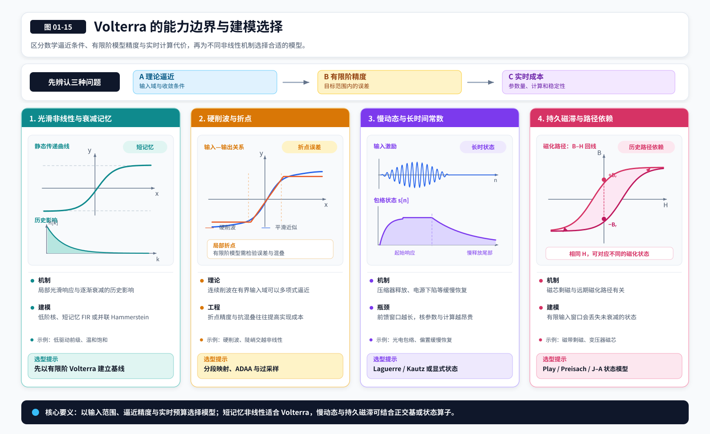

*图 01-14 | 不同类型非线性行为对有限阶、有限记忆 Volterra 实现的挑战。*

## 1.19 时变、随机噪声与多通道耦合

在评估真实硬件的辨识残差时，还需明确三项物理边界：
1. **时变漂移**：热漂移、电源纹波或外部 LFO 调制会使系统违背时不变假设，需要作为慢变状态或外部控制参数建模；
2. **本底随机噪声**：确定性 Volterra 核只应拟合可重复的确定性响应，硬件热噪声与转换器量化抖动应通过多次重复采集平均剥离，并在评估时按统计功率谱检验；
3. **跨声道耦合（MIMO）**：立体声硬件可能通过公共电源内阻或联动侧链产生声道间交叉调制，独立运行两套 SISO 核无法表达跨声道乘积项 $`x_L[n-k_1]x_R[n-k_2]`$。

## 1.20 Volterra 与神经网络：在同一个函数逼近问题上相遇

考虑一个接收有限历史向量 $`\mathbf{x}_n`$ 的单隐藏层神经网络：

$$
\hat{y}[n]=\sum_{r=1}^{R}a_r\,\sigma\!\left(b_r+\mathbf{w}_r^{T}\mathbf{x}_n\right).
$$

若光滑激活函数 $`\sigma(\cdot)`$ 在工作点附近按幂级数展开，其第 $`p`$ 次幂项满足：

$$
\bigl(\mathbf{w}_r^{T}\mathbf{x}_n\bigr)^p
=\sum_{k_1=0}^{M-1}\cdots\sum_{k_p=0}^{M-1}
\Biggl(\prod_{i=1}^{p}w_r[k_i]\Biggr)\prod_{i=1}^{p}x[n-k_i].
$$

将 $`R`$ 个隐藏单元叠加后，网络在局部等价于一个**秩至多为 $`R`$ 的对称 CP 低秩 Volterra 模型**（参见第 1.14.6 节），其中隐藏层权重向量 $`\mathbf{w}_r`$ 直接充当低秩滤波器模态。这一数学等价性清晰揭示了两者的内在联系：固定核 Volterra 预先固定特征基并直接拟合线性输出权重，而前馈神经网络则通过梯度优化同时学习低秩滤波器基 $`\mathbf{w}_r`$ 与非线性组合系数。下一章《02 从 Volterra 到神经网络》将在此基础上全面展开两者的对比。

## 1.21 离散音频的混叠代价与多项式分支抗混叠（ADAA）

在离散时间系统中，计算第 $`p`$ 阶时域乘积（如 $`x^p[n]`$ 或 $`\prod_{i=1}^p x[n-k_i]`$）对应频域的 $`p`$ 重自卷积：若输入信号最高频率为 $`f_{\max}`$，第 $`p`$ 阶非线性产物的最高频率将展宽至 $`p\cdot f_{\max}`$。一旦 $`p\cdot f_{\max} \gt f_s/2`$，高频分量在进入后续支路滤波器 $`g_p[k]`$ 之前就已经折返到可听频带内，后续线性滤波无法消除已经发生的混叠。

为了抑制这一数字伪影，工程上有两条互补路径：
1. **过采样（Oversampling）**：将采样率提升 $`M_{\mathrm{OS}}`$ 倍。要使最高 $`P`$ 阶多项式生成的谐波在折叠后不落入原始基带 $`[0, f_{\max}]`$，需满足 $`P\cdot f_{\max} \lt M_{\mathrm{OS}} f_s - f_{\max}`$，即在满带宽 $`f_{\max}\approx f_s/2`$ 下需满足

$$
M_{\mathrm{OS}} \ge \frac{P+1}{2}
$$

   才可保证基带无混叠（若要求整个过采样奈奎斯特带内完全不折返则需 $`M_{\mathrm{OS}}\ge P`$）。
2. **简化 Volterra / 并联 Hammerstein 支路的无分母多项式 ADAA**：在并行 Hammerstein（对角 Volterra）结构中，由于每条支路的非线性是纯单项式 $`f_p(x)=x^p`$（或 Legendre 多项式），其一阶反导数为 $`F_p(x)=\frac{x^{p+1}}{p+1}`$。Stefan Hopman 与 Christopher Bennett (2022) 指出 [V4]，将一阶反导数抗混叠（ADAA1）应用于单项式 $`x^p`$ 时，差商分母 $`x[n]-x[n-1]`$ 可由代数因式分解 $`a^{p+1}-b^{p+1}=(a-b)\sum_{j=0}^p a^{p-j}b^j`$ **精确消去**，化简为完全无除法、无小分母奇点且无需条件分支切换的闭式齐次多项式：

$$
\mathrm{ADAA}_1\bigl(x^p\bigr)[n]
=\frac{x^{p+1}[n]-x^{p+1}[n-1]}{(p+1)\bigl(x[n]-x[n-1]\bigr)}
=\frac{1}{p+1}\sum_{j=0}^{p}x^{p-j}[n]\,x^j[n-1].
$$

   例如对三阶支路 $`x^3[n]`$，其 ADAA1 等效特征直接化为四项二元对称齐次式 $`\frac{1}{4}\bigl(x^3[n]+x^2[n]x[n-1]+x[n]x^2[n-1]+x^3[n-1]\bigr)`$，在代价上仅相当于向对角模型引入了固定权重的相邻一拍近对角交叉项，却能在无需高倍过采样除法的条件下显著压低高频混叠，并与输入低通滤波或适度过采样形成叠加增益（详见《03》第 3.8 节）。

## 1.22 怎样判断一个 Volterra 模型是否真的值得继续做？

面对未知的音频设备，合理的研发路径应当遵循“由简入繁、逐级证伪”的实验闭环：先建立线性脉冲响应与静态 waveshaper 基线，再依次测试对角记忆多项式（或 SNLM）、近对角/低秩交叉核与正交基展开。在统一的训练/测试集划分、统一的对齐基准与相同的实时 CPU 预算下，用多维指标（时域残差、多电平 THD、双音 IMD、双脉冲交互与长历史探针）检验每一项新增自由度是否带来真实的泛化收益。


*图 01-15 | 基于目标系统特征选择候选模型的初步启发式地图。*

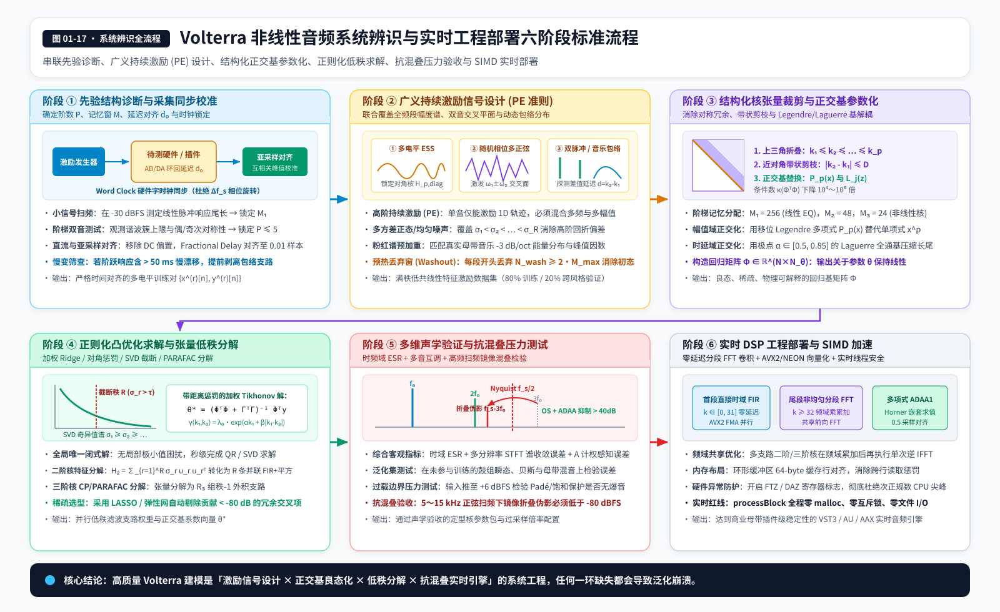

*图 01-16 | 从实验目标到结构选择、参数训练、独立验证的工作流程。*

## 1.23 Volterra 在数字音频建模中的准确位置

综上所述，**Volterra 级数是一套把非线性阶次、输入历史以及跨时刻交互显式组织起来的输入—输出算子表示语言。** 它既可以作为弱至中等非线性硬件的高精度实时模型，更是一把用于诊断目标系统究竟需要多少历史、多少阶次和多少交叉作用的度量标尺。

### 1.23.1 衰减记忆为何支撑了 Volterra 的逼近能力？

理解 Volterra 的表达能力，需要区分局部高阶展开与系统类的整体逼近。在适当的因果性、时不变性、有界输入集及**衰减记忆（Fading Memory）** 条件下，Boyd 与 Chua (1985) 证明了具有无限历史的连续非线性算子可在一致误差意义下由有限阶、有限维线性动力学加多项式读出的 Volterra 型算子任意逼近 [V1]。这一基本定理从理论上打通了“短时高阶 FIR 核”、“正交极点基展开（Laguerre/Kautz）”与“结构化块模型”之间的内在联系，其严格泛函定义将在《04 高级系统辨识》第 4.4–4.5 节展开。

## 1.24 从本章进入下一阶段

本章建立了 Volterra 级数的核心数学结构、对称核记账规则、ESS 与多方差辨识条件、低秩与正交基约简谱系、无分母多项式 ADAA 以及四大能力边界。下一章《02 从 Volterra 到神经网络》将把固定核回归与现代音频神经网络（WaveNet、LSTM、NAM、可微分 DSP 与储备池计算）放入同一个系统辨识框架中，对比它们的优化机制与实时工程权衡。

---

## 主要参考资料与阅读说明

- Martin Schetzen, *The Volterra and Wiener Theories of Nonlinear Systems*：Volterra / Wiener 显式系统表示、核分析与黑盒系统辨识的经典参考。
- Tokunbo Ogunfunmi, *Adaptive Nonlinear System Identification: The Volterra and Wiener Model Approaches*：Volterra / Wiener 模型及自适应辨识算法。
- Oliver Nelles, *Nonlinear System Identification: From Classical Approaches to Neural Networks, Fuzzy Models, and Gaussian Processes*：非线性模型结构、实验设计、参数估计、模型选择与泛化。
- Alan V. Oppenheim, Ronald W. Schafer, *Discrete-Time Signal Processing*：离散时间系统、卷积、稳定性与频域基础。
- Udo Zölzer, *Digital Audio Signal Processing* 及 *DAFX: Digital Audio Effects*：数字音频系统、非线性处理和实际 DSP 结构。
- Giorgio Bertotti, *Hysteresis in Magnetism*：磁滞中的历史依赖、速率相关行为、分支与材料状态。

### 历史资料补充

- **[VH1]** Martin Schetzen (1980), *The Volterra and Wiener Theories of Nonlinear Systems*, Appendix B, pp. 517–521：Volterra、Fréchet、Wiener、Lee–Schetzen、Barrett、George、Brilliant、Zames 与离散 Volterra 的历史回顾。
- **[VH2]** Norbert Wiener (1958), *Nonlinear Problems in Random Theory*：正交随机泛函与非线性系统分析的经典讲义。
- **[VH3]** Y. W. Lee & Martin Schetzen (1965), *Measurement of the Wiener Kernels of a Non-linear System by Cross-correlation*, *International Journal of Control*. [NASA 文献记录](https://ntrs.nasa.gov/citations/19660032499)。
- **[VH4]** S. Boyd & L. O. Chua (1985), *Fading Memory and the Problem of Approximating Nonlinear Operators with Volterra Series*. [Stanford 作者论文页](https://web.stanford.edu/~boyd/papers/fading_volterra.html)。
- **[VH5]** *The Kernel Identification Method (1910–1977): Review of Theory, Calculation, Application, and Interpretation*, *Mathematical Biosciences*, 37, 135–190 (1977). [DOI](https://doi.org/10.1016/0025-5564(77)90091-8)。
- **[VH6]** G. Gripenberg, S.-O. Londen & O. Staffans (1990), *Volterra Integral and Functional Equations*：积分方程及其数学背景，注意与 Volterra 级数的术语区别。
- **[VH7]** T. Ogunfunmi (2007), *Adaptive Nonlinear System Identification: The Volterra and Wiener Model Approaches*：离散与自适应辨识方法、计算开销及参数估计。

- **[V1]** S. Boyd & L. O. Chua (1985), *Fading Memory and the Problem of Approximating Nonlinear Operators with Volterra Series*, IEEE Trans. Circuits Syst., [DOI:10.1109/TCS.1985.1085649](https://doi.org/10.1109/TCS.1985.1085649)；[作者论文页](https://web.stanford.edu/~boyd/papers/fading_volterra.html)。
- **[V2]** S. Orcioni, A. Terenzi, S. Cecchi, F. Piazza & A. Carini (2018), *Identification of Volterra Models of Tube Audio Devices Using Multiple-Variance Method*, J. Audio Eng. Soc., 66(10), 823–838, [DOI:10.17743/jaes.2018.0046](https://doi.org/10.17743/jaes.2018.0046)。
- **[V3]** L. Tronchin & V. L. Coli (2015), *Further Investigations in the Emulation of Nonlinear Systems with Volterra Series*, J. Audio Eng. Soc., 63(9), 671–683, [DOI:10.17743/jaes.2015.0065](https://doi.org/10.17743/jaes.2015.0065)。
- **[V4]** S. Hopman & C. L. Bennett (2022/2023), *Antialiasing for Simplified Nonlinear Volterra Models*, J. Audio Eng. Soc., 70(9), 672–682；以及 *Advances in the Simplified Nonlinear Volterra Model* (University of Miami Master's Thesis, 2023)，提出无分母多项式 ADAA 与简化非线性 Legendre 模型（SNLM）。

---

# 02 从 Volterra 级数到神经网络：同样是模型训练，本质与区别在哪里？

> **版本：v9 · 2026-11-15 · 增补非线性系统辨识与神经网络理论交叉史**
> **所属系列：Volterra Wiki**
> **阅读定位：** 从《01 Volterra 级数》的核辨识自然进入神经网络系统辨识；先解释为什么需要训练、两类模型如何学习、分别擅长什么，再认识 WaveNet、LSTM、NAM、可微分 DSP 与储备池计算及其实时音频工程。
> **阅读建议：** 本章不要求读者预先掌握反向传播或深度学习，已经理解《00》的输入、输出、状态、泛化，以及《01》的 Volterra 核即可。

## 历史导论：Volterra 与神经网络为什么会在系统辨识中相遇？

上一章的历史始于泛函表示、随机过程和核测量。神经网络却有另一条发展脉络：早期人工神经元与感知机研究关注可学习的计算单元，后来多层网络、反向传播与序列模型逐渐形成独立体系。**两条理论路线分别发展，并在非线性系统辨识领域发生交汇**：显式多项式基与可训练的非线性函数族开始共同用于描述未知动力系统。

### 从可学习的函数到可辨识的动力系统

1940—1960 年代的人工神经元、感知机与自适应学习研究，为后来可训练网络奠定基础。1980 年代，误差反向传播的广泛应用，使多层网络能够联合调整隐藏层参数。**Cybenko** 在 1989 年证明了满足特定条件的单隐藏层 Sigmoid 网络对紧集上连续函数的一类一致逼近结果。它与 Volterra 的多项式泛函逼近具有相通的数学思想。比较这两类逼近定理时，需要分别限定函数空间、输入对象和误差条件；有限维静态函数与无限历史动态算子对应不同的数学问题。[NH1]

1990 年，**Narendra 与 Parthasarathy** 在 *Identification and Control of Dynamical Systems Using Neural Networks* 中明确讨论使用多层与递归神经网络辨识、控制非线性动力系统，以及静态与动态反向传播。这是连接神经网络与传统系统辨识的一个重要学术节点。由此，研究者可以在同一项任务中比较不同建模结构：预先设定核与延迟特征后估计系数，或者利用可训练网络从数据中寻找更适合的中间表示。[NH2]

### 历史记忆：从显式输入窗口到递归隐状态

传统有限记忆 Volterra 模型把历史样本写进核的延迟索引；带时序结构的神经网络，则可以通过输入窗口或递归状态保存过去的信息。1997 年 **Hochreiter 与 Schmidhuber** 提出 LSTM，重点处理普通循环网络学习长时间依赖时梯度衰减等问题。LSTM 提供了通过递归状态概括长历史的参数化方式；具体时间常数与自由运行稳定性仍需通过测试确认。[NH3]

2016 年的 **WaveNet** 使用因果扩张卷积处理原始音频，展示了在有限层数下覆盖较长历史窗口的高效结构。最初的 WaveNet 是自回归音频生成模型；后来用于硬件输入—输出辨识的 WaveNet 类网络通常调整为由外部音频驱动的前馈回归结构。两者可以共享因果扩张卷积等计算组件，但预测目标与运行方式不同。[NH4]

### 2019 年以后：音频硬件成为两类模型的共同实验对象

**Wright、Damskägg 与 Välimäki** 等人在 DAFx 2019 讨论了使用 LSTM、GRU 与 WaveNet 类网络对电子管放大器和失真踏板进行实时黑盒建模，并给出 C++/JUCE 部署与运算开销比较。2020 年的后续研究进一步比较了深度前馈网络与递归网络的音频设备建模表现。**Steve Atkinson** 在 NAM 项目的历史回顾中指出，该项目从 2019 年起便以开源仓库形式探索吉他放大器的神经网络建模，后来逐渐形成独立的训练与实时推理生态。[NH5][NH6]

到这一步，Volterra 与神经网络的交叉已经可以从三个层面理解。**表示层**：显式多项式核与可训练非线性特征，都在试图逼近同一个输入—输出映射；**记忆层**：有限核窗口、扩张卷积感受野与递归状态各自提供不同的历史组织方式；**训练层**：固定核 Volterra 常可化为对系数线性的回归，而一般深度网络需要对内部特征和权重共同优化。现实中还可以把 Volterra 核、物理状态、神经残差与参数生成网络组合起来，形成混合模型。这些模型的效果，应在相同激励、测试集和实时预算下比较。[NH2][NH7]

本章将沿这条历史交汇线索，依次比较固定核回归、神经网络训练、WaveNet、LSTM、NAM、参数条件化、可微 DSP 与储备池计算。至于这些技术如何成为商业插件中的核数据库、动态处理器和混合引擎，《06》再作集中讨论。

## 2.1 我们为什么会从 Volterra 讨论到神经网络？

在上一章中，我们通过 Volterra 级数，尝试用数学模型复现未知音频设备的输入—输出规律。一台前级可能在不同输入幅度下生成不同阶次的谐波；在当前输入相同的情况下，不同历史波形可能又会改变输出。Volterra 的优势在于，这些作用可以写成各阶核的求和，并且能够明确讨论不同时间位置之间的交叉记忆。

同时，数学表达式能够描述某种行为，还需配合参数辨识才能落地。即使决定使用三阶 Volterra、64 个采样点的记忆，仍然要回答：每个核系数是多少？它们应当怎样随设备或工作点变化？这些参数从哪里来？

如果我们只知道设备输入 $`x[n]`$ 和输出 $`y[n]`$，一种自然的办法就是不断调整模型参数，让预测输出 $`\hat y[n]`$ 与参考输出的差距变小。到了这一步，**Volterra 建模已经进入了统计学习与系统辨识共同研究的问题范畴**。我们已经是在利用成对数据估计模型参数、控制模型复杂度并检验未见输入下的泛化表现。

于是出现新的结构选择：既然最终都要根据数据辨识参数，除了事先将特征固定为多项式乘积之外，能否采用一种可同时学习中间特征表示的参数化计算图，让它从数据中自动拟合复杂的非线性映射？神经网络正是在这个问题上，与 Volterra 级数形成了直接对话。

## 2.2 两种模型共享系统辨识目标，但采用不同的函数逼近结构

先把目标系统统一写成算子：

$$
y[n]=\mathcal S\{x\}[n].
$$

这里的 $`\mathcal S`$ 代表真实设备对输入历史的处理。其内部机制通常只能通过有限测量部分掌握，于是建立带参数的近似模型：

$$
\hat y[n]=\hat{\mathcal S}_{\boldsymbol{\theta}}\{x\}[n].
$$

训练就是根据成对输入输出数据 $`\mathcal D=\{(x^{(i)},y^{(i)})\}_{i=1}^N`$，寻找一组参数 $`\boldsymbol{\theta}`$，使模型在指定工作范围内预测得尽可能准确。若使用平方误差，可以写成：

$$
\boldsymbol{\theta}^\star=\arg\min_{\boldsymbol{\theta}} \sum_i\sum_n\left(y^{(i)}[n]-\hat y_{\boldsymbol{\theta}}^{(i)}[n]\right)^2.
$$

无论采用 Volterra 还是神经网络，通常都要经历测量、对齐、选结构、训练、独立验证和部署这几个阶段。它们共同面临激励不足、参数不可辨识、训练噪声、过拟合以及训练范围之外的外推问题。

**两者的共同点在于系统辨识任务本身，核心区别则在于预先假设的函数族结构以及参数寻优机制。** 对一个具体的数据集，低训练误差说明模型捕获了数据中可观测的输入—输出关联，至于是否具备跨工作点的泛化能力，仍需通过独立验证集检验。

## 2.3 Volterra 训练为什么有时可以是线性回归？

为了看清区别，不妨回顾《01》第 1.6 与 1.11 节中最简单的二阶、两点记忆模型（采用对称核记账 $`h_2[0,1]=h_2[1,0]`$）：

$$
\begin{aligned}
\hat y[n]={}&h_0+h_1[0]x[n]+h_1[1]x[n-1]\\
&+h_2[0,0]x^2[n]+2h_2[0,1]x[n]x[n-1]\\
&+h_2[1,1]x^2[n-1].
\end{aligned}
$$

这里既有一阶记忆，也有平方和交叉乘积。模型对音频输入显然是非线性的；但如果输入数据已经给定，每一项 $`x[n],\;x^2[n],\;x[n]x[n-1]`$ 都可以预先计算出来，构成固定的显式特征向量 $`\boldsymbol{\phi}[n]`$。

将每个时刻的特征排成设计矩阵 $`\mathbf X`$ 的一行，待估计的核系数排成列向量 $`\boldsymbol{\theta}`$，整个辨识问题即写为线性参数回归形式：

$$
\mathbf y\approx\mathbf X\boldsymbol{\theta},\qquad
\boldsymbol{\theta}^\star
=\arg\min_{\boldsymbol{\theta}}
\bigl(\lVert\mathbf y-\mathbf X\boldsymbol{\theta}\rVert_2^2 + \lambda\lVert\boldsymbol{\theta}\rVert_2^2\bigr).
$$

这就是《00》第 0.21 节强调的**参数线性性（Linear-in-the-Parameters）**：对已固定阶次、固定核支撑集和固定特征字典的 Volterra 模型，平方损失关于未知核系数 $`\boldsymbol{\theta}`$ 是严格凸二次函数，可通过一步闭式矩阵分解（如 QR / SVD / Cholesky）或递推最小二乘直接求得全局最优解。

只有当核张量进一步参数化为可训练低秩因子乘积（如 CP / Tensor Train 分解）、极点可调的 Laguerre 基或状态条件化非线性核时，参数求解才会转化为非凸优化问题。

## 2.4 神经网络训练：嵌套复合映射与非凸优化

再看一个最小的无记忆单隐藏层神经网络：

$$
\hat y[n]=\sum_{j=1}^{J}a_j\tanh(b_jx[n]+c_j)+d.
$$

这里的输出权重 $`a_j`$、内部缩放 $`b_j`$ 与偏置 $`c_j`$ 均需通过训练决定。由于参数 $`b_j, c_j`$ 嵌套在非线性激活函数 $`\tanh(\cdot)`$ 内部，模型输出对待估计参数呈高度非线性依赖，损失函数曲面不再是具有唯一极小值的凸碗面，而是包含大量鞍点、局部极小值与平坦区域的非凸地形。

对于多层深度网络，我们通过反向传播算法求取损失对各层参数的梯度，并利用一阶或二阶随机优化器（如 Adam）按步长 $`\eta_r`$ 迭代更新：

$$
\boldsymbol{\theta}_{r+1}=\boldsymbol{\theta}_r-\eta_r\nabla_{\boldsymbol{\theta}}\mathcal L(\boldsymbol{\theta}_r).
$$

可以这样对比两者的表示机制：**固定核 Volterra 由研究者预先固定了一组描述输入历史的显式多项式基，优化器只需决定每个基函数的线性组合权重；深度神经网络则通过多层线性滤波与逐点非线性的交替复合，连同“用哪些中间特征来表征输入历史”也一并在训练中自适应习得。** 这种自适应特征学习赋予了神经网络逼近强饱和与复杂多级级联非线性的紧凑能力，同时也使内部权重难以像 Volterra 核那样直接拆解为独立的阶次贡献。

## 2.5 固定核 Volterra 与神经网络的系统对比

两种表示结构的参数效率，取决于目标系统的非线性强度、记忆长度和所选模型形式。对于短记忆、弱至中等非线性的模拟电路（如工作在温和驱动区的母带均衡器或变压器前级），少量低秩或对角 Volterra 支路往往用极少的参数与确定性的凸回归即可完成高精度辨识，且各阶谐波与互调贡献完全透明。反之，对于包含多级强过载放大、复杂二极管/电子管削波与交越失真的吉他放大器，固定多项式截断会面临严重的收敛半径瓶颈与参数爆炸，此时多层神经网络能够以更紧凑的计算图完成全局拟合。

| 比较维度 | 固定核 Volterra 辨识 | 常规神经网络辨识 |
| --- | --- | --- |
| 先验规定的结构 | 阶次 $`P`$、核支撑集、记忆长度 $`M_p`$ 及正交基 | 层类型、通道宽度、扩张率 $`d_\ell`$、激活函数或状态单元 |
| 参数的物理与数学意义 | 各阶多维脉冲响应及其跨时刻乘积权重 | 多层线性变换矩阵、卷积核权重与偏置 |
| 典型优化性质 | 线性参数凸回归（LS / Ridge / LASSO，一步闭式解） | 嵌套参数非凸优化（BP / Adam，多轮迭代搜索） |
| 强非线性与奇点逼近 | 受幂级数收敛半径限制，强削波需极高阶或有理/分段扩展 | 通过有界激活函数（如 $`\tanh`$、Softsign）的复合自然保持全局有界 |
| 主要工程代价 | 高阶完整核维度灾难、单项式共线性与幅度外推失控 | 训练超参数敏感、黑盒权重缺乏阶次可分性、实时推理算力开销 |
| 历史与状态机制 | 显式有限延迟窗口（或外接 Laguerre 极点基 / 状态变量） | 因果扩张卷积感受野（WaveNet/TCN）或门控循环状态（LSTM/GRU） |
| 公平比较基准 | 统一测试集误差、跨电平泛化、混叠抑制、峰值 CPU 与延迟 | 同左 |

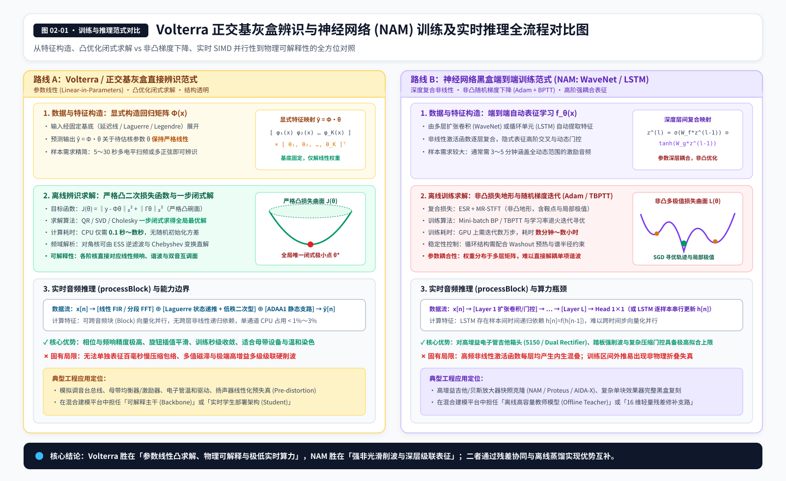

*图 02-01｜固定核 Volterra 与神经网络在结构选择、训练和实时推理上的主要差别。SVG 文件名保留历史素材编号。*

## 2.6 怎样让神经网络学会“带记忆的声音”？

与《00》第 0.8 节区分的“显式历史窗口”和“递推内部状态”完全对应，音频神经网络处理时间记忆同样分为两大主流架构范式：

1. **前馈有限感受野架构（NFIR 型网络）**：网络在每个采样点显式读取过去有限长度 $`R_{\mathrm{RF}}`$ 的输入历史窗口，

$$
\hat y[n]=F_{\boldsymbol{\theta}}\bigl(x[n],x[n-1],\ldots,x[n-R_{\mathrm{RF}}+1]\bigr).
$$

   一维因果卷积网络（ConvNet）、时间卷积网络（TCN）以及 NAM 中广泛使用的前馈 WaveNet 变体均属此类。由于不含输出或隐状态的跨时刻自回归闭环，这类网络在有限输入下天然满足 BIBO 稳定，且在训练阶段可在整段音频上高度并行计算。
2. **递归状态架构（State-Space / RNN 型网络）**：网络维护一个随采样点递推更新的内部隐状态向量 $`\mathbf{s}[n]`$，

$$
\begin{aligned}
\mathbf{s}[n+1]&=G_{\boldsymbol{\theta}}(\mathbf{s}[n],x[n]),\\
\hat y[n]&=H_{\boldsymbol{\theta}}(\mathbf{s}[n],x[n]).
\end{aligned}
$$

   循环神经网络（RNN）、长短期记忆网络（LSTM）、门控循环单元（GRU）以及深度状态空间模型（SSM）均属此类。其历史影响通过状态向量持续传递，理论上可跨越任意长的时间尺度，但在训练时需采用沿时间反向传播（BPTT），且在部署时必须额外验证长序列闭环自由运行（Free-Run）的稳定性。

## 2.7 WaveNet 的因果扩张卷积：用对数级层数覆盖长历史窗口

普通因果一维卷积可写为 $`z[n]=\sum_{k=0}^{K-1}w[k]x[n-k]`$，若保持步长为 1 且不跳过采样点，要覆盖数千个采样点的历史窗口，单层卷积核长度 $`K`$ 或网络层数 $`L`$ 必须线性增长。**因果扩张卷积（Causal Dilated Convolution）** 通过引入扩张率（Dilation Factor）$`d_\ell`$，让卷积核每隔 $`d_\ell`$ 个采样点抽取一次历史特征：

$$
z[n]=\sum_{k=0}^{K_\ell-1}w_\ell[k]\,h_{\ell-1}[n-d_\ell k].
$$

当扩张率按指数序列 $`d_\ell=2^{\ell-1}`$（如 $`1, 2, 4, 8, \ldots, 512`$）逐层堆叠时，网络的理论感受野随层数呈指数增长：

$$
R_{\mathrm{RF}}=1+\sum_{\ell=1}^{L}(K_\ell-1)d_\ell.
$$

例如单组 10 层、核长 $`K_\ell=3`$、扩张率 $`1\sim 512`$ 的堆叠即可覆盖 $`R_{\mathrm{RF}}=1+2\times(2^{10}-1)=2047`$ 个采样点（在 $`48\,\mathrm{kHz}`$ 下约 $`42.6\,\mathrm{ms}`$）。配合门控激活单元（如 $`\tanh(\mathbf{W}_f\ast \mathbf{h})\odot\sigma(\mathbf{W}_g\ast \mathbf{h})`$ 或简化激活）、$`1\times 1`$ 残差连接与跳跃连接（Skip Connections），网络既能保留底层高频瞬态细节，又能跨越多尺度时间窗口构建高阶非线性交互。

需要注意两个工程细节：第一，若模型的总感受野为 $`40\,\mathrm{ms}`$，它仍属于有限记忆（NFIR）系统；要复现长达 $`500\,\mathrm{ms}`$ 的光电压缩器释放尾部，需要更长的记忆窗口或显式递归状态；第二，最初 DeepMind 提出的原版 WaveNet 是逐采样把自身预测输出送回输入端的**自回归语音生成模型**，而音频设备建模（如 NAM）使用的是将外部输入信号 $`x[n]`$ 直接映射为输出 $`\hat{y}[n]`$ 的**前馈回归式 WaveNet 变体**，推理时无需自回归采样循环。[N2]

## 2.8 LSTM：门控循环状态及其记忆边界

LSTM（长短期记忆网络）通过显式的门控循环单元来调节历史信息的写入、保留与擦除。设隐状态为 $`\mathbf{h}[n]`$、单元状态（Cell State）为 $`\mathbf{c}[n]`$，其标准状态递推方程为：

$$
\begin{aligned}
\mathbf{f}[n]&=\sigma\bigl(\mathbf{W}_f x[n]+\mathbf{U}_f\mathbf{h}[n-1]+\mathbf{b}_f\bigr),\\
\mathbf{i}[n]&=\sigma\bigl(\mathbf{W}_i x[n]+\mathbf{U}_i\mathbf{h}[n-1]+\mathbf{b}_i\bigr),\\
\widetilde{\mathbf{c}}[n]&=\tanh\bigl(\mathbf{W}_c x[n]+\mathbf{U}_c\mathbf{h}[n-1]+\mathbf{b}_c\bigr),\\
\mathbf{c}[n]&=\mathbf{f}[n]\odot \mathbf{c}[n-1]+\mathbf{i}[n]\odot\widetilde{\mathbf{c}}[n],\\
\mathbf{o}[n]&=\sigma\bigl(\mathbf{W}_o x[n]+\mathbf{U}_o\mathbf{h}[n-1]+\mathbf{b}_o\bigr),\qquad
\mathbf{h}[n]=\mathbf{o}[n]\odot\tanh(\mathbf{c}[n]).
\end{aligned}
$$

其中 $`\mathbf{f}[n]\in(0,1)^D`$ 是遗忘门，$`\mathbf{i}[n]`$ 是输入门，$`\mathbf{o}[n]`$ 是输出门，$`\odot`$ 表示按元素Hadamard乘积。从动态系统视角看，遗忘门 $`\mathbf{f}[n]`$ 相当于一个**依赖输入与当前状态的时变一阶极点系数**：当某维度的 $`f_d[n]`$ 接近 $`1`$ 时，该状态通道表现为极慢的时间常数；当 $`f_d[n]`$ 变小时，状态迅速重置。

这种门控递归机制为模拟放大器电源下陷（Sag）、热时间常数或程序依赖的动态释放提供了灵活的候选结构。循环状态究竟学到了怎样的物理历史，需要进一步检查：
- 在训练阶段，截断时间反向传播（TBPTT）的窗口长度与状态预热（Warm-up）长度直接决定了网络能否观测到慢速状态变化；
- 在推理阶段，当输入变为零（静音）时，若偏置项使得遗忘门 $`\mathbf{f}[n]\lt 1`$，单元状态 $`\mathbf{c}[n]`$ 仍会按指数速率缓慢衰减回固定不动点，无法天然保持速率无关磁滞（Rate-Independent Hysteresis）所需的永久多分支剩磁状态。

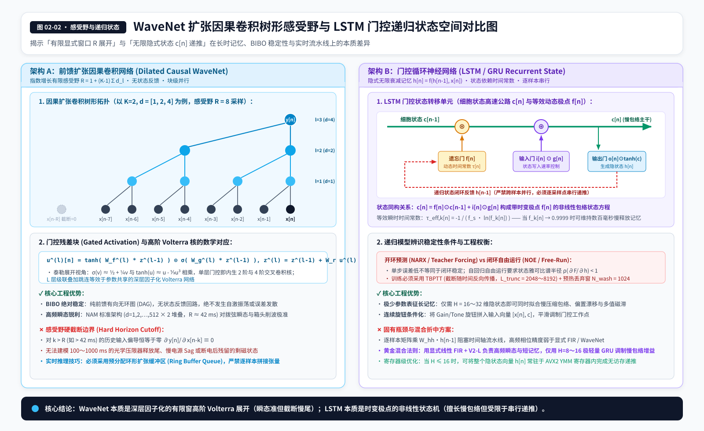

*图 02-02｜因果扩张感受野（有限窗口前馈展开）与门控递归状态（内部状态向量跨采样递推）是两种不同的历史信息组织方式。*

## 2.9 准确理解 NAM：开源音频神经网络系统辨识的工程生态

有了前面的铺垫，我们就可以准确定位 **Neural Amp Modeler (NAM)**：**NAM 是一套面向音频硬件黑盒系统辨识的开源工程工具链与生态标准，其底层承载的数学模型依然是前馈 WaveNet、一维 ConvNet、LSTM 或线性 FIR。**[N1][N4]

NAM 生态主要由三部分构成：
1. **标准化激励与配对采集协议**：提供包含多频段扫频、脉冲、不同幅度瞬态与随机多音片段的标准测试音频（`input.wav`），用于激发被测放大器或硬件前级并对齐录制输出（`output.wav`）；
2. **PyTorch 训练框架（`neural-amp-modeler`）**：自动化完成信号延迟校准、数据集切分、损失计算（时域 ESR 结合多分辨率频谱损失等）以及模型权重导出（`.nam` JSON 格式）；
3. **实时 C++ 推理核心（`NeuralAmpModelerCore`）**：使用 Eigen 等矩阵库针对小批量音频缓冲区（Block Processing）高度优化的前向推理引擎，供 VST3/AU 插件与硬件效果器直接加载。

对于音频系统辨识研究而言，NAM 的核心贡献在于提供了一个**透明、可复现的黑盒基准（Baseline）**：当我们研究自研的混合 Volterra–状态模型时，可以在完全相同的配对 WAV 数据集上同时运行 NAM 的标准 WaveNet 与 LSTM 配置，从而客观量化显式数学结构在参数量、实时 CPU 占用、混叠抑制与长历史泛化上的真实得失。

## 2.10 NAM 的 A1、A2 演进与实时推理的工程权衡

NAM 项目在 2026 年推出了新一代架构规范 **Architecture A2**（同时向下兼容 A1 模型）。[N3] 根据官方说明与 TONE3000 发布的 [A2 技术指南](https://www.tone3000.com/guides/nam-a2-the-complete-guide)，A2 针对实时 CPU 效率、模型尺寸分级（如 Slim / Standard 等）以及训练收敛效率（如 Packed Training）进行了结构重设计，并在官方测试集中报告了更低的 ESR 与高频伪影。[N5] 在学术与工程引用中，应将这些测试数据明确标注为特定吉他放大器样本集与固定采样率下的基准表现。

**离线训练计算图**与**实时插件推理特征**对应不同的计算约束：
- 实时音频插件必须在宿主音频缓冲区规定的硬实时截止期限（Deadline，例如 $`48\,\mathrm{kHz},\;64`$ 采样点缓冲区仅约 $`1.33\,\mathrm{ms}`$）内完成整个音频块的前向求值，需要避免内存动态分配、锁等待和不可预测的峰值耗时抖动；
- 模型的实际 CPU 占用不仅取决于乘加次数（MACs），还高度依赖**计算的数据局部性与并行度**：前馈扩张卷积（WaveNet）各层可在时间维度或通道维度利用 SIMD（AVX2 / NEON）向量化计算；而递归结构（LSTM）由于 $`\mathbf{h}[n]`$ 严格依赖上一采样点 $`\mathbf{h}[n-1]`$，在时间轴上存在逐采样串行数据依赖，当隐藏层维度较大时反而可能因缓存未命中和串行瓶颈消耗更高的实时 CPU。

## 2.11 固定快照（Snapshot）、参数条件化与内部状态记忆的区别

标准 `.nam` 模型文件通常对应被测硬件在某一组固定旋钮位置下的**单点快照（Snapshot）**。数字插件前端的 Input Gain 主要改变送入固定非线性映射的信号幅度。真实放大器的 Gain、Tone 或 Bias 旋钮则可能位于级间网络或局部负反馈回路，旋转后会同时改变频率响应、工作点偏置与反馈深度。

若要构建连续可调的**参数条件化模型（Parametric / Conditioned Model）**，必须将面板控制参数向量 $`\mathbf{c}[n]`$（如旋钮归一化位置，这里遵循《00》第 0.24.2 节符号表记为 $`\mathbf{c}[n]`$，以区别于 Volterra 阶数 $`p`$ 与内部物理状态 $`\mathbf{s}[n]`$）显式作为模型的附加输入：

$$
\hat y[n]=F_{\boldsymbol{\theta}}\bigl(x_{\le n},\mathbf{c}[n]\bigr).
$$

在神经网络中，这通常通过拼接输入通道、HyperNetwork 动态生成卷积权重或 **FiLM（Feature-wise Linear Modulation）** 仿射调制层实现；在 Volterra 体系中，则对应随控制参数 $`\mathbf{c}`$ 插值的核张量簇 $`h_p(k_1,\ldots,k_p;\mathbf{c})`$。

因此，在评估任何神经或混合模型时，必须将三个正交维度分开检验：
1. **快照精度**：固定旋钮与固定采样率下的波形与频谱保真度；
2. **参数条件化泛化**：未采样旋钮中间位置上的插值平滑度与物理一致性；
3. **长程状态记忆**：固定旋钮下，模型能否正确捕获慢速包络恢复或磁滞路径历史。

### 2.11.1 超网络：让控制参数决定另一个模型的权重

参数条件化还有一种更进一步的实现：用较小的网络 $`H_{\boldsymbol\phi}`$ 接收面板参数 $`\mathbf{c}`$，输出音频处理网络 $`F`$ 所使用的一部分卷积核、偏置或门控权重：

$$
\boldsymbol\theta(\mathbf c)=H_{\boldsymbol\phi}(\mathbf c),\qquad
\begin{aligned}
\mathbf s[n+1]&=G_{\boldsymbol\theta(\mathbf c)}(\mathbf s[n],x[n]),\\
\hat y[n]&=F_{\boldsymbol\theta(\mathbf c)}(x[n],\mathbf s[n]).
\end{aligned}
$$

其中，$`\boldsymbol\phi`$ 是训练后保持固定的超网络参数，$`\boldsymbol\theta(\mathbf c)`$ 才是随用户旋钮改变的音频网络参数。这与把 $`\mathbf c`$ 简单拼接到每个音频采样点的输入特征中不同：前者改变处理模型本身的权重，后者通常在固定权重的网络内部改变条件激活。超网络无须在每一个音频采样点重新执行；当控制参数保持不变时，可以缓存其输出，从而控制实时开销。旋钮自动化时则需要缓变、分块更新或双权重状态交叉过渡，以避免参数跳变造成瞬态失真。

**noshige2A 提供了一个具体的结构例子。** 其参数生成层采用带有 gMLP / Simple Gating Unit 的条件网络，主要以归一化 Peak Reduction 和 Comp/Limit 模式作为条件，生成后续音频网络所需的卷积权重及偏置；独立的 Gain 属于输出电平控制。音频计算层包含门控卷积、下采样/上采样及跨块递推状态，整体可理解为流式 U-Net 型动态模型。不同内部采样率域使用不同的模型组合，因此对网络文件名中的 `paramAtt`、`paramRel` 的解释仍需结合实际网络数据流和功能证据。

这套设计的启发在于，**可调旋钮空间和动态记忆状态属于两个不同的学习任务**。超网络解决“旋钮变动后模型参数如何连续变化”，流式网络解决“相同旋钮下设备的历史状态如何影响下一个采样点”。网络结构能够说明其设计思路，但特定设备上的声音误差和未采样参数位置的泛化精度，仍需独立的硬件配对测试验证。

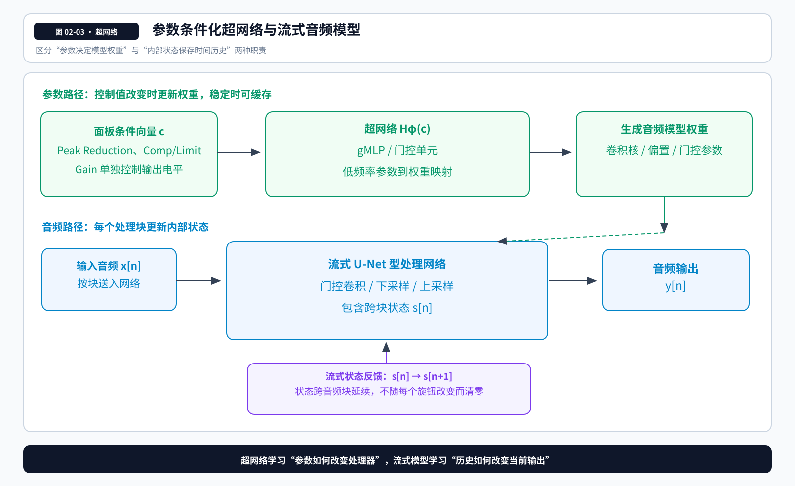

*图 02-03｜控制参数经超网络生成音频模型权重；音频网络保存跨块状态并连续处理输入信号。*

## 2.12 误差指标与评估范围：怎样理解较低的 ESR？

在音频系统辨识文献中，最常用的时域总体指标是**误差信号比（Error-to-Signal Ratio, ESR）**：

$$
\mathrm{ESR}=
\frac{\sum_{n=0}^{N-1}\bigl(y[n]-\hat y[n]\bigr)^2}{\sum_{n=0}^{N-1} y^2[n]}.
$$

通常还会配合预加重滤波器 $`H_{\mathrm{pre}}(z)=1-0.95z^{-1}`$ 计算高频加权 ESR，或结合多分辨率短时傅里叶变换（MR-STFT）幅度谱损失进行训练。工程验收还应从以下四个方面补充 ESR 指标的评价：

1. **亚采样时间对齐敏感性**：哪怕参考信号与预测信号完全相同，仅存在 $`0.1`$ 个采样点（在 $`48\,\mathrm{kHz}`$ 下约 $`2\,\mu\mathrm{s}`$）的分数延迟偏差，高频段的逐点相减就会导致 ESR 急剧恶化，掩盖真实的非线性建模质量；
2. **大能量基波淹没微弱高阶失真**：音乐信号的能量高度集中在中低频基波，即使模型的高阶互调边带或高频折返混叠存在明显听感瑕疵，只要线性频响与主基波对齐良好，总体 ESR 依然可以低至 $`10^{-3}`$（$`-30\,\mathrm{dB}`$）以下；
3. **非同步随机过程与机械抖晃（Wow & Flutter）**：若被测硬件是真实磁带机或含有热噪声的电子管设备，输出信号中包含与输入激励非严格锁相的走带速度抖晃（时变分数延迟调制）与本底噪声。强行用确定性模型去逐采样最小化包含随机抖晃的波形误差，会导致核系数或网络权重被随机相位差抹平（表现为高频模糊发暗）；
4. **单步预测掩盖闭环漂移**：对递归模型，训练片段上的低 ESR 需要配合长时间连续演奏及极端输入条件下的状态有界性测试。

## 2.13 从可微分 DSP（DDSP）看训练模型的第三条路线

在“显式多项式核（Volterra）”与“通用黑盒神经网络（WaveNet/LSTM）”之间，近年来快速发展出了第三条极具工程价值的路线——**可微分数字信号处理（Differentiable DSP, DDSP）与白盒/灰盒参数辨识**。

其核心思想是：**将由双二次滤波器（Biquads）、状态变量滤波器（SVF）、包络检波器、静态非线性曲线与反馈环路组成的经典 DSP 结构写进支持自动微分的计算图中，利用实测输入—输出数据通过梯度下降或二阶拟牛顿/Newton–Raphson 方法直接辨识物理或准物理参数。**

一个极具代表性的公开研究是伦敦玛丽女王大学（QMUL）团队的 **[4A-2A](https://github.com/aim-qmul/4a2a)** 项目。Yu 与 Fazekas (2025) 在 [*Sound Matching an Analogue Levelling Amplifier Using the Newton-Raphson Method*](https://arxiv.org/abs/2509.10706) 中，针对经典光电电平放大器 Teletronix LA-2A，构建了一个包含隐式反馈光电增益控制环路的紧凑可微灰盒压缩器模型，利用双曲函数与定制反向传播算子求解隐式不动点方程，并将面板 Peak Reduction 旋钮映射为仅 **5 个核心可解释参数**。[N6]

这一案例清楚表明：**机器学习也可以用于辨识和优化具有明确 DSP 结构的白盒、灰盒模型。** 只要算子可微（或可通过隐函数定理求取伴随梯度），无论是 Volterra 核、极点滤波器、经典动态压缩器还是物理电路方程，都可以纳入统一的数据驱动优化管线。

## 2.14 储备池计算（Reservoir Computing）与回声状态网络：连接随机递归状态与线性回归的桥梁

在 WaveNet 和 LSTM 之外，**储备池计算（Reservoir Computing）**——特别是**回声状态网络（Echo State Network, ESN）**——为非线性动态系统辨识提供了一条介于“固定核 Volterra 线性回归”与“全参数训练 RNN”之间的独特基线。

典型 ESN 维护一个维度较高的内部递归状态向量 $`\mathbf{s}[n]\in\mathbb{R}^D`$，其状态转移矩阵 $`\mathbf{A}`$ 与输入注入矩阵 $`\mathbf{B}`$ 在满足特定谱半径与缩放条件后**随机生成并保持固定**，训练阶段仅通过线性最小二乘或岭回归拟合输出读出层（Readout）$`\mathbf{C}`$ 与 $`d`$：

$$
\begin{aligned}
\mathbf{s}[n+1]&=(1-\alpha_{\mathrm{leak}})\mathbf{s}[n]+\alpha_{\mathrm{leak}}\,\sigma\bigl(\mathbf{A}\mathbf{s}[n]+\mathbf{B}x[n]+\mathbf{b}\bigr),\\
\hat y[n]&=\mathbf{C}\mathbf{s}[n]+d x[n].
\end{aligned}
$$

从系统辨识理论看，ESN 与 Volterra 级数有着深刻的数学同源性：
- 当储备池满足**回声状态性质（Echo State Property, ESP）** 时，初始状态的影响随时间渐近消失，状态向量 $`\mathbf{s}[n]`$ 成为过去输入序列 $`x_{\le n}`$ 的唯一确定性泛函；
- Grigoryeva 与 Ortega (2018) 严格证明了：在有界输入与**衰减记忆（Fading Memory）** 算子空间上，ESN 与 Volterra 级数一样具备**通用一致逼近性质（Universal Uniform Approximation）**[N7]；
- 与固定核 Volterra 相同，ESN 将非线性历史映射固定在前端特征提取层（储备池状态），从而使**输出参数的训练完全退化为凸线性回归问题**，彻底避开了 LSTM 在长序列 BPTT 训练中的梯度消失/爆炸与局部极小值困扰。

对于磁带机与动态硬件建模研究，ESN 可以作为评估“随机高维递归特征 + 线性读出”与“精简正交极点基（Laguerre-Volterra）”之间参数效率差异的重要对照基线。

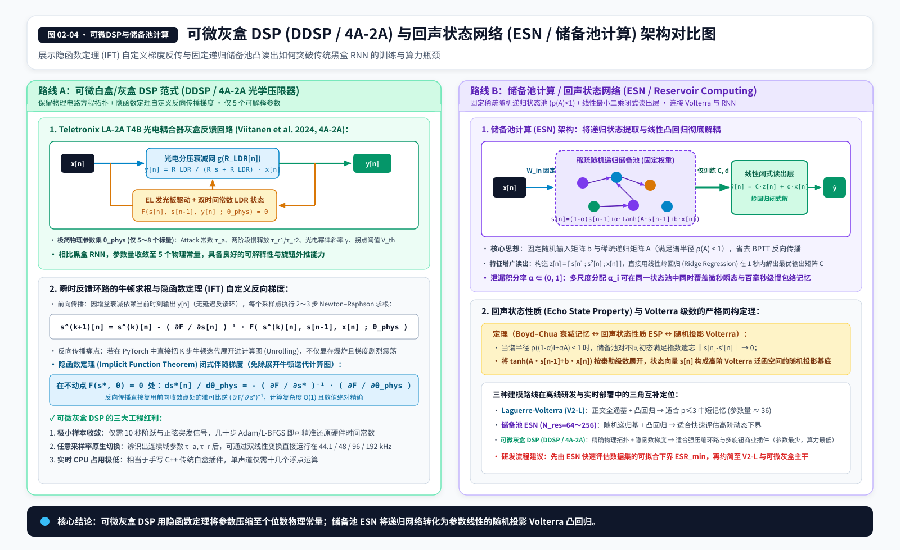

*图 02-04：左篇展示以 Teletronix LA-2A 光电耦合反馈环为例的可微灰盒 DSP（4A-2A）架构，通过隐函数定理（IFT）在不动点处直接计算闭式伴随梯度，将参数量压缩至 5 个物理可解释常量；右篇展示回声状态网络（ESN / 储备池计算），通过冻结满足回声状态性质（$`\rho(\mathbf{A})<1`$）的稀疏随机递归池并仅对读出层执行线性岭回归，架起无穷阶递归状态与 Volterra 线性回归之间的桥梁。*

## 2.15 应当怎样公平比较 Volterra、NAM 与灰盒模型？

为了避免在工程选型中陷入主观偏见，所有候选模型应在统一的基准协议下接受横向评测：
1. **统一数据集与严格隔离**：使用完全相同的训练、验证与封存测试集（涵盖单音多电平、双音互调、双脉冲、瞬态阶跃与真实干声音乐）；
2. **统一实时算力预算（Iso-CPU / Iso-Latency）**：在相同采样率与缓冲区大小下，对比等 CPU 占用档位下的模型精度（例如将轻量级对角/低秩 Volterra 与同等算力的微型 WaveNet / 灰盒 DDSP 对照，而非用三参数简化模型直接对比上万参数的重型网络）；
3. **归因分析驱动混合架构**：若前馈 WaveNet 在某类强失真上显著优于低阶 Volterra，说明问题出在瞬时强饱和的收敛半径；若两者在长时探针测试中均败给带显式状态的灰盒模型，则说明瓶颈在于超越前馈窗口的慢速物理状态。

## 2.16 从单一模型走向下一章

本章梳理了从显式 Volterra 核回归到现代神经与可微系统辨识的完整图景：
- **固定核 Volterra** 通过显式多项式历史特征将辨识转化为凸线性回归，具备极高的阶次可解释性与结构透明度；
- **WaveNet 与 LSTM** 分别通过因果扩张卷积感受野与门控循环状态学习自适应非线性表示，并在 **NAM** 生态中形成了标准化的开源训练与实时推理基线；
- **可微分 DSP（如 4A-2A）** 与 **储备池计算（ESN）** 则展示了如何将经典音频算子或随机衰减记忆状态与高效参数优化相结合。

接下来的核心工程问题是：当被测硬件同时包含短时频响染色、强非线性饱和、高频混叠风险以及长时程光电/磁滞状态时，应当如何划定各模块的职责边界，将白盒、唯象状态、Volterra 核与神经网络组装为稳定高效的实时混合系统？这一问题将在《03 混合建模、训练边界与实时约简》中深入展开。

---

## 本章参考资料


### 理论交叉史补充阅读

- **[NH1]** G. Cybenko (1989), *Approximation by Superpositions of a Sigmoidal Function*. [DOI](https://doi.org/10.1007/BF02551274)。
- **[NH2]** K. S. Narendra & K. Parthasarathy (1990), *Identification and Control of Dynamical Systems Using Neural Networks*. [DOI](https://doi.org/10.1109/72.80202)。
- **[NH3]** S. Hochreiter & J. Schmidhuber (1997), *Long Short-Term Memory*. [DOI](https://doi.org/10.1162/neco.1997.9.8.1735)。
- **[NH4]** A. van den Oord et al. (2016), *WaveNet: A Generative Model for Raw Audio*. [研究机构论文页](https://research.google/pubs/wavenet-a-generative-model-for-raw-audio/)。
- **[NH5]** A. Wright, E.-P. Damskägg & V. Välimäki (2019), *Real-Time Black-Box Modelling With Recurrent Neural Networks*. [DAFx 论文档案](https://dafx.de/paper-archive/details/tieFMcaohHBxl_2yPyIGFA)；Wright et al. (2020), *Real-Time Guitar Amplifier Emulation with Deep Learning*. [Aalto 论文页](https://research.aalto.fi/en/publications/real-time-guitar-amplifier-emulation-with-deep-learning/)。
- **[NH6]** Steve Atkinson (2024), *The History of NAM*. [NAM 官方历史回顾](https://www.neuralampmodeler.com/post/the-history-of-nam)。
- **[NH7]** S. Boyd & L. O. Chua (1985), *Fading Memory and the Problem of Approximating Nonlinear Operators with Volterra Series*. [作者论文页](https://web.stanford.edu/~boyd/papers/fading_volterra.html)；Martin Schetzen (1980), *The Volterra and Wiener Theories of Nonlinear Systems*。

- **[N1]** [NeuralAmpModelerCore 官方文档](https://neuralampmodelercore.readthedocs.io/en/latest/)：主要网络类型与 C++ 实时推理核心。
- **[N2]** [NAM WaveNet 计算过程](https://neuralampmodelercore.readthedocs.io/en/latest/wavenet_walkthrough.html)：因果扩张卷积、残差跳跃连接与前馈回归式 WaveNet。
- **[N3]** [NAM 作者关于 Architecture A2 的介绍](https://www.neuralampmodeler.com/post/architecture-a2)：2026 年 A2 架构演进及 A1 兼容性说明。
- **[N4]** [NAM 官方训练器源码](https://github.com/sdatkinson/neural-amp-modeler)：数据集处理、训练配置与模型导出实现。
- **[N5]** [TONE3000, NAM A2: The Complete Guide](https://www.tone3000.com/guides/nam-a2-the-complete-guide)：A2 架构感受野、Packed Training 及项目方对照测试指标。
- **[N6]** [Yu & Fazekas (2025), *Sound Matching an Analogue Levelling Amplifier Using the Newton-Raphson Method*](https://arxiv.org/abs/2509.10706)；[4A-2A 开源仓库](https://github.com/aim-qmul/4a2a)：参数化可微灰盒压缩器的完整研究与实现。
- **[N7]** Grigoryeva, L. & Ortega, J.-P. (2018), *Echo State Networks Are Universal*, Neural Networks, 108, 495–508, [DOI:10.1016/j.neunet.2018.08.025](https://doi.org/10.1016/j.neunet.2018.08.025)：证明回声状态网络在有界衰减记忆算子空间上的一致逼近性质。
- Martin Schetzen, *The Volterra and Wiener Theories of Nonlinear Systems*；Oliver Nelles, *Nonlinear System Identification*：关于显式模型、参数辨识、结构选择与泛化的理论参考。

---

# 03 混合建模、训练边界与实时约简

> **版本：v8 · 2026-11-15 · 加入三种商业光电动态建模结构、时变增益测量与模型对照**
> **所属系列：Volterra Wiki**
> **阅读定位：** 承接《02》的训练比较，讨论如何决定 Volterra 核与长期状态的职责，怎样引入白盒、唯象与神经网络，如何进行实时约简，并以 SKY SA-1A、Revenger 2A 和 noshige2A 的不同光电动态建模结构检验这些思考。
> **阅读说明：** 本章把数学上的可实现结构与具体商业产品的行为特征放在一起理解。未获完整运行路径核对的细节只作为结构解释，不把单一测试点的符合程度等同于对全部内部机制的确认。

## 3.1 混合建模的核心任务：确立多模型职责分工与表达边界

上一章已经说明，同样的输入输出数据可以用 Volterra、WaveNet 或 LSTM 进行辨识。现在假设我们知道目标设备的电路结构、光电元件行为，或者某一部分具有明确的磁滞和慢速恢复机制。此时可以把已知的物理机制交给结构化分支，再让数据驱动模型补足剩余误差，以便分别控制参数量和跨条件泛化能力。

将四种模型不加约束地并入同一个插件，同样会引入可辨识性冲突：如果 Volterra 与神经网络同时拟合电子管饱和，唯象磁滞状态与另一套循环网络又同时解释相同的慢速变化，虽然训练误差可能进一步降低，我们却难以确认哪个分支承担了真正可泛化的物理规律；两个分支甚至可能在训练集内互相抵消误差，而在新的输入历史下共同偏离。

因此，本章的核心原则是：**先确认目标系统表现出哪些可观测行为，再用最少、最有依据的结构分别承担这些行为；每一项新增复杂性都必须通过独立验证证明其增量价值。**

在启动训练前，至少需要明确六个设计维度：目标模拟的电平、频段、旋钮与工作点；哪些现象依赖短时历史；哪些属于慢速或路径依赖的内部状态；哪些属于非同步随机过程；实时音频线程允许多少延迟与 CPU 预算；以及是否需要跨采样率和跨硬件个体泛化。


*图 03-01｜混合建模研究平台总体架构图：按时间尺度与非线性机制将线性频响、短时高阶 Volterra 核、显式物理/唯象状态及神经残差解耦。SVG 文件名保留历史素材编号。*

## 3.2 训练 Volterra 之前，如何按时间尺度切分三类记忆？

回顾《01》第 1.3 与 1.13 节的分阶记忆 Volterra 模型：

$$
\hat y[n]=h_0+\sum_{p=1}^{P}\sum_{k_1,\ldots,k_p=0}^{M_p-1}h_p[k_1,\ldots,k_p]\prod_{j=1}^{p}x[n-k_j],\qquad N_p=\binom{M_p+p-1}{p}.
$$

正如《01》第 1.13 节参数规模表所量化：在 $`48\,\mathrm{kHz}`$ 采样率下，$`M=64`$（约 $`1.33\,\mathrm{ms}`$）的三阶对称核已有 $`45,760`$ 个独立参数，$`M=256`$（约 $`5.33\,\mathrm{ms}`$）时飙升至 $`2,829,056`$ 个。因此，面对真实音频硬件，必须首先将系统记忆按物理机制切分为三个层次，并分配给不同的数学算子：

1. **小信号线性记忆（数毫秒至数百毫秒）**：如变压器低频高通滚降、耦合电容时间常数与均衡网络振铃，由一阶长 FIR 核 $`h_1[k]`$ 或稳定 IIR 极点滤波器承担；
2. **短时非线性交叉记忆（亚毫秒至数毫秒）**：如放大级局部负反馈延迟、高频摆率限制（Slew-Rate Limiting）与级间瞬态互调，由短窗口高阶约简 Volterra 核（$`p\ge 2,\;M_p\ll M_1`$）承担；
3. **慢速宏观演化与持久状态记忆（数十毫秒至数秒乃至路径保持）**：如光电单元（T4B）的双时间常数释放、电源滤波电容下陷（Power Supply Sag）、电子管热漂移以及磁芯/磁带剩磁，交由**低维显式状态变量 $`\mathbf{s}[n]`$** 承担。

通过这一时间尺度解耦，高阶 Volterra 核无需强行扩展至秒级窗口，即可与慢速状态方程协同覆盖完整的硬件动态。

## 3.3 从对角到交叉：实验分级体系 V0–V5

在研究平台中，短时非线性核的复杂度按 **V0–V5 实验分级体系**逐级递增，每升一级均需回答一个明确的实验假设：

| 实验分级 | 候选结构 | 需要回答的验证问题 |
| --- | --- | --- |
| **V0** | 线性 FIR/IIR、静态 Waveshaper、简化 Hammerstein/Wiener | 最简无交叉记忆基线能解释多少方差与谐波？ |
| **V1** | 对角 Volterra / 实信号 Memory Polynomial / SNLM | 是否需要各阶独立的频率相关饱和与群延迟塑形？ |
| **V2** | Near-Diagonal / Banded（$`\lvert k_1-k_2\rvert\le B`$）/ GMP | 双脉冲与双音差频互调是否由相邻采样点的局部耦合主导？ |
| **V2-L** | Laguerre-Volterra / Kautz 正交时间基展开 | 较长的指数或振荡衰减记忆能否投影至少数极点滤波器输出？ |
| **V3** | 稀疏非局部交叉核（Sparse Volterra，LASSO/OMP 筛选） | 是否存在局部带状结构无法覆盖的特定远距离延迟交互？ |
| **V4** | 低秩张量核（CP / Tucker / Tensor Train 分解） | 稠密非对角交叉核能否由少数几条一维滤波器支路的乘积生成？ |
| **V5** | 状态条件化 Volterra 核 $`h_p(\mathbf{k};\mathbf{s}[n])`$ 与混合残差 | 短时核系数或支路增益是否随慢速物理状态 $`\mathbf{s}[n]`$ 显著迁移？ |

建议实验搜索从记忆网格 $`M\in\{32,64,128,256\}`$、阶数 $`P\in\{3,5,7\}`$ 及低秩模态数 $`R\in\{2,4,8,16\}`$ 起步。每次升级结构时，必须同时检查封存测试集上的双音 IMD、条件数 $`\kappa_2(\mathbf{X})`$ 与每采样点乘加开销：若某次升级仅令训练集 ESR 微降，却未改善未见双音互调或瞬态恢复，则应回退至更紧凑的低一级结构。

### 3.3.1 Laguerre-Volterra 网络（LVN）：极点正交基的时间压缩机制

在 V2-L 分支中，**Laguerre-Volterra Network (LVN)** 通过一组共享实极点 $`a\in(0,1)`$ 的离散正交全通级联滤波器，将长度为 $`M`$ 的原始延迟线压缩为 $`K`$ 个正交历史特征（$`K\ll M`$）。第 $`j`$ 阶规范化离散 Laguerre 滤波器的 $`z`$ 域传递函数定义为：

$$
L_j(z)=\frac{\sqrt{1-a^2}}{1-a z^{-1}}\left(\frac{z^{-1}-a}{1-a z^{-1}}\right)^j,\qquad j=0,1,\ldots,K-1.
$$

在实时 DSP 实现中，各阶特征 $`u_j[n]=( \ell_j\ast x )[n]`$ 无需做长卷积，只需按一阶全通链逐采样递推更新（每采样点仅需 $`O(K)`$ 次乘加）：

$$
\begin{aligned}
u_0[n] &= a\,u_0[n-1] + \sqrt{1-a^2}\,x[n],\\
u_j[n] &= a\,u_j[n-1] + u_{j-1}[n-1] - a\,u_{j-1}[n],\qquad j=1,\ldots,K-1.
\end{aligned}
$$

随后，第 $`p`$ 阶 Volterra 算子直接构建在这 $`K`$ 个正交特征的多重乘积之上：

$$
y_p[n]=\sum_{0\le j_1\le\cdots\le j_p\le K-1}c_p[j_1,\ldots,j_p]\prod_{i=1}^{p}u_{j_i}[n].
$$

这样一来，第 $`p`$ 阶对称核的独立参数量从 $`\binom{M+p-1}{p}`$ 大幅降至 $`\binom{K+p-1}{p}`$（例如将 $`M=256`$ 压缩为 $`K=8`$ 个 Laguerre 基时，三阶独立参数量从 $`282.9`$ 万直接降至 $`\binom{10}{3}=120`$ 个），并可进一步与**主动态模态（Principal Dynamic Modes, PDM）** 结合。[L1][L2]

需要注意，单一实极点 $`a`$ 的 Laguerre 基适合表征单调指数衰减记忆；若目标包含显著欠阻尼谐振（如变压器高频谐振峰），可替换为成对共轭复极点的 **Kautz 正交基**；若目标包含永久剩磁或非对称攻击/释放切换，仍需配合第 3.7 节的显式非线性状态方程。

## 3.4 谐波阶数与核结构选择的解耦原则

正如《01》第 1.7 与 1.9.1 节所证明，单音激励下观测到第 9 次谐波，既可能来自九阶多项式支路，也可能由两个低阶三阶模块级联（$`(x^3)^3=x^9`$）、局部反馈环路或时变增益调制（见第 3.12 节）产生。因此，在 V0–V5 选型时，应依据多电平增长斜率与双音互调残差综合确定单级 Volterra 阶数 $`P`$。

## 3.5 白盒物理建模的实时瓶颈与模型降阶区分

当已知部分电路拓扑时，白盒方法通过基尔霍夫定律与元件本构方程建立非线性微分代数方程（DAE），离散化后在每个采样点求解隐式非线性代数方程组：

$$
\mathbf{F}(\mathbf{z}_n, \mathbf{z}_{n-1}, x[n]) = \mathbf{0}.
$$

实时插件开发涉及两类优化：**无损数值加速**与**有损模型约简**：
1. **无损数值加速**：利用电路连接矩阵的稀疏性、Wave Digital Filters (WDF) 的树状散射解耦加上单非线性根部位隔离，或者对一维单调隐式方程构建高密度预计算查找表（LUT），在不改变物理方程解的前提下降低单步 Newton–Raphson 迭代开销；[R3][R4]
2. **有损模型约简与代理（Model Order Reduction / Surrogate）**：通过本征正交分解（POD）、模态截断（$`\mathbf{q}\approx\boldsymbol{\Phi}_r\mathbf{a}`$）或用轻量神经网络替换昂贵的磁性/多端口非线性子模块，这类方法改变了原始控制方程，必须在工作域内单独量化截断与近似误差（完整的 DAE、Port-Hamiltonian 保无源性离散化、POD/DEIM 超降阶及神经算子理论将在《05 物理约束与实时代理建模》第 5.2–5.10 节系统推导）。

## 3.6 唯象建模（Phenomenological Modeling）与三类核心显式状态算子

当白盒微观参数未知、而纯前馈黑盒又无法跨越长时记忆边界时，**唯象建模（Phenomenological Modeling）** 通过少量具有明确物理意义的宏观内部状态变量 $`\mathbf{s}[n]`$，以极低计算成本精确刻画慢速与路径依赖现象：

$$
\mathbf{s}[n+1] = \mathbf{f}\bigl(\mathbf{s}[n], x[n]; \boldsymbol{\theta}_s\bigr),\qquad
y[n] = g\bigl(x[n], \mathbf{s}[n]; \boldsymbol{\theta}_y\bigr).
$$

在模拟磁带机、变压器与电子管光电压缩器的混合架构中，最重要、最常与 Volterra 核协同的三类显式状态算子如下：

### 3.6.1 速率无关与速率依赖 Play / Prandtl–Ishlinskii 磁滞算子

针对磁带与变压器铁芯的**多分支路径依赖与永久剩磁（Remanence）**，经典的**Play 算子（间隙算子）** 将磁滞分解为一组具有不同阈值半径 $`r_m \ge 0`$（$`m=1,\ldots,M_h`$）的死区回隙单元（Backlash / Play Hysteron）：

$$
s_m^{\mathrm{play}}[n] = \max\!\Bigl(x[n]-r_m,\ \min\bigl(x[n]+r_m,\ s_m^{\mathrm{play}}[n-1]\bigr)\Bigr).
$$

当输入变化量未超出死区区间 $`[s_m[n-1]-r_m,\ s_m[n-1]+r_m]`$ 时，状态 $`s_m[n]`$ 保持原值不变（即便输入归零，剩磁状态依然永久保留）；一旦跨越阈值，状态便沿外包络线推进。将多个不同阈值的 Play 算子加权求和即构成 **Prandtl–Ishlinskii (PI) 模型**。

进一步地，真实磁带涂层与铁芯在高频瞬态下还表现出涡流损耗与磁畴弛豫引起的**速率依赖磁滞（Rate-Dependent Hysteresis，回线面积随频率升高而展宽）**。为此可引入**速率依赖增强型 Play 算子（Rate-Dependent Play, RD-Play）**，在状态更新中加入与输入变化率 $`\Delta x[n]=x[n]-x[n-1]`$ 相关的动态弛豫项或动态阈值缩放：

$$
s_m^{\mathrm{RD}}[n] = (1-\beta_m)\,s_m^{\mathrm{play}}\bigl(x[n],\,s_m^{\mathrm{RD}}[n-1];\,r_m(\lvert\Delta x[n]\rvert)\bigr) + \beta_m\,x[n].
$$

仅需 $`M_h=4\sim 8`$ 个标量 Play 状态，即可为前馈 Volterra 或神经分支提供真实的主回线、次回线（Minor Loops）与擦除记忆（Wiping-out Property）坐标。[R2]

### 3.6.2 双线性状态空间模型（Bilinear State-Space Model, Bilinear SSM）

针对放大器电源下陷（Sag）、偏置漂移以及输入信号对系统极点/增益的乘性调制，**双线性状态空间模型**在标准线性状态方程中显式加入了**状态与输入的交叉乘积项 $`\mathbf{s}[n]\cdot x[n]`$**：

$$
\begin{aligned}
\mathbf{s}[n+1] &= \mathbf{A}\mathbf{s}[n] + \mathbf{B}x[n] + \mathbf{N}\mathbf{s}[n]\,x[n],\\
y[n] &= \mathbf{C}\mathbf{s}[n] + d\,x[n].
\end{aligned}
$$

其中矩阵 $`\mathbf{N}`$ 直接控制外部输入 $`x[n]`$ 对内部状态演化速率与耦合权重的瞬时调制。从泛函展开角度看，双线性状态空间模型若按输入幂次迭代展开，天然生成一个无限记忆长度但由矩阵幂次 $`(\mathbf{A}, \mathbf{B}, \mathbf{N}, \mathbf{C})`$ 紧凑参数化的有理高阶 Volterra 级数，是连接“有限维状态方程”与“无穷维交叉 Volterra 核”的经典桥梁。

### 3.6.3 非对称多时间常数光电/热包络状态（Asymmetric Multi-Stage Envelope）

针对 LA-2A（T4B 光电单元）或 Vari-Mu 压缩器中“初始快速释放、后段长达数秒的对数慢速尾部（Program-Dependent Dual Release）”，可采用耦合双电容或多级非对称状态方程：

$$
s_{\mathrm{env},i}[n] = \bigl(1-\alpha_i[n]\bigr)s_{\mathrm{env},i}[n-1] + \alpha_i[n]\,D(x[n]),\qquad
\alpha_i[n] = \begin{cases}
\alpha_{\mathrm{att},i}, & D(x[n]) \gt s_{\mathrm{env},i}[n-1],\\
\alpha_{\mathrm{rel},i}(\mathbf{s}_{\mathrm{env}}[n-1]), & D(x[n]) \le s_{\mathrm{env},i}[n-1].
\end{cases}
$$

当慢速池状态积累较高时，动态调慢主释放系数 $`\alpha_{\mathrm{rel}}`$，即可用 2 至 3 个标量状态复现长达数秒的程序相关释放记忆。

SKY SA-1A 的一组光电压缩动态测试可以帮助理解为何需要多时间常数：在 $`48\,\mathrm{kHz}`$、MANUAL 模式、Attack / Release 设为 75/75 时，常规电平阶跃测得的 Release $`T_{63}`$ 约为 $`163\,\mathrm{ms}`$；但换成 $`-18\,\mathrm{dBFS}`$ 至 $`-6\,\mathrm{dBFS}`$ 的更强输入历史后，同类释放测量约为 $`327\,\mathrm{ms}`$。这说明在比较两个压缩器的“释放时间”时，应同时固定前导信号幅度、保持时长、增益衰减深度与测试判据。这里的 $`T_{63}`$ 是指定激励条件下的响应特征，与设备内部固定 RC 元件时间常数之间仍需额外的物理辨识。

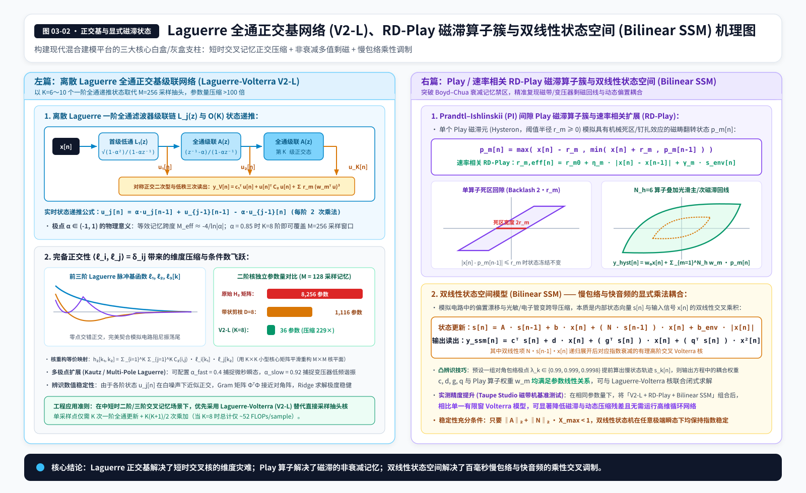

*图 03-03：左篇展示离散 Laguerre 一阶全通级联正交基网络（V2-L），以 $`K=8`$ 个正交递推状态将 $`M=128`$ 的二阶交叉核参数从 $`8,256`$ 压缩至 $`36`$ 个；右篇展示突破 Boyd–Chua 衰减记忆限制的 Prandtl–Ishlinskii 速率相关 RD-Play 磁滞算子簇（复现多值剩磁回线 $`\pm B_r`$）以及显式耦合慢包络与快音频的双线性状态空间模型（Bilinear SSM）。*

## 3.7 混合架构的抗混叠与多速率边界：ADAA、过采样和状态对齐

混合系统通常同时包含静态 Waveshaper、Volterra 交叉乘积、递归状态和神经网络残差。为了在不引爆 CPU 的前提下抑制混叠，需按各子模块的数学结构实施差异化的多速率与反导数抗混叠（ADAA）方案：

| 运算模块 | 候选实时抗混叠策略 | 必须验证的工程边界 |
| --- | --- | --- |
| 线性滤波、慢速包络与热/电源状态 | 基带采样率（1×）更新；极慢状态可降采样更新并线性插值 | 多速率接口的群延迟补偿与块边界连续性 |
| 可解析求反导的无记忆静态非线性 | 一阶/二阶反导数抗混叠（ADAA1 / ADAA2）配合 2× 过采样 | 小分母病态阈值切换、补偿滤波器高频相位与群延迟 |
| 对角 Volterra / 并联 Hammerstein 单项式支路 | Hopman–Bennett 无分母闭式多项式 ADAA（见《01》1.21 节）或支路过采样 | 各阶支路間の整数/半采样点延迟对齐（0.5 sample delay） |
| 一般非对角 Volterra、反馈环路与神经网络残差 | 在统一的过采样域（如 2× / 4× / 8×）执行，经线性相位或最小相位抗混叠滤波器降采样回基带 | 感受野对应的真实物理时间缩放、训练采样率与推理采样率严格匹配 |
| 动态门控与双路径混合输出 | 校准各支路相位与亚采样延迟后再执行非对称 Slew 平滑合成 | 时变门控权重 $`\alpha[n]`$ 自身带宽引起的调幅边带（AM Sidebands） |

### 3.7.1 静态 Waveshaper 的 ADAA1 / ADAA2 显式公式与小分母阈值

对于无记忆静态非线性 $`y=f(x)`$，设其一阶反导数（原函数）为 $`F_1(x)=\int_0^x f(u)\,du`$，二阶反导数为 $`F_2(x)=\int_0^x F_1(u)\,du`$。将离散输入序列视为分段线性连续信号并与三角/矩形保持核卷积后，**一阶与二阶反导数抗混叠（ADAA1 / ADAA2）** 的计算公式分别为：

$$
\mathrm{ADAA}_1[f](x[n],x[n-1]) = \begin{cases}
\dfrac{F_1(x[n])-F_1(x[n-1])}{x[n]-x[n-1]}, & \lvert x[n]-x[n-1]\rvert \ge \varepsilon_{\mathrm{tol}}, \\[10pt]
f\!\left(\dfrac{x[n]+x[n-1]}{2}\right), & \lvert x[n]-x[n-1]\rvert \lt \varepsilon_{\mathrm{tol}}.
\end{cases}
$$

$$
\mathrm{ADAA}_2[f](x[n],x[n-1],x[n-2]) = \frac{2}{x[n]-x[n-2]}\Biggl(
\frac{F_2(x[n])-F_2(x[n-1])}{x[n]-x[n-1]} - \frac{F_2(x[n-1])-F_2(x[n-2])}{x[n-1]-x[n-2]}
\Biggr).
$$

工程实现需要处理以下三个方面：
1. **小分母病态退化保护**：当相邻采样点极其接近（$`\lvert x[n]-x[n-1]\rvert \lt \varepsilon_{\mathrm{tol}}`$，双精度下通常取 $`\varepsilon_{\mathrm{tol}}\approx 10^{-7}\sim 10^{-5}`$）时，直接相除会发生严重的浮点有效数字抵消（Catastrophic Cancellation），必须切换至中点 Taylor 展开值（而如《01》第 1.21 节所示，当 $`f(x)=x^p`$ 为简化 Volterra 的多项式支路时，可利用因式分解精确消去分母，彻底免除除法与分支切换）；
2. **固有亚采样延迟**：ADAA1 会引入 **$`0.5`$ 个采样点**的固定群延迟（对应零阶保持核的中心），ADAA2 则引入 **$`1.0`$ 个采样点**的群延迟。因此，在并行混合架构（如“一阶线性支路 + ADAA1 非线性支路”或干湿比混合）中，**未采用 ADAA 的并行线性支路必须同步串联 $`0.5`$（或 $`1.0`$）个采样点的全通/分数延迟滤波器**，否则两路信号在高频叠加时会发生严重的梳状滤波抵消。
3. **非无记忆算子的适用边界**：标准 ADAA 严格建立在一维静态映射 $`f(x)`$ 的原函数之上。对于包含跨时刻乘积 $`x[n-k_1]x[n-k_2]`$（$`\lvert k_1-k_2\rvert > 1`$）、多维状态耦合或多层神经网络的模块，通常需要采用过采样，并在统一的采样率下进行训练和推理。

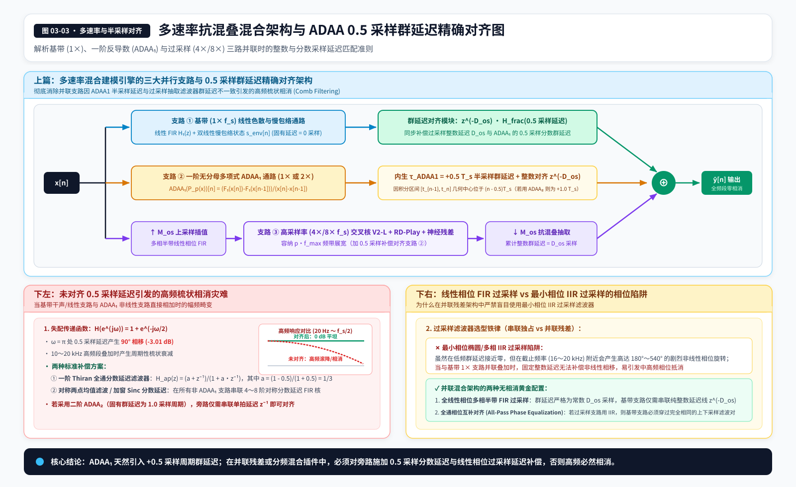

*图 03-04：展示基带（$`1\times f_s`$）线性/慢包络通路、一阶无分母多项式 $`\mathrm{ADAA}_1`$ 通路与高采样率（$`4\times/8\times f_s`$）交叉核/神经残差通路并联时的群延迟精确对齐机制。由于 $`\mathrm{ADAA}_1`$ 在区间 $`[t_{n-1},t_n]`$ 积分天然引入 $`+0.5\,T_s`$ 半采样群延迟，并联旁路必须串联 $`0.5`$ 采样分数延迟与整数过采样延迟补偿，从而彻底根除高频梳状相消（Comb Filtering）。*

## 3.8 白盒、Volterra、神经网络与唯象状态协同的四种模式

结合前述讨论，研究平台的混合架构归纳为以下四种标准运行模式：

| 模式名称 | 信号流与数学表达式 | 适用场景与核心优势 |
| --- | --- | --- |
| **模式 1：并行残差**<br>(Parallel Residual) | $`\hat y[n] = y_{\mathrm{base}}[n] + \alpha\bigl(\mathbf{s}[n]\bigr)\,\Delta y_{\mathrm{NN}}\bigl(\mathbf{x}_n, \mathbf{s}[n]\bigr)`$| 主干线性频响与低阶谐波由可解释 Volterra / 白盒 $`y_{\mathrm{base}}`$ 锁定，轻量网络仅拟合残余高阶非理想失真 |
| **模式 2：状态耦合**<br>(State-Coupled / Grey-Box) | $`\mathbf{s}[n+1] = \mathbf{G}_{\mathrm{phys}}(\mathbf{s}[n], x[n]) + \Delta\mathbf{G}_{\mathrm{NN}}(\mathbf{s}[n], x[n])`$| 物理/唯象状态方程定义主时间常数与剩磁拓扑，小型网络修正非线性状态转移或调制 Volterra 核 $`h_p(\mathbf{k};\mathbf{s}[n])`$ |
| **模式 3：串行级联**<br>(Serial Cascade) | $`v[n]=\mathcal{H}_{\mathrm{pre}}[x](n) \to z[n]=\mathcal{N}_{\theta}[v,\mathbf{s}](n) \to \hat{y}[n]=\mathcal{H}_{\mathrm{post}}[z](n)`$| 严格对应“输入变压器/选频 $`\to`$ 电子管放大/压缩核 $`\to`$ 输出变压器/均衡”的多级硬件物理拓扑 |
| **模式 4：子系统代理**<br>(Component Surrogate) | $`\mathbf{F}_{\mathrm{circuit}}\bigl(\mathbf{z}_n, \mathbf{z}_{n-1}, \mathcal{M}_{\mathrm{NN}}(\mathbf{v}_{\mathrm{port},n})\bigr)=\mathbf{0}`$ | 保留完整电路拓扑与旋钮交互，仅将局部极昂贵的磁芯或电子管多极本构方程替换为神经/Chebyshev 代理 |


*图 03-02｜白盒、Volterra 与神经网络协同的四种运行模式架构图。SVG 文件名保留历史素材编号。*

### 3.8.1 NARX、NOE 与长期自由运行（Free-Run）稳定性约束

当混合模型采用模式 2（状态耦合）或包含输出反馈时，需要分别考察《00》第 0.23 节引入的两种训练与运行体制：[R1]
- **NARX（Teacher Forcing / 开环单步预测）**：训练时将实测参考输出 $`y[n-k]`$（或由参考输出反推的教师状态）直接喂入回归器。由于每一步都被真实测量值强行拉回正轨，误差不会跨时刻累积，训练极易收敛；
- **NOE（Nonlinear Output-Error / 闭环自由运行 Free-Run）**：推理部署时，插件完全没有真实硬件输出可用，只能将模型自己上一时刻预测的状态 $`\hat{\mathbf{s}}[n]`$ 和输出 $`\hat{y}[n-k]`$ 持续回灌。

如果仅使用单步 Teacher Forcing 训练状态增量网络 $`\Delta\mathbf{G}_{\mathrm{NN}}`$，哪怕验证集单步 ESR 低至 $`-40\,\mathrm{dB}`$，一旦切换到数分钟的闭环 Free-Run，微小的单步状态偏差就可能通过正反馈环路指数级放大，导致直流漂移、极限环自激（Limit Cycle Oscillation）甚至浮点溢出（`NaN` / `Inf`）。

为确保闭环长期自由运行稳定，工程上需实施三层保障：
1. **多步展开课程训练（Unrolled BPTT Curriculum）**：从较短的展开窗口起步，逐步过渡到跨越数千至数万采样点的完全闭环 NOE / Free-Run 损失优化，并在初始状态上注入随机扰动以迫使轨迹具备吸引域恢复能力；
2. **局部收缩与耗散结构约束**：对指数衰减型状态（如包络、热、电源滤波状态），要求总状态更新映射 $`\mathbf{G}_{\mathrm{total}}(\mathbf{s},x)`$ 在不变集 $`\mathcal{D}`$ 上关于状态 $`\mathbf{s}`$ 的 Jacobian 谱范数满足一致收缩条件：

$$
\sup_{\mathbf{s}\in\mathcal{D},\, \lvert x\rvert\le x_{\max}}\left\lVert\frac{\partial \mathbf{G}_{\mathrm{total}}(\mathbf{s},x)}{\partial \mathbf{s}}\right\rVert_2 \le q_c \lt 1,
$$

   例如将残差修正参数化为阻尼门控形式 $`s[n+1]=(1-\gamma(\mathbf{s},x))s[n]+\gamma(\mathbf{s},x)\,\tanh(\cdot)`$，其中强制 $`\gamma(\mathbf{s},x)\in[\gamma_{\min}, \gamma_{\max}]\subset(0,1)`$；
3. **磁滞系统的无源耗散边界（区分收缩性与多稳态剩磁）**：全局一致收缩（$`q_c<1`$）意味着相同输入下所有历史状态差异都会指数归零（即退化为衰减记忆），**若对速率无关磁滞状态（如 Play 算子 $`s_m^{\mathrm{play}}`$）强加严格收缩约束 $`q_c<1`$，反而会直接抹除其多分支永久剩磁记忆**。 对于磁滞子状态，正确的物理约束是**非扩张性（Non-expansiveness，$`q_c\le 1`$）、静态存储区间有界性（$`\lvert s_m\rvert\le x_{\max}`$）以及顺时针回线能量耗散正定性（$`\oint H\,dB \ge 0`$）**。[R2]

## 3.9 三种商业光电压缩器的建模路线：状态库、物理求解与超网络

把三款产品放在一起，可以直观看到相似的压缩动态目标如何分配给不同的计算结构。这三款产品的目标硬件分别是：Acustica Audio **SKY SA-1A** 对应 Stam/Summit SA-1A，而 SevenTeamMusic **Revenger 2A** 与 **noshige2A** 对应 LA-2A 类设备。以下比较聚焦三种光电动态的数学处理路线，并保留各自的目标硬件背景。

| 产品与主表示 | 主要动态状态 | 参数改变时的处理方式 | 对研究平台的启发 |
| --- | --- | --- | --- |
| **SKY SA-1A：测量资源与包络调度** | 检测器、增益控制及核资源的工作点权重 | 有限状态资源按包络控制量插值或切换 | 测量资源可以存储增益及短时整形，不局限于一般频响 FIR |
| **Revenger 2A：电路方程 + Unit A 神经校正** | 电容/非线性元件等电路状态，辅以轻量递归网络 | 改变物理控制量或切换 Classic / Unit A 路线 | 保留电路拓扑，再用网络补偿难以拟合的状态相关误差 |
| **noshige2A：超网络 + 流式神经模型** | 音频网络跨块保持的隐藏状态 | 用参数条件化网络生成音频网络权重 | 控制参数泛化与长期记忆可以由两个网络分别承担 |

**SKY：状态条件化的核资源。** 其 48 kHz 资源组可分为 41 个 100 ms 主序列、20 个 5 ms 短序列及 6 个 150 ms 长序列。在主序列中，主要能量集中在一个延迟约 1.5 ms 的抽头附近，整体表现更接近多工作点增益资源，而一些短序列还保留较弱的频率选择性。将其概括为“增益—平滑状态资源 + 小幅频响整形”的模型，比一概视为高阶音色核更加贴近当前数据所支持的结构。具体状态权重怎样从包络映射到资源，仍应视为尚待完整确认的控制关系。一个便于研究的等效表达式为：

$$
\hat y[n] = \sum_{i}w_i\bigl(\mathbf s_{\mathrm{env}}[n]\bigr)\,a_i\,x[n-d]
+\sum_m \mu_m\bigl(\mathbf s_{\mathrm{env}}[n]\bigr)\,(h_m*x)[n],
$$

其中 $`a_i`$ 是主工作点增益，$`d`$ 是主通路的等效延迟，$`h_m`$ 是短时整形核。式中的 $`w_i,\;\mu_m`$ 是教学抽象中的状态权重；具体产品的内部调度公式仍需独立证据确认。对于具有包络纹波的压缩器，哪怕各个 $`h_m`$ 都是线性的，随输入改变的乘法权重仍然可能生成谐波或互调边带（见第 3.10 节）。

**Revenger 2A：由电路承担主行为，网络修正残差。** Classic 路线以 21 节点的 MNA 数值求解为核心，对非线性支路实施迭代线性化，数值求解器自身保留跨采样点的电路状态。Unit A 另外使用较小的门控递归结构，将短帧音频特征映射为缓变增益修正；其实际应用形式更接近**乘性残差** $`\hat y[n]=g_{\mathrm{corr}}[k]y_{\mathrm{circuit}}[n]`$，主要用于随控制状态更新输出增益。$`k`$ 是相对音频采样较慢的网络更新帧。这里的电路求解与神经修正协作，使网络可以集中拟合电路主模型的残余偏差。

**noshige2A：用参数生成权重，用递归状态保存历史。** 其主要控制条件是 Peak Reduction 和 Comp/Limit。参数通过 gMLP 型超网络映射为后级音频网络的部分卷积权重、偏置和门控参数，流式网络则维持跨处理块的隐藏状态。其结构可写成 $`\boldsymbol\theta=H_{\boldsymbol\phi}(\mathbf c),\;\mathbf s[n+1]=F_{\boldsymbol\theta}(\mathbf s[n],x[n])`$。模型结构与资源配置解释了可能的推理路径；实际硬件复刻误差则需要通过完整音频输出与未见工作点的独立测试来测定。

三类方法都要回答同一组问题：**哪些动态来自设备自身状态，哪些可以离散成工作点，哪些适合用神经网络表示，以及旋钮变化是否需要更新模型参数**。比较模型时，除了同一输入条件下的 THD、ESR，也应加入程序依赖释放、相同瞬时 GR 下的不同前史、双音侧带及实时延迟等测试。

## 3.10 动态增益调制引发谐波与互调失真的解析机制

分析压缩器的测量数据时，可以分别考察**电子管/变压器放大级的固有非线性失真**与**时变增益调制自身产生的调制失真（Gain Modulation Distortion）**。

考虑一个不含任何电子管削波的理想乘法压控增益单元 $`y(t)=g(t)x(t)`$。当输入单频正弦波 $`x(t)=A\sin(\omega_0 t)`$ 时，若全波整流检波与平滑滤波器未能完全滤除 $`2\omega_0`$ 纹波，使增益控制信号保留了微弱的二倍频波动：

$$
g(t) = g_0 + \eta\,x^2(t) = g_0 + \eta A^2\sin^2(\omega_0 t),
$$

则输出信号直接展开为：

$$
y(t)=g(t)x(t)=\left(g_0+\frac{3}{4}\eta A^2\right)A\sin(\omega_0 t) - \frac{1}{4}\eta A^3\sin(3\omega_0 t).
$$

可以看到，**哪怕放大通路本身完全线性，仅靠包络跟随器泄露的二倍频增益调制，就会在输出端通过乘法器精确生成与 $`A^3`$ 成正比的三次谐波（且低频信号周期越接近 Attack/Release 时间常数，该调制三次谐波越强烈）**。 同理，在双音激励 $`\omega_1, \omega_2`$ 下，包络差频波动 $`\lvert\omega_1-\omega_2\rvert`$ 调制高频探测音也会直接生成对称的调幅边带。因此，在利用 [SignalTrain LA-2A 公开数据集](https://zenodo.org/records/3824876) [C4] 或实测硬件数据训练混合模型时，应建立纯增益调制基线，再对比放大级非线性及磁滞模型的额外贡献。**H3 或亚谐波可能具有多种生成机制**；若同时存在非线性整流、控制信号非对称性、周期倍化或其他动态状态，仍需通过固定增益、冻结包络或旁路局部模块等对照实验逐一排除。

## 3.11 黑盒系统辨识的可操作测试协议 (Test Bench T1–T6)

为了在统一标准下检验“单一 GR 标量是否足够”“系统是否存在路径依赖磁滞”“交叉互调是否来自非对角核”等核心假说，研究平台定义了六组标准化的可操作测试协议（Test Bench）：

| 测试组 | 激励信号与实验操作 | 核心观测指标 | 主要用来证伪或检验的假说 |
| --- | --- | --- | --- |
| **T1 双稳态/预磁化次回线测试** | 先施加正向或反向大幅预激励脉冲/半波，经规定静音间隔（超越前馈窗口 $`M`$）后注入完全相同的微弱探针；遍历预激励幅度绘制局部次回线 | 探针输出差值 $`\Delta y[n]`$、磁滞回线面积、剩磁保持时长 | 检验是否存在超越有限窗口 $`M`$ 的路径依赖与持久剩磁（区分 Play 磁滞与衰减记忆） |
| **T2 等瞬时 GR / 异历史探针测试** | 构造两条不同前导包络（如“短促强瞬态”与“长时中等持续音”），精确调节幅度使两者在时刻 $`t_0`$ 达到完全相同的瞬时增益衰减量 $`\mathrm{GR}(t_0)`$，随即注入同一高频/复合探针 |$`t_0`$ 之后的恢复轨迹斜率、瞬时频响与谐波谱差异 | 证伪“单标量包络状态 $`s_{\mathrm{env}}`$ 足以表征全部压缩历史”（检验 T4B 多时间常数记忆） |
| **T3 双音与包络调幅边带分离** | 固定低频强驱动音 $`f_1`$ 叠加微弱高频探针 $`f_2`$，扫描频率差 $`\Delta f`$；同时运行一个具有相同包络轨迹但无放大级失真的纯乘法增益基线模型 | 扣除纯增益调制基线后的边带幅相残差（$`f_2\pm k f_1`$） | 将“快包络增益调制产生的边带”与“电子管/变压器高阶 Volterra 交叉核互调”严格剥离 |
| **T4 动态包络与稳态失真分离** | 在相同 RMS 电平下，交替送入稳态正弦与高波峰因数（Crest Factor）突发脉冲串，对比不同 Attack/Release 阶段下的瞬时谐波切片 | 动态 THD/IMD 随压缩状态的轨迹漂移 | 检验短时非线性核是否受慢速状态 $`\mathbf{s}[n]`$ 显著调制（验证 V5 状态条件化核） |
| **T5 多速率与抗混叠边界测试** | 送入高频高电平单音（如 $`12\sim 18\,\mathrm{kHz}`$）与高频双音，分别在 1× / 2× / 4× / 8× 及 ADAA 开关下运行并重采样回基带比对 | 镜像折返伪影电平（Alias-to-Harmonic Ratio）、基带相位偏移与 CPU 耗时 | 量化无分母多项式 ADAA、静态 ADAA 与多速率滤波器的抗混叠性价比及支路对齐精度 |
| **T6 长时间闭环 Free-Run 压力测试** | 从多组极端初始状态出发，连续运行数分钟复合信号（含满幅过载、阶跃直流偏置、静音恢复与旋钮快速自动化） | 状态范数有界性、是否出现 `NaN`/极限环自激、长时误差漂移与最坏块耗时 | 检验递归灰盒与 NOE 模型在宿主实时线程中的长期闭环可靠性 |

当模型在 T1–T6 的某一特定测试组中暴露显著残差时，可结合参数灵敏度矩阵（Jacobian）或 Fisher 信息矩阵（见《04》第 4.14–4.15 节）定向补充下一轮辨识激励，从而形成“基线训练 $`\to`$ 专项证伪 $`\to`$ 靶向补测 $`\to`$ 实时约简”的完整工程闭环。

---

## 本章资料与证据边界

**理论、论文与开源项目：**

- **[L1]** Campello, R. J. G. B., do Amaral, W. C. & Favier, G. (2006), *A note on the optimal expansion of Volterra models using Laguerre functions*, *Automatica* 42(4), 689–693, [DOI:10.1016/j.automatica.2005.12.003](https://doi.org/10.1016/j.automatica.2005.12.003)。
- **[L2]** Marmarelis, V. Z. 等, *Methodology of Recurrent Laguerre-Volterra Network for Modeling Nonlinear Dynamic Systems*, [开放全文](https://pmc.ncbi.nlm.nih.gov/articles/PMC5596897/)。
- **[R1]** Oliver Nelles (2020), *Nonlinear System Identification: From Classical Approaches to Neural Networks, Fuzzy Models, and Gaussian Processes*, 2nd ed., Springer, [DOI:10.1007/978-3-030-47439-3](https://doi.org/10.1007/978-3-030-47439-3)。
- **[R2]** Giorgio Bertotti (1998), *Hysteresis in Magnetism*, Academic Press, [DOI:10.1016/B978-0-12-093270-2.X5048-X](https://doi.org/10.1016/B978-0-12-093270-2.X5048-X)。
- **[R3]** Bernardini, A., Bozzo, E., Fontana, F. & Sarti, A. (2021), *A Wave Digital Newton-Raphson Method for Virtual Analog Modeling of Audio Circuits with Multiple One-Port Nonlinearities*, IEEE/ACM TASLP, [DOI:10.1109/TASLP.2021.3084337](https://doi.org/10.1109/TASLP.2021.3084337)。
- **[R4]** Ducceschi, M. & Bilbao, S. (2022), *Non-Iterative Simulation Methods for Virtual Analog Modelling*, IEEE/ACM TASLP, [DOI:10.1109/TASLP.2022.3209934](https://doi.org/10.1109/TASLP.2022.3209934)。
- **[R5]** Yu, C.-Y. & Fazekas, G. (2025), *Sound Matching an Analogue Levelling Amplifier Using the Newton-Raphson Method*, [arXiv:2509.10706](https://arxiv.org/abs/2509.10706), [4A-2A GitHub](https://github.com/aim-qmul/4a2a)。
- **[R6]** [NAM 官方 C++ 核心](https://github.com/sdatkinson/NeuralAmpModelerCore)；[NAM 官方训练器](https://github.com/sdatkinson/neural-amp-modeler)；[TONE3000 A2 技术评测](https://www.tone3000.com/guides/nam-a2-the-complete-guide)。

**关于商业项目与公开数据集：**

- **[C1]** [Acustica Audio SKY SA-1A 官方产品页](https://www.acustica-audio.com/shop/products/SKYSA1A)：产品定位和官方混合建模描述。
- **[C2]** [Gearspace SKY SA-1A 官方讨论帖](https://gearspace.com/threads/acustica-audio-sky-sa-1a-official-stam-audio-tube-opto-compressor-plug-in.1471233/)：开发者关于压缩状态与谐波耦合的公开讨论。
- **[C3]** [SevenTeamMusic Revenger 2A 产品介绍](https://www.seventeammusic.com/plugins/revenger-2a)：白盒电路、T4 光电状态与神经网络校正的混合架构说明。
- **[C4]** [SignalTrain LA-2A Dataset 1.1](https://zenodo.org/records/3824876)：公开的 LA-2A 硬件配对音频数据集。

---

# 04 高级系统辨识：非线性算子、衰减记忆与随机正交展开

> **版本：v3 · 2026-11-14 · Lee–Schetzen 互相关法、Boyd–Chua 严格定义与受控 Koopman 深化版（继承 v2）**
> **所属系列：Volterra Wiki**
> **阅读定位：** 承接《01》的 Volterra 核、《02》的训练方法与《03》的混合模型边界。本章讨论能够直接用于音频非线性系统辨识的高级算子理论、记忆表示、统计正交展开与主动实验设计。

## 4.1 研究输入输出算子，为什么会遇到函数空间？

线性时不变系统通过卷积把整段输入历史映射成输出：

$$
y[n]=\sum_{k=0}^{\infty}h[k]x[n-k].
$$

对于非线性硬件，输出关系需要更一般的算子 $`\mathcal S,\;y=\mathcal S[x]`$。有限长度 WAV 是一个有限维向量，持续运行的系统却需要接收任意长的输入历史。因此，我们在数学上研究有界序列空间（如 $`\ell^\infty(\mathbb{Z}_-)`$）或函数空间上的算子映射，再用有限状态、有限缓冲和有限参数构造实时近似。

这里最核心的三个数学问题是：
1. **正则性与光滑性**：系统算子 $`\mathcal{S}`$ 在工作点附近需要满足何种可微条件，才能合法展开为各阶多重线性积分/求和核？
2. **记忆衰减性质**：无穷远以前的历史如何随时间衰减，使得有限维模型能够在一致范数意义下逼近真实系统？
3. **统计正交性与可辨识性**：在随机激励或元件公差存在时，如何解除不同阶次之间的统计耦合，并定量设计最具信息量的测试信号？

## 4.2 Gâteaux 与 Fréchet 导数：算子局部敏感性的严格定义

设赋范函数空间 $`\mathcal{X}`$ 上的参考输入波形为 $`x_0`$，沿任意扰动方向 $`v\in\mathcal{X}`$ 施加幅度为 $`\varepsilon`$ 的微弱探测信号。算子 $`\mathcal{S}`$ 在 $`x_0`$ 处沿方向 $`v`$ 的 **Gâteaux 导数（方向导数）** 定义为：

$$
D_G\mathcal S[x_0;v]
=\lim_{\varepsilon\to0}
\frac{\mathcal S[x_0+\varepsilon v]-\mathcal S[x_0]}{\varepsilon}.
$$

在音频测量中，$`x_0`$ 可以是一段正在驱动压缩器或磁带机的大幅度低频偏置信号，$`v`$ 则是一枚叠加在其上的微弱高频正弦探针或单位脉冲。此时 $`D_G\mathcal{S}[x_0;v]`$ 直接刻画了**系统在工作轨迹 $`x_0`$ 瞬时偏置下的小信号线性化增量响应（动态微扰传递函数）**。

Gâteaux 导数仅要求沿单一方向 $`v`$ 极限存在；而更强的 **Fréchet 导数**则要求存在一个有界线性算子 $`D\mathcal{S}[x_0]\in\mathcal{L}(\mathcal{X},\mathcal{Y})`$, 使得对所有方向上的微小扰动 $`h\in\mathcal{X}`$ 一致满足：

$$
\lim_{\lVert h\rVert_{\mathcal{X}}\to 0}
\frac{\bigl\lVert\mathcal S[x_0+h]-\mathcal S[x_0]-D\mathcal S[x_0](h)\bigr\rVert_{\mathcal{Y}}}{\lVert h\rVert_{\mathcal{X}}}=0,
$$

即余项满足 $`\lVert\mathcal{S}[x_0+h]-\mathcal{S}[x_0]-D\mathcal{S}[x_0](h)\rVert = o(\lVert h\rVert)`$。高阶 Fréchet 导数 $`D^p\mathcal{S}[x_0]`$ 则是对称的有界 $`p`$ 重线性算子（Multilinear Operator）。区分这两种导数具有直接的物理意义：理想硬削波或带死区折点的系统在某些轨迹上可能仅具有单侧方向导数而缺乏高阶 Fréchet 可微性，从而限制了局部泛函 Taylor 展开的有效域。

## 4.3 从泛函 Taylor 展开到工作点依赖的 Volterra 核

当算子 $`\mathcal{S}`$ 在参考工作点 $`x_0`$ 的邻域内满足 $`P`$ 阶连续 Fréchet 可微条件时，其泛函 Taylor 展开可写为：

$$
\mathcal S[x_0+h]=
\mathcal S[x_0]+\sum_{p=1}^{P}\frac{1}{p!}
D^p\mathcal S[x_0](\underbrace{h,\ldots,h}_{p})+R_{P+1}(x_0,h).
$$

若系统因果且时不变，由 Riesz 表示定理及核表示理论，在时刻 $`n`$ 处的第 $`p`$ 阶 $`p`$ 重线性映射可表示为多重离散卷积。将组合阶乘因子 $`1/p!`$ 吸收进对称核定义后：

$$
\frac{1}{p!}D^p\mathcal{S}[x_0](h,\ldots,h)[n]
=\sum_{k_1=0}^{\infty}\cdots\sum_{k_p=0}^{\infty}
h_p^{(x_0)}[k_1,\ldots,k_p]\prod_{i=1}^{p}h[n-k_i].
$$

这一严格推导揭示了两个极其关键的工程结论：
1. **展开核对工作点 $`x_0`$ 的依赖性**：标准 Volterra 级数是算子在零输入平衡点 $`x_0\equiv 0`$ 处的 Maclaurin 展开；若设备存在直流偏置或慢变工作点漂移 $`x_0[n]`$，则局部高阶核 $`h_p^{(x_0)}`$ 会随工作点迁移（高阶核向低阶核发生缩并投影，例如零点处的三阶核 $`h_3`$ 在偏置 $`x_0`$ 下会向二阶核注入 $`3x_0 h_3`$ 的偶次不对称分量）；
2. **局部导数核与宽带回归核的区别**：泛函导数 $`D^p\mathcal{S}[0]`$ 描述的是无穷小信号极限 $`\lVert h\rVert\to 0`$ 下的渐近曲率；而在有限大信号范围 $`[-A,A]`$ 内通过最小二乘拟合得到的有限阶多项式核，则是为了最小化区间整体均方误差而包含了高阶截断余项折返修正的最佳逼近核（参见《01》第 1.11.1 节的多方差辨识）。

## 4.4 衰减记忆（Fading Memory）的严格加权范数定义

假设两段有界输入序列在最近 $`M`$ 个采样点完全相同，而在 $`k > M`$ 的遥远过去经历过不同的激励。什么条件下我们可以用有限状态或有限窗口模型一致逼近该算子？

按照 Boyd 与 Chua (1985) 的经典框架 [A1]，定义有界过去序列集合 $`K_M = \{x\in\ell^\infty(\mathbb{Z}_-) : \sup_{k\ge 0}\lvert x[-k]\rvert \le M_{\max}\}`$，并选取一条严格正且在无穷远处单调递减趋于零的**记忆加权序列（Weighting Function）**$`w_k \gt 0`$（满足 $`\lim_{k\to\infty}w_k=0`$，例如指数衰减权重 $`w_k=\lambda^k,\ 0\lt\lambda\lt 1`$）。定义过去序列空间上的**加权上确界范数**：

$$
\lVert x-x'\rVert_w=\sup_{k\ge0}\,w_k\bigl\lvert x[-k]-x'[-k]\bigr\rvert.
$$

**定义（衰减记忆算子）**：若因果时不变算子 $`\mathcal{S}`$ 在集合 $`K_M`$ 上关于加权范数 $`\lVert\cdot\rVert_w`$ 是连续的（由于 $`K_M`$ 在加权范数拓扑下是紧致的，连续性自动等价于一致连续性），即对任意给定的误差容限 $`\varepsilon \gt 0`$，存在 $`\delta \gt 0`$，使得只要两段历史满足 $`\lVert P_{\le n}x - P_{\le n}x'\rVert_w \lt \delta`$，就有当前输出差值 $`\lvert \mathcal{S}[x](n)-\mathcal{S}[x'](n)\rvert \lt \varepsilon`$，则称系统 $`\mathcal{S}`$ 在 $`K_M`$ 上具有**衰减记忆（Fading Memory）**。

这一加权范数直观而严谨地刻画了“远期历史权重的渐近遗忘”：由于 $`w_k\to 0`$，无论两段输入在 $`k \gt M_0`$ 之前相差多大（只要有界于 $`M_{\max}`$），只要选定足够大的截断窗口 $`M_0`$ 使 $`2M_{\max}\sup_{k\gt M_0}w_k \lt \delta`$，远期历史差异在加权范数下就必然小于 $`\delta`$，从而保证当前输出的截断误差严格小于 $`\varepsilon`$。

## 4.5 Boyd–Chua 通用逼近定理及其在音频建模中的推论

基于上述衰减记忆定义，Boyd 与 Chua 利用紧致集 $`(K_M, \lVert\cdot\rVert_w)`$ 上的 **Stone–Weierstrass 定理**证明了非线性系统辨识中最核心的逼近定理 [A1]：

> **定理（Boyd & Chua, 1985）**：设 $`\mathcal{S}`$ 是定义在有界输入球 $`\lVert x\rVert_\infty \le M_{\max}`$ 上的因果、时不变且具有衰减记忆的连续非线性算子。则对任意误差容限 $`\varepsilon \gt 0`$，存在一个有限阶（$`P<\infty`$）、有限记忆（或由有限维稳定线性时不变滤波器组 $`\mathbf{L}(z)`$ 驱动多元多项式读出函数 $`p(\cdot)`$ 构成的）离散 Volterra 级数算子 $`\hat{\mathcal{S}}`$，使得在所有输入序列 $`x\in K_M`$ 与所有时刻 $`n`$ 上一致成立：
> ```math
> \sup_{\lVert x\rVert_\infty \le M_{\max}}\ \sup_{n\in\mathbb{Z}}\bigl\lvert \mathcal{S}[x](n) - \hat{\mathcal{S}}[x](n)\bigr\rvert \lt \varepsilon.
> ```

这一定理在工程上有三项直接推论：
1. **有限维线性滤波器组 + 多项式/神经读出的完备性**：定理中的逼近结构 $`\hat{y}[n]=p\bigl((B_1\ast x)[n],\ldots,(B_K\ast x)[n]\bigr)`$ 直接证明了第 01、03 章介绍的 **Laguerre–Volterra 网络（LVN）**、**Generalized Wiener 模型**与**前馈扩张卷积网络（WaveNet）** 能够一致逼近任意衰减记忆音频硬件；
2. **持久磁滞的严格排除（反例定理）**：Boyd 与 Chua 在同一篇论文中证明，具有多分支剩磁或不可逆路径依赖的理想磁滞算子（以及具有双稳态触发或无穷周期保持的分频器）**违背加权范数下的连续性（即不具备衰减记忆）**，因此在该全输入集合上，纯前馈 Volterra 级数的统一逼近受到连续性条件限制。这一反例为单纯延长前馈窗口 $`M`$ 或加深前馈 WaveNet 层数复刻持久磁滞提供了清晰的适用边界；
3. **逼近存在性与实时成本**：Stone–Weierstrass 定理给出相应的有限阶 $`P`$ 与有限基数量 $`K`$ 的存在性结论；当目标接近强饱和折点或具有极慢松弛时间常数时，所需的 $`(P, K)`$ 可能超出实时 CPU 预算，此时仍需引入显式状态方程或有理逼近。

## 4.6 受控 Koopman 算子与扩展动态模态分解（EDMDc）

当系统包含显式内部状态 $`\mathbf{s}[n]\in\mathbb{R}^d`$ 时，除了在输入历史空间做 Volterra 展开外，还可以在**状态可观测函数空间（Observable Space）** 进行线性化提升。

对于受外部音频信号 $`u[n]`$ 持续驱动的受控非线性状态系统 $`\mathbf{s}[n+1]=\mathbf{F}(\mathbf{s}[n], u[n])`$，定义一组由 $`r`$ 个非线性基函数构成的**状态提升字典（Lifting Dictionary）**：

$$
\boldsymbol{\psi}(\mathbf{s}) = \bigl[\psi_1(\mathbf{s}),\ \psi_2(\mathbf{s}),\ \ldots,\ \psi_r(\mathbf{s})\bigr]^\top \in \mathbb{R}^r,
$$

（例如包含原始状态、状态多项式单项式、径向基函数或神经网络编码特征）。根據 Korda 与 Mezić (2018) 的受控 Koopman 预测框架 [A2]，或带输入的双线性 Koopman 扩展，可以在提升空间中拟合如下线性或双线性演化方程：

$$
\begin{aligned}
\mathbf{z}[n] &= \boldsymbol{\psi}(\mathbf{s}[n]),\\
\mathbf{z}[n+1] &\approx \mathbf{A}_{\mathcal{K}}\mathbf{z}[n] + \mathbf{B}_{\mathcal{K}}u[n] + \Biggl(\sum_{j=1}^{r}\mathbf{N}_{\mathcal{K},j}z_j[n]\Biggr)u[n],\\
\hat{y}[n] &= \mathbf{C}_{\mathcal{K}}\mathbf{z}[n] + d_{\mathcal{K}}u[n].
\end{aligned}
$$

在给定状态—输入快照序列后，系数矩阵 $`[\mathbf{A}_{\mathcal{K}}, \mathbf{B}_{\mathcal{K}}, \mathbf{N}_{\mathcal{K}}]`$ 可直接通过**带控制的扩展动态模态分解（EDMD with Control, EDMDc）** 用一步正则化最小二乘求出，并可通过对 $`\mathbf{A}_{\mathcal{K}}`$ 施加谱半径约束（$`\rho(\mathbf{A}_{\mathcal{K}})\lt 1`$）保证零输入自由演化渐近稳定。

## 4.7 Carleman 线性化：多项式状态动力学的张量提升与截断

与数据驱动的 Koopman 字典相平行，**Carleman 线性化（Carleman Linearization）** 针对已知解析多项式向量场的连续或离散非线性状态方程，通过构造状态的 Kronecker 幂张量将其转化为无穷维线性系统。[A3]

以受输入 $`u(t)`$ 驱动的一维二次非线性状态方程为例：

$$
\dot{s}(t) = a_1 s(t) + a_2 s^2(t) + b_0 u(t) + b_1 s(t)u(t).
$$

定义第 $`k`$ 阶状态单项式 $`z_k(t) = s^k(t)`$（$`k=1,2,\ldots,N_C`$），由链式法则 $`\dot{z}_k = k s^{k-1}\dot{s}`$ 可得无穷维双线性微分方程组：

$$
\dot{z}_k(t) = k\bigl(a_1 + b_1 u(t)\bigr)z_k(t) + k a_2\,z_{k+1}(t) + k b_0 u(t)\,z_{k-1}(t).
$$

在第 $`N_C`$ 阶处将 $`z_{N_C+1}`$ 截断置零后，原非线性状态方程即化为一个 $`N_C`$ 维的**双线性状态空间系统**（参见《03》第 3.6.2 节）：

$$
\dot{\mathbf{z}}(t) = \mathbf{A}_C\mathbf{z}(t) + u(t)\,\mathbf{N}_C\mathbf{z}(t) + \mathbf{b}_C u(t).
$$

这里可以清楚看到 **Carleman 提升**与 **Volterra 展开**的对偶性：Volterra 对**过去输入历史的多重乘积**做展开，而 Carleman 对**当前内部状态的幂次张量**做提升，并将提升后的系统直接投射为双线性状态空间模型。

## 4.8 五类非线性提升与动态建模范式的横向比较

| 模型范式 | 核心提升/展开对象 | 数学结构优势 | 工程实现中必须检验的约束 |
| --- | --- | --- | --- |
| **Volterra / Laguerre-Volterra** | 输入历史乘积 / 正交极点滤波特征 | 阶次、谐波回流与跨时刻互调完全透明，参数线性凸回归 | 高阶维度增长、幂级数收敛半径与多方差局域性 |
| **受控 Koopman / EDMDc** | 状态可观测函数字典 $`\boldsymbol{\psi}(\mathbf{s})`$ | 将非线性状态转移转化为提升空间的线性/双线性矩阵乘法 | 字典函数完备性、不变子空间闭合误差与状态可获取性 |
| **Carleman 线性化** | 状态变量的 Kronecker 幂单项式 $`\mathbf{s}^{\otimes k}`$| 无需随机训练，直接由解析电路方程导出结构化双线性矩阵 | 有限阶截断半径、高维状态维度膨胀（$`O(d^{N_C})`$） |
| **双线性状态空间 (Bilinear SSM)** | 状态与输入的一阶乘积耦合 $`\mathbf{N}\mathbf{s}[n]x[n]`$ | 极紧凑地表达电平依赖极点偏移、压缩调制与有理 Volterra 核 | 闭环 NOE 参数辨识与大信号输入下的谱半径稳定边界 |
| **门控循环网络 (LSTM / GRU / ESN)** | 自适应门控隐状态或随机高维储备池 | 黑盒拟合复杂多时间尺度非线性，ESN 保持线性输出回归 | 长序列自由运行漂移、缺乏永久多稳态剩磁及物理可解释性 |

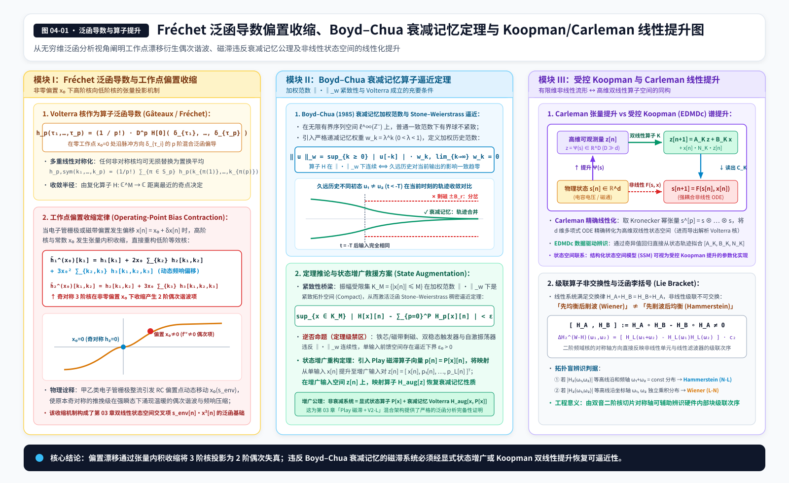

*图 04-01：模块 I 展示 Gâteaux/Fréchet 泛函导数与非零工作点偏置 $`x_0`$ 下的高阶张量内积收缩定律（揭示奇对称三阶核 $`\mathbf{H}_3`$ 如何因动态偏置偏移衍生出二阶偶次谐波 $`3x_0\sum h_3`$）；模块 II 展示 Boyd–Chua 加权范数 $`\|\cdot\|_w`$ 下的衰减记忆逼近定理及针对剩磁分岔的显式状态增广公理；模块 III 对比 Carleman 精确张量提升、受控 Koopman（EDMDc）双线性算子提升与级联泛函李括号（Lie Bracket）非交换性判据。*

## 4.9 分数阶微积分（Fractional Calculus）：幂律衰减记忆与有理逼近实现

在电子管热弛豫、铁氧体/磁带介质粘滞损耗（Magnetic After-effect / Viscosity）、扬声器悬边蠕变（Creep）以及电解电容介质吸收（Dielectric Absorption）中，系统在受激后的恢复可能比单一指数衰减 $`e^{-t/\tau}`$ 更缓慢，并在多个数量级的时间尺度上呈现**幂律衰减（Power-Law Decay，$`t^{-\alpha}`$）**。

当标量阶数满足 $`0\lt \alpha_{\mathrm{frac}}\lt 1`$ 时，连续时间 Caputo 分数阶导数与 Grünwald–Letnikov 离散分数阶差分分别定义为：

$$
{}^CD_t^{\alpha_{\mathrm{frac}}} s(t)=
\frac{1}{\Gamma(1-\alpha_{\mathrm{frac}})}
\int_0^t\frac{\dot s(\tau)}{(t-\tau)^{\alpha_{\mathrm{frac}}}}\,d\tau,\qquad
\Delta^{\alpha_{\mathrm{frac}}} x[n]=
\sum_{k=0}^{\infty}(-1)^k
\binom{\alpha_{\mathrm{frac}}}{k}x[n-k].
$$

其中广义二项式系数满足递推关系 $`w_k^{(\alpha_{\mathrm{frac}})} = (-1)^k\binom{\alpha_{\mathrm{frac}}}{k} = \bigl(1-\frac{\alpha_{\mathrm{frac}}+1}{k}\bigr)w_{k-1}^{(\alpha_{\mathrm{frac}})}`$，当延迟 $`k\to\infty`$ 时按渐近幂律 $`O(k^{-\alpha_{\mathrm{frac}}-1})`$ 缓慢衰减（属于长尾衰减记忆，但非永久剩磁）。

在实时音频插件中，直接截断 Grünwald–Letnikov 无穷级数需要数千个 FIR 抽头。更高效的工程实现是在目标听觉频带 $`[\omega_{\min}, \omega_{\max}]`$（如 $`1\,\mathrm{Hz}\sim 20\,\mathrm{kHz}`$）内，采用 **Oustaloup 递归极零点交错有理逼近**或连分式展开（CFE），将分数阶算子 $`s^{\alpha_{\mathrm{frac}}}`$ 近似为 $`N_f`$ 个一阶 RC 弛豫状态的并联/级联（通常取 $`N_f=4\sim 7`$ 个对数等距分布的极零点对即可在全频带内将幅相误差控制在 $`0.2\,\mathrm{dB}`$ 以内）：[A4]

$$
H_{\mathrm{frac}}(s) = s^{\alpha_{\mathrm{frac}}} \approx C_0 \prod_{m=1}^{N_f} \frac{1 + s/\omega_{z,m}}{1 + s/\omega_{p,m}},
$$

再经双线性变换（Tustin）离散化为极低成本的 IIR 二阶节（Biquads）状态簇。

## 4.10 长尾衰减记忆与路径依赖的横向对照实验设计

为了在工程中客观决定何时采用 Laguerre 正交基、何时采用分数阶极零点簇、何时采用 Play 磁滞算子，建议在统一基准下对比脉冲恢复曲线与预磁化探针响应：
- 若余振尾部在对数—对数坐标（Log-Log Plot）下呈直线，说明系统受幂律弛豫主导，应优先选用 $`4\sim 6`$ 阶 Oustaloup 分数阶状态簇（相比数千抽头 FIR 可节省 99% 以上的乘加运算）；
- 若静音足够长时间后，正负不同预激励极性下的微弱探针响应依然收敛到两条不同的基线，则说明存在非衰减的持久剩磁，必须引入第 3.6.1 节的 Play / Preisach 状态。

## 4.11 Wiener G-泛函与 Lee–Schetzen 互相关辨识法：解除阶次间的统计耦合

在《01》第 1.11.1 节中我们看到，普通 Volterra 级数的单项式基 $`1, x, x^2, x^3, \ldots`$ 在随机输入下彼此非正交（例如对零均值高斯白噪声 $`x[n]\sim\mathcal{N}(0,\sigma_x^2)`$，有 $`\mathbb{E}[x[n]\cdot x^3[n]]=3\sigma_x^4\neq 0`$，导致三阶项严重污染一阶线性核的辨识）。

Norbert Wiener 提出的 **Wiener G-泛函（Wiener G-functionals）** 通过在功率谱密度（方差）为 $`\sigma_x^2`$ 的高斯白噪声输入测度下对各阶 Volterra 泛函做 **Gram–Schmidt 正交化**，构造出一组满足跨阶严格统计正交的泛函展开 [A5]：

$$
y[n] = \sum_{p=0}^{\infty} G_p\bigl[k_p;\,x\bigr](n),\qquad
\mathbb{E}\Bigl[G_p\bigl[k_p;\,x\bigr](n)\,G_q\bigl[k_q;\,x\bigr](n)\Bigr] = 0\quad (p\neq q).
$$

离散时间下前四阶正交 Wiener G-泛函的显式结构为（在最高阶包含对角及下三角低阶减去项，恰好对应概率论 Hermite 多项式的泛函推广）：

$$
\begin{aligned}
G_0\bigl[k_0;\,x\bigr](n) &= k_0,\\
G_1\bigl[k_1;\,x\bigr](n) &= \sum_{m=0}^{M-1}k_1[m]x[n-m],\\
G_2\bigl[k_2;\,x\bigr](n) &= \sum_{m_1=0}^{M-1}\sum_{m_2=0}^{M-1}k_2[m_1,m_2]x[n-m_1]x[n-m_2] - \sigma_x^2\sum_{m=0}^{M-1}k_2[m,m],\\
G_3\bigl[k_3;\,x\bigr](n) &= \sum_{m_1,m_2,m_3=0}^{M-1}k_3[m_1,m_2,m_3]x[n-m_1]x[n-m_2]x[n-m_3] - 3\sigma_x^2\sum_{m_1=0}^{M-1}\Biggl(\sum_{m_2=0}^{M-1}k_3[m_1,m_2,m_2]\Biggr)x[n-m_1].
\end{aligned}
$$

正是因为减去了常数项 $`-\sigma_x^2\sum k_2[m,m]`$（消除二阶直流偏置对零阶的污染）与一阶回流项 $`-3\sigma_x^2\sum k_3[m_1,m_2,m_2]x[n-m_1]`$（消除三阶奇次项对一阶线性核的增益污染），**Y. W. Lee 与 Martin Schetzen (1965)** 证明了各阶对称 Wiener 核 $`k_p`$ 可直接通过输出信号与高阶延迟乘积的**互相关（Lee–Schetzen Cross-Correlation Method）** 逐阶独立解出，而无需联立求解巨型病态矩阵：

$$
k_p[m_1,\ldots,m_p] = \frac{1}{p!\,\sigma_x^{2p}}\,\mathbb{E}\Biggl[\Biggl(y[n]-\sum_{q=0}^{p-1}G_q[k_q;\,x](n)\Biggr)\prod_{i=1}^{p}x[n-m_i]\Biggr].
$$

当所有遅延坐标互不相同时（$`m_i\neq m_j`$），由于低阶泛函与高阶多元乘积正交，公式进一步简化为直接高阶互相关 $`k_p[m_1,\ldots,m_p]=\frac{1}{p!\sigma_x^{2p}}\mathbb{E}[y[n]x[n-m_1]\cdots x[n-m_p]]`$。辨识出最高 $`P`$ 阶 Wiener 核 $`\{k_0,\ldots,k_P\}`$ 后，再将上述显式公式中的相同阶次项合并同类项（例如一阶等效 Volterra 核为 $`h_1[m]=k_1[m]-3\sigma_x^2\sum_{m_2}k_3[m,m_2,m_2]+\cdots`$），即可还原为标准 Volterra 核。

## 4.12 Wiener Chaos Decomposition（维纳混沌分解）在系统辨识中的确切含义

在一维标量标准正态变量 $`\xi\sim\mathcal{N}(0,1)`$ 下，前几阶概率论 Hermite 多项式（Probabilists' Hermite Polynomials）定义为：

$$
H_0(\xi)=1,\quad H_1(\xi)=\xi,\quad
H_2(\xi)=\xi^2-1,\quad
H_3(\xi)=\xi^3-3\xi,\quad
H_4(\xi)=\xi^4-6\xi^2+3,
$$

满足高斯测度下的正交归一关系 $`\mathbb{E}[H_m(\xi)H_n(\xi)]=n!\,\delta_{mn}`$。

**Wiener Chaos Decomposition（维纳混沌分解）** 是这一正交性在无穷维高斯随机过程空间上的完备扩张定理（Cameron–Martin 定理）[A6]：任何具有有限二阶矩（$`\mathbb{E}[\lvert Y\rvert^2]\lt\infty`$）且由独立标准高斯随机变量序列 $`\boldsymbol{\xi}=(\xi_1,\xi_2,\ldots,\xi_d)`$ 驱动的非线性泛函输出 $`Y(\boldsymbol{\xi})`$, 均可唯一展开为多元正交 Hermite 多项式基 $`\Psi_{\boldsymbol{\alpha}}(\boldsymbol{\xi})`$ 的均方收敛级数：

$$
Y(\boldsymbol\xi)\approx
\sum_{\lvert\boldsymbol\alpha\rvert\le P_{\mathrm{PCE}}}
c_{\boldsymbol\alpha}\,
\Psi_{\boldsymbol\alpha}(\boldsymbol\xi),
\qquad
\Psi_{\boldsymbol\alpha}(\boldsymbol\xi)=
\prod_{j=1}^{d}H_{\alpha_j}(\xi_j),
$$

其中多指标 $`\boldsymbol{\alpha}=(\alpha_1,\ldots,\alpha_d)\in\mathbb{N}_0^d`$，总阶数为 $`\lvert\boldsymbol{\alpha}\rvert=\sum_{j=1}^d \alpha_j \le P_{\mathrm{PCE}}`$。需要再次强调，这里的“Chaos（混沌）”源自 Norbert Wiener 1938 年命名的高斯纯随机空间（Homogeneous Chaos），属**概率论与随机泛函正交基术语**，与洛伦兹吸引子、正 Lyapunov 指数等确定性非线性动力学混沌无任何关系。

## 4.13 Polynomial Chaos Expansion (PCE)：器件公差与硬件个体差异的统计建模

在模拟音频硬件复刻中，同型号的两台真实机器（例如两台出厂年份不同的 LA-2A 或两台电子管前级）往往因为碳膜电阻 $`\pm 5\%\sim 10\%`$ 公差、耦合电容老化、电子管跨导离散性或 T4B 光敏电阻批次差异而呈现出可听的个体差异。

利用 **广义多项式混沌展开（Generalized Polynomial Chaos Expansion, gPC / PCE）**（Xiu & Karniadakis, 2002）[A7]，我们可以将电路中的 $`d`$ 个不确定器件参数（如偏置电阻、时间常数、磁芯饱和磁通）归一化为独立随机变量向量 $`\boldsymbol{\xi}=(\xi_1,\ldots,\xi_d)`$，并根据参数的先验概率分布选择对应的 Wiener–Askey 正交多项式族（高斯分布选 Hermite 多项式，有界均匀公差区间 $`[-1,1]`$ 选 **Legendre 多项式**，Beta 分布选 Jacobi 多项式），将系统输出展开为：

$$
y[n;\boldsymbol\xi]\approx
\sum_{\lvert\boldsymbol\alpha\rvert\le P_{\mathrm{PCE}}}
c_{\boldsymbol\alpha}[n]\,
\Psi_{\boldsymbol\alpha}(\boldsymbol\xi).
$$

只需在少量高斯求积节点（Stochastic Collocation）或稀疏网格上运行离线模型求出确定性系数序列 $`c_{\boldsymbol{\alpha}}[n]`$，即可利用基函数的正交性**零成本直接解析求出整个硬件种群在任意时刻的输出均值包络、方差波动带以及各元件对音色差异的全局方差贡献率（Sobol 灵敏度指标）**：

$$
\mathbb E_{\boldsymbol{\xi}}\bigl[y[n;\boldsymbol\xi]\bigr]= c_{\boldsymbol0}[n],\qquad
\mathrm{Var}_{\boldsymbol{\xi}}\bigl(y[n;\boldsymbol\xi]\bigr)=
\sum_{\boldsymbol\alpha\ne\boldsymbol0}
c_{\boldsymbol\alpha}^2[n]\,
\mathbb E\bigl[\Psi_{\boldsymbol\alpha}^2(\boldsymbol\xi)\bigr],\qquad
S_j[n] = \frac{\sum_{\boldsymbol{\alpha}\in\mathcal{A}_j}c_{\boldsymbol{\alpha}}^2[n]\mathbb{E}[\Psi_{\boldsymbol{\alpha}}^2]}{\mathrm{Var}_{\boldsymbol{\xi}}(y[n;\boldsymbol{\xi}])}.
$$

在商业插件设计中，若某个内部元件的 Sobol 灵敏度指标 $`S_j`$ 极高，就可以将该随机坐标 $`\xi_j`$ 直接暴露为插件面板上的“Variance / Tolerance / Tube Age（成色/老化度）”连续微调旋钮，从而用一套正交展开同时覆盖整个经典硬件家族的个体分布。

## 4.14 可观测性与结构可辨识性：Rank 判据与参数解耦

对于含内部状态与未知参数 $`\boldsymbol{\theta}\in\mathbb{R}^K`$ 的非线性模型

$$
\mathbf{s}[n+1]=\mathbf{F}(\mathbf{s}[n],u[n];\boldsymbol{\theta}),\qquad
y[n]=H(\mathbf{s}[n],u[n];\boldsymbol{\theta}),
$$

在长度为 $`N`$ 的激励序列 $`\mathbf{u}`$ 下，设模型预测输出向量为 $`\hat{\mathbf{y}}(\boldsymbol{\theta},\mathbf{u})\in\mathbb{R}^N`$。定义输出关于参数向量 $`\boldsymbol{\theta}`$ 的 **$`N\times K`$ 局部灵敏度矩阵（Sensitivity Jacobian Matrix）**：

$$
\mathbf{J}_{\boldsymbol{\theta}}(\mathbf{u}) = \frac{\partial \hat{\mathbf{y}}(\boldsymbol{\theta},\mathbf{u})}{\partial \boldsymbol{\theta}^\top} \in \mathbb{R}^{N\times K},\qquad
\bigl[\mathbf{J}_{\boldsymbol{\theta}}(\mathbf{u})\bigr]_{n,i} = \frac{\partial \hat{y}[n]}{\partial \theta_i}.
$$

**局部参数可辨识性判据**：在标称参数 $`\boldsymbol{\theta}_0`$ 邻域内，模型参数由激励 $`\mathbf{u}`$ 局部唯一可辨识的充要条件是灵敏度矩阵满列秩，即 $`\mathrm{rank}\bigl(\mathbf{J}_{\boldsymbol{\theta}}(\mathbf{u})\bigr)=K`$（等价于信息矩阵 $`\mathbf{J}_{\boldsymbol{\theta}}^\top\mathbf{J}_{\boldsymbol{\theta}}`$ 正定可逆）。若两个参数列向量线性相关（例如在第 1.9.1 节单音 ESS 激励下，Wiener–Hammerstein 前置增益与后置增益的灵敏度列完全共线），则矩阵奇异，必须通过改变激励结构（如引入双音或多幅度阶跃）打破列共线性。

## 4.15 Fisher 信息矩阵（FIM）、Cramér–Rao 下界与主动最优激励设计

当测量输出包含加性高斯白噪声 $`y[n]=\hat{y}_{\boldsymbol{\theta}}[n]+w[n]`$（$`w[n]\sim\mathcal{N}(0,\sigma_w^2)`$）时，似然函数 $`p(\mathbf{y}\mid\boldsymbol{\theta},\mathbf{u})`$ 对应的 **Fisher 信息矩阵（Fisher Information Matrix, FIM）** 具有极其简洁的闭式表达：

$$
\mathcal I(\boldsymbol\theta;\mathbf u)=
\mathbb E\!\left[
\nabla_{\boldsymbol\theta}\log p(\mathbf y\mid\boldsymbol\theta,\mathbf u)
\nabla_{\boldsymbol\theta}\log p(\mathbf y\mid\boldsymbol\theta,\mathbf u)^\top
\right]
= \frac{1}{\sigma_w^2}\,\mathbf{J}_{\boldsymbol{\theta}}(\mathbf{u})^\top\mathbf{J}_{\boldsymbol{\theta}}(\mathbf{u}).
$$

对于固定核 Volterra 线性回归 $`\hat{\mathbf{y}}=\mathbf{X}(\mathbf{u})\boldsymbol{\theta}`$，灵敏度矩阵就是特征设计矩阵 $`\mathbf{J}_{\boldsymbol{\theta}}(\mathbf{u})=\mathbf{X}(\mathbf{u})`$，因此 Fisher 信息矩阵直接退化为 $`\mathcal{I}(\boldsymbol{\theta};\mathbf{u})=\frac{1}{\sigma_w^2}\mathbf{X}(\mathbf{u})^\top\mathbf{X}(\mathbf{u})`$。由数理统计中的 **Cramér–Rao 不等式（CRLB）**，任何无偏参数估计器 $`\hat{\boldsymbol{\theta}}`$ 的协方差矩阵均受限于 Fisher 信息矩阵的逆：

$$
\mathrm{Cov}(\hat{\boldsymbol{\theta}}) \succeq \mathcal{I}(\boldsymbol{\theta};\mathbf{u})^{-1} = \sigma_w^2\bigl(\mathbf{J}_{\boldsymbol{\theta}}(\mathbf{u})^\top\mathbf{J}_{\boldsymbol{\theta}}(\mathbf{u})\bigr)^{-1}.
$$

这一公式将“设计什么样的测试音频最好”直接转化为一个可计算的数学优化问题——**主动最优激励设计（Optimal Input Design）**[A8]：在满足硬件安全峰值幅度 $`\lVert\mathbf{u}\rVert_\infty \le u_{\max}`$ 与频带限制的前提下，优化测试信号参数（如多音信号的频率分布、多方差台阶权重或脉冲间隔），以极小化参数置信椭球的体积或轴长：
- **D-最优设计（D-Optimal）**：最大化 $`\log\det\mathcal{I}(\boldsymbol{\theta};\mathbf{u})`$，等价于最小化参数联合置信椭球的对数体积；
- **A-最优设计（A-Optimal）**：最小化 $`\mathrm{tr}\bigl(\mathcal{I}(\boldsymbol{\theta};\mathbf{u})^{-1}\bigr)`$，等价于最小化所有待估核系数的平均方差；
- **E-最优 / 条件数优化**：最大化最小特征值 $`\lambda_{\min}\bigl(\mathcal{I}(\boldsymbol{\theta};\mathbf{u})\bigr)`$，改善各参数方向的可观测性。

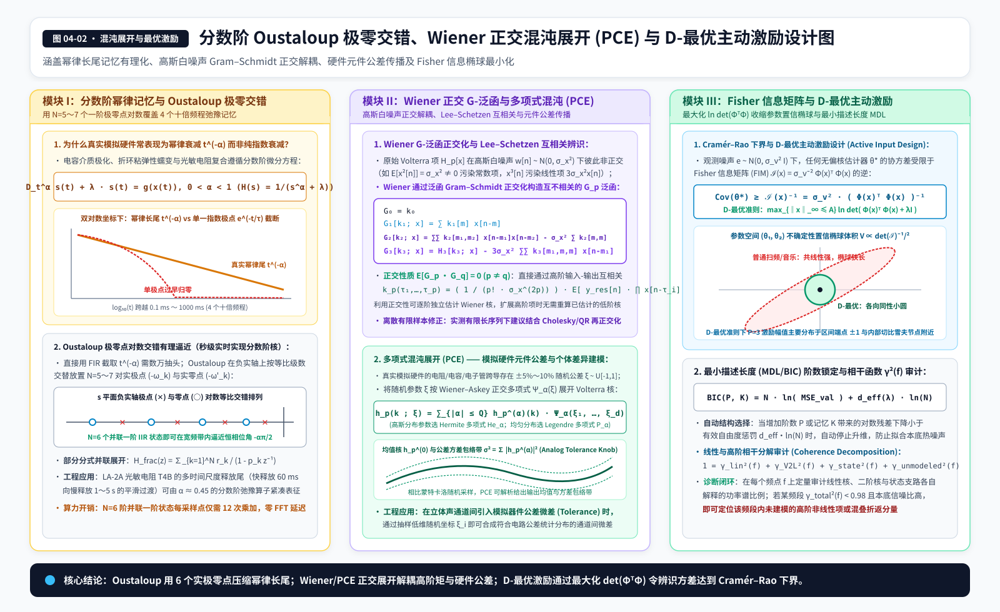

*图 04-02：模块 I 展示分数阶幂律长尾记忆 $`t^{-\alpha}`$ 与 Oustaloup 负实轴极零点对数等比交错有理逼近；模块 II 展示高斯白噪声下 Wiener G-泛函的 Gram–Schmidt 正交解耦（消除 $`-3\sigma_x^2`$ 奇次交叉矩干扰）与用于硬件元件公差建模的多项式混沌展开（PCE）；模块 III 展示基于 Fisher 信息矩阵（FIM）的 D-最优主动激励设计（最大化 $`\ln\det(\boldsymbol{\Phi}^\top\boldsymbol{\Phi})`$ 收缩置信椭球）与 BIC/MDL 阶数判定。*

## 4.16 高级理论的统一测试矩阵

| 实验编号 | 参考基准对象 | 参与对照的模型族 | 核心量化评估指标 |
| --- | --- | --- | --- |
| **Exp-A 衰减记忆逼近** | 多时间常数已知非线性系统 | 截断 FIR Volterra、Laguerre-Volterra (LVN)、ESN | 随基数量 $`K`$ 增加的一致误差 $`\ell^\infty`$ 衰减率 |
| **Exp-B 状态提升线性化** | 已知解析方程的非线性电路/压缩环路 | 受控 Koopman (EDMDc)、Carleman 截断、双线性 SSM | 闭环 Free-Run 轨迹误差、谱半径稳定裕度与每采样耗时 |
| **Exp-C 幂律长尾弛豫** | 含粘滞磁后效或介质吸收的长尾系统 | 截断 Grünwald 分数阶、Oustaloup 有理极零簇、单极点 IIR | 对数时间轴恢复曲线误差（$`1\,\mathrm{ms}\sim 10\,\mathrm{s}`$）与滤波器阶数 |
| **Exp-D 正交泛函解耦** | 多方差宽带激励下的电子管放大级 | 单项式幂基 Volterra、Wiener/Hermite 正交核、SNLM | 设计矩阵条件数 $`\kappa_2`$、跨电平泛化 ESR 与小信号奇次偏置 |
| **Exp-E 器件公差传播** | 含 $`\pm 10\%`$ 随机元件公差的离线白盒电路 | Legendre/Hermite PCE、蒙特卡洛仿真（1000 次） | 均值/方差包络吻合度、Sobol 灵敏度排序与所需仿真次数 |
| **Exp-F 主动最优激励** | 含耦合光电/偏置未知参数的灰盒压缩器 | 常规干声音乐、等距扫频、D-Optimal 信息驱动激励 | 参数估计协方差迹 $`\mathrm{tr}(\mathcal{I}^{-1})`$ 与未见测试集泛化误差 |

## 4.17 小结：高级理论如何赋能工程实践？

本章建立的六大数学工具各自对应明确的工程痛点：
- **Gâteaux / Fréchet 导数**界定了工作点局部展开与偏置缩并规律；
- **Boyd–Chua 衰减记忆定理**确立了有限维滤波器组逼近的适用范围，并严格划出了持久磁滞必须引入显式状态的理论边界；
- **Koopman 与 Carleman 提升**为慢速非线性状态提供了向双线性状态空间转化的结构化路径；
- **分数阶微积分与 Oustaloup 逼近**用极少数极零点对解决了幂律长尾弛豫的实时计算难题；
- **Wiener G-泛函与 PCE 多项式混沌**分别在随机信号域与器件公差域消除了高阶幂次的统计共线性；
- **Fisher 信息矩阵与 CRLB** 则指导我们用最少的硬件采集时间获取最高的参数辨识精度。

下一章《05 物理约束、模型降阶与神经代理》将把这些系统辨识理论与电路微分代数方程（DAE）、Port-Hamiltonian 能量守恒架构、有限元 POD 超降阶及实时模型蒸馏全面打通。

---

## 参考文献

- **[A1]** Boyd, S. & Chua, L. O. (1985), *Fading Memory and the Problem of Approximating Nonlinear Operators with Volterra Series*, IEEE Trans. Circuits Syst., 32(11), 1150–1161, [DOI:10.1109/TCS.1985.1085649](https://doi.org/10.1109/TCS.1985.1085649)；[作者开放文本](https://web.stanford.edu/~boyd/papers/fading_volterra.html)。
- **[A2]** Korda, M. & Mezić, I. (2018), *Linear Predictors for Nonlinear Dynamical Systems: Koopman Operator Meets Model Predictive Control*, *Automatica*, 93, 149–160, [DOI:10.1016/j.automatica.2018.03.046](https://doi.org/10.1016/j.automatica.2018.03.046)。
- **[A3]** Forets, M. & Pouzet, C. / Amini 等 (2022), *Carleman Linearization of Nonlinear Systems and Its Finite-Section Approximations*, [arXiv:2207.07755](https://arxiv.org/abs/2207.07755)。
- **[A4]** Ortigueira, M. D. 等 (2024), *Principles of Fractional Signal Processing*, Digital Signal Processing, [DOI:10.1016/j.dsp.2024.104490](https://doi.org/10.1016/j.dsp.2024.104490)。
- **[A5]** Lee, Y. W. & Schetzen, M. (1965), *Measurement of the Wiener Kernels of a Non-linear System by Cross-Correlation*, Int. J. Control, 2(3), 237–254；以及 Orcioni 等 (2019), *Nonlinear System Identification Using Wiener Basis Functions and Multiple-Variance Perfect Sequences*, Signal Processing, [论文入口](https://www.sciencedirect.com/science/article/pii/S0165168419300660)。
- **[A6]** Wiener, N. (1938), *The Homogeneous Chaos*, Amer. J. Math., 60(4), 897–936；[Polynomial Chaos 教学讲义](https://venturi.soe.ucsc.edu/sites/default/files/COURSE_NOTE_5_Polynomial_chaos.pdf)。
- **[A7]** Xiu, D. & Karniadakis, G. E. (2002), *The Wiener–Askey Polynomial Chaos for Stochastic Differential Equations*, SIAM J. Sci. Comput., 24(2), 619–644, [DOI:10.1137/S1064827501387826](https://doi.org/10.1137/S1064827501387826)。
- **[A8]** *Space-Filling Input Design for Nonlinear State-Space Identification* (2024), [论文入口](https://www.sciencedirect.com/science/article/pii/S2405896324013697)；*An Approximate Bayesian Approach to Optimal Input Signal Design for System Identification* (2025), [开放全文](https://pmc.ncbi.nlm.nih.gov/articles/PMC12562801/)。

---

# 05 物理约束、模型降阶与神经代理：高精度数字建模如何进入实时音频

> **版本：v4 · 2026-11-15 · 增加 21 节点 MNA 光电压缩器、乘性神经修正与超网络部署实例**
> **所属系列：Volterra Wiki**
> **阅读定位：** 把《04》的系统辨识与算子理论连接到电路、结构振动、磁性材料和数值计算，研究物理先验、有限元降阶、科学机器学习与实时推理之间的工程分工。
> **范围：** 只讨论具有具体数字建模任务的物理和数值方法。

## 5.1 为什么需要区分物理精度、求解精度和实时成本？

一台真实模拟设备的原理图可以说明拓扑，却未必给出实际电子管曲线、变压器磁滞回线、寄生参数或每只光敏元件的恢复过程。若原始物理参数已经与真实硬件存在偏差，即使数值求解精确，也会产生偏离硬件的输出。另一方面，即使物理方程充分准确，离散时间积分、迭代求解和模型约简也会引入各自的数值误差。

对于完整的物理—数据联合建模流程，可以分层量化以下四类误差：
1. **物理建模误差**：真实硬件实测响应与连续时间微分代数方程（DAE）理论解之间的偏差；
2. **数值离散化误差**：连续时间方程与高采样率离线高精度数值解（Reference Solver）之间的偏差；
3. **降阶与代理误差**：高精度离线数值解与实时约简/神经代理模型之间的偏差；
4. **实时工程性能**：宿主音频线程中的块处理延迟（Latency）、平均与最坏峰值 CPU 占用（WCET）以及高频混叠抑制。

因此，工程上应当将**高精度离线物理教师模型（Offline Teacher）** 与**实时音频运行模型（Real-Time Student / Surrogate）** 分开构建：离线模型允许采用高倍过采样、精细空间网格与严格收敛的隐式迭代；实时模型则在验证过的工作域内，利用结构化分解、模态超降阶、查找表（LUT）或神经蒸馏，以最少的每采样乘加次数复现关键动态。

## 5.2 从电路网表到非线性微分代数方程（DAE）、DK 方法与 WDF

具有电容、电感、电子管、二极管、变压器及反馈路径的模拟音频电路，在节点分析或修正节点分析（Modified Nodal Analysis, MNA）下可统一写为非线性微分代数方程（DAE）：

$$
\mathbf E(\mathbf z,\boldsymbol\theta)\dot{\mathbf z}+\mathbf f(\mathbf z,\mathbf u,\boldsymbol\theta)=\mathbf 0,
\qquad \mathbf y=\mathbf g(\mathbf z,\mathbf u,\boldsymbol\theta).
$$

其中 $`\mathbf z`$ 包含节点电压、电感支路电流与可能的内部磁通/热状态，$`\boldsymbol\theta`$ 为元件物理参数向量，$`\mathbf u`$ 为外部音频输入与偏置源。

在具体的光电压缩器实现中，**Revenger 2A 的电路主干可以作为 MNA 工程实例**：其求解器组织了 21 个节点变量，对非线性元件采用伴随电导和等效电流源的 Newton 型线性化，并将跨采样点持续演化的电容、光电相关状态留在电路求解过程中。每个采样点可以抽象为求解

$$
\mathbf F\bigl(\mathbf z[n];\mathbf z[n-1],\mathbf u[n],\mathbf c\bigr)=\mathbf 0,
\qquad
\mathbf J(\mathbf z^{(r)})\,\Delta\mathbf z^{(r)}=-\mathbf F(\mathbf z^{(r)}),
$$

再令 $`\mathbf z^{(r+1)}=\mathbf z^{(r)}+\Delta\mathbf z^{(r)}`$ 迭代逼近当前时刻的一致解。实际实现还要设置不收敛回退、非有限数值清理及输入电平范围保护。这类结构与仅用一个非线性增益曲线乘以音频的模型有本质区别：**元件耦合与历史记忆由方程和持续状态共同产生**。对一般读者而言，这个案例说明 MNA 的用途；21 节点是该实例采用的规模；其他 LA-2A 建模方案可能具有不同的节点数量。

在虚拟模拟（Virtual Analog, VA）建模中，为了兼顾无源稳定性与实时求解效率，最核心的两套结构化框架是 **离散 K 方法（Discretization-Kernel / DK-Method，状态空间分离法）** 与 **波数字滤波器（Wave Digital Filters, WDF）**：

### 5.2.1 状态空间 DK 方法（Discretization-Kernel Method）

David Yeh 等人系统化的 **DK 方法**[P8] 将线性储能元件（电容、电感）经梯形法则（Trapezoidal Rule / 双线性变换）离散化为伴随电阻模型，并将电路中的**线性动态状态更新**与**静态非线性代数环求解**显式分离为标准块结构：

$$
\begin{aligned}
\mathbf{p}[n] &= \mathbf{D}\,\mathbf{x}_{\mathrm{state}}[n-1] + \mathbf{E}_u\,\mathbf{u}[n],\\
\mathbf{v}_{\mathrm{nl}}[n] &= \mathbf{p}[n] + \mathbf{K}\,\mathbf{i}_{\mathrm{nl}}\bigl(\mathbf{v}_{\mathrm{nl}}[n]\bigr),\\
\mathbf{x}_{\mathrm{state}}[n] &= \mathbf{A}\,\mathbf{x}_{\mathrm{state}}[n-1] + \mathbf{B}\,\mathbf{u}[n] + \mathbf{C}\,\mathbf{i}_{\mathrm{nl}}\bigl(\mathbf{v}_{\mathrm{nl}}[n]\bigr),\\
\mathbf{y}[n] &= \mathbf{L}\,\mathbf{x}_{\mathrm{state}}[n-1] + \mathbf{M}_u\,\mathbf{u}[n] + \mathbf{N}_{\mathrm{nl}}\,\mathbf{i}_{\mathrm{nl}}\bigl(\mathbf{v}_{\mathrm{nl}}[n]\bigr).
\end{aligned}
$$

其中，$`\mathbf{p}[n]`$ 汇总上一时刻线性状态与当前输入形成的已知项；第二式给出非线性端口电压的隐式关系，后两式分别完成状态更新与输出计算。

DK 方法的关键优势在于：无论电路包含多少个电阻、电容和运算放大器，**需要用 Newton–Raphson 迭代求解的非线性代数方程组被严格压缩到了非线性器件端口电压 $`\mathbf{v}_{\mathrm{nl}}\in\mathbb{R}^{N_{\mathrm{nl}}}`$ 的维度**：

$$
\begin{aligned}
\mathbf{F}_{\mathrm{DK}}(\mathbf{v}_{\mathrm{nl}})
&= \mathbf{v}_{\mathrm{nl}} - \mathbf{p}[n] - \mathbf{K}\,\mathbf{i}_{\mathrm{nl}}(\mathbf{v}_{\mathrm{nl}}) = \mathbf{0},\\
\mathbf{J}_{\mathrm{DK}}(\mathbf{v}_{\mathrm{nl}})
&= \mathbf{I} - \mathbf{K}\,\frac{\partial \mathbf{i}_{\mathrm{nl}}(\mathbf{v}_{\mathrm{nl}})}{\partial \mathbf{v}_{\mathrm{nl}}^{\mathsf T}}.
\end{aligned}
$$

当某一级电路仅含单个一端口非线性元件（$`N_{\mathrm{nl}}=1`$）或耗散矩阵 $`\mathbf{K}`$ 对角占优时，不仅 Newton 步的矩阵求逆退化为标量除法，甚至可将一维隐式映射 $`p \mapsto i_{\mathrm{nl}}(v_{\mathrm{nl}}(p))`$ **离线预计算为一维均匀或切比雪夫查找表（1D LUT）**，实现零迭代的常数时间实时求值。

### 5.2.2 波数字滤波器（WDF）与散射消除无延迟环

Alfred Fettweis 创立、Kurt Werner 与 Alberto Bernardini 等人扩展的**波数字滤波器（Wave Digital Filters, WDF）**[P1] 则不再直接以电压 $`v`$ 和电流 $`i`$ 为变量，而是引入端口参考电阻（Port Resistance）$`R_0 \gt 0`$，定义**入射波 $`a`$ 与反射波 $`b`$**：

$$
a = v + R_0 i,\qquad b = v - R_0 i\qquad
\Longleftrightarrow\qquad
v = \frac{a+b}{2},\qquad i = \frac{a-b}{2R_0}.
$$

通过合理选择各线性元件（电容 $`R_0=T_s/(2C)`$、电感 $`R_0=2L/T_s`$）与串并联适配器（Adaptors）的端口参考电阻，使其满足**无反射端口条件（Reflection-Free Port Condition，散射矩阵主对角元 $`S_{ii}=0`$）**，即可将线性网络与根部非线性元件之间的无延迟反馈环（Delay-Free Loop）精确解耦，并将物理电路的无源性（Passivity）直接转化为散射矩阵的功率收缩性（$`\lVert\mathbf{b}\rVert_2 \le \lVert\mathbf{a}\rVert_2`$）。当电路包含多个非线性元件或非平面 R 型连接拓扑时，则可将多端口散射矩阵 $`\mathbf{a}=\mathbf{S}\mathbf{b}(\mathbf{a})+\mathbf{w}`$ 与波域 Newton–Raphson 或不动点松弛法结合。[P1]

## 5.3 能量、无源性与离散梯度法（Discrete Gradient）：超越梯形法的非线性稳定保证

对于物理电路、扬声器机电耦合或磁芯系统，系统的总储存能量由 **Hamiltonian 储能函数** $`H(\mathbf{s})\ge 0`$ 描述（如电容电荷能 $`q^2/(2C)`$、电感磁通能 $`\phi^2/(2L)`$）。**端口哈密顿系统（Port-Hamiltonian System, PHS）**[P3] 将能量守恒交换、内部热/电阻耗散与外部端口注入统一写为：

$$
\dot{\mathbf s}=\bigl[\mathbf J(\mathbf s)-\mathbf R(\mathbf s)\bigr]\nabla H(\mathbf s)+\mathbf G(\mathbf s)\mathbf u,\qquad
\mathbf{y} = \mathbf{G}(\mathbf{s})^\top\nabla H(\mathbf{s}),
$$

其中反对称结构矩阵 $`\mathbf{J}(\mathbf{s})^\top=-\mathbf{J}(\mathbf{s})`$ 满足 $`\nabla H^\top\mathbf{J}\nabla H \equiv 0`$（内部能量无损流转），对称半正定耗散矩阵 $`\mathbf{R}(\mathbf{s})^\top=\mathbf{R}(\mathbf{s})\succeq \mathbf{0}`$ 描述不可逆损耗，从而保证连续时间下的**功率平衡与无源不等式（Passivity Inequality）**：

$$
\frac{d}{dt}H(\mathbf{s}) = -\nabla H(\mathbf{s})^\top\mathbf{R}(\mathbf{s})\nabla H(\mathbf{s}) + \mathbf{y}^\top\mathbf{u} \le \mathbf{y}^\top\mathbf{u}.
$$

在数字音频实现中，还需考察离散化后的能量平衡：**当储能函数 $`H(\mathbf{s})`$ 本身是高度非二次的强非线性函数（例如非线性变容二极管或磁芯饱和电感 $`H(\phi)`$）时，常规梯形法则（双线性变换）不再严格保持离散能量平衡**，在大信号高频驱动下可能产生虚假的数值能量注入并引发自激爆炸。

为了在离散时间下严格保持非线性系统的能量平衡，Falaize & Hélie (2016) 与 Ducceschi & Bilbao (2022) 引入了**离散梯度法（Discrete Gradient Method）** 与**标量辅助变量/二次化非迭代格式**[P2][P3]：用满足方向差分恒等式与相容性条件的离散梯度算子 $`\overline{\nabla}H(\mathbf{s}_n, \mathbf{s}_{n-1})`$ 替代连续梯度 $`\nabla H(\mathbf{s})`$：

$$
\overline{\nabla}H(\mathbf{s}_n, \mathbf{s}_{n-1})^\top\bigl(\mathbf{s}_n - \mathbf{s}_{n-1}\bigr) = H(\mathbf{s}_n) - H(\mathbf{s}_{n-1}),\qquad
\lim_{\mathbf{s}_n\to\mathbf{s}_{n-1}}\overline{\nabla}H(\mathbf{s}_n, \mathbf{s}_{n-1}) = \nabla H(\mathbf{s}_{n-1}).
$$

在一维标量状态 $`s`$ 下，离散梯度就是精确的割线差商：

$$
\overline{\nabla}H(s_n, s_{n-1}) = \frac{H(s_n)-H(s_{n-1})}{s_n - s_{n-1}}.
$$

（读者可以立即发现：**一维离散梯度在数学形式上与第 01、03 章介绍的一阶反导数抗混叠 ADAA1 差商完全同构**。 这一深刻联系说明，用能量原函数的差商代替瞬时导数，不仅在频域抑制了非线性混叠，同时在时域严格保证了离散时间步长下的无条件无源稳定）

将离散梯度代入中点离散格式，即可严格保证每一步采样更新都满足精确的离散能量耗散定律：

$$
\frac{H(\mathbf{s}_n)-H(\mathbf{s}_{n-1})}{T_s} = -\overline{\nabla}H^\top\,\mathbf{R}_{\mathrm{mid}}\,\overline{\nabla}H + \mathbf{y}_{\mathrm{mid}}^\top\mathbf{u}_{\mathrm{mid}} \le \mathbf{y}_{\mathrm{mid}}^\top\mathbf{u}_{\mathrm{mid}},
$$

从而从根源上杜绝了强过载下的数值发散。


*图 05-01：方法 I 展示 Yeh 离散基尔霍夫状态空间法（DK-Method），将 $`d`$ 维线性储能状态递推与极低维（$`N_{\mathrm{nl}}=1\sim 2`$）非线性端口求根分离并离线烘焙为 1D/2D 样条查找表（LUT）；方法 II 展示 Fettweis 波数字滤波器（WDF），通过选择等于戴维南等效电阻的端口参考阻抗 $`R_0`$ 令根节点散射对角元 $`S_{33}=0`$，消除拓扑无延迟环；方法 III 展示端口哈密顿系统（pHS）的离散梯度法（Discrete Gradient），证明其割线差分公式 $`\overline{\nabla}H=(H(s_n)-H(s_{n-1}))/(s_n-s_{n-1})`$ 与一阶反导数抗混叠（$`\mathrm{ADAA}_1`$）严格数学同构，同时达成抗混叠与离散能量无条件单调耗散。*

## 5.4 物理模型中的数值离散化收敛检验协议

针对同一套物理方程，隐式 Euler（一阶精度，带人工高频数值阻尼）、梯形法（二阶精度，无数值阻尼但高频存在频率弯曲 Frequency Warping）与保结构离散梯度法具有不同的频响与谐波表现。

构建离线参考模型时，应开展**时间步长自收敛测试（Step-Size Convergence Test）**：固定输入物理波形与初始状态，依次在 $`1\times, 2\times, 4\times, 8\times, 16\times, 32\times`$ 过采样率下运行求解器，以 $`32\times`$ 极细步长解作为真值基准，绘制各谐波幅度、相位与状态轨迹随步长 $`T_s`$ 缩小的收敛阶曲线（验证是否达到理论的一阶 $`O(T_s)`$ 或二阶 $`O(T_s^2)`$ 收敛斜率）。在目标频带内确认离线教师模型达到步长收敛后，便可以将其输出作为实时模型的训练基准。

## 5.5 从有限元（FEM）到模态降阶：空间连续场的低维状态投影

当建模对象涉及扬声器盆架/振膜大振幅非线性振动、弹簧混响（Spring Reverb）、钢板混响（Plate Reverb）或变压器铁芯涡流场时，偏微分方程（PDE）经空间有限元（FEM）离散后会产生维度高达 $`N_{\mathrm{FEM}}\sim 10^3\text{–}10^5`$ 的二阶微分方程组：

$$
\mathbf M\ddot{\mathbf q}(t)+\mathbf C\dot{\mathbf q}(t)+\mathbf K\mathbf q(t) + \mathbf{f}_{\mathrm{nl}}\bigl(\mathbf{q}(t)\bigr)=\mathbf b_{\mathrm{in}}\,u(t).
$$

通过求解线性化广义特征值问题 $`\mathbf{K}\boldsymbol{\phi}_i = \omega_i^2\mathbf{M}\boldsymbol{\phi}_i`$，选取听觉频带内耦合最强的 $`r\ll N_{\mathrm{FEM}}`$ 个本征模态组成模态矩阵 $`\boldsymbol{\Phi}_r=[\boldsymbol{\phi}_1,\ldots,\boldsymbol{\phi}_r]\in\mathbb{R}^{N_{\mathrm{FEM}}\times r}`$（满足质量正交化 $`\boldsymbol{\Phi}_r^\top\mathbf{M}\boldsymbol{\Phi}_r=\mathbf{I}_r`$），做 Galerkin 投影 $`\mathbf{q}(t)\approx\boldsymbol{\Phi}_r\mathbf{a}(t)`$，即可将线性部分对角化为 $`r`$ 个二阶模态振子：

$$
\ddot{\mathbf{a}}(t) + \mathbf{\Gamma}_r\dot{\mathbf{a}}(t) + \mathbf{\Omega}_r^2\mathbf{a}(t) + \boldsymbol{\Phi}_r^\top\mathbf{f}_{\mathrm{nl}}\bigl(\boldsymbol{\Phi}_r\mathbf{a}(t)\bigr) = \bigl(\boldsymbol{\Phi}_r^\top\mathbf{b}_{\mathrm{in}}\bigr)u(t).
$$

这里需要明确区分：**有限元模态降阶压缩的是物理空间自由度 $`\mathbf{q}\in\mathbb{R}^{N_{\mathrm{FEM}}}`$**，而第 01、03 章的 **Volterra 低秩/Laguerre 约简压缩的是时间历史核坐标**。两者可在多物理场音频设备中无缝衔接。

## 5.6 POD、SVD 与 DEIM 超降阶：突破非线性投影的计算瓶颈

对于缺乏解析本征模态的强非线性场，可通过离线收集 $`N_s`$ 个时间步的状态快照矩阵 $`\mathbf{X}_{\mathrm{snap}}=[\mathbf{q}(t_1),\ldots,\mathbf{q}(t_{N_s})]\in\mathbb{R}^{N_{\mathrm{FEM}}\times N_s}`$，执行奇异值分解（SVD）构建**本征正交分解（Proper Orthogonal Decomposition, POD）** 基底：

$$
\mathbf X_{\mathrm{snap}}=\mathbf U\boldsymbol\Sigma\mathbf V^\top,\qquad
\boldsymbol{\Phi}_r = \mathbf{U}_{:,1:r},\qquad
\frac{\sum_{i=r+1}^{\min(N_{\mathrm{FEM}},N_s)}\sigma_i^2}{\sum_{i=1}^{\min(N_{\mathrm{FEM}},N_s)}\sigma_i^2} \lt \varepsilon_{\mathrm{POD}}.
$$

然而，在实时计算投影后的非线性恢复力项

$$
\tilde{\mathbf{f}}_{\mathrm{nl}}(\mathbf{a}) = \underbrace{\boldsymbol{\Phi}_r^\top}_{r\times N_{\mathrm{FEM}}}\,\mathbf{f}_{\mathrm{nl}}\bigl(\underbrace{\boldsymbol{\Phi}_r\mathbf{a}}_{N_{\mathrm{FEM}}\times 1}\bigr)
$$

时，会出现一个著名的**伪降阶瓶颈（Lifting Bottleneck）**：为了算出 $`r`$ 维向量 $`\tilde{\mathbf{f}}_{\mathrm{nl}}(\mathbf{a})`$，程序必须先耗费 $`O(N_{\mathrm{FEM}}\cdot r)`$ 将 $`\mathbf{a}`$ 还原回 $`N_{\mathrm{FEM}}`$ 维全空间，在全部 $`N_{\mathrm{FEM}}`$ 个网格节点上逐点计算非线性函数 $`\mathbf{f}_{\mathrm{nl}}`$，再耗费 $`O(r\cdot N_{\mathrm{FEM}})`$ 投影回 $`r`$ 维空间——其每采样计算复杂度依然与庞大的原始网格数 $`N_{\mathrm{FEM}}`$ 成正比，使实时运行难以承受。

为了降低对全维网格 $`N_{\mathrm{FEM}}`$ 的运算依赖，可以引入**离散经验插值法（Discrete Empirical Interpolation Method, DEIM）** 等**超降阶（Hyper-Reduction）** 技术 [P9]：
1. 对离线收集的非线性力快照矩阵 $`[\mathbf{f}_{\mathrm{nl}}(\mathbf{q}(t_1)),\ldots,\mathbf{f}_{\mathrm{nl}}(\mathbf{q}(t_{N_s}))]`$ 再次执行 POD，提取 $`m`$ 个非线性力基向量 $`\mathbf{U}_f\in\mathbb{R}^{N_{\mathrm{FEM}}\times m}`$（$`m\sim r \ll N_{\mathrm{FEM}}`$）；
2. 利用贪心行枢轴选择算法，在原始网格中仅挑选 **$`m`$ 个最具代表性的空间插值采样点（Magic Points）**，记对应的行抽取选择矩阵为 $`\mathbf{P}=[\mathbf{e}_{p_1},\ldots,\mathbf{e}_{p_m}]\in\mathbb{R}^{N_{\mathrm{FEM}}\times m}`$；
3. 预计算常矩阵 $`\mathbf{W}_{\mathrm{DEIM}} = \boldsymbol{\Phi}_r^\top\mathbf{U}_f(\mathbf{P}^\top\mathbf{U}_f)^{-1}\in\mathbb{R}^{r\times m}`$ 与抽取基 $`\boldsymbol{\Phi}_{r,\mathbf{P}}=\mathbf{P}^\top\boldsymbol{\Phi}_r\in\mathbb{R}^{m\times r}`$，则实时非线性模态力可**仅在这 $`m`$ 个空间网格点上求值**：

$$
\tilde{\mathbf{f}}_{\mathrm{nl}}(\mathbf{a}) \approx \mathbf{W}_{\mathrm{DEIM}}\,\mathbf{f}_{\mathrm{nl}}\bigl(\boldsymbol{\Phi}_{r,\mathbf{P}}\mathbf{a}\bigr).
$$

通过 DEIM 超降阶（或将 $`r`$ 维模态力 $`\tilde{\mathbf{f}}_{\mathrm{nl}}(\mathbf{a})`$ 直接拟合成低阶多元 Chebyshev/Volterra 多项式），每采样点非线性运算复杂度从 $`O(N_{\mathrm{FEM}})`$ 进一步降至与原始网格规模无关的 $`O(r\cdot m)`$，使有限元物理模型真正具备进入 $`48\,\mathrm{kHz}`$ 实时音频插件的能力。

## 5.7 器件公差与虚拟硬件族群：结合 PCE 指导参数化设计

将白盒 DAE 求解器与《04》第 4.13 节的广义多项式混沌展开（PCE）相结合，可以在离线阶段对真实硬件的元件公差（如电阻 $`\pm 5\%`$、电容 $`\pm 10\%`$、电子管跨导离散度）进行高效不确定性量化。这不仅能区分“单台参考样机的元件老化偏差”与“电路拓扑的固有特性”，还能根据各元件的 Sobol 灵敏度指标决定哪些内部物理量值得暴露为用户可调的校准旋钮。

## 5.8 物理白盒与神经网络的可解释协同与残差边界

如《03》第 3.8 节所建立的四种协同模式，当拥有实时可运行的简化白盒或唯象模型 $`y_P[n]`$（带内部物理状态 $`\mathbf{s}_P[n]`$）时，神经网络可以遵循**最小侵入原则**：
- 在输出端做加性残差修正 $`\hat{y}[n]=y_P[n]+\Delta y_{\boldsymbol{\theta}}(\mathbf{x}_n, \mathbf{s}_P[n])`$ 时，必须将物理状态 $`\mathbf{s}_P[n]`$（如瞬时偏置电压、增益衰减状态或磁通估计）一并作为残差网络的辅助条件输入，否则纯短窗前馈残差网络将因看不见慢变物理状态而无法拟合依赖工作点的残余失真；
- 在状态转移方程内部做灰盒修正 $`\mathbf{s}[n+1]=\mathbf{G}_P(\mathbf{s}[n],u[n])+\Delta\mathbf{G}_{\boldsymbol{\theta}}(\mathbf{s}[n],u[n])`$ 时，则必须施加第 5.3 节的无源耗散约束或第 3.8.1 节的闭环 NOE 稳定性约束。

还应区分**波形加性残差**与**控制量乘性残差**。以 Revenger 2A 的 Unit A 为例，神经修正可以先对一帧输入/输出能量和峰值特征作编码，再由小型递归网络估计一项标量增益修正：

$$
\mathbf r[k+1]=\mathcal R_{\boldsymbol\theta}(\mathbf r[k],\mathbf f[k]),\qquad
\hat y[n]=g_{\boldsymbol\theta}[k]y_P[n],\quad n\in\mathcal B_k.
$$

实际播放时需要将帧级增益 $`g_{\boldsymbol\theta}[k]`$ 在相邻帧之间平滑过渡，避免块边界阶跃。这样的网络以控制量残差修正为主，用于校正电路模型在不同压缩状态下的**动态增益误差**。控制量残差的优点是输出维度小、容易约束；若还需补足与输入频率相关的波形失真，则要结合更丰富的残差特征或物理分支。

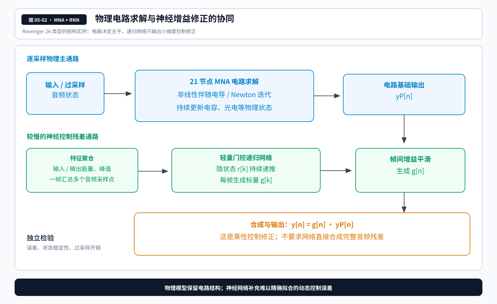

*图 05-02｜以光电压缩器为例：MNA 求解器提供物理主干，轻量递归网络生成平滑的乘性增益校正。*

## 5.9 神经元件代理（Component Surrogate）与隐式代数环的单调性约束

在模式 4（子系统代理）中，我们保留完整电路的 MNA / DK / WDF 拓扑，仅用小型神经网络或 Chebyshev/样条代理模型 $`\hat{\mathbf{i}}_{\mathrm{nl}}(\mathbf{v}_{\mathrm{nl}})`$ 替换计算昂贵的多极真空管（如三极管/五极管跨导与栅极电流曲面）或磁滞本构关系。

这里有一个极易导致实时插件崩溃的数值陷阱：如果代理模型 $`\hat{\mathbf{i}}_{\mathrm{nl}}(\mathbf{v}_{\mathrm{nl}})`$ 位于电路的隐式反馈回路（即 DK 方法方程 $`\mathbf{v}_{\mathrm{nl}}-\mathbf{p}-\mathbf{K}\hat{\mathbf{i}}_{\mathrm{nl}}(\mathbf{v}_{\mathrm{nl}})=\mathbf{0}`$）中，**一个在均方误差上拟合得很准、但局部导数（斜率）存在非物理负阻波动或高频振荡的神经网络，会直接破坏 Jacobian 矩阵 $`\mathbf{I}-\mathbf{K}\nabla\hat{\mathbf{i}}_{\mathrm{nl}}`$ 的单调正定性，导致 Newton–Raphson 求解器在多个伪解之间跳变或迭代发散**。

因此，嵌入隐式电路求解器的元件代理模型需要满足两项要求：
1. **单调性与增量无源约束（Monotonicity & Incremental Passivity）**：对无源或单调有源器件端口，强制代理映射的 Jacobian 满足半正定单调性 $`\frac{\partial \hat{\mathbf{i}}_{\mathrm{nl}}}{\partial \mathbf{v}_{\mathrm{nl}}^\top} \succeq \mathbf{0}`$（例如采用单调神经网络架构、正权重激活组合或带导数惩罚的 Hermite 样条插值），从数学上保证隐式方程在任意输入 $`\mathbf{p}[n]`$ 下存在**全局唯一解**且 Newton 迭代二次收敛；
2. **解析预消解（Pre-computation out of the Loop）**：一旦元件代理确定，尽可能将隐式求根过程 $`\mathbf{p}\mapsto \hat{\mathbf{i}}_{\mathrm{nl}}(\mathbf{v}_{\mathrm{nl}}(\mathbf{p}))`$ 在离线阶段预计算并固化为直接映射代理或紧凑查找表，避免在实时音频回调的每个采样点内重复执行神经网络前向与 Jacobian 反向求导。

## 5.10 神经算子（Neural Operators）：从一维时间序列到多维物理场代理

当离线教师是依赖于几何尺寸、材料分布 $`a(\mathbf{r})`$ 与空间激励 $`u(\mathbf{r},t)`$ 的偏微分方程场（如箱体声学辐射或磁头三维边缘场）时，**神经算子（Neural Operators）**——如 **DeepONet**（通过 Branch Net 编码输入函数、Trunk Net 编码时空查询坐标）[P4] 与 **Fourier Neural Operator (FNO)**（在频域参数化全局积分核）[P5]——提供了在无穷维函数空间之间直接学习算子映射 $`\mathcal{G}_{\boldsymbol{\theta}}: (a, u)\mapsto q(\mathbf{r},t)`$ 的工具。

在音频工程分工中，DeepONet 与 FNO 主要定位于**研发阶段的快速离线参数空间探索与合成数据生成**（代替耗时数小时的 FEM 网格重划分与求解）；若最终目标只是一个单点或双声道的实时效果器插件，仍应将神经算子生成的响应进一步蒸馏为第 5.5–5.6 节的低维模态状态或 Volterra/NAM 实时架构。

## 5.11 物理信息损失（PINNs）中的量纲归一化与梯度冲突治理

在利用物理方程残差辅助训练神经网络时，联合损失函数通常写为：

$$
\mathcal L(\boldsymbol\theta)=
\lambda_y\lVert\mathbf y_{\rm ref}-\hat{\mathbf y}_{\boldsymbol\theta}\rVert_2^2
+\lambda_F\lVert\mathcal R_F(\hat{\mathbf z}_{\boldsymbol\theta})\rVert_2^2
+\lambda_E\mathcal L_{\rm passivity}(\boldsymbol\theta)
+\lambda_B\mathcal L_{\rm boundary}(\boldsymbol\theta).
$$

在实际音频电路与磁滞训练中，直接相加这四项损失往往会遭遇严重的**量纲失配与多任务梯度冲突**：例如电路中的电容参数在纳法（$`10^{-9}\,\mathrm{F}`$）量级、电阻在百千欧（$`10^5\,\Omega`$）量级，而音频采样率在 $`4.8\times 10^4\,\mathrm{Hz}`$ 量级，未归一化的时间导数项 $`\dot{\mathbf{z}}`$ 与微分方程残差 $`\mathcal{R}_F`$ 的梯度范数可能比数据波形误差 $`\lVert\mathbf{y}_{\mathrm{ref}}-\hat{\mathbf{y}}\rVert^2`$ 大出 $`6\sim 10`$ 个数量级，导致优化器完全忽略真实硬件录音数据而退化为拟合一个参数不准的理想方程。

这可以通过两个步骤处理：
1. **无量纲化（Non-dimensionalization）**：在构造物理残差 $`\mathcal{R}_F`$ 前，先用特征参考电压 $`V_0`$、特征参考电流 $`I_0`$ 与特征时间尺度 $`\tau_0`$ 将所有电路状态、时间和阻抗无量纲化至 $`O(1)`$ 量级；
2. **动态梯度范数平衡（Gradient Norm Balancing）**：在训练迭代中定期统计各项损失对网络权重的梯度范数 $`\lVert\nabla_{\boldsymbol{\theta}}\mathcal{L}_k\rVert_2`$，动态更新权重系数 $`\lambda_k`$ 使其梯度幅值保持在同一数量级，并在物理先验不完备的区域以实测配对音频误差 $`\mathcal{L}_y`$ 为最终判据。

## 5.12 多速率实时部署与硬实时音频线程安全规范

一套工业级混合音频插件通常包含三个运行速率层级：
1. **过采样高频非线性层（$`2\times\sim 8\times f_s`$）**：运行核心无记忆/短记忆强非线性乘积、隐式元件求解或小型神经残差；
2. **基带采样率层（$`1\times f_s`$）**：运行一阶长线性 FIR/IIR、Laguerre/Kautz 正交基滤波器组、无分母多项式 ADAA 支路以及包络/磁滞状态更新；
3. **控制率 / 降采样慢速状态层（$`f_s/8\sim f_s/64`$ 或每音频块 Sub-block 更新）**：更新热时间常数、慢速电源恢复、面板旋钮平滑（Parameter Smoothing）与状态条件化核系数插值。

同时，任何进入 VST3 / AU / AAX `processBlock()` 回调的代码必须严格遵守**硬实时音频线程安全规范（Real-Time Audio Thread Safety）**：
- **零动态内存分配**：所有延迟线缓冲、FFT 工作区、Laguerre 状态与网络中间激活张量必须在 `prepareToPlay(sampleRate, maxBlockSize)` 阶段一次性预分配完毕，实时回调内严禁调用 `new`、`malloc`、`std::vector::push_back`；
- **零阻塞同步原语**：严禁在音频线程中使用 `std::mutex`、文件 I/O 或系统调用；UI 线程与音频线程之间的旋钮参数与预设切换必须通过无锁原子变量（`std::atomic`）或无锁环形缓冲区（Lock-free SPSC Ring Buffer）传递；
- **禁用非规格化浮点数（Flush-to-Zero / Denormals-Are-Zero, FTZ/DAZ）**：IIR 滤波器、Laguerre 全通链与慢速包络在静音衰减至 $`10^{-38}`$ 以下时会触发 CPU 微码级非规格化数（Subnormal Numbers）异常处理，导致 CPU 占用瞬间暴增数十倍，必须在音频块入口统一开启硬件 FTZ/DAZ 标志位。

## 5.13 离线白盒教师到实时混合学生的两阶段蒸馏管线

当高精度白盒或 FEM+DAE 模型过于庞大而无法直接满足上述硬实时约束时，可采用**离线物理教师 $`\to`$ 实时混合学生（Teacher–Student Distillation）** 管线：
1. **第一阶段（硬件校准离线教师）**：利用真实硬件的多方差扫频、双音与瞬态配对数据，校准离线白盒教师模型中的未知元件本构参数（记录**硬件—教师误差 $`E_{\mathrm{HW}\to\mathrm{T}}`$**）；
2. **第二阶段（合成全覆盖激励蒸馏实时学生）**：利用校准后的离线教师生成覆盖全部旋钮组合、极端过载与多分支磁滞轨迹的大规模无噪合成数据集（并可导出教师的内部物理状态轨迹 $`\mathbf{s}_{\mathrm{T}}[n]`$ 作为中间监督信号），训练紧凑的实时混合学生模型（如“Laguerre-Volterra + RD-Play 状态 + 微型残差网络”，记录**教师—学生误差 $`E_{\mathrm{T}\to\mathrm{S}}`$**）。

由三角不等式，最终插件相对于真实硬件的总体逼近误差受控于两段误差之和：

$$
\lVert \mathbf{y}_{\mathrm{HW}} - \hat{\mathbf{y}}_{\mathrm{Student}}\rVert \le
\underbrace{\lVert \mathbf{y}_{\mathrm{HW}} - \mathbf{y}_{\mathrm{Teacher}}\rVert}_{E_{\mathrm{HW}\to\mathrm{T}}} +
\underbrace{\lVert \mathbf{y}_{\mathrm{Teacher}} - \hat{\mathbf{y}}_{\mathrm{Student}}\rVert}_{E_{\mathrm{T}\to\mathrm{S}}}.
$$

其中，$`E_{\mathrm{HW}\to\mathrm{T}}`$ 表示物理校准误差，$`E_{\mathrm{T}\to\mathrm{S}}`$ 表示蒸馏约简误差。将这两段误差分开归档，就能在听感或指标不达标时立即定位问题究竟出在“物理方程未校准硬件”，还是“实时学生结构约简过度”。

除了固定参数的学生网络，也可以采用**参数生成网络 + 流式学生网络**的部署形式。以 noshige2A 的结构为例，控制向量经较小的 gMLP 型超网络生成音频网络权重，真正逐块执行的音频网络保存递归状态。这样可以把昂贵的“参数到权重”映射放到控制线程或非音频实时准备阶段，而把具备确定计算上界的音频网络放进实时处理路径。实际插件应将大规模权重对象的构造安排在非实时线程；参数更新时的权重交接、连续性、延迟和跨采样率模型切换，也应纳入第 5.14 节的 L4/L5 验收。

## 5.14 实时物理—数据混合建模的五层验收协议

| 验收层级 | 基准参考对象 | 核心量化验收指标 | 未达标时的第一排查方向 |
| --- | --- | --- | --- |
| **L1 物理校准层** | 真实模拟硬件配对实测 | 多电平频响、THD/IMD、T1–T4 历史探针残差 | 电路拓扑遗漏、磁滞/光电本构方程、测量链对齐 |
| **L2 数值收敛层** | $`32\times`$ 极细步长离线参考解 | 步长收敛阶、大信号能量守恒、Newton 迭代次数上限 | 离散化方法（梯形 vs 离散梯度）、Jacobian 病态 |
| **L3 降阶与代理层** | 已校准的高精度离线教师 | POD/DEIM 模态截断误差、元件代理曲线单调性与导数误差 | 模态数 $`r`$、DEIM 插值点数 $`m`$、代理函数单调约束 |
| **L4 闭环泛化层** | 封存测试集与极端压力激励 | T6 数分钟 Free-Run 无漂移、未采样旋钮插值平滑度 | NOE 展开训练长度、状态耗散边界 $`q_c`$、PCE/FiLM 覆盖 |
| **L5 硬实时部署层** | 目标宿主 DAW（64 采样缓冲） | 99.9% 分位最坏块耗时（WCET）、零 XRUN、FTZ/DAZ、T5 混叠抑制 | SIMD 向量化、LUT 缓存局部性、多速率相位对齐 |

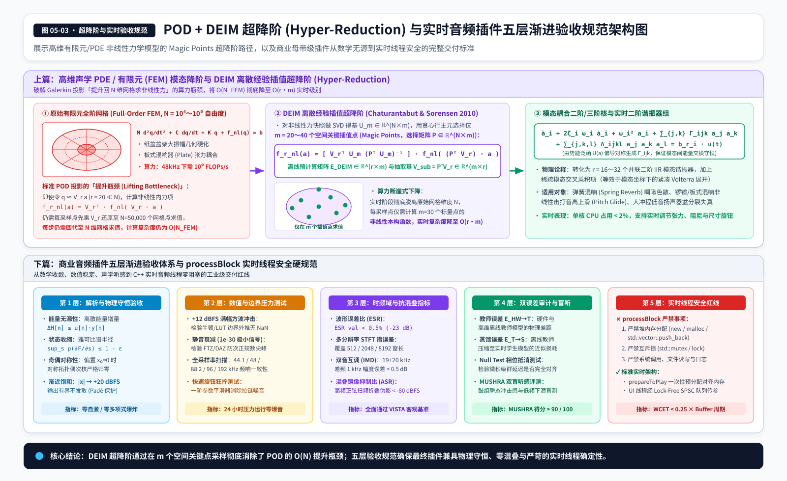

*图 05-03：上篇展示高维声学有限元（FEM / PDE）模态降阶中标准 Galerkin/POD 投影面临的 $`O(N_{\mathrm{FEM}})`$“提升瓶颈（Lifting Bottleneck）”，以及离散经验插值超降阶（DEIM Hyper-Reduction）如何仅在 $`m=20\sim 40`$ 个空间关键点（Magic Points）上求值非线性恢复力，将实时复杂度降至 $`O(r\cdot m)`$；下篇汇总从解析无源性、数值压力边界、时频抗混叠指标、双误差蒸馏审计（$`E_{\mathrm{HW}\to\mathrm{T}}+E_{\mathrm{T}\to\mathrm{S}}`$）到 `processBlock` 实时线程安全（零 `malloc`、零锁、开启 FTZ/DAZ）的五层渐进验收规范。*

## 5.15 本章与整部 Wiki 的关系

至此，我们已经走完了从基础概念（《00》）、显式 Volterra 级数（《01》）、神经网络与可微辨识（《02》）、混合架构与实验协议（《03》）、高级泛函与统计理论（《04》）到物理约束与实时降阶部署（《05》）的全部方法论闭环。

最后一章《06 从 Volterra 理论到商业音频建模：Acustica Audio 的技术发展史》将把这套完整的理论与工程标尺放回真实的商业音频插件工业史中，剖析 Nebula、V.V.K.T.、NAT、Acqua、Hyper 与 NOVA 如何一步步在测量限制与算力约束下演化成今天的产品形态。

---

## 参考文献与工程资料

- **[P1]** Bernardini, A., Bozzo, E., Fontana, F. & Sarti, A. (2021), *A Wave Digital Newton-Raphson Method for Virtual Analog Modeling of Audio Circuits with Multiple One-Port Nonlinearities*, IEEE/ACM TASLP, [DOI:10.1109/TASLP.2021.3084337](https://doi.org/10.1109/TASLP.2021.3084337)。
- **[P2]** Ducceschi, M. & Bilbao, S. (2022), *Non-Iterative Simulation Methods for Virtual Analog Modelling*, IEEE/ACM TASLP, [DOI:10.1109/TASLP.2022.3209934](https://doi.org/10.1109/TASLP.2022.3209934)。
- **[P3]** Falaize, A. & Hélie, T. (2016), *Passive Guaranteed Simulation of Analog Audio Circuits: A Port-Hamiltonian Approach*, Applied Sciences, 6(10), 273, [DOI:10.3390/app6100273](https://doi.org/10.3390/app6100273)。
- **[P4]** Lu, L., Jin, P., Pang, G., Zhang, Z. & Karniadakis, G. E. (2021), *Learning Nonlinear Operators via DeepONet Based on the Universal Approximation Theorem of Operators*, Nature Machine Intelligence, 3, 218–229, [DOI:10.1038/s42256-021-00302-5](https://doi.org/10.1038/s42256-021-00302-5)；[DeepONet 源码](https://github.com/lululxvi/deeponet)。
- **[P5]** Li, Z. 等 (2021), *Fourier Neural Operator for Parametric Partial Differential Equations*, ICLR 2021, [开放 PDF](https://openreview.net/pdf/53c47f849d1cd4d21b865caf7d774e07a5c42aa4.pdf)。
- **[P6]** Grigoryeva, L. & Ortega, J.-P. (2018), *Echo State Networks Are Universal*, Neural Networks, [DOI:10.1016/j.neunet.2018.08.025](https://doi.org/10.1016/j.neunet.2018.08.025)。
- **[P7]** Yu, C.-Y. & Fazekas, G. (2025), *Sound Matching an Analogue Levelling Amplifier Using the Newton-Raphson Method*, [arXiv:2509.10706](https://arxiv.org/abs/2509.10706)；[4A-2A 开源实现](https://github.com/aim-qmul/4a2a)。
- **[P8]** Yeh, D. T., Abel, J. S. & Smith, J. O. (2009/2010), *Automated Physical Modeling of Nonlinear Audio Circuits for Real-Time Audio Effects—Part I: Theoretical Development / Part II: BJT and Vacuum Tube Examples*, IEEE Trans. Audio, Speech, Lang. Process.；以及 David T. Yeh (2009), *Digital Implementation of Musical Distortion Circuits by Analysis and Simulation*, Stanford University PhD Dissertation。
- **[P9]** Chaturantabut, S. & Sorensen, D. C. (2010), *Nonlinear Model Reduction via Discrete Empirical Interpolation*, SIAM J. Sci. Comput., 32(5), 2737–2764, [DOI:10.1137/090766498](https://doi.org/10.1137/090766498)。

---

# 06 从 Volterra 理论到商业音频建模：Acustica Audio 的技术发展史

> **版本：v11 · 2026-11-15 · 增补现代商业音频建模的历史衔接**
> **所属系列：Volterra Wiki**
> **阅读顺序：**《00_前置概念与术语约定_图文版.md》→《01_Volterra级数_图文版.md》→《02_从Volterra到神经网络_模型辨识与NAM.md》→《03_混合建模训练边界与实时约简.md》→《04_高级系统辨识_非线性算子与混沌分解.md》→《05_物理约束与实时代理建模.md》→本章。
> **配图说明：** 本章配有 4 张工程架构与测量机制 SVG 图（`figures/06-*.svg`），请与 `figures/` 目录保持同级相对路径。
> **定位：** 作为全书最后一章，通过 Acustica Audio 的演进，将测量、模型约简、商业部署与证据边界串联起来。以 Acustica Audio 为主线，同时交代 Sintefex、Focusrite 和非线性扫频研究构成的技术背景。
> **阅读说明：** 本章把厂商公开的技术定义、代表性产品的结构实例和测量特征放在同一套数字建模语言中解释。商业产品的资源配置会随版本与工作模式变化。文中的数学等效结构主要解释可观察的系统行为；涉及厂商内部实现的推断，会标明证据来源与适用范围。

## 历史桥梁：从十九世纪的泛函表示到今天的商业音频模型

如果把《01》的发展史与《02》的神经网络史放在一起，现代音频建模就有了两条清楚的知识来源。第一条是 **Volterra—Wiener—Lee–Schetzen** 所代表的核表示与实验辨识传统：先建立可用于分析非线性历史响应的模型，再尝试通过测量估计参数。第二条是 **神经网络—非线性动力系统辨识—音频设备学习** 的路线：利用可训练的函数族从输入输出数据中学习复杂映射。两条路线具有各自的数学结构与发展脉络，后来在音频系统辨识和混合建模中逐渐相遇。

商业音频插件还面对第三项约束：**怎样把模型变成稳定、低延迟、CPU 可负担并可随旋钮连续变化的软件产品**。因此，理论核能否辨识、测量结果能否可靠复现、核数据和参数能否高效组织，以及用户操作时内部状态能否连续更新，都是独立的工程问题。一个产品即使使用 Volterra 型分支，也可能同时包含 FIR/IIR、静态非线性、包络检测器、状态插值或神经处理；理解整条处理链，需要考察不同模块的具体分工。

在这个背景下，二十世纪末至二十一世纪初出现了几项推动现代音频建模的条件：计算机卷积能力逐步提升，Sintefex 等厂商探索动态卷积，Angelo Farina 于 2000 年发表指数正弦扫频的非线性响应测量方法，随后 Nebula 将采样响应数据与通用播放引擎结合起来。这里还要区分 **ESS 分离得到的谐波响应**、按额外假设转换后的 **并联 Hammerstein 支路核**，以及完整多维 **Volterra 核**；单次测量能够识别的系统结构，总会受到激励方式和模型假设的限制。[S1][S2][S3][S4]

本章选择 Acustica Audio 作为主要商业案例，是因为 Nebula、Acqua、Hyper 与 NOVA 的演进能够让我们看到模型表示、测量技术、实时算力与动态控制之间的长期权衡。Sintefex/Focusrite、神经音频建模和电路求解是相邻但不同的技术路线；本章会在必要处交代它们，重点仍放在 Acustica 产品体系内部的工程发展。由此，整套 Wiki 的三段历史便连为一体：**理论怎样产生、表示方法怎样交汇、工程产品怎样落地。**

## 6.1 一个更现实的问题：数学理论怎样变成可以出售的音频插件？

在前面几章，我们已经知道 Volterra 级数能够用不同阶数的核来描述一类具有记忆的非线性输入—输出关系，也了解为什么完整 Volterra 模型会受到核维度、参数数量和运行成本的限制。但知道一个理论能够表示某种系统，与真正做出一款音频插件，中间还隔着很长的工程距离。从真实设备建立 Volterra 模型，需要设计测试信号、采集输入输出数据、处理转换链和噪声误差，再选择模型结构并将其优化为实时算法。模拟设备的可听特征还可能随输入电平、旋钮、包络、时间和历史工作状态变化，因此模型需要相应的参数与状态组织方式。

Acustica Audio 的发展历程恰好能帮助我们理解这段距离。这条路线先把设备视作可测量的声音处理系统，通过响应数据组织模型，避免完整高阶多维核直接计算带来的维度膨胀，构建可以保存、组织并播放测量结果的技术平台。回顾其早期 Nebula、后来的 Acqua Engine，以及 Hyper、Aria、MUST 和 NOVA，我们看到的是一条逐步把**采样数据、非线性运算、动态控制、专用算法与神经建模组合起来**的商业工程路线。

这里先明确一条核心判断准则：**“以 Volterra 为理论基础”代表采用非线性核展开框架，而在工程实现上则必然经过特定阶次与结构的约简；同样，“插件听起来像某台硬件”代表外部输入—输出特征吻合，其内部实现路径既可以是响应库插值，也可以是参数化电路或混合模型。** 商业产品真正需要解决的问题，是在听感、测量准确性、CPU、内存、延迟、可调性与开发成本之间找到能够量产的平衡。

## 6.2 早于 Nebula 的技术背景：普通卷积为什么不够？

最早被广泛运用的脉冲响应采样，可以把房间、箱体和某些近似线性设备的响应保存成一条 FIR 滤波器。我们给房间一个测试信号，测出它的脉冲响应，再将未来的音频与这条响应进行卷积，就能够复现大量线性声学特征。然而，普通卷积捕捉到的是**某种固定工作条件下的线性映射**。如果一台前级的谐波结构随输入电平改变，或者一台压缩器在瞬态到来时才开始降低增益，单条固定脉冲响应显然不够。

正是在这个历史背景下，Sintefex 推出了 FX8000 Replicator，发展了称为 Dynamic Convolution 的技术，并将相关技术应用于 Focusrite 的 Liquid Channel 与 Liquid Mix。Focusrite 的官方历史明确把 2004 年推出的 Liquid Channel 归于与 Sintefex 的合作：它将模拟输入级、可变阻抗匹配与数字建模组合在一起。Sintefex 则公开说明，其专利涵盖了动态卷积，以及通过保存模拟系统参数来模拟动态处理器的技术。[S1][S2]

这一段历史非常重要，因为它说明在 Nebula 之前，商业音频领域就已经开始研究怎样让卷积模型随电平与动态状态变化。理清这两条路线的先后关系与专利边界，有助于准确理解 Acustica 后来真正值得研究的技术创新。

## 6.3 2000 年：Angelo Farina 为非线性采样提供了关键测量工具

另一条重要的技术前史来自声学测量。2000 年，Angelo Farina 在第 108 届 AES 大会上发表了《Simultaneous Measurement of Impulse Response and Distortion with a Swept-Sine Technique》。这项研究提出使用指数正弦扫频，在近似时不变、弱非线性的条件下，通过解卷积将线性响应与不同谐波产生的响应在时间位置上分离。过去测量频响和测量高次谐波往往是分开的流程；这种方法使我们能够用一次设计得当的激励，得到多阶失真响应的重要信息。[S3]

它对音频建模的意义在于：**设备的非线性得以被记录为随频率、相位和时间演化的多阶响应数据，从而超越了单一标量 THD 指标的限制。** 例如，一台前级可能在低频产生较明显的二次谐波，而在高频呈现不同的三次谐波行为。

正如《01》第 1.9.1 节所严格推导，这里涉及三个不同层级的数学对象：扫频解卷积后在负时间轴分离得到的**高次谐波脉冲响应（HIR）**，经 Antonín Novák 上三角矩阵逐级回代反解得到的**对角 Volterra / 并联 Hammerstein 支路核 $`g_p[k]`$**，以及一般意义上包含全部跨时刻乘积坐标的**完整高维 Volterra 核 $`h_p[k_1,\ldots,k_p]`$**。[S4] 区分这三个层级，是客观评估商业采样建模能力的理论基石。

## 6.4 2005—2007 年：Nebula 是怎样诞生的？

关于早期历史，我们有一份关键的第一手材料。2007 年 8 月 6 日，Hispasonic 发表了对主要开发者 Giancarlo Del Sordo 的访谈。他回顾说，自己最初只是想在远离工作室的情况下，把熟悉的模拟设备和 Lexicon 等效果带到笔记本电脑上。2005 年中期，他开始尝试制作 Nebula 原型；项目最初甚至未以大众市场或严格实时运行作为首要目标。[S5]

Giancarlo 在访谈中还特别提到 Sintefex 的启发及其专利约束。团队在寻找不同于 Sintefex 专利的技术路线过程中，将 Volterra 理论与 Angelo Farina 的研究结合起来：2005 年 9 月出现最初的 EQ 模型，约三个月后出现最初的压缩器模型，2006 年 3 月发展出失真模型，2006 年 7 月又实现了首个 flanger。到 2007 年，Nebula 已经从重放 EQ 脉冲响应扩展至采样和复现多类随时间与电平改变的效果。[S5]

这组日期同样提供了清晰的研发方法论启示：**产品能力是在连续实验中由简入繁逐步扩张出来的**——先用最简单、最容易验证的 EQ 建立流程，再扩展到压缩与失真，最后处理更复杂的时变效果。

同一时期的《Sound On Sound》报道将 Nebula 2 Free 描述为利用 Diagonal Volterra Kernels 及实时核选择、变形技术的处理系统，并提到其矢量引擎能够受到 LFO 和包络等控制源驱动。[S6] 这是当时行业媒体对早期产品的公开记录，代表了 Nebula 早期的核心数学定位。

## 6.5 Nebula 的核心架构创意：把“设备采样”做成数据与播放平台

普通软件采样器存储乐器音符在不同力度、音高和演奏状态下的录音，然后由播放引擎决定此刻应该调用哪段声音。Nebula 的核心创意则是将采样对象从“乐器发出的声音”转换为“硬件对输入信号的处理算子”：它保存硬件经测量后形成的各阶处理响应、参数及控制数据；当实时输入音乐时，再由引擎动态选择、插值并计算相应的处理路径。

Acustica 官方对 N4 的介绍也沿用了这种思路：它的工作方式接近软件采样器，载入的是 vectors、programs 和界面等建模资源。Nebula 库可以由其专有采样工具 NAT 制作；后来的 Universal Acqua Engine 负责底层音频处理，N4 则负责库与界面的组织。[S7]

我们可以把这套平台抽象为三个功能层：
1. **测量与转换层**：将设备在若干工作点的扫频响应转化为可存储、可索引的核资源；
2. **动态控制层**：根据输入包络、面板旋钮、LFO 调制信号等决定当前时刻应当激活或插值哪些工作点核资源；
3. **实时重放层**：利用分区快速卷积与分支合成算法，将选定的核资源高效作用于实时音频流。

这种架构使模型能够保留许多难以从理想电路图直接推导的细节，例如变压器非理想频响、相位旋转与不同增益下的谐波染色；同时，其外推表现也受制于采样空间的覆盖密度与控制器的状态表达能力。

## 6.6 V.V.K.T.：Vectorial Volterra Kernels 的公开定义与历史阶数演进

Acustica 将其核心技术称为 **Vectorial Volterra Kernels Technology (V.V.K.T.)**。其技术介绍明确使用了非线性卷积、Volterra 核、向量化数据组织与动态控制等术语，说明其能够管理大规模核数据，并使 LFO、包络跟随器与动态模块共同参与控制，同时重现多阶谐波响应。[S8] 这表明厂商将**核数据的树状/向量化管理、平滑状态选择与实时卷积调度**视为核心工程架构。

在评估商业参数宣传时，保持数学概念的精确对应尤为重要：
- 厂商声称能够管理多达十万个元素，通常指整个多维度采样库（跨越不同旋钮档位、不同输入电平步距、不同阶次及脉冲长度）中管理的数据规模，而非在单个采样点上直接计算十万个独立的多维交叉张量项；
- 界面或文档中出现的“最多九个谐波（9 harmonics / Volterra orders）”与完整九维核张量不同。两份可直接核验的早期学术文献清晰记录了历史演进：Armelloni 与 Farina (2005) 在非线性时变系统卷积研究中指出，面对其测试的强失真吉他效果，五阶对角 Volterra 近似尚显不足，建议该具体实验考虑扩展至十阶；[S28] Farina 在 2008 年的公开讲座第 80 页则明确记录，**当时的 Nebula** 使用最高五阶的对角 Volterra 核，并展示了重建高次谐波的局限。[S29] 至于现代实现中的等效谐波阶次，还可能由“多支路核 + 静态点形器 + 跨支路乘积”协同产生，因此判断实际核结构，需要结合幅度增长规律、互调测试和独立的结构证据。

## 6.7 多工作点对角核插值与因子化非对角交叉记忆

对于单个固定工作点，对角 Volterra / 并联 Hammerstein 支路的输入—输出关系为：

$$
\hat{y}[n]=\sum_{p=1}^{P}\sum_{k=0}^{M_p-1}g_p[k]x^p[n-k].
$$

当引入多工作点采样（Vector）与动态状态控制器后，设第 $`s`$ 个离散工作点拥有一组支路核 $`g_{p,s}[k]`$，并由控制向量 $`\mathbf{z}[n]`$（包含输入包络 $`s_{\mathrm{env}}[n]`$、面板旋钮位置等）决定各工作点的插值权重 $`w_s(\mathbf{z}[n])`$，则状态加权对角核模型可写为（注意此处内层求和上限严格为 $`M_p-1`$）：

$$
\hat{y}[n]=\sum_s w_s(\mathbf{z}[n])\sum_{p=1}^{P}\sum_{k=0}^{M_p-1}g_{p,s}[k]x^p[n-k].
$$

**这一解释性模型说明：即使每个静态工作点仅存储对角支路核 $`g_{p,s}[k]`$，一旦权重 $`w_s(\mathbf{z}[n])`$ 随过去输入包络动态改变，当前时刻的核系数就与过去时刻的输入幅度发生了乘性耦合，从而在整体输入—输出行为上涌现出等效的跨时刻动态记忆。**

在结构化分支库中，除了单缓冲幂次处理，还可以引入**将一个已滤波分支与另一个已滤波分支逐点相乘**的运算。设两条分支缓冲分别为线性滤波输出 $`u[n]=\sum_{i=0}^{M-1} a[i]x[n-i]`$ 与 $`v[n]=\sum_{j=0}^{M-1} b[j]x[n-j]`$，将二者逐点相乘即得：

$$
u[n]\cdot v[n] = \sum_{i=0}^{M-1}\sum_{j=0}^{M-1} a[i]b[j]\,x[n-i]x[n-j].
$$

这恰好构成了《01》第 1.14.6 节推导的**秩-1 因子化非对角二阶交叉核** $`h_2[i,j]=\frac{1}{2}(a[i]b[j]+a[j]b[i])`$。这说明只需两条一维滤波支路和一次逐点乘法，就能以约 $`O(M)`$ 的成本构造一个因子化非对角交叉核；在具体产品中是否采用该结构、采用多少条支路，仍须由实际模型配置与输出行为共同约束。

## 6.8 NAT：从采样模板到可复用设备库

2014 年，《Sound On Sound》邀请 Nebula 库开发者 Tim Wisecup 介绍如何利用 NAT 为前级与混响制作采样程序，展示了校准输入输出电平、选择 Online / Offline 模式、设置动态采样点与电平步距以及选择谐波核数量的具体工作流。[S9]

这揭示了一个商业化建模系统的关键经验：采样质量不仅取决于数学公式，更取决于**测量网格在非线性剧变区（如接近饱和膝点的几个 dB 内）的采样点分布密度、校准精度与数据约简策略**。同时，该指南明确指出：采集前级或 EQ 的染色响应，与完整捕获压缩器的 attack、release 和程序依赖增益控制属于不同性质的任务；在工程上，完全可以将采样得到的谐波染色模型与独立的常规动态压缩算法组合使用。[S9] 这一早期实践直接印证了《03》的核心论点：让测量核承担频响与短时谐波染色，让显式状态算法承担动态增益控制。

在授权形态上，Acustica 当前面向第三方开发者的商务页面介绍了基于模板的 NAT 4，而其 2025 年更新的 N4 / N4 Player 功能比较表显示面向普通终端用户的 N4 产品包不包含独立的 NAT 采样器授权。[S10][S11]

## 6.9 从 Nebula 到 Acqua：从通用采样播放器到独立商业产品线

Nebula 早期定位为能够载入第三方设备库的通用效果采样器；随后出现的 Acqua 产品线则围绕特定目标硬件构建独立插件，把多个测量程序、功能模块、旋钮联动映射和专用 UI 整合为完整的通道条或处理器。[S7]

在这一步，核心工程挑战从“测准单个静态工作点”转向了**“如何在用户连续旋转旋钮或输入包络剧烈变化时，平滑、无伪影地穿过大量离散测量工作点”**。Acustica 公开介绍的 Smooth3 技术正是为了抑制快速切换核时产生的瞬态咔哒声与相位跳变，引入了逐样本插值机制。[S8]

## 6.10 实时计算的代价与分区快速卷积引擎

一个多阶多工作点的采样式非线性模型若在时域逐样本直接计算长 FIR 卷积，CPU 消耗将极为高昂。Giancarlo 在 2007 年访谈中提到，最初的 Nebula 甚至未以实时运行作为先决目标，之后才持续进行多线程与算法级性能优化。[S5][S8]

以现代分支卷积引擎的实现方式为例，其计算底座可包括**非均匀分区快速卷积（Partitioned Fast Convolution）调度器**、FFT 正逆变换、频域复数乘累加、按分区延迟线叠加以及针对短核的 SIMD 点积例程，并结合 Intel IPP、AVX2 / AVX-512 等 SIMD 加速的短核运算。这类异构卷积计算可根据各支路核 $`g_p[k]`$ 的长度与块配置，在短核时域处理与长尾分区频域处理之间分配计算成本。

## 6.11 2019 年与 2022 年：AI 预设、Hyper 与显式动态控制器的演进

2019 年，Acustica 宣布将人工智能与深度学习用于生成可随音频素材自动匹配的参数预设，这属于控制层与工作流辅助范畴。[S12] **2022 年引入的 Hyper（及随后的 Hyper2）技术**则聚焦于底层音频引擎的 CPU 效率提升与压缩、饱和、滤波算法的彻底重构。厂商在 Hyper 技术说明中坦诚指出：早期引擎受限于纯采样架构与计算成本，对压缩器的 attack、release 与 look-ahead 时间存在较多限制。[S13]

在 Tiger 压缩器的官方介绍中，新一代动态控制架构得到了具体说明：包含采样压缩曲线、从实测硬件提取多段 attack / release 恢复包络形状、针对瞬态与持续音设置双探测器（Dual Detectors）加权、以及独立的 look-ahead、sidechain 滤波与过采样。[S14] 这证实了现代 Acustica 动态插件已全面演进为**“非线性采样响应核 + 复杂显式状态动态控制器”的灰盒混合架构**。

## 6.12 Hyper3、Aria 与 MUST：FIR/IIR 混合滤波、抗混叠与合成器扩展

近年来 Acustica 的技术演进主要体现在三个方向：
1. **Hyper3 的 FIR + IIR 混合线性响应**：在 SALT 与 Sand 4 Ultra 等产品说明中，厂商明确指出**前段关键的早期瞬态与相位响应保留 FIR 处理，而漫长的低频共振尾部则交由 IIR 极点滤波器实现**。[S15][S16] 这种“短时 FIR + 长尾 IIR”的分工与我们在《03》《04》中讨论的“FIR + 极点基（Laguerre/Kautz）”在工程思想上高度一致，大幅降低了长尾响应的 FFT 分区内存与 CPU 开销。
2. **Aria 与抗混叠更新**：在 Tiger Mix Ultra Flat、Amber 4 Ultra 与 Sand 4 Ultra 等产品中，Aria 引擎伴随实时动态计量显示与更新的抗混叠（Anti-Aliasing）算法推出。[S16][S17]
3. **MUST（Modular Unified Synthesis Technology）**：在 THING 等虚拟合成器产品中，厂商将模拟电路行为建模与自家的非线性卷积/动态 Volterra 技术结合，向需要实时受控自激振荡器与滤波器谐振的电子乐器领域延伸。[S18]

## 6.13 NOVA 与商业压缩器：结构化核、状态控制和神经模型如何协作？

Acustica 在 YELLOW 的产品资料中将 **NOVA（Neural Optimized Volterra Audio）** 描述为结合 Vectorial Volterra Kernels 与神经音频建模的处理体系。对这类技术的理解需要区分三层对象：第一，分支库能够表达哪些非线性音频运算；第二，具体产品部署了哪些资源及质量档；第三，包络、增益律和神经计算怎样在实际音频流中发挥作用。即使不同产品使用相似的基础引擎，也可能选择完全不同的数据资源和动态控制路径。[S19][S20][S21]

### 6.13.1 可编排 Volterra 分支：线性核、跨支路乘积与有界点形器

一类可编排非线性卷积结构由多个处理分支组成。单条分支可以包含信号幂次 $`x^p[n]`$、一维 FIR 滤波、静态 Waveshaper 与输出权重；把多个滤波支路 $`u[n]`$ 与 $`v[n]`$ 逐点相乘，则能产生《01》第 1.14.6 节介绍的因子化非对角核。对于这类结构，存在 `simplefirvolterra`、`clippedfirvolterra` 等分支执行形式：前者面向较直接的 FIR／多项式组合，后者可以额外安排点形器等强非线性处理。一个模块可以组织有限数量的支路，实际启用支路数还取决于具体产品的程序配置与运行模式。

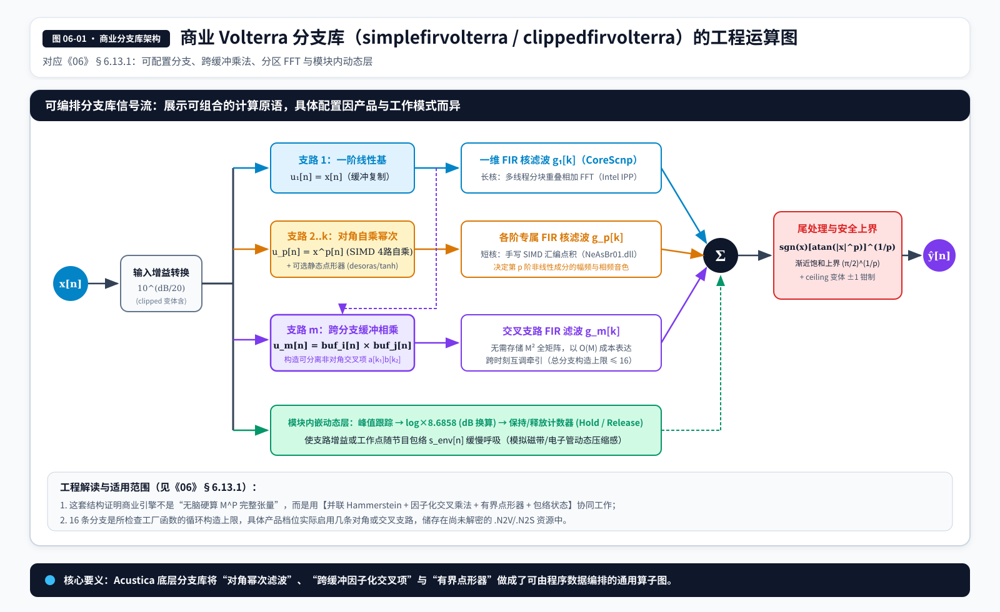

*图 06-01｜结构化非线性分支库的运算抽象：一维 FIR、幂次、跨支路乘法与状态权重能够在同一条实时计算图中组合。*

### 6.13.2 `simplenova`：软膝、双路径权重与控制状态连续性

假设两条音频路径分别输出 $`u[n],\;v[n]`$，由电平检测得到平滑权重 $`g[n]\in[0,1]`$。一种合理的双路径混合形式是：

$$
\hat{y}[n]=\bigl(1-g[n]\bigr)u[n]+g[n]v[n].
$$

在 `simplenova` 型控制中，可以先对输入能量做软膝映射，再用上升与下降速率不同的平滑器更新 $`g[n]`$；备选路径持续维护输入历史，有助于降低切换时的冷启动瞬态。这种结构说明，**模型融合需要同时兼顾各条路径的建模精度，以及路径之间的相位、延迟与状态连续性**。双路径混合原语描述的是控制与路由方式；具体产品的神经网络拓扑及实时执行路径，还需要运行数据确认。


*图 06-02｜电平触发的双路径软膝渐变、非对称平滑与备选路径状态更新。*

### 6.13.3 有界静态点形器与有限阶 Volterra 的互补作用

静态点形函数（Pointwise Waveshaper）为 Volterra 型分支提供了另一种非线性表达。以广义反正切族为例，令 $`p>0`$：

$$
f_p(x)=\operatorname{sgn}(x)\left[\arctan\left(\lvert x\rvert^p\right)\right]^{1/p}.
$$

其小信号近似为 $`f_p(x)\approx x`$，大信号渐近值为 $`\pm(\pi/2)^{1/p}`$。因此，有界非多项式点形器可以在较低复杂度下补足有限阶多项式在强过载区间缺乏全局饱和上界的问题。结合一维 FIR、分支乘积和电平条件权重，能够在同一套引擎中组合频率相关音色、强非线性与工作点变化，但仍须重视抗混叠与多路径延迟对齐。

### 6.13.4 YELLOW：Legacy、Nova 与 Nova HQ 的不同资源配置

YELLOW 将三种质量选项组织为不同的处理资源：**Legacy** 对应 HYPRE 型 Volterra 资源，**Nova** 对应 HYPRE_N 资源，**Nova HQ** 对应 HYPRE_NHQ 资源。Nova 系列另外配有专用 `NOVANAM.N2K` 数据容器（约 $`15.4\,\mathrm{MB}`$）。这说明 NOVA 家族至少包含独立命名的神经相关数据资源，也为“神经与向量化 Volterra 协同”的产品定位提供了一个具体的资源组织实例。

资源文件名和体积提供了资源组织的线索。目前可以确认：**YELLOW 具有纯 Volterra 与 NOVA 家族的不同程序资源。** 神经网络的精确拓扑、加载时机、融合位置和实时执行路径，则需要结合运行数据进一步辨识。这种多质量资源架构，也为单一品牌下按计算成本选择不同建模方案提供了设计参照。[S19]

### 6.13.5 SKY SA-1A：增益状态资源与音频短核的不同职责

SKY SA-1A 是面向 Stam/Summit SA-1A 光电压缩器的模型，采用了与上述 YELLOW 前级不同的数据编排。以 $`48\,\mathrm{kHz}`$ 的 HYPERCOMP 资源为例，可见到 **20 个 5 ms 短序列、41 个 100 ms 主序列以及 6 个 150 ms 长序列**，合计 67 个序列资源。尤其是 41 个主序列，大部分能量集中在约第 72 个采样延迟位置，频率响应近乎平坦，主要表现为不同工作点的增益变化；短序列则承担较弱的频率选择性修正。

因此，把这组资源理解成**测量增益工作点、平滑特征和微弱滤波整形的组合**，比一概把全部 67 个序列解释成高阶非线性音色 IR 更合适。一个面向教学的等效模型为：

$$
\hat y[n]=\sum_i w_i\bigl(\mathbf s_{\mathrm{env}}[n]\bigr)a_i x[n-d]
+\sum_m\mu_m\bigl(\mathbf s_{\mathrm{env}}[n]\bigr)(h_m*x)[n].
$$

这里 $`a_i`$ 是离散增益状态，$`h_m`$ 是短时整形 FIR，$`\mathbf s_{\mathrm{env}}[n]`$ 包含包络相关的控制状态；权重 $`w_i`$ 和 $`\mu_m`$ 是**解释性表示**，需要与已确认的产品内部插值公式区分。主序列中出现的多次回落和重新上升，可以提示存在分段组织的工作点轴，而具体光电元件状态变量的对应关系还需要额外的测量证据。

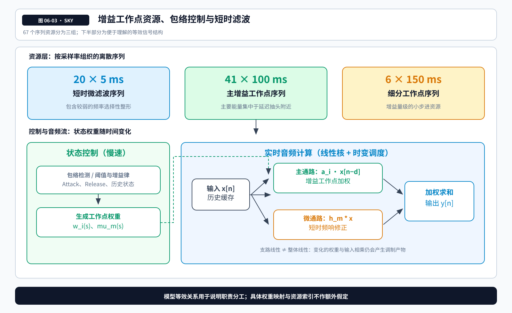

*图 06-03｜SKY 类状态条件化核模型的教学抽象。预制序列资源与实时控制状态分工不同，线性支路与非线性控制可以组合形成整体非线性处理。*

### 6.13.6 SNOW：离散程序选择与连续包络控制

SNOW 类压缩器展示了另一种有实际价值的分工：把可枚举的档位型控制配置为若干核程序，而将连续的阈值、起音、释放与动态增益控制留在实时检测回路中。例如 Mode 的三种检测方式可理解为前馈 RMS、反馈 RMS 与反馈峰值等拓扑选择，Ratio 关联另一组压缩/释放特性程序，两组离散选项构成最多 $`3\times3`$ 的组合维度；Attack、Release、Threshold 等连续参数则无须各自拥有无限密度的预制核库。

这里的关键结论是**结构离散化与动态参数连续化可以共存**。资源程序负责一个工作配置的频率与谐波特征，检测器、增益律和包络状态负责跨时间的实际增益动作。对测量密集型产品而言，这往往比为所有旋钮笛卡尔积组合都保存完整大规模资源更有实际可行性。不同 SNOW 程序的模式映射，应结合对应产品版本与程序配置分别解释。

### 6.13.7 SKY 的外部测量：复刻准确度与机理归因需要分开评价

在 2026 年 11 月 9 日的 SKY SA-1A Beta Vista 测量中，以 $`100\,\mathrm{Hz}`$、约 $`5\,\mathrm{dB}`$ 增益衰减为例，$`48\,\mathrm{kHz}`$ 下插件 THD 为 **5.46%**，目标硬件参考为 **5.59%**；当采样率提高到 $`96\,\mathrm{kHz}`$，插件结果为 **4.96%**。在 $`1\,\mathrm{kHz}`$、FIXED 模式的另一组条件下，插件 THD 约 **1.01%**，硬件参考约 **0.92%**。MANUAL 模式的 $`1\,\mathrm{kHz}`$ THD 约 **0.470%**，并可观察到 $`500\,\mathrm{Hz}`$ 与 $`1500\,\mathrm{Hz}`$ 附近的亚谐波谱线（约 $`-61.4`$ 与 $`-60.5\,\mathrm{dBc}`$）。[S31]

这些数值说明在给定测试条件下，模型的谐波响应可以接近目标硬件；具体失真机制还需通过冻结控制状态、分离支路等对照测试辨识。更能说明动态问题的，是相同旋钮 75/75 在不同前导输入下出现约 **163 ms** 与 **327 ms** 的释放 $`T_{63}`$ 差异；这说明系统辨识应覆盖不同输入历史，并结合稳态与瞬态激励。测试时应同时记录输入电平、GR、阈值、采样率、FFT 窗口、控制模式和状态预处理，才能把结果正确用于模型判别。[S31]

### 6.13.8 前级、EQ、磁带与压缩器：让每个子系统承担合适的任务

不同模块对核、状态和参数控制的要求差异很大。前级常围绕短时谐波、互调与幅相关频响构建多工作点非线性分支；EQ 的主要任务是重建线性频响及随控制旋钮变化的滤波参数，在电平依赖显著时还可能与非线性或工作点状态共同作用；磁带除了饱和染色，还可能需要明确表示磁滞、走带抖晃、变速重采样与慢速动态；压缩器则必须把检测器、增益律、程序依赖起音/释放和音频路径增益动作作为核心系统。

FIR、Waveshaper、包络、重采样与路由等计算原语可以在统一的 DSP 平台中复用，并组合成面向不同设备的 Volterra 与状态混合结构。尤其对于压缩器，**明确保存和更新动态状态通常比无限延长前馈记忆核更经济**；在符合相关连续性和衰减记忆条件的数学讨论中，Volterra 的逼近能力仍然存在，与工程选择并不矛盾。

## 6.14 同一计算平台上的不同产品：YELLOW、SKY 与 TAUPE Studio

YELLOW、SKY SA-1A 与 TAUPE Studio 可以用于解释“公共运算引擎”和“具体音频模型”之间的差别。前者提供分区卷积、静态非线性、动态状态、参数映射及跨路径混合等可复用原语；后者由产品专属的核资源、控制程序与信号路由决定其声音功能。YELLOW 具有 Legacy / Nova / Nova HQ 的分级资源组合，SKY 更突出光电包络驱动的增益工作点资源，TAUPE Studio 则还需要走带速度与 Wow & Flutter 对应的变速/分数延迟处理。通过在同一平台中替换数据、状态模型与处理链，能够实现差异很大的音频设备建模目标。

因此，分析一款商业模型时，可以沿着以下四个层次展开：**音频主通路、状态控制通路、核资源组织与实时执行预算**。这也与《03》第 3.8–3.9 节的混合架构划分保持一致。

## 6.15 Acustica Audio 商业建模路线演进时间线（2000–2026）

| 时间节点 | 可核实的里程碑事件 | 对非线性音频建模技术史的意义 |
|---|---|---|
| **2000 年** | Angelo Farina 发表指数正弦扫频（ESS）论文 [S3] | 实现单次测量在时间轴上同时分离线性脉冲响应与各次谐波脉冲响应 |
| **2004 年** | Focusrite 与 Sintefex 合作推出 Liquid Channel [S1][S2] | 确立 Nebula 之前的商业动态卷积（Dynamic Convolution）与多电平硬件采样先河 |
| **2005 年中–2006 年** | Giancarlo Del Sordo 开发 Nebula 原型，相继实现 EQ、压缩、失真与 Flanger [S5] | 在规避 Sintefex 专利的同时，将 Farina 扫频与对角 Volterra 核重放转化为通用插件平台 |
| **2005–2008 年** | Armelloni & Farina (2005) 及 Farina (2008) 讲座记录当时 Nebula 采用最高 5 阶核 [S28][S29] | 提供早期商业对角 Volterra 实现的确切阶数上限与强失真边界证据 |
| **2010 年** | Antonín Novák 等发表同步扫频（SSS）与广义 Hammerstein 反解理论 [S4] | 严格建立高次谐波脉冲响应（HHIR）向上三角并联 Hammerstein 支路核 $`g_p[k]`$ 的解析转换 |
| **2014 年** | 《Sound On Sound》刊登 NAT 采样实操长文 [S9] | 公开多电平采样步距配置、谐波核截断及“采样染色 + 独立压缩算法”混合思路 |
| **2010 年代中后期** | Acqua 独立插件线成熟，引入 Smooth3 逐样本核插值 [S7][S8] | 解决多离散工作点在旋钮调节与动态调制下的平滑过渡与伪影抑制 |
| **2019 年** | 引入 AI 自适应预设辅助系统 [S12] | 机器学习首先在控制参数推荐层落地，未改动底层音频卷积核 |
| **2022 年–2024 年** | 推出 Hyper / Hyper2 / Hyper3、Aria 与 MUST 架构 [S13–S18] | 引入多探测器显式动态控制、FIR（前段瞬态）+ IIR（长尾低频）混合滤波、抗混叠升级与电路—卷积混合乐器合成 |
| **2026 年 3 月–11 月** | 发布 YELLOW、FIRE THE TUBE、AERO 2、SALT 2、CREAM 3、GOLD 6 及 SKY SA-1A，全面推广 NOVA 技术 [S19–S30][C1] | Volterra 与神经建模协同成为可选产品路线，并逐渐形成多质量资源、结构化核、包络状态和动态滤波的组合方案 |

## 6.16 ESS 阶次分离与多路径架构如何共同塑造商业前级的失真个性？

结合《01》第 1.9.1 节的并联 Hammerstein 上三角反解方程与本章的架构分析，我们可以完整回答音频工程师最关心的问题：为什么商业采样前级（如英式变压器前级、美式运放前级与电子管前级）能够呈现出鲜明且各异的“频率相关失真个性”？

1. **各阶支路 FIR 核 $`g_p[k]`$ 对谐波幅相轮廓的独立雕刻**：经过上三角回代反解剥离高阶回流后，每一阶支路滤波器 $`G_p(f)`$ 独立记录了该阶非线性产物随频率变化的幅度与群延迟。例如，输入/输出变压器在低频（$`50\sim 200\,\mathrm{Hz}`$）接近磁芯饱和时，会使 $`G_2(f), G_3(f)`$ 在低频段显著抬升并伴随相位旋转；而放大级局部负反馈与高频摆率效应则体现在高阶支路的中高频幅相特征上。前级的“音色指纹”首先就编码在这些各阶异构的 $`G_p(f)`$ 滤波器形状中。
2. **多电平向量采样与 `simplenova` 渐变对工作点迁移的动态补偿**：单次固定电平的 ESS 只能测得前后置滤波的综合乘积 $`\lvert P(f)\rvert^p \lvert Q(pf)\rvert`$。NAT 的多驱动电平采样与 NOVA 的 `simplenova` 能量触发双路径渐变，通过随输入能量平滑切换/融和低驱动与高驱动支路核簇，在工程上动态逼近了硬件频响与饱和膝点随输入电平迁移的行为。
3. **跨分支缓冲乘法与有界点形器对多音互调及强过载的补全**：纯对角支路缺乏跨时刻乘积且受多项式收敛半径限制。引擎中引入的**跨缓冲乘法原语**（构造 $`u[n]\cdot v[n]`$ 因子化非对角交叉项）与 **`desoras` 等有界点形器**，恰好在低 CPU 开销下弥补了纯对角 Volterra 在多音差频互调与大信号软限幅边界上的短板。

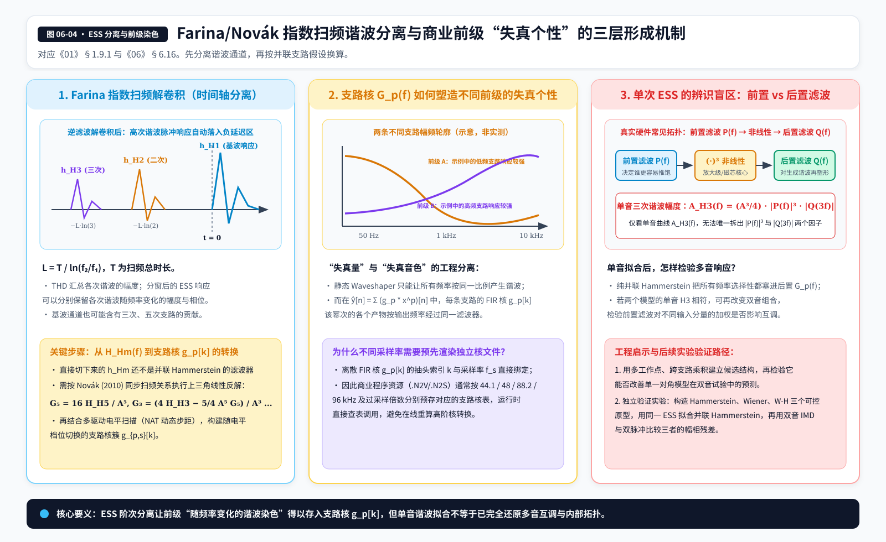

*图 06-04 | Farina 指数扫频 (ESS) 谐波分离、Novák 上三角阶次反解与前级染色机制。展示负时间轴谐波脉冲响应 $`H_{Hm}`$ 如何经阶次反变换映射为支路核 $`g_p[k]`$，以及单次 ESS 在前后置滤波 $`\lvert P(f)\rvert^3 \lvert Q(3f)\rvert`$ 拆分上的可辨识性边界。*

## 6.17 从商业案例回到系统辨识：模型选择的统一判断

回顾本章的 Nebula、NAT、Hyper、NOVA，以及 SKY、YELLOW、SNOW 等不同产品，我们可以将现代数字建模归纳为四个可以独立设计的层级：

| 层级 | 需要解决的技术问题 | 可能采用的实现 |
| --- | --- | --- |
| **响应表达** | 怎样描述输入信号的短时频响、谐波与互调？ | FIR / IIR、结构化 Volterra、静态 Waveshaper、分支乘积 |
| **动态记忆** | 怎样描述起音、释放、磁滞、热状态及工作点迁移？ | 包络检测器、显式状态方程、状态资源表、递归神经网络 |
| **参数变化** | 旋钮如何连续影响频响、工作点和内部动力学？ | 程序切换、工作点插值、物理参数更新、超网络生成权重 |
| **实时部署** | 怎样控制延迟、CPU、内存、抗混叠和状态连续性？ | 分区 FFT、SIMD、过采样、多速率、模型分档与代理约简 |

这些层级提供了一套具体的研究顺序：先辨认资源与处理通路，再测量不同控制状态和输入历史下的行为，最后结合实时运行证据解释模型的分工。神经数据容器、FIR 型序列和单次 THD 测量各自提供不同侧面的信息，需要放在同一套实验框架中考察。显式状态控制还可以降低前馈记忆成本，与 Volterra 在相应函数类中的理论逼近价值相互补充。

对研究者来说，更有实际价值的提问顺序是：**先测量目标系统的可观测行为，再选择表示短时非线性与长时动态的不同结构，最后用跨工作点验证判断增加的模型复杂性是否真的值得。** 这样才能把商业产品的技术经验转化为可检验、可比较、可迁移的系统辨识方法。

---

## 本章参考资料与进一步阅读

- **[S1] Focusrite, *Our Story*.** 包含 2004 年 Liquid Channel 与 Sintefex 合作的官方回顾。https://us.focusrite.com/about-us
- **[S2] Sintefex Audio, 官方网站技术与专利介绍。** 说明 Dynamic Convolution、FX8000 与 Focusrite 产品之间的关系，以及美国专利 7,039,194、7,095,860。https://www.sintefex.com/?src=home&targ=consult
- **[S3] Angelo Farina, 2000, *Simultaneous Measurement of Impulse Response and Distortion with a Swept-Sine Technique*.** AES 第 108 届大会论文 5093。https://aes.org/publications/elibrary-page/?id=10211
- **[S4] Antonín Novák, *Synchronized Swept Sine*.** 包含同步扫频的测量解释、HHIR/HHFR 与广义 Hammerstein/对角 Volterra 的联系。https://ant-novak.com/pages/sss/
- **[S5] Xavier Blanco, 2007, *Acustica Audio: sonido de otra galaxia*.** Hispasonic 对 Giancarlo Del Sordo 的同期专访。https://www.hispasonic.com/reportajes/acustica-audio-sonido-otra-galaxia/2101
- **[S6] Martin Walker (Sound On Sound), 2007, *PC Notes: PCI Soundcard Compatibility Issues* (*Nebula 2 Free* 专题).** 记载 Nebula 2 Free 采用 Diagonal Volterra Kernels 与向量控制。https://www.soundonsound.com/techniques/pci-soundcard-compatibility-issues
- **[S7] Acustica Audio, *Getting started with Nebula*, 2023 年更新。** 介绍 N4、NAT 库、Acqua Libraries 和 Universal Acqua Engine。https://acusticaaudio.freshdesk.com/support/solutions/articles/35000155485-getting-started-with-nebula
- **[S8] Acustica Audio, *The Engine* 与 *V.V.K. Technology*.** 官方对核数据、Smooth3 插值和引擎能力的说明。https://tech.acustica-audio.com/ ；https://tech.acustica-audio.com/vvkt-technology/
- **[S9] Tim Wisecup, 2014, *Sample Your Gear With Acustica Audio Nebula*.** Sound On Sound 的 NAT 采样工作流文章。https://www.soundonsound.com/techniques/sample-your-gear-acustica-audio-nebula
- **[S10] Acustica Audio, *For Business*.** 关于 NAT 4 和第三方开发者采样工具的介绍。https://www.acustica-audio.com/pages/for-business
- **[S11] Acustica Audio, *N4 and N4 Player features comparison chart*, 2025 年更新。** https://acusticaaudio.freshdesk.com/support/solutions/articles/35000093939-n4-and-n4-player-features-comparison-chart
- **[S12] Acustica Audio, *Artificial Intelligence*.** 2019 年引入 AI 预设相关技术的厂商回顾。https://tech.acustica-audio.com/artificial-intelligence/
- **[S13] Acustica Audio, *Hyper Technology*.** 2022 年引入 Hyper、之后发展 Hyper2 的官方介绍。https://tech.acustica-audio.com/hyper-technology/
- **[S14] Acustica Audio, *Tiger*.** 公开描述多段 attack / release、压缩曲线采样和多个 detector 等动态机制。https://www.acustica-audio.com/shop/products/TIGER
- **[S15] Acustica Audio, *SALT*.** 包含 Hyper3 的 FIR/IIR 混合响应技术介绍。https://www.acustica-audio.com/shop/products/SALT
- **[S16] Acustica Audio, *Sand 4 Ultra*.** 包含 Hyper3、Aria、抗混叠与 FIR/IIR 分工说明。https://www.acustica-audio.com/shop/products/SAND
- **[S17] Acustica Audio, *Tiger Mix Ultra Flat*.** 包含 Hyper3、Aria 与抗混叠技术说明。https://www.acustica-audio.com/shop/products/TIGERULTRA
- **[S18] Acustica Audio, *THING*.** 官方关于 MUST 将电路行为建模与卷积式技术结合的介绍。https://www.acustica-audio.com/shop/products/THING
- **[S19] Acustica Audio, *YELLOW*.** NOVA (Neural Optimized Volterra Audio) 的官方定义与技术说明。https://www.acustica-audio.com/shop/products/YELLOW
- **[S20] Acustica Audio, *Your exclusive NOVA Upgrade is ready*.** https://www.acustica-audio.com/pages/and
- **[S21] Acustica Audio, *FIRE THE TUBE*.** 关于 NOVA 两部分同时工作及电平相关表现的官方说明。https://www.acustica-audio.com/shop/products/FIRETHETUBE
- **[S22] Acustica Audio, *SALT 2*.** 介绍 NOVA 与 Hyper 在同一产品中的协同分工。https://www.acustica-audio.com/shop/products/SALT2
- **[S23] The Beat Community, 2026-03-13, *Acustica Audio Release Yellow*.** https://thebeatcommunity.com/2026/03/13/acustica-audio-release-yellow/
- **[S24] Acustica Audio, *AERO 2*.** 说明 NOVA Instrument 面向多级乐器放大链的设计定位。https://www.acustica-audio.com/shop/products/AERO2
- **[S25] Acustica Audio, *CREAM 3*.** NOVA 前级与 NOVA GPU (Beta) 官方说明。https://www.acustica-audio.com/shop/products/CREAM3
- **[S26] Sound On Sound, 2026-05-20, *Aero 2 from Acustica Audio*.** https://www.soundonsound.com/news/aero-2-acustica-audio
- **[S27] Acustica Audio, *YELLOW — Tube Compressor with NOVA Preamp*.** https://www.acustica-audio.com/shop/products/YELLOW
- **[S28] Armelloni, E. & Farina, A., 2005, *Emulation of Not-linear, Time-variant Devices by the Convolution Technique*.** https://angelofarina.it/Public/papers/211-AesItalia2005.pdf
- **[S29] Angelo Farina, 2008, *Impulse Response Measurements by Exponential Sine Sweeps*, 公开讲座（第 75–80 页）.** https://www.angelofarina.it/Public/Presentations/audioprecision-workshop.pdf
- **[S30] Acustica Audio, *GOLD 6*, 产品官方说明。** https://www.acustica-audio.com/shop/products/gold6

- **[S31]** Acustica Audio, *SKY SA-1A Beta (9 November update) — Vista measurement analysis*, 2026-11-09，16 页：给出 100 Hz / 1 kHz THD、谐波与亚谐波、程序依赖释放、侧链 HPF 和不同采样率下的对照测量。

---
